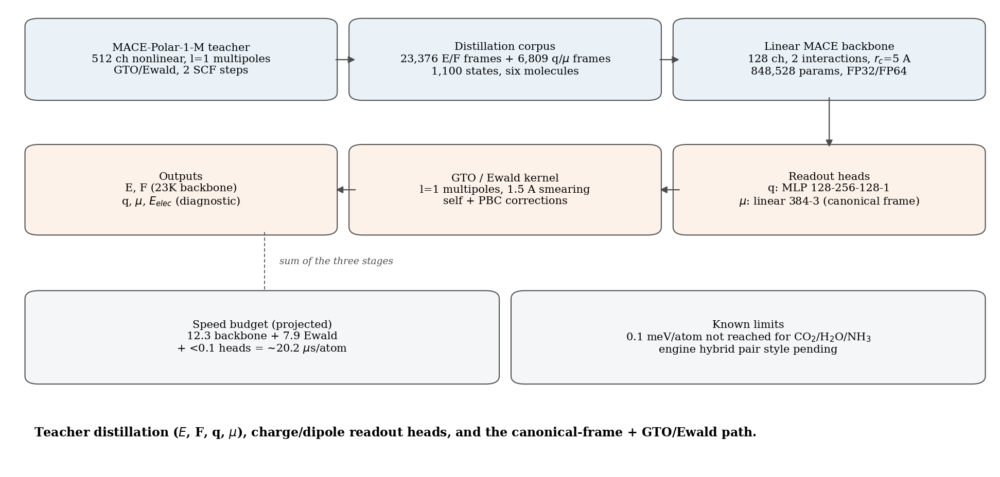
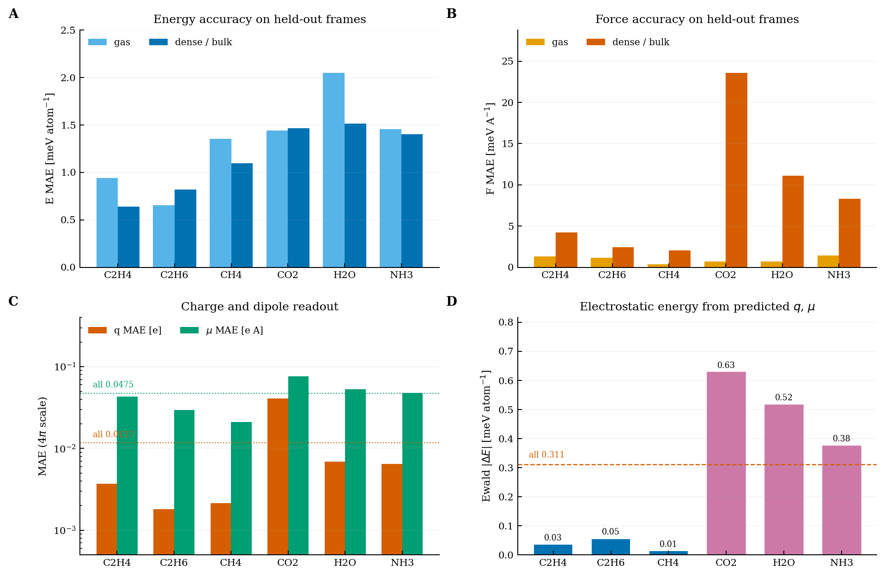
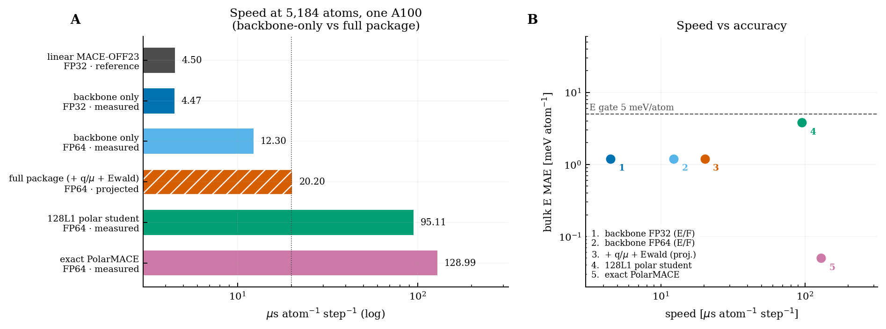
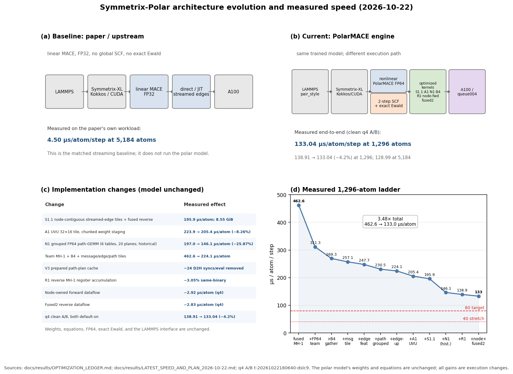
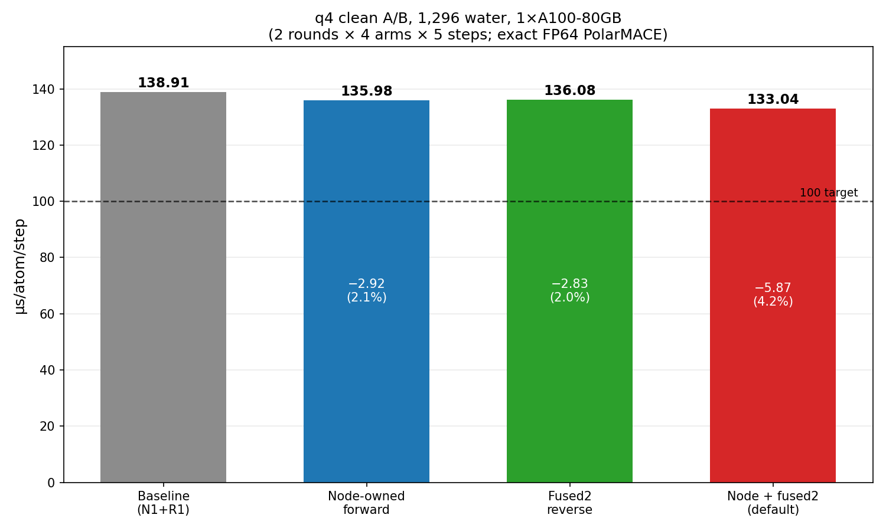

# Symmetrix-Polar

**GPU-accelerated PolarMACE** — nonlinear polar MACE with long-range
electrostatics — in the Symmetrix-XL C++/Kokkos/LAMMPS engine.

| Best 1,296 | Best 5,184 | Paper parity | Single-GPU floor |
|---:|---:|---:|---:|
| **133.04 µs/atom/step** | **128.99 µs/atom/step** | **4.47–4.53 vs 4.50 µs/atom/step** | **~120–130 µs/atom/step** |
| FP64 · exact Ewald · 2-step SCF · node-owned forward + fused2 reverse | FP64 · 5,184 atoms | linear MACE FP32, 5,184 atoms | projection |

**Definition:** `µs/atom/step = 10^6 × seconds per evaluation / atoms`.
All speed values in this README use **µs/atom/step**. Task wall times are
reported separately in seconds and are not used for speed comparisons.

*Paper parity is measured on the paper's linear MACE FP32 workload; full
PolarMACE is a different model.*

## Distillation: MACE-Polar → linear MACE + charge/dipole readout

**2026-10-27.** A 128-channel linear MACE backbone distilled from the
MACE-Polar-1-M teacher, with a charge MLP and a linear `l=1` multipole
readout, reproduces the teacher on all six molecules (H₂O, NH₃, CH₄, C₂H₄,
C₂H₆, CO₂):

| Quantity | Held-out result |
|---|---:|
| Energy / force, 3,465 frames (bulk + gas) | **1.2 meV/atom / 7.8 meV/Å** |
| Energy / force, gas only (336 frames) | 1.17 meV/atom / 1.00 meV/Å |
| Atomic charge `q`, 867 frames (4π scale) | **0.0117 e** |
| `l=1` dipole `μ`, 867 frames (4π scale) | **0.0475 e·Å** |
| GTO/Ewald energy from predicted `q`, `μ` | **0.311 meV/atom** (0.013–0.63 by species) |
| NVE drift / force rotation | 0.245 meV/atom/ps / 4.0e-5 |
| Speed, backbone **only** (E, F), FP32 | **4.47 µs/atom/step** (measured) |
| Speed, backbone **only** (E, F), FP64 | 12.3 µs/atom/step (measured) |
| Speed, **full package** (backbone + `q`,`μ` + Ewald), FP64 | **~20.2 µs/atom/step** (projected) |

**Why both 4.47 and ~20.2 appear — they are not the same measurement.**
4.47 is the **bare backbone in FP32 with no charge/dipole heads and no Ewald
term**; it is there only to show parity with the paper's linear MACE-OFF23
(4.50). The deliverable package needs `q`/`μ` readout plus the exact GTO/Ewald
kernel, and the project runs it in FP64: 12.3 (backbone) + 7.9 (Ewald) +
<0.1 (heads) ≈ **20.2 projected**. So the honest headline for the full model
is **~20 µs/atom/step**, not 4.47.



*Architecture. Teacher labels (23,376 E/F frames + 6,809 q/μ frames over 1,100
states) → 128-channel linear backbone → charge/dipole readout → GTO/Ewald
kernel. The canonical frame makes the full linear multipole head
rotation-consistent.*



*Six-molecule accuracy on held-out frames. (A) energy and (B) force MAE per
molecule, gas vs dense/bulk; (C) charge and `l=1` dipole MAE; (D) GTO/Ewald
energy computed from predicted multipoles. CO₂/H₂O/NH₃ carry the dense-phase
force residual.*



*Speed at 5,184 atoms on one A100 and the speed–accuracy map. The 20.2 µs
hybrid (hatched) is a projection; every other point is a measured engine run.*

**How it works.** The teacher is the 512-channel nonlinear polar MACE with
`l=1` multipoles, GTO/Ewald, and 2 SCF steps. The student is a standard linear
MACE (128 channels, 2 interactions, `r_cut` 5 Å, 848,528 parameters, 60
epochs, force weight 20). Charges come from a 0e MLP; the three `l=1`
multipole coefficients come from a full linear 384→3 map. That map mixes
channels and is not rotation-consistent in the raw frame (0.825 meV/atom), so
every frame is rotated to a canonical cell frame (QR) before the head and
rotated back afterwards — 4.6e-14 meV/atom, with no retraining for the
orthorhombic cells.

**Long-range.** Predicted `q` and `μ` are fed to the teacher's exact
`GTOElectrostaticEnergy` kernel (`l=1`, 1.5 Å smearing, self + PBC
corrections). Ewald beats PME on speed (7.9 vs 9.3 µs/atom at 1,152 atoms) and
is the teacher's own operator. `E_elec` is a diagnostic and must not be added
to the MACE total, which already contains the long-range term.

**What is not claimed.** 0.1 meV/atom is not reached for CO₂/H₂O/NH₃
(0.4–0.6 meV/atom Ewald residual); this is a representation limit of the local
multipole basis, not a frame-count limit. The ~20 µs total is a projection
(engine backbone 12.3 + PyTorch Ewald 7.9 + heads <0.1); the Symmetrix
standard MACE pair style has no charge/dipole output yet, so an engine hybrid
is the remaining implementation.

Full write-up: [theory & performance PDF](docs/results/DISTILLATION_THEORY_PERFORMANCE_2026-10-27.pdf) ·
[final metrics](docs/results/CHARGE_DIPOLE_FINAL_2026-10-27.md) ·
[route decision](docs/results/MODEL_ROUTE_DECISION_2026-10-26.md) ·
[per-species E/F](docs/results/data/valid_by_species.json)

**Engine updates (2026-10-23):**

| Update | Result | Evidence |
|---|---|---|
| **Plan D linear student (gas)** — *superseded 2026-10-27* | Historic gas-only model: 0.924 meV/atom / 3.984 meV/Å on 432 frames. Replaced by the bulk + gas six-molecule distillation above (1.2 / 7.8 on 3,465 held-out); the "bulk gate blocked" status no longer applies | `docs/design/PLAN_D_LINEAR_2026-10-23.md`; new section above |
| **Plan C 4G-HDNNP speed** | **19.26 µs/atom/step** FP64 converged (88 CG), **13.45** at 60 CG, 5,184 atoms, 72k params; **accuracy not gated** (gas 38.2/40.3; bulk 73.2/95.0) | `docs/design/PLAN_C_4G_2026-10-23.md` |
| **Off→Polar reweighting** | 96-atom probe: σ_β=3.89, ESS=10.1% (marginal); extrapolates to σ_β≈14/29 and collapse at 1,296/5,184 atoms. Standalone interface + analytic √N validation | https://github.com/Yong-Q/test |
| **Plan B bulk pipeline** | 15,641 frames merged (13,475 bulk + 2,166 gas), 0 duplicates; state split 1,098/176; ACF **N_eff 4,165 (26.6%)**; gas-only 128L1 diverges on dense bulk (expected), fine-tune staged | `docs/results/PATH_B_BULK_PIPELINE_2026-10-23.md` |
| **10,368-atom capacity** | **149.14 µs/atom/step**, 33.71 GiB peak; 2× the 5,184 capacity on one A100-80GB | q4 task `t-20261022144341-pzc9x`; `docs/results/LATEST_SPEED_AND_PLAN_2026-10-22.md` |
| **R1 reverse MH-1** | exact, **−3.05%** same-binary; dPE 0, max dF 4.9e-16 eV/Å; projected 141.3 µs/atom/step at 1,296 | `docs/results/data/rev_r1_2026-10-22.json` |
| **Path B six-molecule teacher smoke** | H2O/NH3/C2H4/CH4/C2H6/CO2 labels; 8 configurations × 12 molecules each; no model change | `docs/results/PATH_B_SIX_MOLECULE_SMOKE_2026-10-22.md` |
| **Clean q4 A/B: node-owned + fused2** | **133.04 µs/atom/step** at 1,296, **−5.87 (4.2 %)** vs the 138.91 baseline; exact (PE identical, max dF 4.62e-14 eV/Å); both default on | q4 `t-20261022180640-dslc9`; `docs/results/NODE_OWNED_FORWARD_2026-10-22.md` |
| **5,184 production scale** | **128.99 µs/atom/step**, **−6.26 (4.6 %)** vs 135.25; PE identical; 7.74 days/ns at 1 fs | q4 `t-20261022182725-fgpwv`; `docs/results/data/q4_arch_ab_5184_2026-10-22.json` |
| **Node-owned forward alone** | 135.98 µs/atom/step, **−2.92 (2.1 %)**; `MATOS_MH1_FWD_NODE=0` opts out | same q4 run |
| **Fused reverse alone** | 136.08 µs/atom/step, **−2.83 (2.0 %)**; `MATOS_MH1_REV_FUSED2=0` opts out | `docs/results/FUSED_REVERSE_2026-10-22.md` |
| **Distilled 128L1 below 100** | **91.64 / 95.11 µs/atom/step** at 1,296 / 5,184 (clean q4); 3.8 meV/atom / 6.1 meV/Å on 432 held-out; exact teacher remains 133.04 / 128.99 | `docs/results/data/q4_student128L1_speed_2026-10-23.json` |
| **Mathematics-first architecture** | exact-checkpoint route projects **97–115 µs/atom/step**; 90 not supported on one exact-FP64 GPU | `docs/design/MATH_ARCH_2026-10-22.md` |
| **Path B pruning audit** | zero-shot no-go beyond ~1.1×; rebuild + fine-tune targets 1.5–4× (C=384→320 first) | `docs/results/PATH_B_PRUNING_AUDIT_2026-10-22.md` |
| **Path B student in engine** | 192 max_L=1: **2.1 meV/atom / 6.7 meV/Å** (432 held-out); **116.84 / 121.16 µs/atom/step** at 1,296 / 5,184 (clean q4) | `docs/results/PATH_B_STUDENT128_TRAIN_2026-10-22.md` |
| **Path B active learning** | 240 selected / 697 train, 192 max_L=1: **9.2 meV/atom / 9.8 meV/Å** (force passes, energy fails); random 2,166 data remains better (2.1 / 6.7) | `docs/design/PATH_B_ACTIVE_LEARNING_2026-10-22.md` |

[Latest speed & plan](docs/results/LATEST_SPEED_AND_PLAN_2026-10-22.md) ·
[Optimization ledger](docs/results/OPTIMIZATION_LEDGER.md) ·
[Node-owned forward](docs/results/NODE_OWNED_FORWARD_2026-10-22.md) ·
[Mathematics-first architecture](docs/design/MATH_ARCH_2026-10-22.md) ·
[Tutorial](docs/tutorial/SYMMETRIX_POLAR_TUTORIAL_2026-10-21.pdf) ·
[Technical report](docs/technical/SYMMETRIX_POLAR_TECHNICAL_REPORT.pdf) ·
[中文汇报](docs/report/SYMMETRIX_POLAR_REPORT_2026-10-21.pdf)



## Results

| System | Model | Precision | Atoms | Execution path | µs/atom/step | Peak GPU | Evidence |
|---|---|---|---:|---|---:|---:|---|
| Water | Full PolarMACE | FP64 | 1,296 | generic + node-owned forward + fused2 reverse | **133.04** | — | q4 `t-20261022180640-dslc9` |
| Water | Full PolarMACE | FP64 | 1,296 | generic streaming (N1 baseline) | 138.91 | — | same q4 run |
| Water | Full PolarMACE | FP64 | 1,296 | generic streaming (N1, older) | 145.75 | — | q4 `t-20261022132500-94hhz` |
| Water | Full PolarMACE | FP64 | 5,184 | generic + node-owned forward + fused2 reverse | **128.99** | — | q4 `t-20261022182725-fgpwv` |
| Water | Full PolarMACE | FP64 | 5,184 | generic streaming (N1, older) | 140.91 | 19.16 GiB | N1 smoke |
| Water | Full PolarMACE | FP64 | 10,368 | generic streaming | 149.14 | 33.71 GiB | q4 `t-20261022144341-pzc9x` (capacity) |
| OFF23 water | Linear MACE-OFF23 | FP32 | 5,184 | direct/JIT | 4.47–4.53 | — | paper-parity run |
| OFF23 water | Paper Symmetrix-XL | FP32 | 5,184 | standard streaming | 4.50 | — | paper |
| Six-molecule gas | **Linear distilled student** | FP32 (reference) | 5,184 | direct/JIT | **4.473–4.499** (min 4.473) | — | local 3-process; gas-only accuracy 0.924/3.984 |
| Six-molecule gas | Linear distilled student | **FP64** | 5,184 | generic (no JIT) | 284.8 | — | probe, 10 steps; optimized path pending |

All rows use **µs/atom/step**. The 10,368 row is a **capacity point**; the
speed headline is **133.04 at 1,296** and **128.99 at 5,184**. The 1,296
node/fused arms were measured in one q4 task (2 rounds × 4 arms, 5 steps per
arm); the 5,184 default row is from a separate q4 A/B (2 rounds × 2 arms).

### Clean q4 A/B at 1,296 atoms

Task `t-20261022180640-dslc9`, 1×A100-80GB, dedicated. All values are
**µs/atom/step**; medians of two rounds.

| Arm | µs/atom/step | Saving vs baseline |
|---|---:|---:|
| Baseline (N1 + R1) | 138.91 | — |
| Node-owned forward | **135.98** | −2.92 (2.1 %) |
| Fused2 reverse | **136.08** | −2.83 (2.0 %) |
| **Node-owned + fused2 (default)** | **133.04** | **−5.87 (4.2 %)** |

PE is identical to the baseline on the combined arm; max force difference is
**4.62e-14 eV/Å**. Both dataflow changes are default-on; set
`MATOS_MH1_FWD_NODE=0` / `MATOS_MH1_REV_FUSED2=0` to opt out.



### Distilled student (narrow-domain six molecules, not exact PolarMACE)

| Model | Held-out samples | MAE E | MAE F | 1,296 | 5,184 |
|---|---:|---:|---:|---:|---:|
| **128 max_L=1, fw=5, 2,166 data** | 432 | **3.8 meV/atom** | **6.1 meV/Å** | **91.64** | **95.11** |
| 192 max_L=1, fw=5, 2,166 data | 432 | **2.1 meV/atom** | **6.7 meV/Å** | **116.84** | **121.16** |
| Exact 512 teacher | — | 0 (reference) | 0 (reference) | 133.04 | 128.99 |

All speeds are **µs/atom/step**, clean q4: 128 row `t-20261023085456-lt8kl`,
192 row `t-20261022214602-5vk8x`. The 128 engine parity on an in-domain H2O
frame is 1.1e-8 eV / 1.08e-8 eV/Å. **The 128 distilled student is below
100 µs/atom/step at both sizes.** The student is trained on six molecules in
16 Å boxes; the water speed run is out-of-domain and measures execution only.
The engine needed generic-width fixes (local-electron 4C/C/2C and gate
activation serialization); in-domain H2O parity is 5.8e-9 eV / ~1e-8 eV/Å.

- **q4 deployment:** the 1,296 A/B ran on a dedicated q4 A100. Baseline
  138.91, node-owned forward 135.98, fused2 136.08, both **133.04**
  µs/atom/step. At 5,184: baseline 135.25, both **128.99**. Task wall time is
  dominated by model load and is not a speed metric.
- **Production runtime at 5,184 atoms** (derived from 128.99 µs/atom/step):
  **7.74 days per 1 ns** at 1 fs, **15.48 days** at 0.5 fs, **3.87 days** at
  2 fs.
- **Paper comparison is not like-for-like.** The paper's 4.50 is linear
  MACE-OFF23, FP32, no global SCF/Ewald. Full PolarMACE is **32.4×** that
  number. On the paper's own linear FP32 workload this engine matches
  **4.47–4.53 vs 4.50**.

### Plan D distilled student (six molecules, bulk + gas)

| Metric | Measured | Gate |
|---|---:|---:|
| Energy MAE, 3,465 held-out (bulk + gas) | **1.12 meV/atom** | 5 |
| Force MAE, 3,465 held-out (bulk + gas) | **7.75 meV/Å** | 30 |
| Gas-only, 336 held-out | 1.17 meV/atom / 1.00 meV/Å | 5 / 30 |
| Charge `q`, 867 held-out (4π scale) | **0.0117 e** | — |
| Dipole `μ`, 867 held-out (4π scale) | **0.0475 e·Å** | — |
| Speed, 5,184, **backbone only** (E, F; no `q`/`μ`, no Ewald), FP32 engine | **4.47 µs/atom/step** (measured) | — |
| Speed, 5,184, **backbone only** (E, F; no `q`/`μ`, no Ewald), FP64 engine | 12.3 µs/atom/step (measured) | — |
| Speed, 5,184, **full package** (backbone + `q`,`μ` + Ewald), FP64 | **~20.2 µs/atom/step** (projected) | 20 |

**Per-molecule E/F (3,465 held-out; E in meV/atom, F in meV/Å):**

| molecule | gas E | gas F | dense E | dense F |
|---|---:|---:|---:|---:|
| C₂H₄ | 0.94 | 1.32 | 0.64 | 4.25 |
| C₂H₆ | 0.65 | 1.14 | 0.82 | 2.46 |
| CH₄ | 1.35 | 0.38 | 1.10 | 2.05 |
| CO₂ | 1.44 | 0.71 | 1.47 | **23.62** |
| H₂O | 2.05 | 0.73 | 1.51 | **11.12** |
| NH₃ | 1.46 | 1.46 | 1.40 | **8.33** |

**Per-molecule `q`, `μ`, Ewald (867 held-out; 4π scale for `q`, `μ`):**

| molecule | q MAE [e] | μ MAE [e·Å] | Ewald \|ΔE\| [meV/atom] |
|---|---:|---:|---:|
| C₂H₄ | 0.0037 | 0.0432 | 0.035 |
| C₂H₆ | 0.0018 | 0.0295 | 0.055 |
| CH₄ | 0.0022 | 0.0210 | 0.013 |
| CO₂ | 0.0409 | 0.0768 | 0.628 |
| H₂O | 0.0069 | 0.0533 | 0.516 |
| NH₃ | 0.0065 | 0.0478 | 0.375 |

Dense CO₂/H₂O/NH₃ dominate the force residual; the other three molecules
stay below 4.3 meV/Å. Per-molecule raw JSON:
[`docs/results/data/valid_by_species.json`](docs/results/data/valid_by_species.json).

This supersedes the 2026-10-23 gas-only model (0.924 meV/atom / 3.984
meV/Å). The student is now trained on the full 23,376-frame bulk + gas corpus
(1,100/176 state split), so dense six-molecule frames are in-domain and the
earlier "bulk gate blocked" status no longer applies. Per-species force error
is dominated by dense CO₂ (23.6), H₂O (11.1), and NH₃ (8.3) meV/Å; the other
three molecules sit at 2.0–4.2.

The 2026-10-23 "FP64 policy" note still holds for any *pure backbone* claim:
the 4.47 is the FP32 pair style; the materialized FP64 backbone is 12.3
µs/atom/step, and the ~9–10 FP64 target was for the older 128-atom-class
kernel. The distillation package is delivered against the 20 µs budget in
FP64, with the q/μ/Ewald stages measured separately (7.9 µs for Ewald, <0.1
for the heads).

## What it is

PolarMACE extends MACE with learned multipolar spin–charge densities,
GTO-Ewald k-space electrostatics, and a Fukui-balanced SCF fixed point. This
repository brings that layer into Symmetrix-XL's C++/Kokkos GPU engine and
wires it into LAMMPS as `pair_style symmetrix/mace/kk`, without retraining a
universal potential. The production path is **exact full-k Ewald**; Random
Batch Ewald is implemented but rejected by its production force gate.

## Architecture changes

The model weights, equations, FP64 precision, exact Ewald, and LAMMPS
interface are unchanged. All gains are execution changes:

- **S1.1** — node-contiguous streamed-edge tiles + fused reverse.
- **A1** — 32×16 UVU tile with chunked weight staging.
- **N1** — grouped FP64 path-GEMM: 6 UVU tables, 20 planes, Z cache, fused
  epilogue. This is the main win: **−25.87%** (197.03 → 146.06 µs/atom/step
  at 1,296).
- **B4 + team MH-1** — reverse gather, write-through fix, team size 64;
  together with the message/edge/path tiles: 462.6 → 224.1 µs/atom/step.
- **V3** — prepared path-plan cache; removes ~24 D2H syncs/eval and is the
  CUDA Graph prerequisite.
- **R1** — reverse MH-1 per-channel register accumulation and identity-mask
  elision; **−3.05 %** same-binary.
- **Node-owned forward** — receiver-node accumulation; drops the
  `[edges, message_width]` tensor and message gather; **−2.92 µs/atom/step**.
- **Fused2 reverse** — one team per edge, 16 `d input_2` accumulators in
  registers, one shared reduction; **−2.83 µs/atom/step**.
- **queue004** — packaged binary/model offload; same speed as local.

N1 binary `lmp_gemm` sha256 `093982d5…7fa8a03`. Patches:
[`polar_uvu_gemm_n1.patch`](patches/polar_uvu_gemm_n1.patch) ·
[`path_plan_cache_v3.patch`](patches/path_plan_cache_v3.patch) ·
[`symmetrix-xl-polar-support.patch`](patches/symmetrix-xl-polar-support.patch) ·
[`symmetrix-xl-polar-engine-2026-10-22.patch`](patches/symmetrix-xl-polar-engine-2026-10-22.patch).

## Quick start

```bash
git clone <symmetrix-xl> && cd symmetrix-xl
git apply /path/to/patches/symmetrix-xl-polar-support.patch
bash scripts/rebuild_symmetrix.sh v1
python harness/polar_engine_load_smoke.py
python harness/polar_module1_gate.py --live 2
python harness/polar_lammps_parity.py
```

The [tutorial](docs/tutorial/SYMMETRIX_POLAR_TUTORIAL_2026-10-21.pdf)
covers model export, fixtures, the GPU execution path, and the historical
measurements.

## Verification

- 128/1,296-atom parity: dPE = 0; max dF **1.8e-15 / 5.8e-13 eV/Å**
  (gate 1e-10).
- 5,184-atom smoke: **PE drift 0**, 19.16 GiB.
- LAMMPS 1/2-rank PASS; end-to-end vs PyTorch **32/32** (forces ≤1.6e-7 eV/Å).

Details: [theory & methods](docs/THEORY_AND_METHODS.md) ·
[technical report](docs/technical/SYMMETRIX_POLAR_TECHNICAL_REPORT.pdf).

## Limits

- **Single-GPU FP64 floor:** ~**120–130 µs/atom/step** after the
  tensor-product dataflow rewrite + CUDA Graph.
- **80 µs/atom/step:** needs multi-GPU or a precision/model-policy change.
- **40 µs/atom/step:** not reachable on one GPU with the current exact-FP64
  model.
- **5,184 atoms:** the old materialized path OOMs; the generic/streaming path
  uses 19.16 GiB.
- **q4:** one GPU per task; four independent 1-GPU tasks fit the 4-GPU cap.
  A single multi-GPU job is not currently available.

Negative results (S2, fused reverse, FP32, 1-step SCF, RBE) and every number's
source are in the [optimization ledger](docs/results/OPTIMIZATION_LEDGER.md).

## Documentation

- **Start here:** [latest speed & plan](docs/results/LATEST_SPEED_AND_PLAN_2026-10-22.md) ·
  [optimization ledger](docs/results/OPTIMIZATION_LEDGER.md) ·
  [progress to 80 µs/atom/step](docs/results/PROGRESS_TO_80US_2026-10-21.md) ·
  [theory-first execution plan](docs/design/THEORY_OPTIMAL_EXECUTION_PLAN.md) ·
  [two-path new architecture](docs/design/NEW_ARCHITECTURE_TWO_PATHS.md)
- **Model & verification:** [tutorial](docs/tutorial/SYMMETRIX_POLAR_TUTORIAL_2026-10-21.pdf) ·
  [technical report](docs/technical/SYMMETRIX_POLAR_TECHNICAL_REPORT.pdf) ·
  [theory & methods](docs/THEORY_AND_METHODS.md) ·
  [中文汇报](docs/report/SYMMETRIX_POLAR_REPORT_2026-10-21.pdf)
- **Context:** [V4 probes](docs/results/V4_PROBES_2026-10-22.md) ·
  [paper audit](docs/results/PAPER_COMPARABILITY.md) ·
  [MPI H1](docs/results/MPI_H1.md) ·
  [historical comparison](docs/COMPARISON_REPORT_2026-10-19.md)

## License

Tooling and documentation: MIT (see `LICENSE`). The engine patch is a
derivative work of Symmetrix-XL and follows its license. Upstreams:
[mace-torch](https://github.com/ACEsuit/mace), Symmetrix-XL (Zhu group),
graph_longrange (Baldwin et al.), and
[lammps-rbe](https://github.com/randbatch-md/lammps-rbe). See `NOTICE.md`.
