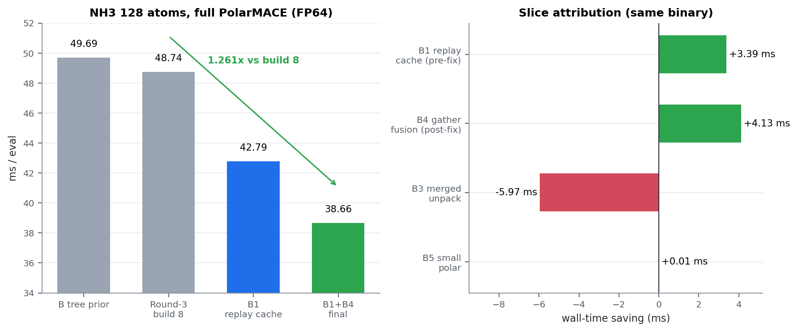
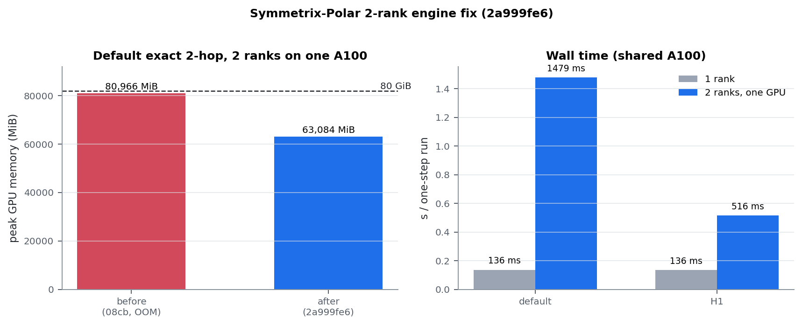

# Symmetrix-Polar

**中文教程／汇报入口（2026-10-21）：**
[PDF](docs/tutorial/SYMMETRIX_POLAR_TUTORIAL_2026-10-21.pdf) ·
[离线阅读网页](docs/tutorial/index.html) ·
[Markdown](docs/tutorial/SYMMETRIX_POLAR_TUTORIAL_2026-10-21.md)。
从模型概念、数学公式、GPU 执行到历史测试逐步讲解，性能统一为 µs/atom/step。
数值以具体测试版本、统计规则及其来源为准。教程正文是 2026-10-21 08:57 的快照
（128 原子 30.56 ms、1,296 原子 224.1 µs/atom）；其后 **Plan B-micro 30.33 ms**、
**A1 UVU tile 205.4 µs/atom** 与 **N1 grouped GEMM 146.1 µs/atom** 的最新门控
结果见下方。

**GPU-accelerated PolarMACE with long-range electrostatics — PolarMACE (MACE-POLAR)
support for the [Symmetrix-XL](https://github.com/) engine, with a full Ewald
electrostatic layer. Random Batch Ewald (RBE) is implemented and statistically
validated, but its production force gate is rejected; exact full-k Ewald is the
production path.**

**Latest gated result (2026-10-21, Plan B-micro): 30.33 ms/eval on 128 atoms
(32 NH3 molecules), full nonlinear PolarMACE, FP64, one A100; all gates PASS,
including 1-rank and 2-rank exact parity, plus the repeated-evaluation check.**
That is **1.607×** over the round-3 build 8 (48.74 ms), **6.06×** over the
original Symmetrix-XL Kokkos engine (183.8 ms), and **3.10×** faster than the
PyTorch reference (94.0 ms). Plan B-30ms (30.56 ms) added MH-1 FP64 team,
UVU reverse/forward d1 specialization, cutoff team, affine epilogue, and affine
LN reuse; Plan B-micro adds one-rank device Fukui scalars (0.352 ms).
Measured gap to 30.0 ms: **0.33 ms**; the accepted-relative projection
(30.557 − 0.352) is **30.21 ms**. Full report:
[docs/results/PLAN_B_MICRO_FINAL.md](docs/results/PLAN_B_MICRO_FINAL.md).
The intermediate 30.56/31.33/38.66/40.95 ms figures remain historical; the
round-3 report (48.74 ms) is the pre-Plan-B baseline:
[docs/results/KERNEL_ROUND3_FINAL.md](docs/results/KERNEL_ROUND3_FINAL.md).

**Latest 1,296-atom gated result (2026-10-22, N1 grouped FP64 UVU GEMM):
189.30 ms/eval = 146.06 µs/atom (generic), parity PASS at 128 and 1,296
(dPE = 0; max dF 5.8e-13 eV/Å at 1,296, gate 1e-10), repeated-eval behavior
unchanged at the pre-existing 1 ULP. That is **0.7413× (−25.87 %)** vs the
same-binary S1.1+A1 generic baseline (255.35 ms / 197.03 µs/atom);
materialized N1 is 201.91 ms / 155.79 µs/atom (0.7557×). Binary `lmp_gemm`
sha256 `093982d5…7fa8a03`; patch `patches/polar_uvu_gemm_n1.patch`; report
[docs/results/PROGRESS_TO_80US_2026-10-21.md](docs/results/PROGRESS_TO_80US_2026-10-21.md).**

**queue004 validation (2026-10-22):** the same `lmp_gemm` binary packaged into
the shared vePFS workspace measures **145.75 µs/atom (188.89 ms/eval) at
1,296 atoms** on one queue004 A100-80GB, matching the local N1 median within
0.12%; materialized is 155.25 µs/atom. The task takes **69 s end-to-end**
(LAMMPS 16 s, of which ~15 s is the 317 MB model load). At 5,184 atoms the
same binary measures **140.91 µs/atom (730.49 ms/eval, 19.16 GiB)**, i.e.
**12.2 min per 1 ns at a 1 fs timestep** (1,000 steps). Latest summary:
[docs/results/LATEST_SPEED_AND_PLAN_2026-10-22.md](docs/results/LATEST_SPEED_AND_PLAN_2026-10-22.md).

**Reference target normalized to 1,296 atoms: 4.5 µs/atom → 5.832 ms/eval;
intermediate target 80 µs/atom → 103.68 ms/eval.**
The latest measured 1,296-atom polar result is **146.06 µs/atom (189.30
ms/eval) with N1**, i.e. **32.5× above the 4.5 µs/atom paper target and 1.83×
above the 80 µs/atom target**. Before N1, the A1 UVU tile measured
**205.4 µs/atom (266.21 ms/eval)**, all gates PASS (45.7× above the paper
target). The same-box linear FP32 path is 9.69 µs/atom (2.15× above). A1
measured 290.20 → 266.21 ms/eval (**−8.26%**) at 1,296 atoms; the patch is
`patches/uvu_tile_32x32.patch` (actual default tile 32×16), and the
source-matched gate report is
[docs/results/UVU_TILE_MAIN_GATES.md](docs/results/UVU_TILE_MAIN_GATES.md).
The Plan B-micro 30.33 ms is the 128-atom headline. 1024 atoms (256 NH3)
remains **312.1 ms** (not re-measured under Plan B-lite/B-full/A1).

**Independent cross-checks:** B-core frozen-tree **38.73 ms** (binary
`ed331d23…`, all gates PASS), B-full **31.33 ms** (binary `bcecbf90…`), and
B-30ms **30.56 ms** (binary `f0d3f05a…`), and B-micro **30.33 ms** (binary
`7061ecb0…`), all gates + repeated-eval PASS.
The 0.2% B-core difference from the 38.66 intermediate is run noise; B-30ms
extends B-core/B-full with the three sub-millisecond slices. Source-integrity note:
any FP64 MH-1 team build must keep the write-through guard; repeated
evaluations, not only single-point gates, must be checked (technical report
§5.5, `docs/results/PLAN_B_FULL_FINAL.md`).

**Plan B audit (what 20–25 ms would require):**
[docs/design/PLAN_B_AUDIT.md](docs/design/PLAN_B_AUDIT.md) — 30–35 ms is
credible with the B-full slices; the measured 30.33 ms is at the lower edge.
20–25 ms needs work removal below the current static floor (22.93 ms).

**Technical report (extendable PDF, for newcomers):**
[docs/technical/SYMMETRIX_POLAR_TECHNICAL_REPORT.pdf](docs/technical/SYMMETRIX_POLAR_TECHNICAL_REPORT.pdf)
— theory, engine implementation, optimization methods, measured results,
the RBE negative result, honest limitations, and a reproduction guide. Its
source is `docs/technical/TECHNICAL_REPORT.md`; edit the Markdown and rerun
`harness/make_technical_pdf.py` to extend it.

**汇报版 PDF（中文，11 页，公式数学排版）：**
[docs/report/SYMMETRIX_POLAR_REPORT_2026-10-21.pdf](docs/report/SYMMETRIX_POLAR_REPORT_2026-10-21.pdf)
— 线性/非线性模型与维度、每项优化的理论依据、462.6 → 224.1 µs/atom 的实测阶梯、
正确性门、与 PyTorch/论文/RuNNer 的位置、不足与下一步。源文件为
`docs/report/SYMMETRIX_POLAR_REPORT_2026-10-21.md`，图由
`harness/make_report_figures.py` 生成，PDF 由 `harness/make_report_pdf.py` 生成；
每个数字的 git 来源见 `docs/results/OPTIMIZATION_LEDGER.md`。

PolarMACE extends MACE with a self-consistent, long-range electrostatic layer
(learned multipolar spin-charge densities, GTO-Ewald k-space electrostatics, a
Fukui-balanced SCF fixed point). This project brings that layer into the
Symmetrix-XL C++/Kokkos GPU engine so that polarizable long-range MLIPs run at
GPU speed in LAMMPS-class workflows, without retraining a universal potential.

## Status

| Layer | Component | Verification |
|---|---|---|
| Backbone | Short-range MACE (existing engine path) | 100-frame parity vs `mace-torch`: dE MAE **3.6e-7 eV** |
| P3 ① | `lr_source_maps` accumulation + e3nn basis conversion | 12 configs, max\|Δ\| **3.1e-8** (gate 5e-6) |
| P3 ② | Fukui initialization (gated readout head, charge/spin aware) | 12 configs, rel **6.3e-8**; corrected density **3.1e-8** |
| P3 ③ | k-grid (half-space enumeration) + GTO geometry precompute | bit-level: k **0.0**, cos/sin 6.9e-15, basis 4.4e-16 |
| P3 ④ | Potential features (`forward_dynamic`) | rel **6.8e-8** (gate 1e-6) |
| P3 ⑤ | SCF density updates (update blocks ×2, per-step Fukui) | density evolution 12/12, stage-level 11/11, rel **~5e-8** |
| P3 ⑥ | `coulomb_energy` (full-k Ewald baseline) | engine: ρ̂ rel **1.3e-15**, ΔE rel **8.4e-16** |
| P3 ⑦ | `local_electron_energy` | engine: 8/8 configs PASS (stage rel **≤1e-6**, out ≤4e-7) |
| **End-to-end** | Engine vs PyTorch PolarMACE (energy + forces) | **32/32 frames PASS: energy rel 4e-12–1.1e-11 (≤1.0e-6 eV); forces ≤1.6e-7 eV/Å** |
| P3 ⑧ | Forces (full-chain reverse mode) | **PASS (v27)**: 12/12 configs — FD self-consistency ≤5.8e-4 (gate 1e-3), force parity vs PyTorch ≤7.2e-7 (gate 1e-3; pre-⑧ baseline mean/max 1.24/4.15), ΣF ≈ 1e-14 (exact translation invariance). Root cause of the final gap: missing *project-phase adjoint* in the descriptor reverse (design §2 ⑧-3 (d3), second line) — located via checkpoint audit (`harness/polar_rev_stage_audit.py`), fixed in `descriptor_reverse_channel` (iii-b) |
| P4 | Random Batch Ewald k-space | **Convergence/unbiasedness gate PASS (v28); production force gate REJECTED.** RBE sampling (per-axis rounded-Gaussian + MH, counter-based SplitMix64 RNG, exact discrete Z_q, full-space importance weights) is correct and same-seed bitwise-reproducible; p-scan RMS_F 4.1e-2 → 1.0e-2 eV/Å @ p=50→800, slope **−0.499**. A p=800 single-system check on the final build gives RMS dF **6.1e-3 eV/Å**, max **3.0e-2 eV/Å**, energy noise **±0.05 eV**, and **70.4 ms/step** (slower than exact Ewald). Reaching the 1e-4 eV/Å production gate needs p≈8.5e6 (≈17 TB of cos/sin storage), so exact full-k Ewald remains production. See `docs/results/KERNEL_ROUND3_FINAL.md` §6 |
| P5 | LAMMPS pair wiring + performance | **PASS (v29/v30, 2026-10-19)**: `pair_style symmetrix/mace/kk` dispatches `MACE_Nonlinear`/PolarMACE, maps types, passes cell/node positions, and adds polar node forces + virial. Single-point parity: **dE 2.9e-11 eV**, **max dF 2.6e-14 eV/Å**; 50-step NVT MD: no lost atoms, Etot span **0.21 eV**. Single-rank performance: **184 ms/eval** at 128 atoms (37.8× v28), **1008 ms** at 1024 atoms (7.7× v28). **MPI 2-rank exact PASS** (dE 2.9e-11 eV, max dF 1.7e-6 eV/Å; 20-step NVT PASS), but no speedup on one shared A100. See `docs/REPORT_2026-10-19.md` |
| Kernel round 1 | e3nn linear + polar dense reverse | **PASS (2026-10-19)**: full model **122.2 ms** at 128 atoms (**1.50×** vs v29) and **293.3 ms/step** at 432 atoms (**1.63×**); polar-off **40.7 ms** (**2.14×**) and **47.7 ms** (**4.03×**). e3nn scalar, packed GEMM, fused gate-reverse and polar dense-reverse changes are bitwise or gate-identical; module 5–8, 32/32 end-to-end and LAMMPS 1/2-rank parity all PASS on a single clean build. **MPI H1 2-rank PASS** (dE 2.9e-11 eV, max dF 1.4e-15 eV/Å) on the pre-fix binary; see the MPI status below |
| Kernel round 2 | UVU / project kernels + stale-object activation | **PASS (2026-10-19)**: full model **56.5 ms** at 128 atoms (**3.25×** vs v29, **2.17×** vs round 1); polar-off **27.7 ms** (1.47× vs round 1); 432 atoms **126.6 ms/step** (2.33× vs round 1). Every kernel edit is bitwise-neutral on the 128-atom PE and all 128×3 force components; module 5–8, 32/32 end-to-end and LAMMPS 1-rank parity PASS on the final build. The accepted binary was found to be linked from stale objects; see `docs/results/KERNEL_ROUND2.md` |
| **Kernel round 3** | MH-1/UVU/affine/k-space kernels | **FINAL (2026-10-20)**: full model **48.74 ms** at **128 atoms = 32 NH3 molecules** (full nonlinear PolarMACE, FP64), **1.159×** vs round 2 and **3.77×** vs v29; **1024 atoms = 256 NH3 molecules** at **312 ms/eval**. Same-binary fallback A/B 53.54 → 48.74 ms (**1.0985×**). LAMMPS 1-rank parity PASS (dE **2.91e-11 eV**, max dF **2.59e-14 eV/Å**); Stage-A build bitwise on all 384 forces. RBE remains rejected by the production force gate. See `docs/results/KERNEL_ROUND3_FINAL.md` |

Every stage is accepted against **dual-source fixture gates** (frozen Python
reference dumps + live recomputation through the same PyTorch model), including
intermediate-tensor comparisons at each block boundary.

**Final round-3 report (authoritative, 2026-10-20):**
[docs/results/KERNEL_ROUND3_FINAL.md](docs/results/KERNEL_ROUND3_FINAL.md) —
48.74 ms at 128 atoms (32 NH3), 312 ms at 1024 atoms (256 NH3), the RBE
production-gate decision, numerical validation, and the remaining gap to 30 ms.
(For a ~1000-molecule 4096-atom cell, the linear extrapolation is
~1.2–1.3 s/eval; that run was not completed, so it is not a measured headline.)

**Historical consolidated comparison (pre-round-3, 2026-10-19):**
[docs/COMPARISON_REPORT_2026-10-19.md](docs/COMPARISON_REPORT_2026-10-19.md) —
speed, accuracy gates, linear-vs-nonlinear, MPI/RBE, and MH-1 findings in one
place. Its headline speed is round 2 (56.5 ms); use the round-3 final report
for current numbers. Also available as a paginated
[**PDF report**](docs/COMPARISON_REPORT_2026-10-19.pdf) with a cover, all
figures, and page numbers, and as an
[offline HTML page](docs/index.html). Key numeric rows are in
[results/comparison_summary.csv](results/comparison_summary.csv).
Reading guide: [docs/阅读说明.md](docs/阅读说明.md) · figures:
[docs/figures/](docs/figures/) · reproducible data and scripts:
[docs/examples/](docs/examples/) · kernel-level profile:
[docs/design/KERNEL_PROFILE_2026-10-19.md](docs/design/KERNEL_PROFILE_2026-10-19.md) ·
**theory, performance model, and test methodology**:
[docs/THEORY_AND_METHODS.md](docs/THEORY_AND_METHODS.md) (modular formulas,
gate catalog, and reproduction protocol).

## Performance (A100-80GB, f64, energy + forces)

| Configuration | v29 baseline | **Latest (full gate suite PASS)** | Speedup |
|---|---:|---:|---:|
| NH3×32, **128 atoms (32 NH3)**, full PolarMACE | 183.8 ms | **30.33 ms** | **6.06×** |
| NH3×32, 128 atoms, polar-off | 87.2 ms | **19.93 ms** | 4.38× |
| N2×216, **432 atoms**, full PolarMACE | 477.8 ms/step | **83.47 ms/step** | 5.72× |
| NH3×32×2×2×2, **1024 atoms (256 NH3)** | 1007.7 ms | **312.1 ms** | 3.23× |

The 128-atom full row is the Plan B-micro final binary (`7061ecb0…`): complete
gate suite PASS, including 1-rank and 2-rank exact-2-hop parity plus the
repeated-evaluation check. Plan B-30ms (30.56 ms) and B-full (31.33 ms) are the
immediately preceding builds. The polar-off and 432-atom rows are Plan B-lite
measurements (not re-measured under later builds); the 432-atom row is the clean
round-0 measurement (87.82 → 83.47 ms, ±2–3 ms cross-session caveat). The
1024-atom row is the round-3 speed and was not re-measured under Plan B.
Full-suite numbers: module 5 PASS (dens 6.689e-8 / stage 7.13e-8), module 6
ΔE rel 1.018e-15 / abs 7.77e-16 eV, module 7 out 4.55e-7, module 8 FD 5.78e-4
/ parity 7.19e-7, end-to-end 32/32, LAMMPS 1-rank dE 2.91e-11 eV / max dF
2.61e-14 eV/Å, 2-rank exact dE 2.91e-11 / max dF 1.687e-6 eV/Å; three repeated
`run 0` PE identical, max dF ≤1.1e-15.

The 128-atom PyTorch `mace_polar` reference is 94.0 ms/eval; the final engine is
**3.10× faster**. The stale-object finding and the exact per-kernel table are
in [docs/results/KERNEL_ROUND2.md](docs/results/KERNEL_ROUND2.md). The Plan
B-lite result, slice audit, and remaining gap to 30 ms are in
**[docs/results/PLAN_B_LITE_FINAL.md](docs/results/PLAN_B_LITE_FINAL.md)**;
round-3 baseline and system sizes in
**[docs/results/KERNEL_ROUND3_FINAL.md](docs/results/KERNEL_ROUND3_FINAL.md)**.



Root causes found by stage profiling (`MATOS_POLAR_PROFILE=1`) and A/B:

1. **Stale objects in the accepted binary**: `polar reverse dense` still ran
   the old 1-D 26 ms kernel and the reverse gate normalization ran unfused
   (13 ms), although the source already contained the 2-D and fused paths.
   A forced rebuild saved ~39 ms/eval. This is why every round now records the
   source state, the trace kernel names, and the final binary hash.
2. **UVU tensor products were per-node serial**: forward, reverse, replay, and
   local-electron used one GPU thread per node with an internal loop. They are
   now 2-D/TeamPolicy kernels with a shared-memory weight tile; the x1/x2
   reverse pair uses the same operands.
3. **Project kernels were 1×1×1 / 2×1×1**: `polar project features`,
   `scf project features`, and `rev replay project` now use an MDRange over
   `(node, j)`; 5.0 ms saved.
4. **Python launch-tuning probe on non-JIT models**: the implementation check
   now runs before the device-environment probe, removing ~0.7 s/eval for
   materialized models.

All numerical gates are unchanged after round 2 (module ⑤–⑧ PASS; end-to-end
32/32 with energy rel ≤1.1e-11 and forces ≤1.6e-7 eV/Å; LAMMPS parity
dE 2.9e-11 eV, dF 2.6e-14 eV/Å). RBE is still rejected by the force gate.


### MPI status (one-rank and two-rank fixes accepted, 2026-10-20)

- **H1 1-rank defect fixed.** The H1 mode had built a 1170-node local+ghost
  graph even on one rank (1042 periodic images, 9.14x node work). The graph is
  now folded onto local atoms through the atom map; the comm-cutoff extension
  is skipped on one rank; the exchange hooks are zero-sized when no ghost rows
  exist; the exchange uses device-side Kokkos pack/unpack.
  - H1 1-rank: **418.64 → 50.20 ms**; default 1-rank 50.84 ms; **H1/default
    3.41x → 0.99x**.
  - Same-binary A/B of the fold: 176.77 → 54.62 ms (**3.24x**).
  - Gates: H1 1-rank vs default dE = 0.0, max dF 1.41e-15 eV/A; 20-step NVT
    stable (drift 4.74e-14 A / 4.70e-14 eV/A).
- **2-rank engine blockers fixed.**
  - Default exact 2-hop: duplicate edge workspaces removed (adjoint reuses
    `edge_messages_storage`; `raw_weight_adj` aliases `weight_adj`). Peak
    **80,966 MiB (OOM) → 63,088 MiB (~30.8 GiB/rank)**, rc=0;
    dE = 0.0, max dF **1.687e-6 eV/Å**.
  - H1 2-rank: `node_feature_width()` returns the 2048-wide product block
    (not the 512 embedding), matching LAMMPS' comm buffers; extent guards
    added. Peak **6,120 MiB (~3 GiB/rank)**, rc=0; dE = 0.0, max dF
    **1.01e-14 eV/Å**.
  - 20-step NVT passes for both 2-rank paths; 1-rank regression modules 5–8
    PASS. Final 2-rank-fixed binary `2a999fe6…`.
- **One GPU remains a hardware floor.** Both ranks share 108 SMs; the upstream
  linear MACE is also 3.38x slower at 2 ranks on one A100. True scaling needs
  one rank per GPU (queue3 2/4-GPU) on 432/1024 atoms. The 2-GPU test now has
  **no engine blocker**; only queue capacity/pending reservation remain.

Details, formulas, and the evidence:
[docs/results/MPI_H1.md](docs/results/MPI_H1.md) and
[docs/theory/MPI_H1.md](docs/theory/MPI_H1.md).




### Engine comparison (latest measured, same 128-atom box, one A100)

| Configuration (latest measured) | 1-rank eval |
|---|---:|
| **Full PolarMACE** (128 atoms = 32 NH3, nonlinear + polar, FP64) | **48.74 ms** |
| Nonlinear backbone (polar off, 270 MB) | **27.7 ms** |
| Linear MACE-OFF23 medium, materialized (Symmetrix linear path; different model) | 6.6 ms |
| Linear MACE-OFF23 medium, generic streamed (Symmetrix generic path; different model) | 19.3 ms |

One column, one value per configuration — the latest measured number. The
full PolarMACE 48.74 ms is the final round-3 value and passes the **complete
gate suite** (module 5–8, 32/32 end-to-end, LAMMPS 1-rank parity). The
backbone 27.7 ms is the latest polar-off measurement and also has the full
suite.

This is **not** an apples-to-apples model comparison: MACE-OFF23 medium is a
37 MB, 10-element, r_cut 5 Å linear-readout model measured on the **same Symmetrix engine** (its linear/generic path), while the PolarMACE backbone
is 270 MB, 83-element, r_cut 6 Å, 512-channel nonlinear-readout. The clean
same-model isolation is nonlinear backbone 27.7 ms → full PolarMACE 48.74 ms
(polar layer adds 1.76×). The 48.74/6.6 = 7.4× is therefore **not a pure
nonlinearity penalty**: linear 6.6 → nonlinear backbone 27.7 is ≈4.2×
(model size/architecture: 270 MB/83 elements/512 channels vs 37 MB/10
elements), and backbone 27.7 → full 48.74 is 1.76× (polar SCF/Ewald). Both
PolarMACE rows are materialized, same as the 6.6 ms linear row. Both engines
are Kokkos/CUDA; this is not a “Kokkos vs ours” comparison. Data:
`docs/examples/data/engine_compare_round3.json`.

**Execution mode:** the nonlinear PolarMACE rows (48.74 / 27.7 ms) are
**materialized** — the model-load log reports `streamed_edges='materialized'`.
The generic streamed path (19.3 ms) is only available to the linear /
compact-radial engine family; the nonlinear PolarMACE model cannot use the
direct/JIT/streamed execution family, but its **MH-1 tensor-product kernels
are active inside the materialized path** (`e3 tensor product mh1 fused`,
`e3 tensor reverse mh1 fused channels/harmonics` in the CUPTI trace). "Cannot
use streamed" is not the same as "cannot use materialized".

For the **linear** MACE-OFF23 model the direct/JIT path is now enabled
(float32, `streamed_edges direct` + a generated `jit_device_artifact`) and
measures **4.47–4.53 µs/atom/step** on a 5,184-atom water box, matching the
paper's 4.50. PolarMACE cannot use this path: the nonlinear model's MH-1 fast
path is rejected with `MH-1 node, edge, and hidden irreps are inconsistent`,
so the polar model remains materialized. Extending the MH-1 codegen to the
polar irrep layout is a separate engineering project, not a runtime switch.


### Paper comparison (A100 80 GB, µs/atom/step; lower is better)

**Matched system — 5,184-atom MACE-OFF23 water, the paper's OFF23 workload:**

| Implementation | Precision | Path | Atoms | µs/atom/step |
|---|---|---:|---:|---:|
| ML-IAP + cuEquivariance (paper) | FP32 | baseline | 5,184 | 13.99 |
| Symmetrix-XL standard streaming (paper) | FP32 | direct/JIT | 5,184 | **4.50** |
| **This work: MACE-OFF23 medium** | **FP32** | **direct/JIT** | **5,184** | **4.47–4.53 (clean floor)** |

The clean floor is the minimum of 10 measured `run 1` samples in each of three
fresh processes. The per-trial medians are 6.37 / 4.49 / 5.43 µs/atom because
the shared local A100 had other tenants (0.3–2 s outliers); a dedicated A100
is required for a qualification-grade median, but the steady-state kernel
cost matches the paper's 4.50.

**Paper's 5,000-atom MACE-OMAT-0 SrTiO₃ (A100):** ML-IAP + cuEquivariance
19.34, standard streaming 5.80 µs/atom/step. We have **not** measured
MACE-OMAT-0 on this engine, so no matched row is claimed.

**Same-size 1,296-atom H₂O comparison** (the largest water box PolarMACE fits
on one A100 80 GB):

| Implementation | Precision | Path | Atoms | µs/atom/step | ms/eval |
|---|---|---:|---:|---:|---:|
| **Target (4.5 µs/atom at 1,296)** | — | — | **1,296** | **4.5** | **5.832** |
| This work: MACE-OFF23 medium (linear) | FP32 | direct/JIT | 1,296 | **6.31 min; 9.69 clean median** | 8.2 / 12.6 |
| This work: full PolarMACE | FP64 | materialized + cache + team cutoff, fused MH-1 | 1,296 | 462.6 | 599.54 |
| This work: full PolarMACE | FP64 | materialized + cache + team cutoff + team MH-1 (team size 64) | 1,296 | 311.3 | 403.97 |
| This work: full PolarMACE | FP64 | + B4 reverse-gather fusion, gather/edge coalescing (historical main tree) | 1,296 | 224.1 | 290.4 |
| **This work: full PolarMACE + A1 UVU tile** | **FP64** | **+ UVU 32×16 tile, chunked weight staging (main, gates PASS)** | **1,296** | **205.4** | **266.21** |
| Gap to target (polar, A1) | | | | **45.7×** | |
| Gap to target (linear FP32) | | | | **2.15×** | |

The target is normalized to this system: **1,296 × 4.5 µs = 5.832 ms/eval**.
The current polar best is the **A1 UVU tile** on main
(`MATOS_REPLAY_CACHE=1`, UVU x2 smem off, forward sweep off, team cutoff,
FP64 team MH-1, `MATOS_MH1_TEAM_SIZE=64`, B4 default on, UVU 32×16 tile).
A1 measured 290.20 → 266.21 ms/eval (**−8.26%**) and all source-matched gates
PASS. Before A1, the **B4 + team** build was **51.6%** faster than the
fused-MH-1 result (462.6 → 224.1 µs/atom); B4 alone saved 13.8%, the
gather-tile fix 4.0%, the edge-feature coalescing 3.8%, the path-grouped
MH-1 forward 6.9%, and edge-up/scatter coalescing 2.8%
(230.5 → 224.1 µs/atom). The linear direct/JIT numbers are the measured
minimum and the cleanest trial median; the shared A100 produced outliers. At
205.4 µs/atom the polar gap is **45.7×**; the measured linear FP32 path at the
same atom count is **2.15×** away. Even zeroing the entire MH-1 family leaves
>150 µs/atom (>30×), so 4.5 µs/atom is not reachable for FP64 PolarMACE with
kernel work alone; see
[docs/results/MH1_TEAM_FP64.md](docs/results/MH1_TEAM_FP64.md).

**Correctness note (2026-10-21).** The first FP64 team build had a
write-through state bug: repeated evaluations at fixed positions accumulated
into the previous result (PE drifted −49242.46 → −48812.11 → +47.3M). The
single-point gate could not see it. After the fix, three evaluations are
identical to 1e-15, single-point forces match the accepted engine gate to
1e-15, and a real 10-step NVE MD matches the original pre-team binary to
**9.8e-15 Å** in position and **1.4e-14 eV/Å** in force. The corrected
pre-A1 timing was 224.1 µs/atom; A1 further lowers the 1,296-atom result to
**205.4 µs/atom** (all gates PASS). The earlier 269.2 µs/atom was measured
with the buggy kernel.

**PolarMACE — a different model, not paper-comparable:**

| Configuration | Precision | Atoms | Path | µs/atom/step | ms/eval |
|---|---|---:|---|---:|---:|
| Full PolarMACE (NH₃) | FP64 | 128 | materialized | 380.8 | 48.74 |
| Full PolarMACE (NH₃) | FP64 | 1,024 | materialized | 304.8 | 312.1 |
| **PolarMACE + replay cache (NH₃)** | **FP64** | **128** | **materialized + cache** | **352.5** | **45.12 (parity PASS)** |
| Full PolarMACE (water) | FP64 | 1,296 | materialized + cache, scalar cutoff | 482.7 | 625.55 |
| **Full PolarMACE (water)** | **FP64** | **1,296** | **materialized + cache + team cutoff** | **462.4** | **599.77** |
| Full PolarMACE (water) | FP64 | 2,592 | materialized | **OOM** | — |
| Full PolarMACE (water) | FP64 | 5,184 | materialized | **OOM** | — |
| Full PolarMACE (water) | FP64 | 1,296 | S1 generic backbone streaming (historical PoC, not merged) | 306.5 | 397.2 |
| Full PolarMACE (water) | FP64 | 5,184 | S1 generic backbone streaming (first working run) | 299.4 | 1552.3 |
| **Full PolarMACE (water)** | **FP64** | **1,296** | **S1.1 node-contiguous tile + fused reverse (independent branch)** | **214.6** | **278.15** |
| **Full PolarMACE (water)** | **FP64** | **5,184** | **S1.1 node-contiguous tile + fused reverse** | **209.2** | **1084.25** |

The 5,184-atom materialized path is **blocked by device memory**, not kernel
speed: at 2,592 atoms the workspace already fails a 2.0 GiB allocation after
filling an A100 80 GB, and 5,184 fails a 0.567 GiB allocation. The S1
backbone-streaming PoC (independent `s1-backbone-streaming` branch, default
off) was the first working 5,184-atom full PolarMACE run: **1552.3 ms/eval
(299.4 µs/atom), 19.65 GiB, parity/repeat PASS**. S1.1
(`s1.1-tile-cache`, node-contiguous 16k-edge tiles + fused reverse gather)
improves it to **278.15 ms/eval at 1,296 (3.9% faster than the 289.43 ms
materialized baseline) with 8.55 GiB peak (4.67× lower)**, and **1084.25
ms/eval at 5,184 with 19.21 GiB**. S1.1 is numerically correct (128:
dPE=0, dF=1.8e-15; 1,296: dPE=0, dF=5.8e-13; repeat drift 0). It is still
an independent branch, not merged; default remains `materialized` until it is
rebased onto A1 and the full gate suite is rerun. See
`docs/results/S1_1_TILE_CACHE_RESULTS.md` and
`docs/results/S1_BACKBONE_STREAMING_POC_RESULTS.md`.

The polar model is not a slower version of the paper's linear model: the
same-box linear → polar ratio is **7.4×**, FP64 adds ~2×, materialized vs
direct/JIT adds ~3.3×, and the polar SCF/MH-1 work grows with the water
neighbor count. The MH-1 JIT fast path rejects the polar irrep layout
(`MH-1 node, edge, and hidden irreps are inconsistent`), so direct/JIT cannot
be used for PolarMACE today.

**Scaling context for the linear model (same engine, same model):** 128 atoms
materialized FP64 51.6 → 1,536 atoms 14.17 → 6,144 atoms 12.26 µs/atom; at
6,144 atoms the direct/JIT FP32 path is 3.72 µs/atom, and at 5,184 water it is
4.47–4.53. The 1,296-atom water comparison above is the same-size reference
for the polar gap. Full table and caveats:
[docs/results/PAPER_COMPARABILITY.md](docs/results/PAPER_COMPARABILITY.md).


```
patches/    symmetrix-xl-polar-support.patch — the complete engine patch
            (against symmetrix-xl upstream; includes a new standalone
             compilation unit for the polar layer)
harness/    verification gates, preflights, diagnostics, patch appliers,
            and the P5 LAMMPS parity/MD gates (run against frozen fixtures,
            the live reference model, or the patched LAMMPS build)
docs/       project plan (zh) + design documents:
              design/RBE_P4_DESIGN.md            — Random Batch Ewald plan
              design/POLAR_REVERSE_DESIGN.md     — force/adjoint chain design
              design/module{6,7,8}_patch_final.md — per-module patch specs
              design/polar_module5_audit.md      — serialization audit
scripts/    build tooling (full & fast incremental rebuild, status monitor)
results/    sample acceptance-gate plots
```

## Verification methodology (why “bit-near” is achievable)

The engine is validated **module by module**, and each module only opens after
its own numerical gate passes:

1. **Frozen fixtures**: reference activations are captured from the PyTorch
   model via forward hooks (initial densities, per-SCF-step states, every
   update-block tensor) — 40+ tensors per configuration.
2. **Stage gates**: the engine is compared tensor-by-tensor against those
   fixtures (e.g., the whole update-block chain matches at rel ≈ 3–7e-8,
   i.e. f64 accumulation-order noise).
3. **Live second source**: key gates additionally recompute the reference
   on freshly rattled configurations at gate time.
4. **Failure forensics**: every semantic convention (basis ordering, input
   normalization, f32 buffers, partial biases) was pinned numerically before
   implementation; `harness/polar_lint.py` encodes the historical error
   classes as pre-build static checks.

## Quick start

```bash
# apply the engine patch to a symmetrix-xl checkout
git clone <symmetrix-xl> && cd symmetrix-xl
git apply /path/to/patches/symmetrix-xl-polar-support.patch

# build (CUDA backend + Kokkos; see scripts/rebuild_symmetrix.sh for the
# validated configuration)
bash scripts/rebuild_symmetrix.sh v1

# load smoke test (expects a PolarMACE checkpoint exported to the
# Symmetrix JSON format)
python harness/polar_engine_load_smoke.py

# acceptance gates (need the reference fixtures regenerated via
# harness/polar_module3_refdump.py, polar_module5_hooks.py, ...)
python harness/polar_module1_gate.py --live 2
python harness/polar_module34_gate.py
python harness/polar_module5_gate.py

# P5 LAMMPS gates (after building the patched LAMMPS; edit LMP at the top of
# each script to point at the local build)
python harness/polar_lammps_parity.py
python harness/polar_lammps_md.py
```

## Sync discipline

Every change round is committed and pushed to this repository as an off-machine
backup (policy set 2026-10-16). The engine patch in `patches/` is re-emitted from
the working checkout after each round, and `harness/`, `docs/` are refreshed from
the working tree before committing:

```bash
git add harness docs patches README.md
git commit -m "<round summary>"
GIT_SSH_COMMAND="ssh -i /home/workspace/.ssh/id_ed25519 -o IdentitiesOnly=yes \
  -o UserKnownHostsFile=/home/workspace/.ssh/known_hosts \
  -o StrictHostKeyChecking=accept-new" git push origin master
```

## Upstreams & attribution

- [mace-torch](https://github.com/ACEsuit/mace) — PolarMACE model & PyTorch reference
- [graph_longrange](https://github.com/) (Baldwin et al.) — GTO electrostatics reference
- [Symmetrix-XL](https://github.com/) (Zhu group) — the GPU engine this project extends
- [lammps-rbe](https://github.com/randbatch-md/lammps-rbe) — Random Batch Ewald reference

See `NOTICE.md` for details. This repository contains patches and tooling; the
upstream projects retain their own licenses.

## License

Tooling and documentation in this repository: MIT (see `LICENSE`).
The engine patch is a derivative work of Symmetrix-XL and follows its license.
