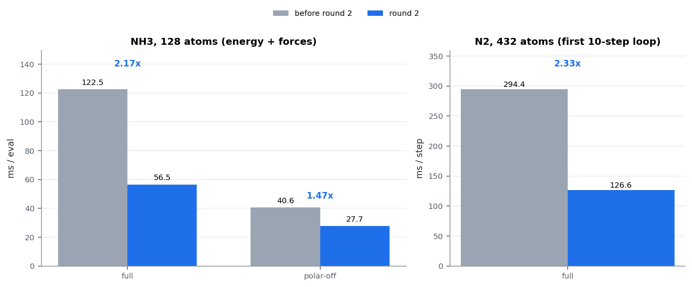
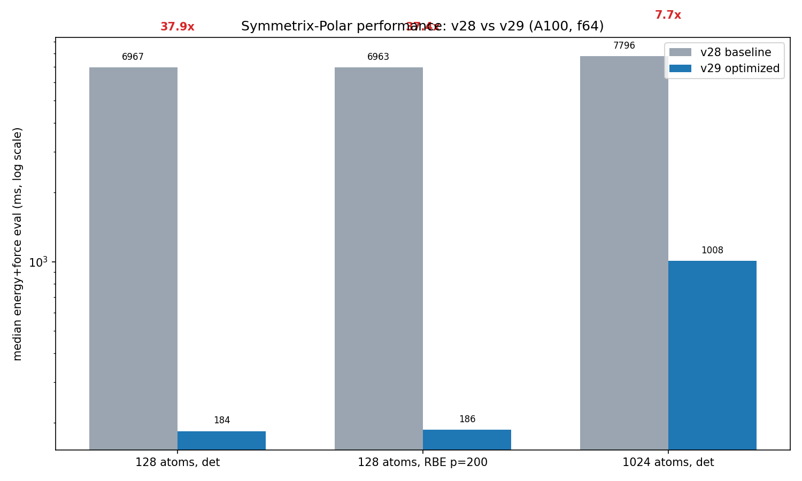
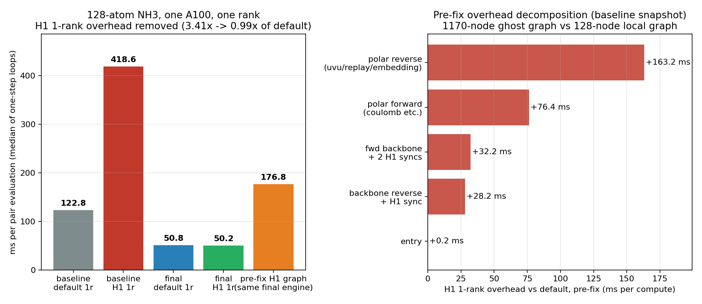
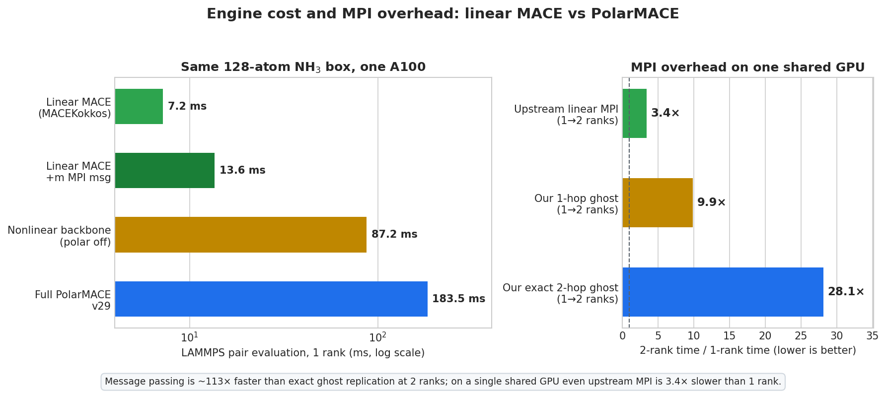

# Symmetrix-Polar

**GPU-accelerated PolarMACE with long-range electrostatics — PolarMACE (MACE-POLAR)
support for the [Symmetrix-XL](https://github.com/) engine, with a full Ewald
electrostatic layer. Random Batch Ewald (RBE) is implemented and statistically
validated, but its production force gate is rejected; exact full-k Ewald is the
production path.**

**Final kernel-round-3 result (2026-10-20): 48.74 ms/eval on 128 atoms
(32 NH3 molecules), full nonlinear PolarMACE, FP64, one A100.** That is
1.159× over the round-2 accepted 56.50 ms, 3.77× over the original
Symmetrix-XL Kokkos engine, and 1.93× faster than the PyTorch reference.
1024 atoms (256 NH3 molecules) run at 312 ms/eval. Full report:
[docs/results/KERNEL_ROUND3_FINAL.md](docs/results/KERNEL_ROUND3_FINAL.md).

PolarMACE extends MACE with a self-consistent, long-range electrostatic layer
(learned multipolar spin-charge densities, GTO-Ewald k-space electrostatics, a
Fukui-balanced SCF fixed point). This project brings that layer into the
Symmetrix-XL C++/Kokkos GPU engine so that polarizable long-range MLIPs run at
GPU speed in LAMMPS-class workflows, without retraining a universal potential.

## Status

| Layer | Component | Verification |
|---|---|---|
| Backbone | Short-range MACE (existing engine path) | 100-frame parity vs `mace-torch`: dE MAE **3.6e-7 eV** |
| P3 ① | `lr_source_maps` accumulation + e3nn basis conversion | 12 configs, max\|Δ\| **3.1e-8** (gate 5e-6) |
| P3 ② | Fukui initialization (gated readout head, charge/spin aware) | 12 configs, rel **6.3e-8**; corrected density **3.1e-8** |
| P3 ③ | k-grid (half-space enumeration) + GTO geometry precompute | bit-level: k **0.0**, cos/sin 6.9e-15, basis 4.4e-16 |
| P3 ④ | Potential features (`forward_dynamic`) | rel **6.8e-8** (gate 1e-6) |
| P3 ⑤ | SCF density updates (update blocks ×2, per-step Fukui) | density evolution 12/12, stage-level 11/11, rel **~5e-8** |
| P3 ⑥ | `coulomb_energy` (full-k Ewald baseline) | engine: ρ̂ rel **1.3e-15**, ΔE rel **8.4e-16** |
| P3 ⑦ | `local_electron_energy` | engine: 8/8 configs PASS (stage rel **≤1e-6**, out ≤4e-7) |
| **End-to-end** | Engine vs PyTorch PolarMACE (energy + forces) | **32/32 frames PASS: energy rel 4e-12–1.1e-11 (≤1.0e-6 eV); forces ≤1.6e-7 eV/Å** |
| P3 ⑧ | Forces (full-chain reverse mode) | **PASS (v27)**: 12/12 configs — FD self-consistency ≤5.8e-4 (gate 1e-3), force parity vs PyTorch ≤7.2e-7 (gate 1e-3; pre-⑧ baseline mean/max 1.24/4.15), ΣF ≈ 1e-14 (exact translation invariance). Root cause of the final gap: missing *project-phase adjoint* in the descriptor reverse (design §2 ⑧-3 (d3), second line) — located via checkpoint audit (`harness/polar_rev_stage_audit.py`), fixed in `descriptor_reverse_channel` (iii-b) |
| P4 | Random Batch Ewald k-space | **Convergence/unbiasedness gate PASS (v28); production force gate REJECTED.** RBE sampling (per-axis rounded-Gaussian + MH, counter-based SplitMix64 RNG, exact discrete Z_q, full-space importance weights) is correct and same-seed bitwise-reproducible; p-scan RMS_F 4.1e-2 → 1.0e-2 eV/Å @ p=50→800, slope **−0.499**. A p=800 single-system check on the final build gives RMS dF **6.1e-3 eV/Å**, max **3.0e-2 eV/Å**, energy noise **±0.05 eV**, and **70.4 ms/step** (slower than exact Ewald). Reaching the 1e-4 eV/Å production gate needs p≈8.5e6 (≈17 TB of cos/sin storage), so exact full-k Ewald remains production. See `docs/results/KERNEL_ROUND3_FINAL.md` §6 |
| P5 | LAMMPS pair wiring + performance | **PASS (v29/v30, 2026-10-19)**: `pair_style symmetrix/mace/kk` dispatches `MACE_Nonlinear`/PolarMACE, maps types, passes cell/node positions, and adds polar node forces + virial. Single-point parity: **dE 2.9e-11 eV**, **max dF 2.6e-14 eV/Å**; 50-step NVT MD: no lost atoms, Etot span **0.21 eV**. Single-rank performance: **184 ms/eval** at 128 atoms (37.8× v28), **1008 ms** at 1024 atoms (7.7× v28). **MPI 2-rank exact PASS** (dE 2.9e-11 eV, max dF 1.7e-6 eV/Å; 20-step NVT PASS), but no speedup on one shared A100. See `docs/REPORT_2026-10-19.md` |
| Kernel round 1 | e3nn linear + polar dense reverse | **PASS (2026-10-19)**: full model **122.2 ms** at 128 atoms (**1.50×** vs v29) and **293.3 ms/step** at 432 atoms (**1.63×**); polar-off **40.7 ms** (**2.14×**) and **47.7 ms** (**4.03×**). e3nn scalar, packed GEMM, fused gate-reverse and polar dense-reverse changes are bitwise or gate-identical; module 5–8, 32/32 end-to-end and LAMMPS 1/2-rank parity all PASS on a single clean build. **MPI H1 2-rank PASS** (dE 2.9e-11 eV, max dF 1.4e-15 eV/Å) on the pre-fix binary; see the MPI status below |
| Kernel round 2 | UVU / project kernels + stale-object activation | **PASS (2026-10-19)**: full model **56.5 ms** at 128 atoms (**3.25×** vs v29, **2.17×** vs round 1); polar-off **27.7 ms** (1.47× vs round 1); 432 atoms **126.6 ms/step** (2.33× vs round 1). Every kernel edit is bitwise-neutral on the 128-atom PE and all 128×3 force components; module 5–8, 32/32 end-to-end and LAMMPS 1-rank parity PASS on the final build. The accepted binary was found to be linked from stale objects; see `docs/results/KERNEL_ROUND2.md` |
| **Kernel round 3** | MH-1/UVU/affine/k-space kernels | **FINAL (2026-10-20)**: full model **48.74 ms** at **128 atoms = 32 NH3 molecules** (full nonlinear PolarMACE, FP64), **1.159×** vs round 2 and **3.77×** vs v29; **1024 atoms = 256 NH3 molecules** at **312 ms/eval**. Same-binary fallback A/B 53.54 → 48.74 ms (**1.0985×**). LAMMPS 1-rank parity PASS (dE **2.91e-11 eV**, max dF **2.59e-14 eV/Å**); Stage-A build bitwise on all 384 forces. RBE remains rejected by the production force gate. See `docs/results/KERNEL_ROUND3_FINAL.md` |

Every stage is accepted against **dual-source fixture gates** (frozen Python
reference dumps + live recomputation through the same PyTorch model), including
intermediate-tensor comparisons at each block boundary.

**Final round-3 report (authoritative, 2026-10-20):**
[docs/results/KERNEL_ROUND3_FINAL.md](docs/results/KERNEL_ROUND3_FINAL.md) —
48.74 ms at 128 atoms (32 NH3), 312 ms at 1024 atoms (256 NH3), the RBE
production-gate decision, numerical validation, and the remaining gap to 30 ms.
(For a ~1000-molecule 4096-atom cell, the linear extrapolation is
~1.2–1.3 s/eval; that run was not completed, so it is not a measured headline.)

**Historical consolidated comparison (pre-round-3, 2026-10-19):**
[docs/COMPARISON_REPORT_2026-10-19.md](docs/COMPARISON_REPORT_2026-10-19.md) —
speed, accuracy gates, linear-vs-nonlinear, MPI/RBE, and MH-1 findings in one
place. Its headline speed is round 2 (56.5 ms); use the round-3 final report
for current numbers. Also available as a paginated
[**PDF report**](docs/COMPARISON_REPORT_2026-10-19.pdf) with a cover, all
figures, and page numbers, and as an
[offline HTML page](docs/index.html). Key numeric rows are in
[results/comparison_summary.csv](results/comparison_summary.csv).
Reading guide: [docs/阅读说明.md](docs/阅读说明.md) · figures:
[docs/figures/](docs/figures/) · reproducible data and scripts:
[docs/examples/](docs/examples/) · kernel-level profile:
[docs/design/KERNEL_PROFILE_2026-10-19.md](docs/design/KERNEL_PROFILE_2026-10-19.md) ·
**theory, performance model, and test methodology**:
[docs/THEORY_AND_METHODS.md](docs/THEORY_AND_METHODS.md) (modular formulas,
gate catalog, and reproduction protocol).

## Performance (A100-80GB, f64, energy + forces)

| Configuration | v28 | v29 | Round 1 | Round 2 | Round 3 | Speedup vs v29 |
|---|---|---|---:|---:|---:|---:|
| NH3×32, **128 atoms (32 NH3)**, full PolarMACE | 6951.7 ms | 183.8 ms | 122.2 ms | 56.5 ms | **48.74 ms** | **3.77×** |
| NH3×32, 128 atoms, polar-off | — | 87.2 ms | 40.7 ms | **27.7 ms** | — | 3.15× |
| N2×216, **432 atoms**, full PolarMACE | — | 477.8 ms/step | 293.3 ms/step | **126.6 ms/step** | — | 3.77× |
| N2×216, 432 atoms, polar-off | — | 191.9 ms/eval | 47.7 ms | — (not re-measured) | — | — |
| NH3×32, 128 atoms, RBE p=200 | 6962.9 ms | 186.3 ms | — | — | — | — |
| NH3×32×2×2×2, **1024 atoms (256 NH3)** | 7795.6 ms | 1007.7 ms | — | — | **312.1 ms** | **3.23×** |

The 128-atom PyTorch `mace_polar` reference is 94.0 ms/eval. After round 1 the
engine was 1.30× slower; after round 2 it was 1.66× faster; after round 3 it is
**1.93× faster** than the PyTorch reference. All required gates (module 5–8,
32/32 end-to-end, LAMMPS parity) pass on the final build; the stale-object
finding and the exact per-kernel table are in
[docs/results/KERNEL_ROUND2.md](docs/results/KERNEL_ROUND2.md). The final
round-3 numbers, system sizes, RBE decision, and remaining gap are in
**[docs/results/KERNEL_ROUND3_FINAL.md](docs/results/KERNEL_ROUND3_FINAL.md)**.



Root causes found by stage profiling (`MATOS_POLAR_PROFILE=1`) and A/B:

1. **Stale objects in the accepted binary**: `polar reverse dense` still ran
   the old 1-D 26 ms kernel and the reverse gate normalization ran unfused
   (13 ms), although the source already contained the 2-D and fused paths.
   A forced rebuild saved ~39 ms/eval. This is why every round now records the
   source state, the trace kernel names, and the final binary hash.
2. **UVU tensor products were per-node serial**: forward, reverse, replay, and
   local-electron used one GPU thread per node with an internal loop. They are
   now 2-D/TeamPolicy kernels with a shared-memory weight tile; the x1/x2
   reverse pair uses the same operands.
3. **Project kernels were 1×1×1 / 2×1×1**: `polar project features`,
   `scf project features`, and `rev replay project` now use an MDRange over
   `(node, j)`; 5.0 ms saved.
4. **Python launch-tuning probe on non-JIT models**: the implementation check
   now runs before the device-environment probe, removing ~0.7 s/eval for
   materialized models.

All numerical gates are unchanged after round 2 (module ⑤–⑧ PASS; end-to-end
32/32 with energy rel ≤1.1e-11 and forces ≤1.6e-7 eV/Å; LAMMPS parity
dE 2.9e-11 eV, dF 2.6e-14 eV/Å). RBE is still rejected by the force gate.



### MPI status (H1 one-rank fix accepted, 2026-10-20)

- **H1 1-rank defect fixed.** The H1 mode had built a 1170-node local+ghost
  graph even on one rank (1042 periodic images, 9.14x node work). The graph is
  now folded onto local atoms through the atom map; the comm-cutoff extension
  is skipped on one rank; the exchange hooks are zero-sized when no ghost rows
  exist; the exchange uses device-side Kokkos pack/unpack.
  - H1 1-rank: **418.64 → 50.20 ms**; default 1-rank 50.84 ms; **H1/default
    3.41x → 0.99x**.
  - Same-binary A/B of the fold: 176.77 → 54.62 ms (**3.24x**).
  - Gates: H1 1-rank vs default dE = 0.0, max dF 1.41e-15 eV/A; 20-step NVT
    stable (drift 4.74e-14 A / 4.70e-14 eV/A).
- **2-rank is blocked by an engine-side workspace defect.** The current engine
  allocates six 2.0–5.4 GiB workspaces per rank (≈21 GiB/rank; peak
  80,966 MiB) in `compute_node_energies_forces` / `AffineMLPKokkosT::prepare`;
  exact 2-hop OOMs and H1 2-rank SIGSEGVs. A dedicated fix round is sizing
  these by owned/local rows and local edges and adding extent assertions.
- **One GPU remains a hardware floor.** Both ranks share 108 SMs; the upstream
  linear MACE is also 3.38x slower at 2 ranks on one A100. True scaling needs
  one rank per GPU (queue3 2/4-GPU) on 432/1024 atoms, after the 2-rank fix.

Details, formulas, and the blocker evidence:
[docs/results/MPI_H1.md](docs/results/MPI_H1.md) and
[docs/theory/MPI_H1.md](docs/theory/MPI_H1.md).



### Engine comparison (v30, same 128-atom box, one A100)

| Configuration | 1-rank eval |
|---|---:|
| Linear MACE-OFF23 medium, materialized | **6.6 ms** |
| Linear MACE-OFF23 medium, generic streamed | 19.3 ms |
| Linear MACE-OFF23 medium, auto (resolved generic) | 7.2 ms |
| Nonlinear backbone (polar off, 270 MB) | **87.2 ms** |
| Full PolarMACE v29 | **183.5 ms** |

This is **not** an apples-to-apples model comparison: MACE-OFF23 medium is a
37 MB, 10-element, r_cut 5 Å linear-readout model, while the PolarMACE backbone
is 270 MB, 83-element, r_cut 6 Å, 512-channel nonlinear-readout. Model
size/architecture explains much of the 12×; PolarMACE additionally cannot use
the MH-1/direct fast path and runs materialized. On the same linear model,
materialized (6.6 ms) is actually faster than generic streamed (19.3 ms), so
the path choice is not the main factor at this small size. The clean same-model
isolation is nonlinear backbone 87.2 ms → full PolarMACE 183.5 ms (polar layer
adds 2.1×). Both engines are Kokkos/CUDA; this is not a “Kokkos vs ours”
comparison.




## Repository layout

```
patches/    symmetrix-xl-polar-support.patch — the complete engine patch
            (against symmetrix-xl upstream; includes a new standalone
             compilation unit for the polar layer)
harness/    verification gates, preflights, diagnostics, patch appliers,
            and the P5 LAMMPS parity/MD gates (run against frozen fixtures,
            the live reference model, or the patched LAMMPS build)
docs/       project plan (zh) + design documents:
              design/RBE_P4_DESIGN.md            — Random Batch Ewald plan
              design/POLAR_REVERSE_DESIGN.md     — force/adjoint chain design
              design/module{6,7,8}_patch_final.md — per-module patch specs
              design/polar_module5_audit.md      — serialization audit
scripts/    build tooling (full & fast incremental rebuild, status monitor)
results/    sample acceptance-gate plots
```

## Verification methodology (why “bit-near” is achievable)

The engine is validated **module by module**, and each module only opens after
its own numerical gate passes:

1. **Frozen fixtures**: reference activations are captured from the PyTorch
   model via forward hooks (initial densities, per-SCF-step states, every
   update-block tensor) — 40+ tensors per configuration.
2. **Stage gates**: the engine is compared tensor-by-tensor against those
   fixtures (e.g., the whole update-block chain matches at rel ≈ 3–7e-8,
   i.e. f64 accumulation-order noise).
3. **Live second source**: key gates additionally recompute the reference
   on freshly rattled configurations at gate time.
4. **Failure forensics**: every semantic convention (basis ordering, input
   normalization, f32 buffers, partial biases) was pinned numerically before
   implementation; `harness/polar_lint.py` encodes the historical error
   classes as pre-build static checks.

## Quick start

```bash
# apply the engine patch to a symmetrix-xl checkout
git clone <symmetrix-xl> && cd symmetrix-xl
git apply /path/to/patches/symmetrix-xl-polar-support.patch

# build (CUDA backend + Kokkos; see scripts/rebuild_symmetrix.sh for the
# validated configuration)
bash scripts/rebuild_symmetrix.sh v1

# load smoke test (expects a PolarMACE checkpoint exported to the
# Symmetrix JSON format)
python harness/polar_engine_load_smoke.py

# acceptance gates (need the reference fixtures regenerated via
# harness/polar_module3_refdump.py, polar_module5_hooks.py, ...)
python harness/polar_module1_gate.py --live 2
python harness/polar_module34_gate.py
python harness/polar_module5_gate.py

# P5 LAMMPS gates (after building the patched LAMMPS; edit LMP at the top of
# each script to point at the local build)
python harness/polar_lammps_parity.py
python harness/polar_lammps_md.py
```

## Sync discipline

Every change round is committed and pushed to this repository as an off-machine
backup (policy set 2026-10-16). The engine patch in `patches/` is re-emitted from
the working checkout after each round, and `harness/`, `docs/` are refreshed from
the working tree before committing:

```bash
git add harness docs patches README.md
git commit -m "<round summary>"
GIT_SSH_COMMAND="ssh -i /home/workspace/.ssh/id_ed25519 -o IdentitiesOnly=yes \
  -o UserKnownHostsFile=/home/workspace/.ssh/known_hosts \
  -o StrictHostKeyChecking=accept-new" git push origin master
```

## Upstreams & attribution

- [mace-torch](https://github.com/ACEsuit/mace) — PolarMACE model & PyTorch reference
- [graph_longrange](https://github.com/) (Baldwin et al.) — GTO electrostatics reference
- [Symmetrix-XL](https://github.com/) (Zhu group) — the GPU engine this project extends
- [lammps-rbe](https://github.com/randbatch-md/lammps-rbe) — Random Batch Ewald reference

See `NOTICE.md` for details. This repository contains patches and tooling; the
upstream projects retain their own licenses.

## License

Tooling and documentation in this repository: MIT (see `LICENSE`).
The engine patch is a derivative work of Symmetrix-XL and follows its license.
