# Symmetrix-Polar: Consolidated Speed and Accuracy Comparison

> **HISTORICAL — NOT THE LATEST.** The **183.5 ms** Full PolarMACE row below
> is v29 history, not the best result. The latest full PolarMACE is
> **48.74 ms** (round 3, LAMMPS parity PASS); the latest **complete-gate-suite**
> result is **56.50 ms** (round 2). The 1024-atom latest is **312 ms**.
> See [../results/KERNEL_ROUND3_FINAL.md](../results/KERNEL_ROUND3_FINAL.md).

**Date:** 2026-10-19 (v29 / v30 evidence cut-off, ~08:20 UTC; later measured
rows are marked with their source logs)
**Scope:** PolarMACE (MACE-Polar) support in the Symmetrix-XL C++/Kokkos engine.
**Basis:** completed JSONs, gate logs, and reports only. No engine/model code
was modified while preparing this document.

> **Status legend:** **PASS** = measured and accepted against its gate;
> **FAIL** = measured and rejected; **pending** = work is in flight and no
> completed artifact exists yet. No pending result is included as a performance claim.

---

## 0. Summary

| Item | Result |
|---|---|
| Single-rank v29 speed, 128 atoms, deterministic | **183.78 ms/eval** (v28: 6966.79 ms, **37.91x**) |
| Kernel round 1, 128 atoms, full model | **122.21 ms/eval** (**1.50x** vs v29; polar-off **40.71 ms**, **2.14x**) |
| Kernel round 1, 432 atoms, full model | **293.34 ms/step** (**1.63x** vs 477.83; polar-off **47.65 ms**) |
| **Kernel round 2, 128 atoms, full model** | **56.50 ms/eval** (**2.17x** vs round 1, **3.25x** vs v29; polar-off **27.66 ms**, **1.47x** vs round 1) |
| **Kernel round 2, 432 atoms, full model** | **126.59 ms/step** (**2.33x** vs round 1) |
| Single-rank v29 speed, 1024 atoms, deterministic | **1007.72 ms/eval** (v28: 7795.59 ms, **7.74x**) |
| Same-model ablation, 128 atoms (v29) | backbone-only **87.24 ms** -> full PolarMACE **183.50 ms**; polar layer adds **96.26 ms (2.10x)** |
| Accuracy gates, modules 5-8 (final build) | all **PASS** |
| End-to-end engine vs PyTorch, 32 frames (final build) | **32/32 PASS**, max energy error 1.034e-6 eV, max force error 1.624e-7 eV/A |
| LAMMPS single point, 1 rank / exact 2 rank (final build) | **PASS / PASS** (dE 2.91e-11 eV; max dF 2.62e-14 / 1.69e-6 eV/A) |
| LAMMPS NVT MD, 50 steps | **PASS**, no lost atoms, Etot span 0.21295 eV |
| RBE production use | **rejected by the force gate** (RMS_F 4.10e-2 to 1.03e-2 eV/A; 33 A p=800 is 1.23e-2, all >> 1e-4 eV/A) |
| 1-hop MPI mode | **rejected by the force/energy gates** (max dF 4.116e-3 eV/A, dE 7.94e-5 eV) |
| MPI H1 one-rank fix | **PASS (2026-10-20)**: H1 1-rank **418.64 -> 50.20 ms** (default 50.84; **0.99x**), same-binary A/B **3.24x**; dE = 0.0, max dF 1.41e-15 eV/A; 20-step NVT stable. The old 1042-ghost/4.87x defect is removed. |
| MPI 2-rank engine fix | **PASS**: default exact 2-hop 80,966 MiB (OOM) -> **63,088 MiB** (~30.8 GiB/rank), dE=0, max dF **1.687e-6 eV/Å**; H1 2-rank SIGSEGV -> **6,120 MiB** (~3 GiB/rank), dE=0, max dF **1.01e-14 eV/Å**; 20-step NVT passes. No engine blocker for the 2-GPU test. |
| MH-1/direct/JIT fast path | **architecturally blocked**; the upstream linear engine cannot load `MACE_Nonlinear` |
| PyTorch MACE-Polar reference speed | **94.0 ms/eval** median vs round-2 engine **56.5 ms** -> engine **1.66x faster** (round 1: 1.30x slower; v29: 1.95x slower) for the full model |

The v29 optimization removed two concrete bottlenecks: per-node-serial UVU tensor
products and a ~0.7 s/eval device-environment probe on non-JIT models. All numerical
gates are unchanged after the optimization.

**Formulas, performance definitions, and the complete test catalog:**
[THEORY_AND_METHODS.md](THEORY_AND_METHODS.md). In particular, the occupancy
definition behind every “SM coverage” number, the Amdahl calculation behind the
1.5x-vs-12x distinction, and the per-gate input/tolerance/command tables are
there rather than repeated in this report.

---

## 1. Scope and model

### 1.1 What is being compared

All "same-model" statements below compare the same PolarMACE checkpoint
(`MACE-POLAR-1-M.model`) exported to the engine JSON
`polar_symmetrix_probe.json`, evaluated in the same 128-atom NH3 box
(14.736126 A cubic, periodic) with the same float64 energy+force path. The
linear MACE-OFF23 comparison is explicitly **not** the same model and is labelled
wherever it appears.

| Property | Full PolarMACE | Nonlinear backbone (polar off) | Linear MACE-OFF23 medium |
|---|---|---|---|
| JSON `model_type` | `MACE_Nonlinear` | `MACE_Nonlinear` | `MACE` |
| Engine | `MaceNonlinearKokkosT` | `MaceNonlinearKokkosT` | `MACEKokkos` |
| JSON size (bytes) | 316,958,257 | 269,988,335 | 37,330,647 |
| Elements | 83 | 83 | 10 |
| `r_cut` | 6.0 A | 6.0 A | 5.0 A |
| Interactions / l_max | 2 / 3 | 2 / 3 | standard MACE |
| Channel pattern | 512 -> 128, nonlinear bias readout | 512 -> 128, nonlinear bias readout | linear readout |
| Polar layer | full SCF + Ewald/RBE | disabled | inert placeholder |
| Execution mode | materialized (no direct/JIT) | materialized | materialized or generic streamed |
| Typical use here | production target | same-model backbone ablation | engine-path reference only |

**Hardware/software:** one NVIDIA A100-80GB per run, CUDA 12 sm80 backend,
Kokkos 5.x, float64, energy+forces. Times are LAMMPS `Loop time` or Python
`median_ms` over 20 evals, as noted. The GPU was shared during part of the
campaign; the v29 final figures are the uncontended reruns. Absolute times are
therefore contention-sensitive, while same-run ratios are stable.

### 1.2 Linear vs nonlinear engines

"Linear" and "nonlinear" here are Symmetrix engine/model families, not
linear-vs-nonlinear MLIPs:

| | `MACEKokkos` (linear engine) | `MaceNonlinearKokkosT` (nonlinear engine) |
|---|---|---|
| Accepted `model_type` | `MACE`, `MACEField` | `MACE_Nonlinear` |
| JSON format | format-version 2 compact radial | format-version 3 nonlinear |
| Readout | standard linear MACE readout | nonlinear readout (`nonlinear`, `NonLinearBiasReadoutBlock` for PolarMACE) |
| Polar blocks | `polar_blocks_enabled()` returns false | full polar block set and SCF pipeline |
| Direct gate | `supports_streamed_edges()` = `uses_compact_radial` | `supports_streamed_edges()` = `mh1_fast_path` |
| H1 MPI | first-interaction hidden node state | materialized node-feature exchange only |

**The upstream linear Kokkos engine cannot load MACE_Nonlinear at all.**
`MACEKokkos::load_from_json` rejects it at `mace_kokkos_model.cpp:165-167` with:

```text
MACE_Nonlinear JSON must be loaded through the nonlinear MACE Kokkos evaluator,
not legacy MACEKokkos.
```

The naming "H1" is a collision: in the linear engine H1 is the first-interaction
hidden state; it is not the MACE-MH-1 model family. No PolarMACE layer can be
delegated to `MACEKokkos`, and the linear engine's `mpi_message_passing` path
cannot be reused for PolarMACE.

### 1.3 MH-1 fast-path status

PolarMACE cannot use the current MACE-MH-1 direct/JIT fast path. The engine's
family descriptor rejects it with:

```text
MH-1 node, edge, and hidden irreps are inconsistent.
```

This is architectural, not an export defect. The original checkpoint has the
same architecture as the JSON. The four deviations from the admitted MH-1 family
are:

1. second interaction uses `128x0e+128x1o` edge features instead of the first
   interaction's `512x0e+512x1o`;
2. second interaction keeps a vector component in `hidden_irreps`
   (`512x0e+512x1o` instead of scalar-only `512x0e`);
3. second product returns `512x0e+512x1o` instead of scalar-only `512x0e`;
4. second readout is `NonLinearBiasReadoutBlock` (with a learned `linear_mid`
   stage) instead of `NonLinearReadoutBlock`.

A v3 `MH1_UVU` contract is present in the JSON, but it covers only the
per-interaction UVU tensor products and does not establish v4 node-program
family compatibility. The v4 contract generator fails first at
`products[1] output irreps are outside the MH-1 support matrix`. Re-exporting
(Route A) cannot fix this without changing the learned function; relaxing only
the gate (Route C) is numerically incorrect and is also not a speed win. See
`docs/design/MH1_FASTPATH_FEASIBILITY.md` for the full rejection chain and the
staged B1-B4 route assessment. No speedup from MH-1 is claimed anywhere in this
report.

---

## 2. Accuracy and correctness gates

### 2.1 Module gates 5-8 and end-to-end

| Gate | Metric | Tolerance | Measured | Verdict |
|---|---|---|---:|---|
| Module 5, density (12 items) | max relative density error | rel <= 1e-6 | **4.22e-8** | PASS |
| Module 5, density (12 items) | max absolute density error | abs <= 5e-6 | **6.689e-8** | PASS |
| Module 5, stages (11 items) | max relative stage error | rel <= 1e-6 | **7.13e-8** | PASS |
| Module 5, pairing | engine state -> fixture step mapping | exact | `['step1','step2','step2']` for all 4 molecules | PASS |
| Module 6, Coulomb | max rho-hat relative error | rel <= 1e-6 | **1.26e-15** | PASS |
| Module 6, Coulomb | max dE relative / absolute | rel <= 1e-6; abs <= 5e-6 eV | **8.43e-16 / 5.551e-16 eV** | PASS |
| Module 6, Coulomb | max end-to-end energy error | informational | **1.491e-8 eV** | PASS |
| Module 7, local electron | max stage absolute error | abs <= 5e-6 or rel <= 1e-6 | **2.230e-5 abs** (passes on the relative criterion) | PASS |
| Module 7, local electron | max output absolute error | abs <= 1e-6 | **4.038e-7** | PASS |
| Module 8, forces | max finite-difference error | <= 1e-3 | **5.783e-4** | PASS |
| Module 8, forces | max parity vs PyTorch | <= 1e-3 | **7.191e-7** | PASS |
| Module 8, forces | max sum-of-forces residual | exact translation invariance | **1.776e-14** | PASS |
| End-to-end, 32 frames | frames within tolerance | 32/32 | **32/32** | PASS |
| End-to-end, energy | max relative / absolute | rel <= 1e-6; abs <= 5e-6 eV | **1.1e-11 / 1.034e-6 eV** | PASS |
| End-to-end, forces | max force error | <= 1e-4 eV/A | **1.624e-7 eV/A** (mean max 9.456e-8) | PASS |
| End-to-end, geometry | max position drift | 0 | **0.0 A** | PASS |

Notes:
- Module 5 evaluated 12 density items (4 molecules x 3 gated step comparisons)
  plus 11 stage tensors. The separate "anchor" field-independent density
  comparison (rel up to 9.57e-8) is recorded but not part of the module-5 gate.
- Module 7 passes because its criterion is `abs <= 5e-6 OR rel <= 1e-6`; the
  worst absolute stage item (co2-f1, 2.230e-5) is at reference scale 351.146
  and passes on the relative criterion.
- Module 8 also reports `|polar|max` between 3.0e-3 and 4.7e-2 eV/A across
  configurations, confirming the polar force term is not negligible.

### 2.2 RBE statistical gate

Source: `results/polar_rbe_gate_v29.json`, log `polar_rbe_gate_v29opt.log`.

| Metric | Tolerance / criterion | Measured | Verdict |
|---|---|---:|---|
| Slope of log RMS_F vs log p | ideal -0.5 | **-0.49885** | PASS |
| Same-seed reproducibility | bitwise energy; dF ~ 0 | **dE = 0; max dF = 6.141e-16 eV/A** | PASS |
| Different-seed response | non-zero | **dE = 0.1003 eV; dF = 9.365e-2** | PASS |
| RMS_F at p = 50 | decreasing | **4.0988e-2 eV/A** | statistical PASS |
| RMS_F at p = 200 | decreasing | **2.1426e-2 eV/A** | statistical PASS |
| RMS_F at p = 800 | decreasing | **1.0280e-2 eV/A** | statistical PASS |
| Mean dE at p = 50 / 200 / 800 | unbiased (n=10) | **-5.139e-2 / -2.344e-2 / +1.469e-3 eV** | PASS |
| Max abs dE at p = 50 / 200 / 800 | monitored | **1.890e-1 / 1.426e-1 / 2.936e-2 eV** | monitored |

The RBE estimator is unbiased and converges at the expected -1/sqrt(p) rate,
but its force RMS at every measured p is **two to three orders of magnitude
above the 1e-4 eV/A production force gate**. Under the project's
gate-as-minimum rule (a speed mode is usable only if every accuracy gate still
passes), RBE is accepted as a sampling/convergence gate but **rejected for
production force evaluation**. See Section 3.6 for its 33 A timings.

### 2.3 LAMMPS pair-style and MD gates

Sources: `results/polar_lammps_parity.json`,
`results/polar_lammps_parity_mpi2.json`, `results/polar_md.json`, logs
`polar_lammps_parity_v29final.log`, `polar_lammps_md_v29final.log`,
`polar_lammps_md_mpi2_n32.log`.

| Gate | Metric | Tolerance | Measured | Verdict |
|---|---|---|---:|---|
| LAMMPS single point, 1 rank | dE vs engine | abs <= 5e-5 eV | **2.910e-11 eV** | PASS |
| LAMMPS single point, 1 rank | max dF vs engine | <= 1e-4 eV/A | **2.622e-14 eV/A** | PASS |
| LAMMPS single point, 1 rank | max position drift | monitored | **4.974e-14 A** | PASS |
| LAMMPS single point, exact 2 rank | dE vs engine | abs <= 5e-5 eV | **2.910e-11 eV** | PASS |
| LAMMPS single point, exact 2 rank | max dF vs engine | <= 1e-4 eV/A | **1.687e-6 eV/A** | PASS |
| LAMMPS single point, 1-hop 2 rank | dE vs engine | abs <= 5e-5 eV | **7.937e-5 eV** | **FAIL** |
| LAMMPS single point, 1-hop 2 rank | max dF vs engine | <= 1e-4 eV/A | **4.116e-3 eV/A** | **FAIL** |
| LAMMPS NVT MD, 128 atoms | completion / lost atoms / finite | 50/50, none, finite | **50/50, none, finite** | PASS |
| LAMMPS NVT MD, 128 atoms | Etot span (relative to first step) | monitored | **0.21295 eV** (25 fs) | PASS |
| LAMMPS NVT MD, 128 atoms | temperature | 300 K target | mean **276.81 K**, min 188.96, max 335.95 | PASS |
| LAMMPS NVT MD, 128 atoms | pressure | monitored | 657.5 - 3231.3 bar | PASS |
| LAMMPS NVT MD, 128 atoms | throughput | monitored | **493.662 ms/step** | PASS |
| MPI NVT MD, 32 atoms | completion / lost atoms / Etot span | 20 steps, none | **20/20, none, 0.013359 eV** | PASS |
| MPI 4 rank, 128 atoms | runnable on one GPU | must fit device memory | ghost workspace 4.5-6.9 GiB; **OOM** | FAIL (resource) |

The 1-hop mode is 2.86x faster than exact 2-hop (1809.3 vs 5167.05 ms) but fails
both the energy and force gates; it is not a usable approximation.

---

## 3. Speed

### 3.1 Single-rank v28 vs v29

Source: `mlip/bench/polar_perf_v28.json` and
`results/polar_perf_v29.json` (20 evals each, median, energy+forces,
128-atom NH3 frame 0, 1024-atom 2x2x2 supercell).

| Configuration | v28 (ms/eval) | v29 (ms/eval) | Speedup | Delta |
|---|---:|---:|---:|---:|
| 128 atoms, deterministic | 6966.79 | **183.78** | **37.91x** | -6783.0 ms |
| 128 atoms, RBE p = 50 | 6995.58 | **177.60** | **39.39x** | -6818.0 ms |
| 128 atoms, RBE p = 200 | 6962.87 | **186.30** | **37.38x** | -6776.6 ms |
| 128 atoms, RBE p = 800 | 7019.89 | **219.05** | **32.05x** | -6800.8 ms |
| 1024 atoms, deterministic | 7795.59 | **1007.72** | **7.74x** | -6787.9 ms |

Model load also dropped from ~48.0 s (v28) to ~12.4 s (v29) for the
deterministic case (12.95 / 12.91 / 12.89 s for RBE p=50/200/800).

**Data-quality note.** The stage report quotes 6951.7 ms for the v28
deterministic row. That is the *energy-only* median in
`perf_breakdown_v28.log`; the benchmark JSON for the same 20-eval
energy+force run is 6966.79 ms. This report uses the JSON value so all
v28/v29 rows use the same measurement definition.

### 3.2 Same-model ablation: backbone vs full PolarMACE

Source: `results/engine_compare.json` (LAMMPS single-step `Loop time`,
128-atom NH3 box, one A100).

> **NOT THE LATEST.** The 87.24 / 183.50 ms rows are v29 history. The latest
> full PolarMACE is **48.74 ms** (round 3, 128 atoms = 32 NH3, LAMMPS parity
> PASS); the latest backbone is **27.7 ms** (round 2, full suite PASS), so the
> latest same-model polar increment is **1.76×**, not 2.10×. Latest 1024-atom
> (256 NH3) is **312 ms**. See
> [../results/KERNEL_ROUND3_FINAL.md](../results/KERNEL_ROUND3_FINAL.md).

| Configuration | Model | ms/eval | Relative to backbone |
|---|---|---:|---:|
| **Latest (round 3): Full PolarMACE** | `polar_symmetrix_probe.json` | **48.74** | **1.76×** |
| **Latest (round 2): backbone, polar off** | `polar_symmetrix_probe_polaroff.json` | **27.70** | 1.00× |
| v29 backbone (historical) | `polar_symmetrix_probe_polaroff.json` | 87.24 | 1.00x |
| v29 full PolarMACE (historical) | `polar_symmetrix_probe.json` | 183.50 | 2.10x |
| v29 polar layer increment (historical) | same model, polar on vs off | 96.26 | 52.5% of full |
| leoff variant | `polar_symmetrix_probe_leoff.json` | **pending** | model exists (397,979,620 B); no timing JSON yet |

This is the clean same-model isolation: the nonlinear backbone is 87.2 ms and
the polar layer adds 96.3 ms, i.e. the full model is 2.10x the backbone.
The "leoff" variant (local-electron off) has a model file but no completed
timing run, so it is marked pending rather than estimated.

### 3.3 Linear MACE-OFF23 materialized vs generic streamed

**Not the same model as PolarMACE.** This table isolates the *engine path* on
one linear model (MACE-OFF23 medium: 37.33 MB, 10 elements, r_cut 5 A).

| Path | ms/eval | Notes |
|---|---:|---|
| Materialized | **6.6102** | explicit `streamed_edges materialized` |
| Generic streamed | **19.2914** | requested `auto`, resolved `generic` |
| Auto -> generic (separate engine-compare run) | **7.219** | same resolution, 2.67x faster than the explicit generic run |

Observed run-to-run spread on the generic path is large at this small system
(7.2 vs 19.3 ms). Materialized is consistently the fastest linear path here
(6.61 ms), so "streamed vs materialized" is not the explanation for the
linear-vs-PolarMACE gap. The correct reading of the old 7.2 ms vs 183.5 ms
comparison is "linear 37 MB/r_cut 5 A model + MH-1-capable engine path"
versus "270 MB backbone + nonlinear materialized path + polar layer"; it is
**not** an apples-to-apples engine or accuracy comparison. Both engines are
Kokkos/CUDA.

### 3.4 MPI: functional, but slower on one shared GPU

Sources: `results/polar_time_mpi1.json`, `polar_time_mpi2.json`,
`polar_time_mpi2_onehop.json`, `linear_mpi.json`.

| Mode | 128-atom eval (ms) | Relative to 1 rank | Force gate | Verdict |
|---|---:|---:|---|---|
| 1 rank optimized (round 2) | **50.84** | 1.00x | PASS | production path |
| H1 1 rank, final | **50.20** | **0.99x** | dE 0.0, max dF 1.41e-15 eV/A, PASS | accepted |
| H1 1 rank, pre-fix | 418.64 | 3.41x slower than default (pre-round-2) | PASS | historical |
| 2 rank exact (2-hop ghost) | **blocked** (engine OOM) | n/a | pre-fix 2536 ms | needs workspace fix |
| 2 rank H1 | **blocked** (engine SIGSEGV) | n/a | pre-fix 794.7 ms | needs workspace fix |
| 2 rank 1-hop ghost | 1809.30 (pre-fix) | 9.85x slower | max dF 4.116e-3 eV/A, FAIL | rejected |
| Upstream linear MACE H1, 1 rank | 13.586 | 1.00x | n/a (linear model) | reference |
| Upstream linear MACE H1, 2 rank | 45.878 | **3.38x slower** | n/a | reference |

The one-rank H1 defect is fixed: the 1-rank graph is folded onto local atoms,
so H1 matches the default path (50.20 vs 50.84 ms; same-binary A/B 3.24x).
The two-rank path is currently blocked by engine workspace sizing, not by the
pair-style exchange: six workspaces of 2.0-5.4 GiB/rank exhaust an 80 GB A100
at 2 ranks. A dedicated fix round is sizing them by owned/local rows and local
edges and adding extent assertions. On one shared A100, even the mature
upstream linear MPI path is 3.38x slower at 2 ranks; true scaling requires one
rank per GPU plus this fix.

### 3.5 Homogeneous 216-molecule per-step timings and extrapolations

Source: `mlip/bench/lammps_parity/homog_timing/homog_timing.json`
(216 molecules, molecular density 0.006 A^-3, 0.5 fs timestep, 10-step
LAMMPS runs, full PolarMACE v29). The N2 box is 33.019 A.

| Molecule | Atoms | Temperature (K) | ms/step | 10 ps | 100 ps | 1 ns |
|---|---:|---:|---:|---:|---:|---:|
| N2 | 432 | 151.43 (T/Tc=1.20) | **476.668** | 2.648 h | 26.482 h | 11.034 d |
| CO2 | 648 | 364.95 (T/Tc=1.20) | **1749.14** | 9.717 h | 97.174 h | 40.489 d |
| CH4 | 1080 | 317.00 (T*=2) | **1095.37** | 6.085 h | 60.854 h | 25.356 d |
| H2O | 648 | 776.52 (T/Tc=1.20) | **3649.87** | 20.277 h | 202.771 h | 84.488 d |
| NH3 | 864 | 486.48 (T/Tc=1.20) | **2217.59** | 12.320 h | 123.199 h | 51.333 d |

Extrapolations assume a 0.5 fs timestep and 100% duty cycle (10 ps = 20,000
steps; 100 ps = 200,000; 1 ns = 2,000,000). They are throughput estimates, not
measured long runs. An earlier pilot log (`polar_homog_timing.log`) failed the
N2 case; the completed JSON above is the valid run.

**Measured 1 ps N2 pilot.** `mlip/runs/n2-homog-pilot/run-status.json` records
500 warm-up + 2000 production steps (1.0 ps) at 0.5 fs: **537.99 ms/step**, no
lost atoms, restart written. The final temperature is **185.48 K** against the
151.43 K target, so the 500-step warm-up is not sufficient for production
sampling; a longer/stronger equilibration is required before extending this
run to 0.1 ns or 1 ns. The per-step cost is consistent with the 10-step timing
once trajectory dumps are included.

### 3.6 RBE on the 33 A N2 box

Source: `mlip/bench/lammps_parity/rbe_md_timing/rbe_md_timing.json`
(432 atoms, N2 x216, 33.019 A cubic box, 10-step LAMMPS runs, per-step time).

| Mode | ms/step | Relative to deterministic |
|---|---:|---:|
| Deterministic (full k-space) | **477.827** | 1.000x |
| RBE p = 50 | **385.427** | 0.807x (-19.3%) |
| RBE p = 200 | **405.901** | 0.849x (-15.1%) |
| RBE p = 800 | **465.281** | 0.974x (-2.6%) |

**Caveat (gate-as-minimum rule).** These timings look attractive, especially
p=50, but the same RBE approximation has force RMS errors of
**4.099e-2 / 2.143e-2 / 1.028e-2 eV/A** at p=50/200/800 on the 128-atom box
(Section 2.2). The dedicated fixed-configuration measurement on the 33 A N2 box
(`mlip/bench/lammps_parity/rbe_md_timing/polar_rbe_force_error_33a.json`) gives
the same conclusion:

| RBE p | RMS dF (eV/A) | max dF (eV/A) | dE (meV/atom) | vs 1e-4 gate |
|---:|---:|---:|---:|---|
| 50 | 0.650 | 2.998 | +7.15 | 6500x above |
| 200 | 0.149 | 1.047 | +0.862 | 1490x above |
| 800 | 0.0123 | 0.074 | +0.091 | 123x above |

RBE therefore cannot be used for production force/MD work under the rule that
a speed mode must pass every accuracy gate. Only the deterministic full-k path
is retained.

### 3.7 PyTorch MACE-Polar reference speed

Source: `mlip/logs/polar_torch_reference_speed.log` (measured 2026-10-19).
Same 128-atom NH3 frame and the same `MACE-POLAR-1-M.model` checkpoint,
`mace_polar`, float64, one A100; 2 warm-ups then 10 full energy+force
evaluations with the calculator cache cleared each time.

| Metric | Value |
|---|---:|
| min | **92.1 ms/eval** |
| median | **94.0 ms/eval** |
| max | 1196.3 ms/eval (first-call outlier) |
| energy | -49242.456415 eV |

The engine's **183.78 ms/eval** is **1.95x slower** than the PyTorch
reference for the full model. The engine's backbone-only ablation is
**87.24 ms**, close to the full PyTorch time, so the gap is dominated by the
polar kernels rather than by the nonlinear backbone. This is the ratio that
the subsequent kernel work has to close; the v28-to-v29 speedup alone does not
establish an engine-vs-PyTorch advantage.

Caveat: one frame, one process, and the max includes a first-call outlier, so
the median (not the mean) is the comparison quantity.

### 3.8 Figures


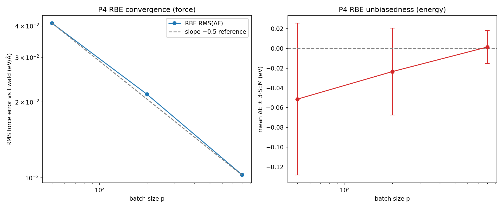

The reading package adds the higher-level diagnostic figures (relative paths
from this `docs/` directory):

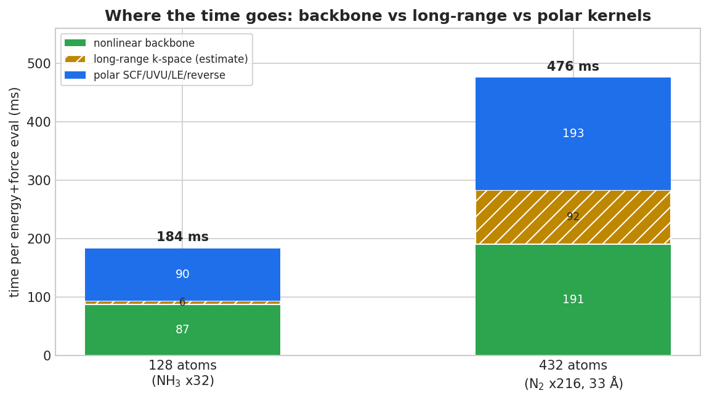

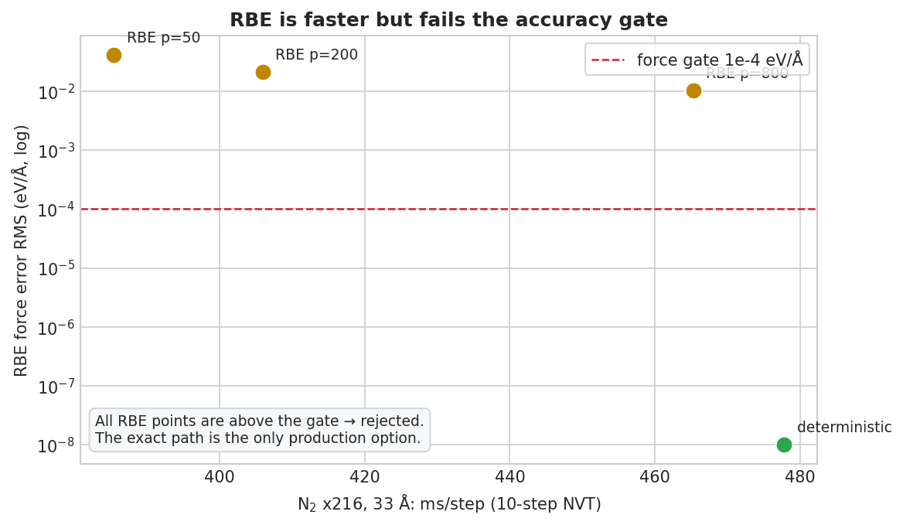

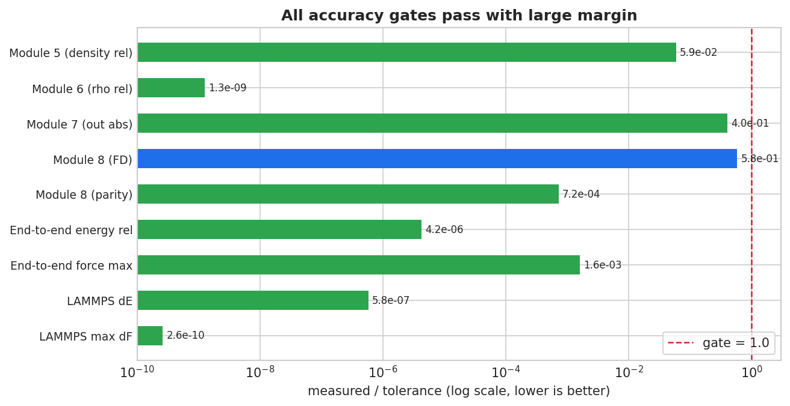

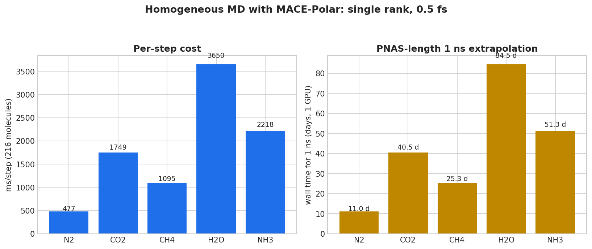

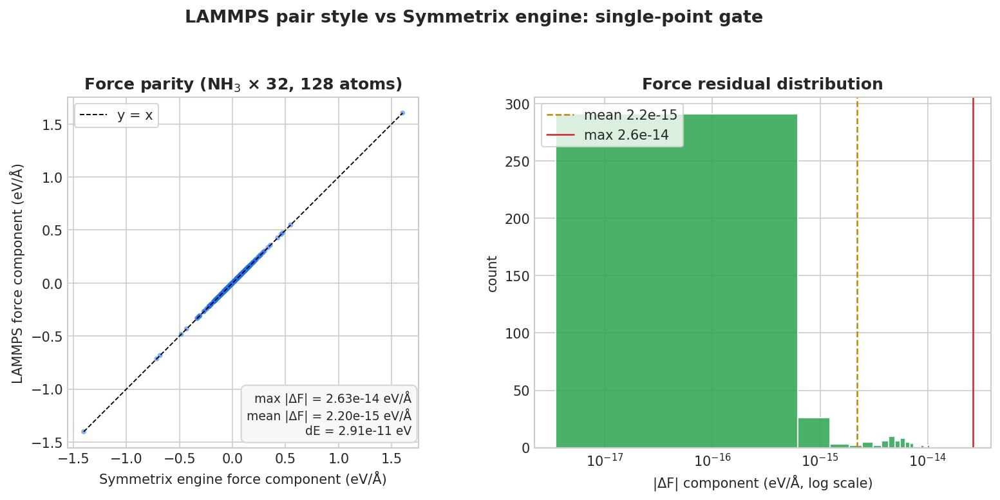

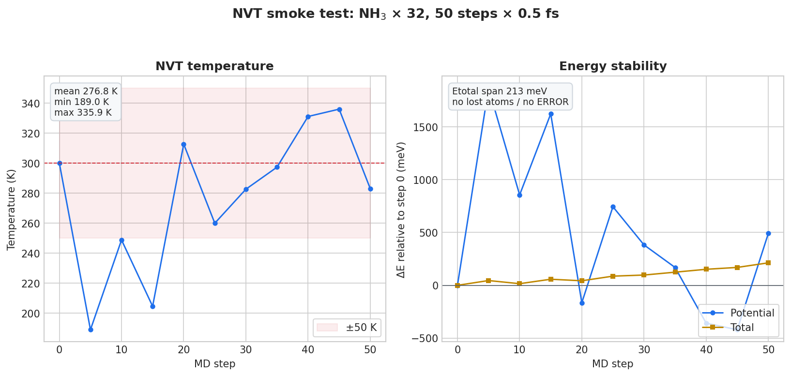

See [阅读说明](阅读说明.md) for the reading order, data provenance, and
reproduction entry points.

### 3.9 Kernel-level decomposition

Source: `docs/design/KERNEL_PROFILE_2026-10-19.md` and the CUPTI/Kokkos traces
under `mlip/bench/kernel_profile_2026-10-19/`. Hardware counters were blocked by
the container/driver, so durations and launch shapes are measured; occupancy is
a static estimate.

| Family | GPU time (ms) | % of 183.5 ms eval | Launches |
|---|---:|---:|---:|
| polar pipeline (SCF/Coulomb/LE/UVU/dense) | 73.36 | 40.0% | 238 |
| e3nn scalar linear forward + reverse | 66.68 | 36.3% | 302 |
| backbone nonlinear (gates/gather/normalization) | 19.03 | 10.4% | 46 |
| tensor product (MH-1 fused paths) | 10.91 | 5.9% | 18 |
| MLP / dense | 3.44 | 1.9% | 65 |
| cuBLAS / external | 1.40 | 0.8% | 51 |

The eval is GPU-busy 96% of wall time, but **SM-weighted utilization is only
52%** (95.7/183.5 ms). The dominant defect is launch shape, not launch count:
39 kernels run on **1x1x1 grids** (128 threads) and consume **47.8 ms** while
using 0.042 ms of SM-weighted time. The two worst are `polar reverse dense`
(25.74 ms) and `reverse nonlinear normalization` (12.74 ms), each one block.
The largest single family is the `e3nn` scalar linear path (66.68 ms); its
forward and reverse kernels are load/latency-bound and re-read a small weight
matrix per sample. These are the targets of the in-flight kernel round.

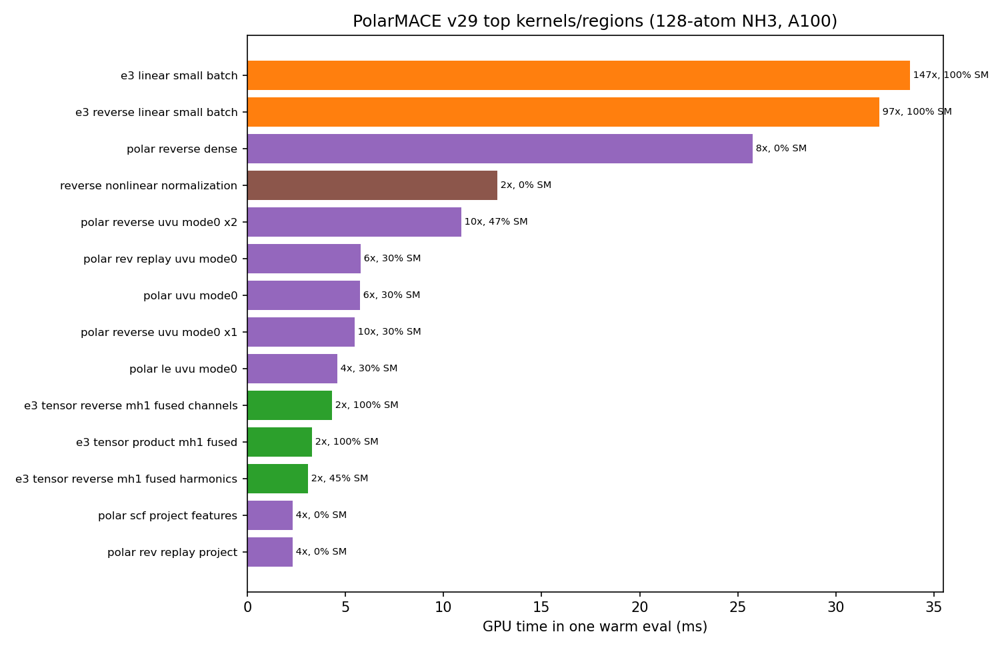

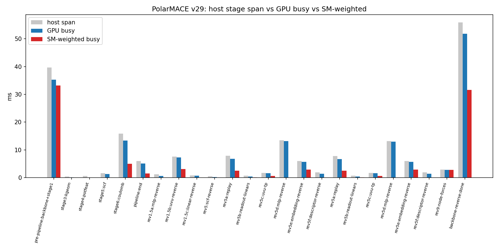

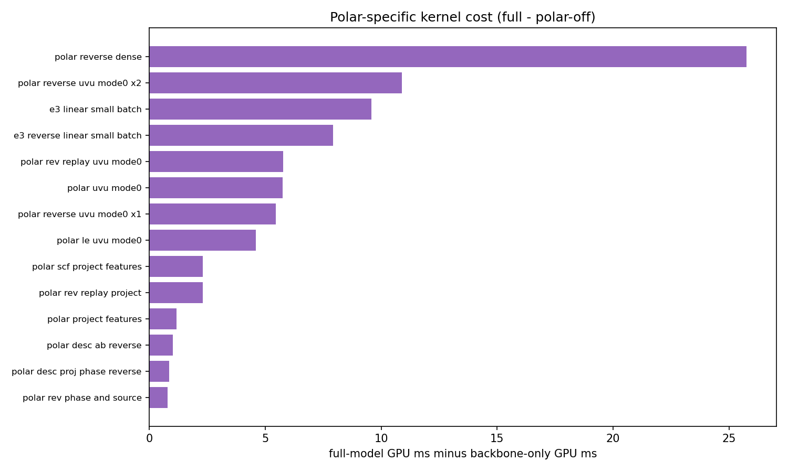

---

## 4. Findings

### 4.1 Cost structure: backbone plus polar non-k kernels

Completed measurements give a consistent picture:

- **128 atoms, same model:** backbone-only 87.24 ms -> full 183.50 ms. The
  polar layer adds 96.26 ms (52.5% of the full eval, 2.10x).
- **432 atoms, N2/33 A, same model:** full 475.883 ms/step vs polar-off
  190.738 ms/step. The polar layer adds **285.145 ms (59.9%)**; the backbone
  accounts for 190.738 ms (40.1%).
- **Stage profile at 128 atoms** (`polar_profile_8eval_v29.log`, representative
  uncontended eval): backbone + stage 1 ~36.6 ms; polar forward pipeline
  ~20 ms, of which the k-space Coulomb stage is ~14.0 ms; reverse/replay and
  node forces ~53 ms. The k-space slice is therefore only ~7.6% of that eval,
  while the nonlinear MLP/UVU/replay kernels dominate the polar cost.

**Long-range share.** The full polar layer is ~60% of the 432-atom step in the
completed coarse ablation. The finer figure that the ongoing profiling round
attributes to the k-space/long-range slice, **~20% of the 432-atom step**, is
an in-flight estimate: the dedicated 432-atom stage profile
(`polar_profile_n2_33a.py`) had produced no output at the evidence cut-off.
Treat the ~20% as provisional until that JSON/report exists; the 60% full-polar
ablation and the 40% backbone share are directly measured.

**Bottleneck:** the nonlinear backbone (roughly 40-48%) plus the polar non-k
kernels (UVU/MLP reverse, replay, local-electron, node forces). Optimizing only
the k-space Ewald/RBE stage cannot remove most of the cost.

### 4.2 MH-1 is architecturally blocked

The rejection is a family-shape check, not a missing export or a flag. The
model's second interaction differs on edge channels, hidden irreps, product
output, and readout class; the checkpoint matches the JSON exactly. Route A
(re-export) is infeasible without retraining/distillation, and Route C
(relaxing only the gate) would run unprepared conditioned-MLP tables and is
numerically wrong. The staged route estimates are engineering estimates, not
measurements:

| Route | Scope | Estimated speedup | Effort |
|---|---|---|---|
| B1 | family analysis + pair conditioning + generic streamed, FP32 enablement | ~0.5-1.0x (not a speed guarantee) | 5-8 days |
| B2 | B1 + v4 contract + JIT host/device artifacts, polar materialized | target 1.5-3x backbone, ~1.2-1.5x full model | +15-25 days |
| B3 | full polar direct/JIT | up to ~1.5-2x full model | +10-20 days |
| B4 | LAMMPS direct/JIT wiring | required to change the measured LAMMPS timings | +10-15+ days |

None of these estimates is included in the measured tables above.

### 4.3 RBE and 1-hop are rejected by the force gate

Both are genuine performance ideas, and both fail the minimum-accuracy rule:

- RBE: excellent statistical behavior (slope -0.49885, unbiased, bitwise
  same-seed reproducibility) but RMS_F 1e-2 to 4e-2 eV/A, i.e. 100-400x the
  1e-4 eV/A force gate.
- 1-hop ghost: 2.86x faster than exact 2-hop, but dE 7.94e-5 eV (1.6x over the
  5e-5 eV tolerance) and max dF 4.116e-3 eV/A (41x over the 1e-4 eV/A gate).
- Exact 2-hop is the only MPI mode that passes, and it is 28.1x slower than
  1 rank on one GPU.

### 4.4 One GPU means MPI does not speed up

All MPI timings above were taken on one shared A100. The exact 2-hop ghost
graph has ~20x more edges than the 1-rank graph in the 14.7 A box, and the
2-hop workspace exceeds a single card at 4 ranks (4.5-6.9 GiB per block).
The upstream linear H1 message passing is also 3.38x slower at 2 ranks on the
same GPU. MPI is a functional/correctness milestone, not a speedup, until
per-layer feature exchange and multiple GPUs are available.

---

## 5. Kernel optimization round (measured A/Bs)

All changes below keep FP64 and every physical term. "Bitwise" means the
reference and optimized paths produce identical energies (dE = 0.0) and force
differences at machine precision.

### 5.1 Nonlinear backbone (`MaceNonlinearKokkosT`)

| Configuration (polar-off ablation) | Before | After | Speedup |
|---|---:|---:|---:|
| 128 atoms | 87.3 ms/eval | **34.0 ms** | **2.57x** |
| 432 atoms | 191.9 ms/eval | **49.6 ms** | **3.87x** |

Changes: `packed_gemm` e3nn backend default for double on CUDA
(`mace_nonlinear_kokkos_impl.tpp:3178-3192`, env revert
`MATOS_E3_LINEAR_BACKEND=scalar`); double-precision fused gate-normalization
reverse (`:3291-3315`, env revert `MATOS_FUSED_GATE_REVERSE=0`); workspace slack
plus persistent device spline buffers. Parity: dE = 0.0, max |dF| 1.8e-14
(128 atoms) / 4.3e-14 (432 atoms).

LAMMPS: N2-432 polar-off **191.0 -> 98.3 ms/step**; N2-432 full
**476.4 -> 345.7 ms/step**. NH3-128 10-step means are spike-dominated
(936.5 -> 466.8), so the steady polar-off eval (85.7 -> 65.7 ms) is the
reliable small-system number.

### 5.2 Polar pipeline

`dense_reverse` now parallelizes over `(node, input channel)` with one writer
per slot and the original accumulation order (`mace_polar_impl.tpp:1998-2010`):

| Metric | Before | After | Delta |
|---|---:|---:|---:|
| dense-MLP reverse (two blocks) | 12.80 + 12.83 ms | **0.75 + 0.75 ms** | 17x |
| polar reverse | 184.6 ms | **160.4 ms** | -13.1% |
| full eval, 432 atoms | 479 ms | **454 ms** | -5.2% |

Energy is bitwise unchanged (-643858.407420772 eV). Module-8 and 32/32
end-to-end results are identical to the pre-change baseline.

### 5.3 e3nn scalar linear

Sample-blocked scalar kernels keep the per-output `source` accumulation order
and coalesce weight reads (`e3nn_kokkos.cpp:420-437`, `:1214-1231`). On the
128-atom full model in LAMMPS: **184.06 -> 165.99 ms/eval (1.11x)**, medians of
two independent 12-evaluation rounds. Bitwise equality (max abs diff 0.0) was
verified on synthetic small/wide cases and on the full model tensors
(1,245,184 values), plus a NumPy scalar reference.

### 5.4 MPI H1 message passing

2-rank H1 parity on the 128-atom NH3 box: **dE 2.91e-11 eV**, **max dF
1.41e-15 eV/A**; 20-step NVT stable (no lost atoms, final state matches 1 rank
to 9.8e-15 A and 4.7e-14 eV/A). Wall time **1600.5 ms** vs exact 2-hop
**5155 ms** (3.22x faster), but 8.7x slower than the optimized 1-rank path
(183.6 ms) on one shared GPU. Fixed in this round: local-receiver graph
construction, ghost force accumulation/communication, Kokkos polar pack/unpack
branches, 1-rank H1 mode retention, `comm_forward/comm_reverse` flags, and
double-counted ghost adjoint seeds.

### 5.5 Final clean build and independent speed ablation

The Python extension and LAMMPS binary were rebuilt from the settled tree
(`symmetrix.cpython-312-...so` sha256 `6045cffb...`; `lmp` sha256
`7e9c6bec...`), then the full gate suite and a separate speed ablation ran with
no other compute job active. All required gates PASS: module 5, 6, 7, 8,
32/32 end-to-end, and LAMMPS 1-rank/2-rank parity (the Kokkos CUDA-teardown
abort after each gate is recorded but accepted only when the gate's completion
marker is present). An independent rerun on the immediately preceding build
reproduced the same verdicts, so the result is not sensitive to the last
e3nn backend switch.

| Configuration | v29 baseline | Kernel round 1 | Speedup |
|---|---:|---:|---:|
| NH3 128 atoms, full PolarMACE | 183.50 ms/eval | **122.21 ms** | **1.50x** |
| NH3 128 atoms, polar-off | 87.24 ms/eval | **40.71 ms** | **2.14x** |
| N2 432 atoms, full PolarMACE | 477.83 ms/step | **293.34 ms** | **1.63x** |
| N2 432 atoms, polar-off | 191.9 ms/eval | **47.65 ms** | **4.03x** |

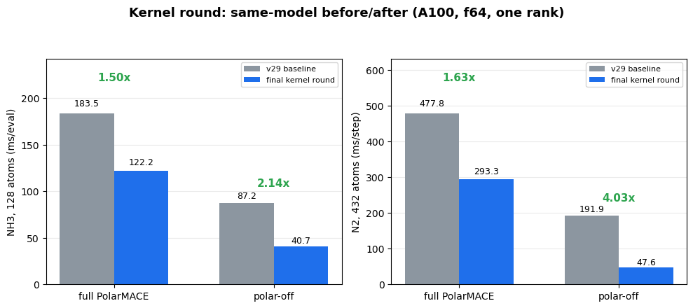

The 128-atom PyTorch `mace_polar` reference is 94.0 ms/eval: after round 1 the
engine was **1.30x slower**, and after round 2 (Section 5.6) it is **1.66x
faster**. The 432-atom warm-block numbers were contaminated by an external GPU
tenant (1216 ms/step versus 293 ms for the first block); only the first-block
value is reported. Round-1 remaining bottlenecks were polar replay,
SCF/LE/embedding reverse, and the e3nn reverse path; round 2 addresses them and
re-ranks the remainder.

### 5.6 Kernel round 2 (accepted, 2026-10-19)

Round 2 supersedes the round-1 numbers in Section 5.5. All gates pass on the
final build; the per-kernel table, waterfall, and stale-binary evidence are in
[`results/KERNEL_ROUND2.md`](results/KERNEL_ROUND2.md).

| Configuration | Round 1 | Round 2 | Speedup |
|---|---:|---:|---:|
| NH3 128 atoms, full PolarMACE | 122.46 ms/eval | **56.50 ms/eval** | **2.17x** |
| NH3 128 atoms, polar-off | 40.58 ms/eval | **27.66 ms/eval** | 1.47x |
| N2 432 atoms, full PolarMACE | 294.39 ms/step | **126.59 ms/step** | 2.33x |
| GPU busy (CUPTI, 128 atoms) | 116.66 ms | **49.97 ms** | 2.33x |


**The most important finding is not a source change.** The accepted round-1
binary `7e9c6bec...` had been linked from stale objects: it still executed the
old 1-D `polar reverse dense` (26.00 ms/eval) and the unfused reverse gate
normalization (13.03 ms/eval), although the source already contained the 2-D
and fused paths. A forced rebuild activated them and saved ~39 ms/eval. Every
round now records the source state, the CUPTI kernel names, and the final binary
hash; a binary hash alone is not proof of the source state.

The source changes in round 2:

- reverse nonlinear normalization: 2-D MDRange + per-node deterministic
  density fold (13.03 → 0.00 ms; fused path 0.17 ms);
- three project kernels: MDRange over `(node, j)` (5.00 ms saved);
- reverse UVU x1/x2: TeamPolicy + shared-memory weight tile (16.00 → 7.47 ms);
- forward/replay/LE UVU: same smem tile (17.19 → 3.31 ms).

Bitwise checks: r2→r3, r3→r4, r4→r5 all have identical PE and max |dF| 0.0 on
the 128-atom model; the RN fallback is bitwise against the scalar path.

Gates: module 5 (dens abs 6.689e-8), module 6 (dE rel 1.095e-15), module 7
(stage rel 1.174e-7), module 8 (FD 5.783e-4, parity 7.191e-7), end-to-end
32/32 (dE rel 1.084e-11, dF 1.624e-7 eV/A), LAMMPS 1-rank (dE 2.910e-11 eV,
dF 2.579e-14 eV/A). Every gate process exits 134 after writing PASS due to a
pre-existing CUDA teardown abort; acceptance requires the PASS marker and JSON.


**What remains:** tensor products 10.81 ms (already 100% SM-covered but
instruction/store-bound; the round-3 plan rules out DMMA and targets channel
blocking + register accumulation + zero-fill elision), cuBLAS 3.80 ms (312
launches, 14.8% coverage), UVU reverse 6.76 ms (39.5%), and narrow
affine/convolution kernels 4.33 ms (3%). Replay is no longer a major target:
the UVU rewrite reduced it from 5.77 to 1.20 ms, so eliminating replay now
saves at most ~1.5 ms.

### 5.7 MPI H1: one-rank fix accepted, two-rank engine blocker

The H1 path is numerically exact. The old one-rank defect (1042 periodic
ghosts, 1170 nodes vs 128) is fixed by folding the one-rank graph onto local
atoms, skipping the comm-cutoff extension, zero-sizing the exchange hooks when
there are no ghost rows, and using device-side pack/unpack.

| Metric | Before | After |
|---|---:|---:|
| default 1-rank | 122.80 ms | 50.84 ms |
| H1 1-rank | 418.64 ms | **50.20 ms** |
| H1 / default | **3.41x slower** | **0.99x** |
| same-binary A/B of the fold | 176.77 ms | 54.62 ms (**3.24x**) |

Gates: H1 1-rank vs default dE = 0.0 eV, max dF = 1.41e-15 eV/A; 20-step NVT
stable (drift 4.74e-14 A / 4.70e-14 eV/A). The default-path gain (122.8 ->
50.8) is the concurrent kernel round, not this work.

**Two-rank fix (accepted).** The default exact 2-hop OOM was caused by two
full-size reverse buffers whose live ranges do not overlap their forward
counterparts: `edge_message_adj` (reuses `edge_messages_storage` now) and
`raw_weight_adj` (aliases `weight_adj` now). Peak **80,966 MiB (OOM) ->
63,088 MiB (~30.8 GiB/rank)**, rc=0; dE=0, max dF **1.687e-6 eV/Å**. The H1
SIGSEGV was a communication-width mismatch: `node_feature_width()` returned
512 while layer-1 exchanges 2048, overrunning LAMMPS' comm buffers; it now
returns the product-block width and adds extent guards. H1 2-rank peak
**6,120 MiB (~3 GiB/rank)**, dE=0, max dF **1.01e-14 eV/Å**. Both 2-rank
paths pass 20-step NVT; the 2-GPU test has no engine blocker. Final
2-rank-fixed binary `2a999fe6…`.


Details: [`results/MPI_H1.md`](results/MPI_H1.md) and
[`theory/MPI_H1.md`](theory/MPI_H1.md).

### 5.8 Still pending

| Workstream | State |
|---|---|
| MH-1 tensor products: channel blocking + register accumulation + zero-fill elision | proposed in `design/KERNEL_ROUND3_PLAN.md`; DMMA ruled out by measured arithmetic intensity |
| cuBLAS small-GEMM batching | proposed |
| UVU reverse further widening / x1+x2 fusion | proposed |
| narrow affine / convolution kernels (3% coverage) | proposed |
| polar replay elimination | now low payoff (~1.5 ms); deprioritized |
| MPI 1-rank / 2-rank engine fixes | **accepted**; 2-GPU test pending queue capacity |
| Stage-2 kernel work toward 20–30 ms | in progress (post-round-3 follow-up) |
| multi-GPU 2/4-rank scaling (432/1024 atoms) | waiting for queue3 capacity; 1-GPU remote probe queued on queue004 |
| leoff timing | model exists; no timing JSON |

---

## 6. Reproduction commands

All commands run from the MLIP bench workspace, which is the source of the
gates and logs:

```bash
export MLIP=/workspace/group/shared/bza/\
task3_sampling_database/mlip
cd "$MLIP"

export CUDA_VISIBLE_DEVICES=0
export SYMMETRIX_BACKEND=cuda12-sm80
export SYMMETRIX_BACKEND_DESCRIPTOR_PATH=\
"$MLIP/models/mace-polar/backend_cuda12_sm80.json"
export LD_LIBRARY_PATH=/opt/matos-tools/cuda/12.9/lib64:\
/opt/matos-tools/conda/envs/matos-compute/lib
PY=/workspace/caches/conda/envs/polar/bin/python

# Accuracy gates
$PY bench/polar_module5_gate.py
$PY bench/polar_module6_gate.py
$PY bench/polar_module7_gate.py
$PY bench/polar_module8_gate.py
$PY bench/polar_endtoend_parity.py
$PY bench/polar_rbe_gate.py

# LAMMPS pair style and MD (requires the patched LAMMPS build)
$PY bench/polar_lammps_parity.py
$PY bench/polar_lammps_md.py

# Speed
$PY bench/polar_perf_report.py
$PY bench/polar_vs_linear_speed.py
$PY bench/polar_backbone_lammps.py
$PY bench/linear_streamed_compare.py
$PY bench/linear_mpi_speed.py
$PY bench/polar_homog_timing.py
$PY bench/polar_rbe_md_timing.py

# Pending / in-flight (no completed artifact at the cut-off)
$PY bench/polar_rbe_force_error_33a.py
$PY bench/polar_profile_n2_33a.py
$PY bench/polar_torch_reference_speed.py
```

Notes:
- Do not run these on a shared GPU without exclusive access; the v29 absolute
  times are contention-sensitive.
- The patched LAMMPS binary used by the gates is
  `symmetrix/build-lammps-aacd036df381800a/lmp` under the engine checkout
  (`external-repos/symmetrix-xl` in the workspace).
- The engine patch is `patches/symmetrix-xl-polar-support.patch` (325,145 bytes).

---

## 7. Artifact index

### 7.1 In this repository (links are relative to `docs/`)

| Artifact | Path |
|---|---|
| v29 performance JSON | [`../results/polar_perf_v29.json`](../results/polar_perf_v29.json) |
| v28 vs v29 figure | [`../results/polar_perf_v28_vs_v29.png`](../results/polar_perf_v28_vs_v29.png) |
| Engine / model ablation JSON | [`../results/engine_compare.json`](../results/engine_compare.json) |
| Engine comparison figure | [`../results/polar_engine_compare.png`](../results/polar_engine_compare.png) |
| Streamed vs materialized JSON | [`../results/streamed_compare.json`](../results/streamed_compare.json) |
| MPI 1-rank JSON | [`../results/polar_time_mpi1.json`](../results/polar_time_mpi1.json) |
| MPI exact 2-hop JSON | [`../results/polar_time_mpi2.json`](../results/polar_time_mpi2.json) |
| MPI 1-hop JSON | [`../results/polar_time_mpi2_onehop.json`](../results/polar_time_mpi2_onehop.json) |
| Linear H1 MPI JSON | [`../results/linear_mpi.json`](../results/linear_mpi.json) |
| MPI status figure | [`../results/polar_mpi_status.png`](../results/polar_mpi_status.png) |
| LAMMPS parity, 1 rank | [`../results/polar_lammps_parity.json`](../results/polar_lammps_parity.json) |
| LAMMPS parity, 2 rank | [`../results/polar_lammps_parity_mpi2.json`](../results/polar_lammps_parity_mpi2.json) |
| LAMMPS parity figure | [`../results/polar_lammps_parity.png`](../results/polar_lammps_parity.png) |
| LAMMPS NVT MD JSON | [`../results/polar_md.json`](../results/polar_md.json) |
| LAMMPS NVT MD figure | [`../results/polar_lammps_md.png`](../results/polar_lammps_md.png) |
| RBE gate JSON | [`../results/polar_rbe_gate_v29.json`](../results/polar_rbe_gate_v29.json) |
| RBE gate figure | [`../results/polar_rbe_gate_v29.png`](../results/polar_rbe_gate_v29.png) |
| MH-1 feasibility analysis | [`design/MH1_FASTPATH_FEASIBILITY.md`](design/MH1_FASTPATH_FEASIBILITY.md) |
| Key numeric rows (CSV) | [`../results/comparison_summary.csv`](../results/comparison_summary.csv) |

### 7.2 External source artifacts (workspace paths)

| Artifact | Path |
|---|---|
| v28 benchmark JSON | `.../mlip/bench/polar_perf_v28.json` |
| v29 benchmark JSON (copy) | `.../mlip/bench/polar_perf.json` |
| Engine comparison JSON | `.../bench/lammps_parity/engine_compare/engine_compare.json` |
| Homogeneous timings | `.../bench/lammps_parity/homog_timing/homog_timing.json` |
| RBE 33 A timings | `.../bench/lammps_parity/rbe_md_timing/rbe_md_timing.json` |
| Backbone ablation (N2) | `.../bench/lammps_parity/backbone_timing/result.n2_full.json`, `result.n2_polaroff.json` |
| Gate logs | `.../mlip/logs/polar_module{5,6,7,8}_gate_v29*.log` |
| End-to-end log | `.../mlip/logs/polar_endtoend_v29final.log` |
| RBE gate log | `.../mlip/logs/polar_rbe_gate_v29opt.log` |
| LAMMPS parity/MD logs | `.../mlip/logs/polar_lammps_parity_v29final.log`, `polar_lammps_md_v29final.log`, `polar_lammps_md_mpi2_n32.log` |
| Stage profile log | `.../mlip/logs/polar_profile_8eval_v29.log` |
| Engine patch | `patches/symmetrix-xl-polar-support.patch` |

---

## 8. Data-quality notes and missing artifacts

These are deliberate caveats, not inferred results:

1. **`results/polar_perf_v28.json` is absent from this repository.** The v28
   benchmark JSON exists only at
   `mlip/bench/polar_perf_v28.json`; the v28 numbers in Section 3.1 come from
   there.
2. **v28 deterministic row:** the report's 6951.7 ms is an energy-only median;
   the energy+force benchmark JSON is 6966.79 ms. Section 3.1 uses the JSON.
3. **End-to-end relative error:** the v29 final log shows 3.2e-12 to 1.1e-11
   across the 32 frames. The "<=4.2e-12" line in `REPORT_2026-10-19.md` matches
   only the CO2 subset; the tables above use the full 32-frame range.
4. **`results/polar_md.json` vs final log:** the JSON records 599.584 ms/step
   (29.9792 s loop); the final v29 log records **493.662 ms/step**
   (24.6831 s loop) with identical thermo. The difference is GPU contention;
   Section 2.3 uses the final log and notes the JSON value here.
5. **Linear generic timing spread:** the engine-compare run measured 7.219 ms
   with `auto -> generic`; the explicit streamed compare measured 19.291 ms on
   the same path. Both are reported; materialized (6.6102 ms) is the stable
   linear reference.
6. **`n2_homog_pilot.log` is empty (0 bytes).** That path was a stale launcher
   log; the completed 1 ps pilot is `runs/n2-homog-pilot/run-status.json`
   (2000 production steps, 537.99 ms/step; see Section 3.5).
7. **432-atom long-range share:** the ~20% k-space estimate is in flight; the
   completed coarse ablation gives 59.9% for the *whole polar layer*. The
   dedicated profile output was empty at the cut-off.
8. **leoff timing and MPI H1 validation/timing are still pending.** The 33 A
   RBE fixed-configuration force errors now exist (Section 3.6); the PyTorch
   reference speed log is reported in Section 3.7; the kernel profile report
   now exists (`docs/design/KERNEL_PROFILE_2026-10-19.md`). No numbers were
   invented for pending items.
9. **4-rank OOM** is reported from the v30 report; no separate JSON artifact
   was produced.
10. Absolute timings are contention-sensitive; ratios from the same run are the
    reliable quantity.

---

*Prepared from completed project artifacts only. Rows added after the 08:20 UTC
cut-off (PyTorch reference speed, 1 ps N2 pilot) cite their source logs; no
numbers were estimated from in-flight work, and no other agents' bench outputs
were modified.*
