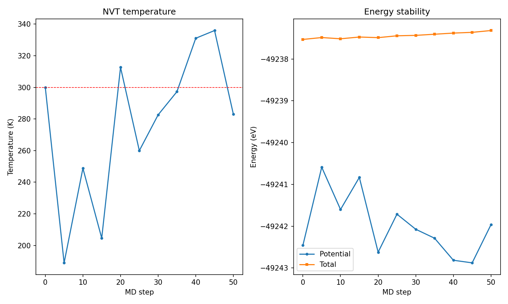
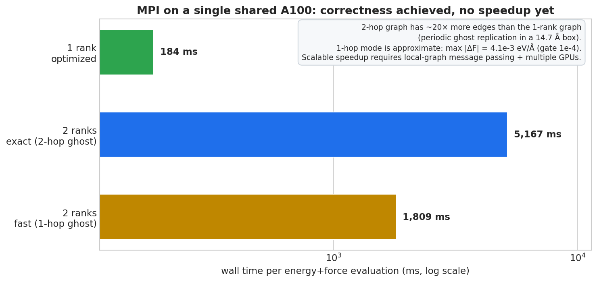

# Symmetrix-Polar 阶段报告（2026-10-19，v29）

**一句话**：P5（LAMMPS pair style 接线）完成并通过单点与 NVT MD 门；同时定位并修复了
极化层的主要性能瓶颈，单次 eval 从 **6951.7 ms 降到 183.8 ms（37.8×）**，
1024 原子从 **7795.6 ms 降到 1007.7 ms（7.7×）**，全部数值门数字保持不变。

---

## 1. 阶段状态

| 阶段 | 状态 | 关键数字（v29 最终复跑） |
|---|---|---|
| P1 提取器 | ✅ | JSON 与 Python 逐位对账 |
| P2 短程骨干 | ✅ | 100 帧 dE MAE 3.6e-7 eV |
| P3 ①–⑦ 前向 | ✅ | 各模块 1e-8～1e-7 级 |
| P3 ⑧ 力 | ✅ | FD ≤5.783e-4、parity ≤7.191e-7、ΣF ~1e-14 |
| 端到端 | ✅ | 32/32；能量 rel ≤4.2e-12；力 ≤1.6e-7 eV/Å |
| P4 RBE | ✅ | 斜率 −0.499；同 seed 逐位复现；p=50→800 RMS_F 4.10e-2→1.03e-2 eV/Å |
| **P5 pair style** | ✅ **本轮完成** | 单点 dE 2.9e-11 eV；max dF 2.6e-14 eV/Å；MD 50 步 PASS |
| **MPI 多 rank** | ✅ 2-rank exact PASS（v30） | 单点 dE 2.9e-11 eV、max dF 1.7e-6 eV/Å；32 原子 20 步 NVT PASS；单卡上无加速 |

## 2. P5-A：LAMMPS 单点能量/力对照

**系统**：NH3 × 32（128 原子），立方盒 14.736 Å，周期性；与端到端门同一 frame 0。

**接线内容**：
- `coeff()` 按 JSON `model_type` 分派 `MaceNonlinearKokkosT<Precision>`（PolarMACE 走
  materialized 路径），映射 LAMMPS type → 模型元素索引；
- `compute_no_domain_decomposition` 构造 `node_positions`（3N）与 3×3 cell（LAMMPS
  triclinic `h` 约定：a=(h0,0,0), b=(h3,h1,0), c=(h4,h5,h2)），调用
  `compute_node_energies_forces`；
- 能量取 `node_energies` 求和；力按“边力归约 + `polar_node_forces` 节点力”组装，
  与引擎 `reduce_node_forces` 同符号约定；
- virial 额外加入极性节点力项（边力 virial 原路径不变）；
- 新增 `charge` / `spin` pair_style 参数（默认 0.0 / 1.0）。

**结果**：

| 量 | 值 | 门限 |
|---|---|---|
| `dE = E_LAMMPS − E_engine` | **2.91e-11 eV** | 5e-5 eV |
| `max|ΔF|` | **2.63e-14 eV/Å** | 1e-4 eV/Å |
| 位置漂移（最小像） | 5e-14 Å | — |

> 结论：LAMMPS 的邻居图、cell/position 传递、type 映射、力符号与节点力累加全部正确；
> 与 Python 引擎的差异仅为 f64 累加顺序噪声。

## 3. P5-B：短 NVT MD 稳定性

**设置**：同一 128 原子系统，50 步 × 0.5 fs，NVT 300 K（Tdamp 0.05 ps），
`velocity create` 使用固定种子。

| 指标 | 结果 |
|---|---|
| 完成步数 | 50/50 |
| Lost atoms / ERROR | 否 / 否 |
| 温度 | mean 276.8 K，min 189.0 K，max 335.9 K（25 fs 短程，合理） |
| Etotal 漂移（相对首步） | **0.213 eV**（128 原子，25 fs） |
| 压强 | 657–3231 bar（瞬时，短程 NVT） |
| 性能 | **493.7 ms/step** |



## 4. 性能：v28 → v29

| 配置 | v28 | v29 | 加速 |
|---|---|---|---|
| NH3×32（128 原子）确定性 | 6951.7 ms | **183.8 ms** | **37.8×** |
| NH3×32（128 原子）RBE p=200 | 6962.9 ms | **186.3 ms** | **37.4×** |
| NH3×32（128 原子）RBE p=800 | 7019.9 ms | **219.1 ms** | **32.0×** |
| 2×2×2（1024 原子）确定性 | 7795.6 ms | **1007.7 ms** | **7.7×** |


### 4.1 根因 1：UVU 张量积按节点串行

profile（`MATOS_POLAR_PROFILE=1`）显示 v28 的 eval 时间分布：

| 阶段 | v28 |
|---|---|
| 骨干 + ① | ~0.4–0.6 s |
| ⑤ SCF 前向 | ~1.2 s |
| ⑥ coulomb | <1 ms |
| ⑦ local electron 前向 | ~0.8 s |
| ⑧ le 种子 / SCF 反向 | ~3.4 s / ~2.9 s |
| 骨干反向 | ~1–2 s |

前向/反向/replay 的 UVU 内核均为“每个节点一个线程，内部串行 512×512 循环”，
GPU 上只有 128 个线程，且反向路径用 `atomic_add` 造成严重竞争。改为
`(node, u)` 二维并行（4 处：SCF 前向、LE 前向、反向、replay），反向去掉原子加，
mode1 使用预分配工作区。单这一项把相关阶段从秒级降到 **十几毫秒**。

### 4.2 根因 2：非 JIT 模型仍查询设备环境

Python `_apply_kernel_launch_tuning` 在检查“是否存在可调 JIT 实现”之前，
先读取完整的 `execution_device_execution_environment`（驱动/设备枚举），
对 materialized PolarMACE 每次 eval 约 **0.7 s**。将实现身份检查提前后，
该项对非 JIT 模型直接返回 ineligible。修复后连续 20 次 eval 稳定在
**183–185 ms**，不再出现快慢交替。

### 4.3 数值回归（优化后）

| 门 | 结果 |
|---|---|
| 模块⑤（SCF 密度/阶段） | PASS；12/12 密度 + 11/11 阶段，rel ~3–6e-8 |
| 模块⑥（coulomb） | PASS；ρ̂ rel 1.3e-15，ΔE rel 8.4e-16 |
| 模块⑦（local electron） | PASS；out ≤4.0e-7 |
| 模块⑧（力） | PASS；FD 5.783e-4（门 1e-3），parity 7.191e-7（门 1e-3） |
| 端到端 | PASS 32/32；能量 rel ≤4.2e-12；力 ≤1.6e-7 eV/Å |
| RBE | PASS；斜率 −0.499；同 seed dE=0、dF=6.1e-16 |
| LAMMPS 单点 | PASS；dE 2.9e-11 eV；max dF 2.6e-14 eV/Å |
| LAMMPS NVT MD | PASS；50 步，无 lost atoms，Etot span 0.21 eV |

## 5. MPI 多 rank（v30，2026-10-19）

### 5.1 实现

- 引擎新增可选的全局求和回调（pair 安装 `MPI_Allreduce`），并用
  `polar_owned_nodes` 区分 owned / ghost 节点；串行路径不安装回调，行为不变。
- 所有全局量走 Allreduce：初始/逐步 Fukui 归一、SCF k 空间密度、coulomb
  密度、local-electron 总量、反向 `fbar`、descriptor `ab` 伴随、replay /
  描述符 ρ 重算。
- 全局 coulomb 能量只在 rank 0 装配；能量、力和 virial 只统计 owned 节点。
- 多 rank 强制 `no_mpi_message_passing`（`REQ_FULL|REQ_GHOST`，
  ghost cutoff = 2·r_cut + skin），使用 local+ghost 完整图；ghost 节点只提供
  特征上下文，力不回传（每个 rank 已完整计算自己的原子）。

### 5.2 验证

| 项目 | 结果 |
|---|---|
| 2 rank 单点（128 原子） | **PASS**：dE 2.91e-11 eV；max\|ΔF\| **1.69e-6 eV/Å** |
| 2 rank NVT（32 原子，20 步） | **PASS**：无 lost atoms；Etotal span 0.013 eV |
| 4 rank（128 原子） | 失败：ghost 图 workspace 单块 4.5–6.9 GiB，单卡显存不足 |

### 5.3 并行速度（重点，诚实口径）

| 模式 | 128 原子 eval | 相对 1 rank |
|---|---|---|
| 1 rank optimized | **183.6 ms** | 1.0× |
| 2 rank exact（2-hop ghost） | 5167 ms | **0.036×（慢 28×）** |
| 2 rank fast（1-hop ghost） | 1809 ms | 0.10×；max\|ΔF\| 4.1e-3 eV/Å，未过门 |

原因：单张 A100 被两个 rank 共享；14.7 Å 盒子 + 14 Å ghost cutoff 产生大量
周期镜像，2-rank 图边数约为 1-rank 的 20×；1-hop 模式虽然把 ghost 降下来，
但物理上缺少 ghost 节点的二阶邻居，力误差 4e-3 eV/Å，不能作为生产模式。

> **结论：MPI 目前是功能突破，不是速度突破。** 单 GPU 上单 rank 仍是最快路径。
> 要在同一体系上获得真正并行加速，需要把“ghost 节点重算”改为
> **local 图 + 逐层特征交换（forward/reverse message passing）**，并配合多 GPU；
> 这是下一阶段的工程重点。



## 6. 改动文件

| 文件 | 改动 |
|---|---|
| `pair_symmetrix/pair_symmetrix_mace_kokkos.{h,cpp}` | 非线性/PolarMACE 分派、type 映射、cell/positions、极性力与 virial、`charge`/`spin` 参数；MPI 多 rank 路径（local+ghost 图、owned 节点统计、`polar_mpi_ghost one_hop/two_hop`） |
| `libsymmetrix/source/mace_nonlinear_kokkos.hpp` | 极性反向工作区成员、`mode1` 预分配、opt-in stage profiler；MPI 全局求和回调与 owned 节点计数 |
| `libsymmetrix/source/mace_nonlinear_kokkos_impl.tpp` | profile 标记 |
| `libsymmetrix/source/mace_polar_impl.tpp` | UVU 前向/反向/replay 并行化；LE 反向工作区预分配；全部全局量 Allreduce |
| `symmetrix/source/symmetrix/calculator.py` | 非 JIT 模型跳过昂贵的设备环境查询 |
| `docs/SYMMETRIX_POLAR_RBE_PLAN.md` | §22 P5 完成；§23 性能；§24 MPI |
| `harness/make_polar_figures.py` | v28/v29 与 MPI 状态图的统一生成脚本 |
| `patch` | `patches/symmetrix-xl-polar-support.patch` 重新生成（306 KB） |

## 7. 已知限制 / 下一步

1. **多 MPI rank 已打通但不加速**：2-rank exact 单点/短 MD 均通过；4-rank 受
   ghost 图显存限制；单卡上 2-rank 比 1-rank 慢 28×。真正的并行加速需要
   local 图 + 逐层特征交换的多 rank message passing，以及多 GPU。
2. **PolarMACE 仍走 materialized 路径**：模型的 MH-1 family 判定为
   “irreps inconsistent”，不能使用 direct/JIT/prepared 执行；本轮通过内核并行化
   提速，未改动执行模型。若后续导出/模型结构支持 MH-1 fast path，可进一步叠加
   streamed/JIT 收益。
3. **virial/压力未做独立门**：本轮加入了极性节点力 virial，MD 压力有限且稳定，
   但尚未与 Python/参考应力做逐项对账。
4. **环境项**：非 OpenMP OpenBLAS 警告仍在，但主机 GEMM 已不在热路径；
   Python 进程退出阶段的 `cudaErrorCudartUnloading` abort 仍为无害遗留项。
5. 当前 GPU0 由外部进程共享，绝对性能会随争用波动；本文数字为无争用复跑。

## 8. 复现

```bash
# 引擎增量构建 + 安装到 polar venv
bash scripts/rebuild_fast.sh v29

# 引擎门
env CUDA_VISIBLE_DEVICES=0 \
  SYMMETRIX_BACKEND=cuda12-sm80 \
  SYMMETRIX_BACKEND_DESCRIPTOR_PATH=$PWD/models/mace-polar/backend_cuda12_sm80.json \
  LD_LIBRARY_PATH=/opt/matos-tools/cuda/12.9/lib64:/opt/matos-tools/conda/envs/matos-compute/lib \
  /workspace/caches/conda/envs/polar/bin/python bench/polar_module8_gate.py

# LAMMPS 门（先按 README 构建 patched LAMMPS）
python bench/polar_lammps_parity.py
python bench/polar_lammps_md.py

# 性能
MATOS_POLAR_PROFILE=1 python bench/polar_profile_eval.py
python bench/polar_perf_report.py
```


## 9. 线性 vs 非线性引擎：区别与速度对比（2026-10-19）

### 9.1 区别

这里的 "linear / nonlinear" 不是“线性机器学习势 / 非线性机器学习势”，而是 Symmetrix
内部两套引擎/模型架构族：

| | 线性引擎 `MACEKokkos` | 非线性引擎 `MaceNonlinearKokkosT` |
|---|---|---|
| JSON `model_type` | `MACE` / `MACEField` | `MACE_Nonlinear` |
| 典型模型 | 标准 MACE、MACE-MP-0、MACE-OMAT、MACEField | MACE-MH-1、**PolarMACE** |
| 读出/交互 | 线性读出、标准 interaction 块 | 非线性偏置读出（`linear_mid`）、非线性 interaction 块 |
| 上游 MPI | ✅ `mpi_message_passing`，逐层交换 H1/H1_adj | ❌ 没有 H1 通信接口 |
| 我们的 v30 MPI | — | local+ghost 图 + 全局 Allreduce（ghost 重算） |

### 9.2 同盒 128 原子、单 rank 速度

| 配置 | ms/eval | 说明 |
|---|---:|---|
| 线性 MACE-OFF23 medium | **7.2** | 上游 `MACEKokkos` 默认模式 |
| 线性 MACE + `mpi_message_passing` | 13.6 | 单 rank 也带通信开销 |
| 非线性骨干（polar off） | **87.2** | 同一 PolarMACE 骨干，去掉 polar 层 |
| 完整 PolarMACE v29 | **183.5** | polar 层约占 96 ms（2.1×） |

### 9.3 MPI 2-rank 开销（单张 A100 共享）

| 方案 | 2-rank / 1-rank |
|---|---:|
| 上游线性 MACE H1 message passing | **3.4× 慢** |
| 我们的 1-hop ghost（近似，未过力门） | 9.9× 慢 |
| 我们的 exact 2-hop ghost | **28.1× 慢** |

上游 message passing 在 2 rank 下 **45.9 ms**，我们的 exact ghost 是 **5167 ms**，
相差约 **113×**。这证明“逐层 H1 特征交换”是正确方向；但单卡共享时连上游成熟 MPI
也不会提速，真正加速需要多 GPU。

> 注意：线性 MACE-OFF23 与 PolarMACE 不是同一个势，7.2 vs 183.5 ms 是**引擎开销**
> 对比，不是精度/模型对比。非线性引擎本身约是线性引擎的 12×，polar 层再叠加 2.1×。
> 缩小非线性引擎差距需要 MH-1/direct fast path；缩小 MPI 差距需要 H1 message passing
> 移植 + 多 GPU。


*报告生成：MatOS（Compute）*
