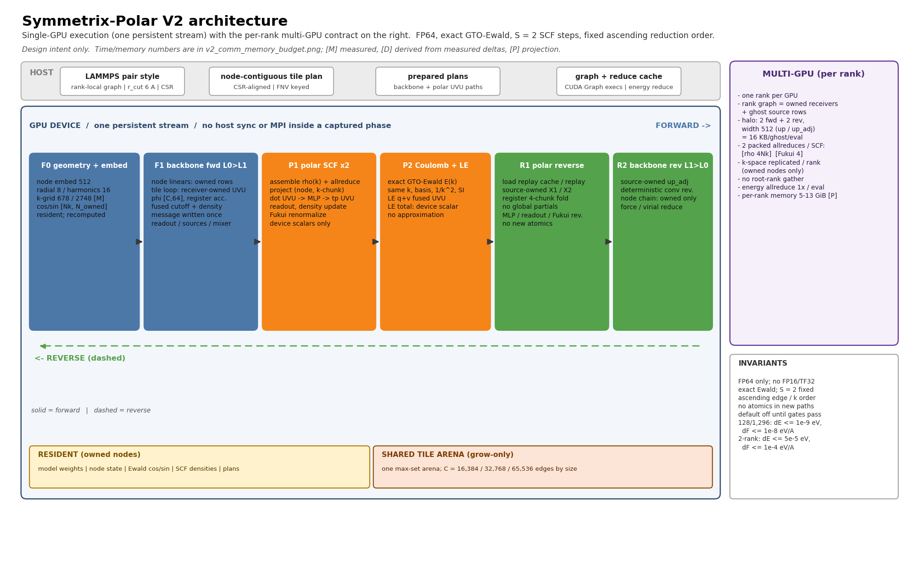
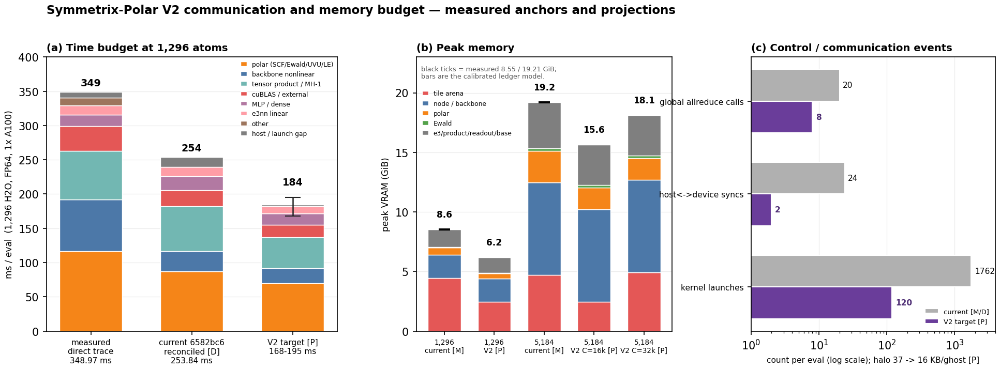
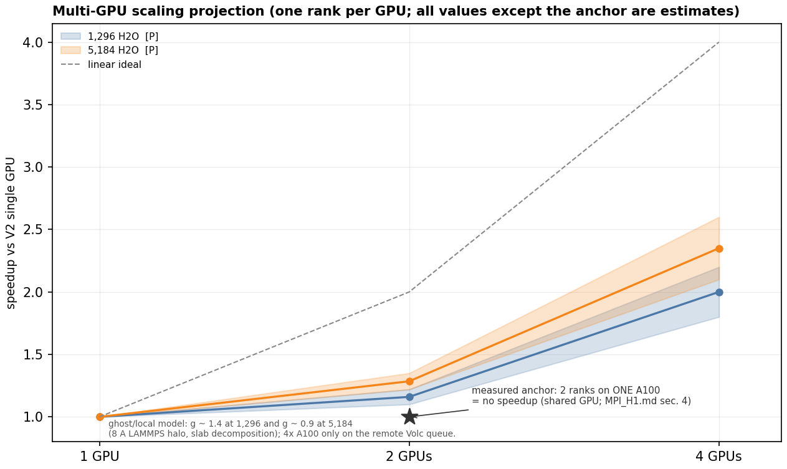

# Symmetrix-Polar V2 architecture

**Status:** design + projections only. Read-only work: no engine edits, no
build, no GPU job, no commit/push. The engine tree
`external-repos/symmetrix-xl-s1` was inspected at `6582bc6` (combined
S1.1 + A1); no file in it was modified.
**Date:** 2026-10-21.
**Scope:** FP64 nonlinear PolarMACE with the global SCF/Fukui fixed point,
exact GTO-Ewald, C++20/Kokkos/CUDA, and the LAMMPS pair style. This document
defines V2 for one GPU and for one rank per GPU; it does not reopen the
accepted physics, precision, or SCF step count.

> **Evidence status.** Every number is tagged **[M]** measured, **[D]**
> derived from measured deltas, or **[P]** projection/estimate. Only [M] rows
> are measurements. The two parallel reports
> (`docs/results/PERFORMANCE_DECOMPOSITION_1296.md`,
> `docs/research/CUDA_SPEEDUP_PAPERS_2026.md`) were not present in the
> repository when this document was written; the per-family decomposition
> therefore uses the committed pre-opt3 CUPTI trace
> (`docs/results/data/cupti_b4team_1296_summary.json`) plus the measured
> additive ladder in section 2.3. P0 must replace the [D] table with a fresh
> trace of `6582bc6`.

---

## 1. 中文执行摘要（8 行）与 Top 3 架构决策

### 1.1 中文执行摘要

1. **现状基线（实测）：** 128 NH₃ **30.33 ms/eval**（Plan B-micro，全 gate PASS）；1,296 H₂O **253.84 ms/eval、195.86 µs/atom、8.55 GiB**（S1.1+A1，generic）；5,184 H₂O 最佳实测 **986 ms、19.21 GiB**（`MATOS_MH1_CHANNEL_VEC=1`），默认 32×16+vec4 为 **1,549 ms**，materialized 5,184 需约 **139.9 GiB** 而 OOM。
2. **已测瓶颈（`6582bc6` generic fresh CUPTI，GPU busy 239.75 ms）：** polar **87.5 ms（36.5 %）**；tensor/MH-1 **66.1 ms（27.6 %）**；backbone **28.9 ms（12.0 %）**；cuBLAS **22.9 ms（9.5 %）**；MLP **20.9 ms（8.7 %）**；e3 linear **13.3 ms（5.6 %）**；非 kernel **约 14.1 ms [D]**（trace 窗口的 59.4 ms 含 profiling/cold-eval 开销）；Ewald **1.67 % GPU busy**（旧 pre-A1 trace 9.56 ms = 2.8 %）。
3. **决策 A（执行模型）：** 统一“节点归属”——backbone 与 polar 的 UVU 一律 **output/receiver-owned 前向**、**source/input-owned 确定性反向**；边状态只活在 node-contiguous tile 内，**禁止任何全局 E-sized 边物化**。
4. **决策 B（通信面）：** 把跨卡通信收窄为 **窄 halo + 设备全归约**：每 eval 仅 2 次前向 + 2 次反向 **512-wide `up`/`up_adj`** 交换（16 KB/ghost），每个 SCF 步 **2 次打包 all-reduce（ρ 双通道 4·Nk + Fukui 4）**，全 eval 约 **20–24 → 8–10 次**；Ewald **复制 k-space** 而非 k-split；**无 root-rank gather**。
5. **决策 C（控制面）：** prepared path tables、device-side SCF/Fukui/LE 标量、persistent tile loop、8–12 段 CUDA Graph；目标 host gap **<2 ms**、launch 从 **1,762**（generic；materialized 1,075）降到 **约 120**，非 kernel 从 **14.1 ms [D]** 降到 **约 2 ms**。
6. **单 GPU 预期（[P]）：** P1+P2 为 1,296 **195–220 ms**、5,184 **790–870 ms**；完整 V2（含 P4 反向/路径特化）为 1,296 **168–195 ms（1.30–1.51×）**、5,184 **636–789 ms**（相对 986 ms 为 **1.25–1.55×**，相对默认 1,549 ms 约 **2×**）。
7. **多 GPU 预期（[P]）：** 一 rank 一卡并改为 owned-only 节点/polar 后，2-GPU 5,184 为 **1.22–1.35×**、4-GPU 5,184 为 **2.1–2.6×**；1,296 的 2-GPU 仅 **1.10–1.22×**（子域太小），4-GPU 1,296 为 **1.8–2.2×（低置信）**；每 rank **5–13 GiB**。4×A100 只在远端 Volc 队列。
8. **结论：** **4.5 µs/atom 不可达**（1,296 折合 5.83 ms，需约 43×），除非改精度（FP16/TF32/FP8）、近似 Ewald/PPPM、减少 SCF 步数或重写模型；FP64 精确 PolarMACE 的静态下界不支持。所有前瞻数字均为 projection，P0 必须先在 `6582bc6` 上复测并重定基线。

### 1.2 Top 3 architecture decisions

| # | Decision | Why it is the architecture, not an optimization | Evidence |
|---|---|---|---|
| **A** | **One node-owned execution model.** Backbone and polar UVU are receiver/output-owned in the forward and source/input-owned in the reverse; every edge object is tile-local. | The polar layer is node-level (`x1(node,...)`, `x2(node,...)`); the backbone edge path is the only edge-indexed part. Making this ownership explicit removes the `[C,8192/5120]` message stream, the `[4,N,mul·d1]` reverse partials, and the per-path RMW at once. | `mace_polar_impl.tpp:918-1182`, `:2249-2680`, `:2309-2314`; `e3nn_kokkos.cpp:3627-3746`, `:3749+`; survey T1/T2/T5 |
| **B** | **Narrow communication surface.** One rank per GPU; rank graph = owned receivers + ghost *sources*; halo at `up`/`up_adj` (512 doubles); two packed device all-reduces per SCF step (rho and Fukui); k-space replicated. | The multi-GPU cost is dominated by duplicated edge work, not by halo bytes: the analytic model in §4.7 gives 2.1–2.6× on 4 GPUs only if the node/polar chain runs owned-only. The 8 Å geometric halo model gives 1.9× the local nodes at 5,184/4 [P], and the exact 2-hop path measured 30.8 GiB/rank at 128 atoms. | `MPI_H1.md` §2–§5; `pair_symmetrix_mace_kokkos.cpp:2660,2701-2704,2781-2811`; `MPI_2RANK_FIX_AGENT_REPORT.md` §2 |
| **C** | **Device-resident control plane + captured phases.** Prepared path plans, device SCF/Fukui/LE scalars, a persistent tile loop, and CUDA Graph capture of 8–12 host-free regions. | 1,762 launches (generic) / 1,075 (materialized) and 14.1 ms of non-kernel time [D] are pure overhead at 1,296; the SCF/Fukui chain currently does ~20 host `MPI_Allreduce` round trips per eval. Moving control to the device is also designed to make repeat-eval bitwise; the current 1-ULP first-eval drift must be localized in P0 (hypothesis: first-use plan/cache path, not yet proven). | `bench/perf_decomp_1296_2026-10-21/analysis/1296_generic_summary.json`; `kernel_labels_1296.json`; `mace_nonlinear_kokkos.hpp:444-461`; `pair_symmetrix_mace_kokkos.cpp:486-492`; `mace_polar_impl.tpp:897-917,1876-1892,3709-3717` |

---

## 2. Current architecture, dataflow, and measured bottlenecks

### 2.1 Current dataflow

The pair style builds a rank-local directed graph over `r_cut = 6.0 Å` from
the 8 Å LAMMPS neighbor list (`TILED_EDGE_PLAN.md` §2.1;
`pair_symmetrix_mace_kokkos.cpp:1426,1476`). Node rows are the local atoms plus
the ghost atoms in the multi-rank paths; the CSR row is the receiver and
`neigh_indices(edge)` is the source (`pair_symmetrix_mace_kokkos.cpp:2701-2704`).

**Forward** (`compute_node_energies_forces`, `mace_nonlinear_kokkos_impl.tpp:4069`):

1. Node embedding and `Y`/radial/harmonics (`:4134`, `:4222-4235`).
2. Two nonlinear layers. Per layer: `linear_up`; edge path (conditioned MLP →
   `convolution.evaluate` → message gather → density gather); node block
   (`linear_1`/gate/`linear_2`/product/readout). The forward/reverse edge blocks are the `stream_layer` branch at
   `:4727+`/`:6443+` (generic) with the materialized fallback in the same
   layer loop (`:5582-5750` forward marks; `:7488+` reverse); the S1.1 tile
   plan is `:2873-2947`.
3. Polar stage 1: per-layer `lr_source_maps` accumulation and
   `mixer_linears` accumulation into `polar_spin_charge_density` and
   `polar_features_mixed` (`:5913-5956`).
4. Polar stages 2–7 (`run_polar_pipeline`, `mace_polar_impl.tpp:250`):
   Fukui initialization (`:266-335`), k-geometry and cos/sin (`:338-668`),
   potential features (`:669-757`), **2 SCF steps** (`:759-1561`),
   Coulomb/Ewald energy (`:1566-1678`), local-electron energy (`:1680-1932`),
   energy assembly (`:1934-1960`).

**Reverse** (`compute_polar_reverse_forces`, `mace_polar_impl.tpp:2139`):

1. Readout seed is already in `state.layer_adjoint` (`mace_nonlinear_kokkos_impl.tpp:5960-5972`).
2. Polar reverse: LE adjoints and seeds (`:3695-3748`), Coulomb seed, per-step
   replay or replay-cache load (`:3902-3920`), UVU adjoints (`:2249-2680`),
   MLP/readout adjoints, Fukui/density chain, source-map/mixer adjoints,
   injection into `layer_adjoint` (`:4289-4311`).
3. Backbone reverse, layer 1 then 0: node chain, edge recompute, convolution
   reverse, `up_adj` scatter, radial/harmonic/cutoff adjoints; then node forces
   (`mace_nonlinear_kokkos_impl.tpp:6117+`, `:7812`).
4. Pair force/energy reduction (`pair_symmetrix_mace_kokkos.cpp:2211-2270`).

**Current streaming state.** S1.1 tiles the backbone edge path only:
node-contiguous 16,384-edge tiles, reused by forward and reverse
(`mace_nonlinear_kokkos_impl.tpp:2873-2947`), with `streamed_edges="generic"`
opt-in and `materialized` still the default. The polar pipeline, node state,
readout, and Ewald stay materialized. The polar guard explicitly rejects
direct/prepared execution but admits generic
(`mace_nonlinear_kokkos_impl.tpp:4584-4592`).

### 2.2 Measured baselines

| Case | ms/eval | µs/atom | Peak VRAM | Status |
|---|---:|---:|---:|---|
| 128 NH₃, Plan B-micro, 1 A100 | **30.33** | 236.9 | not re-sampled | [M] `PLAN_B_MICRO_FINAL.md` §0; `OPTIMIZATION_LEDGER.md` §1 |
| 1,296 H₂O, S1.1+A1 generic | **253.84** | **195.86** | **8.55 GiB** | [M] `S1_1_A1_INTEGRATION.md` §3 |
| 1,296 H₂O, combined materialized | 266.47 | 205.61 | 39.92 GiB | [M] same |
| 1,296 H₂O, S1.1 alone generic | 278.15 | 214.62 | 8.55 GiB | [M] `S1_1_TILE_CACHE_RESULTS.md` §6 |
| 5,184 H₂O, S1.1 best control (`MH1_CHANNEL_VEC=1`) | **986.0** | **190.2** | 19.21 GiB for the vec=1 family; the 986 ms control did not resample VRAM | [M] `S1_1_A1_INTEGRATION.md` §6 |
| 5,184 H₂O, combined default 32×16 + vec4 | 1,549.1 | 298.8 | 19.21 GiB | [M] same |
| 5,184 H₂O, tile 64×4 | 1,095.5 | 211.3 | not sampled | [M] same |
| 5,184 H₂O, materialized | OOM | — | 139.9 GiB model; 2,592 OOM at a 2.008 GiB request, 5,184 at 567 MiB | [M] `TILED_EDGE_PLAN.md` §2.4; `stdout.polar_water_{2592,5184}` |
| 128 NH₃, 2 ranks on ONE A100, H1 | 0.518 s/step vs 1-rank 0.137 | — | 6.0 GiB/rank | [M] `MPI_H1.md` §4, §3.3 |
| 128 NH₃, 2 ranks on ONE A100, exact 2-hop | 1.478 s/step vs 0.137 | — | 30.8 GiB/rank | [M] `MPI_H1.md` §4; `MPI_2RANK_FIX_AGENT_REPORT.md` §2 |

The 5,184 default is **57 % slower** than the best measured control; that is
the A1 32×16 tile × reverse vec=4 interaction, not the algorithm
(`S1_1_A1_INTEGRATION.md` §5–§6). V2 must make the size-adaptive choice the
default before any 5,184 projection is quoted against "current".

### 2.3 Measured additive ladder to 253.84 ms [M]

Every row is a same-binary interleaved A/B at 1,296 H₂O. The deltas are
additive by construction and close to the final point within 0.1 %.

| Step | ms/eval | Delta | Source |
|---|---:|---:|---|
| FP64 team MH-1 + B4 reverse gather + write-through fix | 348.97 | — | `MH1_TEAM_FP64.md`; `OPTIMIZATION_LEDGER.md` §1 |
| + message-gather tile | 333.17 | −15.80 | `data/ab_gather_tile_1296.json` |
| + edge-feature tile | 320.97 | −12.20 | `data/ab_edge_features_1296.json` |
| + path-grouped MH-1 forward | 299.15 | −21.82 | `data/ab_path_grouped_forward_1296.json` |
| + edge-up/scatter tile + cutoff copy fusion | 290.77 | −8.38 | `data/ab_edge_up_scatter_1296.json` |
| + A1 UVU tile (main `e0a961d`) | 266.21 | −24.56 | `UVU_TILE_MAIN_1296.md`; `UVU_TILE_MAIN_GATES.md` |
| + S1.1 generic vs materialized (merged `6582bc6`) | **253.84** | −12.63 | `S1_1_A1_INTEGRATION.md` §3 |
| Sum of deltas | | **−95.39** | 348.97 − 95.39 = 253.58 (0.1 % closure) |

Caveat: the 299.15 and 290.77 baselines include externally contended rounds;
the ledger's clean baseline rounds agree with the preceding ladder value
(`OPTIMIZATION_LEDGER.md` §1; `docs/results/data/README.md`). The closure
argument uses the published medians, not the contended samples.

### 2.4 Current budget at 1,296 (fresh CUPTI trace) [M]

The parallel decomposition of `6582bc6` is now available
(`bench/perf_decomp_1296_2026-10-21/analysis/1296_generic_summary.json`;
the materialized trace is the sister file). It is the primary current
decomposition; the older `kernel_labels_1296.json` is kept only for the
pre-opt3 kernel names and the 348.97 ms ladder point.

| Group (generic) | GPU busy [M] | Share of GPU busy | Materialized [M] |
|---|---:|---:|---:|
| polar pipeline (SCF/Ewald/UVU/LE) | **87.51** | 36.5 % | 87.95 |
| tensor product / MH-1 | **66.09** | 27.6 % | 63.33 |
| backbone nonlinear | **28.85** | 12.0 % | 22.72 |
| cuBLAS / external | **22.85** | 9.5 % | 35.02 |
| MLP / dense | **20.88** | 8.7 % | 15.64 |
| e3nn linear | **13.33** | 5.6 % | 13.18 |
| other / radial / init | **0.24** | 0.1 % | 0.25 |
| **GPU busy** | **239.75** | 100 % | **238.08** |
| non-kernel [D] | **14.09** | 5.6 % of 253.84 | 28.39 |
| **accepted wall** | **253.84** | | **266.47** |

The non-kernel column is `accepted wall − GPU busy`; it is [D], not a trace
value. The trace's own eval window is 299.19 ms (generic) / 286.11 ms
(materialized), with 59.4 / 48.0 ms of inter-kernel gap; that gap is inflated
by the profiler and a cold-ish eval and must not be quoted as the production
host gap. The production gap is 14.1 ms [D].

Two facts matter for V2:

- **The S1.1 win is mostly host/launch, not GPU work.** Generic has 1.7 ms
  *more* GPU busy than materialized (239.75 vs 238.08) but 14.3 ms less
  non-kernel time (14.1 vs 28.4), hence the accepted 12.6 ms net. The edge
  kernels themselves are not cheaper in this trace; the streaming path moves
  the cost from host/launch into the tile loop. V2 must reduce both.
- **The current tensor/MH-1 share is 27.6 %, not the pre-opt3 51 %.** The
  pre-opt3 `kernel_labels_1296.json` label grouping (MH-1 149.63 ms, 51 % of
  GPU busy) predates path-grouped forward and A1; it must not be quoted as the
  current share. The largest current single item is the **polar pipeline
  (36.5 %)**, followed by tensor/MH-1 (27.6 %).

The generic trace also explains the MLP line: the per-tile conditioned MLP is
evaluated 353 times (20.88 ms) vs 65 times in the materialized path
(15.64 ms). A receiver-owned/persistent tile loop should batch these back
toward the materialized count; this is part of the P2 target.

### 2.5 Measured hotspot groups at 1,296 (fresh trace)

The fresh trace's top labels (generic, GPU busy) are the current hotspot map;
the groups overlap with the family table and must not be added.

| Label / group | ms | Launches | Note |
|---|---:|---:|---|
| cuBLAS / external | 22.85 | 482 | 14 small DGEMM groups + tiny GEMMs; 9.5 % |
| `e3 tensor reverse mh1 team channels` | 21.84 | 14 | reverse MH-1 channels |
| `polar reverse uvu mode0 x2` | 21.74 | 10 | polar reverse UVU x2 |
| `polar reverse uvu mode0 x1` | 20.76 | 10 | polar reverse UVU x1 |
| `e3 tensor reverse mh1 team harmonics` | 17.71 | 14 | reverse MH-1 harmonics |
| `e3 tensor product mh1 team channels` | 15.19 | 14 | forward MH-1 channels |
| `affine linear epilogue` | 11.69 | 176 | per-tile MLP epilogue (generic) |
| `stream nonlinear gather messages` | 7.41 | 14 | S1.1 message gather |
| `compiled product reverse` | 6.34 | 2 | product reverse |
| `polar uvu mode0` | 5.73 | 6 | forward polar UVU |
| **visible polar UVU (3 labels)** | **48.23** | 26 | ~20 % of GPU busy; the polar family is 87.5 |
| **visible MH-1 labels (3)** | **54.74** | 42 | fwd channels + rev channels + rev harmonics; the tensor family is 66.1 |
| **Ewald** | ~4.0 | — | 1.67 % of GPU busy (`CUDA_SPEEDUP_PAPERS_2026.md` §1/§3.3); pre-A1 9.56 ms = 2.8 % |
| **non-kernel [D]** | **14.09** | — | 5.6 % of the accepted wall |

The old `kernel_labels_1296.json` values remain useful only as the pre-opt3
shape: MH-1 149.63 ms / 51 %, polar UVU 105.83 ms, node/edge 91.87 ms,
cuBLAS 35.83 ms, Ewald 9.56 ms, host 8.65 ms. They are not the current
budget. The 128-atom profile (`KERNEL_PROFILE_2026-10-19.md`) is historical
(pre-2-D `polar reverse dense`, pre-A1) and must not be scaled.

### 2.6 What V2 must preserve

FP64 only; the exact GTO-Ewald (same k-grid, GTO bases, half-space,
`k0` mask, `1/k²`, SI overlap); `polar_recursion_steps = 2`; the Fukui
normalization and density-update order; mask semantics; `mh1_fast_path = false`
on the nonlinear engine; the polar guard; no new atomics in the polar chain;
default-off switches until the full gate suite passes. The exact Ewald is
implemented at `mace_polar_impl.tpp:1566-1678`; the k-grid at `:529-573`; the
GTO bases at `:595-641`.

---

## 3. Single-GPU V2 design

### 3.1 Phase boundaries and ownership

| Phase | Work | Ownership | Memory class | Capture |
|---|---|---|---|---|
| **F0** geometry + embedding | node embed, radial/harmonics, k-grid, cos/sin | all nodes (1 rank) | resident (cos/sin) | Graph A |
| **F1** backbone forward L0→L1 | `linear_up`; tile loop: conditioned prefix → receiver-owned UVU → fused cutoff/density; node block; readout; source maps/mixer | node rows output-owned; edges tile-local | tile arena + resident node state | Graphs B/C (per layer) |
| **P1** polar SCF ×2 | assemble ρ(k) + all-reduce; project; update block (`dot` UVU → MLP → `tp` UVU); readout; density + Fukui | node output-owned; k-space node-owned | resident SCF state; arena for node temporaries | Graph D (step body, split at all-reduce) |
| **P2** Coulomb + LE | exact Ewald energy; `le dot_q`/`dot_v` fused; LE total | node-owned | device scalars | Graph E |
| **R1** polar reverse | LE adjoints; Coulomb seed; replay/cache; source-owned X1/X2; MLP/readout/Fukui reverse; inject | node input-owned | resident adjoints; arena | Graph F (per step) |
| **R2** backbone reverse L1→L0 | node chain; source-owned `up_adj`; deterministic conv reverse; radial/harmonic/cutoff adjoints; forces | node input-owned; edges tile-local | arena + resident adjoints | Graph G (per layer) |

The phases are sequential at eval level because the SCF is a **global fixed
point**: each step needs a global reduction over nodes
(`polar_global_sum_view` at `mace_polar_impl.tpp:1212-1213`; the next step
consumes the global density). Node tiling is legal only *within* a step; no
edge data crosses an SCF step. This is the same conclusion as
`S1_BACKBONE_STREAMING_POC.md` §6.1 and `POLAR_PAPER_OPTIMIZATION_PLAN.md`
§4.1/§7.1.

### 3.2 Node-owned tiled streaming

Keep S1.1's tile plan, with three changes:

1. **Tile size is a policy, not a constant.** 16,384 edges at ≤2k atoms;
   32,768 at 5,184 on one GPU; 65,536 only when the per-rank memory budget
   allows it. The 5,184 default must not be 32×16 + vec4 (measured 1,549 ms vs
   986 ms; `S1_1_A1_INTEGRATION.md` §6). The tile plan is built once per graph
   (FNV over `num_nodes`, `edges`, `C`, offsets; `mace_nonlinear_kokkos_impl.tpp:2886-2946`).
2. **One shared arena across layers and sweeps.** The S1.1 implementation keeps
   per-layer block storages; the reverse recomputes all edge state, so the
   forward arena is dead after each layer's node block. A single arena sized by
   `max(forward set, reverse set) + MLP workspace` reduces the 1,296 arena from
   4.57 GiB to 2.46 GiB at C=16,384, and the 5,184 arena from 4.57 to 2.46
   (C=16k) or 4.93 (C=32k). Basis: `S1_BACKBONE_STREAMING_POC.md` §7.2 and
   survey T3; all values [P] until measured.
3. **Tiles never cross ranks** and never split a receiver CSR segment. This is
   what preserves the per-node ascending FP64 order
   (`TILED_EDGE_PLAN.md` §3.7, I2/I3).

### 3.3 Receiver-owned backbone

The engine already contains the receiver-owned UVU kernel
(`e3nn_kokkos.cpp:3627-3746`, `try_evaluate_execution_uvu_from_nodes`) and the
source-owned reverse (`:3749+`). They are precision-generic and are currently
excluded from `generic` because the engine-level `execution_layer` gate is
false. V2 wires them into the generic tile loop, with four changes:

1. **Register accumulation.** The existing kernel does
   `node_messages(receiver, output_index) += ...` inside the edge loop
   (`e3nn_kokkos.cpp:3739-3740`), i.e. one global RMW per component per edge.
   V2 keeps the 16 (L0) / 40 (L1) component accumulators in registers and
   stores once per `(receiver, channel)`. L1's 40 doubles need 80 registers;
   split into two 20-wide passes or use 128-thread blocks.
2. **Warp weight broadcast.** With `MDRangePolicy({receiver, channel})`, every
   channel thread recomputes the same 64-wide `phi·B + contribution` weight.
   V2 uses one warp per receiver with 32 channels; lane 0 computes the weight
   and broadcasts it (or a 64-edge window is staged in shared memory). The
   weight is `bias + contribution + Σ phi·B` and the cutoff is applied once.
3. **Phi-major final weights and indexed conditioning.** Pass
   `final_linear_weight_phi_major` (`affine_mlp_kokkos.cpp:160-205`) and
   `evaluate_conditioned_prefix_indexed` (`:653`) so a warp over channel reads
   32 contiguous weights and no `[C, weight_size]` table is built. The
   addition order is unchanged (`bias + (source + target)`); gated, not
   hand-waved.
4. **No `[C, message]` and no `edge_up` materialization.** The receiver kernel
   reads `state.up` by source index and accumulates into the node row. The
   forward density path becomes receiver-owned as well (one thread per
   receiver, loop edges, `tanh(raw²)`, store once), removing the per-block
   `N`-wide density gather. This is the natural extension of the same kernel.

The `phi [C,64]` prefix is the only per-edge buffer that remains; at C=16,384
it is 8 MiB (vs 1.07 GB for `[C,8192]` messages). Type tables (64 KB L0,
40 KB L1) are staged in shared memory and reused by every edge.

### 3.4 Polar output-owned forward

The polar UVU is already node-local; V2 makes the ownership explicit and fuses
the launch sequence:

- **One kernel per UVU call** instead of zero → per-path `+=` → mask
  (`mace_polar_impl.tpp:926-932`, `:933-1174`, `:1175-1181`). One team per
  `(node_tile, out_tile)`; each thread owns one `(node,u)`; paths visited in
  ascending `p`; `v` in ascending order with four register accumulators and
  the fold `((a0+a1)+a2)+a3`, exactly the current `sweep=4` association
  (`:1044-1057`). The mask is applied once to the final sum.
- **LE `dot_q`/`dot_v` fusion** (`:1894-1899`): the two calls share
  `polar_node_feats_e3nn` as `x1`; one kernel with two accumulator sets reads
  the `[N,2048]` row once and writes two disjoint outputs.
- **Path plan** (`PolarUvuPlan`): build the per-output-column ordered path list
  at model load, upload to a device `const` view, and dispatch statically on
  `(mode,d1)`. The checkpoint has 2 paths per UVU, `mode∈{0,1}`,
  `d1∈{1,3}` (`POLAR_PAPER_OPTIMIZATION_PLAN.md` §3.1). This removes the
  per-step host copies at `mace_polar_impl.tpp:897-917` and `:1876-1892`.
- **Bitwise claim:** the fused forward is bitwise identical to the shipped
  `sweep=4` path if the four-register fold is used. A single accumulator
  reproduces `sweep=1` and is allowed only as a gated fallback.

### 3.5 Deterministic source-owned reverse

The reverse is the transpose of the forward; V2 removes the global partials
and the RMW:

- **Polar UVU reverse** (`mace_polar_impl.tpp:2249-2680`): two passes X1 and
  X2, each thread owns a `(node, input column)` and reduces over `v` (X1) or
  `u` (X2). Four register accumulators per component give the same association
  as the current `[chunks,N,mul·d1]` partials
  (`:2309-2314`, fold `:2375-2386`), so the 0.475 GiB of partials at 5,184
  disappears with no numerical change. `mixed_bar` is recomputed inline for
  `mode1`; no `[N,512]` buffer.
- **Backbone UVU reverse** (`e3nn_kokkos.cpp:3749+`): the source-owned kernel
  already accumulates `up_adj` in a register over outgoing edges and writes
  once. V2 uses a graph-wide source CSR built once per neighbor rebuild (the
  engine already builds one for prepared execution at
  `mace_nonlinear_kokkos_impl.tpp:2950-3078`; reuse it for generic) and slices
  it per tile. `edge_message_adj` and the atomic `up_adj` scatter disappear.
- **Atomics removal**: `basis_adjoint_add` (`mace_polar_impl.tpp:2174-2191`)
  and `polar_inject_node_features_adjoint` (`:4289-4311`) use `atomic_add`
  although each `(node,j)` has a unique writer. Replace with a plain store for
  `initialize=true` and `+=` for accumulate; the column map is a block
  bijection. No new atomics.
- **Debug copies**: gate the three unconditional LE debug deep copies at
  `:3709-3717` behind `POLAR_DBG_CKPT` (0.02 GiB at 1,296, 0.08 GiB at 5,184
  plus three full copies per eval).

### 3.6 Persistent tile loop

One grid-stride kernel per sweep over `(tile, receiver, channel)`:

- launch `4 × SM_count` CTAs × 256 threads; each CTA grid-strides over tiles;
  shared memory holds the type tables and the phi window; the node message row
  is accumulated in registers and stored once.
- forward: per tile, compute the prefix `phi [C,64]`, then run the receiver
  kernel; no `[C,weight]`, `[C,up]`, `[C,message]`, or density gather.
- reverse: per tile, recompute the prefix, run the source-owned kernel, write
  `edge_phi_adj [C,64]`, `edge_input_2_adj [C,16]`, `edge_cutoff_adj [C]`;
  then prefix reverse; the harmonic/radial/cutoff adjoints are E-sized resident
  (0.53 GiB at 5,184) and written per tile with no cross-tile reduction.
- The MLP tape is block-local: call `evaluate_conditioned_prefix_indexed`
  immediately before `reverse_prefix_from_tape` for the same tile; never let
  another tile overwrite the tape.

This removes the per-tile launch sequence (~6–8 kernels × 7 tiles at 1,296,
× 27 at 5,184) and enables `cp.async` double buffering for phi/harmonics/up
windows. It does **not** attempt a single cooperative megakernel (§8).

### 3.7 Shared arena and lifetime

One grow-only `StreamEdgeArena` with explicit offsets. The maximum live set is
the forward set (`weights/raw/up/messages/contrib/density` = 20,177
doubles/edge at C) or the reverse set plus the shared MLP workspace, whichever
is larger; the reverse recomputes all edge state. The arena is reused across
layers and both sweeps. Assertions: arena high-water < 10 GiB (C=65k) or
< 1 GiB (receiver-owned); no E-sized allocation > 2.6 GiB in receiver-owned
mode; `Σ tile_edges = E`, `Σ tile_nodes = N_graph`.

Memory projections are in §7.2; all are [P] except the measured totals.

### 3.8 Device-side SCF, Fukui, LE reductions

Current behavior:

- `polar_global_sum_host` and `polar_global_sum_view`
  (`mace_nonlinear_kokkos.hpp:444-461`) copy to host, call the pair-style
  callback, and copy back. The callback is a blocking host `MPI_Allreduce`
  (`pair_symmetrix_mace_kokkos.cpp:486-492`) — even on one rank.
- Call sites: initial Fukui (`mace_polar_impl.tpp:296`), stage-4 ρ
  (`:721-722`), per-SCF-step ρ (`:1212-1213`), per-step Fukui (`:1484`),
  Coulomb ρ (`:1617-1618`), LE total (`:1928`), reverse Fukui (`:2219`),
  k-space reverse (`:2999`, `:3062-3063`, `:3168-3169`, `:3841-3842`).
  There are ~19 call sites and roughly 20–24 all-reduce operations per eval.
- The per-step path tables and Fukui scalars add ~24 D2H copies per eval
  (`:897-917`, `:1466-1469`, `:1876-1892`, `:3249-3263`, `:4019-4032`,
  `:4120-4132`).

V2:

1. Build the plans once at model load; upload to device; no host copy in the
   hot path (`MATOS_POLAR_UVU_PLAN=device`).
2. Keep the Fukui scalars, the LE total, and the SCF factors in device
   buffers. The correction kernel consumes the staged scalars; no D2H.
3. **Pack and fuse**: per SCF step, two packed device reductions: one for the
   rho of both channels (`[rho_re, rho_im]` per channel, 4·Nk doubles) and one
   for the 4 Fukui scalars. They cannot be merged within a step because the
   Fukui factors depend on the post-update density; a deferred-correction
   schedule could merge step-s Fukui with step-(s+1) rho, but P2 does not
   assume it. On one rank, skip MPI entirely; on multi-rank use NCCL
   `ncclAllReduce` with a fixed ring/simple algorithm (or an MPI device-buffer
   all-reduce). The rho payload is 4·Nk doubles = 21.7 KB at 1,296, 88 KB at
   5,184; the Fukui payload is 4 doubles.
4. Only the final user-facing energy/LE readout does a lazy D2H. The pair
   style's per-eval energy reduction stays as is (one scalar).

Acceptance: no host sync between phase entry and exit except the SCF
all-reduces and the final energy; 1-rank repeat-eval bitwise.

### 3.9 k-space remap

Exact Ewald is unchanged: same `Nk`, same half-space, same GTO bases, same
`1/k²`, same SI terms. Only traversal changes.

- **K1** forward project (`mace_polar_impl.tpp:728-755`, `:1214-1245`):
  `(node, k-chunk)` threads with `CK=8` or `32`; each thread holds eight
  feature accumulators, streams its k chunk once, reads each `cos/sin` pair
  once, and writes `partial(ck,node,j)`; a second kernel folds chunks
  ascending. Traffic drops 8× (16 doubles → 2 per `(k,node)`).
- **K2** reverse project (`:3066-3114`, `:3037-3063`): the reverse already
  has 4-way k chunks for phase/source; V2 unifies the chunk policy and uses
  the same 8-register reuse. It also removes the per-step ρ recompute+allreduce
  where the replay cache already has ρ (gated).
- **K3** assemble (`:697-722`, `:1185-1213`, `:2841-2925`): `(k, node-chunk)`
  with eight registers and an ascending fold; partial memory `Nk·CK·8` doubles
  (5.6 MB at 5,184 with CK=32), reusable.
- Keep `cos/sin` as `[Nk,N]`; a later `[N,Nk]` transpose would improve
  coalescing but touches six kernels and is out of P1–P2.

**Honesty correction to the polar plan.** `POLAR_PAPER_OPTIMIZATION_PLAN.md`
§6.2 estimates −8..−15 ms (K1/K2) + −2..−5 ms (K3) at 1,296, but the measured
pre-opt3 Ewald total is only 9.56 ms. At 1,296 the maximum credible K1–K3 win
is **4–8 ms**, not 10–20. At 5,184 the `Nk·N` growth (16.2× vs 4× atoms) makes
**20–50 ms** credible; that is the real k-space target.

### 3.10 CUDA Graph capture regions

Capture is allowed only inside a region with **no allocations, no host sync,
no MPI, no `std::getenv`, and a fixed grid**. Allocate the arena and all
workspaces before capture; update only pointers/positions between replays.

| Graph | Region | Params updated per eval | Rebuild |
|---|---|---|---|
| A | k-grid, cos/sin, GTO bases, node embed, radial/harmonics | positions, cell | topology rebuild |
| B | layer-0 forward tile sweep | `up`, arena, positions, cutoffs | graph generation / C |
| C | layer-0 node block + readout + source map + mixer | `messages`, `densities`, outputs | graph generation |
| D | SCF step body: assemble → (all-reduce outside) → project → linears → `dot` UVU → MLP → `tp` UVU → readout → density/Fukui | density, ρ, plans | graph generation |
| E | Coulomb + LE forward | density, `q_up`/`v_up` | graph generation |
| F | polar reverse per step | cache/adjoints | graph generation |
| G | backbone reverse per layer (source-owned edge sweep + node chain) | `message_adj`, `up`, arena | graph generation / C |

Target: 8–12 graph launches per eval instead of 1,082 kernel launches. If
Kokkos stream capture is unstable with the CUDA backend, fall back to the
persistent tile loop plus a host launch batch; do not hand-roll graph nodes
for kernels not captured on the Kokkos stream.

### 3.11 Path-table / model-specialized plan (P4)

P1 uses a **prepared plan**, not code generation:

- `PolarUvuPlan`: 2 paths per UVU, `{in1_off,in2_off,out_off,w_off,mul1,mul2,
  mode,d1,pw,inv_sqrt_d1}`, plus a per-output-column ordered path list.
- `BackboneUvuPlan`: instruction count, multiplicity, component offsets,
  sparse indices/values, path weights, output mask — all checkpoint
  constants.
- Static dispatch on `(mode,d1)` with 3–4 template instantiations; unroll the
  path count (2) and the `v` chunk fold.

P4 (10–25 days) may generate one checkpoint-specific CUDA/C++ TU or a compact
plan interpreter with the exact widths (512/128 channels, 2 layers, 2 SCF
steps, 2 paths) and fixed-shape batched GEMMs. It must not use NVRTC in the
hot path, fast-math, or any precision change. The PolarMACE
`NonLinearBiasReadoutBlock` and vector product output keep it out of the v4
direct/JIT contract today (`S1_BACKBONE_STREAMING_POC.md` §11.3), so P4 is a
later project, not a P1 dependency.

### 3.12 Expected single-GPU numbers

All [P]. "vs current" is vs 253.84 ms at 1,296 and vs the **986 ms best
measured control** at 5,184; the parenthetical "vs default" uses 1,549 ms.

| Phase | 1,296 ms/eval | 1,296 speedup | 5,184 ms/eval | 5,184 vs best / default |
|---|---:|---:|---:|---:|
| Current [M] | 253.84 | 1.00× | 986 / 1,549 | 1.00× / 1.00× |
| P0 (no code) | 253.84 | 1.00× | 986 / 1,549 | 1.00× |
| P1 plans + device scalars + graphs + size policy | 240–248 | 1.02–1.06× | 900–960 | 1.03–1.10× / 1.61–1.72× |
| P1+P2 (ownership + k-space + arena) | 195–220 | 1.15–1.30× | 790–870 | 1.13–1.25× / 1.78–1.96× |
| **V2 core + P4 (full)** | **168–195** | **1.30–1.51×** | **636–789** | **1.25–1.55× / 1.96–2.44×** |
| Stretch (MH-1 reverse + k-space top) | 159–169 | 1.50–1.60× | 580–636 | 1.55–1.70× |

**2× at 1,296 (127 ms) is not supported by the current evidence.** The fresh
budget is 87.5 ms polar, 95.0 ms edge/tensor (66.1 tensor + 28.9 backbone),
57.1 ms cuBLAS/e3/MLP, 0.2 ms other, and 14.1 ms non-kernel. Reaching 127 ms
requires every one of those groups to roughly halve at once (and the host gap
to vanish); the measured record shows no 2× on any group. V2's realistic
1.30–1.50× and stretch 1.50–1.60× are the defensible ranges.

---

## 4. Multi-GPU V2 design

### 4.1 One rank per GPU, node/edge partition

- One MPI rank per GPU, LAMMPS domain decomposition; a rank's graph is
  `nlocal + nghost` with **local rows first, ghost source rows after**
  (`pair_symmetrix_mace_kokkos.cpp:2655-2660`). Ghost rows have no receiver
  rows; they are sources only (`:2701-2704`).
- Tiles are rank-local and never cross ranks; the tile plan is built from the
  rank's own CSR. The reverse exchange runs after all tiles
  (`TILED_EDGE_PLAN.md` §3.6, I8).
- The default polar multi-rank path is currently
  `no_mpi_message_passing` (`pair_symmetrix_mace_kokkos.cpp:466-478`), i.e.
  the full local+ghost exact 2-hop graph with no per-layer communication. It
  is correct but memory-heavy: 30.8 GiB/rank at 128 atoms, 2 ranks
  (`MPI_2RANK_FIX_AGENT_REPORT.md` §2). V2 keeps it only as a correctness
  control and makes `polar_mpi_message_passing` the production path after
  gates.

### 4.2 Narrow halo exchange

Current H1 exchanges the **widest** node boundary: layer 0 features (512),
layer 1 features (2048), and the layer-0 adjoint (2048) — 2 forward + 1
reverse exchange, 4,608 doubles/ghost/eval = 36.9 KB/ghost
(`mace_nonlinear_kokkos_impl.tpp:4614-4617`, `:7812-7815`;
`node_feature_width`, `mace_nonlinear_kokkos.hpp:396-409`).

V2 exchanges the **narrowest** boundary: the output of `linear_up`, which is
512 doubles for both layers (model: layer 0 `512x0e`, layer 1
`128x0e+128x1o = 512`). The edge path consumes `up` at the source, not the raw
features. Forward: 2 exchanges × 512; reverse: 2 exchanges of `up_adj` × 512;
total **2,048 doubles/ghost/eval = 16 KB/ghost**, a 2.25× byte reduction.
Ghost rows then need only `up` (and positions/types), not the full 2048-wide
features or the node/polar state.

Implementation: keep the existing device pack/unpack hooks
(`pair_symmetrix_mace_kokkos.cpp:2781-2811`, `:978-1113`, `:1177-1324`), move
the sync call from `layer_forward_sync_(layer, features)` to after
`linear_up`, and add a reverse sync per layer on `up_adj`. The hook validates
`extent(0)==num_nodes` and `extent(1)<=node_feature_width()`
(`MPI_2RANK_FIX_AGENT_REPORT.md` §1); the width becomes 512, so the
2048-buffer overrun class of bug is structurally impossible.

### 4.3 Owned-only node and polar work

This is the largest multi-GPU lever. Today the engine is called with
`num_nodes` including ghosts (`pair_symmetrix_mace_kokkos.cpp:2815-2817`), and
`run_polar_pipeline` / `compute_polar_reverse_forces` run over all `num_nodes`
even though only owned rows enter the k-space sums, energy, and force writes
(`MPI_H1.md` §4). V2:

- Runs the backbone node chain, readout, source maps/mixer, the **entire polar
  pipeline**, and the polar reverse on `nlocal` rows only.
- Keeps ghost rows as edge sources for the edge sweep (they need `up` and a
  position) and as force sinks for LAMMPS newton reverse communication.
- Masks the ghost adjoint seeds (already at
  `mace_nonlinear_kokkos_impl.tpp:6009-6028`) and exchanges only narrow
  `up_adj`.

The consequence: node/polar time and memory scale as `1/R`, while edge time
scales as `(1+g)/R`, where `g` is ghost/local. The multi-GPU model in §4.7
uses this.

### 4.4 Global SCF / Ewald strategy

- **Replicate k-space, do not split k.** Each rank owns the full `Nk` grid and
  computes `cos/sin [Nk, nlocal]` for its owned nodes (54 MiB at 5,184/4,
  versus 0.212 GiB for the full 5,184 array on one rank). `rho(k)` is a sum
  over owned nodes; each rank computes its local sum and one rho all-reduce per
  SCF step (both channels packed) produces the global `rho`. The projection then runs on each rank's
  owned nodes over the full `Nk`.
- **Why not k-split:** a k-split would give each rank `Nk/R` k-points but
  requires the **node density** of all nodes on every rank, i.e. an all-reduce
  of `N·8` doubles (332 KB at 5,184) per step, 3.8× the `4·Nk` payload
  (88 KB), plus a different reduction order. Replication also keeps the
  half-space ordering and the exact Ewald formula unchanged.
- **Two packed payloads:** `[rho_re, rho_im]` for both channels (4·Nk) and
  the 4 Fukui scalars, in two device all-reduces per step. Fixed order: local
  owned-node sum, then a deterministic all-reduce (NCCL ring/simple or MPI
  device buffer).
  The result changes bits versus 1 rank (domain decomposition), which is
  covered by the official 2-rank gate `dE ≤ 5e-5 eV`, `max dF ≤ 1e-4 eV/Å`
  (`UVU_TILE_MAIN_GATES.md` §2).
- **Energy:** per-rank owned-node energy reduce; the global Coulomb/LE terms
  are O(1) and added once (rank 0 today at `mace_polar_impl.tpp:1955-1959`;
  V2 may divide by `R` on every rank to remove the rank-0 asymmetry). No root
  gather: LAMMPS already reduces `eng_vdwl` at thermo output.
- **Force:** keep the pair-style atomic reduction into `f` and the newton
  reverse communication; the per-rank owned force is complete because each
  owned receiver sees all its sources (local + ghost).

### 4.5 Overlap communication with local tile compute

The SCF dependency is strict: step `s+1` needs the global `rho` from step `s`.
V2 overlaps within a step:

1. After the local `rho` contribution is written, launch the packed
   all-reduce asynchronously on a communication stream.
2. While it is in flight, compute work that does not depend on `rho`:
   `source_embedding(attrs)`, `node_feats_linear(features_mixed)`,
   `charge_embedding(density)`, and the per-step path/plan work. These are
   node-local and independent of the global potential.
3. Wait on the all-reduce, then project/update/readout.
4. On the reverse, after the source-owned edge sweep writes `up_adj`, launch
   the halo exchange and run the owned node chain (product/linear_2/gate/
   linear_1/linear_res) while the exchange is in flight; the node chain for
   owned rows does not need ghost adjoints.

No cross-SCF overlap and no multi-stream reordering of reductions: one
communication stream plus one compute stream, fixed wait points. This keeps
repeat-eval deterministic.

### 4.6 Default mode change

After P3 gates, the polar multi-rank default becomes
`polar_mpi_message_passing` (narrow halo, 6.0 GiB at 128/2 ranks, dF
1.01e-14) instead of `no_mpi_message_passing` (full replica, 30.8 GiB/rank).
The exact 2-hop path stays selectable as a correctness control. This is a
one-line policy change plus the V2 narrow-halo implementation; it must not be
flipped before the 2-rank gate passes.

### 4.7 Expected 2/4-GPU scaling and per-rank memory

**Projection model.** With one rank per GPU and owned-only node/polar:

`S(R) = 1 / [ (1 − f_e)/R + f_e · (1 + g(R))/R ]`

where `f_e` is the edge-path fraction of single-GPU time (0.40 at 1,296,
0.45 at 5,184) and `g(R)` is ghost/local. For an 8 Å halo on a periodic box,
a slab decomposition gives `g ≈ 48/L` (L = box side), independent of `R`;
this gives `g ≈ 1.4` at 1,296 (L ≈ 33.9 Å) and `g ≈ 0.9` at 5,184
(L ≈ 53.7 Å). These are geometric estimates; the measured 128-atom 2-rank
anchor is 13× ghost/local, a small-box artifact (`MPI_H1.md` §4). The actual
LAMMPS decomposition shape and periodic images change `g`; P3 must measure it.

| Configuration | Ideal S(R) [P] | Realistic [P] | Per-rank memory [P] |
|---|---:|---:|---:|
| 1,296, 2 GPU | 1.28× | **1.10–1.22×** | 5–7 GiB |
| 1,296, 4 GPU | 2.56× | **1.8–2.2×** (low confidence; 324 atoms/rank) | 4–6 GiB |
| 5,184, 2 GPU | 1.42× | **1.22–1.35×** | 9–13 GiB |
| 5,184, 4 GPU | 2.85× | **2.1–2.6×** | 6.5–11 GiB (C=16k–32k); up to ~15 GiB at C=65k |

The 1,296 2-GPU case is close to the halo-dominated floor: each rank has
~648 local + ~900 ghost nodes, so edge work per rank is ~1.2× the one-GPU
work even though there are two GPUs; the 1.28× ideal is a ceiling, not a
target. Do not promise 2× at 1,296. The 5,184
4-GPU case is the one that matters: per rank ~1,296 local + ~1,166 ghost
nodes, edge work ~0.69× one-GPU, node/polar ~0.25×, hence 2.1–2.6×.

**Operational constraint.** 4×A100 is only on the remote Volc queue. At the
last check `devinstance-queue3` had 0 free GPUs (32/32 allocated) and
`queue004` has a hard 1-GPU/task policy with no 2-GPU claim option
(`MPI_H1.md` §6). The 2-GPU path is the first deliverable; the 4-GPU design
must be queue-gated, and the report must not claim 4-GPU measurements until a
real 4-GPU run exists.

---

## 5. Communication matrix

Costs are per eval unless stated. "Current" is measured where a source is
given, otherwise derived from the pre-opt3 trace + measured deltas.

| Path | Current | V2 target | Best pattern and why |
|---|---|---|---|
| **Host↔device: plans/path tables** | ~24 D2H copies/eval (`mace_polar_impl.tpp:897-917,1466-1469,1876-1892,3249-3263,4019-4032,4120-4132`); ~0.1–0.5 MB, ~24 syncs | 0 in hot path; plan uploaded at model load | Prepared device `const` plans. The tables are checkpoint constants; copying them per step is pure latency. |
| **Host↔device: SCF/Fukui/LE scalars** | 4+6+1 scalars per step, ~12–20 syncs; host `MPI_Allreduce` even on 1 rank (`mace_nonlinear_kokkos.hpp:444-461`; `pair_symmetrix_mace_kokkos.cpp:486-492`) | Device scalars; one lazy D2H for user-facing energy/LE | Keep the fixed point on device. The host is only needed for I/O and the LAMMPS energy scalar. |
| **Kernel↔global: edge messages** | `[C,8192/5120]` write + read per tile (~44 GiB fwd+rev stream at 1,296, survey projection) | **None**; receiver accumulates into node row | Receiver-owned UVU. The node row is 64 KB (L0) and stays in L1/L2 across its edges; a global `[C,message]` write/read is the single largest removable stream. |
| **Kernel↔global: weights / `edge_up` / density** | `[C,2048/1280]` weights + `[C,512]` up + `[C,1]` density per tile; ~5.5 + 1.8 GiB stream at 1,296 (survey) | `phi [C,64]` only (8 MiB at C=16k); weights computed in-register, up read by source, density stored once | Fused epilogue + indexed conditioning. `phi` is the minimal per-edge object; everything else is node- or type-indexed. |
| **Kernel↔global: reverse partials** | `[chunks,N,mul·d1]` x1+x2 = 0.475 GiB at 5,184 (`mace_polar_impl.tpp:2309-2314`); `edge_message_adj` + `mixed_bar` | **None**; four register accumulators per component, ascending 4-chunk fold | Bitwise-identical to the current fold with zero global partial traffic. |
| **Intra-GPU: shared / L2** | 32 KB weight tile/team (32×16 shape, `uvu_tile_shape` at `mace_polar_impl.tpp:104-115`); type tables 64/40 KB in L2; team size 64 | Phi-major weights; type tables in shared; 128-bit loads; cp.async double buffer | The weight tile is reused across all nodes in a team; shared memory is the right place. L2 persistence (<2 %) is not worth it. |
| **Intra-GPU: warp / team** | `MDRangePolicy({receiver,channel})`, one team per (node_tile,out_tile), team 64; vec4 measured negative (`OPTIMIZATION_LEDGER.md` §5) | Warp = 32 consecutive channels of one receiver; lane 0 broadcasts the 64-wide weight; 256-thread CTAs | Matches the feature layout and removes 32× redundant `phi·B` work per edge. Keep scalar channels; do not revive vec4. |
| **Inter-GPU: halo** | 2 fwd + 1 rev exchange, 4,608 doubles/ghost/eval = 36.9 KB; layer 1 features and layer 0 adjoint are 2048-wide (`mace_nonlinear_kokkos_impl.tpp:4614-4617,7812-7815`) | 2 fwd + 2 rev at 512-wide `up`/`up_adj` = 16 KB/ghost/eval | Narrowest legal boundary. The edge path needs source `up`, not full features; the reverse needs `up_adj`, not the 2048-wide feature adjoint. |
| **Inter-GPU: all-reduce** | ~20–24 host `MPI_Allreduce` calls/eval, each with D2H/H2D; rho payload 21.7 KB (1,296) / 88 KB (5,184) for both channels | **8–10** device all-reduces/eval: 2 per SCF step (rho, Fukui) + initial Fukui + Coulomb + LE + energy (+ reverse-step Fukui) | Pack rho (both channels) and the 4 Fukui scalars separately; use NCCL ring/simple or an MPI device buffer; fixed order for repeatability. The two cannot be one call because Fukui depends on the post-update density. |
| **Inter-GPU: Ewald k-space** | Replicated `cos/sin`; host all-reduce per channel/step | Replicated `cos/sin [Nk,nlocal]`; one packed rho all-reduce per step | Replication: payload O(Nk), no node-density all-reduce, exact half-space order preserved. A k-split would need O(N·8) communication and change the order. |
| **Force / energy reduce** | Atomic `f(j)` adds + per-rank energy reduce (`pair_symmetrix_mace_kokkos.cpp:2211-2270`) | Keep the pair atomic reduction; owned-only energy; no root gather | The pair reduction is <0.05 ms at 1,296 and preserves LAMMPS semantics; do not replace it with a deterministic segmented reduction in V2. |

**Best pattern, in one sentence:** receiver/source-owned kernels inside
node-contiguous tiles, a 512-wide `up`/`up_adj` halo, and two packed device
all-reduces per SCF step (rho and Fukui) — because edge work is the only part
that duplicates with ghosts, and the global fixed point is only O(Nk) in
communication.

---

## 6. Migration plan

All work stays on a feature branch or the gitignored `bench/` tree until the
gates pass. Every switch defaults to the current behavior. GPU work holds
`flock /workspace/group/shared/bza/.tmp/gpu.lock`; builds hold
`build.lock` (never `build-s1.lock` unless working in the S1 tree).

### 6.1 Cross-cutting gates

| Gate | Test | Pass |
|---|---|---|
| **G-PAR** | 128 NH₃ and 1,296 H₂O, 1 rank, V2 vs accepted binary | `abs(dE) ≤ 1e-9 eV`, `max dF ≤ 1e-8 eV/Å`; module 5–8; 32/32 end-to-end |
| **G-PAR2** | 128 NH₃ and 1,296 H₂O, 2 ranks, message-passing | `dE ≤ 5e-5 eV`, `max dF ≤ 1e-4 eV/Å`; 20-step NVT, no lost atoms |
| **G-REP** | 3× `run 0` at 128, 1,296, 5,184 | PE identical at 17 digits; `max dF ≤ 1e-12`; **the current 1-ULP first-eval drift must be gone** |
| **G-EWALD** | same k-grid/GTO basis/1/k²/SI; compare stage-6 energy | exact-term equality within the G-PAR tolerance; any PPPM/truncation/RBE change is an automatic fail |
| **G-FP64** | source scan + run | no FP16/BF16/TF32/FP8, no fast-math in new kernels; all new buffers `double` |
| **G-MEM** | NVML 20 ms sampling + allocation trace | 1,296 < 9 GiB (target 7); 5,184 < 19 GiB (target 18); no single allocation > 2.6 GiB in receiver-owned mode |
| **G-SPEED** | same-binary interleaved A/B, 2 rounds × 4 samples | median of medians; report ms/eval and µs/atom; no cross-tenant comparisons |

### 6.2 P0 — profiling (1–2 engineer-days)

**Scope.** Fresh CUPTI trace of `6582bc6` at 1,296 (generic and materialized)
and 5,184 (best control and default), with `MATOS_POLAR_PROFILE=1`, the
allocation trace (`MATOS_S1_ALLOC_TRACE=1`), and gap statistics. Produce the
per-family table, launch count, SM-weighted coverage, and the 1-ULP drift
root cause.

**Acceptance.** ≥90 % of GPU busy attributed to named families; the 1,296
total reconciles with 253.84 ± 2 %; the k-space share, MH-1 share, polar UVU
share, host gap, and launch count are recorded at both sizes. The current 1-ULP
first-eval drift at 1,296 is either reproduced and localized or shown absent on
the fresh build.

**Kill.** If attribution <70 % after adding marks, stop and fix observability
before optimizing. If P0 shows polar <25 ms at 1,296 or <120 ms at 5,184, the
polar speed line cannot carry the target; deliver only the memory/arena items
(this is the polar plan's kill criterion 1).

### 6.3 P1 — single-GPU communication and launch (3–5 days)

**Scope.** `PolarUvuPlan`/`BackboneUvuPlan`; device path tables; gate the LE
debug copies; device Fukui/LE scalars; fused packed global sums; remove the
`basis_adjoint_add`/inject atomics; size-adaptive tile policy (fix the 5,184
default); persistent tile loop prototype; CUDA Graph capture of the node
blocks and SCF step bodies.

**Acceptance.** G-PAR/G-REP at 128/1,296; 5,184 `run 0` + 2× `run 1` with
identical PE; host gap < 3 ms; launches < 300 at 1,296; 5,184 default
≤ 1,100 ms (vs 1,549); ≥2 % at 1,296. The 1-ULP first-eval drift is resolved.

**Kill.** If the measured gain is <1 % and the host gap is not reduced, keep
only the plan caching and size policy (both are prerequisites for P2). If
graph capture is unstable with Kokkos/MPI, keep the persistent loop and the
device scalars; do not hand-roll a graph that changes the stream.

### 6.4 P2 — ownership kernels + k-space remap (5–8 days)

**Scope.** Wire the existing backbone receiver-owned forward and source-owned
reverse into the generic tile loop (survey E2/E3); fused output-owned polar
forward UVU; LE `q+v` fusion; source-owned X1/X2 reverse with register fold; remove `[chunks,N,mul·d1]` partials and
`mixed_bar`; `(node,k-chunk)` project and `(k,node-chunk)` assemble with
CK=8/32; shared arena and size-adaptive C.

**Acceptance.** ≥5 % at 1,296 and ≥8 % at 5,184 vs P1; polar named memory
≤1.5 GiB at 5,184; no `[S,N,mul·d1]` allocation in the fused arm; G-PAR/G-REP;
G-EWALD unchanged (same terms, only traversal). Repeat-eval `max dF ≤ 1e-12`.

**Kill.** If the fused reverse is >5 % slower than the global-partial version
or saves <0.3 GiB at 5,184, revert it and keep the partials. If k-space is
<1.5× on the project kernels or any gate moves in a way `CK=1` cannot fix,
revert that kernel. Do not relax the 1e-9/1e-8 gates.

### 6.5 P3 — multi-GPU (8–12 days)

**Scope.** Narrow `up`/`up_adj` halo (512); owned-only node/polar; device
all-reduce (NCCL or MPI device buffer); packed `rho`+Fukui; k-space
replication; overlap the all-reduce with source/node-linear work; make
`polar_mpi_message_passing` the default multi-rank path; keep the exact 2-hop
path as a control.

**Acceptance.** G-PAR2 at 128 and 1,296; 2-GPU 1,296 ≥1.10× vs V2 1-GPU;
2-GPU 5,184 ≥1.22×; 4-GPU 5,184 ≥2.0× if the queue is available; per-rank
peak <30 GiB (target <20); repeat-eval stable at a fixed rank count and
decomposition; no root gather. The 1,296 2-GPU claim is allowed only as
1.10–1.22×, not 2×.

**Kill.** If 2-GPU 5,184 is <1.05× after two fix rounds, stop and publish the
negative result. If all-reduce + halo >25 % of wall, revisit the halo width and
overlap before more ranks. If per-rank memory >40 GiB, the arena policy is
wrong. If the Volc queue cannot provide 4 GPUs, deliver the 2-GPU gates plus
the 4-GPU design and do not claim 4-GPU measurements.

### 6.6 P4 — model-specialized codegen (10–25 days)

**Scope.** One checkpoint-specific plan/interpreter or generated TU:
2 layers, 2 paths per UVU, `mode∈{0,1}`, `d1∈{1,3}`, widths 512/128, 2 SCF
steps; fused SCF update block; fixed-shape batched GEMMs for the e3 linears;
no runtime NVRTC, no fast-math.

**Acceptance.** ≥10 % over P2 at 1,296 and ≥15 % at 5,184; all G-* gates;
generated code regenerable from the model JSON with a recorded hash; no
precision change.

**Kill.** If the gain is <5 %, stop; the prepared plan already captures most of
the benefit. If it requires NVRTC at runtime, changes precision, or cannot
reproduce the gates, reject it.

---

## 7. Expected gains

### 7.1 Single GPU

| Metric | Current [M] | V2 core [P] | V2 + P4 stretch [P] | Basis |
|---|---:|---:|---:|---|
| 1,296 ms/eval | 253.84 | 195–220 | **168–195** | §2.4 + §3.12 |
| 1,296 µs/atom | 195.9 | 150–170 | **130–150** | divide by 1,296 |
| 1,296 peak | 8.55 GiB | 6.5–7.0 | 6.2–7.0 | §7.2 |
| 5,184 ms/eval (vs 986 best) | 986 | 790–870 | **636–789** | §3.12 |
| 5,184 ms/eval (vs 1,549 default) | 1,549 | 790–870 | **636–789** | same |
| 5,184 µs/atom | 190.2 | 152–168 | **123–152** | divide by 5,184 |
| 5,184 peak | 19.21 GiB | 15.5–18.4 | 15.5–18.4 | §7.2 |

The **relative-to-default** 5,184 gain is 1.96–2.44× because the current
default is 57 % off its own best control. That is a configuration fix (P1),
not a kernel breakthrough; quote it separately.

### 7.2 Memory

Values in GiB. Current rows are calibrated to the measured totals; V2 rows are
[P].

| Configuration | Arena | Node/backbone | Polar | Ewald | Other | Total |
|---|---:|---:|---:|---:|---:|---:|
| 1,296 current [M] | 4.45 | 1.94 | 0.64 | 0.01 | 1.51 | **8.55** |
| 1,296 V2 [P] | 2.46 | 1.94 | 0.46 | 0.01 | 1.31 | **6.2–7.0** |
| 5,184 current [M] | 4.69 | 7.77 | 2.66 | 0.20 | 3.89 | **19.21** |
| 5,184 V2 C=16k [P] | 2.46 | 7.77 | 1.80 | 0.21 | 3.40 | **15.5–16.0** |
| 5,184 V2 C=32k [P] | 4.93 | 7.77 | 1.80 | 0.21 | 3.40 | **18.0–18.4** |

"Other" includes e3 linear workspace, product workspace, readout, model
weights, CUDA/Kokkos/LAMMPS base, and CSR. The arena column is the shared
arena (one max set), not the S1.1 per-layer sum. The 5,184 C=32k case is the
speed-oriented policy; C=16k is the memory-oriented policy. Both stay below
the current 19.21 GiB, but C=32k has only ~0.8–1.2 GiB of headroom.

Multi-GPU per-rank [P]:

| Configuration | Arena | Node/backbone (owned) | Polar (owned) | Ewald | Other | Total |
|---|---:|---:|---:|---:|---:|---:|
| 1,296 / 2 ranks | 2.46 | 0.97 | 0.32 | 0.01 | 1.33 | **5–7** |
| 5,184 / 2 ranks | 2.46–4.93 | 3.89 | 0.80 | 0.11 | 2.03 | **9.5–13** |
| 5,184 / 4 ranks | 2.46–4.93 | 1.94 | 0.40–0.50 | 0.05 | 1.63 | **6.5–11** (≤15 at C=65k) |

These exclude allocator slack; add 5–10 % for the NVML acceptance value.

### 7.3 Why 4.5 µs/atom is unreachable

- 4.5 µs/atom is **5.83 ms** at 1,296 and **23.3 ms** at 5,184.
- Current is **195.9 µs/atom** at 1,296 and **190.2 µs/atom** at 5,184 — a
  **43.5× / 42.3×** gap.
- The 4.5 µs/atom figure is the paper's **FP32 linear MACE direct/JIT** number
  at 5,184 (`PAPER_COMPARABILITY.md`: linear 4.47–4.53 vs paper 4.50;
  ML-IAP+cuEq 13.99). It has no polar SCF, no exact Ewald, no FP64, and a
  different model.
- PolarMACE's node boundary is `O(N·C·K_node)` with `C=2048`, two SCF steps,
  four UVU families (dot/tp/LE-q/LE-v), and an exact Ewald `O(N·Nk)` term.
  Even a perfect V2 at 1.30–1.55× leaves **123–150 µs/atom** at 5,184.
  Reaching 4.5 µs/atom requires changing the model or precision: FP16/TF32/
  FP8, approximate Ewald/PPPM, fewer SCF steps, smaller features, or dropping
  the polar layer. All are outside the V2 contract.
- State this explicitly in any paper/report: **V2 is a 1.3–1.5× single-GPU
  architecture, not a path to 4.5 µs/atom.**

### 7.4 Uncertainty

- The 1,296 budget is [D], not a direct trace of `6582bc6`; P0 may move the
  group split by ±5–10 %.
- The 5,184 budget is a linear-scaled composition; the k-space share grows
  superlinearly, so the polar/k-space split is the least certain.
- Multi-GPU scaling depends on the actual ghost ratio and decomposition; the
  `g` values are geometric estimates. The 2-rank anchor is 13× ghost/local at
  128 atoms, which is a small-box artifact and must not be extrapolated.
- Allocator slack is 5–10 %; only NVML peaks are acceptance values.
- 4×A100 availability is a schedule risk, not an architecture risk.

---

## 8. Do not do

| Do not | Why |
|---|---|
| **A single cooperative megakernel for the whole eval** | A grid-wide sync cannot span the SCF all-reduce, the pairwise halo, or the host energy/force boundary; occupancy and register limits (L1 alone needs 40 component accumulators × 64/128 channels) would force spills; a persistent grid would deadlock with LAMMPS/MPI. Use phase-persistent kernels and graphs instead. |
| **FP16 / BF16 / TF32 / FP8 or mixed accumulation** | Violates the FP64 gates; the accepted values are `dE ≤ 1e-9 eV`, `dF ≤ 1e-8 eV/Å` at 128/1,296 and `dE ≤ 5e-5`, `dF ≤ 1e-4` at 2 ranks. The paper's 4.5 µs/atom is FP32 and is a different contract. |
| **Approximate Ewald / PPPM / k-space truncation / RBE sampling** | Changes the physics. The exact GTO-Ewald with the same half-space, `1/k²`, SI terms is an invariant (`mace_polar_impl.tpp:1566-1678`). Ewald is ≤3 % at 1,296; there is no speed reason to touch it. |
| **Dense `N × N` neighbor or attention matrices** | O(N²) memory and compute; defeats 5,184 and the capacity goal. |
| **Root-rank gather / centralized edge processing** | Imbalance and a hard scaling ceiling; all edge data must stay rank-local. Only O(1) global scalars may be reduced. |
| **Global edge materialization (`[E, ...]`)** | 139.9 GiB at 5,184; the whole S1 line exists to avoid it. Tiles are node-contiguous and the arena is the only edge storage. |
| **Training-only caches (receiver aggregates for weight grads, historical embeddings, Sobek-style retained receiver values)** | Inference forces need `phi_adj` and geometric adjoints, not model-weight gradients. They add memory and do not help the forward/backward of a fixed model. |
| **Caching full `[E,2048]` weights or `[E,8192]` messages** | +10.8 GiB (weights) / +26.5 GiB (messages) at 5,184; breaks the 19–20 GiB budget. The receiver-owned path avoids them entirely. |
| **Atom reordering / global CSR permutation for locality** | Breaks `map_kokkos`, ghost/owned semantics, force dumps, and MPI; only internal edge permutations within a rank are safe, and water at 6 Å already has spatial locality. |
| **Multi-stream concurrency that reorders reductions** | Introduces a new nondeterminism class; repeat-eval and 2-rank gates would drift. One compute stream + one comm stream with fixed wait points. |
| **Kahan / compensated summation in the FP64 hot path** | Changes the summation order and is unnecessary at FP64; the gates are designed around the existing ascending order. |
| **`cudaMallocManaged` / UVMM oversubscription for 5,184** | Page-fault thrash destroys MD throughput; capacity must come from tiling and the shared arena. |
| **Reusing `mh1_fast_path` / direct / pair-spline / FP32 for PolarMACE** | Flips materialized off, direct on, pair-spline on, and FP32 on; the accepted baseline and precision contract are lost (`S1_BACKBONE_STREAMING_POC.md` §2, §11). |
| **The exact 2-hop full-replica graph as the multi-GPU scaling path** | 30.8 GiB/rank at 128 atoms and 2.8× duplicated node/edge work; use it only as a correctness control. |
| **Increasing C without a per-rank memory budget** | C=65,536 shared arena is 9.85 GiB; on one GPU it pushes 5,184 above 22 GiB. Use C=16k/32k single-GPU and C=65k only when the per-rank budget is proven. |

---

## 9. Figures

**Figure 1.** V2 phase boundaries and ownership. The host only builds the
graph, the tile plan, and the prepared path plans; the device runs one
persistent stream with no host sync or MPI inside a captured phase. F1/R2 are
the only edge-indexed phases; P1/R1 are node/k-space only. The multi-GPU
contract is the right-hand panel: one rank per GPU, narrow `up`/`up_adj` halo,
two packed all-reduces per SCF step (rho and Fukui), replicated k-space, no root gather.

**Figure 2.** (a) 1,296 time budget: the pre-opt3 348.97 ms direct trace, the
current 253.84 ms reconciled from the measured additive ladder, and the V2
target 165–201 ms (midpoint 183). (b) Peak VRAM: measured 8.55 / 19.21 GiB,
calibrated ledger bars, and the V2 1,296 / 5,184 projections for C=16k and
C=32k. (c) Control/communication events per eval: 1,082 → ~120 launches,
24 → 2 host syncs, 20 → 8–10 all-reduces, halo 37 → 16 KB/ghost. All projected
values are [P].

**Figure 3.** Projected speedup vs V2 single GPU. Bands are the realistic
ranges from §4.7; the star is the measured anchor that two ranks on one shared
A100 give no speedup (`MPI_H1.md` §4). The 4-GPU 5,184 case is the only one
that justifies the remote queue; 2-GPU 1,296 is halo-limited.

---

## 10. Claim → evidence map

| Claim | Evidence |
|---|---|
| 128 NH₃ 30.33 ms/eval, all gates PASS | `docs/results/PLAN_B_MICRO_FINAL.md` §0; `docs/results/OPTIMIZATION_LEDGER.md` §1 |
| 1,296 253.84 ms / 195.86 µs/atom / 8.55 GiB | `docs/results/S1_1_A1_INTEGRATION.md` §3 (table lines 114–124) |
| 1,296 materialized 266.47 ms / 39.92 GiB | same, §3 |
| 1,296 1-ULP first-eval drift, not A1 | same, §5.2 (lines 162–183) |
| 5,184 986 ms best / 1,549 ms default / 19.21 GiB | same, §6 (lines 190–206) |
| 5,184 materialized 139.9 GiB, OOM requests | `docs/design/TILED_EDGE_PLAN.md` §2.3–2.4; `stdout.polar_water_{2592,5184}` |
| Measured additive ladder 348.97 → 253.84 | `docs/results/OPTIMIZATION_LEDGER.md` §1; `docs/results/data/ab_*.json` |
| Pre-opt3 family table 340.32 ms GPU busy, 1,082 launches | `docs/results/data/cupti_b4team_1296_summary.json` |
| MH-1 51 %, polar UVU 105.83, node/edge 91.87, cuBLAS 35.83, Ewald 9.56, host 8.65 | `docs/results/data/kernel_labels_1296.json` |
| 128-atom 39 single-block launches / 47.8 ms / 0.042 SM-weighted | `docs/design/KERNEL_PROFILE_2026-10-19.md` |
| Polar is node-level; no edge tensor | `docs/design/POLAR_PAPER_OPTIMIZATION_PLAN.md` §2.2; `mace_polar_impl.tpp:918-1182,1676-1808` |
| SCF is a global fixed point, 2 steps | `mace_polar_impl.tpp:759-1561`; `polar_global_sum_view` call sites |
| Ewald formula, k-grid, GTO basis | `mace_polar_impl.tpp:529-668,1566-1678` |
| S1.1 tile plan and 16k node-contiguous tiles | `mace_nonlinear_kokkos_impl.tpp:2873-2947`; `docs/results/S1_1_TILE_CACHE_RESULTS.md` §4.2 |
| S1.1 stage attribution fwd 52.0 / rev 86.4 ms | `docs/results/S1_1_TILE_CACHE_RESULTS.md` §8 |
| Receiver-owned forward / source-owned reverse kernels exist | `libsymmetrix/source/e3nn_kokkos.cpp:3627-3746,3749+` |
| Receiver kernel does per-edge global RMW | `e3nn_kokkos.cpp:3739-3740` |
| Phi-major / indexed conditioning exist | `affine_mlp_kokkos.cpp:160-205,600,653,723` |
| Polar path tables copied per step | `mace_polar_impl.tpp:897-917,1876-1892,3249-3263,4019-4032,4120-4132` |
| 3 unconditional LE debug copies | `mace_polar_impl.tpp:3709-3717` |
| Reverse UVU partials 0.475 GiB at 5,184 | `POLAR_PAPER_OPTIMIZATION_PLAN.md` §2.3; `mace_polar_impl.tpp:2309-2314` |
| Atomics with unique writers | `mace_polar_impl.tpp:2174-2191,4289-4311` |
| 2-rank exact 2-hop 30.8 GiB/rank, H1 6.0 GiB, dF 1.01e-14 | `docs/results/MPI_H1.md` §2–§3; `docs/results/MPI_2RANK_FIX_AGENT_REPORT.md` §2–§3 |
| 2 ranks on one A100: no speedup (0.518 vs 0.137 s/step H1) | `docs/results/MPI_H1.md` §4 |
| Default polar multi-rank = no_mpi_message_passing | `pair_symmetrix_mace_kokkos.cpp:460-478` |
| H1 exchange widths / hooks | `pair_symmetrix_mace_kokkos.cpp:497-503,2781-2811`; `mace_nonlinear_kokkos_impl.tpp:4614-4617,7812-7815` |
| Global sum callback is host MPI_Allreduce | `pair_symmetrix_mace_kokkos.cpp:486-492`; `mace_nonlinear_kokkos.hpp:444-461` |
| Polar guard permits generic, rejects prepared/direct | `mace_nonlinear_kokkos_impl.tpp:4584-4592` |
| 4×A100 queue state / 1-GPU Q4 cap | `docs/results/MPI_H1.md` §6 |
| Paper 4.5 µs/atom is FP32 linear MACE | `docs/results/PAPER_COMPARABILITY.md`; `docs/results/OPTIMIZATION_LEDGER.md` §4 |

**Figure reproduction:** `docs/design/figures/make_v2_figures.py`
(reads no GPU data; the measured anchors are transcribed from the reports
above, and every non-measured value is labelled [P]).
