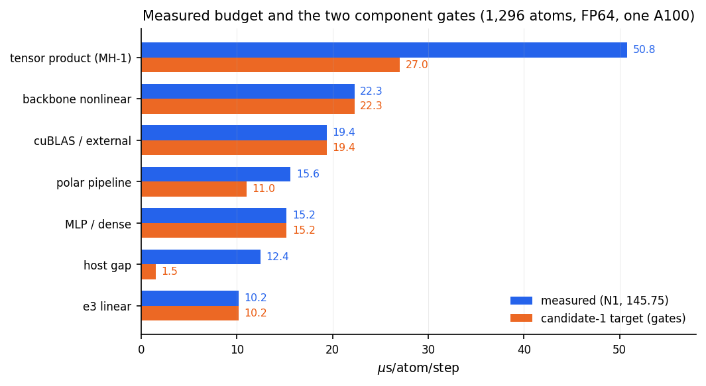
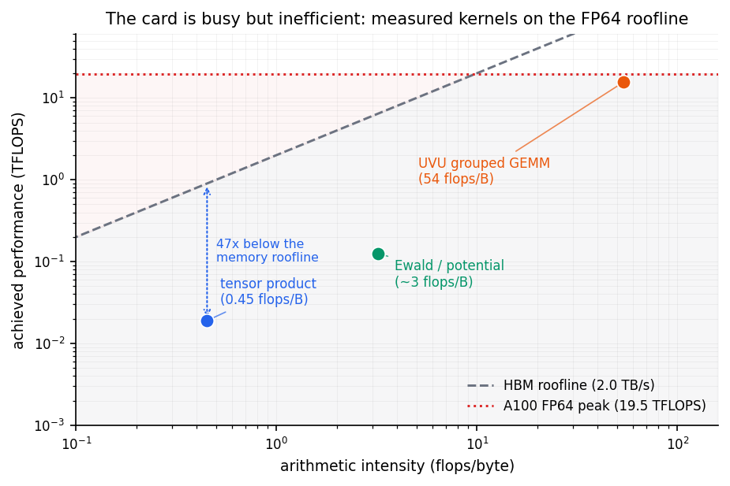
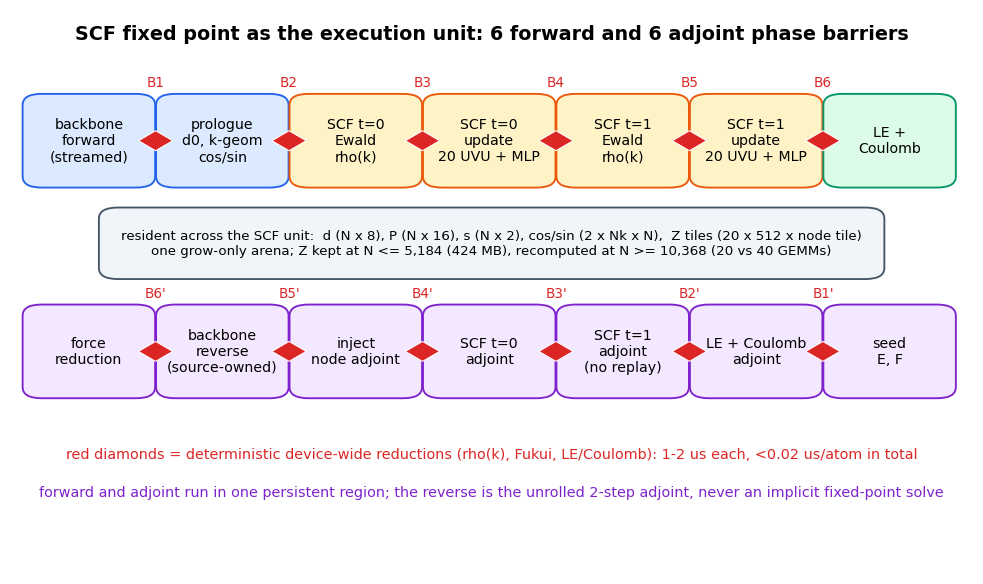
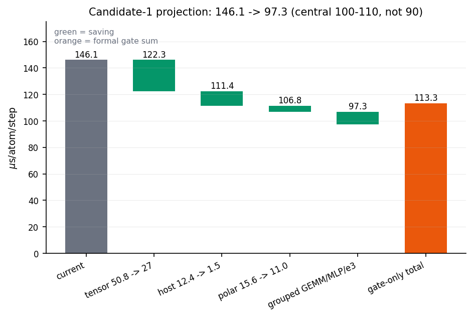
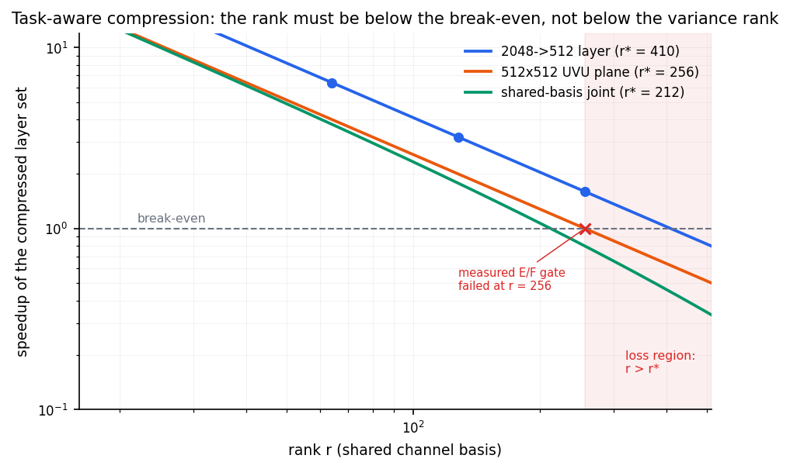

# PolarMACE mathematics-first architecture, 2026-10-22

**Status:** design and analysis only. No kernel was written, no GPU job was
launched, no engine file was modified. The engine worktree, `README.md`, and
`docs/results/` are untouched.
**Scope:** the exact FP64 PolarMACE checkpoint (`MACE-POLAR-1-M`,
`polar_symmetrix_probe.json`, sha256 `0e98f0ae…`), 2-step SCF/Fukui,
GTO-Ewald, one A100-SXM4-80GB, 1,296 / 5,184 / 10,368 atoms.
**Question:** what architecture, grounded in the mathematics of this model,
can go materially below the measured 145.75 µs/atom/step, and what must be
measured before building it?

**Evidence tags.** Every quantitative claim is tagged:

| Tag | Meaning |
|---|---|
| **[M]** | measured on this checkpoint / engine, committed source |
| **[D]** | derived by arithmetic from [M], with the derivation shown |
| **[L]** | literature-reported, cited |
| **[P]** | projection or estimate; not measured |
| **[U]** | unknown; a named experiment is required |

**Unit contract.** Speeds are **µs/atom/step** everywhere. A per-evaluation
duration is given in **µs** only when the atom count is stated. No
millisecond-based speed unit is used in this document. The conversion is
`µs/atom/step = (µs/eval) / N`.

---

## 0. Ten-line executive summary

1. The measured 145.75 µs/atom/step is 91.5 % kernel-busy but the tensor
   product runs at 0.019 TFLOPS (0.1 % of FP64 peak) and 0.45 flops/byte: the
   card is busy, not efficient. The binding constraint is irregular
   memory/launch/dependency latency, not FLOPs.
2. Three architectures are evaluated: (1) fixed-point-aware persistent
   execution, (2) task-aware operator compression, (3) node-centric 4G with
   latent/PME long range and element-wise MoE.
3. Candidate 1 is the only exact-checkpoint route. Its polar+host half is
   projected at 10-14 µs/atom/step (gate 19.3); with a node-owned tensor
   product at 27-35 it projects 97-115 µs/atom/step (1.27-1.50×).
4. Candidate 2 is the mathematically correct repair of the failed variance
   SVD (sensitivity-weighted projector; error = tail eigenvalues), but its
   break-even rank is 212-410 and the E/F gate already fails at rank 256. Its
   best end-to-end upside is ~1.2-1.3×, and it is not exact. Reject as the
   primary architecture.
5. Candidate 3 has the largest ceiling (35-60 µs/atom/step FP64-equivalent;
   15-30 with a reduced-precision contract) but is a new model with a new
   data, training, and accuracy contract. It is a parallel research program,
   not the next engine build.
6. The 20 polar UVU planes cost only 3.74 µs/atom/step of GEMM work. The
   polar pipeline's 15.6 is dominated by the SCF/Ewald/LE/replay chain, so
   persistent execution — not a faster GEMM — is the polar lever.
7. The tensor product is 50.8 µs/atom/step and 47× above its memory roofline;
   node-owned streaming is the only mechanism with 1.5-2× headroom on it.
8. The two component gates (tensor ≤27, host+polar ≤19.3) sum to 113.3
   µs/atom/step with the other components unchanged. Ninety is not supported
   by current exact-FP64 projections; reaching it needs a model, precision,
   or multi-GPU change.
9. Recommendation: build **Candidate 1 plus the node-owned tensor dataflow**
   (architecture A). Go/no-go: tensor ≤35 (target 27), host+polar ≤19.3,
   exact E/F parity, ≤24 GiB at 10,368 atoms.
10. If the gates fail, stop the exact-FP64 single-GPU path and write the
    negative result; pivot to Candidate 3 (new model) or multi-GPU, not to
    more kernel rounds.

---

## 1. What the measurements actually constrain

### 1.1 Speed and scaling

| Workload | Atoms | µs/atom/step | Peak memory | Source |
|---|---:|---:|---:|---|
| full PolarMACE, generic streamed edges | 1,296 | **145.75** | not resampled | [M] `OPTIMIZATION_LEDGER.md` §8 |
| full PolarMACE, generic | 5,184 | **140.91** | 19.16 GiB | [M] same, §1 |
| full PolarMACE, generic | 10,368 | **149.14** | 33.71 GiB | [M] same, §10,368 smoke |
| linear MACE-OFF23, FP32, same engine | 5,184 | 4.47-4.53 | — | [M] `PAPER_COMPARABILITY.md` |
| paper Symmetrix-XL, linear MACE, FP32 | 5,184 | 4.50 | — | [L] arXiv:2610.01036 |

The per-atom cost is flat from 1,296 to 10,368 atoms (−3.3 % at 5,184,
+2.3 % at 10,368 relative to 1,296). **The problem is not asymptotic
scaling.** It is the constant factor of one exact-FP64 polar evaluation.
Full PolarMACE is 32.4× the paper's linear FP32 number; that gap is
model/physics/precision, not a missing tiling trick [M].

### 1.2 Component budget at 1,296 atoms

| Component | µs/atom/step | Share of wall | Binding constraint |
|---|---:|---:|---|
| tensor product (MH-1) | **50.81** | 34.8 % | 0.019 TFLOPS, 0.45 flops/byte; launch/occupancy/latency |
| backbone nonlinear | 22.28 | 15.3 % | edge path, memory/launch |
| cuBLAS / external | 19.38 | 13.3 % | small FP64 GEMMs, 3-5 % of peak |
| polar pipeline | 15.62 | 10.7 % | SCF/Ewald/LE/replay; 20 UVU planes are 3.74 |
| MLP / dense | 15.19 | 10.4 % | small M/N/K, launch-bound |
| e3 linear | 10.15 | 7.0 % | small GEMMs |
| **GPU busy** | **133.43** | 91.5 % | |
| host gap | 12.44 | 8.5 % | 1,762 launches, ~9 µs/launch |
| **total wall** | **146.1** | 100 % | best measured 145.75 |

[D] from the committed N1/CUPTI decomposition; the component sum is 145.87,
within 0.2 of the documented 146.1. `cuBLAS` and `MLP` are reported
separately by the trace but are both small-GEMM launch-bound work.



### 1.3 The roofline: busy but inefficient

- **Tensor product.** 0.63 GFLOP one direction, 1.26 GFLOP forward+reverse
  [M]. At 19.5 TFLOPS FP64 the compute floor is **64.6 µs/eval = 0.050
  µs/atom/step** [D]. At 0.45 flops/byte and 2.0 TB/s the memory floor is
  **1,400 µs/eval = 1.08 µs/atom/step** [D]. The measured 65,850 µs/eval
  (50.81 µs/atom/step) is **47× the memory floor** and **1,019× the compute
  floor** [D]. This is the single most important number in the document:
  there is no FLOP wall, only a data-movement/latency wall.
- **Polar UVU.** 13.59 GFLOP forward, 27.18 GFLOP forward+reverse with Z
  saved [M]. Compute floor 1,394 µs/eval = 1.08 µs/atom/step [D]. The
  measured forward+reverse combination is 4,845 µs/eval = 3.74
  µs/atom/step [M], 3.5× the floor. Grouped batching already reaches 15.64
  TFLOPS (80 % of peak) at 1,296 [M], so the UVU is the one part of the
  model that is close to hardware.
- **Ewald.** 1.67 % of GPU busy = 2.23 µs/atom/step [M/D]. The direct
  k-sum is small: order 0.3-0.4 GFLOP/eval for 2 steps × 2 channels, i.e.
  ~0.1 TFLOPS at the measured time and ~3 flops/byte [D/P]. It is ~50×
  below its memory roofline; its cost is latency and repeated cos/sin
  traffic, not arithmetic.
- **Host.** 1,762 launches × ~9 µs = 15,858 µs/eval = 12.24
  µs/atom/step [M/D], essentially the whole host gap.



### 1.4 The model contract the architecture must preserve

The checkpoint is not a generic MACE. Its polar block has a specific
structure that any architecture must respect [M]:

| Object | Size / count | Role |
|---|---|---|
| polar node features `x2` | 2048 doubles = 512×0e + 512×1o | polar input |
| interaction-0 input | 512 = 512×0e | backbone first layer |
| hidden irreps | 2048 = 512×0e + 512×1o | between the two interactions |
| target irreps | 8192 = 512×0e+512×1o+512×2e+512×3o | convolution output |
| polar density `d` | N×8 doubles | 2 spin channels × 4 multipoles |
| potential features `P` | N×16 doubles | 2 channels × 8 |
| Fukui source `s` | N×2 doubles | charge/spin normalization |
| UVU tables | **6**: fdc0.dot, fdc0.tp, fdc1.dot, fdc1.tp, LE.q, LE.v | 2 paths each |
| UVU planes | **20** forward GEMMs of 512×N×512 | 13.59 GFLOP at N=1,296 |
| SCF steps | T=2, 2 spin channels | unrolled, not converged |
| k-vectors (full) | 1,356 at 1,296 atoms; 11,066 at 10,368 | GTO-Ewald |
| cos/sin geometry | 28.1 MB at 1,296; 1.84 GB at 10,368 | shared across 2×2 passes |
| UVU weights | 12×512×512 doubles = 25.2 MB (24 MiB) | dense, full rank |

The 20 planes are exactly: 4 fdc0.dot (path 0 d1=1, path 1 d1=3), 2 fdc0.tp
(mode 0 + mode 1), 4 fdc1.dot, 2 fdc1.tp, 4 LE.q, 4 LE.v. The checkpoint's
weights have zero fraction 0.0, output masks 1.0, and rank 512 at 1e-3 to
1e-6 [M]. The three facts that kill naive compression are: **dense weights,
full rank, and a nonlinear fixed point that mixes all channels.**

### 1.5 What the measurements rule out

| Hypothesis | Verdict | Evidence |
|---|---|---|
| The GPU is idle; more occupancy fixes it | **No** | 91.5 % busy; the tensor product is 0.1 % of peak because of 0.45 flops/byte |
| FP32 alone is a speed lever | **No** | A100 FP32 CUDA-core peak = FP64 DMMA peak (14.5 vs 14.7 TFLOPS measured); engine FP32 is 0.944× [M] |
| 1-step SCF is enough | **No** | dE 1.27 eV, max dF 0.101 eV/Å [M] |
| Input-variance low-rank truncation works | **No** | r=256 gives dE −2.0 eV, max dF 0.196 eV/Å; oracle basis [M] |
| Ewald is the bottleneck | **No** | 1.67 % of GPU busy [M] |
| Materialized edges are viable | **No** | 139.9 GiB at 5,184 atoms; OOM [M] |
| A faster UVU GEMM alone fixes the polar block | **No** | UVU is 3.74 of 15.62 µs/atom/step; the rest is the SCF/Ewald/LE/replay chain [D] |

### 1.6 Proved, projected, unknown

| Status | Statements |
|---|---|
| **Proved / measured** | The budget and roofline gaps; the rank-512, zero-free UVU tables; the failure of input-variance truncation at r≤256; the 20-plane/6-table count; the grouped-GEMM 15.64 TFLOPS at 1,296; the 1-step SCF failure; the 4-5× receiver-owned accumulation in isolation; Symmetrix-XL's reported mechanisms and 3.1-5.0× |
| **Projected** | Candidate 1's 97-115 µs/atom/step; the 10-14 host+polar; candidate 3's 35-60 (FP64-equivalent) or 15-30 (reduced precision); the 1.2-1.3× compression upside; multi-GPU 65-100 at 1,296 (low confidence) |
| **Unknown** | The native node-owned tensor speed; whether a cooperative SCF kernel fits 2 CTAs/SM; the task-aware basis stability; the joint 6-table rank; the exact CG/path zero fraction; whether a 4G student matches the teacher on six molecules; the PME crossover at 1,296; determinism of the new reduction order at the 1e-9 gate |

---

## 2. Candidate 1 — fixed-point-aware persistent execution

### 2.1 Mathematical formulation

Let `R` be positions, `cell` the periodic cell, `x_i = (h_i^0, h_i^1)` the
backbone node state, and `d_t ∈ R^{N×8}` the spin-resolved density at SCF
step `t`. The model is the composition

```text
d_0 = Ψ_0(x; θ_0)                                      (lr_source_maps, node-local)
for t = 0, 1:
    ρ_{t,σ}(k) = (2π)³/V_k · B_d(k) Σ_i [cos(k·R_i), sin(k·R_i)] · d_{t,σ,i}
    P_{t,σ}    = (1/n_σ) · project_{B_f}(ρ_{t,σ})       (GTO potential features)
    (Δd_t, f_t) = U_θ(P_t, x, d_t)                      (20-plane UVU + MLP + readout)
    d_{t+1}    = Fukui(d_t + Δd_t, f_t; Q_p, Q_m)        (global 2-scalar correction)
E_LR = Coulomb(d_2),   E_LE = LE(d_2, d_0, P_2, x),   E = E_SR + E_LR + E_LE
F = −∂E/∂R            (reverse-mode derivative of the unrolled 2-step map)
```

Two mathematical facts define the architecture:

1. **The fixed point is truncated, not solved.** The reference implementation
   is unrolled autograd over exactly two steps (`num_recursion_steps=2`); it
   is not an implicit-function differentiation. A persistent kernel must
   reproduce the unrolled adjoint. It must **not** solve a fixed-point
   adjoint, use Anderson acceleration, or early-exit; those change the
   gradient. This is the difference between "fixed-point-aware" and
   "fixed-point-solving".
2. **The expensive state is not `d`.** `d` is N×8 (83 KB at 1,296 atoms);
   `P` is N×16; `s` is N×2. The expensive objects are the **potential
   features** (N×16, produced by the Ewald projection), the **20 UVU Z
   planes** (20×512×N = 106 MB at 1,296), and the **cos/sin geometry**
   (28.1 MB at 1,296). The architecture should keep the small fixed-point
   state resident and tile/stream the large planes.

### 2.2 Execution graph

The execution unit is the whole SCF block plus its adjoint, not one kernel.
Seven phases, six device-wide barriers:

| Phase | Work | Parallel axis | Global operation |
|---|---|---|---|
| F0 backbone forward | two edge interactions, streamed node-owned tiles | edge tiles | none |
| F1 polar prologue | `d_0`, k-geometry cos/sin | node tiles | phase barrier B1 |
| F2 SCF t=0 Ewald | ρ(k) partials, potential features | node tiles × k tiles | reduce ρ(k), B2 |
| F3 SCF t=0 update | 20 UVU planes, MLP, readout, Fukui | node × output tiles | reduce Fukui, B3 |
| F4 SCF t=1 Ewald | same as F2 | same | reduce ρ(k), B4 |
| F5 SCF t=1 update | same as F3 | same | reduce Fukui, B5 |
| F6 LE + Coulomb | local-electron MLP, Coulomb energy | node tiles | reduce energies, B6 |
| R0-R6 adjoint | reverse of F6…F0, fused into the same persistent region | same | B1'…B6' |

The forward and adjoint are in **one** persistent region. The reverse uses
the stored `Z` planes (20 GEMMs) or recomputes them (40 GEMMs); it never
replays the whole SCF from host. The force reduction and the backbone
reverse follow in the same launch or in one additional launch.



### 2.3 Synchronization model

- **Intra-phase:** tile-local. Each node has one writer; no atomics in the
  forward. The edge path is receiver-owned; the polar path is node-owned.
- **Inter-phase:** a device-wide barrier. Two implementations:
  (a) `cudaLaunchCooperativeKernel` + `cooperative_groups::grid_group::sync()`;
  (b) a persistent kernel with an atomic counter and a spin barrier. The
  first is simpler; the second avoids the cooperative-launch occupancy
  constraint.
- **Reduction:** a two-level deterministic tree. Each CTA writes its partial
  to a fixed slot; CTA 0 reduces in ascending CTA order and broadcasts. The
  association differs from the current tree, so the result is re-gated. A
  fixed-point (Kahan) accumulation is optional; it improves accuracy but is
  not bitwise identical, so it must be gated like any other reordering.
- **Barrier cost:** 1-2 µs each on a co-resident A100 grid. Twelve barriers
  per eval = 12-24 µs/eval = **0.01-0.02 µs/atom/step** [D]. The barrier
  itself is not the problem; the serialization of the phases is.
- **Occupancy:** the cooperative grid must fit. With 128-256 threads/CTA and
  ≤100 KB shared/CTA, 2 CTAs/SM → 216 CTAs on 108 SMs. The node phases at
  1,296 atoms have 1,296 nodes, ~6 nodes/CTA; the UVU phases have 20×512×N
  work, enough for all SMs. If register pressure forces 1 CTA/SM, use 108
  CTAs and a 2-3 graph fallback.

### 2.4 Memory model

Let `N` be atoms, `Nk` the full k-space count, `M=20`, `C=512`.

```text
S_polar(N) = N(8+16+8+10)·8 B                  (d, P, q, readout: 336 B/atom)
           + N·2048·8 B                        (X2, 16 KB/atom)
           + N·M·C·8 B                         (Z planes, 80 KB/atom, if kept)
           + 2·Nk·N·8 B                        (cos/sin)
```

| N | d/P/q/readout | X2 | Z (20 planes) | cos/sin | S_polar |
|---:|---:|---:|---:|---:|---:|
| 1,296 | 0.44 MB | 21.2 MB | 106.2 MB | 28.1 MB | **155.9 MB** |
| 5,184 | 1.75 MB | 84.9 MB | 424.7 MB | 224.8 MB | **735.9 MB** |
| 10,368 | 3.50 MB | 169.8 MB | 849.3 MB | 1.84 GB | **2.87 GB** |

[D] from the checkpoint dimensions and Nk = 1,356 / 2,712 / 11,066 (full
k-space; the engine's committed note gives 0.212 GiB for the 5,184 cos/sin,
consistent with 2×2,712×5,184×8 B). The polar state is only **~8 %** of the
measured 33.71 GiB (36.2 GB) at 10,368; the rest is backbone/reverse/edge
workspace.
The memory win therefore comes from a **single grow-only arena + node-owned
streaming**, not from the polar state alone.

Consequences:

- At 1,296 and 5,184, keep `Z` (106-425 MB is cheap) and save the 20 reverse
  GEMMs. At 10,368, recompute `Z` (40 GEMMs) to save 849 MB, unless the
  arena has headroom.
- cos/sin is the largest polar-only object at 10,368 (1.84 GB). Keep it: it
  is reused by 2 steps × 2 channels. Recomputing it four times costs more
  than the memory.
- The 25.2 MB of UVU weights do not fit in L2 together with 28 MB of geometry
  at 1,296 (40 MB L2). Expect HBM re-reads per node tile; the arithmetic says
  ~0.4 µs/atom/step at 1,296, acceptable.
- Arena targets: 7-8 GiB at 1,296 (measured 8.55), 15-18 GiB at 5,184
  (measured 19.16), 24-28 GiB at 10,368 (measured 33.71). All **[P]**.

### 2.5 Checkpoint-specialized codegen for the 20 planes

The codegen unit is a **stateful phase machine**, not a static operator
graph. For the 20 planes it emits:

- a compile-time table of 20 tuples `(table, path, input slice, output slice,
  d1, mode, mask)`;
- one forward kernel with the 20-tuple loop unrolled, x2 planes packed at
  compile time (the stride-3 `1o` planes cannot be expressed by `ldb`);
- one fused epilogue: mode-1 broadcast to 3 components, mask, path
  accumulation, and the density/output update;
- the exact adjoint: `dX1 = mbar ⊙ Z` (element-wise), `dX2 = P @ W` (GEMM),
  with the same static schedule; 20 GEMMs if Z is saved, 40 if recomputed;
- no runtime table pointers, no per-plane launch, no host loop.

This is different from Symmetrix-XL's "model-specialized code generation",
which compiles the checkpoint's sparse CG path list into a feed-forward
operator. The 20-plane codegen compiles a **stateful SCF phase machine with
barriers and reductions**; the generated program contains grid-wide
synchronization and a persistent forward/adjoint state, which a feed-forward
operator graph does not.

### 2.6 Complexity

**Asymptotic (unchanged, exact checkpoint):**

| Stage | Complexity |
|---|---|
| backbone edge path | O(E·C·K_tp) |
| backbone node path | O(N·C·H) |
| polar UVU | O(N·C²·M) = O(N) with C,M fixed |
| Ewald | O(N·N_k·(M+F)) + O(N_k) |
| SCF | T · (UVU + Ewald + MLP) + O(N_k) reductions |
| reverse | ~1.5-2× forward, unrolled |

**Constant factors (the architecture's actual claim):**

| Quantity | Current | Candidate 1 | Basis |
|---|---:|---:|---|
| host launches | 1,762 | 8-12 | [M] → [P] |
| host gap | 12.44 | 1-2 | [M] → [P] |
| UVU forward+reverse | 3.74 | 2.0-2.5 | grouped GEMM + fused epilogue [P] |
| Ewald | 2.23 | 0.5-1.0 | resident geometry + device reduction [P] |
| polar other | 9.65 | 5-7 | fused SCF/LE/readout/replay [P] |
| **polar total** | **15.62** | **7.5-10.5** | sum [P] |
| **host+polar** | **28.06** | **8.5-12.5** | sum [P] |

The polar projection is deliberately wider than the component sums: the
fused kernel may lose overlap and may not fit 2 CTAs/SM. The gate is 19.3,
not 12.5, precisely because the 8.5-12.5 is a projection.

### 2.7 Accuracy contract

| Gate | Requirement | Status |
|---|---|---|
| energy | dE ≤ 1e-9 eV vs the current engine | must pass; current gate is 2.9e-11 |
| force | max dF ≤ 1e-8 eV/Å | must pass; current gate is 2.6e-14 |
| 10-step NVE | max Δpos ≤ 1e-13 Å, max ΔF ≤ 1e-13 eV/Å | must pass |
| repeat eval | bitwise stable at fixed rank count | current has a 1-ULP first-eval drift; localize it |
| adjoint | unrolled 2-step derivative, not implicit | mandatory |
| reduction | deterministic tree, re-gated | mandatory |

The new reduction order changes the floating-point association. This is
allowed only after the full gate suite passes; it is not a "bitwise-neutral"
rewrite.

### 2.8 Expected speed

| Scenario | tensor | host+polar | other | total | Speedup |
|---|---:|---:|---:|---:|---:|
| measured N1 component sum | 50.81 | 28.06 | 67.00 | **145.87** | 1.00× |
| Candidate 1 polar only | 50.81 | 12.5 | 67.00 | **130.3** | 1.12× |
| + node-owned TP at 35 | 35 | 12.5 | 67.00 | **114.5** | 1.27× |
| + node-owned TP at 27 | 27 | 12.5 | 67.00 | **106.5** | 1.37× |
| + grouped other at 57.8 | 27 | 12.5 | 57.8 | **97.3** | 1.50× |
| formal gate-only (27 + 19.3) | 27 | 19.3 | 67.00 | **113.3** | 1.29× |



All forward-looking rows are **[P]**. The central projection is **100-110**
µs/atom/step; the aggressive end is **97**; the conservative end (tensor only
35, polar 12) is **114-121**. **Ninety is not supported**: it needs
`90 − 27 − 19.3 = 43.7` from the other four components, a 35 % cut from
67.0, which no measured mechanism supports on this checkpoint.

### 2.9 Implementation risk

| Risk | Severity | Mitigation |
|---|---|---|
| Cooperative kernel does not fit 2 CTAs/SM | high | 1-CTA/SM variant; 2-3 CUDA-graph fallback |
| Determinism of the new reduction tree | high | fixed CTA order; full gate before promotion |
| Register/shared pressure from FP64 Z tiles | medium | 32-node tiles; stream K in 64-chunks |
| Loss of overlap between phases | medium | split into 2-3 persistent regions if needed |
| 1-ULP first-eval drift | low-medium | localize to plan/cache path; do not hide it |
| Replay/recompute ambiguity in reverse | medium | keep Z at N≤5,184; recompute at 10,368 |

### 2.10 First decisive experiment

**Prototype:** one persistent polar SCF kernel at 1,296 atoms that runs
F1-F6 plus their matching adjoint phases, with the 20-plane static schedule,
a device-side ρ(k)/Fukui reduction, and resident cos/sin. Keep the backbone
and tensor product unchanged for this prototype. Measure:
1. host+polar µs/atom/step against the 19.3 gate;
2. exact E/F parity against the current engine;
3. occupancy (CTAs/SM), shared/register use, and the barrier count;
4. repeat-eval bitwise stability.

**Go/no-go:** host+polar ≤19.3 → go; 19.3-25 → conditional; >25 → stop.
The prototype is one kernel family, not a full engine rewrite.

### 2.11 Why this is not Symmetrix-XL

| Axis | Symmetrix-XL | Candidate 1 |
|---|---|---|
| Execution unit | one feed-forward evaluation (or one reverse) | the 2-step SCF fixed point and its unrolled adjoint |
| Dataflow axis | edge-axis streaming; receiver-owned aggregation | node-axis residency; k-space global reduction |
| State lifetime | expanded edge intermediates, consumed and discarded | `d`, `P`, `Z`, cos/sin resident across steps and across forward→reverse |
| Codegen | checkpoint's sparse CG path list / static operator | 20-plane schedule **plus** SCF phase machine, barriers, reductions |
| Synchronization | none global within an evaluation | 6 forward + 6 adjoint device-wide barriers; deterministic tree |
| Memory model | tile-bounded workspace per evaluation | node-resident SCF state + bounded Z plane tiles + one arena |
| Correctness contract | algebraic reassociation of a feed-forward operator | unrolled fixed-point adjoint; no implicit-function shortcut |
| Main gain | capacity/throughput on edge-heavy models | latency and host/launch elimination on a global fixed-point model |
| Failure mode | cache/occupancy, tiling overhead | cooperative occupancy, barrier serialization, determinism |

Symmetrix-XL's three mechanisms (streamed-edge, model-specialized codegen,
tiled execution) are necessary but not sufficient here: the polar block has
no edges to stream, its state is node-level, and its control flow is a fixed
point. That is the gap this candidate fills.

---

## 3. Candidate 2 — task-aware operator compression

### 3.1 Why the input-variance SVD failed

The failed experiment is precise [M]:

| rank r | dE (eV) | max dF (eV/Å) | rms dF (eV/Å) |
|---:|---:|---:|---:|
| 32 | +18.818 | 0.2456 | 0.0717 |
| 64 | +8.333 | 0.2081 | 0.0635 |
| 128 | +7.833 | 0.2672 | 0.0770 |
| 256 | −1.996 | 0.1965 | 0.0553 |

The basis was the **oracle** truncated SVD of the captured activation
`X (512×2048)`, i.e. the best possible variance basis from that snapshot.
The activation energy is concentrated (99 % in 62-76 directions, 99.9 % in
202-238), but the output is not. The reason is a theorem, not a bug:

> Variance SVD minimizes `||X − X_r||`, which is the wrong norm. The task
> error is `||J(X − X_r)||`, where `J = ∂(E,F)/∂X`. If the high-sensitivity
> directions of `J` are not the high-variance directions of `X`, the
> variance tail carries the force.

This is exactly what the measured dE/dF shows: at r=256, 99.9 % of the
feature energy is retained, yet the force error is 0.196 eV/Å against a
max force of 0.710 eV/Å (27.7 % relative).

### 3.2 The mathematically correct alternative

Let `x ∈ R^{C_in}` (`C_in=2048`), `y = f(x) ∈ R^{d_out}` (energy and forces),
`J(x) = ∂y/∂x`. For an orthogonal rank-r projector `Π_r`, the expected
squared output error over the data distribution is

```text
ε²(Π_r) = E_x [ ||J(x)(I − Π_r)x||² ]
        = tr( (I − Π_r) M_s (I − Π_r) )
        = Σ_{i > r} λ_i(M_s),
M_s = ½ E_x [ (JᵀJ) x xᵀ + x xᵀ (JᵀJ) ].
```

A diagonal output metric `W_out` (for example `1 eV⁻²` for energy and
`1 (eV/Å)⁻²` for force components) replaces `JᵀJ` by `JᵀW_outJ`; the theorem
is unchanged, and the metric makes the energy and force units commensurate.

The last equality is the **Ky Fan theorem**: the optimal orthogonal
projector is the top-r eigenspace of the symmetric sensitivity matrix
`M_s`, and the minimal error is the sum of the tail eigenvalues. This is
the correct replacement for the variance SVD. Two special cases:

- **Linear layer** `y = Wx`: `M_s = ½(WᵀW Σ_x + Σ_x WᵀW)`. The optimal
  basis is the top eigenspace of `(WᵀW)^{1/2} Σ_x (WᵀW)^{1/2}`, i.e. the
  generalized singular vectors of `(W, Σ_x^{1/2})`. The variance PCA is
  optimal only if `WᵀW ∝ I`, which the checkpoint is not.
- **Deep network:** `J` is the total Jacobian; compute `g = JᵀJx` by one
  JVP + one VJP per sample, then estimate `M_s` by the rank-2 average
  `½(g xᵀ + x gᵀ)`. With `P` samples, this is a `C_in×C_in` matrix (32 MB
  at 2,048), diagonalizable by a dense eigensolver or a randomized sketch.

**Error bound.** For any `Π_r`, `ε ≤ ||J||₂ ||(I−Π_r)x||₂`; the sharper
data-dependent bound is `ε² = Σ_{i>r} λ_i(M_s)`. For forces, the energy
error is differentiated: `δF = −∂δE/∂R`, so a bound is
`|δF| ≤ ||∂x/∂R|| (||J_E|| ||δx|| + ½||H_E|| ||δx||²)`. The measured
`dF ≈ 0.2` eV/Å at `dE ≈ 2` eV implies a large Hessian-weighted tail, not
a small one.

### 3.3 CG/path sparsity

- **Polar UVU:** zero fraction 0.0, output masks 1.0, 12 dense 512×512
  weights [M]. There are no exact zeros to skip. A sparse format would add
  indices and divergence for no arithmetic saving.
- **Backbone MH-1:** the CG path list has 1-21 nonzero Wigner entries per
  output; the engine already stores only the nonzero path list (path-grouped
  MH-1). FlashTP-style "71-86 % sparse CG matrices" refers to the dense CG
  tensor; the useful exact zeros are already exploited. The **incremental**
  exact sparsity is unknown [U]; the audit is the first experiment.
- **Path aggregation:** load `x1` once and iterate all paths that consume
  it; exact, and partly done by path-grouped MH-1. Expected 5-10 % on the
  tensor product [P], not a 2× lever.

**Break-even:** if `x` % of instructions are exactly skippable and the
sparse format adds `y` % overhead, the net is `x − y`. A sparse path matters
only if `x > 20 %`; the polar block has `x = 0`, the backbone is `[U]`.

### 3.4 Joint tensor decomposition of the 6 tables / 20 planes

The 20 planes are 20 linear maps `Z_p = X_p W_pᵀ`, `W_p ∈ R^{512×512}`.
A shared-basis Tucker/CP decomposition would use

```text
W_p ≈ V_r Σ_p U_rᵀ,       Z_p ≈ V_r Σ_p (U_rᵀ X_p),
cost per plane = 2·C·r + r²   (project + core + reconstruct).
```

Break-even: `2Cr + r² < C²` → `r < C(√2−1) = 212` for C=512. At r=128 the
per-plane speedup is 1.78×; at r=192 it is 1.12×; at r≥212 it is a loss.
The measured individual-table spectra put 99 % energy at rank **355-380**
for the four fdc tables and **286-340** for LE q/v; 99.9 % needs
**471-484** [M]. A shared rank of 212 is far below every 99 % rank, so the
residual would be large. The joint rank across tables is
unknown [U], but the individual spectra make a positive result unlikely.
**Verdict:** reject unless the joint spectrum is dramatically more
concentrated than the individual spectra.

A CP decomposition has the same shape: `R` rank-1 terms cost `2RC` per
plane; break-even `R < C/2 = 256`, again below the measured rank.

### 3.5 Complexity, speed, and break-even

| Layer | Full cost | Rank-r cost | Speedup at r=128 | Break-even r* |
|---|---:|---:|---:|---:|
| 2048→512 projection | `C_in C_out` | `r(C_in+C_out)` | 3.2× | 409.6 |
| 512×512 UVU plane | `C²` | `2Cr + r²` | 2.0× | 256 |
| shared-basis joint | `C²` | `2Cr + r²` | 1.78× | 212 |

End-to-end, if the compressed layers are a fraction `f` of the runtime and
the layer speedup is `s`, `S = 1/((1−f) + f/s)`. The compressible
2048→512 layers are inside `cuBLAS + MLP + e3 = 44.7 µs/atom/step`
(`f = 0.31`) [D]. At `s=3.2`, `S = 1.29×`; at `s=1.6` (r=256), `S = 1.13×`.
The polar UVU is only 3.74 µs/atom/step (`f = 0.026`); even an infinite UVU
speedup saves 2.6 %. **The best realistic compression upside is 1.2-1.3×,
and it is an approximation, not an exact-checkpoint optimization.**



### 3.6 Accuracy contract

There are only three honest contracts for Candidate 2:

1. **Exact:** a lossless factorization with zero tail. The rank audit says
   this requires rank 512; no compression. Rejected.
2. **Gated approximation:** a new numerical contract with a stated dE/dF
   bound. The existing gates (dE ≤1e-9 eV, dF ≤1e-8 eV/Å) are far below the
   measured r=256 errors; a new, looser gate would have to be agreed before
   the model is used for production MD.
3. **New model (Path B):** train the low-rank/latent representation
   end-to-end. This is Candidate 3, not Candidate 2.

There is no fourth option in which a post-hoc rank-256 projection passes the
current exact gate.

### 3.7 Risk and first decisive experiment

| Risk | Severity |
|---|---|
| The sensitivity-weighted basis still fails at r≤256 | high |
| The basis is configuration-dependent and drifts across SCF steps | high |
| The `M_s` estimate needs many Jacobian samples | medium |
| The force tail is not captured by any fixed global basis | high |
| An adaptive per-atom rank adds divergence and bookkeeping | medium |

**First decisive experiment:** on the same 512-atom snapshot, compute `M_s`
by 64-256 JVP/VJP samples, diagonalize, and retest rank 64/128/256. Gate:
`dE ≤ 1 meV/atom`, `rms dF ≤ 1e-3 eV/Å`, `max dF ≤ 5e-3 eV/Å` on the
held-out snapshot. If rank 128 fails, close Candidate 2 permanently for this
checkpoint. Also measure the per-atom sensitivity concentration: if 20 % of
atoms need full rank, the best hybrid speedup is ~2× on the affected layers,
not enough to change the architecture.

**Verdict:** **no-go as the primary architecture.** It is a bounded research
spike at best, and it cannot satisfy the exact-checkpoint contract.

---

## 4. Candidate 3 — node-centric 4G architecture

### 4.1 Node-centric equivariant backbone

The standard edge tensor product is

```text
u_e^{l} = Σ_{l1,l2} C^{l}_{l1m1,l2m2} x_{s(e)}^{l1} Y_e^{l2} w_e,
q_i = Σ_{e:r(e)=i} u_e.
```

E2Former's Wigner-6j convolution recouples the angular momenta so that the
sum over neighbors is performed **before** the expensive angular coupling:

```text
Σ_{m1,m2} C^{l3}_{l1m1,l2m2} C^{l5}_{l3m3,l4m4}
  = Σ_{l6} (2l3+1)(2l6+1) {l1 l2 l3; l4 l5 l6}
      C^{l6}_{l1m1,l4m4} C^{l5}_{l2m2,l6m6}   (up to phase factors),
```

which shifts the tensor-product burden from `O(|E|)` to `O(|V|)` while
preserving equivariance and expressivity [L] E2Former, DOI
10.52202/085713-0797; E2Former reports 7-30× over conventional SO(3)
convolutions. E2Former-V2 adds an SO(3)→SO(2) axis-aligned sparsification and
a fused node-centric Triton kernel, reporting 20× TFLOPS and linear
activation memory [L] arXiv:2601.16622. LunaTP reports node-centric CGTP
execution, path-group parallelism, multi-level reuse, and 250× kernel /
17.1× vs OpenEquivariance on H100 [L] arXiv:2610.18393.

The Gaunt tensor product changes the basis from spherical harmonics to a 2D
Fourier basis, turning the product into a convolution:

```text
Y_{l1m1} Y_{l2m2} = Σ_{lm} G^{m1m2m}_{l1l2l} Y_{lm},
complexity O(L⁶) → O(L³).
```

[L] arXiv:2401.10216. For PolarMACE's `l_max=3`, the asymptotic gain is
modest (729 → 27 in the dense count), but the constant and the memory
traffic improve. SpinGTP extends GTP to spin-weighted spherical harmonics,
recovering the antisymmetric paths and parity-odd components [L]
arXiv:2607.01408; it matters for chiral/spin-orbit systems, less for the six
closed-shell molecules.

**The honest caveat:** the current MH-1 is already path-grouped and runs at
100 % SM coverage; it is instruction/store-bound, not FLOP-bound. The 7-30×
numbers are kernel-level on other models. The end-to-end gain on PolarMACE
is unknown [U] and must be measured on a prototype, not inferred.

### 4.2 Non-self-consistent long-range physics

Three replaceable designs:

1. **Latent Ewald summation (LES).** Learn a hidden variable `z_i = g_θ(h_i)`
   from local descriptors, then apply Ewald to `z`:
   `E_LR = (2π/V) Σ_{k≠0} |Σ_i z_i e^{ik·R_i}|²/k²`. No explicit charges, no
   QEq, no SCF. Cheng reports ~2× the cost of a short-range MLIP [L] DOI
   10.1038/s41524-025-01577-7.
2. **Differentiable PME with learned charges and dipoles.** Assign charges
   and dipoles to a B-spline mesh, FFT, multiply by the kernel, inverse FFT;
   forces are analytic gradients of the assignment. `O(N + G log G)`,
   production-MD scaling, and numerical agreement with explicit Ewald when
   deconvolution is enabled [L] arXiv:2606.01598.
3. **Polarizable atomic multipoles with non-self-consistent linear
   response.** Local descriptors predict monopoles, dipoles, quadrupoles;
   induced charges/dipoles are a single linear response, not an SCF. The
   paper reports Born effective charges, polarizability, IR/Raman, and
   LO-TO splitting without direct supervision [L] arXiv:2605.05746.

The mathematical difference from the current model is decisive: the current
model has a **nonlinear 2-step fixed point** with a Fukui global
normalization and a 20-plane update block. LES/PME/polarizable multipoles
replace that with a **one-pass learned density** (plus at most one linear
response solve). This removes the SCF, the Fukui reduction, and most of the
20 planes, but it is a new model, not an inference optimization.

**Direct k-sum vs PME at 1,296.** `Nk=1,356`, cos/sin 28.1 MB; the direct
k-sum is already cheap. PME's FFT grid at 1,296 is 64³ = 262k points; the
crossover to PME is likely at `N ≈ 10⁴` [P/U]. A runtime switch (direct at
small N, PME at large N) is the right engineering choice; do not force PME
at 1,296.

### 4.3 Element-wise MoE

For element `e`, the model uses a shared trunk plus expert `e`:

```text
h_i = Shared(h_i) + Expert_{e(i)}(h_i),   e(i) ∈ {H, C, N, O, …}.
```

Routing is deterministic by element, so there is no global load balancing,
no all-to-all, and no routing instability. The capacity grows with species,
not with N. For the six-molecule target (H, C, N, O), four experts are
enough. MoE is not a speedup by itself; it allows a smaller shared width (or
better accuracy at fixed width), which is a model-design lever [L] MoE for
MLIPs, DOI 10.1038/s44387-026-00144-9; multifidelity MoE Allegro,
arXiv:2604.26143.

### 4.4 What to borrow from RuNNer 2.0 QEq

RuNNer 2.0 replaces the `O(N³)` QEq solve with a plane-wave/FFT Coulomb
matvec and CG, `O(N log² N)`, and uses one adjoint solve per structure for
the force trick [L] DOI 10.1063/5.0352886. The transferable pieces are:

- **matrix-free global solve:** never form `A` or `A⁻¹`;
- **one global solve + one adjoint per structure:** not per atom, not per
  SCF step;
- **memory budget as part of the algorithm:** the six-component RAM ledger
  and chunking pattern.

The non-transferable piece is the QEq physics: our current long-range layer
is a nonlinear fixed point with a Fukui-balanced update, not a quadratic
charge-equilibration problem. Replacing it with QEq would change the model's
energy and forces; it must be trained, not dropped in.

### 4.5 Six-molecule distillation target

The teacher is the current FP64 PolarMACE. The student is the 4G
architecture. The smoke run covers H2O, NH3, C2H4, CH4, C2H6, CO2 (8
configurations × 12 molecules) and writes E/F extxyz [M]. It is **not**
training-ready:

| Problem | Measured | Fix |
|---|---|---|
| random positions + rattle 0.02-0.06 Å | CO2 max force 37.47 eV/Å | equilibrium + rattle ≤0.02 Å |
| no thermal sampling | E std 1.5-3.3 eV | NVT 300-800 K snapshots |
| no held-out split | — | 2,000-5,000 configs/species, 10-20 % held-out |
| teacher-only validation | — | 100-500 DFT single points for bias check |

**Distillation loss:** energy + force + Hessian (curvature) alignment.
Architecture-agnostic energy-Hessian distillation reports 48.3 % average
energy-accuracy gain over a strong Hessian baseline on SPICE [L] DOI
10.1016/j.neunet.2026.109742. Structural pruning reports 1.5-4× fewer
parameters and better accuracy than a from-scratch small model [L]
arXiv:2605.08885; this supports a compact student, not a guarantee for
PolarMACE.

**Gates before any speed claim:**
1. held-out force RMSE ≤ the teacher's own DFT error (or ≤30 meV/Å);
2. held-out energy RMSE ≤1 meV/atom;
3. 10 ps NVT stable at 300-800 K;
4. charge conservation / dipole response, if the 4G contract includes it;
5. speed at 1,296 and 5,184 on the same A100.

### 4.6 Complexity

| Stage | Current | 4G candidate |
|---|---|---|
| backbone angular TP | O(E·C·K_tp), E/N≈90 (geometric; the checkpoint constant 30 is a training normalization) | O(N·C·K_node) + O(E·C_radial) |
| backbone radial | O(E·C·H) | O(E·C_radial) (scalar) |
| long range | 2-step SCF + 20 planes + k-sum | one latent/PME pass + one linear response |
| Ewald | O(N·N_k·(M+F)) | O(N·N_k) direct, or O(N+G log G) PME |
| MoE | — | +1 expert per atom (deterministic) |
| total | O(E·C·K_tp) dominates | O(N·C·K_node + E·C_radial + G log G) |

The asymptotic win is real: the angular tensor product moves from the edge
count (≈90 N) to the node count. The constant-factor win depends on the
kernel; it is not automatic.

### 4.7 Accuracy contract

The 4G candidate is a **new model**, with:
- a new training set and a held-out split;
- a new precision policy (FP64, TF32, or BF16 — state it explicitly);
- an E/F accuracy contract against the teacher and DFT;
- an MD stability contract;
- a response contract (charge/dipole/polarizability) if claimed.

It cannot inherit the current checkpoint's exactness. The six-molecule
distillation is the only evidence that can justify it.

### 4.8 Expected speed

| Scenario | Backbone | Long range | Total | Speedup vs 145.75 |
|---|---:|---:|---:|---:|
| 4G, FP64-equivalent, conservative | 55-65 | 8-10 | **63-75** | 1.9-2.3× |
| 4G, FP64-equivalent, aggressive | 40-50 | 5-8 | **45-58** | 2.5-3.2× |
| 4G, TF32/BF16, aggressive | 20-30 | 3-5 | **23-35** | 4.2-6.3× |
| "linear MACE + 2×" analogy | — | — | 9-15 | 10-16× |

All **[P]**, low confidence. The 9-15 row is an analogy to the paper's
linear FP32 4.50 µs/atom/step, not a measurement of a 4G model; it assumes
the student is as lean as linear MACE and uses the same execution
efficiency. A 4G model with a long-range solver and MoE is heavier. The
defensible range is **35-60 µs/atom/step in FP64-equivalent** and **15-30
with a reduced-precision contract**. Do not promise 4.5.

### 4.9 Risk and first decisive experiment

| Risk | Severity |
|---|---|
| The student cannot match the teacher on six molecules | high |
| The dataset is not training-ready (CO2 37 eV/Å) | high |
| The 6j/LunaTP kernel gain does not transfer to PolarMACE | high |
| PME at 1,296 is slower than the direct k-sum | medium |
| Reduced precision changes the accuracy contract | high |
| Training cost (months) and no intermediate deliverable | high |

**First decisive experiment:** fix the six-molecule dataset (equilibrium +
gentle rattle + NVT + held-out + 100-500 DFT points), then train a
**water-only** student with the node-centric backbone and LES. Gate: force
RMSE ≤30 meV/Å and energy RMSE ≤1 meV/atom vs the teacher on held-out
water; 10 ps NVT stable. Only then scale to six molecules and benchmark.
Do not start with a full six-molecule training run.

**Verdict:** the right **next model program**, not the next engine build.
It should run in parallel with Candidate 1, gated on the dataset and the
water student.

---

## 5. Comparison

| Axis | Candidate 1 | Candidate 2 | Candidate 3 |
|---|---|---|---|
| Retraining | no | no (but new numerical contract) | **yes** |
| Exact checkpoint | **yes** | no | no |
| Main lever | execution graph, state residency, host elimination | sensitivity-weighted low rank | node-centric equivariance + one-pass long range + MoE |
| Asymptotic change | none | none | O(E)→O(V) angular; SCF→one pass |
| Measured support | 91.5 % busy, 12.44 host, 3.74 UVU, 15.62 polar | rank-512 tables; r=256 E/F failure | E2Former/LunaTP/LES/PME/polarizable multipoles |
| Expected speed | **97-115** µs/atom/step | 1.2-1.3× best case (~112-122) | 35-60 FP64-equivalent; 15-30 reduced |
| Risk | medium | high (gate already failed at 256) | high |
| Time | weeks | 1-2 week spike | months |
| First experiment | persistent polar prototype, host+polar ≤19.3 | Jacobian basis at r=128 | water student, force RMSE ≤30 meV/Å |
| Verdict | **build now** | bounded spike / reject as primary | parallel program |

---

## 6. Recommendation and go/no-go

### 6.1 The architecture to build next

**Architecture A — SCF-persistent node-owned execution.**

It combines Candidate 1 (fixed-point-aware persistent polar execution) with
the node-owned tensor-product dataflow that the measurements put first. The
two are not separable: Candidate 1 alone leaves the 50.8 µs/atom/step tensor
product untouched and lands at ~130; the tensor rewrite alone leaves the
28.06 host+polar untouched and lands at ~123. Together they are the only
exact-checkpoint path below 115.

Build order:

1. **A1: node-owned tensor product.** Replace the materialized edge
   accumulation with a receiver-owned streaming kernel, using the V4 Triton
   probe as the specification (4.12× at 1,296, 5.04× at 5,184, bitwise exact
   in isolation). Keep the MH-1 path-grouped instruction list. Target ≤35
   µs/atom/step; stretch ≤27.
2. **A2: persistent polar SCF.** One persistent region for F1-F6 plus their
   adjoint phases, resident `d/P/Z/cos-sin`, device-side ρ(k)/Fukui
   reductions, static 20-plane codegen, fused epilogue, exact adjoint.
   Target host+polar ≤19.3 µs/atom/step.
3. **A3: grouped small GEMMs + one arena.** Batch the 20 UVU planes, the MLP
   64→64 and 64→512, and the e3 linear pack/unpack; one grow-only arena
   reused across forward and reverse. Target the other four components
   67.0 → 57.8; memory ≤24 GiB at 10,368.

### 6.2 Go/no-go

| Gate | Measure | Go | Conditional | No-go |
|---|---|---:|---:|---:|
| **G1a tensor target** | node-owned TP at 1,296 | ≤27 µs/atom/step | 27-35 | >35 |
| **G1b tensor minimum** | same | ≤35 | 35-45 | >45 |
| **G2 host+polar** | persistent SCF at 1,296 | ≤19.3 | 19.3-25 | >25 |
| **G3 parity** | dE, max dF, 10-step NVE | dE ≤1e-9 eV, dF ≤1e-8 eV/Å, NVE pass | one gate marginal | any fail |
| **G4 memory** | 10,368 atoms | ≤24 GiB | 24-30 | >30 |

Outcomes:

- **G1a + G2 + G3 + G4 pass:** integrate; **106-113** µs/atom/step before
  A3 (1.29-1.37×), **97-107** with A3 (1.36-1.50×). This is the recommended
  target.
- **G1b (not G1a) + G2 pass:** integrate; expected **110-121**
  µs/atom/step (1.20-1.33×). Still a real gain; do not claim 90.
- **G1 passes, G2 fails:** ship the tensor gain (~123, 1.18×); do not build
  the persistent polar kernel. The host+polar gate was the test of that
  mechanism.
- **G2 passes, G1 fails:** ship the polar-only gain (~130, 1.12×) and
  document the tensor wall; do not spend more rounds on the tensor kernel
  without a new model.
- **G1 and G2 fail:** stop the exact-FP64 single-GPU path. Write the negative
  result. Pivot to Candidate 3 (new model) or multi-GPU. More kernel tweaks
  are not justified by the measurements.

### 6.3 What the gates sum to

The example gates (tensor ≤27, host+polar ≤19.3) sum to

```text
27 + 19.3 + 22.28 (backbone) + 19.38 (cuBLAS) + 15.19 (MLP) + 10.15 (e3)
= 113.3 µs/atom/step  (1.29×).
```

That is the **formal gate total**, not the architecture's ceiling. The
aggressive path (tensor 27, host+polar 12.5, grouped other 57.8) is 97.3.
The difference between 113.3 and 97.3 is the grouped-GEMM/MLP/arena work
(A3), which is why A3 is part of the recommendation rather than an optional
polish.

**Ninety is not supported.** It needs `90 − 27 − 19.3 = 43.7` from the other
four components, a 35 % cut from 67.0. No measured mechanism on this
checkpoint supports that. **Eighty is further out.** If 90 is a hard
requirement, the only honest paths are (a) Candidate 3 with a reduced
precision contract, (b) multi-GPU (65-100 at 1,296, low confidence), or
(c) a model-policy change (fewer SCF steps, TF32/BF16), each of which
changes the contract.

### 6.4 What would change the recommendation

| Change | Effect |
|---|---|
| A native node-owned tensor prototype measures ≤20 µs/atom/step | reallocate effort to the persistent polar; the total could approach 90 |
| A multi-GPU 4×A100 job becomes submitable | the 65-100 multi-GPU route competes with A; re-evaluate |
| A TF32/BF16 policy is accepted for production | the precision ceiling changes; Candidate 3 becomes more attractive |
| The water-only 4G student passes the E/F gate | start the six-molecule program in parallel; Candidate 1 is still the engine |
| The task-aware basis passes at r=128 | add it to A as a 1.1-1.2× layer compression, not as the architecture |
| The cooperative SCF kernel cannot fit 2 CTAs/SM | fall back to 2-3 CUDA graphs; the host+polar gate is still reachable |

### 6.5 What not to do

- Do not implement direct low-rank input truncation; it already failed at
  r=256 with the oracle basis.
- Do not use FP32 as a speed lever; A100 FP32 CUDA-core peak equals FP64
  DMMA peak, and the engine FP32 path is 0.944×.
- Do not remove the second SCF step without a passing correction; 1-step
  fails at dE 1.27 eV / dF 0.101 eV/Å.
- Do not force PME at 1,296; the direct k-sum is already cheap and the
  crossover is at larger N.
- Do not call the 20-plane GEMM the polar bottleneck; it is 3.74 of 15.62
  µs/atom/step.
- Do not expect Symmetrix-XL's streamed-edge/tiled mechanisms to fix the
  polar block; it has no edge axis and its control flow is a fixed point.
- Do not benchmark a 4G student before it passes the teacher E/F gate; a
  fast wrong model is not a result.

---

## 7. Claims ledger

| Claim | Tag | Source / derivation |
|---|---|---|
| 145.75 / 140.91 / 149.14 µs/atom/step at 1,296 / 5,184 / 10,368 | [M] | `OPTIMIZATION_LEDGER.md` §8, §10,368 |
| tensor 50.81, backbone 22.28, cuBLAS 19.38, polar 15.62, MLP 15.19, e3 10.15, host 12.44 | [M] | N1 CUPTI; `THEORY_OPTIMAL_EXECUTION_PLAN.md` §2 |
| GPU busy 91.5 % | [D] | 133.43 / 146.1 |
| tensor 0.019 TFLOPS, 0.45 flops/byte | [M] | V4 roofline probe |
| tensor 47× memory floor, 1,019× compute floor | [D] | 1.26 GFLOP; 19.5 TFLOPS; 2.0 TB/s |
| 20 planes, 6 tables, 12 paths, 13.59 GFLOP | [M] | `POLAR_UVU_GEMM_MICROBENCH.md` §2 |
| grouped GEMM 15.64 TFLOPS at 1,296 | [M] | same, §3.2 |
| UVU forward+reverse 4,845 µs/eval = 3.74 µs/atom/step | [M] | same, §3.3 |
| rank 512 at 1e-3-1e-6; zero fraction 0 | [M] | `uvu_rank_2026-10-22.json` |
| input SVD r=256: dE −1.996 eV, max dF 0.196 eV/Å | [M] | `rank_truncated_error.json` |
| Ewald 1.67 % of GPU busy | [M] | `ARCHITECTURE_V2_PLAN.md` |
| 1-step SCF dE 1.27 eV, dF 0.101 eV/Å | [M] | `scf1_probe.json` |
| FP32 engine 0.944× | [M] | `fp32_sensitivity.json` |
| receiver-owned accumulation 4.12×/5.04×, bitwise exact | [M] | V4 probes |
| Nk = 1,356 at 1,296; 11,066 at 10,368 | [D] | k-space count with K=1.8467166 Å⁻¹, L=23.489/46.978 Å |
| cos/sin 28.1 MB at 1,296; 1.84 GB at 10,368 | [D] | 2·Nk·N·8 B |
| S_polar 155.9 MB / 735.9 MB / 2.87 GB | [D] | §2.4 |
| sensitivity-weighted projector is optimal; error = tail eigenvalues | proved | Ky Fan theorem; §3.2 |
| break-even ranks 409.6 / 256 / 212 | proved | §3.5 |
| compression best case 1.2-1.3× | [P/D] | f=0.31, s=3.2 |
| candidate 1 polar 7.5-10.5; host+polar 8.5-12.5 | [P] | component model |
| candidate 1 total 97-115 | [P] | §2.8 |
| candidate 3 35-60 FP64; 15-30 reduced | [P] | §4.8 |
| multi-GPU 65-100 at 1,296 | [P] | V2 plan, low confidence |
| 90 not supported by exact-FP64 single-GPU | [D/P] | gate arithmetic, §6.3 |
| E2Former O(E)→O(V), 7-30× | [L] | DOI 10.52202/085713-0797 |
| E2Former-V2 20× TFLOPS, linear memory | [L] | arXiv:2601.16622 |
| LunaTP 250× kernel, 17.1× vs OEQ | [L] | arXiv:2610.18393 |
| Gaunt O(L⁶)→O(L³) | [L] | arXiv:2401.10216 |
| SpinGTP completeness | [L] | arXiv:2607.01408 |
| LES ~2× short-range cost | [L] | DOI 10.1038/s41524-025-01577-7 |
| differentiable PME O(N log N), numerical Ewald agreement | [L] | arXiv:2606.01598 |
| polarizable multipoles, non-self-consistent response | [L] | arXiv:2605.05746 |
| RuNNer QEq O(N log² N) | [L] | DOI 10.1063/5.0352886 |
| architecture-agnostic energy/Hessian distillation | [L] | DOI 10.1016/j.neunet.2026.109742 |
| structural pruning 1.5-4× fewer parameters | [L] | arXiv:2605.08885 |

---

## 8. Appendix A — derivations

### A.1 Sensitivity-weighted projector (Ky Fan)

For `x ∈ R^{C}`, `y = f(x)`, `J = ∂y/∂x`, and an orthogonal rank-r projector
`Π`, the expected squared output error is

```text
ε²(Π) = E[ ||J(I−Π)x||² ] = E[ xᵀ(I−Π)ᵀJᵀJ(I−Π)x ]
      = E[ tr((I−Π) x xᵀ (I−Π)ᵀ JᵀJ) ]
      = tr((I−Π) M_s (I−Π)ᵀ),
M_s = ½ E[ JᵀJ x xᵀ + x xᵀ JᵀJ ].
```

Because `Π` is an orthogonal projector, `I−Π` is symmetric and idempotent.
The Ky Fan minimum of `tr((I−Π)M_s)` over rank-r projectors is attained by
the span of the top-r eigenvectors of `M_s`, and the minimum is the sum of
the `C−r` smallest eigenvalues. This is the exact correct replacement for
the variance SVD, which uses `M_x = E[xxᵀ]` and ignores `J`.

For a linear layer `W`, `M_s = ½(WᵀW Σ_x + Σ_x WᵀW)`. The optimal basis is
the top eigenspace of `(WᵀW)^{1/2} Σ_x (WᵀW)^{1/2}`; equivalently the
generalized singular vectors of `(W, Σ_x^{1/2})`.

### A.2 Break-even ranks

- 2048→512: `s(r) = C_in C_out / (r(C_in+C_out)) = 409.6/r`; `s>1` iff
  `r < 409.6`.
- 512×512 plane with rank-r factorization: `s(r) = C²/(2Cr+r²) = 262144/
  (1024r+r²)`; `s>1` iff `r < 512(√2−1) = 212.08`.
- Shared-basis joint with a per-plane core: same `2Cr+r²` cost,
  break-even 212.
- CP decomposition with R rank-1 terms: `s = C²/(2RC) = C/(2R) = 256/R`;
  break-even `R=256`.

### A.3 Roofline

- Tensor: 1.26 GFLOP forward+reverse; 19.5 TFLOPS → 64.6 µs/eval; 2.0
  TB/s at 0.45 flops/byte → 1,400 µs/eval. Measured 65,850 µs/eval.
- UVU: 27.18 GFLOP forward+reverse; 19.5 TFLOPS → 1,394 µs/eval; measured
  combination 4,845 µs/eval; grouped GEMM alone 15.64 TFLOPS.
- Ewald: order 0.3-0.4 GFLOP/eval (2 steps × 2 channels × assemble/project);
  measured 2,892 µs/eval → ~0.1 TFLOPS; intensity ~3 flops/byte (28.1 MB ×
  4 passes). This is an order-of-magnitude estimate [D/P], not a
  counter-derived FLOP count.

### A.4 Memory arithmetic

`S_polar(N)` in §2.4. The k-space count uses the reciprocal lattice of the
cubic cell; the half-space count at 1,296 atoms is 678 and the full count is
1,356. The engine's committed note (0.212 GiB for cos/sin at 5,184) is
consistent with the full count, 2,712. At 10,368 the full count is 11,066.

### A.5 20-plane schedule

| Table | Path | d1 | Input plane | Output block | mode |
|---|---:|---:|---|---|---:|
| fdc0.dot | 0 | 1 | x2[:,0:512] | out[:,0:512] | 0 |
| fdc0.dot | 1 | 3 | x2[:,512+c:2048:3] | out[:,0:512] | 0 |
| fdc0.tp | 0 | 1 | x2[:,0:512] | out[:,0:512] | 0 |
| fdc0.tp | 1 | 3 | x2[:,0:512] | out[:,512:2048] | 1 |
| fdc1.dot | 0 | 1 | x2[:,0:512] | out[:,0:512] | 0 |
| fdc1.dot | 1 | 3 | x2[:,512+c:2048:3] | out[:,0:512] | 0 |
| fdc1.tp | 0 | 1 | x2[:,0:512] | out[:,0:512] | 0 |
| fdc1.tp | 1 | 3 | x2[:,0:512] | out[:,512:2048] | 1 |
| le.q | 0 | 1 | x2[:,0:512] | out[:,0:512] | 0 |
| le.q | 1 | 3 | x2[:,512+c:2048:3] | out[:,0:512] | 0 |
| le.v | 0 | 1 | x2[:,0:512] | out[:,0:512] | 0 |
| le.v | 1 | 3 | x2[:,512+c:2048:3] | out[:,0:512] | 0 |

Each row is one 512×N×512 FP64 GEMM; the d1=3 path emits three GEMMs. The
total is 20 forward GEMMs and 20 (Z saved) or 40 (Z recomputed) reverse
GEMMs.

---

## 9. Appendix B — figures

| Figure | File | What it shows |
|---|---|---|
| 1 | `figures/MATH_ARCH_BUDGET.png` | measured budget and the two component gates |
| 2 | `figures/MATH_ARCH_ROOFLINE.png` | tensor/Ewald/UVU on the FP64 roofline |
| 3 | `figures/MATH_ARCH_PROJECTION.png` | candidate-1 projection waterfall |
| 4 | `figures/MATH_ARCH_COMPRESSION.png` | task-aware compression break-even |
| 5 | `figures/MATH_ARCH_SCF_GRAPH.png` | SCF execution graph and barriers |

All figures are generated by
`figures/make_math_arch_figures.py` at `dpi=150`; labels are in
µs/atom/step where a speed is shown.

---

## 10. References

1. Fu, Feng, Li, Du, He, Wu, Bao, Zhang, Deng, Lu, Zhu. *Train for
   Accuracy, Execute at Scale: Architecture-Preserving Inference for
   Equivariant Atomistic Foundation Models.* arXiv:2610.01036 (2026).
2. Li, Huang, Ding, Wei, Wang, Yang, Wang, Liu, Shi, Jin, Qin, Gerstein.
   *E2Former: An Efficient and Equivariant Transformer with Linear-Scaling
   Tensor Products.* NeurIPS 38 (2025). DOI 10.52202/085713-0797.
3. Huang, Huang, Wang, Du, Wang, Lu, Li, Liu, Jiang, Zhang. *E2Former-V2:
   On-the-Fly Equivariant Attention with Linear Activation Memory.*
   arXiv:2601.16622 (2026).
4. Zhou, Li, Wang, Zhang, Tan, Jia. *LunaTP: Enabling Efficient and Scalable
   Tensor Product for Equivariant MLIPs.* arXiv:2610.18393 (2026).
5. Luo, Chen, Krishnapriyan. *Enabling Efficient Equivariant Operations in
   the Fourier Basis via Gaunt Tensor Products.* ICLR 2024;
   arXiv:2401.10216.
6. Liang, Lin, Kryvenko, Yu, Li, Xie, Qian, Ji. *Spin-Weighted Spherical
   Harmonics Enable Complete and Scalable E(3)-Equivariant Networks.*
   arXiv:2607.01408 (2026).
7. Cheng. *Latent Ewald summation for machine learning of long-range
   interactions.* npj Comput. Mater. 11, 80 (2025).
   DOI 10.1038/s41524-025-01577-7.
8. Guo, Wang, Zhang, Liang, Yang, Pan, Sun. *Differentiable Particle-Mesh
   Ewald with Cartesian Tensor Message Passing for Learning Long-Range
   Electrostatics and Dipole Response.* arXiv:2606.01598 (2026).
9. Park, Kim, King, Đào, Savoj, Hamel, Wang, Cheng. *Polarizable atomic
   multipoles for learning long-range electrostatics.* arXiv:2605.05746
   (2026).
10. Knoll, Schäfer, Lausch, Gubler, Wang, Springborn, El Haouari, Liebetrau,
    Finkler, Kocer, Eckhoff, Goedecker. *RuNNer 2.0: A Software Suite for
    High-Dimensional Neural Network Potentials.* J. Chem. Phys. 165, 152502
    (2026). DOI 10.1063/5.0352886.
11. Wang, Hu, Tan, Jia. *Compact SO(3) Equivariant Atomistic Foundation
    Models via Structural Pruning.* arXiv:2605.08885 (2026).
12. Wang, Hu, Tan, Jia. *Architecture-agnostic knowledge distillation for
    machine-learning interatomic potentials.* Neural Networks (2027).
    DOI 10.1016/j.neunet.2026.109742.
13. MoE for MLIPs. DOI 10.1038/s44387-026-00144-9.
14. Multifidelity MoE Allegro. arXiv:2604.26143.
15. Project-internal: `docs/results/OPTIMIZATION_LEDGER.md`,
    `docs/results/V4_PROBES_2026-10-22.md`,
    `docs/design/THEORY_OPTIMAL_EXECUTION_PLAN.md`,
    `docs/design/NEW_ARCHITECTURE_TWO_PATHS.md`,
    `docs/design/ARCHITECTURE_V2_PLAN.md`,
    `docs/results/POLAR_UVU_GEMM_MICROBENCH.md`,
    `docs/design/POLAR_REVERSE_DESIGN.md`,
    `docs/theory/ENERGY_MODEL.md`, `docs/theory/TENSOR_ALGEBRA.md`,
    `docs/results/PATH_B_SIX_MOLECULE_SMOKE_2026-10-22.md`.
