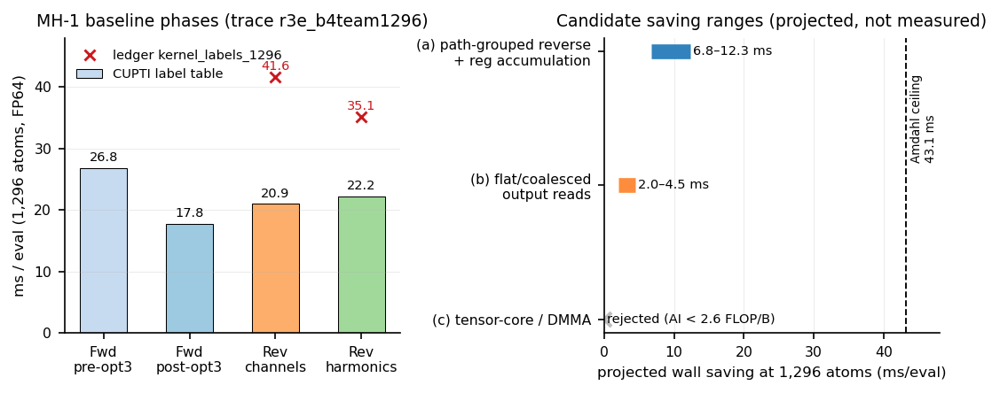

# MH-1 reverse rewrite (Plan A2) — design and feasibility

**Date:** 2026-10-21 (container clock)
**Status:** analysis-only. No engine source was edited, nothing was built, no GPU
job was run. This document is the A2 design deliverable.
**Scope:** the two MH-1 backward (reverse) tensor-product kernels of the main
FP64 PolarMACE path at 1,296 atoms. The MH-1 forward path-grouping work (opt3),
B4 reverse-gather fusion, UVU, Ewald, and the Plan A/B bench trees are out of
scope and were not touched.
**Rule used throughout:** measured values cite a committed log/JSON/CSV;
everything else is labelled *estimate* or *projected*.

---

## 1. 中文执行摘要（6 行）

1. 本报告只做设计与可行性分析：未改引擎源码、未构建、未跑 GPU；所有结论以已提交的 CUPTI/AB 数据为准。
2. 1,296 原子 CUPTI 标签表（r3e_b4team1296）测得 MH-1 反向 = 通道 **20.95 ms** + 谐波 **22.19 ms** = **43.14 ms/eval（33.3 µs/atom，4 次 launch）**；任务给出的 76.73 ms（41.63+35.10）无法由该表复现，列为“待复核上限”，第 0 步先补一条 trace。
3. 反向不是 FP64 算力瓶颈：唯一流量口径 AI ≈ 0.2–0.7 FLOP/B，实测约 0.2–0.6 TFLOP/s（FP64 CUDA-core 峰值的 2–6%）；瓶颈是每通道重复的 plan/values/input_2 加载、逐 entry 的全局 read-modify-write、以及跨 channel 的 strided `output_adjoint` 读。
4. 首选 **(a) path-grouped reverse + 逐通道寄存器累加 + 按 path 预缩放 Wigner + 去掉全 1 mask**：把前向已验证的 `g[a,c]=Σ_b W[a,b,c]·h[b]` 预收缩搬到反向；预计 43.1 → **31–36 ms/eval**，节省 **7–12 ms（5.4–9.5 µs/atom，约 2.4–4.2% 墙钟）**。
5. 次选 **(b) lane→component 的 flat/合并访存**，预计再省 **2.0–4.5 ms**；但会重排 FP64 求和并增加 warp 归约，必须在 (a) 单独过门、且 trace 仍显示有效带宽 <60% 峰值时才做。(c) 张量核/DMMA **明确否决**：N≤21、K≤21、AI<2.6 FLOP/B，远低于 9.75 FLOP/B ridge。
6. 合入前硬性要求：**同一二进制**的 1,296 原子交错 A/B + 128 原子 parity（bitwise 切片要求 dF=0，重排切片要求 dF≤1e-10）+ 三次重复求值 + module 5–8/32/32 + 1/2-rank LAMMPS parity；任一失败即回滚。

---

## 2. Measured baseline

### 2.1 System and method

| Item | Value | Source |
|---|---|---|
| System | 1,296-atom H₂O, periodic, 2 atom types | `bench/paper_scale_2026-10-20/in.polar_water_1296` |
| Model | full PolarMACE (`polar_symmetrix_probe.json`), MACE_Nonlinear + polar SCF + exact Ewald, FP64 | S1/S5 |
| Edges (directed) | 111,312 (`E`); this is the grid-x of both reverse kernels | S2/S3 |
| GPU | one A100-SXM4-80GB, `flock` | S5 |
| Current main wall | **289.43 ms/eval = 223.33 µs/atom** | S6 (A1 A/B, same binary) |
| Accepted 128-atom wall | 30.56 ms/eval = 238.8 µs/atom | `docs/design/PLAN_A_2026-10-21.md` |
| Ewald | 9.56 ms/eval (1.67% of GPU busy) | S4 |

The current main is the B4 + team + path-grouped-forward + edge-tiling build
(`e0a961d` + opt3 forward). Reverse MH-1 was **not** changed by opt3, so its
kernels are the same as in the r3e_b4team1296 trace.

### 2.2 Which kernels, how many launches, how much time

Both reverse phases exist twice per eval, once per interaction (P0 = layer 0,
M=512 channels, 4 instructions; P1 = layer 1, M=128 channels, 10 instructions).
Each label below therefore has **2 launches/eval**; the reverse total is
**4 launches/eval**.

| Phase | CUPTI label | Launches/eval | Grid × block | Regs | SMEM | Theoretical occupancy | ms/eval | µs/atom | % of 289.43 ms wall |
|---|---|---:|---|---:|---:|---:|---:|---:|---:|
| Forward, pre-opt3 | `e3 tensor product mh1 team channels` | 2 | 111,312 × 128 | 40 | 1,056 B | 75% | 26.79 | 20.67 | 9.3% |
| **Forward, current (opt3)** | same label, path-grouped kernel | 2 | 111,312 × 128 | 40 | ~1 KB | 75% | **17.77** | **13.71** | **6.1%** |
| **Reverse, channel phase** | `e3 tensor reverse mh1 team channels` | **2** | **111,312 × 128** | **48** | **1,056 B** | **62.5%** | **20.95** | **16.17** | **7.2%** |
| **Reverse, harmonic phase** | `e3 tensor reverse mh1 team harmonics` | **2** | **1,780,992 × 128** | **44** | **1,088 B** | **68.75%** | **22.19** | **17.12** | **7.7%** |
| **Reverse total** | both labels | **4** | — | — | — | — | **43.14** | **33.29** | **14.9%** |

Sources: labels/regs/smem/grids from S3 (`r3e_b4team1296_labels.csv`); forward
current from S12 (`fwd:conv[0]` 9.90 + `fwd:conv[1]` 7.87); wall from S6.
`µs/atom = ms/eval / 1.296`.

Notes:

- The channel phase writes `input_1_adjoint` and `weights_adjoint`; the
  harmonic phase writes `input_2_adjoint` (16 components, one team per
  `(edge, component)`). They are separate `parallel_for` calls inside
  `E3TensorProductKokkosT::reverse` (main `e3nn_kokkos.cpp:3092-3175`).
- B4 reverse-gather fusion is already inside these labels: the kernel reads the
  node-owned message adjoint through `output_gather(sample)` (main
  `e3nn_kokkos.cpp:3097-3098`), so there is no separate gather kernel to remove.
- `input_1_adjoint` is zeroed once per reverse call (`:3066`); the channel
  kernel then touches each `(channel,a)` slot once per entry with `+=`.
- `weights_adjoint` is assigned (`=`) and its zero-fill is already elided
  (`:3072-3073`, `mh1_weight_adjoint_fully_written_`).
- Static SM coverage is 100% for both labels; occupancy, not grid coverage, is
  the constraint.
- Call path: `mace_nonlinear_kokkos_impl.tpp:7282-7291` calls
  `interaction.convolution.reverse(...)` once per interaction per eval. The B4
  arm passes `local_targets` as `output_gather`; the non-B4 arm passes the
  materialised `state.edge_message_adj`. `mace_polar_impl.tpp` contains the
  UVU/SCF reverse, not the MH-1 contraction, and is untouched by this plan.

### 2.3 The 76.73 ms figure — provenance warning

The task brief and `docs/results/data/kernel_labels_1296.json` quote
**channels 41.63 + harmonics 35.10 = 76.73 ms/eval (59.2 µs/atom)**. That file
states it was extracted from trace `r3e_b4team1296`, but the committed label
table for that trace gives **20.95 + 22.19 = 43.14 ms/eval**. No committed trace
summary in `bench/**/analysis_exact/*_summary.json` reports those values as
label times; the `r3e_team1296` trace (without B4) gives
24.93 + 23.31 = 48.24 ms.

**Resolution:** use 43.14 ms/eval as the measured baseline, and treat 76.73 as
a *planning ceiling* to be re-checked by the Step-0 trace. If 76.73 is
confirmed, every projected saving below scales by ≈1.78× (13–23 ms instead of
7–12 ms); this is not claimed now.

### 2.4 Per-interaction split (estimate, not measured)

Both phases iterate over the sparse Wigner entries. Per edge:

- P0: M₀ × nnz₀ = 512 × 16 = **8,192** entry-evals (42.7%);
- P1: M₁ × nnz₁ = 128 × 86 = **11,008** entry-evals (57.3%);
- total = **19,200** entry-evals/edge for each phase.

If time follows entry count, channels split ≈ **8.9 / 12.0 ms** and harmonics
≈ **9.5 / 12.7 ms** (P0/P1). These are estimates; the trace only reports the
sum of the two launches.

### 2.5 Static floor

- Amdahl ceiling: setting both reverse kernels to zero on the current binary
  gives at most 289.43 − 43.14 = **246.3 ms/eval (190.0 µs/atom)**.
- If the ledger's 76.73 is confirmed, the ceiling is 212.70 ms (164.1 µs/atom).
- Unique-traffic floor for both kernels (see §3.2) is ≈ **17–18 ms combined**
  at 2.0 TB/s. A perfect kernel therefore cannot save more than ≈25–26 ms even
  with infinite compute; the 7–12 ms target is 27–47% of that physical bound.
- This plan does **not** touch the rest of the profile (pre-opt3 family figures:
  UVU 105.8, node/edge 91.9, cuBLAS 35.8, Ewald 9.6, host gap 8.7 ms).

---

## 3. Roofline / instruction diagnosis

### 3.1 Work model

For one edge `e`, channel `u`, instruction `i` with input-1 width `A≤3`,
input-2 width `B≤7`, output width `C≤7` (P0) or `≤21` (P1):

- channel phase: `in1adj[u,a] += Σ_{b,c} W[a,b,c]·h[b]·o[u,c]·w[u]`,
  `wadj[u] += Σ_{a,b,c} W[a,b,c]·h[b]·o[u,c]·f[u,a]`;
- harmonic phase: `h_adj[b] += Σ_{u,a,c} W[a,b,c]·o[u,c]·w[u]·f[u,a]`.

`W` is the sparse Wigner list (`mh1_sparse_values`/`indices`), `h` is input_2
(16 components), `o` is the edge output adjoint, `w` the per-edge dynamic
weight, `f` input_1. The current inner loop executes the full sparse list once
per channel (`e3nn_kokkos.cpp:3117-3132`), i.e. the `W`/`h` side is recomputed
512× (P0) or 128× (P1) per edge.

### 3.2 Arithmetic intensity

Per edge, unique bytes and useful FLOPs (channel phase):

| Term | Value | Note |
|---|---:|---|
| output adjoint, unique | (512·16 + 128·40)·8 B ≈ 106.5 KB | from ΣC = 16 / 40 |
| input_1 | (512·1 + 128·3)·8 B ≈ 7.2 KB | widths 1 / 3 |
| dynamic weights | 3,328·8 B ≈ 26.6 KB | one per channel per instruction |
| input_1 adjoint writes | 896·8 B ≈ 7.2 KB | one per (channel,a) |
| weight adjoint writes | 3,328·8 B ≈ 26.6 KB | one per (channel,instruction) |
| **total unique** | **≈ 174 KB/edge** | |
| useful FLOPs (4 per entry) | 76,800 | |
| **AI (unique traffic)** | **≈ 0.44 FLOP/B** | |
| AI if every per-entry load misses | ≈ 0.1 FLOP/B | 40 B/entry |

The harmonic phase has the same output/weight/input_1 traffic but only one FMA
per entry (≈38,400 FLOP/edge), so its AI is roughly half of this.

For the post-grouping dense per-edge contraction in its most favourable
(forward-like) form (M=512, N=C≤21, K=A·B≤21), the optimistic materialised GEMM
AI is `2MNK / (8(MK+KN+MN)) = 2.57 FLOP/B` — still far below the FP64 DMMA ridge
(19.5 TFLOP/s ÷ 2.0 TB/s = **9.75 FLOP/B**) and below the FP64 CUDA-core ridge
(9.7 ÷ 2.0 = **4.85 FLOP/B**). Every formulation of this contraction is on the
left side of both ridges.

Measured throughput confirms it: 2.14×10⁹ entry-evals/eval at 2–6 FLOP each is
4.3–12.8 GFLOP per kernel in 21–22 ms, i.e. **≈0.20–0.61 TFLOP/s**. That is
2–6% of the A100 FP64 vector peak, so the kernel is not FP64-throughput
bound; it is stalled on dependent RMW chains, scattered loads and instruction
issue.

### 3.3 Registers, shared memory, occupancy

| Kernel | Regs/thread | SMEM/block | Blocks/SM (resident) | Theoretical occupancy | Static coverage |
|---|---:|---:|---:|---:|---:|
| reverse channels | 48 | 1,056 B | 10 | 62.5% | 100% |
| reverse harmonics | 44 | 1,088 B | 11 | 68.75% | 100% |

Theoretical occupancy assumes 64K regs/SM, 1,536–2,048 threads/SM. Both kernels
are register-limited, not SMEM-limited (the ~1 KB is `parallel_reduce` scratch,
not plan storage). There are no spare registers for wide per-thread blocking:
at 64 regs, blocks/SM drops to 8 (50%); at 80 regs, to 6 (37.5%). This is the
hard constraint any rewrite must respect — see §3.5.

### 3.4 Per-channel plan / weight / harmonic load redundancy

Counts below are per edge (both interactions), computed from the shapes above.

| Item | Loads per edge (current) | Unique per edge | Redundancy |
|---|---:|---:|---:|
| instruction plan (`7 ints × instruction_count`) | 23,296 int | 98 int | **238×** |
| sparse `values` / `indices` / `input_2` | 19,200 each | 102 / 16 | **188× / 1,200×** |
| `input_1` | 19,200 | 896 | 21× |
| `output_adjoint` | 19,200 | 13,312 | 1.44× |
| `mask` (all ones) | 19,200 | 1 value | removable |
| dynamic weight | 3,328 | 3,328 | none (necessary) |
| global RMW of `input_1_adjoint` | 19,200 | 896 slots | **21×** |

The plan/`values` loads are warp-uniform and mostly L1-resident, so they are not
HBM traffic; they are extra instructions and dependency-chain latency. The
global RMW is the more damaging one: each entry performs a load-add-store to
`input_1_adjoint`, and for P0 all 16 entries of a channel hit the *same*
address, creating a serialized dependent chain. For P1 the 86 entries map to
only four global `(channel,a)` slots per the round-3 analysis.

### 3.5 Why the previous negative results failed

- **vec4 / 4-channel blocking** (`data/ab_team_vec4_1296.json`): 346.6 →
  379.4 ms/eval (**+9.5%**). The variant processed four channels per thread,
  needing 4 weights + 4 weight values + 3×4 accumulator doubles ≈ 20 extra
  registers. At 128 threads this pushes the channel kernel below 10 blocks/SM,
  and the lost warp-level latency hiding exceeds the ILP gain. Note the recorded
  A/B exercised the *team forward* variant (`MATOS_MH1_TEAM_CHANNEL_VEC`); the
  reverse team kernel has no channel-vec switch, so this is evidence about
  register pressure, not a test of reverse register accumulation.
- **Team size 32/64/128/256** (`data/sweep_team_size_1296.json`):
  347.5 / 347.1 / 350.4 / 362.7 ms/eval. 32 and 64 are within noise; 128 is
  +1%, 256 is +4.5% (fewer resident blocks, longer serial channel loops). The
  current default (64) is already on the flat part of the curve; team size is
  not a lever.
- **component-pair unroll**: reported ≈2× slower in S13. Same mechanism:
  twice the live accumulators, lower occupancy, no compensating memory saving.
- **Forward path-grouping is the right precedent, not 2.22×**: the 2.22× figure
  is against the *fused* forward (39.52 → 17.77). Against the already-team
  forward (26.79 → 17.77) the gain is **1.51×**. The reverse rewrite is in the
  same position and must be bounded accordingly.

### 3.6 What the numbers imply

The issue floor is ≈1.6–3.2 ms per kernel (2.14×10⁹ entries × 15–30 SASS
instructions ÷ 32 lanes ÷ 6.09×10¹¹ warp-inst/s), versus 21–22 ms measured:
the kernel is ~10× above its pure-issue floor, i.e. dominated by stalls. The
highest-value changes are therefore (i) shorten the dependent global RMW chain,
(ii) stop recomputing the channel-invariant Wigner×harmonic product, and
(iii) remove one load per entry (mask) and one multiply (`paths`). These are
exactly the components of candidate (a). Widening per-thread work (vec4) attacks
the wrong term because it spends the scarce resource (registers/occupancy).

---

## 4. Three candidate designs, ranked

### 4.1 Rank 1 — (a) path-grouped reverse with hoisted plan and pre-scaled Wigner

**Idea.** Reuse the opt3 forward algebra in reverse. For each instruction,
compute once per team (edge):

```
g[a,c] = Σ_b W[a,b,c] * h[b]                  (channel-independent, ≤ A*C ≤ 63 doubles)
```

then per channel:

```
t[a]    = Σ_c g[a,c] * o[u,c]                 (A*C FMA)
wadj[u] = Σ_a t[a] * f[u,a]                   (A FMA)
in1adj[u,a] += w[u] * t[a]                    (A mul + A add, one flush per instruction)
```

with `path` folded into `g` (pre-scaled Wigner) and the identity mask skipped.

**Exact code region (main tree).**

| What | File / lines |
|---|---|
| Forward path-grouped template to copy | `libsymmetrix/source/e3nn_kokkos.cpp:2683-2815` (team scratch, `g_base`, flat loop, barrier) |
| Host plan for `g` | `e3nn_kokkos.cpp:2510-2527` (`mh1_forward_g_base`, `mh1_forward_g_total`) |
| Host sparse values / harmonic values | `e3nn_kokkos.cpp:2532-2554` |
| **Reverse channel team kernel** | `e3nn_kokkos.cpp:3092-3136` |
| **Reverse harmonic team kernel** | `e3nn_kokkos.cpp:3137-3175` |
| Fallback (leave untouched) | `e3nn_kokkos.cpp:3179-3449` |
| Env parsing / switches | `e3nn_kokkos.cpp:2429-2462` |
| Zero-fill contract | `e3nn_kokkos.cpp:3066-3073` |

**Sub-slices (important for gating):**

- **R1 — bitwise, no reordering.** (i) Keep the entry loop exactly as now, but
  accumulate `in1adj` in a local `double acc[3]` per channel and flush once per
  instruction (the global buffer is zero at entry, so `0+x₁+x₂+…` is unchanged);
  (ii) skip `mask` when `output_mask_is_identity_` is true (multiplying by
  exactly 1.0 is exact); (iii) pre-multiply `values`/`harmonic_values` by
  `path_weight` on the host (same two Double operands, same rounding); (iv) pack
  `first_entry`/`last_entry` into the instruction record so the component-offset
  load disappears. These are all bitwise and can use the strict 128-atom gate
  (`max dF = 0`).
- **R2 — not bitwise, re-gate.** Add the `g[a,c]` team precompute and the dense
  per-channel c-loop. This changes the multiplication association (`path`
  folded before `o`, `weight` applied after the c-sum) and the summation order
  (b-sum first, then c-sum), so it must pass the full numerical suite, not the
  bitwise check.
- **H1 — harmonic phase.** Hoist the per-term metadata (`instruction,a,c,offsets,
  base coefficient`) for one component into team scratch before the channel
  reduction, pre-scale `harmonic_values` by `path`, and skip the identity mask.
  Keep the ascending-channel reduction order; this is bitwise. A later
  term-outer/channel-inner swap is possible but is a separate, re-gated step.

**Scratch/register budget.** `g_total = Σ_i A_i·C_i` is at most a few hundred
bytes (P0: 16 doubles; P1: ≤120 doubles), far below the 48 KiB per-team A100
limit already probed by the forward (`:2697-2699`). The per-channel phase needs
`t[≤3]`, `acc[≤3]`, `weight_value`, `w` ≈ 8–10 live doubles; keeping the
channel loop un-vectorized (one channel per thread iteration) should land at
≈52–60 regs, i.e. 8–9 blocks/SM. That is the key difference from the failed
vec4 design (which used 4 channels × 3 accumulators simultaneously).

**Expected saving (projected, not measured).**

| Phase | Baseline ms/eval | Projected factor | Projected ms/eval | Saving |
|---|---:|---:|---:|---:|
| channel (R1+R2) | 20.95 | 1.30–1.60× | 13.1–16.1 | **4.8–7.9** |
| harmonic (H1) | 22.19 | 1.10–1.25× | 17.8–20.2 | **2.0–4.4** |
| **total** | **43.14** | **1.19–1.40×** | **30.9–36.3** | **6.8–12.2 → 7–12** |

Defensible bounds: (i) the team-forward → path-grouped-forward precedent is
1.51×; the reverse adds a weight-adjoint accumulation per channel (so the
removable plan overhead is a smaller fraction than in the forward) but also
removes the global RMW chain (which the forward never had), so 1.3–1.6× brackets
the precedent; (ii) the unique-traffic floor is ≈17–18 ms combined, so the
projection is well inside the physical bound; (iii) if the ledger's 76.73 ms is
confirmed, the same fractional saving is 13–23 ms.

**Risk.** Medium. Main risks: (1) register growth from the dense c-loop;
(2) shared-memory read pressure for `g` (≈21 GB/eval of shared traffic at
1,296 atoms → ≈1.1 ms at 19 TB/s aggregate shared bandwidth, acceptable);
(3) R2 is non-bitwise and must re-pass the full suite; (4) one team barrier
after the whole `g` precompute is required (allocate `g` for all instructions,
as the forward does, and do not barrier per instruction).

**Gate impact.** 1,296 wall **289.4 → 277.1–282.7 ms (213.8–218.1 µs/atom)**,
2.4–4.2%. At 128 atoms the reverse is ≈2.07 ms of 30.56 ms (S9: 1.016 + 1.058),
so the expected gain is only ≈0.3–0.7 ms *estimate*; the 128-atom run is a
correctness gate, not a speed claim. This is a structural 1,296 lever.

---

### 4.2 Rank 2 — (b) channel-major output coalescing / flat index

**Idea.** The channel kernel maps lane → channel, so a warp's 32 lanes read
`output_adjoint(output_offset + channel*C + c)` at stride `C` (up to 21
doubles = 168 B): each lane touches a different 32-B sector. Remap lanes to the
flat `channel*C + c` index (forward-style), or stage a per-edge output tile
through shared memory with coalesced loads, then reduce the c-lanes into
`in1adj[channel,a]` / `weight_adj[channel]`.

**Exact code region.** Channel kernel `e3nn_kokkos.cpp:3092-3136` (thread map
and `output_adjoint` read at `:3121-3125`); harmonic kernel `:3137-3175`
(`output_adjoint` read at `:3162-3166`). The forward flat-index implementation
to copy is `:2757-2812`.

**Expected saving (projected).** 2.0–4.5 ms/eval (≈0.5–1.5% wall) *on top of*
(a). Standalone it could be larger, but the measured kernel is only ≈15% of
wall and the unique output traffic is ≈12 GB per phase; the floor is already
≈6 ms per phase, so >2× from coalescing alone is not credible.

**Risk.** Medium–high. Combining lanes across `c` changes the FP64 summation
order → full re-gate. The warp reduction for C=21 is awkward (21 lanes per
channel), and the reduction/register cost can repeat the vec4 failure. Only
start if the post-(a) trace shows the channel kernel still >12 ms and achieved
HBM bandwidth on `output_adjoint` <60% of peak. This is a *conditional* second
step, not part of the A2 first landing.

**Gate impact.** Additional ≈1.5–3.5 µs/atom (≈212.5–214.5 µs/atom total if
(a) lands at its midpoint of ≈216 µs/atom).

---

### 4.3 Rank 3 — (c) tensor-core / DMMA batched contraction (rejected)

**Proposal examined.** Reformulate the channel phase as a batched GEMM over
edges: `T_e = O_e (M×C) · G_eᵀ (C×A)`, batch = 111,312 edges, then
`in1adj += w·T`, `wadj = row-dot(T, F)`.

**Why it fails at these shapes.**

- Per batch item: M ∈ {512,128}, N = A ≤ 3, K = C ≤ 21. Tensor-core tiles are
  8×8×4 (FP64 DMMA): N=3 uses 3/8 of the tile, and every edge needs its own
  `G_e` (63 doubles) staged.
- AI: 2.57 FLOP/B at the *best* instruction (M=512, N=21, K=21), <1/4 of the
  9.75 FLOP/B DMMA ridge; typical instructions are ≈0.6–1.5 FLOP/B. DMMA would
  idle on memory.
- Materialisation: a Khatri–Rao `P = x⊗h` or `T` intermediate is 0.6–2.1 GB per
  eval (S7 §2.1.2); writing/reading it costs more than the 43 ms kernel.
- The measured math rate (≲0.6 TFLOP/s) is not a tensor-core-shaped deficit;
  the deficit is latency/RMW/loads.

**Risk if attempted:** high effort, high probability of no gain, and the
materialised intermediates raise memory pressure at 1,296 atoms; it would also
add a new numerical contract to gate.

**Verdict:** do not implement for MH-1. The only tensor-core-shaped work in this
model is the medium e3-linear GEMM block (Plan A4), which is a separate
workstream and already runs FP64 DMMA.

**Gate impact:** none (not implemented).

---

## 5. Step-by-step implementation plan

All work stays in a private tree; builds use
`flock /workspace/group/shared/bza/.tmp/build.lock`, GPU runs use
`flock /workspace/group/shared/bza/.tmp/gpu.lock`. No `bench/plan_b_micro_*` or
`bench/plan_a_uvu_tile_*` files are touched.

### 5.1 Phase 0 — freeze the baseline (0.5 day, read-only)

1. Run one warm eval of the current main binary at 1,296 atoms under CUPTI
   (same input and env as S5 §7) and extract the two reverse labels.
2. Resolve the 43.14 vs 76.73 discrepancy. Record: per-label ms, launches,
   grid, regs, smem, occupancy, and (if available) achieved DRAM bandwidth.
3. Record binary/source/object hashes (`docs/testing/BENCHMARKS.md` §3).
   **Gate:** the baseline table in §2 is reproduced within ±3%; if 76.73 is
   real, update every projection in §4.1 by the measured factor before coding.

### 5.2 Phase R1 — bitwise work removal (1–1.5 days)

Env: `MATOS_MH1_REV_REGACC=1` (new; default 0). Changes: per-channel
`acc[3]` + one flush per instruction, identity-mask elision, host `path×value`
pre-scale, packed `first/last_entry`. Keep the current team dispatch
(`MATOS_MH1_TEAM_FP64` default on) and team size 64.

Accept: 128-atom PE identical, `max dF = 0`; 3× `run 0` identical; 10-step NVE
vs the pre-change binary; 1,296 same-binary A/B saving ≥2 ms and within ±25% of
the attributed channel-kernel drop. Expected 2–4 ms. Kill if <1.5 ms or
regs > 60.

### 5.3 Phase R2 — path-grouped channel kernel (2–3 days)

Env: `MATOS_MH1_REV_PATHGROUP=1` (default 0). Add `mh1_reverse_g_base` /
`mh1_reverse_g_total`, a team-scratch `g` view, the component-parallel
precompute, one `team_barrier()`, and the dense per-channel c-loop. Keep the
same launch geometry (one team per edge); do not change the grid or add
launches.

Accept: full numerical suite because the sum order changes (module 5–8, 32/32,
1/2-rank LAMMPS parity, `max dF ≤1e-4 eV/Å` at 1,296, `≤1e-10` vs main at 128);
same-binary 1,296 A/B ≥3 ms additional. Expected 2.6–4.4 ms. Kill if the
channel label does not drop ≥15%, or if regs > 64 / occupancy < 50%.

### 5.4 Phase H1 — harmonic hoist (1–2 days)

Env: `MATOS_MH1_REV_HOIST=1` (default 0). Stage per-component term metadata
(`instruction,a,c,input_1_offset,output_offset,width,base`) in team scratch
before the reduction; skip the identity mask; use pre-scaled harmonic values.
Do not change the ascending-channel reduction order in this phase.

Accept: bitwise 128-atom gate; same-binary 1,296 A/B ≥1.5 ms; label time drop
≥10%. Expected 2–4.4 ms. Kill if <1 ms or regs > 48.

### 5.5 Phase B1 — coalescing (conditional, 2 days)

Start only if the post-R2/H1 trace shows `e3 tensor reverse mh1 team channels`
>12 ms and achieved `output_adjoint` bandwidth <60% of peak. Env:
`MATOS_MH1_REV_FLAT=1`. Full re-gate (non-bitwise). Expected 2–4.5 ms
additional. Kill on any parity drift or if it repeats the vec4 regression.

### 5.6 Same-binary A/B protocol (mandatory for every phase)

- One binary per phase; only environment variables differ between arms
  (`...=0` vs `...=1`), everything else identical.
- 1,296 atoms, full polar: 1 warm-up + 4 measured `run 1`, 2 interleaved
  rounds, median of per-round medians, same session, GPU `flock` (S5 protocol).
- Also run polar-off and 432-atom N2 as regression checks; reject if either
  regresses >2%.
- Accept only if the wall saving is >1% (>2.9 ms) and within ±25% of the
  CUPTI-attributed kernel saving.
- Report the measured values only; projected numbers from §4 are not results.

### 5.7 Parity and correctness gates (before merge)

- **128 atoms:** PE identical to main; `max dF = 0` for R1/H1 (bitwise claim),
  `≤1e-10` for R2/B1; three fixed-geometry `run 0` evaluations identical
  (PE identical, `dF ≤1e-15`); 10-step NVE `max Δpos ≤1e-13 Å`.
- **1,296 atoms:** same-binary A/B and single-point parity vs main
  (`dE ≤5e-5 eV`, `max dF ≤1e-4 eV/Å`).
- **Full suite:** module 5–8, end-to-end 32/32, LAMMPS 1-rank and 2-rank parity.
- **Trace:** same labels, same grids (111,312 and 1,780,992), same launch counts
  (2 per label), no new large memsets; record regs/smem.
- **Repeated evaluation:** the team-path write-through class of bug must not
  reappear; three evals at fixed positions are part of every gate (S1).

### 5.8 Kill criteria (any one stops the slice)

1. Any gate above fails, or a bitwise slice shows `dF ≠ 0`.
2. 1,296 wall saving <3 ms, or <1% of the 289.4 ms wall.
3. R1+R2 together deliver <20% on the channel label (the projection low end is
   23%) — abandon (a) and do not start (b)/(c).
4. Registers >64 or theoretical occupancy <50% after the change.
5. Wall saving is outside ±25% of the kernel attribution (indicates a hidden
   extra cost, e.g. a new zero-fill or launch).
6. Any new kernel launch, workspace >8 MB, or change to the launch grid.
7. A secondary workload (polar-off, 432-atom N2) regresses >2%.

### 5.9 Merge checklist

Only after **all** of the following on a clean rebuild of the final tree:

- same-binary 1,296 A/B for the full (a) stack, 2 rounds, interleaved;
- 128-atom parity and the full gate suite;
- 1,296 single-point parity and 3× repeat-eval;
- CUPTI attribution table and binary/source hashes recorded in the result doc;
- default switches chosen to match the accepted arm, with the losing arm still
  reachable by env for A/B;
- no git commit/push performed by this design task.

---

## 6. Do not do

- **No tensor cores / DMMA / batched GEMM for MH-1 reverse.** K≤21, N≤21,
  AI<2.6 FLOP/B, tile waste and 0.6–2.1 GB intermediates; see §4.3.
- **No FP32/TF32/FP16 or mixed-precision accumulation.** FP64 is the contract.
- **No dropped terms or approximate Wigner/UVU contractions.** The all-ones
  mask may be elided only because it is host-verified identity, never because
  "it is probably one"; any non-identity mask must keep the multiply.
- **No un-gated reordering of FP64 sums.** R2/B1 must rerun module 5–8, 32/32,
  1/2-rank parity, 128-atom and 1,296-atom checks. A bitwise claim requires
  `dF = 0`, not "within tolerance".
- **No atomics or unordered reductions** on `input_1_adjoint`,
  `input_2_adjoint`, or `weights_adjoint`; keep one writer per element.
- **No touching Ewald** (9.56 ms, 1.67% of GPU busy) or the polar SCF; they are
  a different physics contract and not an MH-1 lever.
- **No change to the B4 gather path** (`output_gather` at the call site) or to
  the 2-launch/4-launch geometry unless a new trace justifies it.
- **No global materialisation** of the Khatri–Rao/G/T intermediates.
- **No 4-channel/8-channel blocking and no team size >64** without a fresh A/B;
  both measured regressions (vec4 +9.5%, team 256 +4.5%).
- **No edits to `mace_polar_impl.tpp` (UVU), `mace_nonlinear_kokkos_impl.tpp`
  (cutoff), or the Plan A/B bench trees** as part of A2.
- **No build/GPU run without the shared locks**, and no claim of a speedup from
  a projected number.
- **No merge without the same-binary 1,296 A/B and 128-atom parity.**

---

## 7. Provenance and references

| Tag | Path | Used for |
|---|---|---|
| S1 | `docs/results/MH1_TEAM_FP64.md` | team enablement, B4, write-through bug, team-size check |
| S2 | `docs/results/data/cupti_b4team_1296_summary.json` | family totals, GPU busy |
| S3 | `bench/kernel_round3_2026-10-19/analysis_exact/r3e_b4team1296_labels.csv` | per-label ms, grids, regs, smem, occupancy |
| S4 | `docs/results/data/kernel_labels_1296.json` | per-eval component figures (with §2.3 caveat) |
| S5 | `docs/results/OPTIMIZATION_LEDGER.md` | ledger, protocol, environment, negative results |
| S6 | `docs/results/UVU_TILE_1296.md` | current main wall 289.43 ms/eval |
| S7 | `docs/design/KERNEL_ROUND3_PLAN.md` | MH-1 shapes, nnz, AI analysis, DMMA no-go |
| S8 | `docs/results/KERNEL_ROUND3_FINAL.md` | 128-atom round-3 kernel attribution |
| S9 | `docs/results/PLAN_B_FULL_FINAL.md` | 128-atom team times (1.016 / 1.058 ms) |
| S10 | `docs/results/data/ab_team_vec4_1296.json` | vec4 negative result |
| S11 | `docs/results/data/sweep_team_size_1296.json` | team-size sweep |
| S12 | `docs/results/data/profile_path_grouped_forward.json` | forward 39.52 → 17.77 stage profile |
| S13 | `docs/report/SYMMETRIX_POLAR_REPORT_2026-10-21.md` | negative results, occupancy/ILP interpretation |
| S14 | `external-repos/symmetrix-xl/libsymmetrix/source/e3nn_kokkos.cpp` (main) | current kernels; line numbers in this document refer to this tree (4,448 lines) |
| S15 | `external-repos/symmetrix-xl/libsymmetrix/source/e3nn_kokkos.hpp` | members and switches |

**Figure**



Left: measured phase times at 1,296 atoms (CUPTI `r3e_b4team1296`) with the
ledger values overlaid; right: projected saving ranges from §4 (design (a) and
the conditional (b)), the Amdahl ceiling (43.1 ms), and the rejected tensor-core
option. The figure contains projections and is labelled as such.

---

## 8. Bottom line

The reverse MH-1 family is 43.1 ms/eval (trace) or 76.7 ms/eval (ledger) of a
289.4 ms wall. It is instruction/latency-bound, not FLOP-bound, and its largest
removable redundancies are the per-channel Wigner×harmonic recomputation and the
per-entry global read-modify-write. Candidate (a) attacks exactly these with the
same algebra that already gave 1.51× on the team forward, and is the only
candidate recommended for implementation now. Candidate (b) is a conditional
follow-up; (c) is a no-go. The first action is not code: it is one fresh 1,296
CUPTI trace to settle the 43.14 vs 76.73 baseline.
