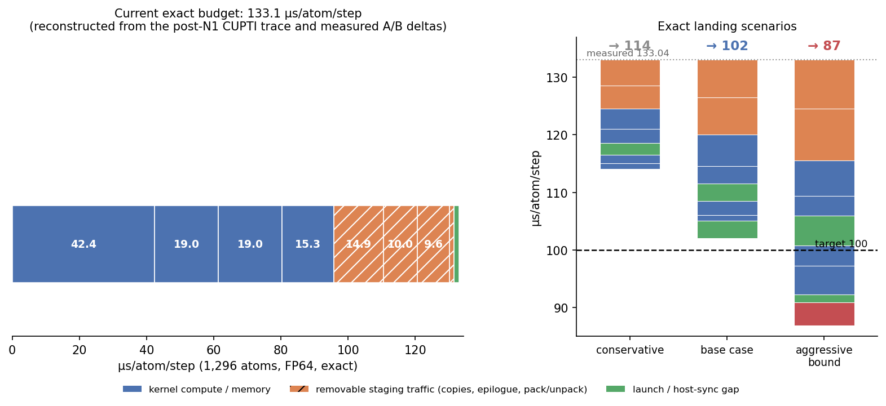

# Plan A — persistent execution, reverse dataflow, and grouped kernels

**Date:** 2026-10-23
**Status:** measured-budget implementation plan. No engine source was modified;
no README was modified; no GPU job was launched. Plan B/C/D files were not
touched.
**Scope:** the exact 512-channel PolarMACE checkpoint (`MACE-POLAR-1-M`,
`polar_symmetrix_probe.json`, sha256 `0e98f0ae…`), FP64, 2-step unrolled
SCF/Fukui, exact GTO-Ewald, one A100-SXM4-80GB, 1,296 and 5,184 atoms.
**Current measured speed:** **133.04 µs/atom/step** at 1,296 atoms and
**128.99 µs/atom/step** at 5,184 atoms (node-owned forward + fused2 reverse +
runtime N1 width; clean q4 A/B `t-20261022180640-dslc9` and successors).
**Target:** 100.00 µs/atom/step, exact E/F.

**Unit contract.** Every speed in this document is **µs/atom/step**. Per-eval
durations appear in **ms/eval** only inside arithmetic, and are marked as
durations, never as a speed. The conversion is
`µs/atom/step = (ms/eval) × 1000 / atoms`.

**Evidence tags.**

| Tag | Meaning |
|---|---|
| **[M]** | measured on this checkpoint/engine, committed source |
| **[D]** | derived by arithmetic from [M], derivation shown |
| **[P]** | projection; not measured |
| **[U]** | unknown; a named experiment is required |

---

## 0. Verdict

1. **100 exact is reachable, but it is not the median outcome.** The measured
   removable work supports a **base-case landing of 101–108 µs/atom/step**
   (central **104**). The conservative, low-risk subset lands at
   **110–114**; the credible aggressive case (base items at their high ends)
   is **~91**, and 87 is the arithmetic bound when the e3 layout is added on
   top. The reverse-MH-1 staging is an alternative upside of the same size,
   not an additive one.
2. **The earlier 113–125 estimate under-counted ~19.5 µs/atom/step of measured
   pure-memory staging.** The post-N1 CUPTI trace contains **9.6
   µs/atom/step of edge D2D tape copies** (9.16 GB/eval, 12.39 ms/eval,
   205 copies) and **~8.6 µs/atom/step of a separate AffineMLP bias epilogue**
   (11.34 ms/eval), plus 1.3 of other copies. The first was booked as "host
   gap" and the second as "MLP/dense compute"; neither is compute, and both
   are removable without changing one FP64 operation.
3. **The "host gap 12.4" is not launch overhead.** It is **10.9
   µs/atom/step of D2D copies + 1.6 µs/atom/step of true launch/sync gap**.
   CUDA Graph capture therefore caps at ~1.5 µs/atom/step, not 12.4. The
   28.1 → 8.5–12.5 host+polar projection is attainable, but only because the
   copy elimination (lever 2) does most of the "host" work.
4. **Highest-leverage exact slices, in order:** (a) AffineMLP bias-epilogue
   fusion, 6–8.6 µs/atom/step; (b) AffineMLP tape-copy aliasing, 5–9.6;
   (c) polar Ewald assemble/project as FP64 GEMMs, 4.5–6.2; (d) cutoff-kernel
   launch geometry, 2.5–5.2; (e) polar MLP batched GEMM, 2.8–3.4; (f) reverse
   MH-1 staging/register blocking, 3–6 (risky); (g) reverse cutoff and
   compiled-product fusion, 1.5–3; (h) grouped cuBLAS/e3 GEMMs, 2–5.
5. **All three lever families must land.** Lever 1 alone lands 125–127;
   levers 1+2 ~113–117; levers 1+2+3 ~101–108. Reaching 100 additionally
   needs one of the two upside items (reverse-MH-1 staging or the e3
   component-major layout).
6. **Gate 0 is a fresh CUPTI trace of the current default.** Every component
   number below is anchored at the post-N1 trace (146.1 µs/atom/step), which
   predates node-owned forward, fused2, and R1. The current-state column is a
   reconstruction [D]; the first 1,296-atom q4 task must replace it.



---

## 1. Measurement basis and the correction to the existing budget

### 1.1 Anchors

| Anchor | µs/atom/step | Source |
|---|---:|---|
| Current default, 1,296 | **133.04** | clean q4 A/B, `t-20261022180640-dslc9` |
| Current default, 5,184 | **128.99** | q4 `t-20261022182725-fgpwv`; `q4_arch_ab_5184_2026-10-22.json` |
| Clean q4 baseline (N1 + R1), 1,296 | 138.91 | same A/B |
| Node-owned forward alone | −2.92 | `NODE_OWNED_FORWARD_2026-10-22.md` |
| Fused2 reverse alone | −2.83 | `FUSED_REVERSE_2026-10-22.md` |
| Node-owned + fused2 | −5.87 | same |
| Post-N1 CUPTI (pre-dataflow), 1,296 | 146.1 | `n1_generic_1296_summary.json` |
| Post-N1 CUPTI, 5,184 | — | **not measured** |

The post-N1 CUPTI trace is the only complete component decomposition. It was
taken on 2026-10-21, before R1 (2026-10-22), node-owned forward (2026-10-22)
and fused2 (2026-10-22). It is tagged `n1_generic_1296` and covers exactly one
evaluation: GPU busy 173.18 ms, copies 14.08 ms, GPU total 187.26 ms, against
a no-CUPTI A/B wall of 189.30 ms.

### 1.2 The correction: copies are not host gap

The ledger's "host gap 12.44 µs/atom/step" is `189.30 − 173.18 = 16.12 ms`.
Subtracting the CUPTI copy total changes the attribution:

| Component | ms/eval (duration) | µs/atom/step | Evidence |
|---|---:|---:|---|
| GPU kernels | 173.18 | 133.63 | [M] CUPTI busy |
| GPU copies (memcpy + memset) | 14.08 | 10.87 | [M] `copies` in summary |
| — of which D2D `MEMCPY_kind8_src3_dst3` | 12.39 | 9.56 | [M] 205 copies, 9.16 GB |
| True launch/host-sync gap | **2.04** | **1.57** | [D] 189.30 − 187.26 |
| **Total wall** | **189.30** | **146.07** | [M] A/B |

The D2D copy population is not noise. It is 42 copies larger than 100 MB per
eval, in three rounds:

| Copy size | Count per eval | Shape | Rounds |
|---:|---:|---|---|
| 268.9–269.6 MB | 18 | `[edges × 2048]` | forward, reverse, reverse-weights |
| 167.9–168.5 MB | 21 | `[edges × 1280]` | forward, reverse, reverse-weights |
| 130–209 MB | 3 | mixed | forward |
| 21.2 MB | 5 | `[nodes × 2048]` | node MLP |

The copies sit exactly between the profile marks `s1:fwd-condtable` and
`s1:fwd-mlp`, between `s1:rev-condtable` and `s1:rev-mlp`, and between
`s1:rev-wadj` and `s1:rev-mlprev` [M, trace pairing]. Their source is
`AffineMLPKokkosT::forward_impl`, which stages its input into the reverse tape
with `ordered_kokkos_deep_copy(values(0), input)`
(`affine_mlp_kokkos.cpp:443`) and stages each output out with
`ordered_kokkos_deep_copy(output, values(…))` (`:586, :596, :616, :649,
:700`). Those are plain `Kokkos::deep_copy` D2D memcpys
(`tools_kokkos.hpp:81–88`). The tape is required for the reverse; the *copies*
are not, because the caller's input view outlives the tape.

The 176-launch "affine linear epilogue" (11.34 ms/eval) is a second,
independent staging pass: after `KokkosBlas::gemm` writes the target, a
separate kernel reads the whole target, adds the per-row bias and the
source/target type contributions, and writes it back
(`affine_mlp_kokkos.cpp:518–545`). It is not GEMM work.

### 1.3 Current-state reconstruction (all [D])

Method: the q4 baseline's kernel time is `180.03 − 16.12 = 163.91 ms/eval`
(138.91 µs/atom/step). The post-N1 trace's kernel time is 173.18 ms/eval. The
pure GPU-state factor is therefore `0.9815` once R1's measured −6.06 ms is
accounted for on the reverse MH-1 pair; the node-owned (−3.79 ms) and fused2
(−3.67 ms) deltas are then subtracted from their measured families. The
result closes to the measured 133.04 (172.42 ms/eval) to 0.2 %:

| Slice | Current reconstruction | Raw post-N1 CUPTI | Binding evidence |
|---|---:|---:|---|
| tensor product (MH-1) | **42.4** (40–43) | 50.81 | reverse pair 39.4 ms pre-fused2; forward 15.08 pre-node-owned |
| backbone nonlinear | **19.0** (19–22) | 22.28 | gather + cutoff + conditioning; family total 28.88 ms |
| cuBLAS / external | **19.0** | 19.38 | 522 launches, 48 µs avg, 3–5 % of FP64 peak |
| polar pipeline | **15.3** | 15.62 | 253 launches; sub-budget §2.1 |
| MLP/dense | **14.9** | 15.19 | 11.34 epilogue + 8.35 LN/SiLU |
| e3 linear | **10.0** | 10.15 | 400 pack/unpack launches |
| edge D2D tape copies | **9.6** | 9.56 (in "host") | 9.16 GB, 205 copies |
| other copies / memsets | **1.3** | 1.30 (in "host") | 4.19 GB / 186 memsets |
| launch / host-sync gap | **1.6** | 1.57 (in "host") | 2.04 ms wall − GPU total |
| other kernels | 0.2 | 0.1 | radial/spline/init |
| **total** | **133.1** | **146.1** | closes to 133.04 |

The tensor/backbone boundary is ambiguous only because node-owned forward
removes a message gather that the trace books in backbone nonlinear. The
alternative attribution is tensor 40.1 / backbone 21.3. Every lever total below
is unaffected.

### 1.4 What is not measured

- No post-node-owned / post-fused2 / post-R1 CUPTI. The current slice table is
  a reconstruction.
- No 5,184 CUPTI. The 5,184 per-atom total (128.99) is measured, but no
  component split exists.
- The copy-round attribution to forward vs reverse vs reverse-weights is from
  profile marks at 300 µs pairing tolerance [M/D]; the total (9.16 GB,
  12.39 ms) is exact [M].

---

## 2. Lever 1 — persistent polar SCF / host execution

### 2.1 Measured polar sub-budget

From `n1_generic_1296_labels.csv`, polar family = 20.24 ms/eval
(15.62 µs/atom/step at the 146.1 anchor; 15.3 in the current reconstruction):

| Sub-slice | ms/eval | µs/atom/step | Launches | Geometry |
|---|---:|---:|---:|---|
| Ewald k-space forward (assemble + project) | 4.63 | 3.57 | 12 | 6×128 and 42×256 |
| Ewald k-space reverse (recompute + partials) | 3.30 | 2.55 | 35 | 6×128, 21×64, 11×8 |
| Coulomb ρ(k) + energy + adjoint | 1.12 | 0.86 | 6 | 6×128 |
| k-space subtotal | **9.04** | **6.97** | 53 | |
| polar MLP (dense0–3 + reverse dense) | 4.82 | 3.72 | 8 | 336×256, ~0.8 TB/s |
| polar UVU forward is in cuBLAS; reverse + pack + epilogue | 3.50 | 2.70 | 76 | 2688×256 |
| gates, basis conversion, pe sum, elementwise | 2.30 | 1.77 | ~110 | 21×512 |
| LE zero-fills + readout + misc | 0.56 | 0.43 | ~40 | |
| **total** | **20.22** | **15.60** | 253 | |

The two k-space facts that drive lever 1:

- `polar assemble fourier` / `polar scf assemble fourier` /
  `polar desc proj rho recompute` / `polar coulomb rho` run with
  **grid = (6,1,1), block = (1,128,1)** — 6 CTAs, 768 threads on 108 SMs,
  **0.6 % SM coverage**, 36 GB/s effective. Each launch streams the resident
  cos/sin geometry (14 MB at 1,296) in a serial per-k node loop.
- `polar project features` / `polar scf project features` run with
  **grid = (21,2,1)**, 42 CTAs, 10,752 threads, 0.39 CTA/SM, 280 GB/s
  effective. Each thread loops over all 678 k for one (node, j).

### 2.2 Host-sync inventory and the true bound

| Site | Line (`mace_polar_impl.tpp`) | Calls/eval | What it does |
|---|---|---:|---|
| Fukui init | 347–350 | 2 | mirror `sources(N,2)`, `density(N,8)` to host |
| Fukui init factor | 364 | 1 | `polar_global_sum_host(4)` |
| cell → host | 419 | 1 | 9 doubles |
| Fukui per SCF step | 1567–1571 | 4 | mirror `update_out(N,10)`, `density(N,8)` |
| Fukui factor per step | 1585 | 2 | `polar_global_sum_host(4)` |
| LE atom sum | 2036–2043 | 1 | mirror `le_atom(N)` + host sum |
| Fukui reverse init | 2618–2621 | 2 | mirror `dbar(N,8)`, `sources(N,2)` |
| LE reverse path tables | 4065–4080 | 4 | **re-copies tables V3 already cached** |
| ρ(k) allreduce | 789–790, 1296–1297, 1718–1719, 3416, 3479–3480, 3585–3586, 4269–4270 | 15 | `polar_global_sum_view` |
| scalar allreduce | 2636 | 1 | `polar_global_sum_host(2)` |

`polar_global_sum_view` (`mace_nonlinear_kokkos.hpp:444–460`) does a full
`create_mirror_view_and_copy`, a host loop, the MPI callback, and a
`deep_copy` back. On one rank the MPI callback is a no-op, but the two stream
synchronizations remain.

**The bound is the measured 1.57 µs/atom/step of total launch/sync gap for the
whole evaluation.** This is not additive with the copies and it is shared by
the Fukui, V3 and graph items: removing *every* host sync recovers at most
~0.4–1.0 of it, and graph capture can recover only the residual ~0.3–0.6. The
LE zero-fills are kernel time (0.2–0.4), not gap. The earlier 12.4 "host"
saving is really the copy slice.

### 2.3 Fukui device-side normalization

Current path: initial Fukui (`:341–403`) and each SCF step (`:1565–1624`)
copy N×10 and N×8 doubles to the host, run a serial host sum over the owned
nodes, compute the two factors, and launch the correction kernel. The largest
single observed gap is `polar fukui correction → polar k inner products`,
**466 µs** [M, `n1_generic_1296_gaps.csv`].

Proposal:

1. One device reduction kernel per SCF step computing `Sα, Sβ, Σd(0), Σd(4)`
   into a 4-double slot with a deterministic tree (one CTA per chunk + a
   fixed-order second stage).
2. A 1-thread kernel computes `factor_α, factor_β` on device and applies the
   correction in the same launch (or in the next density-update kernel).
3. Keep a 2-double D2H per step only for the reverse's cached scalars, or
   cache them on device and read them in the reverse kernel.

Exactness: the sum association changes (host serial vs device tree). Gate as a
re-association. The correction itself is one multiply-add, unchanged.

**Expected gain: 0.5–1.0 µs/atom/step at 1,296, 1.0–2.0 at 5,184.**
Effort S–M (2–4 days). Risk low. Gate: PE bitwise or ≤1 ULP, max dF ≤1e-8
eV/Å, zero mid-eval D2H except ≤2 scalar slots.

### 2.4 V3 path cache: close the last gap

`prepare_polar_host_tables` (`:277–306`) already caches the six UVU tables and
the LE q/v tables. The forward and the main reverse use the cache
(`:965–971, :1978–1983, :3667–3670, :4448, :4557`). The **LE reverse still
re-copies four device views** at `:4072–4080` instead of using
`polar_host_le_q_meta` etc. Four stream syncs per eval are pure waste.
**Gain 0.1–0.3 µs/atom/step**, effort S (1 hour), risk none, parity bitwise.

### 2.5 Ewald and Coulomb k-space: replace the hand-written loops with FP64 GEMMs

The mathematics is already a matrix product. With `cos/sin` resident as
`[Nk × N]` (28.1 MB at 1,296):

```text
assemble:  ρ_re/im[k, c] = Σ_n cos/sin[k,n] · q[n,c]        (c = 0..3, 2 spins)
project:   P[n, j]       = Σ_k A[j,k] · cos[k,n] + B[j,k] · sin[k,n]
```

`A` and `B` fold the basis `dbre/dbim`, the `1/k²` Coulomb kernel, the k0
mask/0.5 factor and the RBE weight; the self-interaction subtraction and the
`/knorm` stay in a small epilogue.

Proposal, per SCF step:

1. One batched GEMM per spin channel for assemble,
   `[Nk × N] × [N × 8]`, or one `[Nk × N] × [N × 16]` for both channels.
   At N=1,296 this is 14–28 MFLOP and 14 MB of traffic; the current 393 µs
   becomes 20–40 µs.
2. One GEMM per spin channel for project,
   `[N × Nk] × [Nk × 8]` (cos) plus the same with sin; the current 399 µs
   becomes 40–80 µs.
3. Coulomb ρ(k) and the reverse ρ recompute use the same three calls.
4. A tiny epilogue applies the k0 mask, the 0.5 factor, the self-interaction
   and the normalization. The current `polar scf normalize potential features`
   (`:1329`) and `polar pe sum` (`:1356`) fuse here.

Code paths: assemble `:765–788`, project `:796–823`, SCF assemble
`:1269–1297`, SCF project `:1298–1327`, Coulomb `:1693–1717`, reverse
recompute `:3458–3490`, reverse project `:3588`, Coulomb adjoint `:4280`.

Exactness: the k-sum association changes from a serial ascending-k loop to a
GEMM's internal order. FP64 re-association is ~1e-14 relative per sum; the
gate is dE ≤1e-9 eV and dF ≤1e-8 eV/Å. The mask/factor epilogue preserves
every term.

**Expected gain: 4.5–6.2 µs/atom/step at 1,296; ~2× that per atom at 5,184**
because `Nk` doubles while atoms quadruple [D]. This is the largest polar
lever. Effort M (3–5 days). Risk medium: the GEMM must beat 1 TB/s to pay off,
and the cos/sin layout may need a transpose. Gate: k-space subtotal
≤1.5 ms/eval (1.2 µs/atom/step) and full E/F parity.

### 2.6 LE cleanup

The LE block (`:1782–2047`) launches three zero-fills of N×512 adjoints
(`polar le q_up/v_up/nf adjoint zero`, 0.33 ms/eval combined) that the
subsequent UVU reverse overwrites; the reverse zero-writes are redundant. The
atom readout (`:2030–2046`) copies `polar_le_atom(N)` to the host for a serial
sum that duplicates the existing device energy reduction. The 4 re-copied path
tables are §2.4.

Proposal: elide the zero-fills when the UVU reverse writes every output; fold
the LE atom sum into `polar_global_sum_host`/device energy reduction; use the
V3 cache. **Gain 0.2–0.5 µs/atom/step.** Effort S (1–2 days). Risk low.
Gate: PE bitwise.

### 2.7 Graph capture feasibility

Graph capture of the whole evaluation is **not** currently possible, and it is
the wrong first step:

1. **Host syncs inside the region.** 15 `polar_global_sum_view` calls and
   3 Fukui mirror pairs do host allocations and synchronizations; CUDA graph
   capture forbids both. §2.3 and §2.4 must land first.
2. **Per-eval allocations.** `run_polar_pipeline` issues ~20
   `Kokkos::realloc(Kokkos::WithoutInitializing, …)` calls per evaluation
   (`:741–742, :840–889, :1345, :1372, …`). After the first evaluation the
   extents match and Kokkos resize is a no-op, but the first capture must be
   warm; the arena refactor (one grow-only arena) is the clean fix.
3. **cuBLAS.** `KokkosBlas::gemm` (`affine_mlp_kokkos.cpp:525–528`) and the N1
   batched GEMM must be capture-safe: warm the handle and workspace before
   capture, and use `cudaStreamBeginCapture` on the Kokkos stream. Kokkos 5.2
   exposes graph interop (the tree has `TestCuda_InterOp_Graph.cpp`), but the
   engine does not use it.
4. **LAMMPS inputs.** Positions, cell and edge topology must be copied into
   stable buffers before the capture; the pair style currently reads
   LAMMPS-owned views.

Graph replay benefits only the *launch* stream: the measured bound is the
1.57 µs/atom/step gap, of which 0.4–1.0 is already claimed by the Fukui/V3
sync removal and only the residual 0.3–0.6 is graph-recoverable. The D2D
copies are data movement and do not disappear in a graph.

**Expected gain: 0.3–0.6 µs/atom/step, after the sync removal and after
levers 2 and 3 have removed the copies.** Effort M–L (1–2 weeks). Risk high.
Gate: capture succeeds, replay PE bitwise identical, wall ≤ current − 0.3
µs/atom/step. Do not spend this effort before §2.3/§2.5.

### 2.8 Lever 1 table

| Slice | Current µs/atom/step | Code path | Proposal | Gain | Effort | Risk | Gate |
|---|---:|---|---|---:|---|---|---|
| k-space Ewald/Coulomb | 6.97 | `mace_polar_impl.tpp:765–823, 1269–1327, 1693–1717, 3458–3490, 3588` | FP64 GEMMs against resident cos/sin; epilogue fuses mask/normalize/pe-sum | 4.5–6.2 | M | Medium | k-space ≤1.5 ms/eval; dE ≤1e-9, dF ≤1e-8 |
| Fukui normalization | part of 1.57 gap | `:341–403, 1565–1624` | device reduction + on-device factors; ≤2 scalar D2H | 0.4–1.0 | S–M | Low | PE ≤1 ULP; zero mid-eval D2H |
| V3 LE tables | part of 1.57 gap | `:4072–4080` | use `polar_host_le_*` | 0.1–0.2 | S | None | bitwise |
| LE zero-fills / atom sum | 0.43 | `:1834–1839, 2018–2046, 4079–4087` | elide overwritten zero-fills; device sum | 0.2–0.4 | S | Low | bitwise |
| polar UVU reverse | 2.70 | `:2423–2550` | keep Z; group epilogue/pack (lever 3) | 0.3–0.6 | M | Medium | dF ≤1e-8 |
| launch / graph | residual of 1.57 gap | whole eval | graph after the above | 0.3–0.6 | M–L | High | replay bitwise |
| **Lever 1 total** | | | | **5.8–9.0** | | | polar ≤9.5, gap ≤0.5 |

Lever 1 alone: **133.04 → 125–127** (base items ~7.0).

---

## 3. Lever 2 — tensor reverse dataflow beyond fused2

### 3.1 What fused2 already did

`E3TensorProductKokkosT::reverse` (`e3nn_kokkos.cpp:3258`) now runs one team
per edge in `e3 tensor reverse mh1 fused2` (`:3319–3407`): each thread owns a
contiguous channel set, the 16 `d input_2` components live in registers, and
the cross-thread reduction is one shared-memory pass. That removed the second
harmonics kernel and saved **2.83 µs/atom/step** [M]. The forward is
receiver-owned (`try_evaluate_node_owned_forward`, `:3147–3257`) and saved
**2.92 µs/atom/step** [M].

Post-dataflow tensor sub-budget (current reconstruction):

| Sub-slice | µs/atom/step | Code |
|---|---:|---|
| reverse MH-1 pair (fused2) | 22–25 | `e3nn_kokkos.cpp:3258–3408` |
| forward MH-1 (node-owned) | 8.5–9.5 | `:3147–3257` |
| compiled-product reverse + contraction | 7.6 | `e3nn_product_kokkos.cpp` |
| gate / harmonic-adjoint / skip | 1.3 | |
| **tensor total** | **42.4 ± 2** | |

### 3.2 The measured 9.6 µs/atom/step tape-copy slice (highest confidence)

This is the single largest exact slice in the engine that is not doing
physics. See §1.2 for the evidence. The fix is **view aliasing, not a kernel**:

1. In `AffineMLPKokkosT::forward_impl`, replace
   `ordered_kokkos_deep_copy(values(0), input)` (`:443`) with a *const view
   alias* of the caller's input. The first Linear reads `values(0)` and writes
   `values(1)`; no aliasing hazard. The caller's input (`state.up`,
   `state.messages`, `features`) outlives the reverse.
2. For the last layer, write directly into `output` and keep the tape entry as
   an alias of `output`, or keep the output copy only where `output` is a
   short-lived scratch that the reverse still needs.
3. Where a copy is genuinely required (layout change), replace the full-tensor
   copy with a per-tile copy inside the consuming kernel.

Exactness: the copy is a pure move; aliasing changes no arithmetic. Parity must
be **bitwise** (PE identical, max dF ≤1e-12 eV/Å). Memory: the tape currently
holds the input twice (input view + `values(0)`); aliasing frees 269 MB at
1,296 (1.07 GB at 5,184) per live tape.

**Expected gain: 5.0–9.6 µs/atom/step.** The full 9.6 requires aliasing the
input in all three rounds; 5.0 is the conservative case where one round keeps
a copy for a scratch that dies before the reverse. Effort S–M (3–5 days).
Risk low. Gate: D2D bytes ≤1.5 GB/eval and bitwise PE.

### 3.3 Reverse MH-1 staging and register blocking

The fused2 kernel's inner loop (`:3336–3395`) is:

```text
for channel in thread's channels:
  for instruction:
    for b in 0..15:
      for term in reverse_plan[instruction][b]:
        common = path·value·mask·output_adjoint(sample, output_index)
        contribution = common·weight·input_2(sample,b)
        weight_value += common·input_1(sample,input_index)
        acc2[b] += common·weight·input_1(...)
```

`output_index` is independent of `b`, and `input_1` and `dynamic_weights` are
independent of `b` and mostly of `term`. The kernel re-reads them from the
memory hierarchy for each `b`. At 16,415 edges × 64–128 threads this is the
dominant instruction and load stream.

Proposal (a *dataflow*, not a Wigner rewrite):

1. Stage the per-edge `output_adjoint` slice (512×1 or 512×3 doubles, 4–12 KB)
   and the per-edge `input_1` slice into shared memory once per edge team.
2. Keep `weight` and `input_2[b]` in registers; hoist `output_index` out of
   the `b` loop.
3. Split `b` into two halves of 8 so the register footprint (16 accumulators +
   16 input_2 values) fits 128 threads without spilling.
4. Use 128 threads per edge for the `1o` paths and 64 for `0e`, selected at
   model load from the plan's `input_width`.

Exactness: the per-edge plan order and the thread reduction order are
preserved if the staging only changes *where* operands are read. If the
channel assignment changes, it is a re-association → gate.

**Expected gain: 3–6 µs/atom/step** (a 1.15–1.35× on a 22–25 µs/atom/step
pair). Effort M (1–2 weeks). Risk **medium-high**: the earlier fused-reverse
prototype was 1.12× *slower* (ledger §5) and the S2 receiver-owned forward API
route was 2.36× slower. The difference here is that the kernel is already the
fused2 shape; this is a staging change, not a new dispatch.

### 3.4 Compiled-product reverse + contraction + gate

`compiled product reverse` (6.34 ms/eval, 4 launches, grid 5,184) and
`compiled product contraction` (3.67 ms/eval, 4 launches, grid 20,736) are the
adjoint of the readout products. The gate reverse
(`mh1 fused reverse gate normalization`, 1.32 ms) is a third pass over the
same node state. They are all `[N × C]` memory passes over 1,296 nodes.

Proposal: one reverse-readout kernel that walks the product basis, contraction
and gate in the same tiling, keeping the 512-wide node slice in shared memory.
Exactness: same per-node term order.

**Expected gain: 1.5–3.0 µs/atom/step.** Effort M (4–7 days). Risk medium.
Gate: tensor ≤40 µs/atom/step, dF ≤1e-8.

### 3.5 Reverse cutoff and forward cutoff multiply

`stream nonlinear weight cutoff` (3.69 ms/eval, grid 262,640 × 128 threads)
and `stream reverse nonlinear weight cutoff` (3.68 ms/eval, grid 164,150)
multiply the E×512 weight tensor by the per-edge cutoff. They are separate
full-tensor passes at **15 GB/s** because each of the 262k elements is given a
128-thread block. `stream reverse convolution cutoff team` (5.24 ms/eval,
grid 16,415 × 64) is the same multiply inside the reverse sweep.

Proposal: fold the forward multiply into the AffineMLP epilogue (the MLP
produces the weights immediately before), and the reverse multiply into the
fused2 weight read. Both preserve the product order (multiply by the same
cutoff before the same accumulation).

**Expected gain: 2.5–5.2 µs/atom/step** if the geometry bug is fixed even
without fusion; 1.5–3 more from fusion. Effort S–M. Risk low. Gate: dF ≤1e-8,
backbone nonlinear ≤15 µs/atom/step.

### 3.6 What not to do

- **Do not repeat the S2 receiver-owned generic forward API route.** Parity
  passed but it was 2.36× slower (188.35 → 444.21 ms/eval). The node-owned
  FP64 *kernel* is the path that worked.
- **Do not use the existing FP32 direct-node reverse.** `supports_direct_node_reverse`
  is `Precision=float` only (`e3nn_kokkos.cpp:2742–2752`) and its node-input
  adjoint uses `Kokkos::atomic_add` (`:3985–3995`), which is nondeterministic
  and violates the exact contract. A deterministic FP64 source-CSR version is
  a separate project.
- **Do not materialize edges.** 139.9 GiB at 5,184 atoms already OOMs.
- **Do not call the 20 UVU planes the tensor bottleneck.** Forward is
  0.835 ms/eval (0.64 µs/atom/step).

### 3.7 Lever 2 table

| Slice | Current µs/atom/step | Code path | Proposal | Gain | Effort | Risk | Gate |
|---|---:|---|---|---:|---|---|---|
| AffineMLP tape copies | 9.6 | `affine_mlp_kokkos.cpp:443, 586–700`; `tools_kokkos.hpp:81` | alias tape input/output views | 5.0–9.6 | S–M | Low | D2D ≤1.5 GB/eval; bitwise PE |
| reverse MH-1 staging | 22–25 (pair) | `e3nn_kokkos.cpp:3319–3407` | shared per-edge output_adjoint/input_1; hoist output_index; 8+8 b-split | 3–6 | M | Med–High | tensor ≤40; dF ≤1e-8 |
| compiled product + gate | 8.6 | `e3nn_product_kokkos.cpp`, `mace_nonlinear_kokkos_impl.tpp:599–640` | one reverse-readout kernel | 1.5–3.0 | M | Medium | tensor ≤40; dF ≤1e-8 |
| cutoff multiply / conv cutoff | 9.6 (three kernels) | `mace_nonlinear_kokkos_impl.tpp:5676, 7302–7320, 7454` | fuse into MLP epilogue / fused2 weight read; fix 128-thread-per-element geometry | 2.5–5.2 | S–M | Low | backbone ≤15; dF ≤1e-8 |
| **Lever 2 total** | | | | **12–20** | | | tensor+backbone ≤58 |

Lever 2 base slices (12.0): **133.04 → 121**; full range **113–121**.
Levers 1+2 base: **114**; range **104–115**.

---

## 4. Lever 3 — grouped small FP64 GEMM / MLP / e3 kernels

### 4.1 The "MLP/dense" family is not GEMM work

The 14.9 µs/atom/step MLP/dense family is three memory passes:

| Kernel | ms/eval | µs/atom/step | Launches | Geometry | What it is |
|---|---:|---:|---:|---|---|
| `affine linear epilogue` | 11.34 | 8.59 | 176 | 8,208–16,415 × 128 | bias + type-contribution RMW after `KokkosBlas::gemm` |
| `affine fused layer norm silu` | 4.84 | 3.67 | 118 | 16,415 × 64 | LN mean/var + SiLU |
| `affine fused reverse layer norm silu` | 3.51 | 2.66 | 59 | 16,415 × 64 | reverse LN/SiLU |
| **total** | **19.69** | **14.92** | 353 | | |

The epilogue is a separate read-modify-write of the GEMM result
(`affine_mlp_kokkos.cpp:529–545`). The two LN/SiLU kernels read the GEMM
result and write the normalized result. All three are removable by fusion
without touching a GEMM accumulation:

1. **Epilogue fusion (highest ROI).** For a Linear followed by LN+SiLU, add
   `bias(row) + source_table[src(edge),row] + target_table[tgt(edge),row]`
   inside the LN kernel's first read. For a Linear followed by Linear, pass the
   per-row bias as the GEMM's `C` with `beta=1` (the edge types are fixed for
   the run, so a `[E × C_out]` bias matrix can be built once at graph setup;
   67 MB at 1,296 and 269 MB at 5,184 for `C_out=512`) or keep a custom
   epilogue. Either removes the 11.34 ms pass.
2. **LN/SiLU fusion into the GEMM epilogue (stretch).** The row is 128 or 512
   wide; a custom GEMM tile that holds one row in shared memory can compute
   mean/variance and SiLU before the store. This removes the separate LN pass
   (4.84 + 3.51 ms).

**Gain: 6.0–8.6 from the epilogue alone; 2.5–3.5 more from the LN fusion.**
Effort M (1 week for the epilogue; 2 weeks for the fused LN). Risk low for the
epilogue, medium for the fused LN. Gate: MLP/dense ≤7 µs/atom/step, PE
bitwise (the bias add is the same single FP64 add).

### 4.2 Polar MLP: naive inner-product kernels at 0.2 TFLOPS

| Kernel | ms/eval | µs/atom/step | Geometry | Effective |
|---|---:|---:|---|---|
| `polar nl dense0` (128→512) | 1.63 | 1.24 | 336 × 256 | 0.2 TFLOPS, ~0.8 TB/s |
| `polar nl dense1/2` (64→64) | 0.22 | 0.17 | 336 × 256 | 0.2 TFLOPS |
| `polar nl dense3` (64→512) | 0.65 | 0.50 | 2,688 × 256 | 0.26 TFLOPS |
| `polar reverse dense` | 2.33 | 1.77 | 336 × 256 | ~0.2 TFLOPS |
| **total** | **4.82** | **3.69** | | |

Each output thread reads the whole input row from global; for N=1,296 × 512
outputs the input is re-read 512 times (663 MB per launch for dense0). A
batched GEMM (or one `KokkosBlas::gemm` per step) tiles the input in shared
memory and would run at 5–10 TFLOPS: 4.82 ms/eval → **0.15–0.30 ms/eval**.
The adjoint is the same GEMM with transposed operands.

**Gain: 2.8–3.4 µs/atom/step.** Effort S–M (3–5 days). Risk low (same
arithmetic up to GEMM association). Gate: polar ≤9.5 µs/atom/step, dF ≤1e-8.

### 4.3 e3 linear pack/unpack

400 launches, 10.0 µs/atom/step:

| Kernel | ms/eval | µs/atom/step | Launches |
|---|---:|---:|---:|
| `e3 linear pack` | 3.29 | 2.49 | 103 |
| `e3 linear unpack` | 3.21 | 2.43 | 103 |
| `e3 reverse linear pack` | 4.87 | 3.69 | 97 |
| `e3 reverse linear unpack` | 1.79 | 1.36 | 97 |

The pack transposes `input[sample, offset + channel*width + component]` into
`packed[channel, sample*width+component]` so a contiguous GEMM can be called
(`e3nn_kokkos.cpp:759–800`). For `width=3` the natural layout is not
GEMM-expressible (stride 3 along the channel, row stride along the sample).

Options, in increasing effort and payoff:

1. Fuse the pack into the producer (the tensor product or LN/SiLU writes the
   packed layout for the next linear) and the unpack into the consumer. Saves
   the read+write of the intermediate; ~40–60 % of the slice.
2. Change the node/edge feature layout to component-major
   `[component][channel][sample]` so every e3 linear is one batched GEMM over
   components and both pack and unpack vanish. This touches the tensor
   product, the MLP and the readout; high blast radius.
3. Keep the pack but run the pack/unpack kernels with a tiled 2-D geometry
   (the current grid `16×648`, block `32×2×4` is already reasonable; 31–50 µs
   per launch at ~700 GB/s).

**Gain: 2.0–5.0 µs/atom/step (option 1–2), 0.5 from geometry.**
Effort M–L (1–3 weeks for option 2). Risk medium-high. Gate: e3 linear
≤6.5 µs/atom/step, parity.

### 4.4 cuBLAS GEMMs and the UVU reverse

`cuBLAS/external` is 19.0 µs/atom/step, 522 launches, 48 µs average, 3–5 % of
FP64 peak. The measured grouped-GEMM probes are the honest ceiling:

| Probe (FP64, 1,296) | Sequential | Batched | Speedup |
|---|---:|---:|---:|
| 20 UVU planes | 1.178 ms | 0.835 ms | 1.41× |
| MLP 64→64, 16,415 edges | 0.382 ms | 0.260 ms | 1.47× |
| MLP 64→512, 16,415 edges | 1.745 ms | 1.520 ms | 1.15× |
| same, 5,184 | 6.214 ms | 5.994 ms | 1.04× |

At 5,184 the batched MLP 64→512 is only 1.04×, so do not project the 1,296
speedup to 5,184. The UVU forward (20 planes) is already batched (0.835
ms/eval = 0.64 µs/atom/step). The reverse is 3.50 ms/eval (2.70) in 76 small
launches; grouping `pack + dx1 + dx2 + p + mode1 + mixed + epilogue` into one
static sequence (checkpoint-specialized codegen, `polar_uvu_gemm_reverse`,
`mace_polar_impl.tpp:2423`) can save 0.3–0.6 µs/atom/step.

For the remaining cuBLAS GEMMs (e3 linears, affine MLPs), batch the small
`64×64` and `64×512` shapes across the two SCF steps and the 2 layers. The
measured 1.15–1.47× on the 1,296 shapes implies **2–4 µs/atom/step** on the
GEMM population, not more.

**Gain: 2.0–5.0 µs/atom/step.** Effort M (1 week). Risk medium (the 5,184
batching gain is small). Gate: cuBLAS ≤15.5, e3 ≤8.

### 4.5 Lever 3 table

| Slice | Current µs/atom/step | Code path | Proposal | Gain | Effort | Risk | Gate |
|---|---:|---|---|---:|---|---|---|
| MLP bias epilogue | 8.59 | `affine_mlp_kokkos.cpp:518–545` | fold into LN read / GEMM `C` with beta=1 | 6.0–8.6 | M | Low | MLP ≤7; bitwise PE |
| LN/SiLU passes | 6.33 | `:455–515` | fused GEMM+LN (stretch) | 2.5–3.5 | L | Medium | MLP ≤7 |
| polar MLP | 3.69 | `mace_polar_impl.tpp:1374–1520, 3246` | batched FP64 GEMM + adjoint | 2.8–3.4 | S–M | Low | polar ≤9.5 |
| e3 pack/unpack | 10.0 | `e3nn_kokkos.cpp:759–880, 1072–1100, 1399` | fuse pack/unpack or component-major layout | 2.0–5.0 | M–L | Med–High | e3 ≤6.5 |
| grouped GEMM / UVU rev | 19.0 + 2.7 | `mace_polar_impl.tpp:2423`; cuBLAS calls | batch across steps/layers; static reverse sequence | 2.0–5.0 | M | Medium | cuBLAS ≤15.5 |
| **Lever 3 total** | | | | **15–26** | | | MLP+e3+cuBLAS ≤40 |

Lever 3 base slices (12.0): **133.04 → 121**; full range **107–118**.

---

## 5. Combined plan, landing, and gates

### 5.1 No-double-count allocation

| Current slice | µs/atom/step | Lever | Mechanism |
|---|---:|---|---|
| tensor (MH-1) | 42.4 | 2 | reverse staging + compiled-product fusion |
| backbone nonlinear | 19.0 | 2/3 | cutoff fusion + launch geometry |
| cuBLAS / external | 19.0 | 3 | grouped GEMM |
| polar pipeline | 15.3 | 1/3 | k-space GEMM + MLP GEMM + Fukui |
| MLP/dense | 14.9 | 3 | epilogue + LN fusion |
| e3 linear | 10.0 | 3 | pack/unpack |
| edge D2D copies | 9.6 | 2 | tape aliasing |
| other copies | 1.3 | 2 | tape/memset elision |
| launch / host gap | 1.6 | 1 | graph/sync |
| **total** | **133.1** | | |

### 5.2 Waterfall

| Scenario | Removed | Landing | Assumptions |
|---|---:|---:|---|
| Measured today | — | **133.04** | 1,296, exact |
| Conservative | 19 | **114** | epilogue 4.5, tape 4, k-space 3.5, polar MLP 2.5, reverse fusion 2, grouped GEMM 1.5, host 1 |
| Base case | 31 | **102** | epilogue 6.5, tape 6.5, k-space 5.5, polar MLP 3, cutoff 3, reverse fusion 2.5, grouped 2.5, host/LE 1.5 |
| Credible aggressive | 42 | **91** | base items at their high ends; no reverse-MH-1 rewrite, no e3 layout |
| Arithmetic bound | 46 | **87** | credible aggressive + e3 layout 4 (the reverse-MH-1 5 is an alternative, not additive) |
| **Recommended claim** | | **≤108** | base case plus one upside item |
| **Realistic exact landing** | | **101–108** | central 104 |

The aggressive bound is bounded by the measured removable traffic, not by
enthusiasm: the removable staging (copies 10.9 + epilogue 8.6 + LN/SiLU 6.3 +
e3 pack/unpack 10.0 + cutoff 5.7 + k-space 6.97 + polar MLP 3.69) is
**52.2 µs/atom/step**. Removing 85 % of it is 44.4 and lands at 88.6. The
aggressive row is therefore an upper bound that requires *every* item to land
at its high end; it is not a forecast.

### 5.3 Is 100 exact reachable?

**Yes, but at the upper end of execution, not at the median.** The arithmetic:

```text
133.04
 − 6.5   epilogue fusion
 − 6.5   tape-copy aliasing
 − 5.5   polar k-space GEMM
 − 3.0   cutoff geometry + fusion
 − 3.0   polar MLP GEMM
 − 2.5   reverse compiled-product/cutoff fusion
 − 2.5   grouped GEMM/e3
 − 1.5   host/graph/LE
 = 102.0  base case
```

Reaching 100 needs **2 more µs/atom/step** from one of: reverse-MH-1 staging
(3–6), e3 layout (2–5), or fused LN (2.5–3.5). Each is a named, measured
slice; none requires an approximation. The risk is schedule and kernel
engineering, not physics.

**What is not supported:** 90 without at least one of the reverse-MH-1 staging
or the e3 layout landing on top of the base case; 80 on one exact-FP64 GPU;
any claim that the 20 UVU GEMMs or the Ewald direct sum are the bottleneck.

### 5.4 5,184 atoms

The edge-proportional slices (tape copies, epilogue, LN, cutoff, e3 pack)
have `E/N ≈ 12.7` at both sizes, so their **per-atom** savings are the same
range. The k-space slice scales as `N × Nk`: `Nk` doubles at 5,184 while atoms
quadruple, so the per-atom k-space cost **doubles** [D]. The 1,296 k-space
saving of 4.5–6.2 therefore becomes **~9–12 µs/atom/step at 5,184**, which is
the largest single lever there. The measured 5,184 total (128.99) is already
4.05 lower than 1,296; the plan should gate both sizes but expect 5,184 to
land 3–6 µs/atom/step below the 1,296 result.

### 5.5 Execution order and gates

| Step | Work | Effort | Gate (all exact) |
|---|---|---|---|
| **P0** | Fresh CUPTI trace of the current default at 1,296 + 5,184; reproduce the §1.3 table and the copy byte count | 1 q4 task | component table closes to ±1 µs/atom/step; copy bytes ~9.16 GB/eval |
| **P1** | AffineMLP tape aliasing + epilogue fusion (lever 2/3) | 1–1.5 wk | D2D ≤1.5 GB/eval; MLP ≤7; bitwise PE; dF ≤1e-12 |
| **P2** | Polar k-space GEMM + Fukui device reduction + LE cleanup (lever 1) | 1–1.5 wk | k-space ≤1.5 ms/eval; polar ≤9.5; dF ≤1e-8 |
| **P3** | Cutoff geometry + fusion; polar MLP GEMM; grouped UVU/e3 GEMM (lever 3) | 1 wk | backbone ≤15; polar ≤9.5; cuBLAS ≤15.5 |
| **P4** | Reverse MH-1 staging; compiled-product/gate fusion (lever 2) | 1–2 wk | tensor ≤40; dF ≤1e-8 |
| **P5** | e3 component-major layout (stretch) | 2–3 wk | e3 ≤6.5; parity |
| **P6** | Graph capture / arena (lever 1) | 1–2 wk | replay bitwise; −0.3 µs/atom/step |

Every step is gated by a same-binary interleaved A/B on q4 (2 rounds × 4
`run 1` samples, median of per-round medians) and by the full parity suite:
dE ≤1e-9 eV, max dF ≤1e-8 eV/Å, 10-step NVE max Δpos ≤1e-13 Å, repeated-eval
PE bitwise or the documented 1-ULP drift, and 5,184 memory ≤19.2 GiB.

### 5.6 Stop conditions

- If P1's D2D copy elimination does not remove ≥5 µs/atom/step, the tape is
  genuinely needed for the reverse; stop aliasing and keep the epilogue win.
- If P2's k-space GEMM is >3 µs/atom/step, the cos/sin layout is the wall;
  fall back to the parallel-reduction version (2–3× on the existing kernel,
  3–4 µs/atom/step).
- If P4's reverse staging is <1.5 µs/atom/step or regresses, revert; the
  fused2 kernel is already the best measured reverse dataflow.
- If P5's layout change does not beat 1.3× on e3, revert; the pack/unpack is
  not the wall.
- If the summed landing after P1–P4 is >110, do not start P5/P6; write the
  exact-execution result at 110–114 and keep 100 as the aggressive bound.

---

## 6. Figure


The left panel is the current-state reconstruction of §1.3: hatched slices are
the measured removable staging traffic (tape copies, AffineMLP epilogue/LN,
e3 pack/unpack). The right panel is the waterfall of §5.2; the dashed line is
100 µs/atom/step.

---

## 7. Artifacts and provenance

**Read for this plan (all committed):**

- `docs/design/FOUR_PLANS_2026-10-23.md`
- `docs/design/MATH_ARCH_2026-10-22.md`
- `docs/results/OPTIMIZATION_LEDGER.md`
- `docs/results/NODE_OWNED_FORWARD_2026-10-22.md`
- `docs/results/FUSED_REVERSE_2026-10-22.md`
- `docs/results/LATEST_SPEED_AND_PLAN_2026-10-22.md`
- `docs/results/PROGRESS_TO_80US_2026-10-21.md`
- `docs/results/V4_PROBES_2026-10-22.md`
- `bench/perf_decomp_1296_2026-10-21/analysis/n1_generic_1296_{summary.json,labels.csv,families.csv,rawkernels.csv,gaps.csv}`
- `bench/v4_math_probes_2026-10-22/probe_{grouped_gemm,cuda_graph,node_vs_edge,roofline}.json`
- engine source `/workspace/group/shared/bza/external-repos/symmetrix-xl-polar-uvu-gemm/libsymmetrix/source/`

**Written by this plan:**

- `docs/design/PLAN_A_PERSISTENT_2026-10-23.md` (this file)
- `docs/design/figures/PLAN_A_PERSISTENT_BUDGET.png`
- `docs/design/figures/make_plan_a_persistent_figure.py`

**Not touched:** engine source, `README.md`, Plan B/C/D files, `docs/results/`.

---

## Appendix A — line-reference index

Root: `/workspace/group/shared/bza/external-repos/symmetrix-xl-polar-uvu-gemm/libsymmetrix/source/`

### Polar pipeline (`mace_polar_impl.tpp`)

| Line | Content |
|---:|---|
| 270–306 | `prepare_polar_host_tables` (V3 path-plan cache) |
| 309 | `run_polar_pipeline` entry |
| 341–403 | initial Fukui: mirrors `:347/:349`, host factor `:364`, correction `:386` |
| 419 | cell → host |
| 583 | RBE `m` → host (off) |
| 654 | `polar k inner products` |
| 765–788 | `polar assemble fourier` |
| 789–790 | ρ(k) allreduce |
| 796–823 | `polar project features` (self-interaction + `/knorm`) |
| 827–1662 | SCF loop |
| 1269–1297 | `polar scf assemble fourier` |
| 1298–1327 | `polar scf project features` |
| 1329 | `polar scf normalize potential features` |
| 1345 | `polar pe sum` |
| 1374–1520 | `polar nl dense0/1/2/3` |
| 1565–1624 | per-step Fukui: mirrors `:1567–1571`, factor `:1585`, correction `:1605`, snapshot `:1616` |
| 1693–1717 | `polar coulomb rho` |
| 1718–1719 | Coulomb ρ allreduce |
| 1726–1736 | Coulomb k energy |
| 1782–2047 | LE block; zero-fills `:1834–1839`; atom host sum `:2036–2045` |
| 2289–2355 | `polar_uvu_gemm_compute_z` |
| 2356–2422 | `polar_uvu_gemm_forward` |
| 2423–2550 | `polar_uvu_gemm_reverse` |
| 2551 | `compute_polar_reverse_forces` |
| 2614–2664 | Fukui reverse (mirrors `:2618–2621`, host allreduce `:2636`) |
| 3246 | `polar reverse dense` |
| 3383 | `polar desc ab reverse partial` |
| 3458–3490 | `polar desc proj rho recompute` |
| 3491 | `polar desc proj phase reverse partial` |
| 3558–3587 | reverse assemble |
| 3588 | reverse project |
| 4065–4080 | LE reverse re-copies the V3 tables |
| 4269–4270 | reverse Coulomb ρ allreduce |
| 4280 | `polar coulomb rho adjoint` |

### Host reductions and profiling (`mace_nonlinear_kokkos.hpp`)

| Line | Content |
|---:|---|
| 22–35 | `symmetrix_polar_profile_mark` (Kokkos::fence + timestamp) |
| 444–446 | `polar_global_sum_host` |
| 448–460 | `polar_global_sum_view` (D2H + MPI + H2D) |

### Backbone (`mace_nonlinear_kokkos_impl.tpp`)

| Line | Content |
|---:|---|
| 4729–4730 | zero-fill messages/densities |
| 4975–4990 | S2 receiver-owned env dispatch |
| 5300–5340 | node-owned forward dispatch |
| 5653–5656 | `state.weights` `[edges × weight_width]` |
| 5676 | `state.weights = state.raw_weights` (non-team cutoff fallback) |
| 7347–7360 | direct-node reverse dispatch (FP32-only) |
| 7454 | reverse weight-adjoint copy |

### Tensor product (`e3nn_kokkos.cpp`)

| Line | Content |
|---:|---|
| 2755–3145 | `evaluate` (MH-1 team channels; fused variants) |
| 3147–3257 | `try_evaluate_node_owned_forward` (`e3 tensor product mh1 node-owned`) |
| 3258–3408 | `reverse`; fused2 at `:3319–3407` |
| 3890–3995 | `try_reverse_from_nodes` (FP32 only, atomics) |
| 759–880 | e3 linear pack/unpack |
| 1072–1100, 1399 | pack/unpack variants |

### Affine MLP (`affine_mlp_kokkos.cpp`)

| Line | Content |
|---:|---|
| 443 | `ordered_kokkos_deep_copy(values(0), input)` — 269 MB tape copy |
| 518–545 | `KokkosBlas::gemm` + `affine linear epilogue` |
| 586, 596, 616, 649, 700 | output staging copies |
| 749 | `reverse_from_tape_impl` |

### Copy helper

`tools_kokkos.hpp:81–88` — `ordered_kokkos_deep_copy` is a plain
`Kokkos::deep_copy` on the default execution space.

---

## Appendix B — derivations

### B.1 Current-state reconstruction

```text
q4 clean baseline wall        = 138.91 × 1.296 = 180.03 ms/eval
q4 baseline non-kernel        = 14.08 (copies) + 2.04 (gap) = 16.12
q4 baseline kernel            = 163.91 ms/eval   (includes R1)
post-N1 trace kernel          = 173.18 ms/eval   (before R1)
R1 saving (measured)          = 6.06 ms/eval
GPU-state factor              = (163.91 + 6.06) / 173.18 = 0.98151
current kernel                = 173.18 × 0.98151 − 6.06 − 7.61
                              = 156.3 ms/eval
current wall                  = 156.3 + 16.12 = 172.4 ms/eval
                              = 172.4 / 1.296 = 133.0 µs/atom/step  ✓
```

The 0.9815 factor is the GPU-state ratio after removing R1. A pure
`163.91/173.18 = 0.9465` scaling would attribute R1's kernel saving to the GPU
clock and move ~3 µs/atom/step from tensor to the other families; the exact
split between clock state and R1 is ±1 µs/atom/step on the tensor row and does
not change any lever total.

### B.2 Removable staging traffic

```text
edge D2D copies          12.39 ms/eval =  9.56 µs/atom/step
AffineMLP epilogue       11.34         =  8.75
LN/SiLU forward+reverse   8.35         =  6.44
e3 pack/unpack           13.16         = 10.15
cutoff weight fwd+rev     7.37         =  5.69
Ewald k-space             9.04         =  6.97
polar MLP                 4.82         =  3.72
--------------------------------------------------
total removable          66.47 ms/eval = 51.29 µs/atom/step
85 % removed                                   = 43.6
133.04 − 43.6                                  = 89.4  (aggressive bound)
70 % removed                                   = 35.9
133.04 − 35.9                                  = 97.1  (top of base)
60 % removed                                   = 30.8
133.04 − 30.8                                  = 102.2 (base)
```

### B.3 Copy rounds

```text
per round:  6 × 269 MB  = 1.61 GB   ([edges × 2048] MLP input tapes)
          + 7 × 168 MB  = 1.18 GB   ([edges × 1280] MLP tapes)
          + 1 × 0.2 GB  = 0.20 GB
          = 2.99 GB
three rounds (fwd, rev, rev-wadj)  = 8.97 GB
measured D2D                       = 9.16 GB / 12.39 ms
effective copy bandwidth           = 739 GB/s
```


The base case (60–70 % removal) and the aggressive bound (85 %) are the two
ends of the same measured ledger. The 100 target sits at ~65 % removal.

### B.4 Why the reverse MH-1 is the risk item

`fused2` saved 2.83 µs/atom/step by removing a second kernel; the earlier
fused prototype and the S2 API route were both slower. The reverse pair is
22–25 µs/atom/step, so a 1.2× staging win is 4–5; a regression of the kind
measured in ledger §5 (1.12× slower) would cost 2–3. Budget it as an upside
item, not as base-case money.
