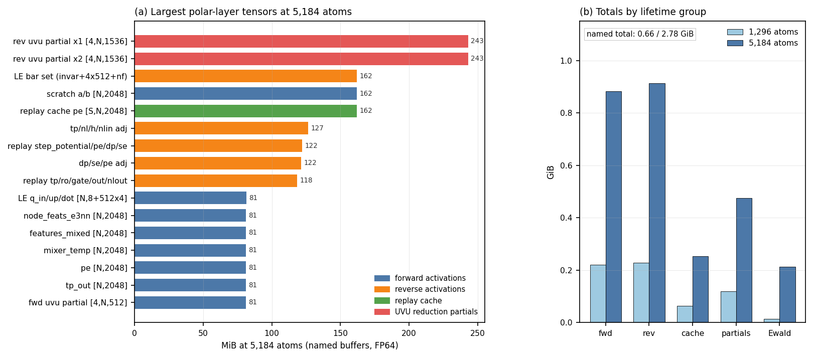
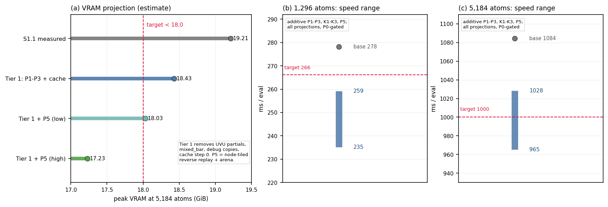

# Symmetrix-XL paper mechanisms applied to the PolarMACE polar layer

**Date:** 2026-10-21
**Status:** design only. Read-only: no engine edit, no build, no GPU job, no git
commit/push. The protected trees `bench/plan_b_micro_2026-10-21`,
`bench/plan_a_uvu_tile_2026-10-21` and `external-repos/symmetrix-xl-s1` were not
modified (the S1 worktree was inspected with `git log`/`git diff` only).
**Scope:** the polar layer, not the backbone. Backbone streaming (S1.1) is
treated as a fixed platform.
**Source of truth for line numbers:** `external-repos/symmetrix-xl-s1`
worktree, `s1.1-tile-cache` at `6582bc6` (A1 UVU tile merged). Backbone line
numbers from the S1 tree are quoted from the survey where the numbering differs.

> **Evidence status.** Measured numbers are only those published in
> `docs/results/UVU_TILE_MAIN_1296.md`, `docs/results/S1_1_TILE_CACHE_RESULTS.md`,
> `docs/design/TILED_EDGE_PLAN.md` and `docs/design/KERNEL_PROFILE_2026-10-19.md`.
> Every forward-looking number is marked **estimate (projection)**. The 128-atom
> kernel profile was taken on a 2026-10-19 binary that predates the 2-D
> `polar reverse dense` rewrite and the A1 tile; it is used only for kernel
> *shape* and relative attribution, never scaled linearly. No new measurement is
> claimed in this document.

---

## 1. 中文执行摘要与结论

1. **结论：论文的 streamed-edge execution 对 polar 层主体不适用。** PolarMACE 的
   `dot_products`、`tp_out`、local-electron UVU、source maps、density paths 全部是
   node-local：核内索引是 `x1(node, ...)`、`x2(node, ...)`、`output(node, ...)`，
   没有任何 `neigh_indices`/edge 维（`mace_polar_impl.tpp:918-1182, 1676-1808`）。
   polar 层恰好是论文复杂度式子里必须常驻的 `O(N C K_node)` 节点边界项
   （paper `symmetrix-xl_paper.tex:340-352`），不存在可被 streaming 消除的
   `O(E C P)` 张量。对 polar 层谈"9x 容量"是把 FP32 边式结论错误外推。
2. **可迁移的是 receiver-owned 的"对偶形式"，不是边核本身。** 前向以
   `(node, out-column)` 为唯一写者、按 path→v→c 升序在寄存器/共享内存累加，
   一次写回并同时乘 mask（P-RO）；反向以 `(node, in-column)` 为唯一写者、
   在寄存器内按 4 个 v-chunk 累加后升序折叠（P-SO）。全程无 atomics，
   且可做到与现分块部分和**逐位一致**。
3. **polar 侧最大的显存项不是 UVU 本体**，而是反向 UVU 的
   `[4,N,1536]` 部分和（5,184 时 x1/x2 各 243 MiB，合计 0.475 GiB）、
   replay cache（0.253 GiB）、以及未条件编译的 3 个 LE debug 拷贝
   （`[N,2048]` 等，81 MiB + 每次 3 次全量 deep_copy，
   `mace_polar_impl.tpp:3709-3717`）。
4. **polar 侧最大的时间项是 k-space，而非 UVU。** `polar scf project features`
   与 `polar rev replay project` 用 `(node, j=8)` 线程串行扫 `num_k`，8 个 j
   重复读同一对 `cos/sin`（`mace_polar_impl.tpp:1214-1245, 3069-3105`）。
   改成 `(node, k-chunk)` 一次读 k、8 个特征在寄存器累加，可把 cos/sin 流量
   降 8 倍；这是 5,184 追 84 ms 的主要来源（estimate）。
5. **tiled execution 只以 node-tile 形式适用。** SCF/Fukui 是全局定点，每步之间
   有全局归约（`polar_global_sum_view`），tile 不能跨 step；收益是 workspace
   上界与跨 sweep 复用，不是容量扩展。polar 层本身只有 O(N)。
6. **model-specialized JIT 是后期项目（10–25 天），不进 P1。** 该 checkpoint
   每个 UVU 只有 2 条 path、`mode∈{0,1}`、`d1∈{1,3}`；P1 用"预生成路径表计划"
   （host 缓存 + device 只读表 + 融合 path 循环）即可拿到大部分收益。
7. **速度投影（estimate）**：1,296 为 235–259 ms（目标 <266.21 可满足；但
   S1.1+A1 合并分支本身可能已约 254 ms，必须先测，见 §6.1）；5,184 为
   965–1028 ms（<1.0 s 只在区间上半成立）。
8. **显存投影（estimate）**：polar named 张量 2.78 GiB → 0.80–2.00 GiB；
   5,184 峰值 17.2–18.6 GiB。<18 GiB 需要 P5（node-tiled reverse replay + arena）
   全部落地，或配套 S1 边 arena 共享；polar 侧单独完成 Tier 1 只能到 ~18.4 GiB。
9. **Kill 条件**：若 P0 测得 1,296 polar < 25 ms 或 5,184 polar < 120 ms，
   则 polar 侧不可能独立承担速度目标，停止速度线，只交付内存/容量项。
10. **不变量**：FP64、精确 Ewald、SCF 步数 2、Fukui/密度更新顺序、mask 语义、
    polar guard 全部不变；不得引入 FP32/TF32/近似 Ewald/新 atomics。

### 机制适用性裁决

| 论文机制 | 论文出处 | 对 polar 层 | 裁决 |
|---|---|---|---|
| Streamed-edge execution / receiver-owned edge accumulation | tex:225, 309-312; §3.1-3.3 of the survey | polar 层无 edge 张量；只有 `O(N C K_node)` 节点边界 | **不适用（主体）**。只适用于 backbone 边路径（已是 S1.1）与 polar→backbone 的 node-adjoint 交接 |
| Recompute reverse / source-owned deterministic reverse | tex:309; survey §3.2 | 有精确对偶：输入分量 owned 的确定性反向 | **适用（对偶）**。P-SO，见 §3.2 |
| Model-specialized code generation | tex:226, 339-354 | 路径表/宽度/步数固定，但 path 只有 2 条 | **部分适用，后置**。P1 只做 prepared plan，不做 NVRTC |
| Tiled execution / fixed workspace | tex:227, 355-364, 446, 451 | node-local，SCF 全局定点 | **适用（node-tile 变体）**。只省 workspace，不扩容量 |
| 8,192 receivers, 9x atoms, +4%/atom | tex:446,451 | FP32 linear MACE，边受限 | **不可外推**。PolarMACE 的 polar 峰值已是 O(N) |

### Top 3 polar-side opportunities

| # | Opportunity | Lever | Estimate (projection) |
|---|---|---|---|
| 1 | k-space project/assemble remap (K1-K3): one `(node,k-chunk)` thread reads each `cos/sin` once and keeps 8 features in registers; `(k,node-chunk)` assemble with ascending fold | 8x less `cos/sin` traffic; 8-32x less serial `num_k` per thread | -10..-20 ms at 1,296; -38..-75 ms at 5,184 |
| 2 | Fused output-owned UVU forward (P-RO, dot/tp + LE q+v): one writer per output column, path/v/c ascending, one masked store, no zero/mask kernels, no `[4,N,512]` partial | removes 2 kernels per UVU call, per-path RMW and the forward partial; better team mapping | -3..-8 ms at 1,296; -6..-15 ms at 5,184 |
| 3 | Deterministic input-owned reverse (P-SO): X1/X2 passes with register 4-chunk fold, no global partials, no `mixed_bar` | removes 0.475 GiB partials + 0.021 GiB mixed_bar + 2 reduce kernels, bitwise vs the current fold | -4..-10 ms at 1,296; -8..-20 ms at 5,184; -0.50 GiB |

Cheap prerequisites (P1): gate the 3 unconditional LE debug copies (-0.082 GiB,
3 full deep-copies), cache the path tables on device (-~24 D2H syncs/eval),
remove the two unique-writer atomics (`basis_adjoint_add`,
`polar_inject_node_features_adjoint`).

---

## 2. Polar pipeline 数据流与内存账本

### 2.1 Forward dataflow

`run_polar_pipeline` (`mace_polar_impl.tpp:250`) 在 backbone forward 之后运行，
按以下顺序（所有中间量的第一维都是 `node`，Ewald 量是 `k`）：

```
stage2 fukui      : fukui_source_map(node_feats[N,2048]) -> sources[N,2]
                     density0 = corrected(spin_charge_density)
stage3 kgeom      : k-vectors[Nk,3], cos/sin[2,Nk,N], GTO bases[Nk,4/8]
stage4 potential  : rho(k) = sum_n cos/sin * density;  project -> P[N,16]
stage5 SCF (S=2)  : for step in 0..S-1:
                      assemble rho(k)  (global sum over nodes)
                      project  P_step[N,16]  (serial k per (node,j))
                      pe = potential_linear(P) + node_feats_linear(features_mixed)
                           + charge_embedding(density)
                      dp = dot_products UVU(x1=features_mixed[N,2048],
                                            x2=pe[N,2048]) -> [N,512]
                      se = source_embedding(attrs) -> [N,512]
                      nl = MLP(cat(dp,se))      [1024 -> 64 -> 64 -> 64 -> 512]
                      tp = tp_out UVU(x1=features_mixed[N,2048],
                                      x2=nl[N,512]) -> [N,2048]
                      out = readout(gate(linear_1(tp)), gate(linear_mid))
                      density += out[:,:8]; Fukui renormalization + l=0 correction
stage6 coulomb    : rho(k) from final density; E_k space sum; SI correction
stage7 LE         : q_up = Lin_q(d_final+d_init); v_up = Lin_v(P_last)
                     dot_q = LE UVU(x1=node_feats[N,2048], x2=q_up[N,512]) -> [N,512]
                     dot_v = LE UVU(x1=node_feats[N,2048], x2=v_up[N,512]) -> [N,512]
                     E_le = sum(MLP(cat(dot_q,dot_v)))
readout/energy    : E += coulomb; E += le; node energies
```

Reverse (`compute_polar_reverse_forces`, `mace_polar_impl.tpp:2139`) is the
transpose: LE seed → Coulomb seed → per-step replay (or replay cache) → UVU
adjoints → MLP/readout adjoints → density/Fukui chain → per-layer source-map
and mixer adjoints → `states[layer].layer_adjoint[N,2048]` handed to the
backbone reverse.

**Key structural fact.** No stage above reads or writes `neigh_indices`,
`targets`, `offsets`, radial features, harmonics, or any `[E, ...]` tensor. The
only coupling to the backbone is the per-layer node feature `state.output`
consumed at `mace_nonlinear_kokkos_impl.tpp:5913-5956` (source-map and mixer
accumulation) and the node adjoint returned at `mace_polar_impl.tpp:4225-4244`.
This is the same conclusion as `S1_BACKBONE_STREAMING_POC.md` §6.1 and §11.

### 2.2 "Every edge-materialized tensor in the polar UVU": there are none

The audit requested by the brief is answered in the table below. `dot_products`,
`tp_out`, local-electron UVU, the source maps and the density paths are all
indexed by `(node, column)` or `(node, k)`; none has an edge dimension.

| Polar object | Index space | Width (doubles) | 1,296 | 5,184 | Owner / streamable? |
|---|---|---:|---:|---:|---|
| `polar_features_mixed` (mixer accumulator, x1 of dot/tp) | N | 2048 | 20.25 MiB | 81.0 MiB | node; must stay resident (SCF + reverse) |
| `polar_node_feats_e3nn` (x1 of LE UVU) | N | 2048 | 20.25 MiB | 81.0 MiB | node; resident |
| `polar_pe_out` (x2 of dot) | N | 2048 | 20.25 MiB | 81.0 MiB | node; tile-local after P-RO |
| `polar_scratch_a/b` (potential/charge embeddings) | N | 2x2048 | 40.5 MiB | 162.0 MiB | node; tile-local after P-RO |
| `polar_tp_out` (tp UVU output, readout input) | N | 2048 | 20.25 MiB | 81.0 MiB | node; tile-local |
| `polar_dp_out` | N | 512 | 5.06 MiB | 20.25 MiB | node; tile-local |
| `polar_se_out` | N | 512 | 5.06 MiB | 20.25 MiB | node; tile-local |
| `polar_nl_input` | N | 1024 | 10.1 MiB | 40.5 MiB | node; tile-local |
| `polar_nl_out` (x2 of tp) | N | 512 | 5.06 MiB | 20.25 MiB | node; tile-local |
| `polar_ro_l1_out`, `polar_ro_lmid_out` | N | 2x160 | 3.16 MiB | 12.7 MiB | node; tile-local |
| `polar_gate1_out`, `polar_gate2_out` | N | 2x128 | 2.53 MiB | 10.1 MiB | node; tile-local |
| `polar_update_out` | N | 10 | 0.10 MiB | 0.40 MiB | node; tile-local |
| `polar_scf_step_densities` | S,N | Sx8 | 0.16 MiB | 0.63 MiB | node; resident (SCF state) |
| `polar_spin_charge_density`, working, field-independent | N | 3x8 | 0.24 MiB | 0.95 MiB | node; resident |
| `polar_fukui_sources` | N | 2 | 0.02 MiB | 0.08 MiB | node; resident |
| `polar_potential_features`, `polar_step_potential_features` | N | 16+16 | 0.32 MiB | 1.27 MiB | node; resident (LE reads last step) |
| LE `q_up+v_up+dot_q+dot_v` | N | 4x512 | 20.25 MiB | 81.0 MiB | node; tile-local in fwd, needed by LE reverse |
| LE `invar` | N | 1024 | 10.1 MiB | 40.5 MiB | node; LE reverse input |
| LE `mlp_out`, `atom` | N | 1+1 | 0.02 MiB | 0.08 MiB | node; resident |
| UVU weights (dot+tp+le_q+le_v) | path table | 4x2x512x512 | 16 MiB | 16 MiB | model; resident, read-only |
| UVU path table (`meta[8]`, `path_weight`, `mask`) | path | 8 paths | <1 KiB | <1 KiB | model; resident |
| `polar_cosines`, `polar_sines` | Nk,N | 2xNk,N | 13.4 MiB | 217.4 MiB | k-space; **must stay resident** |
| GTO bases (`density_basis_re/im`, `feature_basis_re/im`) | Nk | 4+4+8+8 | <0.2 MiB | <0.5 MiB | resident |

**Conclusion for item 2 of the brief:** there is no polar tensor of the form
`[E, W_dot]`, `[E, W_tp]`, `[E, W_le]`, `[E, W_density]`, or an edge-conditioned
source map. The "polar UVU" is a *node-local sparse contraction over feature
channels*, not an edge-indexed tensor product. Consequently, none of these
tensors can be "receiver-owned per edge"; they are already receiver-owned per
node. The correct optimization is to make each node's output column owned by
exactly one thread and to stop materializing path partial sums, which is what
§3 does.

### 2.3 Memory ledger (named polar buffers, FP64)

Widths are doubles per node; `S=2` (`polar_blocks.configs.num_recursion_steps`).
`Nk=678` at 1,296 and `Nk=2,748` at 5,184 (`TILED_EDGE_PLAN.md` §2.1).

| Group | Doubles/node | 1,296 (GiB) | 5,184 (GiB) |
|---|---:|---:|---:|
| forward activations (incl. LE forward) | 22,838 | 0.221 | 0.882 |
| reverse activations (replay views + adjoints + LE bars) | 24,818 | 0.240 | 0.959 |
| replay cache (`MATOS_REPLAY_CACHE=1`, S steps) | 6,548 | 0.063 | 0.253 |
| UVU reduction partials (`[4,N,mul*d1]`, x1+x2) | 12,288 | 0.119 | 0.475 |
| **named polar total** | **66,492** | **0.642** | **2.568** |
| Ewald cos/sin | `2*Nk*N` | 0.013 | 0.212 |
| **named total incl. Ewald** | | **0.655** | **2.780** |

Cross-check against the accepted ledger: `TILED_EDGE_PLAN.md` §2.3 rows 17-19
give `0.224+0.380+0.013 = 0.617 GiB` at 1,296 and
`1.055+1.521+0.212 = 2.788 GiB` at 5,184. This enumeration gives 0.655 and
2.780 GiB (+6.2% / -0.3%). The agreement calibrates the table; the row-level
split is new, the total is not.



**Largest individual buffers at 5,184 (MiB):** reverse UVU partial x1 = 243,
x2 = 243, LE bar set = 162, scratch a/b = 162, replay cache `pe` = 162,
tp/nl/h/nlin adjoints = 127, replay step-potential/pe/dp/se = 122,
dp/se/pe adjoints = 122, replay tp/ro/gate/out = 118,
`polar_fwd_uvu_partial` = 81, each `[N,2048]` activation = 81.

### 2.4 Where the polar time actually goes

The only measured attribution is the 128-atom profile
(`KERNEL_PROFILE_2026-10-19.md`, historical binary):

- polar pipeline 73.36 ms of a 183.5 ms eval (40.0%), 238 launches;
- 39 single-block (`1x1x1`) launches account for 47.8 ms GPU but only
  0.042 ms SM-weighted (26% of the eval on one SM);
- polar-specific kernels: `polar uvu mode0` 5.76, `polar rev replay uvu mode0`
  5.76, `polar le uvu mode0` 4.59, `polar reverse uvu mode0 x2` 10.90,
  `x1` 5.45 ms; `polar scf project features` 2.32 ms and
  `polar rev replay project` 2.30 ms at 4 blocks.

These numbers must not be scaled linearly to 1,296/5,184: the kernels are
latency/grid-starved at 128 atoms, and the 2026-10-19 binary predates both the
2-D `polar reverse dense` rewrite (`mace_polar_impl.tpp:2829-2837`) and the A1
tile. They establish relative shape only:
(i) the UVU family is a real cost; (ii) the k-space project kernels run with
`8*N` threads and a serial `num_k` loop, so their wall time grows with `Nk`
until block count saturates the SMs; (iii) host-synchronizing kernels are
scattered through the reverse.

**P0 must produce the 1,296 and 5,184 stage table before any speed claim.** The
plan in §6 is written so that P0 is a kill gate, not a formality.

---

## 3. Kernel design

### 3.1 P-RO: polar output-owned UVU forward

This is the polar-layer analogue of the paper's receiver-owned accumulation:
the "receiver" is the output element `(node, out-column)`, which has exactly one
writer for the whole evaluation of a UVU call.

#### Applicability contract

The fusion is legal only if, for each output column, the set of paths writing it
can be identified statically and each path's contribution can be added in the
checkpoint's path order. For `polar_symmetrix_probe.json`:

| UVU | paths | mode / d1 | out block | x1 block | x2 block |
|---|---|---|---|---|---|
| `dot_products` | 2 | mode0 d1=1 (l=0); mode0 d1=3 (l=1) | shared `[0,512)` | `[0,512)`, `[512,2048)` | `[0,512)`, `[512,2048)` |
| `tp_out` | 2 | mode0 d1=1; mode1 d1=3 | `[0,512)`, `[512,2048)` | `[0,512)`, `[512,2048)` | `[0,512)` (both) |
| `le dot_q` | 2 | mode0 d1=1; mode0 d1=3 | shared `[0,512)` | `[0,512)`, `[512,2048)` | `[0,512)`, `[512,2048)` |
| `le dot_v` | 2 | mode0 d1=1; mode0 d1=3 | shared `[0,512)` | `[0,512)`, `[512,2048)` | `[0,512)`, `[512,2048)` |

All output blocks are either shared by two mode0 paths (dot, LE) or disjoint
(tp). The constructor already parses `[in1_off,in2_off,out_off,w_off,mul1,mul2,
mode,d1]` from `parse_uvu_paths` (`mace_polar_impl.tpp:24-58`) and stores
`uvu_*_meta/path_weight/weight/mask` (`:115-140`). Add a load-time validation
that computes, per output column, the ordered path list; if two paths overlap
on a column and are not in strictly increasing `p`, fall back to the sequential
path kernel for that UVU (still fused per path). This makes the checkpoint's
path structure explicit instead of implicit in kernel launches.

#### Work decomposition

- One `Kokkos::TeamPolicy` over `(node_tile, out_tile)`, team size
  `TN*TM = 256`.
- `TN=8`, `TM=32`: each warp owns one node row (32 consecutive output
  columns); `TM=32` matches a warp exactly, so the x1 row is a coalesced
  32x`d1` load, and the x2 row is a warp-wide broadcast.
- Grid at 1,296: `ceil(1296/8) * ceil(512/32) = 162*16 = 2,592` teams for a
  512-wide output; at 5,184: `648*16 = 10,368` teams. That is 24 teams per SM
  in the grid at 1,296 and 96 per SM at 5,184, so the fused kernel is not
  grid-starved; each thread still owns one output column and the full `v` loop.
- Shared memory: one weight tile `W[TM][stage_v]` per team. The weight depends
  only on `(u,v)`, not on the node, so it is staged once and reused by all
  `TN` nodes. `TM=32`, `stage_v=64` → 16 KiB, safely under the 48 KiB static
  limit even with double buffering.

#### Forward math and accumulation order

`mode0` (scalar output):

```
mixed = 0
for v in 0..mul2-1 (ascending):
    pair = 0
    for c in 0..d1-1 (ascending):
        pair += x1(node, in1_off + u*d1 + c) * x2(node, in2_off + v*d1 + c)
    mixed += pair * inv_sqrt_d1 * W(u,v)
acc += pw * mixed
```

`mode1` (vector output):

```
mixed = 0
for v in 0..mul2-1 (ascending):
    mixed += x2(node, in2_off + v) * W(u,v)
contrib = pw * mixed * inv_sqrt_d1
for c in 0..d1-1: accv[c] += contrib * x1(node, in1_off + u*d1 + c)
```

Across paths, `acc` starts at 0 and paths are visited in ascending `p`; this
reproduces `out=0; out += term_0; out += term_1` exactly (`0 + term_0` is
exact). At the end, one store applies the mask:

```
mode0: out(node, out_off+u)        = acc * mask[out_off+u]
mode1: out(node, out_off+u*d1+c)   = accv[c] * mask[out_off+u*d1+c]
```

The current code performs a zero kernel, one `+=` per path, and a separate mask
kernel (`:926-932, 1040-1057, 1175-1181`). To be **bitwise identical** to the
shipped `sweep=4` order, the fused forward also keeps four register
accumulators per `(node,u)`: `v` goes into `acc[v/chunk_width]` in ascending
order, then the four are folded `((a0+a1)+a2)+a3` before `acc += pw*total`.
This costs four registers and no global memory. A single accumulator instead
reproduces the `sweep=1` order and differs only at the ~1e-16 chunk-boundary
re-association (allowed by the gates, but must be reported). The mask is applied
once to the final sum (`(a+b)*m` in both cases). No compensated summation, no
reordering beyond the stated chunk fold.

#### What this removes

- `polar uvu zero` and `polar uvu mask` launches (2 per UVU call, 8-10 per
  eval).
- The per-path read-modify-write of the output: at 5,184, `dot` 512 columns x
  2 paths x 2 steps, `tp` 2048 x 2 x 2, LE 512 x 2 x 2 calls
  ≈ 12,288 doubles/node of RMW plus the zero/mask traffic ≈ 24,000 doubles/node
  ≈ 1.0 GB per eval (estimate; bandwidth-bound lower bound ~1-2 ms at
  800 GB/s, so this is not the main speed source).
- `polar_fwd_uvu_partial [4,N,512]` (81 MiB at 5,184) and its reduce kernel when
  the fused kernel replaces the chunked branch (`:971-1057`). The speed source
  is the single-pass team mapping and the removal of the 4-way partial fold,
  estimated 1.2-2.0x on the forward UVU kernels, not 8x.
- `polar_fwd_uvu_partial` is also the reason the current "sweep=0" environment
  is silently coerced to 4 (`:943-948` accepts only 2/4/8). The fused path
  removes this ambiguity.

#### LE q+v fusion

`le dot_q` and `le dot_v` share the same x1 (`polar_node_feats_e3nn [N,2048]`)
and differ only in x2 and weights (`:1827-1832`). Run both path sets in one
kernel with two accumulator sets, reading the x1 row once. This removes one
full `[N,2048]` read per eval (81 MiB at 5,184) and halves the LE UVU launches.
The two outputs (`dot_q`, `dot_v`) are disjoint, so no atomics. Accumulation
order per output is unchanged.

### 3.2 P-SO: polar source(input)-owned deterministic reverse

The forward is linear in x1 and x2 given the other operand. The adjoints are:

`mode0`, with `M_u = pw * outbar(out_off+u) * mask(out_off+u)`:

```
x1bar(in1_off+u*d1+c) += sum_v M_u * inv_sqrt_d1 * W(u,v) * x2(in2_off+v*d1+c)
x2bar(in2_off+v*d1+c) += sum_u M_u * inv_sqrt_d1 * W(u,v) * x1(in1_off+u*d1+c)
```

`mode1`, with `S_u = sum_v x2(in2_off+v) * W(u,v)` (forward scalar):

```
Sbar_u = pw * inv_sqrt_d1 * sum_c outbar(out_off+u*d1+c) * mask * x1(in1_off+u*d1+c)
x1bar(in1_off+u*d1+c) += outbar(out_off+u*d1+c) * mask * pw * inv_sqrt_d1 * S_u
x2bar(in2_off+v)      += sum_u Sbar_u * W(u,v)
```

#### Work decomposition and atomics

- Pass X1 (`x1bar`): one team per `(node_tile TN=8, u_tile TM=32)`, thread owns
  one `(node,u)`. Reduction dimension `v` (512) ascending. Each thread owns a
  distinct `(node, in1 column)`, so the final add is a plain `+=`; **no atomics**.
- Pass X2 (`x2bar`): one team per `(node_tile, v_tile)`, thread owns
  `(node,v)`. Reduction dimension `u` (512) ascending. Same ownership argument;
  **no atomics**.
- `mode1` X2 recomputes `Sbar_u` inline from `(outbar, mask, x1)` (3 MACs) inside
  the `u` loop, so no `mixed_bar` buffer is needed. `mode1` X1 recomputes `S_u`
  from `x2` and `W` (512 MACs), which is the unavoidable forward scalar.
- The two passes are independent (X1 needs only forward `x2`; X2 needs forward
  `x1` and `outbar`), so they can run in either order or on two streams, but the
  plan keeps one stream and a fixed order for determinism.

#### Exact FP64 order vs the current 4-chunk partials

The current reverse splits `v` into 4 contiguous chunks, writes
`partial_x1[4,N,mul1*d1]`, and folds ascending (`:2300-2386`, `:2546-2557`).
The fused kernel keeps **four register accumulators per component**,
`acc[ck][c]`, adds `v` into `acc[v/chunk_width][c]` in ascending `v`, then folds
`((acc0+acc1)+acc2)+acc3`. This is bitwise identical to the current global
partial fold, with zero global partial memory. With
`MATOS_UVU_REV_SWEEP=1` a single accumulator reproduces the single-pass order.
This is the key design choice that makes the memory win free numerically.

#### What this removes

- `polar_rev_uvu_partial_x1 [4,N,mul1*d1]` and `_x2` (486 MiB at 5,184, the two
  largest polar buffers).
- The two reduce kernels and their read traffic.
- `polar_rev_uvu_mixed_bar [N,512]` (20.25 MiB at 5,184) by recomputation.
- Atomic-like robustness in `basis_adjoint_add` (`:2172-2191`, comment admits
  each `(node,j)` has a unique writer) and in
  `polar_inject_node_features_adjoint` (`:4289-4311`). Replace
  `Kokkos::atomic_add(&internal(node,source(column)), ...)` with
  `internal(node,source(column)) = sign(column)*adjoint(node,column)` for the
  `initialize=true` variant, and a plain `+=` for the accumulate variant. The
  mapping `c -> source(c)` is a block bijection, so there is no collision.
  (No new atomics anywhere; this removes the existing ones.)

### 3.3 k-space remap (the largest polar-side speed lever)

This is the polar analogue of "receiver-owned accumulation" applied to the
k-space: the node owns its 8 feature accumulators and streams k once, instead of
8 threads per node each streaming k.

#### K1: forward `polar scf project features` (`:1214-1245`)

Current: `MDRangePolicy({N,8})`; thread `(node,j)` loops `num_k` ascending and
reads `kcos2(k,node)`, `ksin2(k,node)`, `kweight(k)`, `rho_re/im(k)`,
`fbre/fbim(k,m)`. The same `cos/sin` pair is read by all 8 `j` threads:
16 doubles per `(k,node)` instead of 2.

New: `MDRangePolicy({N, CK})` with `CK = 8` or `32`; thread `(node,ck)` holds
`proj_cos[8]`, `proj_sin[8]` in registers, loops its k-chunk ascending, reads
each `cos/sin` once, computes all 8 `j` contributions, and writes
`partial(ck,node,j) = proj_cos[j]+proj_sin[j]`. A second kernel folds chunks
ascending, applies `proj_scale`, the SI overlap subtraction and `/knorm(j)`.
Traffic drops from `16*Nk*N` to `2*Nk*N` doubles per channel-sweep (8x), and
threads go from `8N` serial-`Nk` to `CK*N` serial-`Nk/CK` threads. The current
`8N` threads occupy ~40 blocks at 1,296 and ~162 at 5,184; the remap keeps at
least that many threads and shortens the serial loop by `CK` (with `CK=32` the
grid is 162 blocks at 1,296 and 648 at 5,184).
Accumulation order changes only by the chunk fold; the fold is deterministic
and ascending. Expected |dE| ~1e-15 relative; the 1e-9/1e-8 gates must confirm
it. If a gate fails, fall back to `CK=1` (bitwise) for that kernel.

#### K2: reverse `polar rev replay project` (`:3069-3105`)

Same transformation. This kernel runs once per SCF step in the reverse when
`MATOS_REPLAY_CACHE=0`, and is the sister of K1 in cost.

#### K3: `polar scf assemble fourier` / Coulomb / replay assemble (`:1185-1213`,
`:1592-1617`, `:3036-3062`)

Current: one thread per k, serial loop over all owned nodes, with a stride-`N`
read pattern. New: grid `(Nk, CK)`; thread `(k,ck)` sums its node chunk
ascending into 8 registers (`acc_cos[4]`, `acc_sin[4]`), writes
`partial(k,ck,8)`; a final kernel folds `ck` ascending, applies the GTO basis
contraction and writes `rho_re/rho_im`. Parallelism rises from `Nk` threads to
`Nk*CK`; partial memory is `Nk*CK*8` doubles (5.6 MB at 5,184 with CK=32),
bounded and reusable. The order changes only at chunk boundaries; gate it.

#### What this does not change

- No approximation of Ewald/PPPM/RBE. The same GTO tables, the same
  `k0` mask, the same half-space sum, the same exact `1/k^2` and SI terms.
- No change to `num_k`, `kspace_cutoff`, `kweight`, or the global sums
  (`polar_global_sum_view`).
- `polar_cosines/sines` remain `[Nk,N]` and resident (0.212 GiB at 5,184);
  K1-K3 only change traversal, not storage layout. (A later `[N,Nk]` transpose
  could improve coalescing further but touches six kernels; not in P1.)

### 3.4 Path-table plan and host-sync removal

The path tables are re-fetched from device every SCF step and every reverse
step with `create_mirror_view_and_copy` + `std::vector`
(`mace_polar_impl.tpp:882-889`, `:1809-1825`, `:3183-3188`, `:3953-4059`).
For this checkpoint there are 4 UVU tables x (meta + path_weight) = 8 copies per
step, ~24 device-to-host synchronizations per eval. They are checkpoint
constants.

Plan:
- Build a `PolarUvuPlan` host object once in `PolarUpdate` (or
  `parse_polar_extension_tables`, `:1966`) containing, per UVU: path count,
  per-path `{in1_off,in2_off,out_off,w_off,mul1,mul2,mode,d1,pw,inv_sqrt_d1}`,
  and a per-output-column path list. No `std::getenv` in the step loop.
- Upload once to a device `Kokkos::View<const PolarUvuPath>` (or a raw CUDA
  `__constant__` array if the fused kernel is written in CUDA). The kernel
  indexes the plan directly; no host copy in the hot path.
- Keep the existing host `std::vector` path only as a debug fallback
  (`MATOS_POLAR_UVU_PLAN=host`).
- Cache the `fukui_reverse` host scalars only where a global host reduction is
  genuinely required (MPI allreduce). The current `fukui_reverse` does two
  `[N,8]` D2H copies per call (`:2201-2204`) and a serial host loop over
  `owned_nodes`; for 1 rank this can be a device reduction + a kernel that reads
  the scalar, removing the sync. For MPI, keep the host allreduce but only for
  the 2-element `fbar` vector. This is P1, optional if it perturbs parity.

### 3.5 Atomics audit

| Site | Current | Change |
|---|---|---|
| `basis_adjoint_add` `:2172-2191` | `atomic_add` with a comment admitting unique writer | plain store (`initialize=true`) or `+=` |
| `polar_inject_node_features_adjoint` `:4289-4311` | `atomic_add` | plain store / `+=` |
| `polar_rev_le_*` LE reverse | reads/writes are `(node,column)` unique | no atomics needed |
| `polar reverse dense` `:2829-2837` | `i_adj(node,i) += acc` after zeroing | keep; no atomics, single writer |
| pair force/virial | unchanged | out of scope |

There are no atomics in the current polar UVU forward/reverse tensor-product
kernels; the plan adds none.

---

## 4. Fixed-workspace tiling for the polar layer

### 4.1 Tile definition

A tile is a contiguous node range `[n0, n0+T_N)`; no edge semantics are
involved. Every polar op is `(node, ...)`-local except the scalar global
reductions, so a node tile is legal within one SCF step. `T_N = 512` for 5,184
(11 tiles, last 64) and `T_N = 256` for 1,296 (6 tiles, last 16) are the
suggested defaults; both are env-tunable.

Why not an edge tile: the polar layer has no edges, and its global state is
`O(N)`/`O(Nk*N)`. An edge tile would neither bound nor accelerate anything.

### 4.2 Arena

One `PolarArena` (a single `Kokkos::View<double*>` with explicit offsets)
sized by the maximum simultaneous tile-local set. Because every UVU/MLP/readout
stage is sequential, the same arena is reused across:

1. forward SCF step 0 (assembled rho, project, pe, dot, se, nl, tp, readout);
2. forward SCF step 1 (same);
3. Coulomb final rho (K3 uses `Nk*CK*8`, a separate small slice);
4. reverse per step (replay values, UVU adjoints, MLP/readout adjoints);
5. LE forward and LE reverse.

The arena does not need the maximum sum of all stages, only the maximum over
stages. From the widths in §2.3, the largest single stage at `T_N=512` is the
SCF update with `pe+scratch_a/b+tp+pe_adj+...`; a conservative bound is
`T_N * 40,000 doubles * 8 = 164 MB` at `T_N=512` (estimate; the implementation
should assert the actual high-water and publish it). Add 16 KiB for the
double-buffered UVU weight tile. Round to `~192 MB` with slack.

### 4.3 What stays resident

Resident (cannot be tiled without recomputing the global fixed point or
re-reading the Ewald tables):

- SCF state: `polar_spin_charge_density`, `polar_working_density`,
  `polar_field_independent_density`, `polar_scf_final_density`,
  `polar_scf_step_densities [S,N,8]`, `polar_fukui_sources [N,2]`.
- Backbone handoff: `polar_features_mixed [N,2048]`,
  `polar_node_feats_e3nn [N,2048]`,
  `polar_step_potential_features [N,16]` (LE input).
- Ewald: `cos/sin [2,Nk,N]`, GTO bases, k-vectors, `k_norm2`, `k0_mask`,
  `k_weight`.
- Reverse node adjoints consumed after the polar reverse:
  `polar_rev_density_adjoint [N,8]`, `polar_rev_channel_adjoint [N,8]`,
  `polar_rev_source_adjoint [N,8]`, `polar_rev_potential_adjoint [N,16]`,
  `polar_rev_position_adjoint [N,3]`,
  `polar_rev_nfeat_adjoint [N,2048]`, `polar_rev_fmix_adjoint [N,2048]`,
  `polar_rev_fukui_source_adjoint [N,2]`.
- Model: all weights, UVU path plan, mixer linears, readout.
- Energy/readout buffers.

Everything else in §2.3 is tile-local. This is the polar instance of the paper's
"node boundaries stay graph-wide" rule (`tex:355-364`): here the node-boundary
set is small because the node width is 2048, not because edges were streamed.

### 4.4 Replay strategy

Current accepted runs use `MATOS_REPLAY_CACHE=1`: the forward SCF stores
`pe, nl_h, nl_a, nl_out, ro1, ro2, out` for both steps
(`mace_polar_impl.tpp:798-832`, `load_step_cache` `:3552-3588`), 0.253 GiB at
5,184. Options, in order of risk:

- `MATOS_POLAR_CACHE_STEPS=1`: cache only the last step; recompute step 0 in
  the reverse. Saves 0.127 GiB at 5,184. The recompute is the existing
  `replay_step_forward` (`:3132-3544`), already the fallback when the cache is
  off; it must be gated at the same dE/dF thresholds before being accepted.
- With node tiling: replay step 0 **per node tile**, immediately run that
  tile's reverse, and discard. This bounds the replay views by `T_N` and
  removes the 0.253 GiB cache plus most of the 0.959 GiB reverse activations.
  The cross-tile state is only the node adjoints listed above (which are
  resident) and the deterministic global reductions (Fukui, rho), which must
  complete between steps.
- Do not cache full `[N,2048]` forward values per step at 5,184: that is
  +0.08 GiB per 2048-wide tensor per step and defeats the capacity goal.

### 4.5 Expected polar peak

| Configuration | 1,296 (GiB) | 5,184 (GiB) | Basis |
|---|---:|---:|---|
| Current named (incl. Ewald) | 0.655 | 2.780 | §2.3 |
| Tier 1: P1-P3 + cache trim, no arena | 0.460 | 1.996 | removes partials, fwd partial, mixed_bar, debug copies, cache step 0 |
| Tier 1 + P5 low | 0.36 | 1.60 | +0.1 / +0.4 GiB arena/replay win |
| Tier 1 + P5 high | 0.16 | 0.80 | +0.3 / +1.2 GiB full node-tiled reverse |
| **Resulting S1.1 peak** | **8.06-8.36** | **17.2-18.6** | adds polar delta to the measured S1.1 peak |

All rows except "current" are **estimate (projection)**. The 5,184 `<18 GiB`
gate is met only in the P5-high case; P5-low is 18.03 and Tier 1 alone 18.43.
The plan therefore pairs P5 with the S1 edge-arena sharing identified in the
survey (T3), which is outside the polar layer but is the only remaining
capacity lever if P5 lands short. This dependency is explicit, not assumed.

---

## 5. Code-change map

All paths are in `external-repos/symmetrix-xl-s1/libsymmetrix/source/`
(current `s1.1-tile-cache` tree). "New env" is the opt-in switch; every switch
defaults to the current behavior, so the existing path is bitwise unchanged
unless the switch is set.

| ID | File | Function / lines | Change | New env | Default |
|---|---|---|---|---|---|
| P1a | `mace_polar_impl.tpp` | `PolarUpdate` ctor `:115-140`; `run_polar_pipeline` `:882-889`; `replay` `:3183-3188`; reverse `:3953-4059` | build `PolarUvuPlan` once; remove per-step D2H copies | `MATOS_POLAR_UVU_PLAN=device` | `host` (current) |
| P1b | `mace_polar_impl.tpp` | `:3709-3717` | gate the three unconditional LE debug copies behind `POLAR_DBG_CKPT` | `MATOS_POLAR_DBG_COPIES` | 0 (off) |
| P1c | `mace_polar_impl.tpp` | `basis_adjoint_add` `:2172-2191`; `polar_inject_node_features_adjoint` `:4289-4311` | remove `atomic_add` (unique writer) | `MATOS_POLAR_ADJ_ATOMIC` | 1 (keep current until gated) |
| P2a | `mace_polar_impl.tpp` | `launch_uvu` `:918-1182` | fused output-owned kernel for dot/tp; one store + mask; no zero/mask kernels; no `polar_fwd_uvu_partial` | `MATOS_POLAR_UVU_FUSED` | 0 |
| P2b | `mace_polar_impl.tpp` | `:1676-1808` | fused LE q+v (one x1 read, two accumulator sets) | `MATOS_POLAR_LE_FUSED` | 0 |
| P3a | `mace_polar_impl.tpp` | `uvu_reverse` `:2249-2680` | input-owned X1/X2 passes; register 4-chunk fold; no global partials; no `mixed_bar` | `MATOS_POLAR_UVU_REV_FUSED` | 0 |
| P3b | `mace_nonlinear_kokkos.hpp` | `:598-604` | keep the partial views for the fallback; do not allocate when fused | — | — |
| K1 | `mace_polar_impl.tpp` | `polar scf project features` `:1214-1245` | `(node,k-chunk)` with 8 feature registers + ascending fold | `MATOS_POLAR_KSPACE_CHUNK` | 0 |
| K2 | `mace_polar_impl.tpp` | `polar rev replay project` `:3069-3105` | same as K1 | `MATOS_POLAR_KSPACE_CHUNK` | 0 |
| K3 | `mace_polar_impl.tpp` | `:1185-1213`, `:1592-1617`, `:3036-3062` | `(k,node-chunk)` with 8 registers + ascending fold | `MATOS_POLAR_KSPACE_CHUNK` | 0 |
| P5a | `mace_polar_impl.tpp` | `run_polar_pipeline` `:250`; `compute_polar_reverse_forces` `:2139` | node-tiled driver and `PolarArena`; reuse across steps/sweeps | `MATOS_POLAR_ARENA`, `MATOS_POLAR_TILE_N` | 0, 512 |
| P5b | `mace_polar_impl.tpp` | `:798-832`, `load_step_cache` `:3552-3588` | `MATOS_POLAR_CACHE_STEPS=1` or per-tile replay | `MATOS_POLAR_CACHE_STEPS` | 2 (current) |
| P5c | `mace_nonlinear_kokkos.hpp` + `mace_nonlinear_kokkos_impl.tpp` | `StreamEdgeTile` plan and the per-layer edge arenas (S1.1 slice 1) | share one S1 edge arena across layers/sweeps (outside polar; only if needed for the 18 GiB gate) | `MATOS_S1_SHARED_ARENA` | 0 |

Integration points that must **not** change:
`mace_nonlinear_kokkos_impl.tpp:4584-4607` (polar guard and buffers),
`:5913-5956` (per-layer source-map/mixer accumulation),
`:5960-5973` (readout),
`mace_polar_impl.tpp:2139-4285` (reverse ordering, seeds, Fukui chain),
`parse_polar_extension_tables:1966` (model tables).

### 5.1 Default-off plan

1. Land P1a-P1c behind their switches; default path still takes the old
   host-copy/atomic route. Gate: bitwise or dF<=1e-15 at 128, no speed claim.
2. Land P2 behind `MATOS_POLAR_UVU_FUSED=0`; A/B with the switch on, same
   binary. If parity passes at 128/1,296 and the median improves, change the
   default only in a separate commit with the full gate suite.
3. Same for P3, K1-K3, P5. Never flip more than one switch group per A/B.
4. The accepted production environment for the A/B matrix is unchanged:
   `MATOS_REPLAY_CACHE=1`, `MATOS_CONV_CUTOFF_BACKEND=team`,
   `MATOS_MH1_TEAM_SIZE=64`, `MATOS_UVU_TILE_N=32`, `MATOS_UVU_TILE_M=16`,
   `MATOS_UVU_X2_MB_SMEM=0`, `MATOS_UVU_FWD_SWEEP=0` (note: the current parser
   coerces `0` to `4` at `:943-948`; the fused path removes that branch).
5. Default execution mode stays `materialized`; S1 generic stays explicit
   opt-in; no change to the polar guard.

### 5.2 Log assertions

Emit once per evaluation at `MATOS_POLAR_PROFILE=1`:
`polar_plan=prepared`, `polar_uvu_fused=0/1`, `polar_le_fused=0/1`,
`polar_rev_fused=0/1`, `polar_kspace_chunk=0/8/32`,
`polar_arena_bytes=<n>`, `polar_cache_steps=<n>`, `polar_tile_n=<n>`, and a
`polar_peak_named_bytes=<n>` computed from the extent table. The A/B harness
must assert the expected combination and that no `[S,N,mul1*d1]` allocation
occurred (`MATOS_S1_ALLOC_TRACE=1` already prints `ensure_view` reallocations).

---

## 6. Expected performance, plan, acceptance, kill criteria

### 6.1 Baselines and the target re-basing

| Point | Measured | Source |
|---|---:|---|
| 1,296 materialized main | 289.43 ms, 39.92 GiB | `S1_1_TILE_CACHE_RESULTS.md` §6 |
| 1,296 A1 UVU tile on main | **266.21 ms** (205.41 us/atom) | `UVU_TILE_MAIN_1296.md` §0; VRAM not re-measured (same materialized path) |
| 1,296 S1.1 | **278.15 ms, 8.55 GiB** | `S1_1_TILE_CACHE_RESULTS.md` §6-7 |
| 5,184 S1.1 | **1,084.25 ms, 19.21 GiB** | same, §7 |
| 128 polar share (historical binary) | 73.36 ms / 183.5 ms (40%) | `KERNEL_PROFILE_2026-10-19.md` |

The A1 commit `c88fa72` was merged into `s1.1-tile-cache` at `6582bc6` after the
S1.1 A/B. **The merged S1.1+A1 point has not been measured.** Because A1 is a
pure polar UVU change, the two gains should be approximately additive
(estimate: 278.15 - 23.9 = 254 ms). This has two consequences:

- The stated 1,296 target (`<266.21 ms`) may already be met by the merge. P0
  must measure it before the plan claims any new win.
- The meaningful gate for this plan is therefore **two-level**:
  G1a `merged S1.1+A1 < 266.21 ms`; G1b `merged + polar work` at least 3% faster
  than `merged` (i.e. the new work must beat the merge, not ride it).

### 6.2 Speed accounting (all estimates)

Basis: the historical 128-atom kernel times establish which kernels exist and
their shape; the traffic arithmetic in §3 establishes the removable work. No
linear scaling is used.

| ID | Work removed / changed | 1,296 (ms) | 5,184 (ms) | Basis |
|---|---|---:|---:|---|
| P1 | ~24 D2H syncs/eval, 3 debug deep-copies | -1 .. -3 | -1 .. -3 | 20-100 us per sync |
| P2 | zero/mask kernels, per-path RMW, fwd partial; better team mapping | -3 .. -8 | -6 .. -15 | UVU fwd 5.76+4.59 ms at 128; 1.2-2x |
| P3 | 2 reduce kernels, global partials, mixed_bar; input-owned passes | -4 .. -10 | -8 .. -20 | rev UVU 10.9+5.45 ms at 128; 1.2-1.8x |
| K1/K2 | 8x cos/sin read reduction in project kernels | -8 .. -15 | -30 .. -55 | 2.32+2.30 ms at 128 with 4 blocks; 2-4x |
| K3 | assemble chunking/coalescing | -2 .. -5 | -8 .. -20 | 1.5-3x |
| P5 | arena/replay reuse, fewer realloc/memset | -1 .. -2 | -3 .. -6 | allocation churn |
| **Total** | | **-19 .. -43** | **-56 .. -119** | additive |
| **Projected** | | **235 .. 259** | **965 .. 1028** | |



Reading the table:

- At 1,296, the whole range is below 266.21, so the stated target is robust
  **if** the merged baseline is ~254; the plan's own incremental contribution
  (19-43 ms) is what G1b tests.
- At 5,184, `<1.0 s` requires -84 ms, which needs K1-K3 near the upper half plus
  P2/P3. It is plausible but not guaranteed; P0 decides whether k-space is
  actually large at 5,184. This is the single largest uncertainty.
- If P0 finds polar < 25 ms at 1,296 or < 120 ms at 5,184, the polar layer
  cannot carry these targets; stop the speed line (kill criterion 1).

### 6.3 Two-week P1 plan

Days are engineering days for one experienced Kokkos/CUDA engineer; GPU time
is serialized by `flock /workspace/group/shared/bza/.tmp/gpu.lock`, one A100
80 GB.

| Step | Days | Work | Gate / decision |
|---|---:|---|---|
| **P0** | 1-2 | Profile the merged `s1.1-tile-cache` binary at 1,296 and 5,184 with `MATOS_POLAR_PROFILE=1` + CUPTI; allocation trace; report per-stage ms, launches, peak. Measure merged A/B vs S1.1 and vs A1. | Attributes >=60% of polar time to named kernels; establishes the 1,296/5,184 polar share. **Kill if polar <25 ms / <120 ms.** Re-base the 1,296 target to the merged baseline |
| **P1** | 1-2 | `PolarUvuPlan`, host-copy removal, debug-copy gating, atomics removal. | 128/1,296 parity dE<=1e-9, dF<=1e-8; no speed claim; merged binary unchanged by default |
| **P2** | 2-4 | Fused output-owned forward (dot/tp), then LE q+v. | Parity; 1,296 median improves; no `[4,N,512]` allocation; fallback on overlap |
| **P3** | 4-6 | Input-owned reverse with register chunk fold; remove partials/mixed_bar. | Parity; 5,184 polar peak drops >=0.4 GiB; repeat-eval dF<=1e-12 |
| **K1-K3** | 6-9 | k-space project/assemble remap; chunk size 8/32 A/B. | Parity; >=1.5x on the two project kernels and >=1.3x on assemble; else revert |
| **P5** | 9-11 | Node-tiled arena, per-tile replay, `CACHE_STEPS=1`; measure high-water. | 5,184 polar peak <=1.6 GiB; peak <=18.0 GiB if P5-high; else report 18.x |
| **P6** | 11-13 | Full gates: 128/1,296/5,184, 1/2-rank, 3x repeat, interleaved A/B, NVML peak, hashes. | All acceptance criteria below |
| **P7** | 13-14 | Docs, ledger update, results report, figure regeneration; buffer. | Reproducible artifact list; no default flip without the full suite |

### 6.4 Acceptance criteria

1. **1,296 speed:** median `< 266.21 ms` over 2 rounds x 4 samples, same-binary
   interleaved A/B; and the polar-on arm at least 3% faster than the merged
   polar-off arm (G1b).
2. **1,296 memory:** peak `< 20 GiB` (current 8.55; do not regress above 9.0).
3. **5,184:** `rc=0`, median `< 1.0 s`, peak `< 18.0 GiB`, 3 repeats with
   identical printed PE (17 digits).
4. **Parity:** 128 and 1,296 `dE <= 1e-9 eV`, `max dF <= 1e-8 eV/A`; 2-rank
   official gate `dE <= 5e-5 eV`, `dF <= 1e-4 eV/A`; repeat-eval drift
   `<= 1e-12`.
5. **Invariants:** FP64 only; exact Ewald/GTO tables; `num_recursion_steps=2`;
   same Fukui correction and density update; same mask semantics; polar guard
   unchanged; `mh1_fast_path=false`; no new atomics; no silent fallback (a
   failed plan validation must throw, not run the wrong kernel).
6. **Logs:** the §5.2 assertions are present and match the A/B arm; no
   `[S,N,mul*d1]` allocation in the fused arm.

### 6.5 Kill criteria

1. **P0 kill:** polar < 25 ms at 1,296 or < 120 ms at 5,184 -> the speed target
   cannot come from the polar layer; stop the speed line and deliver only the
   memory/Tier-1 items (which still help the 5,184 capacity gate).
2. **Merged-baseline kill:** if S1.1+A1 already beats 266.21 by >3%, re-base
   G1b to the merged value; do not claim the merge as this plan's result.
3. **Parity kill:** two consecutive parity failures after a fix -> revert that
   kernel group; keep the previous group. Never relax 1e-9/1e-8.
4. **P3 kill:** if the fused reverse is >5% slower than the global-partial
   version or saves <0.3 GiB at 5,184 -> revert P3 and keep the partials.
5. **K1-K3 kill:** if the remap is <1.5x on the project kernels or any gate
   moves in a way that cannot be fixed by `CK=1` -> revert that kernel.
6. **Memory kill:** if 5,184 peak remains >18.0 GiB after P5, do not claim the
   `<18 GiB` acceptance; report the measured value and require the S1 arena
   sharing (P5c) as a separate, explicitly-owned change.
7. **Physics kill (automatic):** any change to Ewald terms, SCF iteration
   count/order, Fukui normalization, density update, output mask, or precision
   is rejected without discussion.

---

## 7. Limitations and non-goals

1. **The global SCF/Fukui fixed point cannot be edge-streamed.** Each step needs
   a global reduction over nodes (`polar_global_sum_view`, e.g.
   `mace_polar_impl.tpp:1212-1213, 1617`), and the next step consumes the global
   density. There is no edge dimension to stream and no way to overlap steps.
   Node tiling is legal only *within* a step.
2. **Exact Ewald is resident and O(N*Nk).** `cos/sin` is 0.212 GiB at 5,184 and
   every SCF step touches it. PPPM, k-space truncation, or RBE sampling would
   change the physics and are out of scope. The k-space remap changes traversal,
   not the sum.
3. **Model-specialized JIT is a later 10-25 day project.** PolarMACE keeps a
   vector output and a `NonLinearBiasReadoutBlock` with `linear_mid`, which the
   v4 direct/JIT contract rejects (`S1_BACKBONE_STREAMING_POC.md` §11.3;
   `execution_mh1_contract.py:500-546, 780-838`). A polar JIT would also need
   its own precision contract; a fast-math/NVRTC variant is forbidden. P1 does
   the "prepared plan" subset only.
4. **No 9x capacity claim.** The paper's capacity numbers (24,565 ->
   11,240,455 atoms) are FP32 linear MACE with graph-wide edge intermediates.
   PolarMACE at 5,184 already uses 19.21 GiB, of which the polar layer is
   ~2.78 GiB; the polar layer is not the capacity limiter and node tiling cannot
   multiply capacity.
5. **The 128-atom polar profile is historical.** It predates the 2-D
   `polar reverse dense` and the A1 tile; its absolute times must not be quoted
   as current. Every speed projection here is conditional on P0.
6. **The merged S1.1+A1 point is unmeasured.** The 1,296 target may be met by
   the merge alone. G1b exists to keep the plan honest.
7. **MPI.** Global sums are per rank + allreduce. Node tiling must preserve the
   rank-local ascending order; the 2-rank gate is part of acceptance. No
   cross-rank tile is introduced.
8. **Stress/virial.** The engine throws for polar stress (S1 doc §11.4); this
   plan does not add or claim a polar cell adjoint.
9. **Allocator slack.** The measured peak is 5-10% above the modeled total (S1
   and TILED calibration). The VRAM projections carry that uncertainty; only
   NVML-measured peaks are acceptance values.
10. **No fake precision.** The reverse chunk fold is designed to be bitwise;
    K1-K3 change FP64 reduction association at the ~1e-15 level and are gated,
    not hand-waved. If a gate fails, the fallback is the serial (bitwise) form.

---

## 8. Source references

**Paper** (`bench/paper_2610.01036/symmetrix-xl_paper.tex`):
225-227 (three mechanisms), 296-312 (streamed-edge reassociation and reverse
recompute), 340-352 (complexity: `O(E K_geom)+O(N C K_node)+O(K_work)`),
355-364 (tiled execution, fixed workspace, explicit opt-in), 446 (8,192
workspace receivers), 451 (~4% per atom, ~9x atoms; FP32).

**Project docs:**
`docs/research/CUDA_STREAMING_OPTIMIZATION_SURVEY.md` §3.1-3.3 (existing
receiver/source kernels), §4 (do-not-copy: precision, Ewald, atomics, atom
reordering), §5 (S1.1 plan);
`docs/design/TILED_EDGE_PLAN.md` §2.1 (N/E/Nk counts), §2.3 (memory ledger
rows 17-19), §3 (node-aligned tiles);
`docs/design/S1_BACKBONE_STREAMING_POC.md` §6.1 (polar is node-level), §11
(why full polar streaming is out of scope);
`docs/design/KERNEL_PROFILE_2026-10-19.md` (40% polar share, 39 single-block
launches, historical binary);
`docs/results/UVU_TILE_MAIN_1296.md` (A1 266.21 ms, 32x16 default, env);
`docs/results/S1_1_TILE_CACHE_RESULTS.md` (278.15 ms / 8.55 GiB; 1,084.25 ms /
19.21 GiB; stage attribution).

**Code** (`external-repos/symmetrix-xl-s1`, `6582bc6`):
`libsymmetrix/source/mace_polar_impl.tpp`: 24-58 path parse; 104-120 tile
shape; 115-140 path tables; 250 pipeline; 578-604 k-space allocs; 680-733
initial rho/project; 798-832 replay cache alloc; 869-1182 SCF/launch_uvu;
1185-1245 assemble/project; 1566-1676 Coulomb; 1676-1833 LE; 2139 reverse
entry; 2172-2247 basis adjoint/Fukui; 2249-2680 uvu_reverse; 2829-2837 reverse
dense; 2841-2919 k-space reverse; 3132-3544 replay; 3552-3588 cache load;
3590-3740 LE reverse; 3709-3717 debug copies; 3901-4244 step reverse/handoff;
4289-4311 inject.
`libsymmetrix/source/mace_nonlinear_kokkos.hpp`: 599-604 partial views;
622-634 replay cache views.
`libsymmetrix/source/mace_nonlinear_kokkos_impl.tpp`: 4584-4607 polar guard and
workspace; 5913-5956 source-map/mixer accumulation; 5960-5973 readout.
`libsymmetrix/source/e3nn_kokkos.cpp`: 3627 and 3749 (backbone receiver/source
UVU kernels; precision-generic; not used by the polar path).

**Reproduction of figures:**
`docs/design/figures/make_polar_plan_figures.py` (reads no GPU data; the
tensor enumeration is transcribed from the ledger in §2.3).
`docs/design/figures/polar_memory_ledger.png`,
`docs/design/figures/polar_projection.png`.
