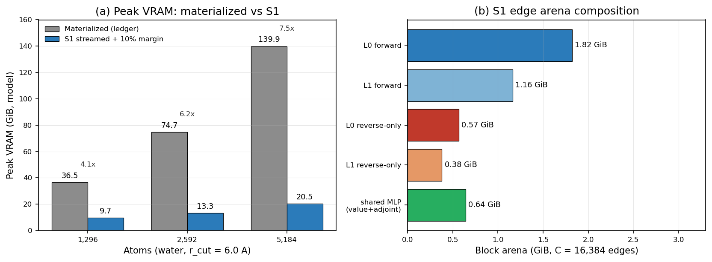

# S1 — Backbone edge streaming with materialized PolarMACE global state

**Status:** design + exact code-change list (Phase 1). No engine source edit, no build,
no GPU run was performed for this document.
**Date:** 2026-10-21 (container clock).
**Scope:** minimal proof of concept. Only the nonlinear backbone edge path may use
`streamed_edges="generic"`. The polar SCF/Fukui/Ewald state, the node features, the
readout and the reverse node chain stay materialized.
**Engine provenance:** `external-repos/symmetrix-xl`, `main` tip
`e0a961df1692a3b7ee05ba4aa85f40d064b72fce` (`e0a961d`). The checked-out working tree
is on local branch `plan-a-uvu-tile` (same commit, with one uncommitted
`mace_polar_impl.tpp` change). All line numbers below are from the `e0a961d` tree.
**Baseline:** accepted 1,296-atom full PolarMACE, `290.20 ms/eval`
(`223.92 us/atom`), binary `bench/plan_a_uvu_tile_2026-10-21/bin/lmp_main_e0a961d`,
SHA256 `0ad4fe8fa6db75a93a6ab4ee09886153ca1fa400b64c6d5d8598666c0e18bcb4`.

---

## 1. 中文执行摘要

1. 目标：在 PolarMACE（`MaceNonlinearKokkosT`）上做一个最小 S1 验证，只让骨架边路径走 `streamed_edges="generic"` 分块流式，极性 SCF/Fukui/Ewald 与节点状态保持材料化。
2. 结论：**技术方案成立**；`generic` 的前向与反向边路径在引擎中已经完整存在，真正缺少的只是族描述符准入、两层 `prepare_pair_conditioning` 初始化和 `set_streamed_edges("generic")` 的选择 gate。
3. 关键约束：**不得把 `mh1_fast_path` 置真**；否则会禁用 `materialized`、构造函数默认 `direct`、启用 `pair_spline_v1` 与 FP32，并把 S1 变成未经门控的 B2/B3。应新增独立的 `generic_streamed_edges_available_` 能力位。
4. 内存：1,296 原子边缓冲从 `E≈111,312` 行降到 `C=16,384` 行，模型峰值约 **8.8 GiB**（材料化 36.5 GiB）；5,184 原子约 **18.6 GiB**（材料化 139.9 GiB，原路径 OOM）。
5. 速度：**不承诺提速**。generic 反向要按块重算条件 MLP，且 GEMM 行数变小；预计 0.95–1.05×，可能略慢。S1 的收益是容量与可行性，不是 1,296 速度。
6. 验收：128/1,296 一致性 `dE≤1e-9 eV`、`max dF≤1e-8 eV/Å`，重复求值稳定，1/2-rank gate，峰值 VRAM；若失败两次则保持默认 `materialized` 并记录负结果，不调宽容差。

**Verdict:** a minimal S1 PoC is technically sound and small (roughly one descriptor
function, one capability flag, one gate, one pair-style policy change). It is **not**
a speed optimization and it does **not** remove the polar guard. Full polar streaming
(S3) remains out of scope.

---

## 2. What S1 is, and what it is not

S1 is a **selection and admission** change, not a new kernel:

- The nonlinear engine already contains a complete generic streamed edge path:
  forward at `mace_nonlinear_kokkos_impl.tpp:4840–5121`, reverse at
  `7013–7160`, with the materialized fallback at `5317–5509` and `7252+`.
- The path is currently unreachable for PolarMACE because
  `supports_streamed_edges()` returns `mh1_fast_path` (`mace_nonlinear_kokkos.hpp:86`),
  and `mh1_fast_path` requires the strict MH-1 family descriptor
  (`mace_nonlinear_schema.cpp:106–209`). PolarMACE fails that descriptor on four
  axes (second edge channels 128 vs 512, second hidden keeps a vector, second
  product keeps a vector output, `NonLinearBiasReadoutBlock`).
- The polar guard already permits generic streaming. It rejects only
  `generated_node_program` and prepared/direct execution
  (`mace_nonlinear_kokkos_impl.tpp:4457–4459`), because those replace the standard
  node-feature graph. Generic streaming still produces the standard materialized
  node graph, so the guard should stay exactly as it is.
- The minimal correct change is therefore:
  1. admit the PolarMACE architecture into a **separate, lenient generic-streaming
     descriptor** (not into `mh1_family.compatible`);
  2. call the existing `prepare_pair_conditioning` for **both** interactions;
  3. allow `streamed_edges="generic"` when that separate capability is present;
  4. relax the LAMMPS pair-style policy from "materialized only" to
     "materialized, or generic for this capability";
  5. keep `mh1_fast_path=false`, `supports_factorized=false`, the constructor
     default `materialized`, the polar guard, and every forward/reverse kernel
     unchanged.

S1 is **not**: direct/JIT execution, a v4 contract, FP32, `pair_spline_v1`, polar
SCF streaming, Ewald streaming, or a stress/virial feature.

---

## 3. Verified code facts

| Fact | File / function | Lines |
|---|---|---|
| `supports_streamed_edges()` returns `mh1_fast_path` | `libsymmetrix/source/mace_nonlinear_kokkos.hpp` | 86 |
| `supports_factorized()` starts with `!mh1_fast_path` | `.../mace_nonlinear_kokkos_impl.tpp` (`supports_factorized`) | 1489–1507 |
| Constructor gate chain: `primitive_candidate`, `mh1_pair_conditioning`, `mh1_fast_path` | `.../mace_nonlinear_kokkos_impl.tpp` (constructor) | 3641–3675 |
| Constructor default `direct` only when `supports_streamed_edges()` | `.../mace_nonlinear_kokkos_impl.tpp` | 3693 |
| `prepare_pair_conditioning` builds the four contribution tables | `.../mace_nonlinear_kokkos_impl.tpp` (`Interaction::prepare_pair_conditioning`) | 891–949 |
| Contribution-table fields | `.../mace_nonlinear_kokkos.hpp` (`Interaction`) | 744–747 |
| `set_streamed_edges` generic gate | `.../mace_nonlinear_kokkos_impl.tpp` (`set_streamed_edges`) | 2278–2308; gate 2287–2289 |
| `streams_layer()` is true for generic | `.../mace_nonlinear_kokkos_impl.tpp` | 2843–2847 |
| Generic mode releases materialized edge workspace | `.../mace_nonlinear_kokkos_impl.tpp` (`release_layer_edge_workspace`) | 3020–3057; call 2302–2305 |
| Polar guard | `.../mace_nonlinear_kokkos_impl.tpp` (`compute_node_energies_forces`) | 4452–4475; throw 4457–4459 |
| Node `up` is materialized before the edge branch | `.../mace_nonlinear_kokkos_impl.tpp` | 4573–4576 |
| `stream_layer` selection | `.../mace_nonlinear_kokkos_impl.tpp` | 4594–4595 |
| Generic forward edge block | `.../mace_nonlinear_kokkos_impl.tpp` | 4840–5121 |
| Materialized forward fallback | `.../mace_nonlinear_kokkos_impl.tpp` | 5317–5509 |
| Generic reverse edge block | `.../mace_nonlinear_kokkos_impl.tpp` | 7013–7160 |
| Materialized reverse fallback | `.../mace_nonlinear_kokkos_impl.tpp` | 7252+ |
| CUDA streamed block size = 16,384 edges | `.../mace_nonlinear_kokkos.hpp` | 981 (host 1024 at 983) |
| Pair style rejects `supports_streamed_edges()` and non-materialized modes | `pair_symmetrix/pair_symmetrix_mace_kokkos.cpp` | 515–519, 530–533 |
| Pair-style keyword parser already accepts `generic` | `pair_symmetrix/pair_symmetrix_mace_kokkos.cpp` | 243–252 |
| Python binding of the streaming capability | `symmetrix/source/cpp/mace_nonlinear_kokkos.cpp` | 49–50, 140 |

The strict family analyzer (`mace_nonlinear_schema.cpp:106–209`) and the external
UVU layout helper (`72–102`) are **not** relaxed. They keep rejecting PolarMACE as an
MH-1 fast-path model. This is deliberate: relaxing them would flip `mh1_fast_path`,
which would disable materialized mode (`impl:2281–2286`), default to `direct`
(`impl:3693`), enable `pair_spline_v1` (`impl:3676–3685`), and enable FP32
(`impl:3672–3675`). None of that is S1.

---

## 4. Exact code-change map

### 4.1 Summary table

| # | File | Function | Change | Risk |
|---|---|---|---|---|
| C1 | `libsymmetrix/source/mace_nonlinear_schema.hpp` | descriptor struct | add generic-streaming fields and a second analyzer declaration; keep strict fields | low |
| C2 | `libsymmetrix/source/mace_nonlinear_schema.cpp` | new `analyze_generic_streaming_architecture` | lenient PolarMACE-pattern admission; strict analyzer untouched | medium |
| C3 | `libsymmetrix/source/mace_nonlinear_kokkos.hpp` | accessors / flags | add `supports_generic_streamed_edges()` and `generic_streamed_edges_available_` | low |
| C4 | `libsymmetrix/source/mace_nonlinear_kokkos_impl.tpp` | constructor (after 3661) | call `prepare_pair_conditioning` for both layers under the new candidate; set the flag | medium |
| C5 | `libsymmetrix/source/mace_nonlinear_kokkos_impl.tpp` | `set_streamed_edges` (2287–2289) | allow `generic` when the new capability is present; keep `direct` fail-closed | low |
| C6 | `pair_symmetrix/pair_symmetrix_mace_kokkos.cpp` | `coeff` policy (515–533) | allow `generic` for the new capability; keep true MH-1 direct/JIT rejection | low |
| C7 | `symmetrix/source/cpp/mace_nonlinear_kokkos.cpp` | bindings | expose `supports_generic_streamed_edges` for harness assertions | low |

No changes to the forward edge kernels, the reverse edge kernels, the polar
pipeline, `streams_layer`, `supports_factorized`, `release_layer_edge_workspace`,
or the constructor default.

### 4.2 C1/C2 — family descriptor extension (lenient, separate from MH-1)

`MaceMH1FamilyDescriptor` at `mace_nonlinear_schema.hpp:7–14` gains:

```cpp
bool generic_streaming_compatible = false;
int  second_edge_channels = 0;
bool second_hidden_vector = false;
bool second_product_vector_output = false;
bool bias_readout = false;
std::string generic_streaming_rejection;
```

and a new declaration next to `analyze_mh1_family_architecture` (line 17):

```cpp
MaceMH1FamilyDescriptor analyze_generic_streaming_architecture(
    const nlohmann::json& data);
```

The new function in `mace_nonlinear_schema.cpp` (after the strict analyzer) checks
exactly what generic streaming needs, and nothing that only direct/JIT needs:

1. `num_interactions == 2`, and `interactions/products/readouts` each have two
   entries; `l_max ∈ {2,3}`; non-empty Bessel radial basis.
2. Both interactions are `RealAgnosticResidualNonLinearInteractionBlock`.
3. First interaction node and edge irreps are scalar; record
   `node_channels` and `edge_channels`.
4. Second interaction:
   - `node_feats_irreps = node_channels x0e + node_channels x1o`;
   - `edge_irreps = e2 x0e + e2 x1o`, with `e2 > 0` (PolarMACE has `e2=128`);
   - `hidden_irreps` may be the same scalar+vector pattern (the current strict
     analyzer requires scalar-only);
   - `target_irreps` and `gate.irreps_in/out` must still equal the full `l=0..3`
     set, exactly as in the strict analyzer.
5. Products: `use_sc`, `use_agnostic_product`, full contraction input, correlation 3,
   `weights_max.shape[0] == 1`; the output may be scalar+vector for layer 1 (the
   PolarMACE pattern), not only scalar. Contraction count must match the output
   block count.
6. External UVU layout is checked with the **per-layer** multiplicity (512 for
   layer 0, `e2` for layer 1). It is recorded but not required for generic
   streaming, because the generic path uses `convolution.evaluate`/`reverse`, not
   the prepared UVU path.
7. Readout 0 is `LinearReadoutBlock`; readout 1 may be `NonLinearReadoutBlock` or
   `NonLinearBiasReadoutBlock` (the `linear_mid` stage is irrelevant to edge
   streaming; the materialized readout already executes it).
8. Conservative S1 scope gate: require a `polar_blocks` object. This prevents
   accidentally enabling generic streaming for an untested nonlinear model.

On success set `generic_streaming_compatible = true`. On failure set
`generic_streaming_rejection` and leave `compatible = false`. The strict analyzer
and all its rejection strings stay byte-for-byte unchanged.

Why a separate descriptor instead of relaxing the strict one: `mh1_fast_path` is a
multi-purpose switch (materialized disabled, direct default, pair spline, FP32).
S1 needs only the generic edge path. A separate flag keeps every other behavior at
the accepted baseline and makes the change auditable.

### 4.3 C3 — capability accessor

In `mace_nonlinear_kokkos.hpp`, next to `supports_streamed_edges()` (line 86):

```cpp
bool supports_generic_streamed_edges() const {
    return generic_streamed_edges_available_;
}
```

Private flag near the existing `mh1_fast_path` flag (line 872):

```cpp
bool generic_streamed_edges_available_ = false;
```

Do **not** change the existing `supports_streamed_edges()` return expression. It must
stay `mh1_fast_path` so that:
- the constructor keeps defaulting to `materialized` (line 3693);
- `supports_factorized()` stays false, so `direct` remains rejected;
- the LAMMPS true-MH-1 direct/JIT rejection at 515–519 still fires;
- `set_streamed_edges("materialized")` remains legal for PolarMACE.

### 4.4 C4 — pair-conditioning coverage for both nonlinear layers

The existing call at `impl:3655–3660` runs only when `primitive_candidate` is true
(strict family + compiled products + external UVU). PolarMACE is `primitive_candidate
= false`, so its contribution tables are empty today. Add, immediately after the
existing block (`impl:3661`):

```cpp
MaceMH1FamilyDescriptor generic_family =
    analyze_generic_streaming_architecture(data);
bool generic_pair_conditioning = generic_family.generic_streaming_compatible;
if (generic_pair_conditioning && !primitive_candidate) {
    for (int layer = 0; layer < (int)interactions.size(); ++layer)
        generic_pair_conditioning =
            interactions[layer].prepare_pair_conditioning(
                data.at("interactions").at(layer), num_bessel,
                model_num_elements, indices)
            && generic_pair_conditioning;
}
generic_streamed_edges_available_ = generic_pair_conditioning;
```

The loop covers **both** nonlinear layers. `prepare_pair_conditioning`
(`impl:891–949`) is already per-interaction and channel-agnostic: it reads
`conv_tp_weights` and `density_fn`, checks
`supports_conditioned_input(radial_size)`, verifies
`input_size == radial_size + source_width + target_width` (8+512+512 = 1,032),
and builds the four `[types, width]` tables
(`mace_nonlinear_kokkos.hpp:744–747`). For PolarMACE it should return true for
both layers; this is the first runtime gate to verify.

If `primitive_candidate` is already true (a true MH-1 model), reuse the existing
tables and do not call `prepare_pair_conditioning` twice. If it fails for either
layer, `generic_streamed_edges_available_` stays false and
`set_streamed_edges("generic")` fails closed.

Do **not** set `mh1_pair_conditioning` or `mh1_fast_path` from this new result.
They drive reporting and the direct/JIT gates; overwriting them would flip the
constructor default and the pair-spline executor.

### 4.5 C5 — `streamed_edges="generic"` gate

In `set_streamed_edges` (`impl:2278–2308`), replace the gate at 2287–2289 with:

```cpp
const bool generic_allowed =
    requested == MACEStreamedEdgesMode::generic
    && (supports_streamed_edges() || generic_streamed_edges_available_);
if (requested != MACEStreamedEdgesMode::materialized && !generic_allowed)
    throw std::invalid_argument(
        "Streamed edges require a compatible MACE-MH-1 family fast path.");
```

Everything else stays:
- the `mh1_fast_path && materialized` rejection at 2281–2286 stays (S1 never sets
  `mh1_fast_path`, so materialized remains selectable);
- `mace_uses_prepared_execution(requested)` is false for `generic`, so the
  `supports_factorized()` check at 2293 is not triggered;
- the generic branch at 2302–2305 still calls `release_layer_edge_workspace` for
  every layer, which drops the E-sized materialized views and lets the first
  evaluation allocate block-sized storage;
- `set_execution_mh1_scratch_budget_bytes` at 2306–2307 is not relevant for
  generic (it is only called when not prepared/direct). No behavior change.

For `direct`, the gate remains fail-closed: `supports_factorized()` is false because
`mh1_fast_path` is false, so `direct` throws at 2293–2296.

### 4.6 C6 — LAMMPS pair-style policy

`pair_symmetrix/pair_symmetrix_mace_kokkos.cpp:515–519` currently rejects every
`supports_streamed_edges()` model. Keep it: that is the true MH-1 direct/JIT
rejection. S1 never sets `supports_streamed_edges()`, so it does not fire.

At 530–533, replace the materialized-only check with:

```cpp
const std::string resolved = mace_nonlinear->streamed_edges_mode();
const bool generic_ok =
    resolved == "generic"
    && mace_nonlinear->supports_generic_streamed_edges();
if (resolved != "materialized" && !generic_ok)
    error->all(
        FLERR,
        "MACE_Nonlinear pair execution requires streamed_edges materialized "
        "or generic (S1 backbone streaming).");
```

At 520–529 the existing `set_streamed_edges(streamed_edges)` call already handles
`generic`; the parser at 243–252 already accepts it. Add a log line next to 534–537
that prints `supports_generic_streamed_edges` and the resolved mode, so the A/B
harness can assert the path from the log rather than guessing.

No change to the neighbor build, the polar call at 1487–1495, the 1-rank/2-rank
comm policy, or the `pair_coeff` element mapping.

### 4.7 C7 — Python binding (optional, for the harness)

Next to `.def_property_readonly("supports_streamed_edges", ...)` at
`symmetrix/source/cpp/mace_nonlinear_kokkos.cpp:50`, add:

```cpp
.def_property_readonly(
    "supports_generic_streamed_edges",
    &Evaluator::supports_generic_streamed_edges)
```

This lets a Python smoke assert the capability before calling
`set_streamed_edges("generic")`. It does not change execution.

### 4.8 What is deliberately not changed

| Item | Why |
|---|---|
| `mh1_fast_path`, strict `analyze_mh1_family_architecture`, `has_external_uvu_tensor_layout` | flipping them enables direct default, pair spline, FP32, and disables materialized |
| `supports_factorized()` | S1 must not admit direct |
| Constructor default at 3693 | default stays `materialized`; generic is explicit |
| Polar guard at 4452–4475 | generic passes it; removing it would be incorrect |
| Forward/reverse edge kernels | they already implement generic correctly |
| `mace_nonlinear.cpp` / `mace_nonlinear.hpp` non-Kokkos path | S1 is the Kokkos/LAMMPS path; the Python non-Kokkos evaluator stays materialized |
| `release_layer_edge_workspace`, block size | reused as-is |

---

## 5. What streams vs what stays materialized

| Quantity | S1 | Reason |
|---|---|---|
| edge features `[E,1032]` | **streams / never materialized** | the source/target contribution tables replace them |
| `conv_tp_weights` raw/scaled weights `[E,2048/1280]` | **streams**, block-sized | per-block conditioned MLP |
| `convolution_contributions`, `density_contributions` | **streams**, block-sized | pair-conditioning tables indexed by type |
| `edge_up [E,512]` | **streams**, block-sized | gathered from node `up` per block |
| `edge_messages [E,8192/5120]` | **streams**, block-sized | conv output is immediately gathered into node messages |
| density raw/base + envelope `tanh(raw²)` | **streams**, block-sized | gathered into node densities |
| reverse `edge_up_adj`, `weight_adj`, `raw_weight_adj`, `edge_feature_adj`, `density_*_adj`, `edge_harmonic_adj` | **streams**, block-sized | recomputed/scattered per block |
| node features, `up`, `messages`, `densities`, `output`, all node buffers | **materialized** | node block and polar source maps consume them |
| polar SCF: spin-charge density, `polar_features_mixed`, mixer, Fukui maps, per-step replay cache, polar reverse caches | **materialized** | coupled node-level SCF; no edge data |
| Ewald k-space `Nk×N` cos/sin, basis/rho/adjoints | **materialized** | k-space is node-level; 0.21 GiB at 5,184 |
| readout + energy/force assembly | **materialized** | node-level |
| `radial [E,8]`, `cutoffs [E]`, `edge_harmonics [E,16]`, `Y/Y_grad`, `harmonic/radial/cutoff adjoints` | **materialized, E-sized** | random-access inputs to both sweeps; only 0.14/0.53 GiB, not the bottleneck |
| model weights, CUDA/Kokkos/LAMMPS base | **materialized** | fixed |

The deliberate exception is the E-sized harmonic/radial scratch: it is still
`O(E)`, but it is ~5% of the materialized peak and removing it would require a
second recompute path in both sweeps. S1 does not do that.

---

## 6. Data-dependency analysis

### 6.1 Per SCF step: no edge tensor is recomputed

The polar SCF (`mace_polar_impl.tpp`, `run_polar_pipeline`) is node-level:

- It consumes `state.output` per interaction (the node feature after the product)
  and the per-layer source maps; it produces `polar_spin_charge_density`,
  `polar_features_mixed`, the mixer/field updates, the Fukui correction and the
  per-step replay cache. All are `N`-sized or `Nk×N`-sized.
- It does **not** read or write any edge tensor. The two recursion steps change
  node-level densities only. The backbone edge features depend on positions and
  atom types, not on the SCF density.
- `MATOS_POLAR_SCF_STEPS` changes only the number of node-level steps; it does not
  change the edge recompute count.
- The polar reverse runs after the SCF and seeds `state.layer_adjoint` (node-level).
  The backbone reverse then runs once per layer, in descending layer order.

Therefore: **per SCF step, zero edge tensors need to be recomputed.** The edge
forward is evaluated once; the edge reverse recompute is once per block, independent
of the SCF step count. This separation is what makes S1 sound without touching the
polar pipeline.

### 6.2 Forward dependency chain (per block)

For each block `[first_edge, first_edge+samples)`:

1. Node `state.up` is already materialized (`impl:4573–4576`).
2. Build `convolution_contributions` / `density_contributions` from the pair tables
   using `neigh_types(edge)` and `node_types(local_targets(edge))`
   (`impl:4849–4868`).
3. `radial_block` and `harmonics_block` are subviews of the resident E-sized
   `radial` and `edge_harmonics` (`impl:4885–4888`).
4. `raw_weights = convolution_weights.evaluate_conditioned(radial_block,
   convolution_contributions)` (`impl:5073–5077`); `weights = raw_weights * cutoff`
   (`impl:5078–5089`).
5. `edge_up(local,k) = up(neigh_indices(first_edge+local),k)` (`impl:5091–5100`).
6. `edge_messages = convolution.evaluate(edge_up, harmonics, weights)`
   (`impl:5101–5105`).
7. Gather `edge_messages` into `messages(node,k) += …` in ascending edge order
   (`impl:5106–5121`).
8. Density MLP on the block, envelope `tanh(raw²)`, gather into `densities`
   (`impl:5123–5190`).

Nothing is stored across blocks. The block storages are grow-only capacity-`C`
buffers.

### 6.3 Reverse dependency chain (per block)

The reverse does **not** need the forward `edge_messages` or `edge_features`:

1. `state.message_adj` (node) and `state.up` (node) are materialized.
2. Recompute `convolution_contributions`, `raw_weights` and `weights` for the block
   (`impl:6754–6798`, `7031–7048`). The `evaluate_conditioned` call refreshes the
   MLP tape for exactly this block before `reverse_from_tape`
   (`impl:7158–7159`). This is the key ordering constraint: never call
   `reverse_from_tape` on a block whose tape was overwritten by another block.
3. Recompute `edge_up` by gathering `up(neigh_indices)` (`impl:7064–7073`).
4. Reuse the forward `edge_messages_storage` capacity for `edge_message_adj`
   (`impl:7074–7087`); this is an alias, not an extra buffer.
5. `convolution.reverse(...)` produces `edge_up_adj`, `edge_harmonic_adj`,
   `weight_adj` (`impl:7088–7093`).
6. Scatter `edge_up_adj` into node `up_adj` with the existing atomic add
   (`impl:7094–7104`). This is the same nondeterminism class as the materialized
   path; S1 introduces no new atomics.
7. Cutoff reverse, MLP reverse, density reverse, and the E-sized adjoint
   accumulation (`impl:7106–7248`).

What the reverse needs from the forward: node `up`, node `message_adj` seed, the
pair-conditioning tables, the resident radial/cutoff/harmonics arrays, the graph
arrays, and the positions/distances. What it does not need: forward edge messages,
edge features, source/target embeddings, or any per-SCF-step edge cache.

### 6.4 FP64 accumulation order

- Within a block, every gather walks edges in ascending order
  (`impl:5107–5121`, `5173–5190`, `7079–7087`).
- Blocks are processed in ascending edge order, so the **sequence** of edge
  contributions to a node is unchanged.
- Blocks are edge-aligned, not node-aligned. If a node's CSR segment straddles a
  block boundary, the per-node sum becomes
  `(sum block0) + (sum block1)` instead of one running accumulator. This is a
  different FP64 parenthesization at the boundary; it is not bitwise.
- The MLP GEMM batch size also changes (`C=16,384` rows vs `E` rows), which can
  change the last FP64 bits through a different BLAS blocking.
- Conclusion: S1 parity is **tolerance-based**, not bitwise. Use the accepted
  `dE ≤ 1e-9 eV`, `max dF ≤ 1e-8 eV/Å` gates. If a bitwise requirement is ever
  imposed, the fix is to align blocks to CSR node boundaries (as TILED_EDGE_PLAN
  does) or use `C ≥ E` for the small systems; S1 does not require it.
- The reverse `edge_up_adj` scatter is already atomic in the materialized path
  (`impl:7096–7104`), so force parity is already tolerance-based at the 1e-8 level.

---

## 7. Memory model

### 7.1 Assumptions

- `E = 111,312 / 232,098 / 434,456` directed edges and `N = 1,296 / 2,592 / 5,184`
  from the direct periodic counts in `TILED_EDGE_PLAN.md` §2.1; the 1,296 count
  matches the CUPTI grid `111312x1x1`.
- CUDA block size `C = 16,384` (`mace_nonlinear_kokkos.hpp:981`).
- `Precision = double` (8 bytes), FP64.
- The static floor is rows 15–25 of the TILED ledger: 4.26 / 7.49 / 14.06 GiB.
  It includes the node forward/reverse buffers, polar workspaces, Ewald, readout,
  model weights, CUDA/Kokkos/LAMMPS base, and the E-sized radial/cutoff/harmonic
  scratch row 15.
- The S1 arena is the sum over **both** layers because `states[layer]` keeps its
  own block storages. TILED uses one shared arena across layers; S1 does not.
- The shared conditioned-MLP workspace is one buffer pair (value + adjoint) used by
  both layers. In streaming the MLP input is the 8-wide radial block, so its row
  requirement is `8 + 9×64 + 2048 = 2,632` doubles, not the materialized
  `1,032 + 9×64 + 2,048 = 3,656`. This is a correction to the TILED
  row coefficient for the streaming case.
- No allocator fragmentation or tenant usage is modeled. The 10% margin is the
  calibration band from the 128-atom 2-rank tracer (−3% model bias).

### 7.2 Per-edge arena (doubles per edge, C = 16,384)

| Buffer set | L0 | L1 |
|---|---:|---:|
| forward: `weights` + `raw_weights` | 4,096 | 2,560 |
| forward: `edge_up` | 512 | 512 |
| forward: `edge_messages` | 8,192 | 5,120 |
| forward: `convolution_contributions` | 2,048 | 1,280 |
| forward: `density_contributions` (width 64) | 64 | 64 |
| forward: `density_matrix` | 1 | 1 |
| reverse-only: `edge_up_adj` | 512 | 512 |
| reverse-only: `edge_harmonic_adj` (16) | 16 | 16 |
| reverse-only: `weight_adj` | 2,048 | 1,280 |
| reverse-only: `raw_weight_adj` | 2,048 | 1,280 |
| reverse-only: `edge_feature_adj` (8) | 8 | 8 |
| reverse-only: `density_feature_adj` (8) | 8 | 8 |
| reverse-only: `density_raw_adj` | 1 | 1 |
| **subtotal** | **19,554** | **12,642** |
| shared MLP workspace (value + adjoint) | **5,264** | — |
| **total** | **37,460 doubles/edge** | |

`37,460 × 8 × 16,384 = 4,909,957,120 B = 4.573 GiB` for the whole S1 edge arena.
The density MLP (`1032→64→1` with layer norm/SiLU) and the conv MLP
(`1032→64→2048/1280` with three linear/LN/SiLU stages) both fit in the 2,632-row
shared workspace; the density path needs only 201 rows.

### 7.3 Peak VRAM at the three sizes



| Atoms | Materialized (GiB) | S1 model (GiB) | S1 + 10% (GiB) | Reduction |
|---:|---:|---:|---:|---:|
| 1,296 | 36.5 | 8.83 | **9.72** | **4.13×** |
| 2,592 | 74.7 | 12.06 | 13.27 | 6.19× |
| 5,184 | 139.9 | 18.63 | **20.50** | **7.51×** |

The 1,296 materialized value is measured (fits on the 80 GiB A100). The 2,592 and
5,184 materialized values are the ledger projections that match the observed OOM
requests. The S1 values are **projections**, not measurements. The 5,184 S1
projection is the main capacity claim: it predicts the full FP64 PolarMACE can run
below 21 GiB, but it is not quoted as a measured result until it actually runs.

The peak is the forward sweep of both layers plus the shared MLP workspace, because
the reverse-only buffers are allocated later and coexist with the forward buffers
(storages are grow-only). A future optimization could release layer 0's forward
blocks before layer 1, or share one arena across layers; S1 does not include that.

---

## 8. Test plan and acceptance criteria

All runs use the accepted full PolarMACE model
`task3_sampling_database/mlip/models/mace-polar/polar_symmetrix_probe.json`, FP64,
one A100-80GB, and the environment of
`bench/plan_a_uvu_tile_2026-10-21/ab_1296.py` (including
`MATOS_REPLAY_CACHE=1`, `MATOS_CONV_CUTOFF_BACKEND=team`, `MATOS_MH1_TEAM_SIZE=64`).
Every GPU run holds `flock /workspace/group/shared/bza/.tmp/gpu.lock`; only one GPU
job runs at a time.

### 8.1 Gates

| Gate | System | Comparison | Acceptance |
|---|---|---|---|
| G0 default-off | 128 NH₃ | same binary, no `streamed_edges` keyword vs baseline `lmp_main_e0a961d` | PE bitwise identical; `streamed_edges_mode()=="materialized"`; `supports_generic_streamed_edges==true` in the log; 3× `run 0` PE identical |
| G1 128 parity | 128 NH₃ | `streamed_edges generic` vs materialized | `|ΔE| ≤ 1e-9 eV`; `max|ΔF| ≤ 1e-8 eV/Å`; repeat 3× `max|ΔF| ≤ 1e-12`; `|ΣF| ≤ 1e-10 eV/Å` |
| G2 1,296 parity | 1,296 H₂O | generic vs materialized | `|ΔE| ≤ 1e-9 eV`; `max|ΔF| ≤ 1e-8 eV/Å`; 3× repeat stable; `|ΣF| ≤ 1e-9 eV/Å` |
| G3 1,296 speed | 1,296 H₂O | interleaved A/B, 2 rounds × 4 samples | median ratio ≤ **1.30** (hard), target ≤ **1.10**; report `ms/eval` and `us/atom` |
| G4 1-rank | 1,296 H₂O, 1 rank | generic vs materialized | same as G2 plus LAMMPS `run 0` exit code 0 |
| G5 2-rank | 128 NH₃, 2 ranks, exact 2-hop | generic vs materialized | official gate `dE ≤ 5e-5 eV`, `max dF ≤ 1e-4 eV/Å`; report the measured value |
| G6 peak VRAM | 1,296 H₂O | NVML/nvidia-smi 20 ms sampling | S1 peak < materialized peak; model target 9–10 GiB |
| G7 5,184 (optional) | 5,184 H₂O | `run 0` + 3× `run 1` | completes rc=0; peak ≤ 45 GiB (target ≤ 21 GiB); finite energies |

If G1 or G2 fails twice after two fix rounds, stop. Do not relax the tolerances.
If G3 is above 1.30×, keep the feature default-off and report a negative speed
result; the capacity claim still stands if G1/G2/G6 pass.

### 8.2 Measurement protocol

- 128-atom input: `bench/plan_a_uvu_tile_2026-10-21/parity/in.main`
  (`run 0` ×3 + `write_dump ... fx fy fz`, `thermo_modify format float %.17g`).
  For the candidate, add `streamed_edges generic` to the `pair_style` line.
- 1,296-atom input: `bench/paper_scale_2026-10-20/in.polar_water_1296`
  (`run 0` + four `run 1`; the last four `Loop time` values are the samples).
- A/B: same-binary-pair interleaved order, 2 rounds × 4 samples, alternating
  `main`/`s1`; report per-round medians, median of medians, and per-round ratios.
  Never compare across different GPU tenants.
- Peak VRAM: a background `nvidia-smi --query-gpu=memory.used --format=csv,noheader,nounits`
  loop at 20 ms, plus the run's own allocator high-water if available. Record the
  maximum and the binary/source hashes.
- Log assertions: `streamed_edges='generic'`, `supports_generic_streamed_edges`,
  block size, and `edge_workspace_bytes()` if it is logged. The log line is the
  proof that the intended path, not the materialized fallback, ran.

### 8.3 What "parity" does not mean here

S1 does not promise bitwise parity. The block-boundary FP64 reassociation and the
different GEMM batch size make the last bits differ. The gates above are the same
tolerance class already used by the tiled-edge and Plan B work. The repeat-eval
gate (same binary, same input, 3×) must still be exact or within 1e-12, because it
does not change the block schedule.

---

## 9. Expected speed (honest statement)

The generic path is **not** a speed feature:

- Forward FLOPs are similar: the conditioned MLP replaces the 1,032-wide first
  layer with an 8-wide radial GEMM plus type-table contributions, saving about
  1,024×64 FLOPs/edge, but it adds the contribution-table build and keeps the same
  conv/message/density work.
- The reverse recomputes the conditioned MLP per block (the materialized path
  reuses the forward tape), adding roughly the conv-MLP forward plus the density
  MLP forward, on the order of a few ms at 1,296.
- The block GEMMs are 16,384 rows instead of 111,312, and the block loop adds
  launches and gathers.
- The linear-engine precedent is 6.6 ms materialized vs 19.3 ms generic streamed
  on a 128-atom box. The nonlinear edge path is much heavier than that linear
  model, so the penalty should be smaller, but it is not a reason to expect a win.

Expected outcome: **0.95–1.05× at 1,296**, with a real chance of a few percent
slowdown. The S1 claim is capacity (4.1× lower edge memory at 1,296, 7.5× at 5,184)
and a correctness bridge to S2/S3. Any measured speedup is a bonus and must be
reported with the same-binary interleaved protocol; no speedup is claimed in this
document.

---

## 10. Effort, risk, kill criteria

### 10.1 Effort

| Step | Estimate |
|---|---|
| C1–C7 code + local review | 0.5–1 day |
| Isolated S1 tree + LAMMPS tree + configure/build | 2–4 h (build ~20–40 min, lock permitting) |
| G0/G1/G2/G3/G4/G6 at 128 and 1,296 | 2–4 h |
| G5 2-rank, optional G7 5,184 | 0.5–1 day |
| **Total** | **~1.5–2.5 days** |

This is smaller than the 5–8 day B1 estimate in `MH1_FASTPATH_FEASIBILITY.md`
because S1 does not extend the strict family, the v4 contract, FP32, pair spline,
or the polar pipeline. It adds one lenient descriptor, one flag, one gate, and one
pair-style policy.

### 10.2 Risks

| ID | Risk | Mitigation |
|---|---|---|
| R1 | Accidentally setting `mh1_fast_path` and flipping materialized/direct/pair-spline/FP32 | separate descriptor and flag; G0 asserts default materialized; review `git diff` for `mh1_fast_path` |
| R2 | Pair conditioning fails for layer 1 (128-channel edge) | the function is channel-agnostic and already per-interaction; assert both layers return true and log the table widths |
| R3 | FP64 block-boundary reassociation / GEMM blocking shifts forces beyond the gate | node-aligned blocks later if needed; S1 tolerance gate; repeat-eval exact check |
| R4 | Generic reverse calls `reverse_from_tape` with a stale block tape | the existing code recomputes `evaluate_conditioned` per block before the MLP reverse; do not reorder |
| R5 | Pair-style policy accidentally enables generic for an untested nonlinear model | require the `polar_blocks` scope gate and the `supports_generic_streamed_edges` capability; true MH-1 still rejected at 515 |
| R6 | 2-rank ghost/owned-node semantics | do not change the comm policy; G5 official tolerance; report measured |
| R7 | Memory model is a projection | measure peak VRAM; 10% margin; 5,184 is optional and not quoted until run |
| R8 | Build conflict with the full-gate agent | hold `build.lock`; if busy, wait or stop after Phase 1 |

### 10.3 Kill criteria

Stop and keep `streamed_edges` default `materialized` if **any** of:

1. **K1:** G1 fails twice after two fix rounds (or any NaN/non-finite energy).
2. **K2:** G2 fails twice after two fix rounds.
3. **K3:** G3 median ratio > **1.30**.
4. **K4:** G6 peak VRAM is not below the materialized peak at 1,296 (the model
   says ~4× lower; a higher value means an untracked E-sized allocation).
5. **K5:** G0 default-off is not bitwise identical to the accepted baseline.
6. **K6:** the build cannot be isolated from `main`, `plan-a-uvu-tile`, or the
   full-gate agent without touching their sources/binaries.

On kill: do not merge, do not push, keep the switch off, and publish the failing
gate plus the buffer/allocation evidence. A negative result is acceptable.

---

## 11. Why full polar streaming (S3) is out of scope

Full polar streaming would require all of the following, none of which S1 attempts:

1. **Polar SCF/Fukui under a streamed graph.** The SCF is a coupled two-step
   node-level recursion, and the Fukui correction and mixer consume per-layer node
   features. Streaming the backbone does not stream the SCF; S3 would have to
   interleave edge blocks with SCF steps or port the SCF to a node program. This is
   the B3 route in `MH1_FASTPATH_FEASIBILITY.md`, 10–20 additional days, very high
   risk.
2. **Ewald k-space.** `Nk×N` cos/sin, basis, rho and adjoints are resident. S3 would
   need a k-space streaming/PPPM design; at 5,184 it is only 0.21 GiB, so there is
   no S1 capacity reason to touch it.
3. **Direct/JIT v4 contract.** The PolarMACE second product keeps a vector output
   and the readout is `NonLinearBiasReadoutBlock` with `linear_mid`. The v4
   contract generator rejects both (`execution_mh1_contract.py:500–546`,
   `780–838`), and the JIT codegen/plugins do not implement them. This is the B2
   route, 15–25 additional days.
4. **Polar cell adjoint for stress/virial.** The engine explicitly throws for polar
   stress (`impl:7302–7310` in the MH1 feasibility numbering; see
   `MH1_FASTPATH_FEASIBILITY.md` §B3). S1 must not claim stress parity.
5. **LAMMPS direct/JIT wiring.** The pair style intentionally rejects direct/JIT
   nonlinear execution (`pair_symmetrix_mace_kokkos.cpp:515–519`). S1 only adds a
   generic-mode policy. B4 is a separate 10–15+ day project.

S1 is the smallest experiment that answers the question "can the backbone edge path
stream while the polar global state stays materialized and numerically correct?"
It does not answer "can the whole PolarMACE stream?" That is S3.

---

## 12. Phase 2 execution plan (isolated tree)

If Phase 2 is attempted, use this exact isolation:

1. **S1 engine tree.** Create `external-repos/symmetrix-xl-s1` from the pristine
   `main` tip `e0a961d`, not from the dirty working tree. Recommended:
   `git archive main | tar -x -C external-repos/symmetrix-xl-s1`, then copy the
   six populated submodule directories (`libsymmetrix/external/{kokkos,kokkos-kernels,
   sphericart,json,cblas-prototypes}`, `symmetrix/external/pybind11`). Verify
   `libsymmetrix/source/mace_polar_impl.tpp` matches
   `git show main:libsymmetrix/source/mace_polar_impl.tpp` (the dirty worktree has a
   UVU-tile modification that must not leak into S1).
2. **LAMMPS tree.** The existing `lammps-stable_30Sep2026` has
   `src/KOKKOS/pair_symmetrix_mace_kokkos.*` symlinked to
   `external-repos/symmetrix-xl`, and its `cmake/CMakeLists.txt` hard-codes that
   path. Create a separate `external-repos/lammps-s1` (copy or hardlink copy),
   repoint those two symlinks and the `add_subdirectory`/include paths to
   `symmetrix-xl-s1`, and leave the original LAMMPS tree untouched.
3. **Build.** Configure `symmetrix-xl-s1/symmetrix/build-s1` with the
   `build_priv.sh` toolchain: CUDA 12.9, `nvcc_wrapper`, host `g++-11`, MPI from
   `/workspace/caches/conda/envs/lammps-deepmd`, `Release`, C++20,
   `PKG_KOKKOS=on`, `Kokkos_ENABLE_CUDA=on`, `Kokkos_ARCH_AMPERE80=on`,
   `BUILD_MPI=on`, `BUILD_OMP=on`, `BUILD_TESTING=off`. Hold
   `flock -w 7200 /workspace/group/shared/bza/.tmp/build.lock` for the build.
   If the lock is busy or the full-gate agent is using it, wait or stop after
   Phase 1.
4. **Smoke.** Run the 1,296 input with `run 0` first, under
   `flock /workspace/group/shared/bza/.tmp/gpu.lock`. If it runs, run the 128
   parity first, then the interleaved A/B vs
   `bench/plan_a_uvu_tile_2026-10-21/bin/lmp_main_e0a961d`. Do not run more than
   one GPU job at a time.
5. **Report.** Record the binary SHA256, the `streamed_edges='generic'` log line,
   128 parity, 1,296 parity, A/B medians, and peak VRAM. If parity fails, stop and
   report; do not quote a speed number.

Constraints: do not modify `external-repos/symmetrix-xl` (main or
`plan-a-uvu-tile`), `bench/plan_b_micro_2026-10-21`, or
`bench/plan_a_uvu_tile_2026-10-21` source/binary. No git commit/push. No
`Co-Authored-By: MatOS Opus` trailer.

### 12.1 Phase 2 status observed at 2026-10-21 09:23

Phase 2 was attempted, but `external-repos/symmetrix-xl-s1/symmetrix/build-s1`
was already owned by a **concurrent S1 builder** (a separate
`/workspace/group/shared/bza/.tmp/build-s1.lock`, `cmake --build ... --target lmp
-j 24`, configured against `external-repos/lammps-stable_30Sep2026-s1`). The
concurrent build reconfigured the same build directory after this design's build
script started, so this script stopped rather than run a second build in the same
tree. No GPU run and no measurement is claimed in this document.

The concurrent tree's implementation (observed at 09:23, uncommitted) uses a
narrower runtime gate than C1/C2 above:

- it adds `backbone_streaming_supported` / `backbone_pair_conditioning` and sets
  them when `polar_enabled && !mh1_fast_path` and
  `prepare_pair_conditioning` returns true for both layers;
- `supports_streamed_edges()` returns `mh1_fast_path || backbone_streaming_supported`;
  the constructor default is changed to `if (mh1_fast_path) direct` so the S1
  model still defaults to `materialized`;
- it keeps `mh1_fast_path=false`, so `supports_factorized()` stays false, the
  polar guard stays intact, `pair_spline_v1` and FP32 stay disabled, and the
  materialized mode stays selectable;
- the LAMMPS policy rejects only `uses_mh1_fast_path()` at the old direct/JIT
  check and allows `generic` when `supports_backbone_streaming()`.

That variant preserves every safety invariant of this design but does not add
the lenient family descriptor. It is a legitimate smaller gate for the PoC; C1/C2
remain the recommended stricter admission if the goal is to prove the family
pattern rather than only the runtime dimensions.

---

## 13. Bottom line

| Question | Answer |
|---|---|
| Is a minimal S1 PoC technically sound? | **Yes.** The generic forward/reverse edge path already exists; only admission, pair conditioning, the selection gate, and the pair-style policy are missing. |
| Does it require a new kernel? | No. |
| Does it remove the polar guard? | No. The guard already admits generic; it rejects only direct/prepared execution. |
| Does it set `mh1_fast_path`? | **No.** A separate capability flag is used, so materialized/direct/pair-spline/FP32 behavior is unchanged. |
| What is the expected memory win? | 36.5 → 8.8 GiB at 1,296 (4.1×); 139.9 → 18.6 GiB at 5,184 (7.5×), projected. |
| What is the expected speed? | 0.95–1.05×; no speed claim. Capacity and correctness only. |
| What is the acceptance gate? | 128/1,296 `dE ≤ 1e-9 eV`, `max dF ≤ 1e-8 eV/Å`, repeat-eval, 1/2-rank, peak VRAM; kill if ratio > 1.30 or parity fails. |
| Is S3 in scope? | No. Full polar streaming/direct is a separate 15–25+ day project with a v4 contract, JIT codegen, polar SCF/Ewald streaming, and a polar cell adjoint. |

---

## Appendix A — Source anchors used in this document

- `libsymmetrix/source/mace_nonlinear_schema.hpp:7–18`
- `libsymmetrix/source/mace_nonlinear_schema.cpp:72–102, 106–209`
- `libsymmetrix/source/mace_nonlinear_kokkos.hpp:86, 744–747, 872, 981–983, 905`
- `libsymmetrix/source/mace_nonlinear_kokkos_impl.tpp:891–949, 1489–1507,
  2278–2308, 2843–2847, 3020–3057, 3113+, 3641–3675, 3693, 4452–4475,
  4573–4576, 4594–4595, 4840–5121, 5317–5509, 6241–6251, 6754–6798,
  7013–7160, 7252+`
- `libsymmetrix/source/affine_mlp_kokkos.cpp:22–75, 283–331, 399–563`
- `pair_symmetrix/pair_symmetrix_mace_kokkos.cpp:243–252, 515–537`
- `symmetrix/source/cpp/mace_nonlinear_kokkos.cpp:49–50, 140`
- `libsymmetrix/source/mace_streamed_edges.hpp:7–47`
- `docs/design/MH1_FASTPATH_FEASIBILITY.md` §3.1, §4 (routes B1/C), §7
- `docs/design/TILED_EDGE_PLAN.md` §2 (memory ledger), §3.4 (arena), §5 (gates)

## Appendix B — Reproduction of the S1 arena formula

```text
L0 forward = 2048(weights) + 2048(raw) + 512(up) + 8192(messages)
           + 2048(conv_contrib) + 64(density_contrib) + 1(density) = 14,913
L1 forward = 1280 + 1280 + 512 + 5120 + 1280 + 64 + 1              =  9,537
L0 reverse = 512(up_adj) + 16(harm_adj) + 2048(weight_adj)
           + 2048(raw_weight_adj) + 8(edge_feature_adj)
           + 8(density_feature_adj) + 1(density_raw_adj)            =  4,641
L1 reverse = 512 + 16 + 1280 + 1280 + 8 + 8 + 1                     =  3,105
shared MLP = 2 * (8 + 9*64 + 2048) = 2 * 2,632                       =  5,264
total      = 37,460 doubles/edge
arena      = 37,460 * 8 * 16,384 = 4,909,957,120 B = 4.573 GiB
S1(1,296)  = 4.26 (floor) + 4.573 (arena) = 8.83 GiB
S1(5,184)  = 14.06 (floor) + 4.573 (arena) = 18.63 GiB
```
