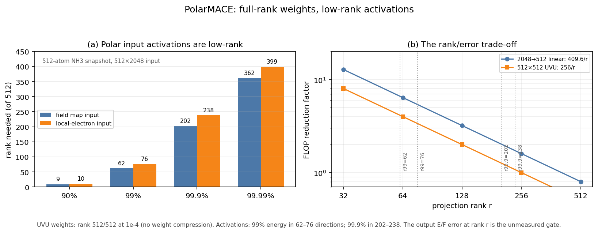

# Theory-first plan for the optimal PolarMACE execution speed

**Date:** 2026-10-22
**Status:** analysis/planning. The checkpoint weight audit, 512-atom
activation-rank probe, and rank-truncated E/F gate are complete. **The gate is
negative: direct low-rank input truncation is rejected.** The two-path
new-architecture plan is in [`NEW_ARCHITECTURE_TWO_PATHS.md`](NEW_ARCHITECTURE_TWO_PATHS.md).
**Scope:** FP64 nonlinear PolarMACE, exact GTO-Ewald, 2-step SCF/Fukui, one
A100-80GB, 1,296 and 5,184 atoms.

## 1. Formal complexity model

Let `N` = atoms, `E` = directed neighbors, `C = 512`, `L = 3`, `P = 2` paths
per UVU, `T = 2` SCF steps, `Q = 6` UVU tables, `M = 20` UVU planes per
evaluation, `K_tp` = tensor-product instructions per path.

| Stage | Dominant work | Complexity |
|---|---|---|
| Backbone edge path | radial + tensor product + aggregation | `O(E C K_tp)` |
| Backbone node path | MLP/readout | `O(N C H)` |
| Polar UVU | 6 tables, 20 planes, 512×512 | `O(N C² M)` |
| Polar nonlinearity | 2 MLPs, hidden 64 | `O(N C H)` |
| Polar SCF | `T` serial fixed-point steps + global reductions | `T · (UVU + MLP + reduce)` |
| Ewald | k-space modes `N_k` | `O(N N_k + N_k log N_k)` |
| Reverse | adjoint of the above | ~1.5–2× forward |

The measured Ewald share is **1.67% of GPU busy**; it is not the bottleneck.
The polar layer is **node-local** (`O(N C K_node)`), unlike the backbone edge
path. This is why Symmetrix-XL's streamed-edge/tiled-edge mechanisms do not
directly remove the polar work.

## 2. Measured budget (1,296 atoms, FP64, one A100)

| Component | ms/eval | µs/atom | Share | Measured efficiency / binding constraint |
|---|---:|---:|---:|---|
| tensor product (MH-1) | **65.85** | **50.8** | **34.8%** | 0.019 TFLOPS = 0.1% of FP64 peak; 0.45 flops/byte; launch/occupancy/latency-bound |
| backbone nonlinear | 28.88 | 22.3 | 15.3% | memory/launch-bound edge path |
| cuBLAS / external | 25.11 | 19.4 | 13.3% | small FP64 GEMMs; ~3–5% of peak |
| polar pipeline | 20.24 | 15.6 | 10.7% | 20 UVU planes; ~0.7 TFLOPS = ~3.5% of peak |
| MLP / dense | 19.69 | 15.2 | 10.4% | small M/N/K; launch-bound |
| e3 linear | 13.16 | 10.2 | 7.0% | small GEMMs |
| host gap | 16.12 | 12.4 | 8.5% | 1,762 launches; ~9 µs/launch |
| **total wall** | **189.30** | **146.1** | **100%** | |

Sources: `bench/perf_decomp_1296_2026-10-21/analysis/n1_generic_1296_summary.json`,
`docs/results/OPTIMIZATION_LEDGER.md`.

## 3. Roofline: how far from the theoretical bound?

For the tensor product, the V4 probe measured **0.63 GFLOP one direction** at
**0.019 TFLOPS**; a 19.5 TFLOPS FP64 roofline would be **0.032 ms**, and a
2 TB/s memory roofline at 0.45 flops/byte would be **~0.7 ms**. The measured
**65.85 ms** is therefore 100–2000× above either roofline. The gap is not
FLOPs or HBM; it is **small-kernel launch, occupancy, and dependency
latency**.

For the polar UVU, 20 planes of `2·512·512·1296 = 0.679 GFLOP` each give
**13.6 GFLOP/eval**; at 19.5 TFLOPS that is **0.70 ms**, versus the measured
**~20 ms**. Again the gap is small-batch FP64 GEMM efficiency and launches,
not the algorithm's asymptotic FLOP count.

The roofline lower bound for the current algorithm is therefore **order
10–30 µs/atom**, but it is not achievable: the model's small path batches,
2-step serial SCF, and FP64 precision keep the kernels far from peak. The
realistic engineering floor is **~120–130 µs/atom** (V2 projection), and the
remaining single-GPU headroom from 145.75 is **~1.1–1.2×**, not 1.5–2×.

## 4. Mathematical structure audit

| Structure | Question | Status |
|---|---|---|
| UVU weights | Are the 6 tables low-rank/block-sparse? | **Measured: no.** zero fraction 0; rank 512/512 at 1e-3–1e-6; 99% energy needs 286–380 singular values. Low-rank `C²→Cr` compression is rejected. |
| Activation/feature rank | Is `X (N×C)` effectively low-rank, so `W X = (W U_r)(U_rᵀX)`? | **Measured: yes, strongly.** 512-atom snapshot, input `512×2048`: `fdcm0` energy ranks 90/99/99.9/99.99 = **9 / 62 / 202 / 362**; `le_q/v` = **10 / 76 / 238 / 399**. Numerical rank at 1e-3 is 488–508 and at 1e-4 is 512, so the tail is nonzero. A rank-256 projection captures >99.9% energy, but the output E/F gate **failed**: direct truncation is rejected (see §4.1). |
| CG/path sparsity | How many tensor-product instructions are exactly skippable? | Planned. Need >50% skippable to beat the current memory/launch-bound path. |
| SCF contraction | Can 1 step + a cheap Anderson/Jacobian correction match 2 steps? | Planned. 1-step alone fails (dE 1.27 eV); a correction must pass dE/dF gates. |
| Path-mask block sparsity | Do path masks zero large UVU output blocks? | Planned. If yes, a block-sparse UVU GEMM can skip compute; N1 may already exploit part. |

**Completed negative result:** the UVU tables are dense and full-rank. The
mathematical complexity reduction cannot come from factorizing the weights;
it must come from the **activations**, **CG/path sparsity**, or the
**SCF iteration structure**.

### 4.1 Low-rank activation subspace (positive)

The weights are full-rank, but the data manifold is not. For the captured
`X (512×2048)` polar input:

- 99% of the spectral energy is in **62–76** directions;
- 99.9% is in **202–238** directions;
- 90% is in **9–10** directions.

This enables a data-dependent complexity reduction. Let
`X ≈ U_r Σ_r V_rᵀ`. For a linear operator `W` (the 2048→512 field/LE
projection, or the UVU input projection),

```text
W X = (W V_r)(V_rᵀ X) + W (X - X_r)
```

and the reconstruction error is bounded by

```text
||W X - W X_r||₂ ≤ ||W||₂ · σ_{r+1}(X).
```

Cost: `O(N C_in C_out)` becomes `O(N r C_in + N r C_out)` on the affected
layers. For `r = 128`, `C_in = 2048`, `C_out = 512`, that is ~4–6× fewer
FLOPs and much less feature traffic. The basis `V_r` can be precomputed from
calibration snapshots if the subspace is stable; otherwise use a periodic or
online randomized SVD. This is a **model/data-manifold mechanism**, not a
generic GEMM/tiling trick, and it composes with the memory/compute-and-release
schedule: the rank-r features are smaller, stay in L2/shared, and the
projected weights `W V_r` are small.

The output-error gate is decisive, and it **failed**:

| rank r | dE (eV) | max dF (eV/Å) | rms dF (eV/Å) |
|---:|---:|---:|---:|
| 32 | +18.818 | 0.2456 | 0.0717 |
| 64 | +8.333 | 0.2081 | 0.0635 |
| 128 | +7.833 | 0.2672 | 0.0770 |
| 256 | −1.996 | 0.1965 | 0.0553 |

The oracle rank-r basis is the best possible basis from the same snapshot; even
so, r=256 (99.9% feature energy) leaves ~2 eV energy error and ~0.2 eV/Å force
error. **Feature energy rank is not output-error rank**: the small tail
singular directions carry force-relevant information. Direct low-rank input
truncation is therefore **rejected** for the current checkpoint. A **trained**
latent/low-rank model (Path B) is still possible, but that is a new model, not
an inference approximation.



## 5. CS/architecture mechanisms

| Mechanism | Theoretical basis | Removes |
|---|---|---|
| Node-owned persistent dataflow | register/shared accumulation; no global edge/state materialization | tensor/UVU intermediate traffic, launch count |
| Checkpoint-specialized codegen | static path tables/masks, 20 planes, fixed MLP shapes | runtime loops, per-path launches, epilogue traffic |
| Fused nonlinear SCF block | dot UVU → gate/MLP → tp UVU → readout in one kernel | global intermediate round-trips |
| Device-side control plane | SCF/Fukui/LE scalars, cooperative grid reduction | 16.12 ms host gap, 24 D2H syncs |
| One grow-only arena | tile-local lifetime, compute-and-release | peak VRAM; target <10 GiB at 5,184 |
| CUDA-core/VRAM scheduling | tile size to SM occupancy; L2-resident weights/path tables; 128-bit loads; `cp.async` | occupancy/latency stalls |
| Low-rank activation projection | **rejected** for the current checkpoint (dE 2–19 eV, dF 0.20–0.27 eV/Å even at r=256) | a trained latent model is Path B |
| Mixed precision + FP64 refinement | TF32/BF16 for GEMM-heavy parts, FP64 residual correction | only the GEMM-bound subset; error-controlled |
| Multi-GPU V2 | one rank/GPU, owned-only node/polar, narrow halo, device-side Ewald allreduce | scale-out; 1.5–2.6× projected, queue-blocked |

These are the **CS side** of the plan. The mathematical side is the audit in
§4; without a positive structure there, the CS mechanisms alone land at
**~120–130 µs/atom**.

## 6. Optimal schedule and speed projection

All forward-looking numbers are **[P]** projections, not measurements.

| Scenario | Mechanisms | ms/eval | µs/atom | Speedup |
|---|---|---:|---:|---:|
| Measured N1 | — | 189.3 | 145.75 | 1.00× |
| CS conservative | persistent SCF + codegen + CUDA Graph | 150–165 | 116–127 | 1.15–1.26× |
| CS optimistic | + node-owned tensor product | 120–135 | 93–104 | 1.40–1.56× |
| Exact math + CS | CG sparsity / joint tensor decomposition / SCF correction | 110–140 | 85–108 | 1.35–1.70× |
| Multi-GPU V2 | 4×A100, owned-only, narrow halo | 65–100 | 50–77 | 1.9–2.9× |
| New model (Path B) | node-centric Wigner-6j/Gaunt + latent Ewald/PME + MoE | <80 [P] | <62 [P] | >2.3× [P] |

The **1.5× target (97 µs/atom)** requires the CS-optimistic path **and** at
least one positive mathematical structure. The **2× target (73 µs/atom)** is
not supported on one exact-FP64 GPU; it needs multi-GPU or a model/precision
change.

## 7. Go/no-go decision tree

1. **Activation rank gate: FAILED.** Oracle rank truncation at
   `r = 32/64/128/256` gives dE 2–19 eV and dF 0.20–0.27 eV/Å. Do not
   implement direct low-rank input truncation; a trained latent model is
   Path B.
2. **CG/path sparsity**: if >50% of tensor-product instructions are exactly
   skippable, build a sparse instruction-level path; otherwise keep the dense
   path.
3. **SCF contraction**: if 1 step + correction passes dE/dF, implement it; if
   not, keep 2 steps and only fuse the block.
4. **Node-owned tensor-product prototype** at 1,296: if tensor ≤35 ms, the
   CS-optimistic path is alive; if >50 ms, stop and write the optimization
   paper.
5. **Persistent SCF prototype**: if host+polar ≤25 ms, continue; otherwise
   stop.
6. **Multi-GPU access**: if 4×A100 is available, run V2 scaling; otherwise
   declare a single-GPU scope.

## 8. What is explicitly not possible

- A 2× single-GPU speedup on exact-FP64 PolarMACE with the measured
  mechanisms: not supported by the 120–130 µs/atom engineering floor.
- A 4.5 µs/atom full-PolarMACE target: it is the paper's linear MACE FP32
  number; full PolarMACE is a different model and precision.
- Removing the nonlinear polar/SCF/Ewald without retraining: it is part of the
  trained model contract.

## 9. Next measurements

1. **Rank-truncated inference:** hook the polar input projection, run
   `r = 64/128/256`, and measure E/F vs the full model. This is the
   go/no-go for the low-rank activation mechanism.
2. **Basis stability:** repeat the rank probe on 1,296 atoms and on at least
   two snapshots / both SCF steps; if the subspace drifts, use a periodic or
   online randomized SVD.
3. Audit CG/path instruction sparsity from the checkpoint's W3j/path tables.
4. Capture the SCF iterates and test 1-step + Anderson/Jacobian correction.
5. Prototype the node-owned tensor-product kernel at 1,296.
6. Re-run the cost model with the new numbers and update the projection.

Artifacts: `docs/results/data/uvu_rank_2026-10-22.json`,
`docs/results/data/feature_rank_2026-10-22.json`,
`docs/results/theory_rank/rank_truncated_error.json`,
`docs/results/theory_rank/` (read-only audit scripts), and
`docs/results/figures/FEATURE_LOWRANK.png`. The negative gate is recorded in
`docs/results/theory_rank/rank_truncated_error.json`.
