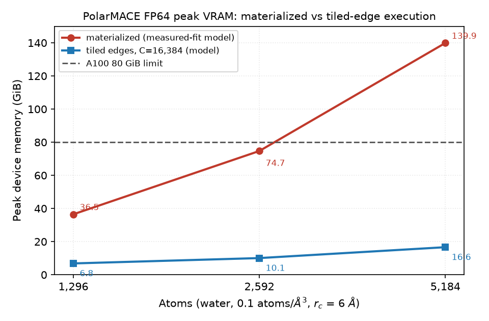

# Tiled-edge execution for PolarMACE FP64 — design and memory model

**Date:** 2026-10-20
**Scope:** design + memory model only. No engine source edit, no GPU build/run.
**Target:** run the full nonlinear PolarMACE (FP64) materialized path at 5,184
water atoms on one A100 80 GB without changing the numerical gates.
**Source of truth for code references:** `bench/plan_b_full_2026-10-20/work/symmetrix`
(model `polar_symmetrix_probe.json`, FP64, `streamed_edges='materialized'`,
`MH-1 fast path: no`).

---

## 1. 中文执行摘要

1. 目标：用分块边执行（tiled-edge）把 FP64 PolarMACE 材料化路径从 1,296 原子扩到 5,184 原子，数值门不变。
2. 校准：2,592 原子在 A100 80 GiB 上因 2.008 GiB 分配失败 OOM，5,184 原子因 0.567 GiB 请求失败；128 原子 2-rank 实测 30.8 GiB/rank，本模型 29.9 GiB/rank（−3%）。
3. 现状：材料化峰值 1,296≈36.5 GiB、2,592≈74.7 GiB、5,184≈139.9 GiB；2,592 再加 5–7 GiB 外部占用即触顶。
4. 主占用：edge_messages（L0 8192、L1 5120 宽）、raw/weights、共享 MLP 工作区 2×E×3656、反传 weight_adj/feature_adj 与节点缓冲。
5. 设计：按目标节点段对齐、每块 16,384 条边；前向一遍 + 反向重算一遍；单块 arena ≤C；节点缓冲、SCF 与 Ewald 常驻。
6. 结果：5,184 峰值≈16.6 GiB（含 10% 余量≈18 GiB）；1,296 降到≈6.8 GiB；5,184 相对材料化降 8.4×。
7. 代价：反向重算边特征/MLP/up-gather，整步约 +5–15%；这是容量特性，不是 1,296 提速。
8. 验收：128/1,296 分块 vs 材料化 dE≤1e-9 eV、dF≤1e-8 eV/Å；1,296 减速≤15%；5,184 峰值≤45 GiB；否则 kill。

---

## 2. Memory ledger

### 2.1 Graph, atom and k-space sizes (measured from the actual inputs)

The engine's graph is the local-atom directed edge set inside the model
`r_cut = 6.0 Å` (the pair style filters the 8 Å LAMMPS list with
`r_squared < r_cut_squared`, `pair_symmetrix_mace_kokkos.cpp:1408/1458`).
Counts below were obtained by direct periodic neighbor counting on
`bench/paper_scale_2026-10-20/water_{1296,2592,5184}.data`; the 1,296 count
matches the CUPTI grid `111312x1x1` exactly.

| Quantity | 1,296 | 2,592 | 5,184 |
|---|---:|---:|---:|
| Atoms `N` | 1,296 | 2,592 | 5,184 |
| Edges `E` (directed, `< 6 Å`) | **111,312** | **232,098** | **434,456** |
| Edges/atom | 85.89 | 89.54 | 83.81 |
| Ewald k-points `Nk` (half-space, `k_cut=1.8467166 Å⁻¹`) | **678** | **1,388** | **2,748** |
| `2·Nk·N` cos/sin doubles | 1.757M | 7.196M | 28.49M |

Notes:
- The brief quoted an edge-feature width of 1,026 doubles. The model and the
  code say **1,032**: `conv_tp_weights.layers[0].weight.shape = [64,1032]`
  and `edge_width = num_bessel(8) + source_embedding(512) + target_embedding(512)`
  (`mace_nonlinear_kokkos_impl.tpp:5349`). The ledger uses 1,032.
- All widths below are from the model JSON: layer 0 message width
  `512x0e+512x1o+512x2e+512x3o = 8192`, layer 1
  `128x0e+128x0e+128x1o×3+128x2e×3+128x3o×2 = 5120`, `weight_size` 2048/1280,
  gate input 9728, gate output 8192, product output 1024.

### 2.2 Per-edge coefficients (bytes per edge)

| Block | L0 | L1 |
|---|---:|---:|
| forward edge set (`features+raw+weights+up+messages+density`) | 110,680 | 73,816 |
| reverse edge additions (`up_adj+harm_adj+weight_adj+feature_adj+density_adj`) | 37,128 | 30,984 |
| shared conditioned-MLP workspace (value + adjoint, `2×3656×8`) | 58,496 | 58,496 |
| global edge scratch (`radial/cutoff/harmonics/Y/Y_grad/adjoints`) | 1,320 | 1,320 |
| **total per edge** | **207,624** | **164,616** |

Layer 0 dominates; a single shared tile arena is therefore sized on L0.

### 2.3 Ledger at the three sizes (GiB = 2³⁰ bytes)

`E` and `N` are the values above. The `Formula` column is bytes; for example
L0 `edge_messages` at 1,296 is `111,312 × 8,192 × 8 = 7,294,967,808 B =
6.794 GiB`.

| # | Buffer | Formula (bytes) | 1,296 | 2,592 | 5,184 | Mode |
|---|---|---|---:|---:|---:|---|
| 1 | `edge_features` (L0+L1) | `2·E·1032·8` | 1.712 | 3.569 | 6.681 | **tile** |
| 2 | `raw_weights`+`weights` L0 | `2·E·2048·8` | 3.397 | 7.083 | 13.259 | **tile** |
| 3 | `raw_weights`+`weights` L1 | `2·E·1280·8` | 2.123 | 4.427 | 8.287 | **tile** |
| 4 | `edge_up` (L0+L1) | `2·E·512·8` | 0.849 | 1.771 | 3.315 | **tile** |
| 5 | `edge_messages` L0 | `E·8192·8` | 6.794 | 14.166 | 26.517 | **tile** |
| 6 | `edge_messages` L1 | `E·5120·8` | 4.246 | 8.854 | 16.573 | **tile** |
| 7 | density matrix/raw/base (L0+L1) | `2·E·3·8` | 0.005 | 0.010 | 0.019 | **tile** |
| 8 | reverse `edge_up_adj` (L0+L1) | `2·E·512·8` | 0.849 | 1.771 | 3.315 | **tile** |
| 9 | reverse `edge_harmonic_adj` (L0+L1) | `2·E·16·8` | 0.027 | 0.055 | 0.104 | **tile** |
| 10 | reverse `weight_adj` L0 (`raw_weight_adj` aliased) | `E·2048·8` | 1.698 | 3.542 | 6.629 | **tile** |
| 11 | reverse `weight_adj` L1 | `E·1280·8` | 1.062 | 2.213 | 4.143 | **tile** |
| 12 | `edge_feature_adj`+`density_feature_adj` (L0+L1) | `4·E·1032·8` | 3.424 | 7.138 | 13.362 | **tile** |
| 13 | reverse `density_raw_adj` (L0+L1) | `2·E·8` | 0.002 | 0.003 | 0.006 | **tile** |
| 14 | conditioned-MLP workspace, value+adjoint | `2·E·3656·8` | 6.064 | 12.644 | 23.669 | **tile** |
| 15 | global edge scratch (`radial`,`cutoff`,`harmonics`,`Y`,`Y_grad`, adjoints) | `E·165·8` | 0.137 | 0.285 | 0.534 | resident |
| 16 | node fwd+rev, both layers | `N·201,222·8` | 1.943 | 3.886 | **7.772** | resident |
| 17 | polar forward workspaces | `N·(21,822+2·Nk)·8` | 0.224 | 0.475 | 1.055 | resident |
| 18 | polar reverse + replay cache | `N·39,376·8` | 0.380 | 0.760 | 1.521 | resident |
| 19 | Ewald cos/sin | `2·Nk·N·8` | 0.013 | 0.054 | 0.212 | resident |
| 20 | E3 linear workspace (upper bound) | `N·21,920·8·1.3` | 0.275 | 0.550 | 1.101 | resident |
| 21 | product feature-major workspace (upper bound) | `N·16,384·8` | 0.158 | 0.316 | 0.633 | resident |
| 22 | readout workspace | `N·3000·8` | 0.029 | 0.058 | 0.116 | resident |
| 23 | graph CSR/index arrays | `E·44` | 0.005 | 0.010 | 0.018 | resident |
| 24 | model weights (device copy) | — | 0.294 | 0.294 | 0.294 | resident |
| 25 | CUDA/Kokkos/LAMMPS base | — | 0.800 | 0.800 | 0.800 | resident |
| | **Total materialized** | | **36.5** | **74.7** | **139.9** | |
| | **Tiled floor (rows 15–25)** | | **4.26** | **7.49** | **14.06** | |
| | **Tiled total, C=16,384** | `floor + C·169,176 B` | **6.84** | **10.07** | **16.64** | |

Rows 1–14 are the buffers that **must** be tiled; row 15 stays resident
(0.53 GiB at 5,184; it could later be recomputed per tile to save ~0.5 GiB
more, but it is not required for capacity). Rows 16–25 are O(N) or small and
stay resident. `edge_messages` alone is ~30% of the materialized footprint,
the shared MLP workspace (row 14) is ~17%, and with `raw/weights`,
`edge_features`, `edge_up`, `edge_feature_adj`, and `weight_adj` the edge
workspace accounts for ~88–90% of the peak.

### 2.4 Calibration against measured failures

| Point | Measurement | This model | Delta |
|---|---|---:|---:|
| 128 NH₃, 2-rank exact 2-hop, rank 1 | 63,088 MiB / 2 = **30.8 GiB/rank** (`MPI_2RANK_FIX_AGENT_REPORT.md`) with `N=2,581`, `E=78,156` | 29.9 GiB | **−3.0%** |
| 1,296 water, 1 rank | runs to completion on the 80 GiB A100 | 36.5 GiB | fits, ~43 GiB headroom |
| 2,592 water, 1 rank | OOM: `Cuda memory space failed to allocate 2.008 GiB` (`stdout.polar_water_2592`) | 74.7 GiB | +5–7 GiB tenant/allocator → 80–82 GiB → OOM |
| 5,184 water, 1 rank | OOM: `failed to allocate 567 MiB` (`stdout.polar_water_5184`) | 139.9 GiB | OOM long before the last request |

The strongest independent check is the 128-atom 2-rank tracer: its measured
affine-MLP row is `2 × 2.029/2.129 GiB` for `E = 74,472/78,156`; the formula
`E × 3656 × 8` gives 2.029/2.129 GiB exactly, confirming both the 1,032-wide
edge feature and the shared (one pair, not four pairs) MLP workspace. The
`−3%` model bias at that point is the basis for the 10% margin used in the
tiled totals. The identity of the single 2.008 GiB request is not
recoverable (Kokkos reports an empty label for all `ensure_view` storages);
the calibration is on total demand, not on one row. The 2,592 OOM runs were
on a shared GPU, so 5–7 GiB of tenant usage is the expected last increment.

### 2.5 Why the 1,296 materialized peak is already ~36 GiB

The materialized path keeps **both layers'** full edge workspaces live for
the whole evaluation and never calls `release_layer_edge_workspace` in the
hot path (`mace_nonlinear_kokkos_impl.tpp:3020` is only used when replacing
a JIT plugin). The forward `edge_messages` storage is reused by the reverse
adjoint and `raw_weight_adj` aliases `weight_adj` (the 2026-10-19 MPI fix),
so the ledger above is post-dedup, not the pre-fix 80,966 MiB variant.

---

## 3. Tiled-edge design

### 3.1 Tile definition, chunk size, schedule

- **Tile = a contiguous range of the existing target-ordered CSR**:
  `tile t` covers nodes `[n0, n1)` and edges `[offsets(n0), offsets(n1))`.
  Node segments are never split. A node whose degree exceeds `C` becomes a
  single oversized tile, so the arena capacity is
  `C_max = max(C, max_degree)`.
- **Chunk size C = 16,384 edges**, reusing the existing CUDA constant
  `streamed_edge_block_size = 16384` (`mace_nonlinear_kokkos.hpp:991`).
  Tile counts per layer: `T = 7 / 15 / 27` at 1,296 / 2,592 / 5,184;
  a 5,184 tile spans ≈195 nodes.
- **Schedule:** forward sweep layer 0 tiles → layer 1 tiles → node/readout
  block → polar pipeline. Reverse sweep: polar reverse (node-level) →
  layer 1 tiles → layer 0 tiles. Tile order is always ascending; layer order
  in reverse is descending, as today.
- **Tile table:** greedy over `offsets`, O(N) host work, cached on
  `(graph_generation, C)`. Rebuilt when the neighbor list rebuilds
  (`neighbor->ago == 0` / `rebuild_topology`, pair style lines 1357/1382).
  Device table: `tile_first_edge[T+1]`, `tile_first_node[T+1]`,
  `tile_edge_count[T]`, `tile_node_count[T]` (a few hundred bytes).
- C may be lowered to 8,192 or 4,096 for a tighter arena (1.29/0.65 GiB),
  or raised to 32,768 (5.16 GiB) if launch overhead ever matters. The
  default is 16,384 because it is already the engine's block constant and
  gives 27 tiles at the target size.

### 3.2 Forward sweep (per layer)

For each tile, ascending:

1. Build the tile's `edge_features` (`radial[g]`, `source_embedding(source)`,
   `target_embedding(target)`); graph arrays are indexed globally, tile
   arrays locally: `e_global = tile_first_edge + e_local`.
2. Evaluate the convolution-weights MLP on the tile (workspace rows = tile
   edges) → `raw_weights`; copy and apply the cutoff → `weights`.
3. Evaluate the density MLP on the tile → `density_matrix/raw/base`.
4. `edge_up = up(neigh_indices(e_global))`.
5. `edge_messages = conv(edge_up, edge_harmonics[e_global], weights)`.
6. Gather `edge_messages` into the node `messages` **for the tile's nodes
   only**. Because the tile contains complete node segments, each node's
   ascending-edge FP64 sum is exactly the untiled expression.
7. Apply the density envelope to the tile's target nodes (also complete).

After all tiles of a layer, run the unchanged node block (`linear_1`, gate,
`linear_2`, product, readout; impl lines 5492–5675). The node-level forward
state needed by the reverse — `up`, `messages`, `residual`, `skip`,
`linear_1_output`, `pre_gate`, `gated`, `interaction_output`, `output`,
`densities` — is O(N) and stays resident.

### 3.3 Reverse sweep (per layer, both layers after the polar reverse)

The polar reverse consumes node-level caches and seeds `layer_adjoint`
(impl 5764). Then, for each tile ascending, recompute the **forward edge
values needed by the reverse** and immediately run the reverse edge block:

1. Recompute `edge_features`, `raw_weights`, `weights` (cutoff applied),
   `edge_up`, `density_raw/base`, and the per-edge harmonics (from the
   resident `edge_harmonics` or recomputed from the tile xyz).
   **Do not** recompute `edge_messages`: the convolution reverse needs only
   forward `edge_up`, harmonics and `weights`, plus the node `message_adj`.
2. `conv.reverse` with the B4 fused target gather → `edge_up_adj`,
   `edge_harmonic_adj`, `weight_adj`.
3. Scatter `edge_up_adj` into the node `up_adj` (atomic add, same as today),
   then cutoff reverse in place on `weight_adj`, MLP reverse →
   `edge_feature_adj`, density reverse → `density_feature_adj`, accumulate
   `radial_adjoints`/`cutoff_adjoints` for these edges.
4. `edge_message_adj` is not needed as a separate buffer in the fused B4
   path; if `MATOS_REV_GATHER_FUSE=0` is used for an A/B, the tile's
   `edge_messages` storage is reused, exactly as the current code does.

The node adjoint chain (product, `linear_2`, gate, `linear_1`, `linear_res`)
runs once per layer after its tiles, unchanged. `harmonic_adjoints`,
`radial_adjoints`, `cutoff_adjoints` remain full E-sized (~0.13 GiB combined
at 5,184) and are written per tile; no cross-tile reduction is needed
because every edge belongs to exactly one tile.

### 3.4 Tile arena

One arena, capacity `C_max`, reused by every tile, layer and sweep:

| Set | Bytes/edge | C=16,384 |
|---|---:|---:|
| forward (`features+raw+weights+up+messages+density`) | 110,680 | — |
| + shared MLP workspace (value+adjoint) | 58,496 | — |
| **forward arena** | **169,176** | **2.58 GiB** |
| reverse recompute subset + reverse additions + MLP | 140,768 | 2.15 GiB |

The peak is the forward arena, 2.58 GiB at C=16,384. The arena is allocated
once (grow-only), so no per-tile allocation churn. All E-sized edge views
listed in §2.3 rows 1–14 are **not** allocated in tiled mode; the
`ensure_view` capacity is `min(E, C_max)`.

### 3.5 Interaction with the 2-step SCF and the Ewald k-space

- The polar SCF is **node-level**: 2 recursion steps, two spin channels,
  `polar_features_mixed` (N×2048), per-step densities (S×N×8), Fukui
  corrections and the replay cache. It runs after the backbone forward and
  before the polar reverse; tiling does not interleave with it and does not
  change its iteration count. No edge data crosses SCF steps.
- The Ewald k-space is `Nk × N` cos/sin plus `Nk`-sized basis/rho/adjoint
  vectors. It is O(Nk·N), and `Nk` itself grows with the box
  (678/1,388/2,748 for the three boxes), so this term is O(N²) asymptotically,
  but it is only **0.212 GiB at 5,184**. It stays resident and unchanged;
  the half-space k-order is fixed, so determinism is unchanged. Recomputing
  cos/sin per SCF step would save 0.21 GiB and is explicitly *not* needed.
- The local-electron and Coulomb terms are node/k-space only; no edge tiling.
- The polar reverse's per-step cache (`polar_rev_cache_*`, 0.25 GiB at
  5,184) is node-level and stays resident. It does not grow with E.

### 3.6 MPI, ghosts, halos

- Tiles are rank-local and built over the rank's graph (local atoms plus
  whatever ghosts the exact 2-hop / H1 path keeps, `N_graph`). A tile never
  spans ranks.
- 1-rank: the pair style folds ghost tags back to local atoms through
  `map_kokkos` (`pair_symmetrix_mace_kokkos.cpp:1464`), so all tile targets
  are local. No halo is introduced.
- Multi-rank exact 2-hop: ghost rows are normal graph rows with synced node
  features; a tile's source may be a ghost, whose `up`/embeddings come from
  the existing comm hooks. The H1 comm width is node-level
  (`node_feature_width()`, 2,048 in the MPI report) and is unaffected.
- Reverse: `edge_up_adj` scatters into possibly-ghost source rows; the
  existing reverse comm runs **after all tiles**, so the ghost adjoints are
  complete before the exchange. No new communication.
- The global Fukui source sums remain the existing owned-node serial-order
  reduction + `Allreduce`; tiling does not touch them.

### 3.7 State invariants and determinism

| ID | Invariant |
|---|---|
| I1 | Atom order and node indices/types/positions are unchanged. |
| I2 | Tiles are contiguous CSR ranges; node boundaries are never split. |
| I3 | Within a node, edges are summed in the original ascending order. |
| I4 | Tile order is ascending in both sweeps; layer order is forward 0→1, reverse 1→0. |
| I5 | No new global reductions; SCF sums and energy reduction order unchanged. |
| I6 | Tile arrays are `[0, C_tile)`; graph arrays are `[0, E)`, with `e_global = tile_first_edge + e_local`. |
| I7 | `Σ tile_edge_count == E` and `Σ tile_node_count == N_graph`; assert at build. |
| I8 | Reverse comm fires only after all tiles of all layers. |

**Determinism class.** Energy and all per-node forward sums are bitwise
reproducible if tiles are node-aligned (I2/I3) and the per-row MLP/GEMM
arithmetic is batch-size-independent. In practice cuBLAS/KokkosBlas may pick
a different blocking for a 16k-row GEMM than for a 434k-row GEMM, changing
the last FP64 bits; hence the parity gate is tolerance-based (1e-9 eV).
Forces additionally inherit the existing atomic `edge_up_adj → up_adj`
scatter (`mace_nonlinear_kokkos_impl.tpp:7296`), so the force parity gate is
1e-8 eV/Å, not bitwise. Tiled mode introduces **no new** nondeterminism
class: the schedule is fixed, tile order is fixed, and the only atomics are
the ones already present. A bitwise-force variant would require replacing
the atomic scatter with a deterministic source-segmented reduction in
**both** modes; that is out of scope and would change the accepted baseline.

---

## 4. Code-change map

### 4.1 Files and functions

| File | Anchor (current tree) | Change |
|---|---|---|
| `libsymmetrix/source/mace_nonlinear_kokkos.hpp` | 682–697 (`compute_node_energies_forces`, `run_polar_pipeline`); 342 (`edge_workspace_bytes`); 991 (`streamed_edge_block_size`) | add `set_edge_tile_capacity(int)`, `edge_tile_capacity()`, `tile_workspace_bytes()`; private tile table views; tile arena views; `edge_tiles_enabled()` |
| `.../mace_nonlinear_kokkos_impl.tpp` | 3942 entry; 4038–4039 offsets/targets; 4477–5460 forward layer; 5492–5675 node block; 7217–7444 reverse edge block; 3020 `release_layer_edge_workspace`; 3113 `edge_workspace_bytes` | build/validate tile table after `offsets`; wrap the per-layer forward edge block in `for tile`; wrap the reverse edge block in `for tile`; add `forward_edge_tile(layer,tile)` / `reverse_edge_tile(layer,tile)` helpers; report tile bytes |
| `.../mace_polar_impl.tpp` | 405 `run_polar_pipeline`; 723–795 k-grid/trig; 962+ SCF; 3478–3500 reverse workspaces | **no edge changes**; add a comment/assert that polar is node-only and that the SCF/replay cache is unaffected. Do not tile `Nk×N` |
| `pair_symmetrix/pair_symmetrix_mace_kokkos.cpp` | 1335–1476 edge build; 1487–1493 polar call; 820–843 neighbor requests | parse `MATOS_EDGE_TILE`/`edge_tile` keyword; call `set_edge_tile_capacity`; log `tiled-edges=off/on C=.. T=.. arena=..` |
| `libsymmetrix/source/affine_mlp_kokkos.cpp` | 283–331 `prepare()` | no code change; in tile mode `batch_size = C_tile`, so the shared workspace grows to `C_max`, not `E` |
| `libsymmetrix/source/e3nn_kokkos.cpp` | 2496+ tensor product evaluate/reverse | verify the conv kernels accept a tile-local view plus a global edge offset; the streamed reverse path in `mace_nonlinear_kokkos_impl.tpp:7015–7069` already passes `first_edge` through the same kernels |

### 4.2 New buffers and arguments

New device buffers (all capacity `C_max`, reused every tile):
`tile_features[C,1032]`, `tile_raw_weights[C,2048]`, `tile_weights[C,2048]`,
`tile_up[C,512]`, `tile_messages[C,8192]`, `tile_density_matrix/raw/base[C,1]`,
`tile_up_adj[C,512]`, `tile_harmonic_adj[C,16]`, `tile_weight_adj[C,2048]`,
`tile_feature_adj[C,1032]`, `tile_density_feature_adj[C,1032]`,
`tile_density_raw_adj[C,1]`. Existing shared MLP workspace grows to
`2·C_max·3656` doubles. Tile table:
`tile_first_edge[T+1]`, `tile_first_node[T+1]`, `tile_edge_count[T]`,
`tile_node_count[T]` (int).

New arguments: `int first_edge` / `int edge_offset` on the conv forward,
message gather, up gather, conv reverse, up scatter and MLP calls; the
kernels index graph arrays with `first_edge + local` and tile arrays with
`local`. No signature change to the public `compute_node_energies_forces`
unless the pair style passes a capacity; `set_edge_tile_capacity` is enough.

### 4.3 Environment switch and default-off plan

- `MATOS_EDGE_TILE` — unset/`0`/`off` = current materialized path (**default**);
  integer = tile capacity in edges; `auto` = choose the largest power of two
  ≤ `MATOS_EDGE_TILE_MAX` whose predicted peak fits
  `MATOS_EDGE_TILE_BUDGET_GIB`.
- `MATOS_EDGE_TILE_MAX` (default 16384), `MATOS_EDGE_TILE_BUDGET_GIB`
  (default 45).
- Optional pair-style keyword `edge_tile <N|auto>` for LAMMPS input files.
- Default-off is enforced in three ways: (a) capacity 0 → the existing code
  path and no new allocations; (b) `edge_workspace_bytes()` must be identical
  with the switch off; (c) a 128-atom bitwise check runs in CI with the
  switch off.
- Landing order: (1) tile table + forward loop behind the switch, reverse
  still full (not shippable, gates only at 128); (2) reverse loop; (3) 1,296
  and 2,592 gates; (4) 5,184; (5) optional auto mode. The capacity win
  requires **both** sweeps; a forward-only tiled mode still allocates the
  E-sized reverse buffers and will not unlock 5,184.

### 4.4 Memory peaks and launch counts

| Size | Materialized (model) | Tiled C=16,384 (model) | Tiled + 10% margin |
|---|---:|---:|---:|
| 1,296 | 36.5 GiB | 6.84 GiB | 7.5 GiB |
| 2,592 | 74.7 GiB (OOM + tenant) | 10.07 GiB | 11.1 GiB |
| 5,184 | 139.9 GiB (OOM) | **16.64 GiB** | **18.3 GiB ≈ 18 GiB** |

The peak within one evaluation is the forward sweep (resident node/polar
state plus the 2.58 GiB forward arena); the reverse arena is smaller
(2.15 GiB), and the floor already counts both the forward and reverse node
buffers, so the table is conservative. Launch count:
`T × layers × sweeps × ~6–8 kernels` ≈ 200 launches at 1,296, ~650 at
5,184; at ~3–5 µs each this is 1–3 ms/eval, negligible against the ~1 s
5,184 evaluation and <1% at 1,296.

---

## 5. Validation plan

All comparisons are same-binary, same-GPU, switch off vs on, with the
accepted gate fixtures. "Tiled" means `MATOS_EDGE_TILE=16384` unless stated.

### 5.1 Gates and exact thresholds

| Gate | System | Comparison | Exact acceptance threshold |
|---|---|---|---|
| G0 default-off | 128 NH₃ | switch off vs accepted binary | `edge_workspace_bytes()` identical; PE bitwise; 3 repeated evals max dF ≤1e-15 eV/Å |
| G1 128 parity | 128 NH₃ (32 molecules) | tiled C∈{64,128,256,512,1024,4096} vs untiled (small C forces many tiles; C≥E is the single-tile equivalence) | `|ΔE| ≤ 1e-9 eV`; `max|ΔF| ≤ 1e-8 eV/Å`; 3 repeated evals run-to-run `max|ΔF| ≤ 1e-12`; `|ΣF| ≤ 1e-10 eV/Å` |
| G2 1,296 parity + speed | 1,296 H₂O | tiled vs untiled | `|ΔE| ≤ 1e-9 eV`; `max|ΔF| ≤ 1e-8 eV/Å`; median-of-5 eval time `tiled/untiled ≤ 1.15`; peak VRAM ≤ untiled |
| G2m 1,296 MPI | 1,296 H₂O, 2 ranks exact 2-hop | tiled vs untiled | official gate: `dE ≤ 5e-5 eV`, `max dF ≤ 1e-4 eV/Å` (report measured value; expected ~1.7e-6) |
| G3 2,592 capacity | 2,592 H₂O | run 0 + 3×run 1 | completes with rc=0; peak VRAM **≤45 GiB** (target ≤20); `C∈{8192,16384,32768}` invariance `|ΔE| ≤ 1e-9`, `max|ΔF| ≤ 1e-8`; `|ΣF| ≤ 1e-9`; all energies finite |
| G4 5,184 capacity/parity | 5,184 H₂O | run 0 + 3×run 1 | completes with rc=0; peak VRAM **≤45 GiB** (target ≤20); C-invariance as G3; 3 repeated evals `max|ΔF| ≤ 1e-10`; 10-step NVT: no lost atoms, finite thermo, `|ΣF| ≤ 1e-9` |
| G5 memory audit | 5,184 | NVML/cudaMalloc tracer | tiled peak ≤45 GiB; no single allocation >2.6 GiB (the arena is the largest); no unexpected E-sized allocation >5 GiB |

Measurement protocol: one warm-up `run 0`, then 3×`run 1`; peak VRAM from
NVML sampling at 20 ms plus a `cudaMalloc` tracer threshold 1 GiB (same
method as `MPI_2RANK_FIX_AGENT_REPORT.md`); record binary/source hashes and
the `tiled-edges=` startup line.

### 5.2 Kill criterion

Stop and keep the feature default-off if **any** of:

1. **K1:** 5,184 peak VRAM > **60 GiB** after the reverse sweep is
   implemented (the model says 16–18 GiB; a >60 GiB result means an untracked
   E-sized buffer remains).
2. **K2:** 1,296 tiled median is **>1.30×** the untiled median (the design
   budget is ≤1.15×; 1.30× is the hard stop).
3. **K3:** G1 or G2 parity fails twice after two fix rounds, or G3/G4
   C-invariance exceeds 1e-6 eV/Å.
4. **K4:** the arena at C=8,192 exceeds 5 GiB (a hidden per-edge allocation
   of the same class as `edge_messages`), or the tile table cannot be built
   node-aligned without splitting a node segment.

On kill: do not ship, keep `MATOS_EDGE_TILE` off, and publish the ledger plus
the failing buffer as a negative result. Do not fall back to a naive
edge-range tile (it changes the per-node FP64 sum order; see R3).

### 5.3 What cannot be validated directly

There is **no untiled 2,592 or 5,184 reference**: both OOM by construction.
G3/G4 therefore rest on (a) cross-C invariance, (b) the physical invariants
`ΣF≈0`, finite energies, no lost atoms, (c) G1/G2 exact parity at the sizes
where an untiled run exists. If a strict reference is required, generate a
PyTorch PolarMACE 2,592 reference on a larger-memory GPU/CPU; that is a
separate, expensive task and is not part of this plan.

---

## 6. Risks

### R1 — Determinism and parity (highest)
The reverse `edge_up_adj → up_adj` scatter is atomic today, so forces are not
bitwise even in the current engine. Tiling changes the grid and therefore the
atomic order; energy is expected to be bitwise-equivalent per node, forces
only to the 1e-8 eV/Å gate. Additional batch-size-dependent GEMM blocking in
the recomputed MLP can shift the last bits. Mitigation: node-aligned tiles,
fixed ascending tile order, G1/G2/G3 tolerance gates, and an explicit
"no new nondeterminism class" statement. A bitwise requirement would force a
deterministic segmented scatter in both modes — a larger change, not planned.

### R2 — Extra global traffic and throughput
The reverse sweep re-reads `source/target` embeddings, `radial`, and the tile
`edge_features`, and re-runs the conv-weights and density MLPs for every tile;
it does **not** re-run the 8192-wide tensor-product forward (edge_messages is
not needed by the reverse). The duplicated work is ~5–15% of the whole
evaluation at 1,296, plus 1–3 ms of launch overhead. At 5,184 the same
fraction applies. This is a capacity feature; it cannot make 1,296 faster.

### R3 — Edge reorder / indexing
A naive edge-range tile splits a node's CSR segment across two tiles; the
per-node message/density sum order then changes and FP64 forces drift at the
1e-6 level, silently passing a loose gate. Mitigation: build tiles on
`offsets` node boundaries only, assert I7, and use one `e_global =
first_edge + e_local` mapping in every kernel. Also check the `local_targets`
and `neigh_indices` indexing in the B4 fused gather and the cutoff-reverse
path; an off-by-one there is invisible in energy but wrong in forces.

### R4 — SCF replay cache
`MATOS_REPLAY_CACHE=1` stores per-step node state (`S×N×3274` doubles,
0.25 GiB at 5,184). It is node-level, so tiling does not grow it; but the
reverse tiles must load the same step cache in the same order and use the
same forward call sequence (full `evaluate`, not the prefix-conditioned path)
so the recomputed weights match the forward. If the cache is invalidated or
the call sequence differs, the MLP weights differ in the last bits and the
force gate drifts. Keep the cache resident; do not tile it.

### R5 — MPI / ghosts
Tiles must not span ranks, and the exact 2-hop graph's node buffers scale
with `N_graph` (ghosts), not `N_local`; a tile table built from local atom
counts would truncate ghost-owned edges. The H1 comm widths are node-level
and unchanged, and the reverse comm must run after all tiles. One rank per
GPU remains the scaling path; tiling does not change the one-GPU 2-rank
throughput.

### R6 — Why this is not a 1,296 speed claim
At 1,296 the peak is 36.5 GiB and already fits; the 224–321 ms/eval is
kernel-bound (CUPTI: MH-1 51% of GPU busy, polar UVU 105.8 ms, node/edge
91.9 ms, Ewald 9.6 ms). Tiling adds a replay sweep and cannot reduce any of
those. The 1,296 headline must come from the existing UVU/MH-1 reverse work.
The tiled path's claim is: **5,184 atoms runnable at ~16–18 GiB**, with a
1,296 regression budget of ≤15%, and a possible large-N cache-locality gain
that is not claimed until measured.

---

## Appendix A — width sources

| Quantity | Value | Source |
|---|---:|---|
| `num_bessel` | 8 | `radial_embedding.basis.weights.shape=[8]` |
| source/target embedding output | 512 each | `interactions[*].source_embedding.irreps_out` |
| edge feature width | **1032** | `8+512+512`; `conv_tp_weights.layers[0].weight.shape=[64,1032]` |
| L0 message width | 8192 | `conv_tp.irreps_out = 512x0e+512x1o+512x2e+512x3o` |
| L1 message width | 5120 | `conv_tp.irreps_out = 128x0e×2 + 128x1o×3 + 128x2e×3 + 128x3o×2` |
| L0 `weight_size` | 2048 | `conv_tp_weights.layers[9].weight.shape=[2048,64]` |
| L1 `weight_size` | 1280 | `conv_tp_weights.layers[9].weight.shape=[1280,64]` |
| gate input / output | 9728 / 8192 | `linear_1` / `linear_2` output prefixes |
| product output | 1024 | `512x0e+512x1o` |
| node fwd+rev width, L0/L1 | 103,427 / 97,795 | sum of per-node buffers in §2.3 row 16 |
| MLP rows coefficient | 3656 | `1032 + (9×64 + 2048)` |
| `num_lm` | 16 | `(l_max+1)^2`, `l_max=3` |

## Appendix B — reproduction of the measured points

- Edge counts are exact direct counts on the three `water_*.data` files with
  periodic images; the 1,296 result `111,312` matches the CUPTI
  `e3 tensor product mh1 team channels` grid `111312x1x1`.
- `Nk` uses the code's half-space enumeration: `max_ns =
  ceil(k_cut/(2π/L))` = 7/9/11, then filter `|k|² ≤ k_cut²`; 678/1,388/2,748.
- The 128-atom 2-rank check uses `N=2,581`, `E=78,156` (rank 1 of the
  `MPI_2RANK_FIX_AGENT_REPORT.md` exact 2-hop graph).
- OOM strings are from
  `bench/paper_scale_2026-10-20/stdout.polar_water_{2592,5184}`.
