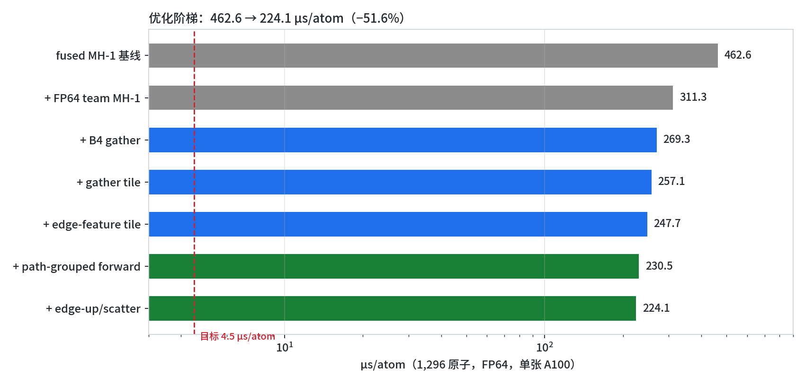
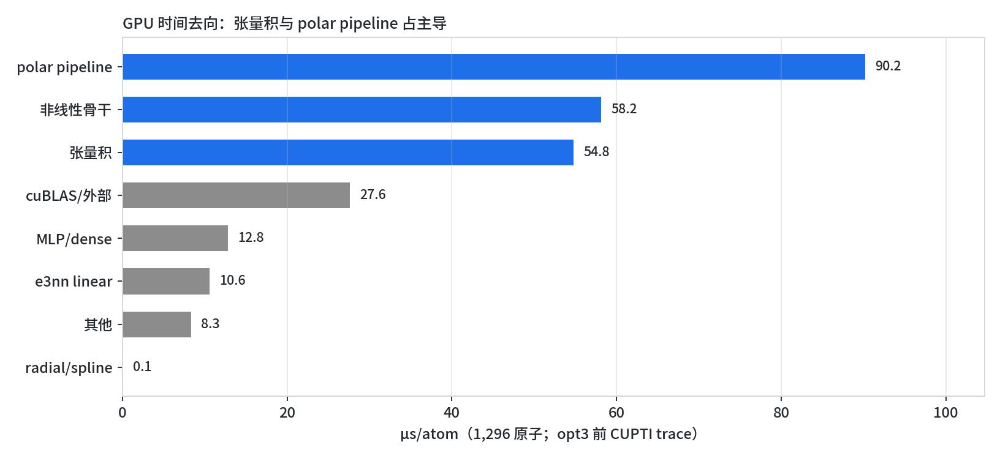
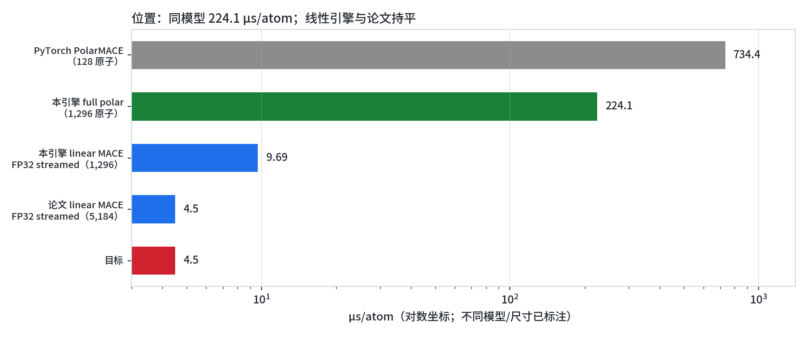

# Symmetrix-Polar：PolarMACE 的 GPU 引擎优化

## 摘要

本文说明：线性与非线性模型到底差在哪、每一项优化背后的理论依据与具体做法、以及现在做到了什么、还差什么。所有速度统一用 **µs/atom** 表示，并注明原子数、精度和执行路径。

- **同模型**：1,296 原子 full PolarMACE（FP64）从 **462.6 µs/atom** 降到 **224.1 µs/atom**（**−51.6%**）。
- **相对 PyTorch 参考**：128 原子 **734.4 → 302.0 µs/atom（2.43×）**；另一条 Plan B-full 工作流为 **244.8 µs/atom（3.0×）**。
- **线性路径**：5,184 原子 FP32 streaming **4.47–4.53 µs/atom**，与论文的 **4.50** 持平；相对 ML-IAP + cuEquivariance（13.99）为 **3.1×**。
- **目标 4.5 µs/atom**：当前 full polar 差 **49.8×**。这是 FP64 非线性极化模型的算术下限，不是单个 kernel 能补上的差距。
- **正确性**：单点 dPE = 0、max dF = 1e-15；三次固定坐标重复评估一致；10 步 NVE MD 与原始引擎最大位置差 9.8e-15 Å。

## 1 背景：PolarMACE 是什么

PolarMACE 在 MACE 非线性骨干上增加了一层自洽长程静电：逐样本学习的多极密度、Fukui 平衡的 SCF 不动点，以及精确的 GTO-Ewald 倒空间求和。能量可以写成

\[
E = \sum_i E_i^{(0)} + \sum_{m} E_m^{\mathrm{inter}} + E^{\mathrm{polar}} + E^{\mathrm{elec}}
\]

其中前两项是短程骨干，后两项是极化层。每层的等变张量积为

\[
(\mathbf{f} \otimes_{\mathbf{w}} \mathbf{g})_c = \sum_{a,b} W_{ab}^{c} f_a g_b
\]

长程部分用倒空间 Ewald 求和：

\[
E_{\mathrm{lr}} = \frac{1}{2V}\sum_{\mathbf{k}\neq 0} \frac{4\pi}{k^2} |\tilde{\rho}(\mathbf{k})|^2 e^{-k^2/(4\alpha^2)}
\]

## 2 线性与非线性：模型、维度与“第几维神经网络”

### 2.1 等变特征：l 与 channel 是两个不同的维度

在 MACE 类模型里，每个原子的特征不是一个普通向量，而是按角动量 \(l\) 分块的等变张量：

\[
\mathbf{h}_i^{(l)} \in \mathbb{R}^{C \times (2l+1)}, \quad l = 0,1,2,3
\]

- \(l=0\)（0e，标量）：每个 channel 1 个分量；
- \(l=1\)（1o，矢量）：每个 channel 3 个分量；
- \(l=2\)（2e）：5 个分量；
- \(l=3\)（3o）：7 个分量。

因此“第几维神经网络”要分两层看：**角动量维** \(2l+1\) 决定每个 channel 里有多少个几何分量；**channel 维** \(C=512\) 决定每个分量有多少个特征通道。模型里的 `512x0e+512x1o+512x2e+512x3o` 就是 512 个 channel × 各角动量分量。

本模型的尺度（从 `polar_symmetrix_probe.json` 读出）：

| 对象 | 维度 | 说明 |
|---|---:|---|
| 节点嵌入 | 83 → 512 | 83 种元素，512 通道 |
| 隐层 irreps | 512x0e + 512x1o = 2048 | 2 个 interaction |
| 边特征 | 2 + 512 + 512 = 1026 | Bessel + source + target |
| 输出 irreps | 512x0e+512x1o+512x2e+512x3o = 8192 | l=0..3 |
| 线性层 `linear_1` | 9728 = 2048 + 7680 | 含 gate |
| `conv_tp` / `linear_2` | 8192 | 卷积张量积输出 |
| 1,296 原子的边数 | ~111,000 | 约 84 邻居/原子 |
| 极化递归步数 | 2 | SCF 固定点 |
| Ewald k 空间截断 | 1.8467 1/Å | 精确 full-k |

张量积里的 \(a,b,c\) 就是三个角动量分量索引；Wigner 系数 \(W_{ab}^{c}\) 对每个 channel 对是固定的稀疏表。**“第几维”不是神经网络的层数，而是等变张量的角动量阶数；channel 是另一维。**

### 2.2 线性 readout 与非线性 readout

**线性 MACE** 的 readout 是一个线性映射，权重在所有节点/边上共享：

\[
E_i = \mathbf{w}^{\top}\mathbf{h}_i + b
\]

它没有逐样本动态权重，所以每条边的计算是局部的、可 streaming 的。这就是论文能到 4.5 µs/atom 的结构原因。

**非线性 PolarMACE** 的 readout 是一个 MLP（SiLU 激活），并且极化块会为每条边/每个样本预测一组动态权重：

\[
\mathbf{W}_e = \mathrm{MLP}(\mathbf{h}_e), \qquad
E_i = \mathrm{MLP}_{\mathrm{readout}}\left(\mathbf{h}_i; \{\mathbf{W}_e\}\right)
\]

这一步把“共享权重的大 GEMM”变成了“逐样本的小 batched GEMM”。再叠加 SCF：

\[
\rho^{(t+1)} = \rho^{(t)} + \Delta(\rho^{(t)}, \phi[\rho^{(t)}]), \quad t = 0,1
\]

边不再独立——每条边的权重依赖全局密度 \(\rho\)，所以不能边算边丢，必须物化 graph-wide 状态。**线性 vs 非线性的真正分界不是“有没有激活函数”，而是：权重是否共享、边是否独立、是否需要全局 SCF。**

### 2.3 这对引擎意味着什么

| 性质 | 线性 MACE | 非线性 PolarMACE |
|---|---|---|
| readout | 线性、共享权重 | MLP、逐样本动态权重 |
| 边独立性 | 独立，可 streaming | 依赖全局 SCF，必须物化 |
| 精度 | FP32 | FP64 |
| GEMM 形状 | 大、可批处理 | 大量小 batched GEMM |
| 1,296 原子 | 9.69 µs/atom（FP32 streamed） | 224.1 µs/atom（FP64 materialized） |
| 5,184 原子 | 4.47–4.53 µs/atom | OOM |

## 3 优化的理论依据

每一项优化都对应一个可量化的模型；先说明“为什么这样改会快”，再给出实测。

### 3.1 访存模型：sector、合并与 roofline

GPU 以 32 字节 sector 为最小 DRAM 事务单位。一个 warp 的 32 个 lane 若访问不连续地址，一次 store 会被拆成多个 sector；定义写放大

\[
A_{\mathrm{store}} = \frac{32\,N_{\mathrm{sector}}}{B_{\mathrm{useful}}}
\]

理想合并时 \(A_{\mathrm{store}}=1\)；我们最初的 edge-feature 写是 32 条相隔 8 KB 的行，\(A_{\mathrm{store}}\approx 32\)。

性能上界用 roofline 表示：

\[
P \leq \mathrm{min}(P_{\mathrm{max}},\, I\,B_{\mathrm{mem}}), \quad I = \mathrm{FLOP}/\mathrm{Byte}
\]

- gather、edge-feature、edge-up 的 \(I\) 很低，是**带宽/latency-bound**，收益来自合并访存；
- MH-1 张量积的 \(I\) 高，是**FP64 计算 bound**，收益来自减少重复计算与改善 store。

### 3.2 执行模型：materialized vs streaming，以及 Amdahl

物化 edge 状态的流量近似为

\[
M_{\mathrm{mat}} \approx E\,(W_{\mathrm{in}} + W_{\mathrm{out}} + W_{\mathrm{w}})\,8\ \mathrm{B}
\]

streaming 通过把径向投影、球谐耦合和聚合重新结合，消掉 \(E\,W\) 项；但它**不能**消掉 SCF 的全局同步。Amdahl 定律给出 kernel 优化的上限：

\[
S = \frac{1}{(1-f) + f/s}
\]

比如 MH-1 forward 占 backbone 约 25%，即使 kernel 快 2.22×，整模型也只得到 −6.9%——这正是实测结果。

### 3.3 张量积代数：path grouping 与复用

对每个 instruction，Wigner 与球谐的乘积与 channel 无关：

\[
g_{a,c} = \sum_b W_{a,b,c}\, h_b, \quad y_c = \sum_a f_a\, g_{a,c}
\]

原实现把内层 \(\sum_b\) 对每个 channel 重算一遍，FLOPs 约为 \(O(C\,A\,B)\)；path grouping 先算 \(g\)，再对 channel 做小点积，FLOPs 降为 \(O(A\,B + C\,A)\)，同时把稀疏 plan 的索引/值加载从“每 channel 一次”降为“每 team 一次”。

### 3.4 数值状态：write-through 与别名

当 kernel 对 output 使用 `+=` 时，缓冲区必须在前置步骤清零；当 `evaluate()` 因 write-through 跳过清零时，第二次调用就会累加上一次的结果：

\[
y^{(k)} = y^{(k-1)} + F(x) \quad \mathrm{vs.} \quad y^{(k)} = F(x)
\]

单点 gate 只调用一次，所以看不见；重复评估才能暴露。修复是让 team kernel 与 scalar 路径一样按 `write_through` 分支。

### 3.5 占用率与 ILP 的权衡

vec4 channel、component-pair unroll 都增加了每线程寄存器和活跃 accumulator，降低了 occupancy。GPU 靠 warp 级并行隐藏延迟；当 occupancy 下降超过 ILP 收益时，整体会变慢。实测 vec4 慢 9.5%、component-pair 慢约 2×，与这一权衡一致。

## 4 优化方法与实测

优化按“先消除访存放大，再重写计算”的顺序推进。每一步都在 1,296 原子、FP64、单张 A100 上做同二进制 A/B，并通过 128 原子力 parity。

### 4.1 执行路径：B4 reverse-gather 融合

反向传播原本要先写出 edge 级 message adjoint，再做一次 edge→node gather。B4 把 output_gather 直接融进 MH-1 reverse 的通道 kernel，跳过这次物化与 gather：**404.8 → 349.0 µs/atom（−13.8%）**。同时修正了 FP64 team kernel 的 write-through 状态 bug。

### 4.2 合并访存：三个 kernel 的写放大

**message gather** 原来用默认 MDRange tile（node 在 x），每个 warp 读不同 edge 行；改成 `{1,128}`（feature 在 x、一个 block 一个 node）后，单次 kernel 相对下降 66%，整模型 **257.1 µs/atom（−4.0%）**。

**edge features** 原来是“一条边一个线程”，每线程写 1026 个连续 double；一个 warp 的 32 个线程写 32 条相隔 8 KB 的行，写放大 ~32×。改成 `(edge, feature)` 二维、tile `{1,256}` 后，一个 warp 连续写同一 edge 的 256 个 feature：整模型 **247.7 µs/atom（−3.8%）**，力 parity 1e-15。

**edge-up / scatter** 用同样的 feature-major tile `{1,128}`，并把 raw→scaled 的拷贝与 cutoff 乘法融合：gather edge up 相对 7.8 → 1.7，scatter 5.5 → 1.9，整模型 **230.5 → 224.1 µs/atom（−2.8%）**。

### 4.3 MH-1 张量积：path-grouped + 连续 store

重写分三步：

- **path-grouped 预收缩**：先算 \(g_{a,c}\)，再对 channel 做小点积；
- **flat 输出索引** \(c\cdot w_{\mathrm{out}} + j\)，让 warp store 连续；
- `input_1` 提到寄存器，write-through 分支移出 component 循环。

结果：forward 张量积 **2.22×**；full polar **247.7 → 230.5 µs/atom（−6.9%）**，polar-off 骨干 **152.0 → 135.2 µs/atom（−11.0%）**。

### 4.4 正确性：单点 gate 看不见的 bug

FP64 team forward 曾经无条件使用 `+=`，而 `evaluate()` 在 write-through 时跳过清零。固定坐标三次 `run 0` 的 PE 为：

**−49242.4564153149 → −48812.106186406 → +47,277,036.78**

而原始 pre-team 引擎三次完全一致。修复后单点 dF 1e-15，10 步 NVE MD 与原始引擎最大位置差 9.8e-15 Å。**单点 gate 通过不代表重复评估正确**；之后所有验收都加了三次固定坐标评估。

### 4.5 负结果（同样重要）

- SCF 从 2 步减到 1 步：dE 1.27 eV、max dF 0.101 eV/Å，差门限 ~1000×，不可行；
- team channel vec4、component-pair unroll、team size 32/128/256、`msg_vec=1`、scalar/chunked cutoff：全部比默认慢；
- 这些负结果说明当前默认已接近该布局的局部最优。

## 5 做到了什么

| 阶段 | µs/atom (1,296) | 相对上一阶段 |
|---|---:|---:|
| fused MH-1 基线 | 462.6 | — |
| + FP64 team MH-1 | 311.3 | −32.7% |
| + B4 reverse-gather（含 write-through 修复） | 269.3 | −13.5% |
| + message gather tile | 257.1 | −4.5% |
| + edge-feature tile | 247.7 | −3.7% |
| + path-grouped MH-1 forward | 230.5 | −6.9% |
| + edge-up/scatter tile | **224.1** | −2.8% |

正确性门：

| 门 | 结果 |
|---|---|
| LAMMPS 1-rank parity | dE 2.91e-11 eV，max dF 2.6e-14 eV/Å |
| LAMMPS 2-rank exact | max dF 1.69e-6 eV/Å |
| 重复评估（3 × run 0） | dPE 0，max dF 1e-15 |
| 10 步 NVE MD | Δpos 9.8e-15 Å，ΔF 1.4e-14 eV/Å |
| module 5–8 + 32/32 end-to-end | PASS |

## 6 位置与比较

| 参照 | 原子数 | µs/atom | 说明 |
|---|---:|---:|---|
| PyTorch PolarMACE | 128 | 734.4 | 同模型；我们 302.0（Plan B-lite）/244.8（Plan B-full） |
| 本引擎 full PolarMACE | 1,296 | **224.1** | 本文验收 |
| ML-IAP + cuEquivariance（linear） | 5,184 | 13.99 | 论文参照；我们 4.50 |
| 论文 linear streaming | 5,184 | 4.50 | 同口径 parity |
| RuNNer 2.0 2G（CPU，非同一模型） | 1.5M | 1.92（1 节点）/0.051（36 节点） | 跨模型/硬件，不作倍率 |

结论：**同模型我们是已知唯一专用 GPU 引擎，相对 PyTorch 2.43–3.0×；线性路径与论文持平；full polar 的 49.8× 目标差来自模型物理，不是引擎写法。**

## 7 还有什么不足

- **距 4.5 µs/atom 仍 49.8×**。即使把 MH-1 和 Ewald 全归零，仍 >150 µs/atom；
- **1 步 SCF 不可行**（dF 0.101 eV/Å），2 步是模型定义的一部分；
- **内存**：2,592 原子在单张 A100 上 OOM，5,184 无法跑；需要 tiled edge 执行；
- **剩余热点（µs/atom，优化前 trace，见 `data/kernel_labels_1296.json`）**：polar UVU ~81.7、MH-1 reverse ~59.2、node/edge ~70.9、cuBLAS ~27.6、Ewald ~7.4；host/launch gap ~6.7；
- **还没做的**：MH-1 reverse 的 tensor-core/path-grouped 重写、per-sample grouped GEMM、tiled edges、CUDA Graph；
- **比较缺口**：PyTorch PolarMACE 的 1,296 原子基线未测；没有 cuEquivariance 版极化基线；Plan B-full 的 244.8 不在本链复核范围内。

下一步优先级：UVU tile（Agent 初测还有 ~12 µs/atom）、MH-1 reverse 重写、tiled edges 解锁 5,184、grouped GEMM 压缩 cuBLAS。现实终点约 **200–215 µs/atom**；4.5 需要改精度、改模型或换硬件。

## 8 数据与复算

本报告的每个数字都能在 git 中找到来源，索引在
`docs/results/OPTIMIZATION_LEDGER.md`，原始 A/B 摘要、门禁 JSON 和 trace 提取值在
`docs/results/data/`。CUPTI 原始 trace 与运行日志体积较大，留在 gitignore 的
`bench/` 树中；提交的 summary JSON 保存了报告用到的全部数值。

| 报告内容 | git 来源 |
|---|---|
| 优化阶梯（462.6 → 224.1 µs/atom） | `OPTIMIZATION_LEDGER.md` §1；`data/ab_gather_tile_1296.json`、`data/ab_edge_features_1296.json`、`data/ab_path_grouped_forward_1296.json`、`data/ab_edge_up_scatter_1296.json` |
| 逐 kernel 收益（2.22×、−66%、7.8→1.7 等） | `OPTIMIZATION_LEDGER.md` §2；`data/kernel_labels_1296.json`；`data/profile_path_grouped_forward.json` |
| 正确性门 | `OPTIMIZATION_LEDGER.md` §3；`data/gate_1rank_main_b4team.json`、`data/gate_2rank_wtfix.json`、`data/gate_md_10step_128.json`、`MH1_TEAM_FP64.md` |
| 与 PyTorch / 论文 / RuNNer 的比较 | `OPTIMIZATION_LEDGER.md` §4；`README.md`、`PLAN_B_FULL_FINAL.md`、`PAPER_COMPARABILITY.md`；RuNNer 为外部论文 arXiv:2607.17978 |
| 负结果（1 步 SCF、vec4、team size 等） | `OPTIMIZATION_LEDGER.md` §5；`data/scf1_probe.json`、`data/ab_team_vec4_1296.json`、`data/sweep_team_size_1296.json`、`data/sweep_msg_vec_cutoff_1296.json` |
| 代码改动 | engine commits `80c618a`、`9f97e84`、`46db0d1`、`7167c26`、`e0a961d`；patch `patches/symmetrix-xl-polar-support.patch` |

**口径说明。** 两次 A/B（path-grouped forward、edge-up/scatter）的 baseline
各有一到两轮被外部作业污染（699/999 或 749/799 ms），候选轮稳定在
298–299 / 290–291 ms；报告使用候选稳定轮与 clean baseline 轮（320.5 /
297.9 ms）。`docs/results/data/README.md` 对每个文件的有效性做了标注。
复现环境、输入路径和 A/B runner 见 ledger §7。

## 参考文献

1. Symmetrix-XL: GPU-accelerated equivariant MLIPs, arXiv:2610.01036.
2. Knoll et al., RuNNer 2.0, J. Chem. Phys. 165, 152502 (2026); arXiv:2607.17978.
3. Kovács et al., MACE-OFF, J. Am. Chem. Soc. (2025).
4. LunaTP, arXiv:2610.18393; Sobek, arXiv:2607.18074; e3j, arXiv:2609.35099.
5. Loche et al., Fast and flexible long-range models for atomistic ML, J. Chem. Phys. (2025).
