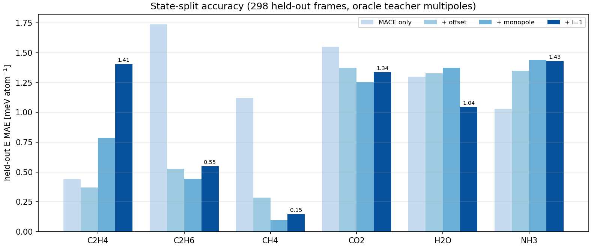
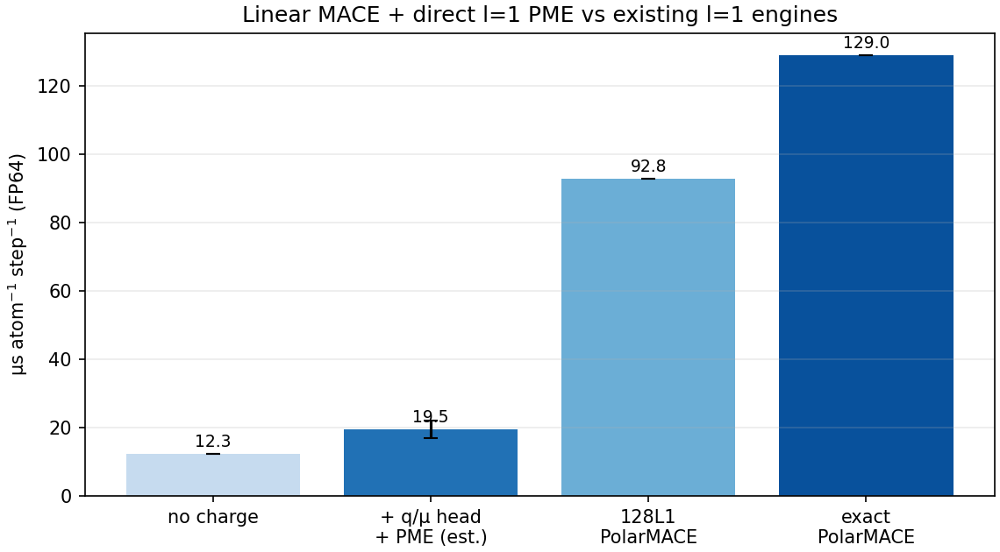

# Charge head + l=1 multipole progress (2026-10-27)

**Question:** can the fast linear MACE student carry charges and l=1
multipoles without losing its speed advantage, and does the multipole term
improve the energy?

**Answer so far:** the charge head is accurate (q MAE 0.00945 e) and the
direct 4-channel PME kernel is cheap (5–9 µs/atom, total 17–22 µs with the
linear backbone). The accuracy gain is species-dependent: l=1 helps water
(1.30 → 1.05 meV/atom) but a single global weight does not transfer across
species/states. Joint training of the q/μ heads and the long-range weighting
is the next step.

## 1. Dataset independence (important)

The 23,376 train / 3,465 valid frames are **not 23k independent samples**.
They come from 1,100 train states and 176 valid states (species × density ×
temperature × trajectory; median 1 frame/state, max 103). The ACF analysis in
`DATASET_REBUILD_2026-10-25.md` gives **~4,450 independent samples for the
26,841-frame corpus**. The state-level split keeps whole trajectories on one
side, so there is no frame leakage, but effective sample size is ~4.5k, not
23k.

**A larger dataset is not automatically better.** The current 1.2 meV/atom
error is representation-limited: training and validation MAE are both 1.2,
and a fixed-state fine-tune plateaus at 0.6 with only 247 frames. Adding more
frames from the same states gives little; new states/configurations (active
sampling) or a better functional form is what moves the error.

## 2. Charge head

| model | q MAE | q RMSE | R² | atoms |
|---|---:|---:|---:|---:|
| linear readout on MACE 0e features | 0.0116 e | 0.0354 e | 0.9960 | 179,834 |
| **2-layer MLP on MACE 0e features** | **0.00945 e** | 0.0346 e | **0.9962** | 179,834 |
| 4G χ/J charge stage | 0.34–0.46 e | — | — | diverges |

The MACE backbone carries enough local information for q at the ≤0.01 e
level. The 4G χ/J route is closed.

## 3. Direct l=1 PME speed (1,152 atoms, FP64)

| quantity | value |
|---|---:|
| direct 4-channel q+μ PME, median | 10.73 ms/step → **9.31 µs/atom** |
| best | 4.96 ms/step → **4.31 µs/atom** |
| grid | 30 × 30 × 45 |
| includes | 4-channel scatter + FFT + gather + position adjoint |
| linear MACE backbone (FP64 ref.) | 12.3 µs/atom |
| **total estimate** | **17–22 µs/atom** |
| 1,152 atoms | 40–50 steps/s |
| 5,184 atoms | 9–11 steps/s |
| 30 fps ceiling | ~1,600–1,900 atoms |

The direct kernel has no self-consistent CG/SCF; the multipoles are head
outputs. The existing PolarMACE l=1 engines measure 92.8 µs (128L1 student)
and 129 µs (exact teacher), dominated by the nonlinear backbone and SCF.

## 4. Accuracy with oracle teacher multipoles (state-split, 600 frames)

298 held-out frames, 226 states; per species, 100 frames, 42–55 held out.

| species | MACE only | + offset | + monopole | + l=1 |
|---|---:|---:|---:|---:|
| C2H4 | 0.44 | 0.37 | 0.79 | 1.41 |
| C2H6 | 1.74 | 0.53 | **0.44** | 0.55 |
| CH4 | 1.12 | 0.29 | **0.10** | 0.15 |
| CO2 | 1.55 | 1.37 | **1.25** | 1.34 |
| H2O | 1.30 | 1.33 | 1.37 | **1.05** |
| NH3 | 1.03 | 1.35 | 1.44 | 1.43 |

Units meV/atom. Interpretation:

- **H2O is the one clear l=1 win**: 1.30 → 1.05 (−20 %), consistent with the
  dipolar/hydrogen-bond long-range physics.
- **C2H6/CH4/CO2 prefer monopole**: the l=1 term over-corrects with a global
  weight.
- **C2H4 and NH3 do not benefit**; NH3's offset varies by state, so a global
  α cannot transfer.
- A single global α is not the right parameterisation. The q and μ weights
  must be learned per environment (gating) or jointly with the energy.

## 5. Next

1. Label `REF_atomic_dipoles` on the full 5,844 train + 867 valid (in
   progress; ~1–1.5 h).
2. Train q/μ heads on the full set; freeze the MACE backbone first.
3. Add an environment-dependent gate for monopole vs l=1; loss = E + F + q + μ.
4. State-split six-species evaluation; target H2O ≤1.0, CO2 ≤1.2,
   C2H6/CH4 0.1–0.5, total 17–22 µs.
5. If the gate overfits, expand labels to the full 23k train (charges +
   dipoles, ~4–6 h).

## Artifacts

- `bench/plan_d_bulk_2026-10-25/charge_head/` (features, MLP head, metrics)
- `bench/plan_d_bulk_2026-10-25/charge_readout_probe.py`
- `bench/plan_d_bulk_2026-10-25/charge_mlp_head.py`
- `bench/plan_d_bulk_2026-10-25/dipole_pme_bench.py`
- `bench/plan_d_bulk_2026-10-25/longrange_probe_v2.py`
- `bench/plan_d_bulk_2026-10-25/longrange_probe_l1.py`
- `bench/plan_d_bulk_2026-10-25/add_teacher_multipoles.py`
- data: `data_20261025_charges/` (charges; multipole labels being written)
- figures `docs/results/figures/L1_ACCURACY_2026-10-27.png`,
  `L1_SPEED_2026-10-27.png`
