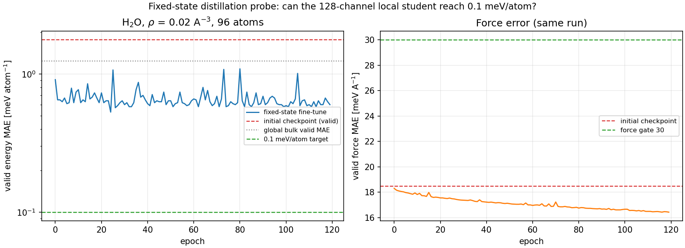
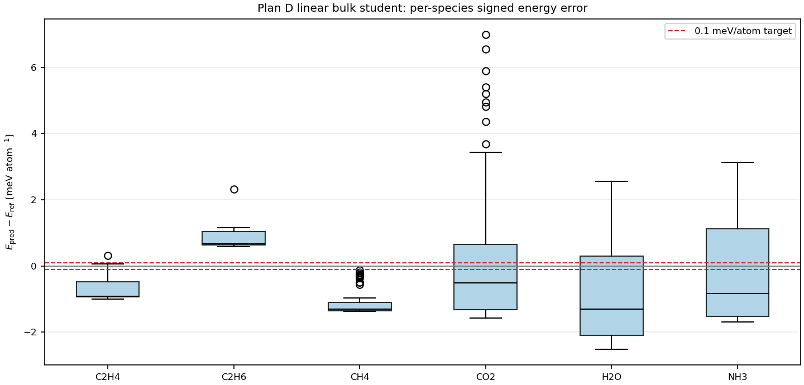

# Fixed-state distillation probe: can the local student reach 0.1 meV/atom?

**Question:** the global bulk distillation sits at 1.2 meV/atom. Is that a data
problem that active sampling can fix, or an architecture floor? The 0.1 meV/atom
target is 12× below the current value, so this needed a controlled test.

**Answer: it is an architecture floor, not a data problem.** Even after
fine-tuning on a single density and a single temperature, the 128-channel local
MACE contract plateaus at **0.5–0.6 meV/atom** (96-atom boxes) and **0.20–0.27
meV/atom frame-to-frame fluctuation** on the 1,152-atom production box.
Active sampling alone cannot reach 0.1 meV/atom with this model class.

## Protocol

| dataset | atoms | density | T | train / valid |
|---|---:|---|---:|---|
| fixed-state mixed T | 96 (32 H2O) | 0.020 molecules/ų | 250 / 300 / 400 K | 247 / 62 |
| fixed-state T300 | 96 (32 H2O) | 0.020 molecules/ų | 300 K | 80 / 23 |
| production box | 1,152 (384 H2O) | same OFF box | 300 K | 100 frames, teacher energies only |

Model: the same 128-channel, 2-interaction linear MACE contract
(848k parameters, `r_max=5.0 Å`) initialized from `plan_d_bulk.model`.
Fine-tune: Adam, lr 1e-4 (5e-5 for T300), `energy_weight=20`,
`forces_weight=20`, batch 8, 120/100 epochs.

## Result

| test | initial E MAE | fine-tuned E MAE | E fluctuation (std) | initial F MAE | final F MAE |
|---|---:|---:|---:|---:|---:|
| fixed-state mixed T (62 frames) | 1.77 | **0.60** (0.79 FP64) | 0.73 | 18.5 | 16.4 |
| fixed-state T300 (23 frames) | 1.77 | **0.60** | — | 18.5 | 14.9 |
| production box 1,152 atoms (100 frames) | 0.21 offset / 0.24 MAE | **0.86 offset / 0.20 MAE** | **0.27** | — | — |

Notes:

- The fixed-state training error is also 0.5 meV/atom, so this is an
  underfitting/representation limit, not a train-valid gap.
- The global 1.2 meV/atom splits into ~0.3 meV/atom of per-species constant
  offsets plus ~0.94 meV/atom of genuine fluctuation; CO2/H2O/NH3 dominate
  (std 1.5–2.1 meV/atom). A per-species offset fitted on half the data
  transfers to the other half (1.235 → 0.937 meV/atom), so the offsets are
  real but removing them does not approach 0.1 either.
- Single-T versus mixed-T makes no difference (0.60 both). The plateau is not
  caused by temperature interpolation.
- On the production box the constant offset grows (0.86 meV/atom), but it
  cancels in reweighting; the relevant frame-to-frame fluctuation is
  **0.27 meV/atom std / 0.20 meV/atom MAE after offset removal**.
- Force error falls only from 18.5 to 14.9 meV/Å; it remains far above the
  ~1 meV/Å level that would accompany 0.1 meV/atom.

## Why 0.1 is below the local floor

The teacher (`MACE-POLAR-1-M`) carries l=1 atomic multipoles and exact Ewald.
Its intermolecular long-range term in dense water varies by 4.3–5.8 meV/atom
and 36–64 meV/Å RMS across configurations. A local model with `r_cut=5.0 Å`
can learn the mean-field part, but not the configuration-dependent tail; the
residual is the observed 0.2–0.6 meV/atom. More data or active sampling cannot
create the missing functional form.

## What the 0.1 target requires

1. **Charge/multipole head + long-range electrostatics.** Distil the teacher's
   per-atom charges (the `add_teacher_charges.py` path already works; 174 bulk
   + 99 gas frames were labelled as a smoke test) and add the Ewald/mean-field
   correction. This is the physically correct route and also serves the
   polarization/c1-c2 deliverable.
2. **Or a larger local model.** 192–256 channels and `r_max=6.0 Å` would lower
   the floor, but the estimate from the 128→192 polar scaling is only ~1.5–2×,
   i.e. ~0.3 meV/atom, not 0.1. It also costs speed and does not add charges.

## Recommendation

- Do **not** spend another active-sampling round on the 128-channel local
  model for a 0.1 target; the ceiling is measured.
- If 0.1 meV/atom is a hard requirement, start the charge-head + Ewald
  student (Plan D-Polar). The existing 128L1 polar student (3.8 / 6.1 at
  91.6 µs) is the accuracy fallback, not the final model.
- If ~0.2 meV/atom relative and ~1 meV/atom absolute are acceptable, the
  current local student is already at that level and active sampling can be
  used only to improve the worst species (CO2/H2O/NH3), not to break the floor.

## Artifacts

- `bench/plan_d_bulk_2026-10-25/fixed_state/` (datasets, logs, models,
  `baseline_eval.json`, `final_signed.json`, `T300/production_box.json`)
- `bench/plan_d_bulk_2026-10-25/analyze_energy_offsets.py`
- `bench/plan_d_bulk_2026-10-25/fixed_state/make_fixedstate_figure.py`
- `bench/plan_d_bulk_2026-10-25/results/energy_offset_audit.json`
- figure `docs/results/figures/FIXEDSTATE_PROBE_2026-10-26.png`
