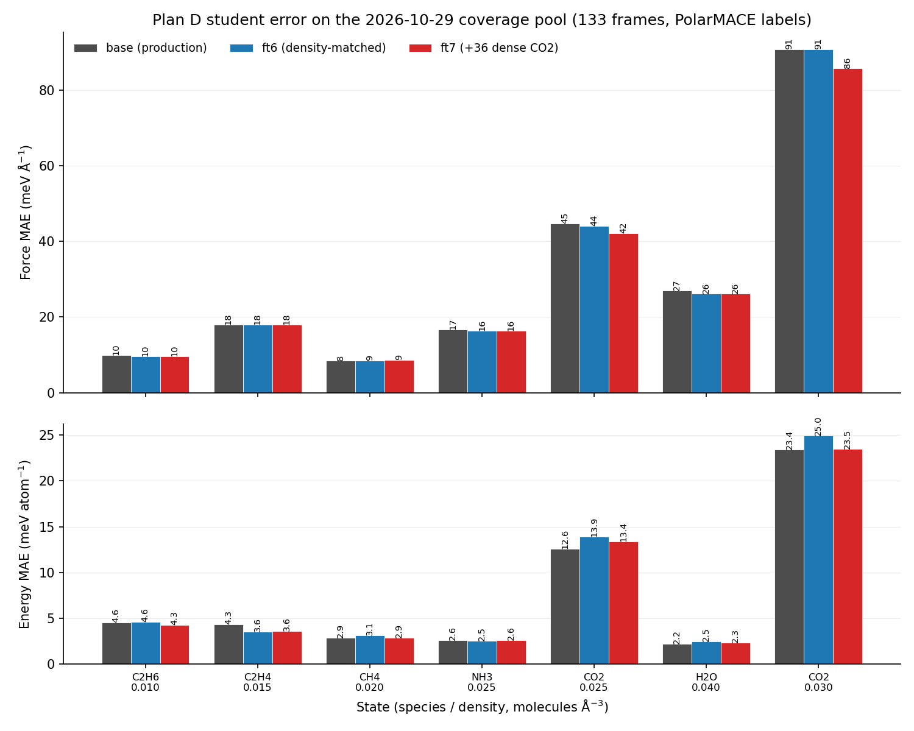
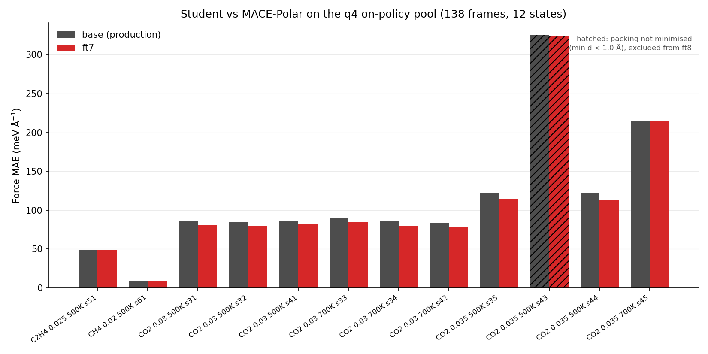

# Plan D distillation force error after the 2026-10-29 coverage sampling

Status note, 2026-10-29 05:30 UTC. All numbers are measured from the files
under `bench/plan_d_ft7_20261029/results/`; labels are PolarMACE-1-M FP64.

## What was added

- Coverage-pool sampling (MACE-OFF23 sampler, teacher labels):
  `data_20261028_new/labeled_dense_20261029a.xyz`, 133 frames / 48,448 atoms.
  States: CO2 0.025 (21) and 0.03 (7, truncated run), H2O 0.04 (21),
  C2H4 0.015 (23), C2H6 0.01 (23), CH4 0.02 (23), NH3 0.025 (13).
- Active selection (`scripts/select_active_frames.py`): 133 candidates,
  85 kept (top 60 % per state by student–teacher force difference,
  min 3 per state) -> `bench/plan_d_ft7_20261029/selected_dense_test.xyz`.
- ft7 fine-tune: ft6 + 36 on-policy CO2 frames at 0.03/0.035
  (`train_ft7.xyz`, 24,054 frames total), lr 2e-6, 2 epochs, warm start from
  `plan_d_bulk.model`. Training finished 03:24.

## Force error (meV/Å) / energy error (meV/atom)

| Set | base (production) | ft6 | ft7 |
|---|---:|---:|---:|
| Old valid, 3,465 frames | 1.124 / 7.753 | 1.210 / 7.526 | 1.30 / 7.55 |
| Field holdout v2, 228 frames | 5.174 / 31.401 | 5.598 / 31.042 | **5.364 / 30.558** |
| Field holdout v2, CO2 only (102) | 8.974 / 42.370 | 10.186 / 41.964 | 9.790 / 40.550 |
| Coverage pool, 133 frames | 4.857 / 20.395 | 4.966 / 20.109 | **4.748 / 19.802** |
| CO2 0.025 (21) | 12.57 / 44.77 | 13.88 / 44.06 | 13.38 / 42.12 |
| CO2 0.03 (7) | 23.40 / 90.70 | 24.96 / 90.70 | 23.48 / **85.71** |
| H2O 0.04 (21) | 2.20 / 27.05 | 2.50 / 26.15 | 2.32 / 26.18 |
| NH3 0.025 (13) | 2.63 / 16.62 | 2.54 / 16.42 | 2.63 / 16.43 |
| C2H4 0.015 (23) | 4.33 / 18.05 | 3.54 / 18.08 | 3.59 / 18.09 |
| C2H6 0.01 (23) | 4.56 / 9.93 | 4.61 / 9.69 | 4.26 / 9.65 |
| CH4 0.02 (23) | 2.85 / 8.47 | 3.12 / 8.56 | 2.89 / 8.60 |

## Reading

1. The in-distribution force error has plateaued: 7.75 -> 7.53 (ft6) -> 7.55
   (ft7) on the 3,465-frame gate. ft7 gives back the old-gate energy gain that
   ft6 had (1.21 -> 1.30) but keeps the force edge.
2. The residual is a density-extrapolation problem, not a fitting problem.
   Force error tracks density monotonically: 8.6-18 at 0.01-0.02,
   42 at CO2 0.025, **86 at CO2 0.03**. The old corpus ceiling is 0.02 for CO2.
3. The first 36 frames above the ceiling do move the headline, but only by
   -5.5 % (90.70 -> 85.71 at 0.03; 44.77 -> 42.12 at 0.025). Extrapolating
   that gain, closing 0.03 to the ~20 meV/Å band needs O(300-500) frames at
   0.03-0.035, not O(50).
4. The energy cost of the density extension persists (CO2 0.025: 12.6 -> 13.4);
   weight 1:20 energy:force with lr 2e-6 cannot absorb a 50 % density jump
   without a small energy regression.

## Next

- Current site-field runs (4 states, 21 frames each, ETA ~05:42 UTC) are
  second seeds at 0.025/0.015/0.01/0.02 — they thicken the shoulder, not the
  0.03 ceiling. CO2 reaches 0.03/0.035 later in the same queue (9 states per
  species at ~70 min/state).
- Fold the 85 selected frames + all 0.03/0.035 CO2 states into ft8; do not
  re-weight energy above 1.0 until the 0.03 force plateaus.
- NH3 0.03 fails twice with "Lost atoms" (density too high for the 1 fs / 0.5 fs
  setup); keep NH3 at <=0.025 or lower the timestep before retrying.

## 07:30 UTC — first look at the q4 on-policy pool

The q4 tasks submitted at 05:38 have delivered 138 frames / 12 states so far
(10 CO2 0.03-0.035 states plus one C2H4 0.025 and one CH4 0.02 state; 8 states
still running). Pool: `data_20261028_new/q4_dense_20261029.xyz`; labels are
the sampler's own MACE-Polar energies/forces renamed to REF_*.

| State group | base | ft7 |
|---|---:|---:|
| CO2 0.03 (6 states, 72 frames) | 83-90 | 78-84 |
| CO2 0.035, clean (s35/s44/s45, 36 frames) | 122-215 | 114-214 |
| CO2 0.035, s43 (packing not minimised) | 325 | 324 |
| C2H4 0.025 (9 frames) | 49.1 | 49.1 |
| CH4 0.02 (9 frames) | 8.3 | 8.5 |

- The 0.03 plateau is consistent across six independent on-policy states
  (83-90 meV/A), so 85.7 on the earlier dense pool was not a fluke.
- Equilibrium 0.035 sits at ~110-125 meV/A (relative to a 1.1 eV/A mean force,
  i.e. ~10 %); s43 starts at min d = 0.93 A because its FIRE pre-relaxation did
  not converge, and its 325 meV/A outlier must not be read as a model failure.
  Drop s43-type frames (min d < 1.0 A) or re-run the state after a proper
  minimise before using it in ft8.
- C2H4 0.025 is a real new gap (49 vs 18 at 0.015) and needs its frames in ft8.

## Artifacts

- `bench/plan_d_ft7_20261029/results/{base,ft6,ft7}_on_dense_20261029a.json`
- `bench/plan_d_ft7_20261029/results/{base,ft6,ft7}_on_holdout_v2.json`
- `bench/plan_d_ft7_20261029/selection_report_test.json`
- `bench/plan_d_ft7_20261029/models/ft7/plan_d_bulk_ft7_20261029.model`
- `docs/results/figures/FORCE_ERROR_BY_STATE_2026-10-29.png`
