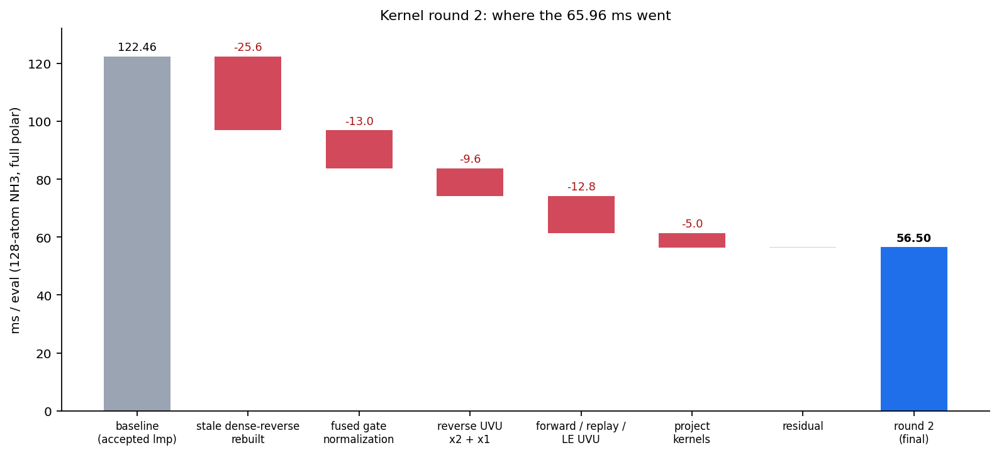
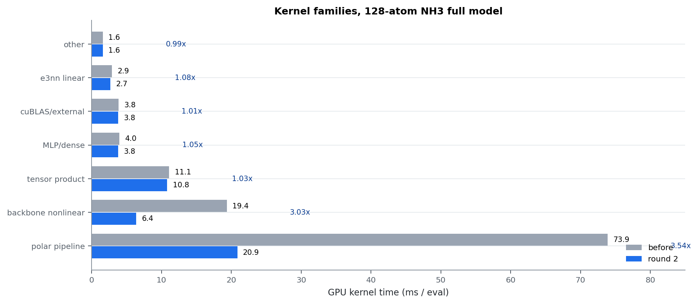
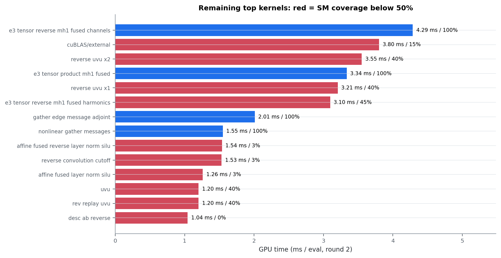

# Results — Kernel Round 2 (2026-10-19)

**中文摘要：** 128 原子全模型 122.46 → 56.50 ms/eval（2.17×；相对 v29
3.25×；相对 v28 123×），polar-off 40.58 → 27.66 ms，432 原子 294.39 →
126.59 ms/step；全部数值门通过。最大发现是旧 object 导致“已验收”二进制仍在
跑 26 ms 的 dense reverse 和未融合 normalization，强制重建后这两项单独省
~39 ms。剩余大头是 tensor product（10.81 ms）、cuBLAS（3.80 ms）、UVU
reverse（6.76 ms）和低覆盖 affine/convolution（4.33 ms）。

This is the accepted round-2 result. Every number is from
`bench/kernel_round2_2026-10-19/summary.json`; the gate details are in
[`../testing/GATES.md`](../testing/GATES.md).

## 1. Headline

| Metric | Before | After round 2 | Speedup |
|---|---:|---:|---:|
| NH3 128 atoms, full PolarMACE | **122.46 ms/eval** | **56.50 ms/eval** | **2.167×** |
| NH3 128 atoms, polar-off | 40.58 ms/eval | **27.66 ms/eval** | 1.467× |
| N2 432 atoms, full PolarMACE | 294.39 ms/step | **126.59 ms/step** | 2.325× |
| GPU busy (CUPTI, 128 atoms) | 116.66 ms | **49.97 ms** | 2.33× |

Cumulative, same model and hardware:

| Baseline | Time | Cumulative |
|---|---:|---:|
| v28 original | 6966.79 ms/eval | — |
| v29 | 183.78 ms/eval | 37.9× vs v28 |
| kernel round 1 | 122.21 ms/eval | 1.50× vs v29 |
| **kernel round 2** | **56.50 ms/eval** | **3.25× vs v29, 123× vs v28** |

The PyTorch `mace_polar` reference for the same frame is 94.0 ms/eval; the
engine is now **1.66× faster** than the reference.

## 2. Where the 65.96 ms went

| Source | Saved (ms/eval) | Note |
|---|---:|---|
| stale `polar reverse dense` object rebuilt | 25.59 | source already contained the 2-D kernel; the binary was stale |
| fused gate normalization reverse | 13.03 | the fused path was already written; stale object replaced |
| reverse UVU x2 + x1 | 9.59 | TeamPolicy + shared-memory weight tile, ascending accumulation |
| forward / replay / LE UVU | 12.81 | same smem tile scheme |
| project kernels (3 sites) | 5.00 | MDRange over (node, j) |
| residual / rounding | ~0.07 | — |

Two-thirds of the round-2 gain came from **activating already-written code**
that the accepted binary was not executing. This is why the round-2 report
starts with the stale-binary lesson, not with a source diff.

## 3. Per-kernel CUPTI (ms per eval, 128-atom full model)

| Kernel | Before | After |
|---|---:|---:|
| `polar reverse dense` | 26.00 | 0.41 |
| `reverse nonlinear normalization` | 13.03 | 0.00 (fused 0.17) |
| `polar reverse uvu mode0 x2` | 10.90 | 3.55 |
| `polar reverse uvu mode0 x1` | 5.45 | 3.21 |
| `polar uvu mode0` (forward) | 5.76 | 1.20 |
| `polar rev replay uvu mode0` | 5.77 | 1.20 |
| `polar le uvu mode0` | 4.59 | 0.91 |
| `polar scf project features` | 2.39 | 0.39 |
| `polar rev replay project` | 2.38 | 0.39 |
| `polar project features` | 1.22 | 0.21 |

## 4. Family roll-up (ms/eval)

| Family | Before | After | Speedup |
|---|---:|---:|---:|
| polar pipeline | 73.88 | **20.87** | 3.54× |
| backbone nonlinear | 19.37 | **6.38** | 3.04× |
| tensor product | 11.09 | 10.81 | 1.03× |
| MLP/dense | 3.96 | 3.78 | 1.05× |
| cuBLAS/external | 3.84 | 3.80 | 1.01× |
| e3nn linear | 2.89 | 2.68 | 1.08× |
| other | 1.59 | 1.60 | 0.99× |

## 5. What remains

Round 2 leaves 49.97 ms of GPU busy and 56.50 ms wall. The largest remaining
items are:

1. **Tensor products — 10.81 ms (19% of wall), already 100% SM-covered,
   compute-bound.** The next lever is FP64 tensor cores (DMMA) or a better
   contraction layout, not occupancy. Estimated 2–4 ms if a packed/batched
   path is feasible and gate-neutral.
2. **cuBLAS/external — 3.80 ms, 312 launches, 14.8% coverage.** Batch/group
   the small GEMMs; expected 2–3 ms.
3. **UVU reverse — 6.76 ms (x2 3.55 + x1 3.21), 39.5% coverage.** The smem tile
   is in place; the next step is a wider grid or a fused x1/x2 pass.
4. **Narrow affine / convolution kernels — 4.33 ms at 3% coverage.**
   `affine fused reverse layer norm silu` 1.54, `reverse convolution cutoff`
   1.53, `affine fused layer norm silu` 1.26. Parallelize over
   `(sample,width)` and by edge; expected 2–3 ms.
5. **Replay is no longer a major target.** The UVU rewrite reduced
   `polar rev replay uvu mode0` from 5.77 to 1.20 ms; eliminating replay now
   saves at most ~1–1.5 ms, so it is not the first priority. The earlier 8.6 ms
   replay figure was the pre-round-2 state.

## 6. Numerical validation

The incremental binaries were compared at the LAMMPS level on the 128-atom
input (PE and all 128×3 force components):

- r2 → r3 (project kernels): PE identical, max |dF| = 0.0
- r3 → r4 (reverse UVU smem): PE identical, max |dF| = 0.0
- r4 → r5 (forward/replay/LE UVU smem): PE identical, max |dF| = 0.0
- RN fallback 2-D vs scalar (with `MATOS_FUSED_GATE_REVERSE=0`): PE identical,
  max |dF| = 0.0

Every kernel change is bitwise-neutral on this model. The only non-bitwise
change relative to the accepted binary is the activation of the already-written
fused gate-reverse path, which is more accurate (module-5 dens abs dropped to
6.7e-8).

## 7. Gates

All required gates pass on the final build; see
[`../testing/GATES.md`](../testing/GATES.md) for definitions and commands.

| Gate | Verdict | Key metric |
|---|---|---|
| module 5 | PASS | dens abs 6.689e-8 / rel 4.218e-8 |
| module 6 | PASS | dE rel 1.095e-15, abs 5.551e-16 eV |
| module 7 | PASS | stage rel 1.174e-7, out 4.546e-7 |
| module 8 | PASS | FD 5.783e-4, parity 7.191e-7 |
| end-to-end | PASS | 32/32, dE rel 1.084e-11, dF 1.624e-7 |
| LAMMPS 1-rank | PASS | dE 2.910e-11 eV, dF 2.579e-14 eV/Å |

## 8. Rejected / not pursued

- UVU mode-1 kernels (0.61–0.67 ms each) were left as MDRange; a smem rewrite
  would save well under 1 ms.
- The RN 2-D fallback is dormant for this model (fused path used); it is kept
  as the safety net and was proven bitwise with the env revert.
- Further tensor-product work was not attempted in this round: those kernels
  already run at 100% coverage; the next attempt must target math throughput
  (DMMA) rather than occupancy.
- No FP32/TF32 path was introduced; it would violate the gate.

## 9. Artifacts and reproduction

- Report: `bench/kernel_round2_2026-10-19/FINAL_REPORT.md`
- Summary: `docs/examples/data/kernel_round2_summary.json`
- Families: `docs/examples/data/kernel_round2_families.csv`
- Labels: `docs/examples/data/kernel_round2_labels.csv`
- Traces: `bench/kernel_round2_2026-10-19/analysis_exact/` and `trace_runs/`
- Gates: `bench/kernel_round2_2026-10-19/gates/`
- Figures: `docs/figures/13_*` … `16_*`
- Final binary snapshot: `lmp_r5` sha256
  `54d8fe3978aa07f559224cea048489b1e433981804c45566a52a94bc1baef855`;
  the shared build measured 55.97 ms/eval at the check.
- Protocol: [`../testing/BENCHMARKS.md`](../testing/BENCHMARKS.md).
