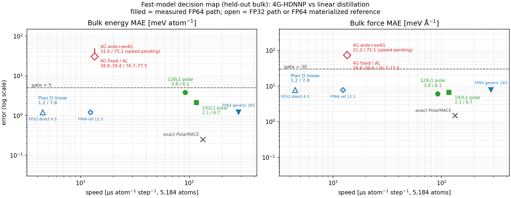

# 4G vs linear distillation: route decision (2026-10-26)

**Question:** should the next training round go into the new 4G-HDNNP model
(wide + ee4G, v2 baseline queued) or into distilling the linear MACE student?

**Answer: make the linear distillation the main line. Stop pushing 4G accuracy
as the primary route.** The linear student already passes the accuracy gate by
4× in both energy and force, at a measured FP32 speed of 4.5 µs/atom/step and
a comparable FP64 materialized reference (~12.3 µs, still to be measured on
this exact student). The 4G route is 6.2× / 2.5× above the same gate after the
wide + ee4G rewrite, active learning moves it by ~1 %, and the overfit probe
shows the descriptor cannot go below ~60 meV/Å even on its own 8 training
frames. That is a missing-physics problem (l=1 multipoles + thin angular
basis), not a data or capacity problem.

## 1. Numbers

All accuracy values are held-out bulk frames (253 frames, 1,731-frame bulk
subset), except the gas column noted separately.

| model | bulk E | bulk F | gate 5 / 30 | speed (5,184 atoms) |
|---|---:|---:|---|---:|
| 4G fixed (c1) | 39.44 | 77.48 | 7.9× / 2.6× over | 13.45 µs FP64 (60 CG) |
| 4G + local AL | 38.79 | 76.70 | 7.8× / 2.6× over | 13.45 µs FP64 |
| 4G wide + ee4G | **31.01** | **75.06** | **6.2× / 2.5× over** | speed not measured (v2 queued; original 4G is 13.45) |
| 4G wide + ee4G, best-by-E | 27.14 | 118.98 | 5.4× / 4.0× over | same |
| **Plan D linear** | **1.2** | **7.8** | **passes (4.2× / 3.8× margin)** | 4.47 µs FP32 measured |
| Plan D linear, FP64 generic | 1.2 | 7.8 | — | 284.8 µs measured |
| Plan D linear, FP64 materialized ref | 1.2 | 7.8 | — | ~12.3 µs (MACE-OFF23 ref, not yet student) |
| 128L1 polar student | 3.8 | 6.1 | passes | 91.64 µs FP64 |
| 192L1 polar student | 2.1 | 6.7 | passes | 116.84 µs FP64 |
| exact PolarMACE | 0 | 0 | reference | 133.04 µs FP64 |

Plan D gas gate: 0.924 meV/atom / 3.984 meV/Å on 432 held-out gas frames.
The 50 ps reweighting pilot adds an independent check on the ensemble:
Plan D → MACE-POLAR ΔE/atom std is **0.243 meV/atom** (ESS 3.37 %, marginal),
i.e. the linear model is energetically very close to the teacher on the
sampled dense-water configurations.

## 2. Why not continue 4G as the main line

1. **Accuracy is not close.** Even the best 4G checkpoint is 5.4× over on
   energy and 4.0× over on force. The wide + ee4G rewrite cost a large
   descriptor (24 G4, 16 RBF) and still sits at 31 / 75.
2. **Active learning does not move it.** A 40-frame committee/ACF/FPS round
   changed bulk E by −1.6 % and bulk F by −1.0 %; gas F got worse. The
   bottleneck is not sample count.
3. **The descriptor is the floor.** The overfit probe cannot drive the force
   error below ~60 meV/Å on the 8 frames it is trained on. Adding width/layers
   cannot fix this.
4. **The missing physics is named.** The teacher's intermolecular long-range
   term in dense water is 4.3–5.8 meV/atom and 36–64 meV/Å RMS; 4G has
   monopole-only QEq, while the teacher has l=1 multipoles plus exact Ewald.
   The dense-state force error (338.8 meV/Å at ρ=0.02) is exactly that term.
5. **The speed advantage has evaporated.** The original 4G FP64 is
   13.45 µs/atom/step; the linear FP64 materialized path is ~12.3 µs on the
   paper-comparable reference. The wide + ee4G model is *slower* than the
   original 4G (larger descriptor) and its speed is not yet measured; the v2
   baseline will provide it. There is no longer a 2–4× reason to accept a 6×
   accuracy deficit.

## 3. Why the linear student

1. It passes both gates on the real bulk set (1.2 / 7.8), not only gas.
2. Its FP32 speed matches the paper's linear baseline (4.47–4.50 µs).
3. Its FP64 materialized reference (~12.3 µs) is inside the 20–40 µs budget;
   the remaining work is a measurement on this student, not new physics.
4. The full-corpus active-learning round (24,776 frames) is already queued as
   `t-20261026135843-f6bq5`; it can only improve the data coverage, and it is
   not blocking the decision.

## 4. The one thing the linear student cannot do

The linear student has **no charge head**: its training data carry only
`REF_energy` / `REF_forces`, and the model emits no per-atom charges or
dipoles. For the polarization/c1-c2 line, that is a hard gap. The 4G model is
the only fast model with explicit QEq charges, but its accuracy fails and its
monopole-only electrostatics is the main error term, so "continue 4G" does not
solve the polarization requirement either.

If charges are required, the cheaper path is:

1. add a per-atom charge head to the already-accurate linear backbone;
2. distil MACE-POLAR per-atom charges on the same 26,841 frames (teacher calls
   are static, no new MD);
3. add the fixed-charge Gaussian-Ewald mean-field correction (already
   prototyped: correlates 0.73–0.76 with the teacher k-space term and reduces
   its RMS to 32–41 meV/Å after one fitted scale);
4. gate charges against MACE-POLAR and energy with the correction.

This preserves the 1.2 / 7.8 short-range accuracy and adds the missing
long-range piece at the linear-path speed. It is a much smaller project than
implementing l=1 multipole Ewald inside 4G.

## 5. Decision and next actions

1. **Main line = Plan D linear distillation.** Keep the queued full-AL round;
   do not queue another 4G accuracy round.
2. **Gate the FP64 path now:** run the student JSON through the materialized
   FP64 path at 5,184 atoms and record µs/atom/step. Kill criterion: if
   >40 µs, profile the materialized kernel before any more training.
3. **4G v2 baseline** (`t-20261026164227-vvhlh`) is already queued; let it
   finish as the last 4G accuracy data point. Kill criterion: if it does not
   reach ≤20 meV/atom and ≤50 meV/Å, close the 4G accuracy line.
4. **Charge branch:** only if the polarization deliverable is prioritized,
   start the charge-head + Ewald correction on the linear backbone; keep the
   128L1 polar student (3.8 / 6.1 at 91.6 µs) as the accuracy fallback.

## Artifacts

- figure `docs/results/figures/MODEL_ROUTE_DECISION_2026-10-26.png`
- generator `docs/results/figures/make_model_route_decision.py`
- evidence: `docs/results/PLAN_C_4G_STATUS_2026-10-25.md`,
  `docs/results/PLAN_C_4G_LOCAL_AL_2026-10-26.md`,
  `docs/results/PLAN_C_4G_WIDE_EE4G_2026-10-26.md`,
  `docs/results/PLAN_D_REWEIGHT_PILOT_2026-10-26.md`,
  `bench/plan_d_bulk_2026-10-25/logs/plan_d_bulk_run-42_debug.log`
