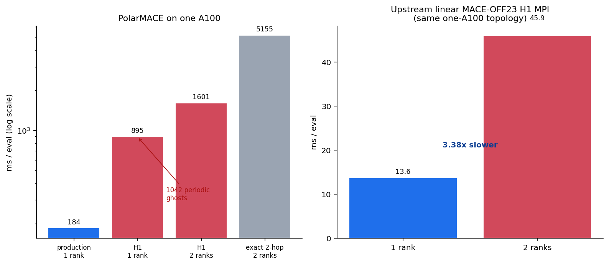
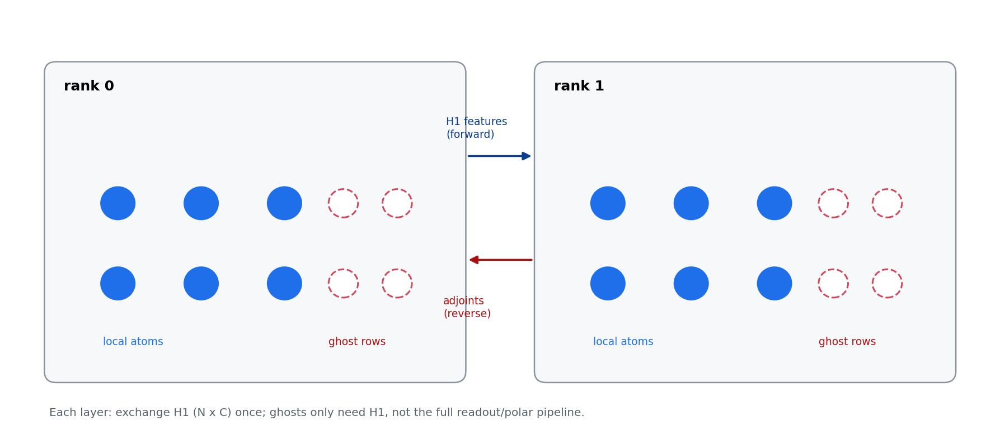

# Results — MPI H1: One-Rank Fix Accepted, Two-Rank Blocker (2026-10-20)

**中文摘要：** H1 的 1-rank 缺陷已修复：把 1-rank 图折叠到 local atoms，
H1 1-rank 从 **418.64 ms 降到 50.20 ms**，与默认路径的 50.84 ms 持平
（0.99×），同二进制 A/B 为 176.77 → 54.62 ms（3.24×）。1-rank parity
dE=0、max dF 1.41e-15 eV/Å，20-step NVT 稳定。**2-rank 仍被引擎侧
workspace 分配阻塞**：当前源码在 2 ranks 下每个 rank 分配 6 个 2.0–5.4 GiB
workspace（合计 ~21 GiB/rank，峰值 80,966 MiB），exact 2-hop OOM；H1 2-rank
SIGSEGV；kernel round-3 构建 `86bb29b1` 则报 `cudaErrorIllegalAddress`。
这是引擎侧问题，已启动专门的 2-rank workspace 修复。

## 1. Status summary

| Item | State |
|---|---|
| H1 1-rank, final binary | **50.20 ms** (default 50.84; **0.99x**) |
| H1 1-rank, baseline snapshot | 418.64 ms (default 122.80; 3.41x slower) |
| Same-binary A/B of the one-rank fold | 176.77 → 54.62 ms (**3.24x**) |
| H1 1-rank absolute gain | **8.34x** (baseline snapshot → final binary) |
| H1 1-rank parity | **PASS**: dE = 0.0 eV, max dF = 1.41e-15 eV/Å |
| Exact 2-hop 1-rank parity | **PASS**: dE = 0.0, max dF = 1.54e-15 eV/Å |
| 20-step NVT, H1 1-rank | **PASS**: 128 atoms, no lost atoms, drift 4.74e-14 Å / 4.70e-14 eV/Å |
| H1 2-rank | **BLOCKED** by engine workspace sizing (SIGSEGV on agent builds) |
| Exact 2-hop 2-rank | **BLOCKED** by engine OOM |
| Final binary | `08cb7847ffb1a804306907c56fcee800fd795e15da63105ed6cc296f8a7a69c8` |

## 2. Root cause and fix (one rank)

The H1 mode built a local+ghost engine graph even on one rank. LAMMPS'
periodic self-swaps made it legal but useless: **1170 node rows** (128 local +
1042 periodic images) instead of 128, i.e. 9.1x the node-only work of the
production one-rank path. The pre-fix cost decomposition (per compute, ms):

| component | default (128 nodes) | H1 pre-fix (1170 nodes) | delta |
|---|---:|---:|---:|
| entry | 2.02 | 2.19 | +0.18 |
| forward backbone + 2 H1 syncs | 10.70 | 42.93 | +32.23 |
| polar forward (stages 2–7, Coulomb, LE) | 19.21 | 95.65 | +76.44 |
| polar reverse (UVU, replay, embedding, MLP) | 62.44 | 225.64 | +163.20 |
| backbone reverse + 1 H1 sync | 29.57 | 57.77 | +28.20 |
| **sum** | **124.0** | **424.2** | **+300.3** |

The fix (pair-style only; `pair_symmetrix_mace_kokkos.cpp`):

- one-rank graph folded onto local atoms through the atom map
  (`:2640-2645`, edge remap `:2741-2745`);
- no communication-cutoff extension on one rank (`:803`);
- exchange hooks remain installed but are zero-sized when there are no ghost
  rows (`:2762-2792`), avoiding LAMMPS periodic self-swap writes;
- H1 exchange uses device-side Kokkos pack/unpack with
  `reverse_comm_device = 1` (`:497`, `:959/1057/1158/1279`; host fallbacks
  `:889/1003/1105/1210`).

The same-binary A/B isolates the change: the old 1170-node graph costs
**176.77 → 54.62 ms (3.24x)** even after device staging. The final stage
profile is flat versus the default path; the H1 hooks are 0.13% of the compute
on one rank.

## 3. Two-rank blocker (engine-side, not pair-style)

The current engine source is not runnable on two ranks:

- **Default / exact 2-hop:** peak GPU memory **80,966 MiB of 81,920 MiB**;
  abort on a 1.28–1.34 GiB allocation. An `LD_PRELOAD` cudaMalloc tracer shows
  six workspaces per rank:
  **2.03 + 2.13 + 3.20 + 3.36 + 5.12 + 5.37 ≈ 21 GiB/rank**, allocated from
  `MaceNonlinearKokkosT::compute_node_energies_forces` → `ensure_view` and
  `AffineMLPKokkosT::prepare` / `forward_impl`. The 2-rank graph has
  **2481/2581 nodes and 74,472/78,156 edges** (rank 0/1).
- **H1 path:** ~3.6 GB peak, SIGSEGV after graph construction. The same input
  with the pre-change pair style on the current engine also SIGSEGVs, while
  the 09:22 binary runs it — so the regression is engine-side.
- **Kernel round-3 build `86bb29b1`:** both default and H1 2-rank abort with
  `cudaErrorIllegalAddress` instead of OOM; the default path does not execute
  H1 pair code, confirming it is engine-side.

The MPI agent proposed and the coordinator launched a dedicated fix round:

1. size the `ensure_view` workspaces (and `AffineMLPKokkosT` forward buffers)
   by **owned/local rows and local edges**, or add a capacity guard that
   scales them down for multi-rank graphs;
2. add an extent assertion at the multi-rank entry that every per-node and
   per-edge view covers `num_nodes`/`num_edges` before the first kernel.

Until this lands, H1 2-rank and exact 2-hop 2-rank cannot be measured or
gated, and the device-staged exchange (validated on one rank through real
self-swaps) remains unvalidated over real MPI.

## 4. What is inherent on one shared A100

All ranks share one GPU, so multi-rank cannot win wall-clock by construction.
The H1 design runs the complete node pipeline (including the polar k-space
Coulomb chain) on every ghost row on every rank. On the 128-atom system each
2-rank process carries ~836 ghost rows against ~64 local rows; the aggregate
node work is ~1.5x the one-rank H1 graph and the GPU serializes it: 2 ranks
measure ~2x the one-rank stage times despite fewer nodes per rank. No
pair-style change can remove that duplication without engine support; the only
pair-side win was the one-rank folded graph, now in place.

Ghost compaction cannot help: a geometric reconstruction shows all 861 ghosts
within the 8 Å communication cutoff are within \(r_c=6\) Å of a local atom
(0% unused). The real multi-rank win requires one rank per GPU and a larger
system (432/1024 atoms) where the ghost ratio is smaller.

## 5. Planned 2-GPU test

- Queue: `devinstance-queue3`, flavor `ml.pni2.4xlarge` (2×A100-80G, 16C).
- Systems: 128 (worst case), 432, 1024 atoms.
- Modes: H1 exact, exact 2-hop control; 1/2 ranks; parity + 20-step NVT.
- Metrics: ms/eval or ms/step, speedup vs 1 rank, ghost ratio, communication
  fraction, per-rank utilization.
- Acceptance: dE ≤5e-5 eV, max dF ≤1e-4 eV/Å, no lost atoms.
- Prerequisite: the engine 2-rank workspace fix above must pass 2-rank parity
  on one GPU first (runnable, even if slow), then the same package runs on
  two GPUs.

## 6. Operational state

- The 1-GPU remote probe `t-20261019191724-4zbd7` (`queue004`) was still
  `queued` at the last check; it validates the self-contained remote package
  and measures 1-rank baselines for 128/432/1024 atoms.
- The 2-GPU submit to `devinstance-queue3` returned `SubmitOutcomeUnknown`
  (Volc CLI exit 255); the local reservation `pending-7dea5a64…` holds 2 GPUs
  and must be reconciled by task name/workdir before a resubmit.
- Queue3 reported `freeGpuCount=0`; queue004 has 12 free GPUs but a hard
  1-GPU/task policy and no 2-GPU flavor.

## 7. Artifacts

- `bench/mpi_h1_opt_2026-10-19/FINAL_REPORT.md` (full agent report)
- `docs/results/MPI_H1_AGENT_REPORT.md` (copy)
- `docs/examples/data/mpi_h1_opt_summary.json`
- `docs/figures/17_mpi_h1_diagnosis.png`, `18_mpi_h1_schematic.png`,
  `19_mpi_h1_final.png`
- Final binary snapshot: `bench/mpi_h1_opt_2026-10-19/lmp_mpi_final`
  (`08cb7847…`)
- Gate JSONs: `bench/mpi_h1_opt_2026-10-19/gates/gate_final/parity.json`,
  `gates/gate_fix2/`, `nvt/`
- 2-rank memory trace: `bench/mpi_h1_opt_2026-10-19/gates/sc2/memwatch.log`
- 2-rank fix round: `bench/mpi_2rank_fix_2026-10-19/` (in progress)
