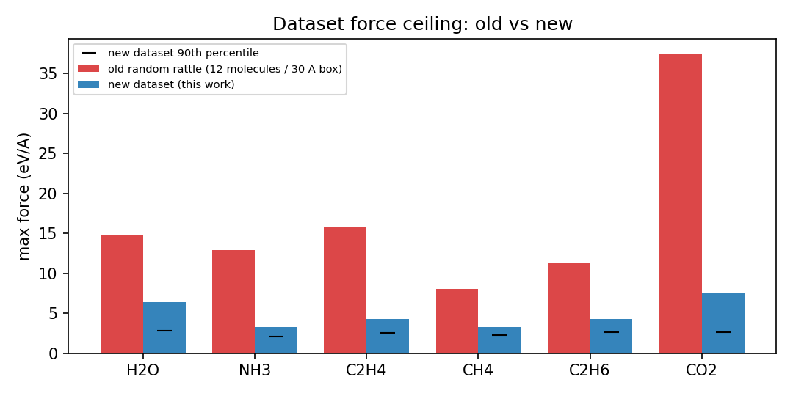

# Path B: narrow-domain PolarMACE distillation (six molecules)

Generated: 2026-10-22 08:25 UTC

Prototype only. The teacher checkpoint and any deployed model are untouched.

**Status: dataset and trainer configuration are complete; the A100 smoke was NOT run because the only local GPU was continuously occupied by external jobs.** The trainer path, data loading, E0/statistics handling, one training epoch on CPU, checkpoint save, and `mace_polar` checkpoint reload were validated. The GPU command below is ready to run unchanged once the GPU is free.

GPU blocker evidence (recorded at the time of the attempted launch): `nvidia-smi` reported 99-100% utilization with 3-5 external compute processes (~0.5-0.7 GB each, none owned by this session; `[Not Found]`/invisible PIDs), and memory fluctuating between 1.5 and 11.5 GB. No GPU job was submitted, per the task constraint.

## 1. Teacher

- Model: `/workspace/group/shared/bza/task3_sampling_database/mlip/models/mace-polar/MACE-POLAR-1-M.model`
- SHA-256: `fab8b8713c832f31a2a853aaa22fd638be8a369cbf5095e6b3e982a18d10e93a` (68,133,235 bytes).
- Architecture: PolarMACE, 15,238,498 parameters, r_max 6.0 A, 2 interactions, 512 channels, hidden irreps up to l=2 with edge spherical harmonics l<=3, atomic multipoles l=1, field features l=1, 2 SCF recursion steps, exact Ewald.
- Reference E0s used for the student (teacher values): H -15.99000358581543, C -1037.1678466796875, N -1490.378173828125, O -2047.592529296875 eV.

## 2. Dataset

- Path: `/workspace/group/shared/bza/symmetrix-polar/bench/path_b_distill_2026-10-22/data/train.xyz` and `/workspace/group/shared/bza/symmetrix-polar/bench/path_b_distill_2026-10-22/data/valid.xyz`
- Protocol: one molecule per 16 A cubic periodic box; teacher-relaxed equilibrium (fmax < 0.01 eV/A), 45 Gaussian rattles with sigma in [0.004, 0.020] A, and NVT Langevin snapshots at [300.0, 600.0, 800.0] K (400 steps, dt=0.5 fs, 20 steps between frames).
- Teacher: FP64, GPU. Filter: f_max <= 25.0 eV/A, min interatomic distance >= 0.7 A.
- Totals: 457 train + 107 held-out configs.

| species | atoms | configs | train | valid | E spread (eV) | f_max (eV/A) | f_rms mean (eV/A) |
|---|---|---|---|---|---|---|---|
| H2O | 3 | 94 | 76 | 18 | 0.397 | 6.38 | 0.697 |
| NH3 | 4 | 94 | 76 | 18 | 0.266 | 3.25 | 0.535 |
| C2H4 | 6 | 94 | 77 | 17 | 0.519 | 4.34 | 0.625 |
| CH4 | 5 | 94 | 76 | 18 | 0.354 | 3.27 | 0.513 |
| C2H6 | 8 | 94 | 76 | 18 | 0.604 | 4.29 | 0.563 |
| CO2 | 3 | 94 | 76 | 18 | 0.222 | 7.54 | 0.893 |



- Teacher-labelling wall time: 2000 s (~33.3 min) for all six species, including FP64 teacher MD and one-off kernel warmup. Per-species times: H2O 249 s, NH3 368 s, C2H4 593 s, CH4 419 s, C2H6 199 s, CO2 173 s.

Old random-rattle smoke (same teacher, 12 molecules per 30 A box) had excessively high forces, e.g. CO2 max f = 37.47 eV/A and H2O max f = 14.80 eV/A. The new dataset caps at the values above (all <= 25 eV/A filter; actual max 7.54 eV/A).

## 3. Student

- Trainer: `mace.cli.run_train` from mace 0.3.16; it exposes `--model PolarMACE` plus the PolarMACE electrostatic flags used here, and consumes the YAML via `--config`. Runtime: Python 3.11.15, torch 2.5.1+cu121, ASE 3.28.0, CUDA 12.2 driver, A100-SXM4-80GB; `PYTHONPATH` includes graph_electrostatics-0.4.0.
- Config: `/workspace/group/shared/bza/symmetrix-polar/bench/path_b_distill_2026-10-22/student/student128_config.yaml`
- Parameters: 2041489 (2.04 M), i.e. 7.5x smaller than the teacher. (Count verified by direct model construction and by loading the CPU-validation checkpoint.)
- Backbone: 128 channels, max_L=2 (128x0e+128x1o+128x2e), max_ell=3, 2 interactions, correlation 3, MLP_irreps 32x0e, radial MLP [64,64,64], r_max 6.0 A.
- Electrostatics: identical PolarMACE settings to the teacher (kspace factor 1.5, multipoles l=1 with 1.5 A smearing, field features l=1 widths [1.5,3.0], norms [20,20,0.5,0.5] -> [20,20,0.5,0.5,0.5,0.5,0.5,0.5], 2 recursion steps, self-interaction and local-electron-energy on).
- Loss: `ef`, energy_weight 1.0, forces_weight 50.0, Adam lr 3e-3, batch 16, float32.
- Expected statistics from the 457-config train set (teacher E0s): atomic_inter_shift = -0.072851 eV/atom, atomic_inter_scale = 0.729521 eV/A.

Exact command:

```bash
export PYTHONPATH=/workspace/group/shared/bza/external-repos/graph_electrostatics-0.4.0
/opt/matos-tools/conda/envs/matos-compute/bin/python -m mace.cli.run_train \
  --config /workspace/group/shared/bza/symmetrix-polar/bench/path_b_distill_2026-10-22/student/student128_config.yaml --name path_b_student128
```

Validation command (after the smoke finishes):

```bash
/opt/matos-tools/conda/envs/matos-compute/bin/python /workspace/group/shared/bza/symmetrix-polar/bench/path_b_distill_2026-10-22/scripts/validate_student.py \
  --teacher /workspace/group/shared/bza/task3_sampling_database/mlip/models/mace-polar/MACE-POLAR-1-M.model \
  --student /workspace/group/shared/bza/symmetrix-polar/bench/path_b_distill_2026-10-22/student/models/path_b_student128.model \
  --valid /workspace/group/shared/bza/symmetrix-polar/bench/path_b_distill_2026-10-22/data/valid.xyz \
  --outdir /workspace/group/shared/bza/symmetrix-polar/bench/path_b_distill_2026-10-22/results
```

Wrappers: `/workspace/group/shared/bza/symmetrix-polar/bench/path_b_distill_2026-10-22/scripts/run_training.sh` and `/workspace/group/shared/bza/symmetrix-polar/bench/path_b_distill_2026-10-22/scripts/run_validation.sh` (they also tee logs). The dataset can be regenerated with `/workspace/group/shared/bza/symmetrix-polar/bench/path_b_distill_2026-10-22/scripts/generate_dataset.py` (see `--help`).

## 4. Smoke training

- Not run on the A100: the only local GPU was busy with external jobs (see Status). The exact runnable command is in section 3; no flags need to change.
- Pipeline validated on CPU with a 12-config mixed-species subset: the real E0/mean/std statistics path built the 2,041,489-parameter model, completed one epoch (6 gradient updates), saved `cpu_smoke.model`, and `mace_polar` reloaded it. That CPU run is a correctness check only, not an accuracy result.
- CPU evidence: avg_num_neighbors=4.48 on the 12-config subset; 1-epoch CPU loss and checkpoint save succeeded.

## 5. Held-out validation vs teacher

_Pending: no student checkpoint has been trained on the GPU yet. `data/valid.xyz` (107 configs) is ready and the validation command is in section 3._

## 6. Inference speed (us/atom/step)

_Pending: requires a trained student checkpoint. The validation script measures both models on the same configurations with `calc.reset()` per call and reports us/atom/step._

## 7. Go / no-go

**Verdict: PENDING - GPU smoke not run.**

Criteria used: GO if held-out energy MAE <= 5 meV/atom and force MAE <= 0.03 eV/A; conditional GO for 5-20 meV/atom and 0.03-0.10 eV/A; no-go if worse. These are proposal-level thresholds for a narrow six-molecule domain, not production acceptance criteria.

GPU time estimate is deferred rather than guessed: one measured epoch of the exact command in section 3 is required. The CPU one-epoch check is not a valid basis for a GPU estimate. For context, the smoke budget is 997 gradient updates at batch 16, and the dataset is 457 configurations.

## 8. Artifacts

- `/workspace/group/shared/bza/symmetrix-polar/bench/path_b_distill_2026-10-22/data/train.xyz`
- `/workspace/group/shared/bza/symmetrix-polar/bench/path_b_distill_2026-10-22/data/valid.xyz`
- `/workspace/group/shared/bza/symmetrix-polar/bench/path_b_distill_2026-10-22/data/summary.json`
- `/workspace/group/shared/bza/symmetrix-polar/bench/path_b_distill_2026-10-22/data/per_species`
- `/workspace/group/shared/bza/symmetrix-polar/bench/path_b_distill_2026-10-22/data/dataset_force_ceiling.png`
- `/workspace/group/shared/bza/symmetrix-polar/bench/path_b_distill_2026-10-22/student/student128_config.yaml`
- `/workspace/group/shared/bza/symmetrix-polar/bench/path_b_distill_2026-10-22/student/models/path_b_student128.model`  _(pending)_
- `/workspace/group/shared/bza/symmetrix-polar/bench/path_b_distill_2026-10-22/results/validation_metrics.json`  _(pending)_
- `/workspace/group/shared/bza/symmetrix-polar/bench/path_b_distill_2026-10-22/results/predictions.npz`  _(pending)_
- `/workspace/group/shared/bza/symmetrix-polar/bench/path_b_distill_2026-10-22/logs/train_student128.log`  _(pending)_
- `/workspace/group/shared/bza/symmetrix-polar/bench/path_b_distill_2026-10-22/logs/generate_dataset.log`
- `/workspace/group/shared/bza/symmetrix-polar/bench/path_b_distill_2026-10-22/logs/validate_student128.log`  _(pending)_
- `/workspace/group/shared/bza/symmetrix-polar/bench/path_b_distill_2026-10-22/logs/cpu_training_smoke.log`
- `/workspace/group/shared/bza/symmetrix-polar/bench/path_b_distill_2026-10-22/logs/cpu_validation_smoke.log`

## 9. Caveats and blockers

- Molecules are isolated in 16 A periodic boxes; Ewald k-space is evaluated in that box. The student is therefore validated only for this narrow, gas-phase-like domain and should not be used for condensed-phase or reactive chemistry without new data.
- The student config uses float32; no hyperparameter sweep was run.
- The A100 was free before the dataset-generation job. It was continuously busy with external jobs at the training attempt, so no training job was submitted. `scripts/run_when_gpu_free.sh` gates on zero external compute processes and low utilization before launching. No q4/remote jobs were submitted.
- MatOS `Skill` names advertised in the role (`mlip-guide`, `materials-compute`, etc.) were not materialized in this runtime (`Unknown skill`), so the workflow was executed from the native MCP catalogs and direct MACE/ASE commands.

## 10. Best next route

1. `nvidia-smi` - confirm the A100 has no compute processes.
2. `bash /workspace/group/shared/bza/symmetrix-polar/bench/path_b_distill_2026-10-22/scripts/run_training.sh` - 35 epochs (~997 updates), writes `student/models/path_b_student128.model` and `logs/train_student128.log`.
3. `bash /workspace/group/shared/bza/symmetrix-polar/bench/path_b_distill_2026-10-22/scripts/run_validation.sh` - held-out metrics and parity plots under `/workspace/group/shared/bza/symmetrix-polar/bench/path_b_distill_2026-10-22/results/`.
4. `/opt/matos-tools/conda/envs/matos-compute/bin/python /workspace/group/shared/bza/symmetrix-polar/bench/path_b_distill_2026-10-22/scripts/make_summary.py` - refreshes this summary with the measured numbers.

Or run `bash /workspace/group/shared/bza/symmetrix-polar/bench/path_b_distill_2026-10-22/scripts/run_when_gpu_free.sh` unattended: it waits (bounded) for an idle GPU, then executes steps 2-4. It never launches while external compute processes are present. `logs/gpu_gate.log` records each check; if the runner was still active at handoff it will fill in sections 4-6 automatically.

