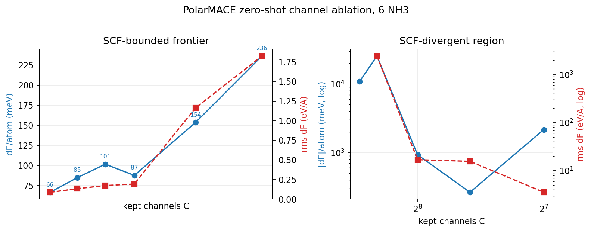

# Path B structural-pruning audit: PolarMACE MACE-POLAR-1-M
Date: 2026-10-22  
Checkpoint: `/workspace/group/shared/bza/task3_sampling_database/mlip/models/mace-polar/MACE-POLAR-1-M.model`  
Model: `mace.modules.extensions.PolarMACE`, 2 interactions, hidden 512x0e+512x1o+512x2e+512x3o, polar/SCF/exact-Ewald, `add_local_electron_energy=True`, 2 recursion steps.
Environment: `/opt/matos-tools/conda/envs/matos-compute` (MACE 0.3.16, torch 2.5.1+cu121); `PYTHONPATH` includes `/workspace/group/shared/bza/external-repos/graph_electrostatics-0.4.0`.

## 1. Executive answer
- **1.5-4x parameter reduction is structurally plausible**, but only through **channel pruning** (common channel count C), not order pruning alone.
- Trainable parameters follow an exact, validated law `P(C) = 47 C^2 + 4846 C + 436578` (P(512) = 15,238,498).
- C=384 gives **1.65x** fewer trainable parameters (1.56x smaller state dict, 43.2 MB); C=320 gives **2.24x** (2.01x, 33.5 MB); C=256 gives **3.20x** (2.65x, 25.3 MB); C=224 plus dropping l=3 gives **4.17x** trainable (3.21x state).
- **Zero-shot is a no-go beyond a very mild prune.** Even 3% channel removal (C=496) costs 66 meV/atom; C=384 costs 236 meV/atom with rms dF 1.82 eV/A. Hard channel pruning below C~352 triggers polar-SCF / field-dependent charge-source divergence (spin-charge density absmax up to 847 vs 0.83 in the full model), so the large-ratio regime **requires rebuilding at reduced multiplicity and fine-tuning**, with explicit charge-source stabilization.
- **Keep both l=0 and l=1 angular orders** (do not drop them; narrow their channels to C), the product symmetric-contraction weights and CG buffers, and the tiny charge-conservation heads (`fukui_source_map`, `lr_source_maps`, charge/fukui readout). l=3 is only 6.2% of parameters; dropping it is optional and does not by itself justify the 1.5-4x claim.
- **Go/no-go:** GO for a rebuild + fine-tune at 1.5-2.5x (C=384 -> C=320); CONDITIONAL for 3-4x (C=256 -> C=224, optionally dropping l=3), pending charge-map warm-up and distillation; NO-GO for zero-shot structural pruning beyond ~1.1x on this checkpoint.

Relation to the published channel/order block-pruning result (arXiv:2605.08885, 1.5-4x on MACE-MP/MACE-OFF): the parameter-count arithmetic is favorable and the same C^2-dominated block structure is present, so the 1.5-4x range is reachable. PolarMACE has an extra failure mode that plain MACE does not: the field-dependent charge-source maps feed an SCF loop, and their output scale is sensitive to the hidden-feature distribution. Expect the large-ratio regime to need the charge-map warm-up stage below, which has no counterpart in the published MACE-MP/MACE-OFF recipe.

## 2. Exact channel/order block inventory
Trainable parameters: **15,238,498**; buffers: **1,578,226**; state-dict elements: **16,816,724** (67.27 MB fp32). The 68 MB checkpoint is dominated by trainable weights, with 1.45 M of the 1.58 M buffers being angular CG `U_matrix` tensors in the two product blocks.
| group | l=0 | l=1 | l=2 | l=3 | order-common | trainable | % |
|---|---:|---:|---:|---:|---:|---:|---:|
| `interactions.0` | 3,001,856 | 557,568 | 557,568 | 557,568 | 141,123 | 4,815,683 | 31.602% |
| `interactions.1` | 1,461,248 | 851,968 | 458,752 | 393,216 | 224,323 | 3,389,507 | 22.243% |
| `field_dependent_charges_maps.0` | 864,768 | 805,888 | 0 | 0 | 110,916 | 1,781,572 | 11.691% |
| `field_dependent_charges_maps.1` | 864,768 | 805,888 | 0 | 0 | 110,916 | 1,781,572 | 11.691% |
| `local_electron_energy` | 528,384 | 527,360 | 0 | 0 | 165,121 | 1,220,865 | 8.012% |
| `layer_feature_mixer` | 524,288 | 524,288 | 0 | 0 | 0 | 1,048,576 | 6.881% |
| `products.0` | 262,144 | 262,144 | 0 | 0 | 44,032 | 568,320 | 3.730% |
| `products.1` | 262,144 | 262,144 | 0 | 0 | 44,032 | 568,320 | 3.730% |
| `node_embedding` | 42,496 | 0 | 0 | 0 | 0 | 42,496 | 0.279% |
| `fukui_source_map` | 8,192 | 0 | 0 | 0 | 306 | 8,498 | 0.056% |
| `readouts.1` | 8,192 | 0 | 0 | 0 | 289 | 8,481 | 0.056% |
| `lr_source_maps.0` | 1,024 | 1,024 | 0 | 0 | 0 | 2,048 | 0.013% |
| `lr_source_maps.1` | 1,024 | 1,024 | 0 | 0 | 0 | 2,048 | 0.013% |
| `readouts.0` | 512 | 0 | 0 | 0 | 0 | 512 | 0.003% |

Largest individual modules (exact per-order weight counts; full 423-row table in `block_table.csv`):

| module | l=0 | l=1 | l=2 | l=3 | common | total |
|---|---:|---:|---:|---:|---:|---:|
| `interactions.0.linear_1` | 1,048,576 | 262,144 | 262,144 | 262,144 | 0 | 1,835,008 |
| `interactions.0.linear_res` | 1,048,576 | 0 | 0 | 0 | 0 | 1,048,576 |
| `interactions.0.linear_2` | 262,144 | 262,144 | 262,144 | 262,144 | 0 | 1,048,576 |
| `interactions.1.linear_1` | 524,288 | 196,608 | 196,608 | 131,072 | 0 | 1,048,576 |
| `interactions.1.linear_2` | 262,144 | 262,144 | 262,144 | 262,144 | 0 | 1,048,576 |
| `interactions.1.skip_tp` | 262,144 | 262,144 | 0 | 0 | 0 | 524,288 |
| `products.0.linear` | 262,144 | 262,144 | 0 | 0 | 0 | 524,288 |
| `products.1.linear` | 262,144 | 262,144 | 0 | 0 | 0 | 524,288 |
| `field_dependent_charges_maps.0.potential_embedding.node_feats_linear` | 262,144 | 262,144 | 0 | 0 | 0 | 524,288 |
| `field_dependent_charges_maps.1.potential_embedding.node_feats_linear` | 262,144 | 262,144 | 0 | 0 | 0 | 524,288 |
| `layer_feature_mixer.linears.0` | 262,144 | 262,144 | 0 | 0 | 0 | 524,288 |
| `layer_feature_mixer.linears.1` | 262,144 | 262,144 | 0 | 0 | 0 | 524,288 |
| `field_dependent_charges_maps.0.dot_products` | 262,144 | 262,144 | 0 | 0 | 0 | 524,288 |
| `field_dependent_charges_maps.0.tp_out` | 262,144 | 262,144 | 0 | 0 | 0 | 524,288 |
| `field_dependent_charges_maps.1.dot_products` | 262,144 | 262,144 | 0 | 0 | 0 | 524,288 |
| `field_dependent_charges_maps.1.tp_out` | 262,144 | 262,144 | 0 | 0 | 0 | 524,288 |
| `local_electron_energy.dot_products_q` | 262,144 | 262,144 | 0 | 0 | 0 | 524,288 |
| `local_electron_energy.dot_products_v` | 262,144 | 262,144 | 0 | 0 | 0 | 524,288 |

Per-order totals across the whole model: l=0 7,831,040 (51.4%), l=1 4,599,296 (30.2%), l=2 1,016,320 (6.7%), l=3 950,784 (6.2%), order-common 841,058 (5.5%).
The key structural fact is that **l=2 and l=3 exist only inside the two interaction blocks**; the products emit only l=0 and l=1, and the polar field maps / local-electron energy / feature mixer are l=0/1 only. The polar head (two field maps 23.4%, local-electron 8.0%, mixer 6.9%) is 38.3% of trainable parameters and almost entirely dense C x C matrices.

## 3. Importance metrics
Weight L2 norms per group/order are in `group_summary.csv` (`l2_*` columns) and per block in `block_table.csv`. Global channel importance (sum of squared weights touching each common channel, aggregated over all groups and orders) is in `channel_importance.json`; `global_rank_desc` is the ranking used for the ablations. The ranking is dominated by l=0 (51.4% of weights) but the same index set must be used for all orders because MACE's symmetric contraction shares the feature multiplicity across l.
The channel-score distribution is almost flat: max/median = 1.17, top-128 carries 26.8% of the squared-weight mass (uniform: 25.0%), top-256 carries 52.1% (uniform: 50.0%). Weight norm therefore gives weak channel selectivity. Its practical value is mainly to avoid a small set of channels that destabilize the polar SCF: random channel subsets at the same C explode, while the top-C subsets stay bounded down to C=384. A production prune should add activation- or gradient-based sensitivity (or rely on the fine-tune) rather than weight norm alone.

## 4. Zero-shot ablation protocol
- One six-molecule NH3 configuration: `build_gas('NH3', 6, 0.01, seed=770600, min_distance=2.0)`, 24 atoms, cubic L=8.434 A, charge=0, spin=1, single point, CPU float32. Full model: E = -9233.1455 eV, rms F = 0.1297 eV/A, max F = 0.3759 eV/A.
- Order ablation is an exact equivariant projection: the selected irrep blocks are zeroed after every interaction, before every product, and in the residual path.
- Channel ablation zeroes the same top-C channel indices in every hidden feature tensor (node embedding, both interaction outputs and skip residuals, both product outputs, mixer output). The full 512-channel weights remain, so this is a sensitivity probe, not a rebuilt model.
- The all-channels-kept hook control reproduces the full energy and forces exactly (dE=0, dF=0).
- The local A100 was not used: during the audit it was held by another process (~0.9-1.0 GB, 9-18% util), so every ablation ran CPU float32 as required by the CPU-first constraint.

| ablation | removed | parameter effect | dE/atom (meV) | rms dF (eV/A) | max dF (eV/A) | status |
|---|---:|---:|---:|---:|---:|---|
| `order_l3_off` | l=3 | 6.24% direct weights | 141.8 | 0.151 | 0.453 | stable |
| `order_l23_off` | l=2+3 | 12.91% direct weights | 187.5 | 0.544 | 1.385 | stable |
| `order_l123_off` | l=1+2+3 | 43.09% direct weights | 436.0 | 0.567 | 1.044 | stable |
| `channel_top496` | 16 channels | 1.06x fewer params | 66.4 | 0.086 | 0.203 | SCF bounded |
| `channel_top480` | 32 channels | 1.12x fewer params | 84.6 | 0.133 | 0.308 | SCF bounded |
| `channel_top464` | 48 channels | 1.19x fewer params | 101.4 | 0.173 | 0.466 | SCF bounded |
| `channel_top448` | 64 channels | 1.27x fewer params | 87.4 | 0.192 | 0.494 | SCF bounded |
| `channel_top416` | 96 channels | 1.44x fewer params | 153.6 | 1.164 | 3.793 | SCF bounded |
| `channel_top384` | 128 channels | 1.65x fewer params | 236.3 | 1.824 | 5.796 | SCF bounded |
| `channel_top352` | 160 channels | 1.91x fewer params | 10890.3 | - | 2255.000 | SCF divergent |
| `channel_top320` | 192 channels | 2.24x fewer params | 25520.2 | 2424.956 | 9085.221 | SCF divergent |
| `channel_top256` | 256 channels | 3.20x fewer params | 929.2 | 16.923 | 57.790 | SCF divergent |
| `channel_top192` | 320 channels | 4.92x fewer params | 264.8 | 15.637 | 66.778 | SCF divergent |
| `channel_top128` | 384 channels | 8.34x fewer params | -2166.6 | 3.559 | 7.508 | SCF divergent |
| `channel_random384` | random 128 | 1.65x fewer params | 30022925.3 | 615792.147 | 2699916.418 | catastrophic |
| `channel_random256` | random 256 | 3.20x fewer params | 76120582047.7 | 8469956703.158 | 29599209471.805 | catastrophic |
| `channel_top256_l3_off` | 256 + l3 | 3.40x | 2147.0 | 52.960 | 206.361 | SCF divergent |

The non-monotonic channel errors are the signature of the SCF instability, not of a meaningful accuracy trend. At C=352 the spin-charge density absmax reaches 485 (full: 0.83), electrostatic energy 250 eV, and the total energy is already meaningless; at C=320 it reaches 847 and 589 eV. Random channel subsets explode to 10^6-10^10 eV. The SCF-bounded frontier is C >= 384, but "bounded" does not mean accurate: the C=384 error is already 236 meV/atom.

### SCF diagnostic (energy components, eV)

| case | E | E_int | E_elec | E_local-e | q absmax |
|---|---:|---:|---:|---:|---:|
| `full` | -9233.146 | -4.748 | 0.146 | 1.547 | 0.833 |
| `order_l3` | -9229.742 | -1.165 | 0.126 | 1.387 | 0.803 |
| `order_l23` | -9228.646 | -3.214 | 0.075 | 4.584 | 0.752 |
| `channel_top496` | -9231.552 | -3.854 | 0.064 | 2.330 | 0.588 |
| `channel_top480` | -9231.115 | -4.109 | 0.032 | 3.053 | 0.589 |
| `channel_top464` | -9230.712 | -4.175 | 0.023 | 3.532 | 0.563 |
| `channel_top448` | -9231.047 | -4.277 | 0.003 | 3.318 | 0.734 |
| `channel_top416` | -9229.458 | -4.091 | 0.010 | 4.714 | 0.624 |
| `channel_top384` | -9227.474 | -3.724 | 0.018 | 6.322 | 0.210 |
| `channel_top352` | -8971.779 | 10.122 | 249.558 | -1.370 | 484.900 |
| `channel_top320` | -8620.661 | 5.562 | 589.099 | 14.769 | 846.900 |
| `channel_top256` | -9210.845 | 5.813 | 8.574 | 4.858 | 77.230 |

Source-level diagnostic (raw per-molecule sums, not normalized):

| case | Fukui source min/max | field-map source absmax | field-map source per-molecule sum max |
|---|---:|---:|---:|
| `full` | 128.8 / 228.4 | 3.89 | 11.6 |
| `channel_top384` | 119.0 / 200.8 | 16.24 | 25.0 |
| `channel_top352` | 636.1 / 1969.0 | 156.70 | 196.7 |
| `channel_top320` | 830.5 / 1964.0 | 447.80 | 491.1 |
| `channel_top256` | 133.5 / 185.6 | 20.86 | 29.7 |

The raw Fukui source sums stay O(10^2) across all cases; the runaway is in the **field-dependent charge-source map** output: its absmax grows from 3.9 (full) to 16.2 (C=384), 156.7 (C=352) and 447.8 (C=320), and the per-molecule source sum grows from 11.6 to 25.0, 196.7 and 491.1. The normalized charge density then reaches 485-847 and the electrostatic energy 250-589 eV. The primal instability is therefore the `field_dependent_charges_maps` response to the shifted hidden-feature distribution, not the Fukui denominator. A rebuild should warm up / fine-tune the two charge-source maps first (backbone frozen) to restore the source scale, then unfreeze end-to-end with a charge-conservation penalty.

Even in the stable regime the error budget is not the backbone: at C=384, dE = +5.67 eV decomposes into +1.02 eV interaction, -0.13 eV electrostatic and +4.78 eV local-electron energy; at C=416 the corresponding terms are +0.66, -0.14 and +3.17 eV. The `local_electron_energy` head (8.0% of parameters) is therefore the second fragile part after the charge-source maps and should be fine-tuned with the same care.

Parameter efficiency of the two prune axes: normalizing the zero-shot energy error by the fraction of parameters removed, l=3 removal costs ~23 meV/atom per % removed and l=2+3 costs ~15 meV/atom per %, while channel pruning costs ~5 meV/atom per % (C=416) to ~6 meV/atom per % (C=384). Channel pruning is therefore 3-4x more parameter-efficient than order pruning on this checkpoint, even though l=3 weights are not small (interaction-0 l=3 L2 norm 5.0e3 vs l=1 4.5e3).

## 5. Recommended prune recipe and fine-tune plan
**Recommended first target: C=384, keep all four angular orders** (1.65x trainable, 1.56x state, 43.2 MB fp32). This is the smallest (most aggressive) measured prune that stays in the SCF-bounded regime (236 meV/atom, rms dF 1.82 eV/A zero-shot).
1. **Rebuild, do not mask.** Re-instantiate PolarMACE with `hidden_irreps = Cx0e + Cx1o + Cx2e + Cx3o` (C=384 / 320 / 256) and the same polar settings (r_max=6.0, 2 interactions, atomic_multipoles_max_l=1, field_feature_max_l=1, widths [1.5, 3.0], 2 recursion steps, local-electron on, self-interaction on).
2. **Initialize by channel selection.** Use the top-C channel ranking from `channel_importance.json` for every hidden matrix; slice e3nn Linear flat weights with the documented per-order instruction offsets (see `block_inventory.py`). Let the rebuilt e3nn modules recompute path normalization for the new multiplicities; do not copy the old 1/sqrt(512) scaling.
3. **Keep at full width:** `fukui_source_map`, both `lr_source_maps`, the charge/fukui readout heads, `atomic_energies_fn`, `scale_shift`, and the product `U_matrix` buffers. These are tiny or non-trainable and control charge conservation / SCF stability.
4. **Freeze the electrostatic geometry descriptors** (`electric_potential_descriptor`, `coulomb_energy`); they have no trainable weights (132 + 45 elements of constant tables).
5. **Warm up the charge-source and local-electron heads first.** Freeze the backbone, train `field_dependent_charges_maps.*`, `fukui_source_map`, `lr_source_maps` and `local_electron_energy` for a few epochs on charge/dipole/energy targets until the raw field-map source absmax is back near the full-model scale (~4 in this configuration, vs 16 at C=384 and 157 at C=352) and the local-electron energy offset is removed. This is the step that prevents the SCF divergence and the ~4.8 eV local-electron error seen in the zero-shot ablations.
6. **Fine-tune end-to-end** on the original PolarMACE training distribution (energies, forces, charges/dipoles) with a small LR (1e-4 to 5e-4) for 10-30 epochs, then 1e-5 for 5 epochs. Add a charge-conservation / Fukui-normalization penalty and monitor the SCF fixed point on held-out six-molecule and periodic cells.
7. **Staged ratios:** C=384 (1.65x) first; if parity is recovered, C=320 (2.24x); only then C=256 (3.20x). C=224 plus l=3 removal (4.17x) or C=192 channel-only (4.92x) should use distillation from the full model rather than plain fine-tuning.
8. **Order pruning is secondary.** Dropping l=3 saves only 6.2% (1.07x) and costs 142 meV/atom zero-shot; dropping l=2+3 saves 12.9% (1.15x) and costs 188 meV/atom. Do it only after channel pruning is fine-tuned, and keep l=2 for angular anisotropy.

## 6. Artifacts
- `block_table.csv` - 383 exact parameter blocks (module, param, kind, order, slice, numel, norm, scaling coefficients).
- `block_table_module.csv` - module-level aggregation.
- `group_summary.csv` / `group_summary.json` - group x order counts, fractions, L2 norms.
- `channel_importance.json` - per-group/per-order and global channel scores + rankings.
- `scaling_coefficients.json` - the validated A, B, D law.
- `prune_candidates.csv` / `prune_candidates.json` - parameter/state/file-size reduction and zero-shot metrics for candidate C.
- `ablation_results.json`, `ablation_frontier_cpu_f32.json`, `ablation_mild_cpu_f32.json`, `ablation_table.csv` - raw zero-shot results.
- `scf_diagnostics.csv`, `source_diagnostics.csv` - energy-component and raw charge-source diagnostics.
- `model_config.json` - architecture facts extracted from the checkpoint.
- `prune_curve.png` - dE/atom and rms dF vs kept channels.
- `block_inventory.py`, `ablate_blocks.py`, `make_report.py` - reproduction scripts.

## 7. Limitations
- The channel ablation keeps the full 512-wide weights and gates features. It does not reproduce the changed e3nn normalization or a retrained first-layer element embedding, so the absolute zero-shot errors are an upper bound / sensitivity ranking, not a prediction of the fine-tuned pruned model.
- Only one six-molecule NH3 configuration was required and used. The SCF-divergence boundary should be re-checked on a batch before production fine-tuning.
- Buffer savings from dropping l=2/3 (U_matrix tensors) are not included in the trainable-parameter reduction columns; they improve the file-size reduction.
