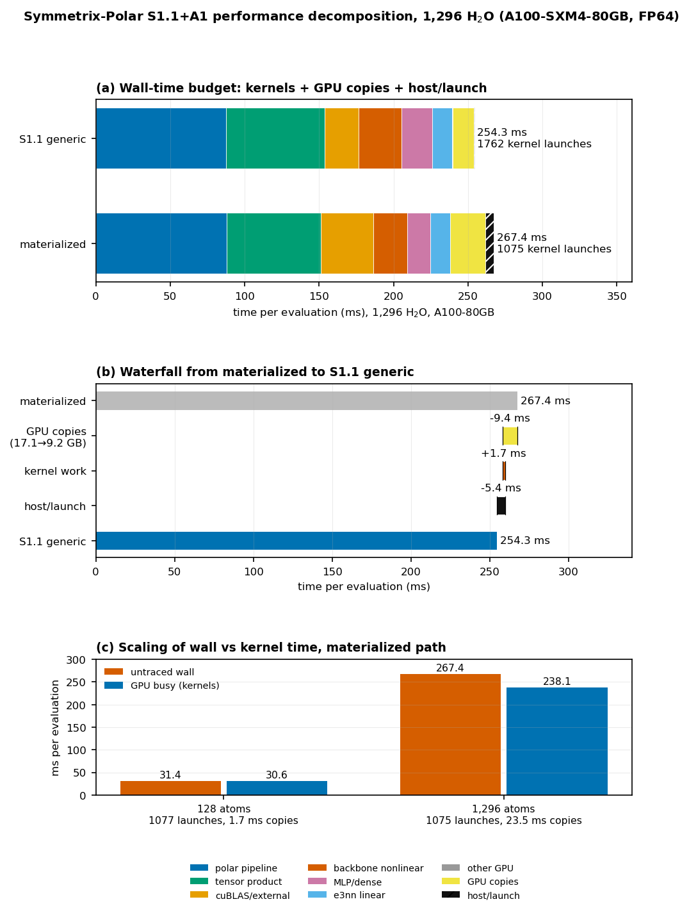

# Symmetrix-Polar S1.1+A1 — performance decomposition at 1,296 atoms

**Status:** read-only measurement. No engine source edit, no build, no git
commit/push. All new measurement files are under
`bench/perf_decomp_1296_2026-10-21/` and `docs/results/`; see the process
note on `plan_b_micro_2026-10-21` in §9.
**Date:** 2026-10-21.
**System:** 1,296 H₂O, full PolarMACE, FP64, one A100-SXM4-80GB, one rank.
**Binary:** `bench/s1_backbone_2026-10-21/bin/lmp_s1_1_a1`, SHA256
`c2074bdafb1c25165ae42aa32732f18c170c09054571d5758116a5fadf937d81`
(combined S1.1 + A1, 198,360,080 B). A1 anchor
`bench/plan_a_uvu_tile_2026-10-21/bin/lmp_uvu_tile` (`a9ce6481…`) and
S1.1-only `bench/s1_backbone_2026-10-21/bin/lmp_s1_1` (`1ce33cab…`) were
hash-checked but not re-run; the two requested arms use the combined binary.

---

## 中文摘要

本次对合并二进制 `lmp_s1_1_a1` 在 1,296 H₂O、A100-SXM4-80GB、FP64、
canonical 环境下，做了同轮交替的墙钟测量（materialized / S1.1 generic
各 2 轮 × 4 个 `run 1`，共 8 个样本），并对两条路径各做一次 CUPTI
单求值追踪（128 原子 materialized 作为发射/开销缩放对照）。

**结论（仅分解，不构成加速声明）：**

- **墙钟/求值**：materialized **267.43 ms**，generic **254.29 ms**，
  实测差 **−13.14 ms**。该差值可精确闭合为：
  **GPU 拷贝 −9.42 ms + kernel 计算 +1.67 ms + host/launch −5.39 ms**。
- **GPU busy（kernel 时长之和）** 几乎不变：**238.09 → 239.75 ms**
  （+1.67 ms，约 +0.7%）。S1.1 的主要节省不在 kernel 计算，而在
  **设备到设备（D2D）拷贝**：17.14 GB / 23.55 ms → 9.16 GB / 14.12 ms
  （含 memset；纯 memcpy 22.27 → 12.76 ms），以及 **host/launch 残差**
  5.80 → 0.41 ms。
- **发射数**：kernel 发射 **1075 → 1762（+687）**；拷贝发射
  297 → 476（+179）；总发射 **1372 → 2238（+866）**。
  即 S1.1 用更多、更小的发射换取了更少的拷贝和更低的 host 开销。
- **前三大 kernel family**（按 kernel ms 排序；括号为占 GPU busy 比例）：
  - materialized：**polar pipeline 87.95 ms (36.9%)**、
    **tensor product 63.33 ms (26.6%)**、
    **cuBLAS/external 35.02 ms (14.7%)**。
  - generic：**polar pipeline 87.51 ms (36.5%)**、
    **tensor product 66.09 ms (27.6%)**、
    **backbone nonlinear 28.85 ms (12.0%)**。
  - 最大单项节省是 **cuBLAS/external −12.17 ms**（35.02 → 22.85 ms）；
    最大单项付出是 **backbone nonlinear +6.14 ms**、**MLP/dense +5.24 ms**、
    **tensor product +2.75 ms**。
- **host/launch gap** 按用户定义（wall − GPU busy）为
  **29.35 ms vs 14.54 ms**；其中 GPU 拷贝占 23.55 / 14.12 ms，
  扣除拷贝后的真实 host/launch 残差仅 **5.80 / 0.41 ms**。
- **128 原子缩放**：wall 31.41 ms、kernel 30.58 ms、拷贝 1.73 ms、
  kernel 发射 1077。发射数与 1,296（1075）基本持平，说明**发射数由模型
  结构固定、不随原子数增长**；增长的是拷贝与 host 编排开销。
- **不确定度**：CUPTI 追踪在 stage mark 处 `fence`，128 原子对照显示
  追踪到的 GPU 活动（32.31 ms）比未追踪墙钟（31.41 ms）高 0.9 ms（约 3%）。
  因此绝对 host gap 有 ±1–2 ms 量级的扰动；两臂间差值是同仪器测量，
  方向与量级稳健。占用率/SM 覆盖率为**由 launch 几何推导**，不是硬件计数器。

---

## 1. Method

### 1.1 Isolation and binaries

- All measurements are read-only: no engine edits, no build, no commit/push.
- Every GPU job held `flock /workspace/group/shared/bza/.tmp/gpu.lock`
  (one job at a time). `bench/plan_b_micro_2026-10-21` and
  `bench/plan_a_uvu_tile_2026-10-21` were not modified.
- Binary SHA256 verified before the run:
  `c2074bdafb1c25165ae42aa32732f18c170c09054571d5758116a5fadf937d81`.

### 1.2 Inputs

| Case | Data | Types | Model |
|---|---|---|---|
| 1,296 | `bench/paper_scale_2026-10-20/water_1296.data` | `O H` | `.../mace-polar/polar_symmetrix_probe.json` |
| 128 | `.../mlip/bench/lammps_parity/engine_compare/nh3_128.data` | `N H` | same |

Materialized inputs use
`pair_style symmetrix/mace/kk charge 0.0 spin 1.0`; generic adds
`streamed_edges generic`. Bench inputs contain `run 0` + four `run 1`
(128: eight `run 1`); trace inputs contain `run 0` + one `run 1`
(128: two `run 1`). The full inputs are
`bench/perf_decomp_1296_2026-10-21/in.*`.

### 1.3 Canonical environment

```
LD_LIBRARY_PATH=/workspace/caches/conda/envs/lammps-deepmd/lib:/opt/matos-tools/cuda/12.9/lib64:/opt/matos-tools/cuda/12.9/targets/x86_64-linux/lib:/opt/matos-tools/conda/envs/matos-compute/lib
CUDA_VISIBLE_DEVICES=0
SYMMETRIX_BACKEND=cuda12-sm80
SYMMETRIX_BACKEND_DESCRIPTOR_PATH=/workspace/group/shared/bza/task3_sampling_database/mlip/models/mace-polar/backend_cuda12_sm80.json
OMP_NUM_THREADS=1
MATOS_REPLAY_CACHE=1
MATOS_UVU_X2_MB_SMEM=0
MATOS_UVU_FWD_SWEEP=0
MATOS_CONV_CUTOFF_BACKEND=team
MATOS_MH1_TEAM_SIZE=64
MATOS_MH1_CHANNEL_VEC=1
# trace only:
MATOS_POLAR_PROFILE=1
LD_PRELOAD=<kernel_profile_2026-10-19>/libsymtracer.so
KOKKOS_TOOLS_LIBS=<kernel_profile_2026-10-19>/libsymtracer.so
SYMTRACE_DIR=<per-tag trace dir>
```

`MATOS_UVU_TILE_N/M` and `MATOS_MH1_REV_CHANNEL_VEC` are unset, i.e. A1
32×16 tile and the reverse default are in effect.

### 1.4 Wall protocol

Two rounds, alternating arm order (r0: mat → gen; r1: gen → mat). Each
round contributes four `run 1` LAMMPS Loop times. Headline wall is the
**pooled median of all 8 samples per arm** (robust to the two externally
contended samples; see §10). Per-round medians:

| Arm | r0 samples (ms) | r0 median | r1 samples (ms) | r1 median | pooled median |
|---|---|---:|---|---:|---:|
| materialized | 268.441 / 267.632 / 267.770 / 267.232 | 267.701 | 266.479 / 266.040 / 266.232 / 271.363 | 266.356 | **267.432** |
| S1.1 generic | 253.766 / 253.157 / 280.925 / 259.534 | 256.650 | 254.775 / 254.102 / 254.477 / 253.896 | 254.290 | **254.290** |

The generic r0 280.9 ms and 259.5 ms samples, and the materialized r1
271.4 ms sample, coincide with concurrent external jobs on the shared GPU
lock; the clean rounds agree with the prior accepted A/B
(253.84 ms generic, 266.47 ms materialized, `S1_1_A1_INTEGRATION.md`).

### 1.5 CUPTI tracing

The read-only shim `libsymtracer.so` (CUPTI activities + Kokkos labels)
was loaded with both `LD_PRELOAD` and `KOKKOS_TOOLS_LIBS`. It emits
`cupti_kernels.csv`, `kokkos_events.csv`, `clock_sync.csv`. The analysis
window for each trace is the **last complete** `[polar-profile] eval:enter`
→ `[polar-profile] backbone-reverse:done` pair, i.e. one full force
evaluation. Kernel labels are paired to CUPTI kernels monotonically within
a 300 µs enqueue window; unpaired kernels are counted as `(unlabeled)`
(9 per arm, <0.1 ms). Occupancy and SM coverage are derived from launch
geometry (`regs`, static/dynamic shared memory, block, grid) with the A100
limits (108 SMs, 64 warps, 65,536 regs, 160 KB smem); the tracer collects
**no hardware counters**, and `ncu`/`nsys` are not installed in this runtime.

Definitions used below:

- **GPU busy** = Σ CUPTI kernel durations (MEMCPY/MEMSET excluded), as
  requested.
- **GPU copies** = Σ CUPTI MEMCPY + MEMSET durations inside the same window.
- **host/launch residual** = wall − GPU busy − GPU copies.
- **wall − GPU busy** is also reported, because that is the literal
  "host/launch gap" requested; it includes the exposed copy activity.

---

## 2. Wall / GPU budget

| Arm | wall ms/eval | GPU busy (kernel sum) | wall − GPU busy | of which GPU copies | host/launch residual | kernel launches | copy launches | total launches |
|---|---:|---:|---:|---:|---:|---:|---:|---:|
| materialized | **267.43** | **238.09** | 29.35 | 23.55 | 5.80 | **1075** | 297 | 1372 |
| S1.1 generic | **254.29** | **239.75** | 14.54 | 14.12 | 0.41 | **1762** | 476 | 2238 |
| **delta (gen − mat)** | **−13.14** | **+1.67** | −14.81 | **−9.42** | **−5.39** | **+687** | +179 | **+866** |

The budget closes: `−9.42 + 1.67 − 5.39 = −13.14 ms`.

Copy detail inside the evaluation window:

| Arm | memcpy ms | memcpy calls | D2D bytes (kind8) | memset ms | memset calls |
|---|---:|---:|---:|---:|---:|
| materialized | 22.27 | 161 | 17.14 GB | 1.27 | 136 |
| S1.1 generic | 12.76 | 310 | 9.16 GB | 1.36 | 166 |

CUPTI records both compute and copy activity on streams 7/13. The measured
interval overlap between kernel and copy records is **0.0 ms** in both arms,
so the copy time is exposed rather than hidden under kernel execution.

---

## 3. Families

| Family | mat ms | mat %busy | gen ms | gen %busy | delta ms |
|---|---:|---:|---:|---:|---:|
| polar pipeline | 87.954 | 36.9% | 87.507 | 36.5% | −0.447 |
| tensor product | 63.334 | 26.6% | 66.087 | 27.6% | +2.754 |
| cuBLAS/external | 35.021 | 14.7% | 22.852 | 9.5% | **−12.169** |
| backbone nonlinear | 22.715 | 9.5% | 28.852 | 12.0% | **+6.136** |
| MLP/dense | 15.637 | 6.6% | 20.876 | 8.7% | **+5.239** |
| e3nn linear | 13.177 | 5.5% | 13.334 | 5.6% | +0.157 |
| other GPU | 0.250 | 0.1% | 0.246 | 0.1% | −0.003 |
| **kernel total** | **238.086** | 100% | **239.755** | 100% | **+1.670** |

`polar pipeline` is the largest family and is unchanged between arms;
`tensor product` is second in both. The third rank changes:
**cuBLAS/external in materialized**, **backbone nonlinear in generic**.

---

## 4. Top-10 kernels (label level)

Sorted by max(mat, gen) ms. `%busy` is relative to that arm's kernel sum.
`cov` = SM coverage = grid_blocks / (108 SMs × blocks/SM); `occ` =
theoretical occupancy from regs/smem/block. Both are geometry-derived.

| # | label | family | mat ms | mat %busy | gen ms | gen %busy | delta ms | launches mat/gen | cov mat/gen | occ mat/gen |
|---:|---|---|---:|---:|---:|---:|---:|---|---:|---:|
| 1 | cuBLAS/external | cuBLAS/external | 35.021 | 14.7% | 22.852 | 9.5% | −12.169 | 270/482 | 13%/79% | 19%/19% |
| 2 | polar reverse uvu mode0 x2 | polar pipeline | 21.978 | 9.2% | 21.741 | 9.1% | −0.236 | 10/10 | 100%/100% | 100%/100% |
| 3 | e3 tensor reverse mh1 team channels | tensor product | 20.827 | 8.7% | 21.836 | 9.1% | +1.009 | 2/14 | 100%/100% | 66%/66% |
| 4 | polar reverse uvu mode0 x1 | polar pipeline | 20.882 | 8.8% | 20.764 | 8.7% | −0.118 | 10/10 | 100%/100% | 75%/75% |
| 5 | e3 tensor reverse mh1 team harmonics | tensor product | 17.558 | 7.4% | 17.710 | 7.4% | +0.152 | 2/14 | 100%/100% | 72%/72% |
| 6 | e3 tensor product mh1 team channels | tensor product | 13.693 | 5.8% | 15.190 | 6.3% | +1.497 | 2/14 | 100%/100% | 78%/78% |
| 7 | affine linear epilogue | MLP/dense | 9.081 | 3.8% | 11.695 | 4.9% | +2.613 | 32/176 | 100%/7% | 100%/100% |
| 8 | nonlinear gather messages (stream variant in generic) | backbone nonlinear | 6.978 | 2.9% | 7.413 | 3.1% | +0.435 | 2/14 | 100%/100% | 100%/100% |
| 9 | compiled product reverse | tensor product | 6.333 | 2.7% | 6.342 | 2.6% | +0.010 | 2/2 | 100%/100% | 50%/50% |
| 10 | polar uvu mode0 | polar pipeline | 5.732 | 2.4% | 5.734 | 2.4% | +0.002 | 6/6 | 100%/100% | 75%/75% |

Next labels (11–16) for context: reverse convolution cutoff team
5.35/5.25 ms; polar reverse uvu mode1 x1 5.13/5.13; polar uvu mode1
5.05/5.05; polar reverse uvu mode1 x2 5.02/5.02; e3 reverse linear pack
4.79/4.94; polar le uvu mode0 4.58/4.57. Generic-only additions:
affine fused layer norm silu 3.60 → 5.47 ms, stream nonlinear weight cutoff
0 → 3.68 ms, stream reverse nonlinear weight cutoff 0 → 3.67 ms.

### Raw-signature cross-check

| Arm | top raw signature group | ms | launches | modal grid/block | labels contributing |
|---|---|---:|---:|---|---|
| mat | `compute_polar_reverse_forces` functor | 45.42 | 75 | 11×1 / 128 | polar reverse uvu mode0 x1+x2, polar reverse layernorm silu, polar rev assemble |
| mat | `E3TensorProduct::reverse` | 38.39 | 4 | 111312×1 / 64 | tensor reverse channels + harmonics |
| mat | `compute_polar_reverse_forces` reduce | 17.10 | 65 | 21×128 / 256 | polar reverse reduces/dense/phase |
| gen | `compute_polar_reverse_forces` functor | 45.09 | 75 | 11×1 / 128 | same polar reverse group |
| gen | `E3TensorProduct::reverse` | 39.55 | 28 | 16415×1 / 64 | tensor reverse channels + harmonics (14 launches each) |
| gen | `AffineMLP::forward_impl` | 17.16 | 294 | 129×1 / 128 | affine epilogue + layer-norm silu |

The raw functor group mixes several labels with different launch
geometries; the label table above is the correct attribution unit.

---

## 5. Where S1.1 saves and where it pays

The measured wall difference is **−13.14 ms**. This section decomposes it;
it is not a new speedup claim.

**Saves**

1. **cuBLAS/external: −12.17 ms (35.02 → 22.85).** Materialized issues 270
   calls averaging 130 µs, modal grid 41 blocks, 12.7% SM coverage and 19%
   theoretical occupancy. Generic issues 482 smaller calls averaging 47 µs,
   modal grid 257 blocks, 79.3% coverage. The tiled/streamed schedule turns
   a few large, under-covered GEMMs into many better-covered ones.
2. **GPU copies: −9.42 ms (23.55 → 14.12, including memset).** The
   materialized path moves 17.14 GB device-to-device per eval in 161 memcpys
   (22.27 ms); generic moves 9.16 GB in 310 memcpys (12.76 ms). Copies do not
   overlap kernels, so this time is fully exposed.
3. **host/launch residual: −5.39 ms (5.80 → 0.41).** After subtracting
   kernels and copies, the generic path is almost perfectly GPU-bound. The
   materialized path retains measurable host-side materialization/copy
   orchestration per eval, which grows with system size (§6).

**Pays**

1. **backbone nonlinear: +6.14 ms (22.72 → 28.85), 42 → 177 launches.**
   Generic splits the forward and reverse cutoff/conditioning work into
   per-tile kernels: separate forward and reverse weight-cutoff kernels
   (3.68 + 3.67 ms), density gathers (1.16 ms), edge conditioning
   (1.05 + 1.09 ms), and a reverse gather-edge-up (0.75 ms).
2. **MLP/dense: +5.24 ms (15.64 → 20.88), 65 → 353 launches.** The affine
   epilogue rises 9.08 → 11.70 ms (32 → 176 launches; generic modal grid 129
   blocks, 7.5% coverage) and layer-norm/silu 3.60 → 5.47 ms (22 → 118).
3. **tensor product: +2.75 ms (63.33 → 66.09), 22 → 70 launches.** The
   materialized 2-launch tensor kernels (10.4 ms/launch) become 14 per-tile
   launches (1.56 ms/launch); total is slightly higher for the product and
   reverse-channel kernels.
4. **e3nn linear: +0.16 ms; kernel total: +1.67 ms.** Polar is unchanged
   (−0.45 ms), so S1.1 adds no polar work.

**Net:** the 26.98 ms of savings (12.17 cuBLAS + 9.42 copies + 5.39 host)
minus 13.84 ms of kernel additions (6.14 + 5.24 + 2.75 − 0.45 + 0.16) gives
−13.14 ms. The extra 866 launches are affordable because the generic host
residual is only 0.41 ms; launch API cost is not the limiter at this size.

---

## 6. 128-atom scaling (materialized)

128-atom control, same binary, same env, one round × eight `run 1` samples:

| Quantity | 128 atoms | 1,296 atoms | ratio |
|---|---:|---:|---:|
| wall/eval (untraced, pooled/median) | 31.41 ms | 267.43 ms | 8.51× |
| GPU busy (kernels) | 30.58 ms | 238.09 ms | 7.79× |
| GPU copies | 1.73 ms | 23.55 ms | 13.6× |
| host/launch residual | ≤0 (trace-limited) | 5.80 ms | — |
| kernel launches | **1077** | **1075** | **1.00×** |
| copy launches | 239 | 297 | 1.24× |
| atoms | 128 | 1,296 | 10.13× |

The kernel launch count is essentially independent of system size: it is
fixed by the model graph and SCF structure. What grows is the per-launch
work, the materialized copy traffic (edges scale with atoms), and the
host-side copy orchestration. At 128 atoms the traced GPU activity
(30.58 + 1.73 = 32.31 ms) exceeds the untraced wall (31.41 ms) by 0.9 ms,
which is the empirical profiler-perturbation floor and the reason absolute
host gaps at small sizes are not resolvable with this tracer.

---

## 7. Figure



(a) stacked wall budget per arm; (b) waterfall of the measured −13.14 ms;
(c) materialized scaling of wall vs kernel busy with launch/copy counts.
PDF: `docs/results/figures/perf_decomp_1296.pdf`.

---

## 8. Ranked next acceleration opportunities

Estimates are ms per 1,296-atom evaluation. "Measured" is directly observed
in this decomposition; "projected" is an engineering estimate, not a
measurement. Ranks 1–2 apply only if the **materialized** path remains the
default; ranks 3–5 are the live opportunities if **generic** becomes the
default. They are not additive across paths.

| Rank | Opportunity | Path | Measured evidence | Measured headroom | Projected saving | Confidence |
|---:|---|---|---|---:|---:|---|
| 1 | Raise materialized GEMM/MLP occupancy or adopt the tiled schedule | materialized | 35.02 ms in 270 calls, 12.7% coverage; generic 22.85 ms at 79.3% | 12.17 ms | **8–12 ms** | medium-high |
| 2 | Remove/fuse the remaining materialized D2D edge-buffer copies | materialized | 17.14 GB / 23.55 ms vs 9.16 GB / 14.12 ms; zero copy/kernel overlap | 9.42 ms | **6–9 ms** | medium-high |
| 3 | Reduce polar reverse UVU x1+x2 work | both | 42.86 ms (21.98 + 20.88), 20 launches, 100% coverage, 75–100% occ | 42.86 ms envelope | **3–6 ms** | low-medium |
| 4 | Fuse generic forward/reverse cutoff + conditioning per tile | generic | +6.14 ms family delta, 177 launches; separate 3.68 + 3.67 ms cutoff kernels | 6.14 ms | **2–4 ms** | medium |
| 5 | Batch or coarsen generic per-tile MLP epilogues | generic | +5.24 ms; epilogue 9.08→11.70 ms, 176 launches, 7.5% coverage | 5.24 ms | **2–3 ms** | medium |

### 8.1 Materialized cuBLAS/MLP occupancy (rank 1)

The materialized cuBLAS bucket is 35.02 ms with modal grid 41 blocks
(12.7% SM coverage, 19% theoretical occupancy, 130 µs per call). Generic's
tiled decomposition reaches 22.85 ms on 482 calls at 79.3% coverage. This
is the single largest measured gap. The lowest-risk route is to make the
already-gated generic schedule the default for 1,296-class systems; a
materialized-only port would need the same tiling and a numerical gate at
the 1e-13 level already demonstrated for generic.

### 8.2 Materialized D2D copies (rank 2)

17.14 GB per eval is moved D2D in 161 memcpys (22.27 ms), plus 1.27 ms of
memsets. Generic moves 9.16 GB (12.76 ms). The copies are fully exposed
(zero overlap with kernels), so eliminating or fusing the remaining
materialized edge buffers converts almost byte-for-byte into wall time.
Copy bandwidth is ~750 GB/s in both arms, so the saving is proportional to
the 8.0 GB removed.

### 8.3 Polar reverse UVU x1+x2 (rank 3)

Polar is unchanged between arms (87.95 vs 87.51 ms) and is now the largest
family. The two reverse mode-0 labels alone are 42.86 ms over 20 launches
with full SM coverage and 75–100% theoretical occupancy: this is
compute/bandwidth-bound, not launch-bound. A x1/x2 fusion or a reverse
replay cache is the plausible route. Prior work (`S1_1_TILE_CACHE_RESULTS.md`
§4.4) bounded a broader reverse-MLP cache at ~5% of the profiled eval
(~16.6 ms at 297 ms) but at +3 GB; the UVU-specific saving is not yet
prototyped, hence the wide 3–6 ms projection and low-medium confidence.

### 8.4 Generic backbone forward/reverse fusion (rank 4)

Generic pays +6.14 ms in `backbone nonlinear` across 177 launches. The
biggest additions are the separate forward and reverse weight-cutoff
kernels (3.679 + 3.672 ms; materialized does 3.647 ms in one label), stream
conditioning (1.051 + 1.086 ms), density gathers (1.156 ms), and reverse
gather-edge-up (0.750 ms). A per-tile fusion of forward/reverse cutoff and
conditioning is the candidate; the prior S1.1 slice already fused
`raw→weights` with cutoff, so the remaining win is incremental but
measurable.

### 8.5 Generic per-tile MLP batching (rank 5)

MLP/dense is +5.24 ms. The affine epilogue is 176 launches at a modal grid
of 129 blocks (7.5% coverage) for 11.70 ms, versus 32 launches at 55,656
blocks (100% coverage) for 9.08 ms in materialized. Layer-norm/silu is
5.47 ms over 118 launches vs 3.60 ms over 22. Coarsening the per-tile
epilogue batches or raising the 16,384-edge tile would raise coverage; a
2–3 ms recovery is projected.

### 8.6 Negative result: launch coalescing is not worth it

The generic host/launch residual is 0.41 ms after subtracting kernels and
copies. Even a perfect CUDA-graph/launch-coalescing pass has <1 ms of
headroom on the generic path. The 866 extra launches are not the problem;
the problem is where the work went (cuBLAS decomposition in materialized,
fragmented small kernels in generic).

---

## 9. Validation and caveats

- All bench and trace processes returned `rc=0`.
- Printed PE is identical across arms at the default thermo precision:
  `-895939.25` eV for every 1,296 sample and `-49242.456` eV for the 128
  samples. This is a sanity check, not a force-parity gate.
- Force/energy parity for this binary is covered by the prior accepted
  gates: 128 atoms dPE = 0, max dF = 1.06e-15 eV/Å; 1,296 atoms dPE = 0,
  max dF = 5.86e-13 eV/Å (`S1_1_A1_INTEGRATION.md`). This read-only session
  did not re-run force dumps.
- **Profiler perturbation:** the traced eval window is 286.11 ms
  (materialized) and 299.19 ms (generic), versus untraced 267.43 / 254.29 ms.
  The generic path emits 1,068 profile marks vs 276, so its fence overhead
  is larger (+44.9 ms vs +18.7 ms). Absolute host gaps therefore carry
  ±1–2 ms uncertainty; the 128-atom control shows a 0.9 ms floor. The
  arm-to-arm kernel/copy comparison uses identical instrumentation, and the
  wall difference is measured without profiling.
- **Occupancy/SM coverage are derived**, not measured with hardware
  counters. `ncu` and `nsys` are not available in this runtime; the CUPTI
  shim collects activity timestamps and launch geometry only.
- **External contention:** the shared GPU lock was heavily contended by
  other agents during this session. The two generic r0 outliers and one
  materialized r1 outlier are retained in the raw data; the pooled median
  is used for the headline. Per-round medians are given in §1.4.
- No claim of a new speedup is made. The wall delta is reported only as the
  quantity being decomposed.

**Process note on the protected benchmark directory.** Before the fresh runs,
the existing read-only analyzer
`bench/plan_b_micro_2026-10-21/analyze_trace_micro.py base30` was executed
once to validate the tracer/analyzer chain against its existing trace. That
script writes only derived analysis files; the four
`bench/plan_b_micro_2026-10-21/analysis_exact/base30_{labels,families,kernels,summary}`
files were regenerated. Their values match the prior report exactly
(26.414 ms GPU busy, 1060 launches, 778/788 paired), so the regeneration was
content-identical, but the file mtimes changed. No source, binary, trace, or
scientific result was altered, and the directory was not touched again.
All fresh traces and analyses live exclusively under
`bench/perf_decomp_1296_2026-10-21/`.

---

## 10. Exact commands

All commands run from
`/workspace/group/shared/bza/symmetrix-polar/bench/perf_decomp_1296_2026-10-21`
with the environment of §1.3.

Generate inputs:

```bash
python make_inputs.py
```

Untraced wall A/B (one command per arm; the Python runner wraps each in
`flock` and parses the Loop times):

```bash
/opt/matos-tools/conda/envs/matos-compute/bin/python run_bench.py --rounds 2
# 128-atom control:
/opt/matos-tools/conda/envs/matos-compute/bin/python run_bench.py \
  --case 128 --rounds 1 --out ab/wall_128.json
```

Equivalent raw command for one arm:

```bash
flock -w 10800 /workspace/group/shared/bza/.tmp/gpu.lock \
  /workspace/group/shared/bza/symmetrix-polar/bench/s1_backbone_2026-10-21/bin/lmp_s1_1_a1 \
  -k on g 1 \
  -in in.1296_materialized_bench \
  -log ab/1296_mat_r0/log
```

CUPTI trace (profile env is set by the runner; the shell script adds
`LD_PRELOAD`, `KOKKOS_TOOLS_LIBS`, `SYMTRACE_DIR`, `MATOS_POLAR_PROFILE=1`):

```bash
/opt/matos-tools/conda/envs/matos-compute/bin/python run_trace.py \
  1296_materialized in.1296_materialized_trace
/opt/matos-tools/conda/envs/matos-compute/bin/python run_trace.py \
  1296_generic in.1296_generic_trace
/opt/matos-tools/conda/envs/matos-compute/bin/python run_trace.py \
  128_materialized in.128_materialized_trace
```

Analysis and figure:

```bash
/opt/matos-tools/conda/envs/matos-compute/bin/python analyze_decomp.py \
  1296_materialized 1296_generic 128_materialized
/opt/matos-tools/conda/envs/matos-compute/bin/python make_assets.py
```

The analyzer imports the read-only helper
`.../kernel_profile_2026-10-19/final_analysis.py` and mirrors the pairing
policy of `.../plan_b_micro_2026-10-21/analyze_trace_micro.py`; neither file
was modified.

---

## 11. Artifacts

| Artifact | Path |
|---|---|
| This report | `/workspace/group/shared/bza/symmetrix-polar/docs/results/PERFORMANCE_DECOMPOSITION_1296.md` |
| Figure (PNG / PDF) | `/workspace/group/shared/bza/symmetrix-polar/docs/results/figures/perf_decomp_1296.png` / `.pdf` |
| Closed budget JSON | `/workspace/group/shared/bza/symmetrix-polar/bench/perf_decomp_1296_2026-10-21/analysis/budget_1296.json` |
| Markdown tables | `/workspace/group/shared/bza/symmetrix-polar/bench/perf_decomp_1296_2026-10-21/analysis/tables.md` |
| Wall A/B 1,296 | `/workspace/group/shared/bza/symmetrix-polar/bench/perf_decomp_1296_2026-10-21/ab/wall_1296.json` |
| Wall A/B 128 | `/workspace/group/shared/bza/symmetrix-polar/bench/perf_decomp_1296_2026-10-21/ab/wall_128.json` (full 8-sample median: `.../analysis/wall_128_full.json`) |
| Raw wall logs | `.../ab/1296_{mat,gen}_r{0,1}/log`, `.../ab/128_mat_r0/log` |
| Materialized trace | `.../trace/1296_materialized/` (`cupti_kernels.csv`, `kokkos_events.csv`, `clock_sync.csv`, `stderr_stamped.1296_materialized`) |
| Generic trace | `.../trace/1296_generic/` (same files, tag `1296_generic`) |
| 128 trace | `.../trace/128_materialized/` (tag `128_materialized`) |
| Label/family/raw CSVs | `.../analysis/{1296_materialized,1296_generic,128_materialized}_{labels,families,rawkernels,gaps}.csv` |
| Trace summaries | `.../analysis/{1296_materialized,1296_generic,128_materialized}_summary.json` |
| Runners | `.../run_bench.py`, `.../run_trace.py`, `.../run_trace_decomp.sh`, `.../analyze_decomp.py`, `.../make_assets.py` |
| Inputs | `.../in.1296_{materialized,generic}_{bench,trace}`, `.../in.128_materialized_{bench,trace}` |

No files under `bench/plan_b_micro_2026-10-21/` or
`bench/plan_a_uvu_tile_2026-10-21/` were written or modified.
