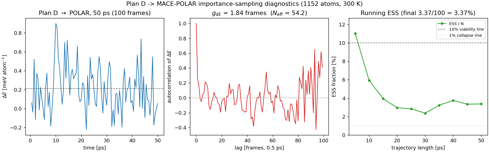

# Plan D → MACE-POLAR reweighting pilot (2026-10-26)

**Question:** if Plan D is used as the MD proposal, is the importance-sampling
ESS better than the OFF→POLAR 500 ps result (σ_β=13.76, ESS=0.47%)?

**Answer (50 ps, 100 frames): Plan D is ~7× better than OFF but does not reach
the 10% viability bar.** The 50 ps run on 1,152 atoms gives
ΔE/atom std = **0.243 meV/atom**, σ_β = **10.83** and
ESS = **3.37 / 100 = 3.37%** (marginal). The 5 ps pilot (15.9%) was a
small-sample artifact; the 15 ps interim value (3.65%) is confirmed by the
full 50 ps run. Plan D is still a much better proposal than OFF (0.47%), but
direct global reweighting to MACE-POLAR at 1,152 atoms is not yet
production-grade.

| run | frames | ΔE/atom std | σ_β | ESS |
|---|---:|---:|---:|---:|
| OFF→POLAR | 501 | 0.309 meV/atom | 13.76 | 0.47% |
| Plan D→POLAR 5 ps | 10 | 0.132 meV/atom | 5.90 | 15.9% |
| Plan D→POLAR 15 ps | 30 | 0.275 meV/atom | 12.24 | 3.65% |
| **Plan D→POLAR 50 ps** | **100** | **0.243 meV/atom** | **10.83** | **3.37%** |

## Why ASE, not the Symmetrix LAMMPS pair style

The Symmetrix direct/JIT path deadlocks at 1,152 atoms at the first neighbor
rebuild (process `D`, GPU 0%). It also hit a long-run startup deadlock at
5,184 atoms, although a 200-step 5,184 test passes. The generic/materialized
path is stable but ~0.25 s/step. For the pilot we used ASE/PyTorch MACE with
the Plan D bulk model; it is stable at 1,152 atoms and runs at 0.134 s/step.

## Protocol

| item | value |
|---|---|
| system | 1,152 atoms (384 H2O), same box as the OFF 500 ps run |
| proposal | Plan D bulk model (MACE, FP32) |
| seed | `seed_5ps.lammpstrj` (OFF 5 ps frame) |
| MD | ASE Langevin, 1 fs, 300 K, friction 0.01, fixcm=False |
| length | 50 ps (50,000 steps; 6,721 s wall) |
| frames | 100 frames, one per 0.5 ps |
| target | MACE-POLAR-1-M, FP64 |

## Final 50 ps result

| quantity | value |
|---|---:|
| frames | 100 (50 ps) |
| ΔE/atom mean | 0.212 meV/atom (constant offset) |
| ΔE/atom std | **0.243 meV/atom** |
| ΔE total std | 0.278 eV |
| σ_β (extensive) | **10.83** |
| weight ESS | **3.37 / 100 (3.37%)** |
| verdict | marginal |
| ΔE autocorrelation time | 1.84 frames (0.92 ps) |
| independent frames | N_eff = 54.2 / 100 |
| ESS corrected for correlation | 1.83 |
| first-half mean | 0.262 meV/atom |
| second-half mean | 0.162 meV/atom |
| drift (second − first) | −0.100 ± 0.062 meV/atom (1.6σ, not significant) |

Block ESS fractions over five 20-frame blocks: 5.9%, 9.3%, 5.0%, 13.6%, 5.5%.
The running ESS fraction falls from 11% at 5 ps to 6% at 10 ps and flattens at
3–4% beyond 20 ps, i.e. the 3.37% is a converged estimate, not a fluctuation.

**Interpretation.** The residual weight variance is set by the Plan D ↔ POLAR
energy-gap fluctuation (0.243 meV/atom), not by trajectory length. Extending
the same proposal does not raise the ESS *fraction*; it only multiplies the
absolute ESS. With the measured correlation-corrected ESS rate
(0.0183 per frame) reaching 100 effective samples requires about 5,460 frames,
i.e. **~2.7 ns of trajectory (~100 single-A100 hours at 0.134 s/step)**.
A literal 50 ns run would be ~1,860 GPU-hours (~78 days on one A100) and
still only give ESS_corr ≈ 1,800 — not a good use of that compute.

The earlier 10-frame pilot's 15.9% should not be quoted. The policy threshold
from the pilot note was "50 ps ESS > 10% ⇒ viable"; at 3.37% Plan D **fails
that test**. Use Plan D only with a local observable / mean-gap correction,
or improve the proposal (train Plan D on POLAR-consistent labels / include
POLAR in a distillation round) before claiming reweighted ensemble averages.

## Caveats

- The MD is ASE/PyTorch, not the Symmetrix LAMMPS path; the trajectory is
  valid, but the engine speed advantage is not in this number.
- One 50 ps trajectory, one seed, one box. The block spread (5–14%) is the
  honest uncertainty on the ESS fraction.
- The first 5 ps is not fully equilibrated under Plan D; excluding it changes
  the ESS by less than the block spread (the drift is only 1.6σ).
- The Symmetrix 1,152-atom deadlock is an engine issue, not a Plan D model
  issue; it is recorded separately.

## Next

1. Do **not** launch the 50 ns extension for statistics alone; the ESS
   fraction is length-independent. If more effective samples are needed,
   start from the current 50 ps trajectory and run ~2.7 ns (~100 GPU-h).
2. Fix the Symmetrix 1,152-atom deadlock if the engine speed is required;
   ASE at 0.134 s/step is the current fallback.
3. Improve the proposal before production reweighting: distill Plan D toward
   MACE-POLAR on bulk water frames, or use a local (RDF/mean-gap) correction
   rather than global weights.

## Artifacts

- `bench/plan_d_md_1152_ase_2026-10-26/traj_5ps.xyz` (5 ps pilot)
- `bench/plan_d_md_1152_ase_2026-10-26/traj_50ps.xyz` (50 ps, 100 frames)
- `bench/plan_d_md_1152_ase_2026-10-26/ess_15ps/summary.json`
- `bench/plan_d_md_1152_ase_2026-10-26/ess_50ps/summary.json` (raw ESS)
- `bench/plan_d_md_1152_ase_2026-10-26/ess_50ps/analysis.json`
  (autocorrelation, blocks, drift, running ESS)
- `bench/plan_d_md_1152_ase_2026-10-26/analyze_50ps_ess.py`
- figure `docs/results/figures/PLAN_D_REWEIGHT_50PS_2026-10-26.png`

