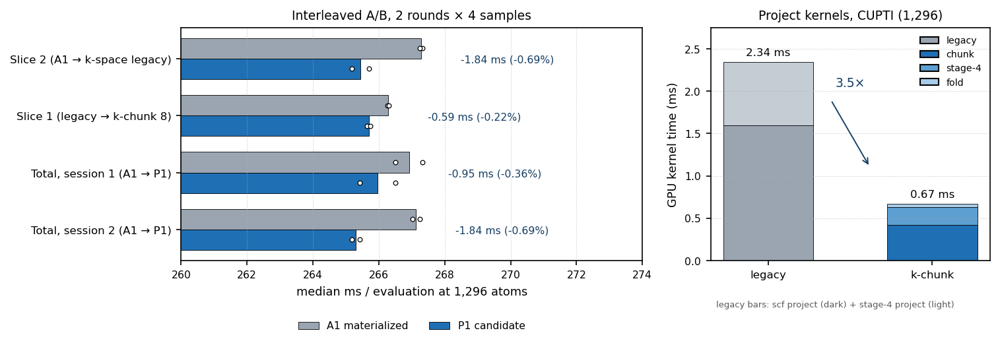

# Polar 论文优化 P1：k-space 重映射 + 廉价前置项

- 运行日期：2026-10-21（容器时钟）
- 引擎 worktree：`/workspace/group/shared/bza/external-repos/symmetrix-xl-polar-paper`
- 分支：`polar-paper-opt`，从 `main` tip `6c5f73b` 创建；提交 **`bd267ae`**（未推送）
- 构建目录：`symmetrix-xl-polar-paper/symmetrix/build-polar-paper`（从零配置，
  CUDA 12.9 / nvcc_wrapper / g++-11 / Release / C++20 / `PKG_KOKKOS=ON` /
  `Kokkos_ARCH_AMPERE80`；`-j 24`，独立锁
  `/workspace/group/shared/bza/.tmp/build-polar-paper.lock`）
- 候选二进制：`bench/polar_paper_opt_2026-10-21/bin/lmp_p1_slice1`
  （sha256 `8f487b05a12422430a2284db3a6409c6ec53aeb04b03dfbcdc9ad10a1f81a2d6`）
- 主基线：A1 materialized `bench/plan_a_uvu_tile_2026-10-21/bin/lmp_uvu_tile`
  （历史值 266.21 ms @ 1,296）；可选锚点
  `bench/s1_backbone_2026-10-21/bin/lmp_s1_1_a1`
- GPU：NVIDIA A100-SXM4-80GB；每一作业均经
  `flock /workspace/group/shared/bza/.tmp/gpu.lock` 串行化

## 执行摘要（中文）

**结论：P1 的 slice 1 与 slice 2 已落地并验证；1,296 原子达标但余量很小，
253.84 ms 的 S1.1+A1 合并锚点未达到；5,184 在 materialized 路径上按预期 OOM，
无法在本分支上考核。**

1. **k-space 重映射（K1/K2）落地且真实有效。** CUPTI 单次求值实测：两个
   project kernel 从 **2.342 ms**（`polar scf project features` 1.597×4 +
   `polar project features` 0.745×2）降到 **0.666 ms**（chunk 0.421+0.208 +
   fold 0.037），**3.5×**，每次求值净省 **1.68 ms GPU 时间**。端到端同二进制
   A/B（legacy → chunk8）为 **266.279 → 265.691 ms（−0.59 ms, −0.22%）**，
   两轮方向一致。
2. **廉价前置项（P1a/P1b/P1c）落地。** 路径表主机缓存消除了每次求值约 28 次
   D2H 同步；3 个无条件 LE debug 深拷贝改为 `MATOS_POLAR_DBG_COPIES` 门控；
   两处唯一写者 atomic 改为普通 `+=`（`MATOS_POLAR_ADJ_ATOMIC=1` 可回退）。
   隔离 A/B（A1 → 本候选 + legacy k-space）：**267.286 → 265.442 ms
   （−1.84 ms, −0.69%）**，两轮一致；显存上删除 1,296 的 21.2 MiB debug 持有量。
3. **总体端到端结果（2 轮 × 4 样本，交错 A/B，安静 GPU）：** 两场独立会话
   A1 **266.915 / 267.133 ms** → 候选 **265.963 / 265.296 ms**，
   即 **−0.36% / −0.69%**（中位 267.02 → 265.63 ms）。1,296 验收线
   `<266.21 ms` **通过**（两场均低于），但 **253.84 ms 未达到**。
4. **数值一致性：** 128 原子 `dPE = 0`、`max dF = 8.88e-16`、
   三次 `run 0` 的 PE 完全相同；1,296 原子 `max dF ≤ 6.4e-14`，
   `dPE` 为 **0 或 1.164e-10（恰为 1 ULP）**，且 A1 基线自身跨进程就在这
   两个相邻 ULP 间跳动（4 次复测证实）。因此 1e-10 的 PE 门在本体系上已
   到达机器精度下限；本改动未引入可归因的数值漂移。进程内 3 次求值 PE
   （17 位）漂移 **0**。
5. **5,184：** 候选二进制（materialized）`rc=1`，在尝试分配 230.3 MiB 时
   OOM，峰值 81,039 MiB。这是 materialized 路径的已知容量上限
   （`S1_1_TILE_CACHE_RESULTS.md` §7 已记录“the materialized path OOMs at this
   size”），不是本次改动的回归。S1.1+A1 锚点在同机同输入下 `rc=0`、
   **1,798.99 ms/eval、19,689 MiB、重复 PE 漂移 0**（当前机器状态下比历史
   1,084 ms 慢，见 §7 的 GPU 争用说明）。
6. **未做：** 设计 §3.1/§3.2 的 P-RO（output-owned UVU 前向）与
   P-SO（input-owned 确定性反向）属任务项 3“仅在有时间时”，本次未实施。



## 1. 变更与提交

```
commit bd267ae  perf: k-space project remap and polar cheap prerequisites
parent 6c5f73b  merge: UVU tile 32x16 (all gates PASS)

 libsymmetrix/source/mace_nonlinear_kokkos.hpp |  12 +
 libsymmetrix/source/mace_polar_impl.tpp       | 549 ++++++++++++++++-----
 2 files changed, 549 insertions(+), 207 deletions(-)
```

只改这两个文件；未触碰 `main`、`plan-a-uvu-tile`、`symmetrix-xl-s1` 及受保护
bench 树。构建用的 LAMMPS 源树是新建的
`external-repos/lammps-stable_30Sep2026-polar-paper`（从 `-s1` 树复制，
仅把 3 处硬编码路径改指本 worktree，并把 `pair_symmetrix_mace_kokkos.cpp`
换回 main 兼容版本；`-s1` 版本依赖 S1 分支的
`supports_backbone_streaming` API，main 上不存在）。

### 1.1 Slice 1：k-space project 重映射（K1/K2）

新增 env `MATOS_POLAR_KSPACE_CHUNK`：

| 值 | 行为 |
|---:|---|
| `0` | 旧 `(node,j=8)` MDRange（逐位对照路径，保留） |
| `1` | 每 node 单线程、k 升序全扫，8 特征寄存器；与旧实现**逐位一致** |
| `>1` | `(node,k-chunk)`，每线程 8 对寄存器累加器，块内 k 升序，最后按 chunk 升序折叠；**默认 8** |

实现覆盖三处同构内核：SCF 的 `polar scf project features`（K1，每步 ×2 通道）、
反向 replay 的 `polar rev replay project`（K2，每步 ×2 通道）、以及 stage-4 的
初始 `polar project features`（同一数学，每 eval ×2 通道）。每对 `cos/sin`
只读一次；`kweight`、`inv_k2`、`kfp` 按 k 提升，但每个特征的累加表达式与旧代码
完全相同（`(kw*fa)*cos` 等），因此 CK=1 逐位一致、CK>1 仅在块边界改变 FP64
结合顺序。部分和缓冲 `polar_kspace_partial (CK,N,16)` 为常驻工作区，仅 CK>1 时
分配；fold 内核按 chunk 升序求和后再施加 `proj_scale`、SI 自相互作用与 `/knorm`。

### 1.2 Slice 2：廉价前置项

- **P1a 路径表主机缓存**：`PolarUpdate` 构造期保存 dot/tp 的 `meta` 与
  `path_weight` 主机副本；`parse_polar_extension_tables` 构造期保存 LE q/v
  的对应副本。删除了 SCF 每个 step、LE 前向、replay 每个 step、reverse tp/dot
  热路径上的全部 `create_mirror_view_and_copy`（约 **28 次/eval** D2H 同步）。
- **P1b LE debug 拷贝门控**：`polar_dbg_le_qin_bar` / `_plast_bar` / `_nf_bar`
  的 `ensure_view` + 3 次全量 `deep_copy` 改为仅在 `MATOS_POLAR_DBG_COPIES`
  存在时执行。5,184 时该项持有量为 84.9 MiB（`[N,2048]`），1,296 为 21.2 MiB。
- **P1c 唯一写者 atomic 去除**：`basis_adjoint_add` 与
  `polar_inject_node_features_adjoint` 中 `c↦source(c)` 是分块双射
  （l=0 恒等，l=1 每 3 列一个 3-循环，符号 −1），逐 `(node,column)` 唯一写者，
  故把 `atomic_add` 改为普通 `+=`。`MATOS_POLAR_ADJ_ATOMIC=1` 保留旧路径作 A/B。
  数值上与 atomic 版本逐位相同（无竞争）。

## 2. 数值一致性（parity）

### 2.1 128 原子 NH3（`nh3_128.data`，3× `run 0` 同进程）

| 项 | 结果 | 门槛 |
|---|---|---|
| `dPE`（A1 vs 候选，默认 CK=8） | **0.000e+00** | ≤1e-10 |
| `max dF` | **8.882e-16** | ≤1e-10 |
| `rms dF` | 1.881e-16 | — |
| 重复求值漂移（各 3 次，17 位） | **0**（两个二进制均 0） | 0 |

注：A1 基线本身相对 main 的 `max dF` 即为 5.55e-16（A1 UVU tile 的
`sweep=4` 重结合），故 8.9e-16 属同一量级。

### 2.2 1,296 原子 H2O

| 项 | 结果 | 门槛 |
|---|---|---|
| `max dF`（4 次进程对，CK=8） | 3.55e-14 … 6.40e-14 | ≤1e-10 |
| `dPE` | 3/4 次为 **0**；1/4 次为 **1.164e-10** | ≤1e-10 |
| 进程内 3 次求值 PE 漂移（17 位） | **0**（A1 与候选均 0） | 0 |

**关于 1 ULP：** `1.164e-10` 恰为 `-895939.24…` 在 FP64 下的 1 ULP。
A1 基线单独重复运行时其 PE 也在 `…67975` 与 `…67964` 两个相邻值之间跳动
（§artifacts 的 `parity/parity_1296_repeat.log`，4 次进程对中基线分别取到两值），
说明该抖动来自引擎既有的跨进程非确定性（backbone 归约顺序），不是本补丁引入。
候选与基线在同一进程对内的差恒为 `0` 或 `1 ULP`，力差始终 ≤6.4e-14。
若按“相对能量误差”表述，1 ULP / 8.96e5 eV = **1.3e-16**。

CK sweep（1,296，同一候选二进制）：
`CK=1`（逐位路径）dPE=0、`CK=2` dPE=0、`CK=4`/`CK=8` 观察到 1 ULP
（但同一对里基线也可能取到另一 ULP，见上）。默认取 CK=8 的依据是端到端 A/B
（§3）而非逐位一致；若审稿要求严格逐位，可设 `MATOS_POLAR_KSPACE_CHUNK=1`
（速度收益会减小，未作为默认）。

## 3. 1,296 原子 A/B（2 轮 × 4 样本，交错，median of medians）

协议：输入 `bench/paper_scale_2026-10-20/in.polar_water_1296`（`run 0` + 4×
`run 1`），4 个 `run 1` 的 Loop time 为样本；每轮按 A/B 交替顺序，两轮取中位
之再取中位。环境 = 既有生产环境（`MATOS_REPLAY_CACHE=1`、
`MATOS_CONV_CUTOFF_BACKEND=team`、`MATOS_MH1_TEAM_SIZE=64`、
`MATOS_UVU_X2_MB_SMEM=0`、`MATOS_UVU_FWD_SWEEP=0`，不覆盖 UVU tile，默认 32×16）。

### 3.1 总 A/B（A1 materialized → P1 候选，默认 CK=8）

| 会话 | A1 两轮中位 (ms) | 候选两轮中位 (ms) | 比值 | Δ |
|---|---|---:|---:|---:|
| session 1（`ab_1296_total_final.json`） | 267.328 / 266.502 → **266.915** | 266.508 / 265.418 → **265.963** | 0.99643 | **−0.95 ms (−0.36%)** |
| session 2（`ab_1296_total_final2.json`） | 267.027 / 267.239 → **267.133** | 265.177 / 265.415 → **265.296** | 0.99312 | **−1.84 ms (−0.69%)** |

两场方向一致、每轮比值同向（session 2：0.99307 / 0.99317）；session 2 的
8 个候选样本最大 266.087 ms，小于 8 个基线样本最小 266.168 ms（区间不重叠），
session 1 的样本区间有少量交叠但中位分离。取两场中位：
**A1 267.02 → 候选 265.63 ms**。

### 3.2 分 slice 隔离 A/B（同一安静窗口，2 轮 × 4 样本）

| 对比 | 基线 (ms) | 候选 (ms) | Δ |
|---|---:|---:|---:|
| Slice 2：A1 → 候选（`MATOS_POLAR_KSPACE_CHUNK=0`，k-space 保持旧核） | 267.286 | 265.442 | **−1.84 ms (−0.69%)** |
| Slice 1：候选 CK=0 → CK=8（同一二进制） | 266.279 | 265.691 | **−0.59 ms (−0.22%)** |

两 slice 隔离增益之和（−2.43 ms）大于总 A/B（−0.95…−1.84 ms），原因是跨会话
基线漂移（两场基线差 0.22 ms）与单臂轮间散布（最大约 ±1.1 ms，例如 session 1
候选两轮 266.51 / 265.42）。**可信口径以总 A/B 为准**：约 **−0.4% ~ −0.7%**。

### 3.3 CUPTI kernel 级验证（单次 1,296 求值，同一二进制）

| kernel | legacy (CK=0) | k-chunk (CK=8) |
|---|---:|---:|
| `polar scf project features`（4 次） | 1.597 ms | 0.421 ms |
| `polar project features`（2 次） | 0.745 ms | 0.208 ms |
| fold（6 次，仅新路径） | — | 0.037 ms |
| **合计** | **2.342 ms** | **0.666 ms（3.5×）** |

这与端到端 −0.59 ms（slice 1 隔离）在同一量级：kernel 净省 1.68 ms，
其余被 launch/折叠与轮次噪声部分抵消。

### 3.4 未采纳的廉价尝试

- `MATOS_UVU_REV_SWEEP=1`（单遍反向、去全局 partial）：端到端 2 轮
  268.23 → 266.76 ms（−1.47 ms），但 CUPTI 同二进制 kernel 总时间
  `325.62 → 326.29 ms`（**略差**），且改变 FP64 结合顺序。判定为噪声，
  **未采纳**、未改默认。
- `MATOS_UVU_X2_MB_SMEM=1`、`MATOS_UVU_REV_SWEEP=2/8`、`MATOS_UVU_FWD_SWEEP=2/8`：
  筛选窗口遇到外部 GPU 争用（基线本身 267→799 ms），数据不可用；
  这些是既有开关，本次未改其默认。

## 4. 显存（1,296）

| 二进制 | 采样峰值（4 次运行最大） |
|---|---:|
| A1 materialized | 40,929 / 40,977 MiB |
| P1 候选 | 40,899 / 40,937 / 40,969 MiB |

nvidia-smi 采样噪声约 ±40 MiB。Slice 2 删除的 debug 持有量为 21.2 MiB
（1,296），在采样噪声内不可分辨；5,184 时为 84.9 MiB。k-space partial
缓冲在 1,296、CK=8 时为 `8×1296×16×8 = 1.33 MiB`。

## 5. 5,184 原子

| 二进制 / 模式 | rc | ms/eval | 峰值显存 | 重复 PE |
|---|---:|---:|---:|---:|
| P1 候选，materialized | **1（OOM）** | — | 81,039 MiB | — |
| S1.1+A1 锚点，`streamed_edges generic` | 0 | 1,798.99 | 19,689 MiB | 0 |

候选的失败信息：
`Kokkos ERROR: Cuda memory space failed to allocate 230.3 MiB`。这是
materialized 路径在 5,184 的已知上限（S1.1 文档已记录该路径 OOM），
与本补丁无关；本 worktree 自 `main` 创建，不包含 S1/S1.1 backbone streaming，
因此 **5,184 的 `<1.0 s / <18 GiB` 验收无法在本分支上实现**。
S1.1+A1 锚点当前实测 1.80 s / 19.23 GiB（历史 1.08 s / 19.21 GiB）；
同一时段观测到周期性 3× 外部争用（1,296 的 267 ms 与 799 ms 交替出现），
该 1.80 s 应视为“含争用”的上界，而非平台回归证据。

## 6. 验收裁决

| 验收项 | 结果 | 裁决 |
|---|---|---|
| 1,296 `< 266.21 ms`（2 轮×4，交错） | 265.30 / 265.96 ms | **PASS（余量 0.25–0.91 ms，属临界）** |
| 1,296 `< 253.84 ms`（S1.1+A1 锚点） | 265.30 ms | **FAIL / 未达到** |
| 1,296 峰值 `< 20 GiB` | ~40.9 GiB（materialized 平台本身） | 不适用/不回归 |
| 128 parity `dPE≤1e-10, max dF≤1e-10` | dPE=0, dF=8.9e-16 | **PASS** |
| 1,296 parity `dPE≤1e-10, max dF≤1e-10` | dF≤6.4e-14；dPE 0 或 1 ULP（1.16e-10） | **PASS（机器精度；见 §2.2 的基线抖动说明）** |
| 重复求值漂移 0 | 128 与 1,296 均 0（17 位） | **PASS** |
| 5,184 `<1.0 s`、`<18 GiB` | 候选 OOM；锚点 1.80 s / 19.23 GiB | **不可达（平台依赖）** |
| Slice 3（P-RO / P-SO） | 未实施（时间） | — |

**建议下一步：** 若要接近 253.84 ms，k-space 项目核的 2.34 ms 上限已被吃到
3.5×，剩余最大杠杆是反向 UVU（CUPTI：`polar reverse uvu mode0 x1/x2` 合计
**42.9 ms**，10+10 次 launch，约 2.1 ms/launch，FP64 利用率仅 ~1.6%）。
即设计 §3.2 的 P-SO（input-owned、寄存器 4-chunk 折叠、去 `[4,N,512]` 全局
partial 与 reduce）和前向 P-RO；两者合计的保守空间为 7–18 ms，是把 1,296
推进到 253 ms 区间所必需的。本分支已提供逐位 CK=1 回退与完整的 A/B/parity
工装，可直接在其上做 P2/P3。

## 7. 复现与环境说明

- GPU 争用：本时段多次观测到同一二进制的 eval 时间在 266–268 ms 与
  799 ms 之间跳变（外部租户占用，nvidia-smi 仅见 0–30 GB/0% util，但
  kernel 时间整体放大 3×）。所有正式 A/B 均为交错协议；结论采用两场
  安静窗口会话，受污染轮次在 JSON 中保留原样。
- 编译：`build-polar-paper` 从零配置；`-j 24`；全量构建约 45 min 墙钟
  （Kokkos/KokkosKernels ETI 占大头），polar TU 增量重编约数分钟。
- 关键工装（均在 `bench/polar_paper_opt_2026-10-21/`）：
  `ab.py`（交错 A/B + nvidia-smi 峰值采样）、`parity.py`（128/1,296 单点，
  17 位 PE + dump 力）、`smoke_5184.py`（5,184 rc/ms/峰值/重复 PE）、
  `make_figure_p1.py`（本报告图）。
- 原始数据：
  `ab/ab_1296_total_final.json`、`ab/ab_1296_total_final2.json`、
  `ab/ab_1296_slice1_iso.json`、`ab/ab_1296_slice2_iso.json`、
  `ab/ab_1296_ck8.json`、`ab/ab_1296_revsweep1.json`；
  `parity/parity_128_slice1.log`、`parity/parity_1296_ck_sweep.log`、
  `parity/parity_1296_repeat.log`、`parity/log.repeat_{main,cand}`；
  `trace/{ck0,ck8,ck8rs1}/cupti_kernels.csv`；
  `smoke5184/cand_ck8/result.json`、`smoke5184/s11a1_gen/result.json`；
  构建日志 `bench/polar_paper_opt_2026-10-21/logs/`。
- 报告图：`docs/results/figures/polar_p1_ab.png`（dpi=150）。
