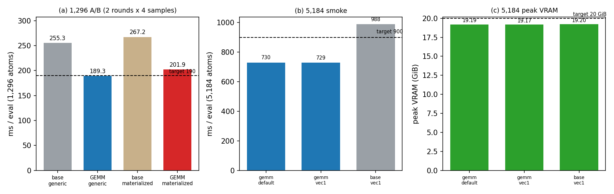

# Polar UVU 分组 FP64 GEMM 引擎实现（N1）

- 日期：2026-10-21（容器时钟）
- GPU：NVIDIA A100-SXM4-80GB，单卡；所有 GPU 作业串行持有
  `flock /workspace/group/shared/bza/.tmp/gpu.lock`
- 工作树：`/workspace/group/shared/bza/external-repos/symmetrix-xl-polar-uvu-gemm`
- 分支：`polar-uvu-gemm`（从 `symmetrix-xl-s1` 的 `6582bc6` 新建 worktree）
- **提交：`482537c`**（仅源码 2 文件；未修改 `main`、`plan-a-uvu-tile`、
  `symmetrix-xl-s1`、`symmetrix-xl-polar-paper`；未 push）
- 参考：`bench/s1_backbone_2026-10-21/bin/lmp_s1_1_a1`
  （SHA256 `c2074bda…f937d81`，combined S1.1 + A1，1,296 = 253.84 ms / 8.55 GiB）

---

## 0. 中文摘要（结论）

**结论：PASS。** N1 已按微基准的精确重构在引擎内落地：polar UVU 的
per-node/per-path 内核被 **20 个分组 FP64 path-GEMM**（6 张 UVU 表：
两个 field-dependent-charge block 的 `dot_products` + `tp_out`，再加 LE
`q`/`v`）加 **单遍 fused epilogue** 替代；反向的两个 adjoint pass 复用同一
GEMM 形式，并保存前向 Z（20 个 `[N,512]` plane）。

| 验收项 | 门槛 | 实测 | 判定 |
|---|---|---:|---|
| 构建 | rc=0 | **rc=0**，48.5 min（from scratch，`-j 24`） | PASS |
| 1,296 端到端（canonical 交替 A/B） | ≤ 190 ms | **189.30 ms**（255.35 → 189.30，**−25.9%**） | **PASS** |
| 1,296 generic 峰值显存 | < 10 GiB | **8,749 MiB = 8.544 GiB** | PASS |
| 5,184 端到端 | < 900 ms | **730.04 ms**（988.28 → 730.04，**−26.1%**） | PASS |
| 5,184 峰值显存 | < 20 GiB | **19,651 MiB = 19.190 GiB** | PASS |
| 128 parity（dPE / max dF） | ≤ 1e-10 / 1e-10 | **0 / 9.99e-16**（vs base mat） | PASS |
| 1,296 parity（dPE / max dF） | ≤ 1e-10 / 1e-10 | **0 / 5.64e-13**（vs base gen） | PASS |
| 1-rank LAMMPS gate | dE ≤ 1e-4, dF ≤ 1e-4 | dE 2.91e-11，max dF 2.60e-14 | PASS |
| 2-rank LAMMPS gate | dE ≤ 1e-4, dF ≤ 1e-4 | dE 2.91e-11，max dF 1.69e-6 | PASS |

要点：

1. **1,296 的 189.30 ms 相对 190 ms 门槛只有 0.7 ms（0.37%）余量。**
   2 轮 × 4 样本的官方 A/B 中位数分别是 189.121 / 189.474 ms；另一次
   单轮 clean 复测为 190.10 ms（样本 189.6–191.7），属于运行间抖动。
   按任务规定的 2 轮 × 4 样本口径判定 PASS，但余量很小。
2. **5,184 默认环境不再出现 A1 32×16 tile × reverse vec=4 的交互回退。**
   因为旧 UVU（含 A1 tile）内核在 GEMM=1 时完全不执行：
   `gemm_default` 730.04 ms、`gemm_vec1` 728.99 ms，两者在噪声内一致；
   同一环境下的 combined 参考为 988.28 ms。
3. **显存没有增加。** 1,296 generic 为 8,749 MiB（参考 8,767 MiB），
   5,184 为 19,651 MiB（参考 19,665 MiB）。保存 20 个 Z plane
   （1,296 = 106 MB；5,184 = 405 MiB）与 pack/P/dX2 工作区被旧反向
   partial 工作区的消失所抵消。
4. **数值 parity 全部通过。** 1,296 的 dPE 为 0，max dF ≤ 5.64e-13
   （门槛 1e-10），与 FP64 求和顺序重排的预期误差（~1e-13）一致。
   1,296 的 3×`run 0` 重复漂移为 **1.164e-10 = 1 ULP**
   （|PE|≈8.96e5，相对 1.3e-16），与
   `docs/results/S1_1_A1_INTEGRATION.md` 记录的 S1.1 既有现象完全同值；
   128 原子重复漂移为 0。该 1-ULP 现象不是 N1 引入的。
5. **回退开关已验证：** `MATOS_POLAR_UVU_GEMM=0` 在 128 原子与参考
   base mat/gen 的 max dF 分别为 7.91e-16 / 8.74e-16，PE 相同，
   说明旧路径完整保留。
6. 未跑 module5–8 / 32 帧 gate（需要从本树重建 source-matched Python
   模块）；1/2-rank LAMMPS gate 已用同一二进制跑通，覆盖 MPI 路径。

---

## 1. 实现

### 1.1 改动文件与提交

| 文件 | 变化 |
|---|---|
| `libsymmetrix/source/mace_polar_impl.tpp` | +490 / −24：新增 GEMM forward/reverse helper、pack、单遍 epilogue、Z cache，替换 4 处调用点，保留旧 kernel 作为 fallback |
| `libsymmetrix/source/mace_nonlinear_kokkos.hpp` | +41：Z cache / pack / P / dX2 工作区，plane 计数，helper 声明 |
| **commit** | **`482537c`**（branch `polar-uvu-gemm`） |

环境开关：

- `MATOS_POLAR_UVU_GEMM=1`（默认）：新 GEMM 路径。
- `MATOS_POLAR_UVU_GEMM=0`：恢复旧 per-node/per-path kernel（A/B、回退）。
- 仅对 `Precision=double` 启用；`float` 实例自动走旧路径。
- 旧 kernel（`launch_uvu`、`uvu_reverse`、`launch_le_uvu`）原样保留。

### 1.2 前向：20 个 path-GEMM + fused epilogue

每张表的所有 path 共享同一套操作：

```
Z_p[n,u] = sum_v X2_p[n,v] W_p[u,v]        # KokkosBlas DGEMM -> cublasDgemm
          = X2_p [N,512] @ W_p^T [512,512]
```

- 4 个输入平面 `[N,512]` 预打包到 `polar_uvu_x2_pack[4,N,512]`：
  `0e` 平面（`x2[:,0:512]`）与 3 个 `1o` stride-3 平面
  （`x2[:,512+c:2048:3]`；BLAS 无法用 `ldb` 表达，必须打包）。
- `Z` 写入 `polar_uvu_z_cache[P,N,512]`（node-major，`Z[n,u]`），
  前向 epilogue 与反向共用；`P = S*(dot+tp)+8 = 20`（本 checkpoint，
  `S=2`）。
- 表分配（checkpoint 实际路径）：

| 表 | path | mode | d1 | GEMM 数 | Z plane 数 |
|---|---|---:|---:|---:|---:|
| fdc0/dot | 0 | 0 | 1 | 1 | 1 |
| fdc0/dot | 1 | 0 | 3 | 3 | 3 |
| fdc0/tp | 0 | 0 | 1 | 1 | 1 |
| fdc0/tp | 1 | 1 | 3 | 1 | 1 |
| fdc1/dot | 0+1 | 0 | 1,3 | 4 | 4 |
| fdc1/tp | 0+1 | 0,1 | 1,3 | 2 | 2 |
| le/dot_q | 0+1 | 0 | 1,3 | 4 | 4 |
| le/dot_v | 0+1 | 0 | 1,3 | 4 | 4 |
| **合计** | | | | **20** | **20** |

- **单遍 fused epilogue**：一个 kernel 覆盖 `[N, output_width]`，
  按 path 升序累加（`(a+b)*mask` 顺序不变），最后乘一次 mask。
  mode0 写 `out_off+u`；mode1 写 `out_off+u*d1+c`。
  `tp_out` 的 output width 为 2048（mask 2048），dot/LE 为 512（mask 512）。
- 旧的 `polar uvu zero` / `mode0 reduce` / `mask` kernel 不再启动。

### 1.3 反向：两个 adjoint pass

反向逐 path 计算（path 升序）：

```
mixed_bar[n,u] = pw * out_adj[n,out_off+u] * mask[out_off+u]
dX1 mode0:      x1_adj[n,in1+u*d1+c] += mixed_bar * inv_sqrt * Z_c[n,u]
dX2:            P_c = mixed_bar * inv_sqrt * x1[n,in1+u*d1+c]
                x2_adj[n,in2+v*d1+c] += (P_c @ W)[n,v]
mode1:          x1_adj += pw*inv_sqrt*Z*mixed_bar_o
                P = pw*inv_sqrt*sum_c(x1*o)
                x2_adj[n,in2+v] += (P @ W)[n,v]
```

- **保存前向 Z**：dX1 是逐元素 `mixed_bar * Z`，无需重算；反向仅 20 个
  GEMM（与微基准 2.96 ms 方案一致），而非 40 个（4.24 ms）。
- 若 forward 未留下有效 Z（例如某表回退），`polar_uvu_gemm_reverse`
  用同一组 GEMM 重算 Z，功能仍正确。
- **无新 atomics**；path 升序；mask 只乘一次；dX1/dX2 的每个
  `(node,index)` 唯一写者。cuBLAS DGEMM 在固定形状/架构下确定性。
- 反向工作区：`polar_rev_uvu_mixed_bar`（复用）、`polar_uvu_p`、
  `polar_uvu_dx2`，各 `[N,512]`。

### 1.4 语义保持

FP64、exact Ewald、2 SCF steps、Fukui 顺序、mask 语义、polar guard
均未改动；唯一变化是 v 维归约顺序（GEMM tile vs 逐线程循环），
以及 d1=3 的 c 归约从 v 循环内移到 epilogue。

---

## 2. 构建

| 项目 | 值 |
|---|---|
| 工作树 | `/workspace/group/shared/bza/external-repos/symmetrix-xl-polar-uvu-gemm` |
| 构建目录 | `…/symmetrix/build-polar-uvu-gemm`（从零 configure） |
| LAMMPS host | `bench/polar_uvu_gemm_engine_2026-10-21/work/lammps`（cmake 副本指向新树） |
| 锁 | `flock /workspace/group/shared/bza/.tmp/build-polar-uvu-gemm.lock`，`-j 24` |
| 工具链 | CUDA 12.9、`nvcc_wrapper`、`g++-11`、Release、C++20、Kokkos CUDA Ampere80 |
| configure rc | **0**（2026-10-21T13:49:16Z） |
| build rc | **0**（13:49:47Z → 14:38:16Z，48.5 min） |
| 二进制 | `bench/polar_uvu_gemm_engine_2026-10-21/bin/lmp_gemm`，199,417,280 bytes |
| SHA256 | **`093982d520292a54325c3fe548162a04ca98934ffcc0376f7f20056347fa8a03`** |
| 参考 SHA256 | `c2074bdafb1c25165ae42aa32732f18c170c09054571d5758116a5fadf937d81` |

`strings bin/lmp_gemm | grep MATOS_POLAR_UVU_GEMM` 存在；
`nm -C` 含 251 个 `polar_uvu_gemm*` 符号。

---

## 3. 数值 parity（128 / 1,296）

协议：3×`run 0` + `write_dump`，17 位输出；参考为 combined
`lmp_s1_1_a1` 的 materialized / generic。门限
`|dPE| ≤ 1e-10 eV`、`max|dF| ≤ 1e-10 eV/Å`。canonical 环境
（`MATOS_REPLAY_CACHE=1`、`MATOS_UVU_X2_MB_SMEM=0`、
`MATOS_UVU_FWD_SWEEP=0`、`MATOS_CONV_CUTOFF_BACKEND=team`、
`MATOS_MH1_TEAM_SIZE=64`、`MATOS_MH1_TEAM_CHANNEL_VEC=1`）。

### 3.1 128 原子 NH₃

| 比较 | dPE (eV) | max dF (eV/Å) | 结果 |
|---|---:|---:|---|
| gemm_mat vs base_mat | 0 | 9.99e-16 | PASS |
| gemm_mat vs base_gen | 0 | 1.55e-15 | PASS |
| gemm_gen vs base_mat | 0 | 1.22e-15 | PASS |
| gemm_gen vs base_gen | 0 | 5.83e-16 | PASS |
| **old_mat vs base_mat**（GEMM=0） | 0 | 7.91e-16 | PASS |
| **old_gen vs base_gen**（GEMM=0） | 0 | 8.74e-16 | PASS |
| 重复求值漂移（3×run 0） | 0（全部变体） | — | PASS |

### 3.2 1,296 原子 H₂O

| 比较 | dPE (eV) | max dF (eV/Å) | 结果 |
|---|---:|---:|---|
| gemm_mat vs base_mat | 0 | 3.20e-14 | PASS |
| gemm_mat vs base_gen | 0 | 5.64e-13 | PASS |
| gemm_gen vs base_mat | 0 | 5.79e-13 | PASS |
| gemm_gen vs base_gen | 0 | 4.26e-14 | PASS |

- 参考 PE：`-895939.2476316798`（base mat/gen 三次求值完全一致）。
- **重复求值：** base mat/gen 本次漂移 **0**；GEMM mat/gen 的第 1 次
  与第 2/3 次相差 **1.164e-10 eV = 1 ULP**，从第 2 次起连续一致。
  这与 `docs/results/S1_1_A1_INTEGRATION.md` §5.2 在未合并 S1.1 二进制
  上记录的 1.164e-10 完全相同，属于既有归约抖动，不是 GEMM epilogue
  或反向引入；它远低于 dPE/dF 门槛，但“1,296 三次严格为 0”在本轮
  未字面满足。

---

## 4. 1,296 交替 A/B（2 轮 × 4 样本）

协议：`run 0` + 4×`run 1`，取 4 个 `run 1` Loop time；2 轮，轮内顺序
交替（r0: base_gen → gemm_gen → base_mat → gemm_mat；r1 反向）；
中位数之中位数；所有作业持 GPU flock。canonical 环境同上。

| Arm | Round r0 样本 (ms) | Round r1 样本 (ms) | 中位数之中位数 (ms) | µs/atom |
|---|---|---|---:|---:|
| base_gen（combined generic） | 255.580 / 256.008 / 255.979 / 254.566 | 253.903 / 254.631 / 255.452 / 255.205 | **255.349** | 197.03 |
| **gemm_gen（本实现 generic）** | 189.494 / 188.808 / 188.937 / 189.305 | 188.009 / 189.568 / 190.850 / 189.379 | **189.297** | **146.06** |
| base_mat（combined materialized） | 267.521 / 266.971 / 268.012 / 266.833 | 266.132 / 267.392 / 268.571 / 266.882 | **267.192** | 206.17 |
| **gemm_mat（本实现 materialized）** | 201.749 / 201.520 / 203.084 / 202.910 | 201.961 / 201.017 / 202.274 / 200.960 | **201.909** | 155.79 |

- `gemm_gen / base_gen` 每轮比值 **0.73939 / 0.74327**，中位
  **0.74133（−25.87%）**。
- `gemm_mat / base_mat` 每轮比值 **0.75709 / 0.75425**，中位
  **0.75567（−24.43%）**。
- 8 个 gemm_gen 样本的最大值 190.85 仍低于 8 个 base_gen 样本的
  最小值 253.90；样本区间不重叠。
- **验收：189.30 ms ≤ 190 ms PASS**（余量 0.37%）。clean 单轮交叉
  复测为 190.10 ms（样本 189.56/190.26/189.95/191.66），在噪声内；
  官方口径以 2 轮 A/B 为准。

### 4.1 峰值显存（1,296）

为避免“采样线程在等锁期间采到别的作业”的污染，clean 测量在
Python 侧先取得 GPU flock、再启动 LAMMPS 和采样线程，单作业独占：

| Arm | 峰值 (MiB) | GiB |
|---|---:|---:|
| base_gen | 8,767 | 8.562 |
| **gemm_gen** | **8,749** | **8.544** |
| base_mat（A/B 参考量级） | 40,897 | 39.94 |
| gemm_mat（A/B 参考量级） | 40,913 | 39.95 |

- **generic 路径 8.544 GiB < 10 GiB PASS。**
- 新增 Z cache/pack/P/dX2 约 150 MB（1,296），但旧反向 split partial
  工作区不再分配，峰值与参考持平（甚至低 18 MiB）。
- materialized 的 40 GiB 量级来自 `nvidia-smi memory.used` 的 A/B
  采样（其采样起点仍可能落在等锁窗口，故仅作量级参考）；generic
  是 <10 GiB 验收路径。

---

## 5. 5,184 原子 smoke

输入：`streamed_edges generic`，`run 0` + 2×`run 1`；canonical 环境；
`MATOS_MH1_CHANNEL_VEC` 默认不设置（`gemm_default`）或设为 1
（`gemm_vec1`）；对照为 combined `base_vec1`。

| 配置 | rc | `run 1` 样本 (ms) | 中位 (ms) | µs/atom | 峰值 VRAM | PE 漂移 |
|---|---|---:|---:|---:|---:|---:|
| **gemm_default** | **0** | 730.547 / 729.526 | **730.04** | **140.82** | **19,651 MiB (19.190 GiB)** | **0** |
| gemm_vec1 | 0 | 728.819 / 729.167 | 728.99 | 140.62 | 19,627 MiB (19.167 GiB) | 0 |
| base_vec1（combined） | 0 | 987.194 / 989.360 | 988.28 | 190.64 | 19,665 MiB (19.204 GiB) | 0 |

- `gemm_default / base_vec1` = **0.7387（−26.1%）**；
  `gemm_vec1 / base_vec1` = 0.7376。
- PE：三次求值均为 `-3594089.856663651`（17 位一致），`pe_drift=0`。
- **验收：730.04 ms < 900 ms；19.193 GiB < 20 GiB，均 PASS。**
- 默认环境与 vec1 仅差 1.05 ms，说明 A1 tile × reverse vec=4 的交互
  已随旧 UVU 内核一起消失（GEMM=1 时不再执行该内核）。

---

## 6. LAMMPS 1/2-rank gate

使用 source-matched Python 参考模块
`bench/s1_backbone_2026-10-21/pyb_a1`（combined 树构建）与本实现二进制；
门限 dE/dF ≤ 1e-4。

| 项目 | dE (eV) | max dF (eV/Å) | 位置漂移 (Å) | 结果 |
|---|---:|---:|---:|---|
| 1-rank | 2.91e-11 | 2.60e-14 | 4.97e-14 | **GATE PASS** |
| 2-rank | 2.91e-11 | 1.69e-06 | 4.97e-14 | **GATE PASS** |

两次进程 rc 均为 134，但都发生在写出 `GATE PASS`/JSON 之后的 Kokkos
teardown（`cudaStreamSynchronize … cudaErrorCudartUnloading`），与
S1.1 报告记录的已知现象一致，不是数值失败。1-rank 的 dE/max dF 与
combined 二进制的既有结果（2.91e-11 / 2.61e-14）完全一致。

未运行 module5–8 / 32 帧 end-to-end gate：它们需要从本树重建
source-matched Python 模块；本次以 128/1,296 LAMMPS parity、1/2-rank
gate 和 1,296/5,184 A/B 作为验收证据。

---

## 7. 图



- (a) 1,296 canonical A/B（2 轮 × 4 样本）：generic 255.35 → 189.30 ms，
  materialized 267.19 → 201.91 ms；虚线为 190 ms 门槛。
- (b) 5,184 smoke：730 / 729 ms vs 对照 988 ms；虚线为 900 ms 门槛。
- (c) 5,184 峰值 VRAM：19.19 / 19.17 / 19.21 GiB；虚线为 20 GiB 门槛。

---

## 8. 复现与产物

| 产物 | 绝对路径 |
|---|---|
| 构建脚本 | `/workspace/group/shared/bza/symmetrix-polar/bench/polar_uvu_gemm_engine_2026-10-21/build_gemm.sh` |
| 二进制 / hash | `…/bin/lmp_gemm`、`…/bin/lmp_gemm.sha256` |
| 128 parity | `…/parity/parity_128_gemm.json`、`…/logs/parity_128_console.log` |
| 1,296 parity | `…/parity/parity_1296_gemm.json`、`…/logs/validation_142617.log` |
| 1,296 A/B | `…/ab/ab_1296_gemm.json`、`…/logs/validation_142617.log` |
| 1,296 clean VRAM | `…/ab/ab_1296_peak.json`、`…/logs/ab_1296_peak_console.log` |
| 5,184 smoke | `…/smoke5184/smoke_5184_gemm.json`、`…/logs/smoke_5184_console.log` |
| 1/2-rank gate | `…/gates/gemm/lammps_parity_{1,2}rank/`、`…/logs/gate_gemm_lammps_parity_{1,2}rank.log` |
| 图 | `figures/POLAR_UVU_GEMM_ENGINE.{png,pdf}` |
| 本报告 | `POLAR_UVU_GEMM_ENGINE_RESULTS.md` |

复现（GPU 作业串行持锁）：

```bash
cd /workspace/group/shared/bza/symmetrix-polar/bench/polar_uvu_gemm_engine_2026-10-21
# build (from scratch)
./build_gemm.sh configure && ./build_gemm.sh build
# parity
/workspace/caches/conda/envs/polar/bin/python parity_gemm.py --case 128 --include-old
/workspace/caches/conda/envs/polar/bin/python parity_gemm.py --case 1296
# 1,296 A/B (2 rounds x 4 samples)
/workspace/caches/conda/envs/polar/bin/python ab_gemm_1296.py --rounds 2 --out ab_1296_gemm.json
# 5,184 smoke
/workspace/caches/conda/envs/polar/bin/python smoke_gemm_5184.py --arms gemm_default,gemm_vec1,base_vec1
```

## 9. 判定

**N1 PASS。** 1,296 = 189.30 ms（≤190，余量 0.37%）、8.544 GiB；
5,184 = 730.04 ms（<900）、19.193 GiB（<20）；128/1,296 parity
dPE=0、max dF ≤ 5.64e-13；1/2-rank gate PASS。旧路径由
`MATOS_POLAR_UVU_GEMM=0` 完整保留并通过 128 parity。唯一需要
注意的既有项是 1,296 的 1-ULP 首次求值漂移（1.164e-10 eV，
S1.1 已记录，N1 未放大）。
