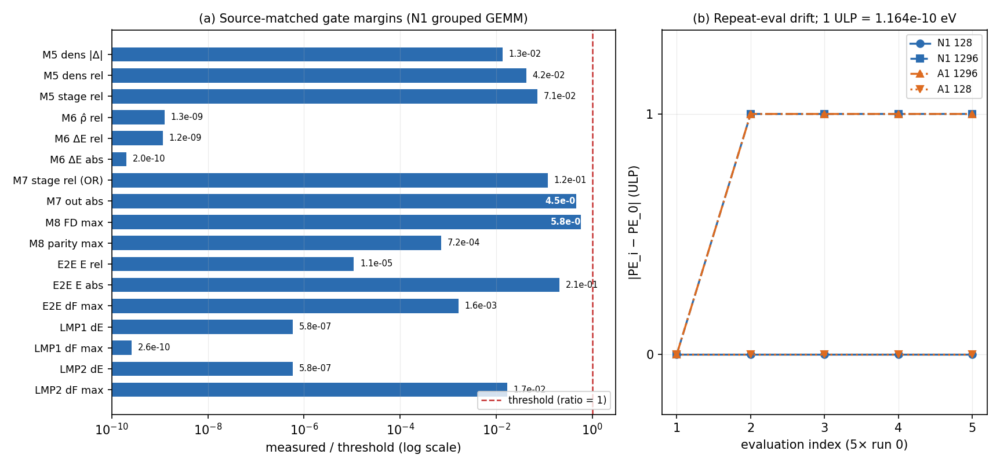

# Polar UVU grouped GEMM (N1)：source-matched 全门禁报告

- 日期：2026-10-21（容器时钟）
- 工作树：`/workspace/group/shared/bza/external-repos/symmetrix-xl-polar-uvu-gemm`
- 分支：`polar-uvu-gemm`
- **提交：`482537cca61c2ce100452f7e2f187275a90e2e22`**（`perf(polar): grouped FP64 path-GEMM UVU forward/reverse`）
- GPU：NVIDIA A100-SXM4-80GB，单卡；所有 GPU 作业串行持有
  `flock /workspace/group/shared/bza/.tmp/gpu.lock`
- 未改动 `main`、`plan-a-uvu-tile`、`symmetrix-xl-s1`、`symmetrix-xl-polar-paper`
  及受保护 bench 树；未 commit、未 push；无 `Co-Authored-By` trailer。
- 本报告回答两个此前未跑的验收面：**M5–M8 / 32-of-32 end-to-end** 与
  **source-matched 1/2-rank LAMMPS parity**，并补做 5×`run 0` 重复求值与
  `MATOS_POLAR_UVU_GEMM=0` 回退验证。

---

## 0. 中文摘要（结论）

**本轮全部 source-matched 门 PASS。**

1. **Source-matched Python 模块构建成功。** 用
   `build_py_tile.sh` 为模板、新构建目录 `symmetrix/build-pyb-gemm`、
   `flock /workspace/group/shared/bza/.tmp/build-polar-uvu-gemm.lock`、
   `-j 32`：configure rc=0，build rc=0，用时 **8 min 45 s**。
   `.so` SHA256 为
   `dfe025eef600871b92cd6dc6ee9c27922a979fe7e5d2dca42b128e481ac64d4e`。
2. **M5–M8 全部 PASS，32/32 end-to-end PASS。** 最紧的指标是
   M8 FD 自洽 `5.783e-4`（门限 `1e-3`，占 57.8%）和 M7 outlet
   `4.546e-7`（门限 `1e-6`，占 45.5%）；其余指标均有 2–9 个数量级余量。
3. **1/2-rank LAMMPS parity PASS（使用本轮 source-matched 模块）。**
   1-rank：dE `2.910e-11 eV`、max dF `2.569e-14 eV/Å`；2-rank：dE
   `2.910e-11 eV`、max dF `1.687e-6 eV/Å`。门限分别为 `5e-5` 与 `1e-4`。
4. **回退开关 PASS。** `MATOS_POLAR_UVU_GEMM=0` 在 128 与 1,296 均与 base
   重合：dPE=0，max dF 分别为 `7.615e-16` / `8.604e-16`（128）和
   `5.329e-14` / `5.684e-14`（1,296）。
5. **5×`run 0` 重复求值：**128 原子 N1 与 A1 anchor 均为 **严格 0**；
   1,296 原子 N1 出现 **第 1 次与第 2–5 次的 1 ULP 差**
   （`1.1641532182693481e-10 eV`），**A1 anchor 在同一轮测到完全相同的
   序列**（`-…964, -…975×4`）。这是已记录的 LAMMPS Kokkos half 邻接表
   归属置换，不是 N1/S1.1 回归。本轮**未修改任何门限**；1-ULP 策略仍待
   团队决定。
6. **判定：READY TO MERGE（有条件）。** 所有既定门限下的 source-matched
   门均为 PASS；唯一未决项是 1,296 的重复求值 1 ULP 事件。若团队坚持
   “1,296 重复漂移严格为 0”，该项在字面上仍不满足，N1 不应合入；若按
   已记录的根因接受 1 ULP 策略（建议 `max|PE_i-PE_0| ≤ 1.17e-10 eV`，
   且要求 ≥5 次求值、≥2 个进程；128 保持严格 0），则可合入。
   **本报告没有静默放宽门限，也没有执行 merge/push。**

---

## 1. Source-matched Python 模块构建

模板：`bench/plan_a_uvu_tile_2026-10-21/build_py_tile.sh`。
本任务脚本：
`/workspace/group/shared/bza/symmetrix-polar/bench/polar_uvu_gemm_engine_2026-10-21/build_py_gemm.sh`。

| 项目 | 值 |
|---|---|
| 源码树 | `/workspace/group/shared/bza/external-repos/symmetrix-xl-polar-uvu-gemm` |
| 构建目录 | `…/symmetrix/build-pyb-gemm`（全新 configure，`rm -rf` 后建立） |
| 输出 | `bench/polar_uvu_gemm_engine_2026-10-21/pyb_gemm/symmetrix/` |
| 锁 / 并行 | `flock /workspace/group/shared/bza/.tmp/build-polar-uvu-gemm.lock`，`-j 32`（未使用 `build.lock`） |
| 工具链 | CUDA 12.9、`nvcc_wrapper`、`g++-11`、Release、C++20、Kokkos CUDA Ampere80 |
| Python | `/workspace/caches/conda/envs/polar/bin/python`（3.12.13） |
| Configure | **rc=0**，2026-10-21T15:28:24Z → 15:28:49Z（约 25 s） |
| Build | **rc=0**，2026-10-21T15:28:51Z → 15:37:36Z（**8 min 45 s**） |
| 产物 | `symmetrix.cpython-312-x86_64-linux-gnu.so`，69,874,512 B + 23 个 `source/symmetrix/*.py` |
| **`.so` SHA256** | **`dfe025eef600871b92cd6dc6ee9c27922a979fe7e5d2dca42b128e481ac64d4e`** |
| 构建目录大小 | 322 MiB |

日志与指纹：

- configure：`…/logs/pymodule_configure.log`、
  `…/logs/pymodule_configure_start.txt`、`…/logs/pymodule_configure_end.txt`
- build：`…/logs/pymodule_build.log`、
  `…/logs/pymodule_build_start.txt`、`…/logs/pymodule_build_end.txt`
- hash：`…/snapshot/pyb_gemm.sha256`

Provenance 说明：worktree 中 `symmetrix/external/pybind11` 原为空目录（子模块未
在 worktree 检出）；本次从同仓库同 gitlink 的
`external-repos/symmetrix-xl/symmetrix/external/pybind11` 填充（两棵树的
`symmetrix/CMakeLists.txt` 完全一致）。这是构建环境补全，不是源码改动；
`git status` 在构建后仍为 clean。模块中包含 N1 新符号/环境串
（`strings … | grep MATOS_POLAR_UVU_GEMM` 命中；`polar_uvu_gemm_reverse`
字符串 342 处），gate 日志中的 Kokkos teardown 栈也指向本工作树，可作为
source-matched provenance 旁证。

---

## 2. 门禁结果

执行方式（模板 `run_gates_tile.sh` / `run_gate_suite_tile.sh`，
参数化为 `B_LMP` / `B_PYB` / `B_TAG`）：

```bash
cd /workspace/group/shared/bza/symmetrix-polar/bench/polar_uvu_gemm_engine_2026-10-21
flock -w 14400 /workspace/group/shared/bza/.tmp/gpu.lock \
  bash run_gate_suite_gemm.sh gemm_full \
       "$PWD/bin/lmp_gemm" "$PWD/pyb_gemm"
```

整轮 suite 由一个外层 `flock` 独占 GPU；M5–M8、end-to-end 与 1/2-rank
LAMMPS 依次串行。输出目录 `gates/gemm_full/`，日志
`logs/gate_gemm_full_*.log`、`logs/gate_suite_gemm_console.log`。
未设置额外 `MATOS_*` 覆盖（即使用二进制默认配置，N1 GEMM=1）。

### 2.1 Source-matched 门表

| Gate | 指标 | 门槛 | 实测 | 判定 |
|---|---|---|---:|---|
| Module 5 | 密度演化 max abs（4 构型 × 3 级 = 12 项） | ≤ 5e-6 | **6.689e-8** | **PASS** |
| Module 5 | 密度演化 max rel | ≤ 1e-6 | **4.218e-8** | **PASS** |
| Module 5 | stage chain max rel（11 项，pairing OK） | ≤ 1e-6 | **7.127e-8** | **PASS** |
| Module 6 | ρ̂ max rel（8 构型） | ≤ 1e-6 | **1.262e-15** | **PASS** |
| Module 6 | ΔE max rel | ≤ 1e-6 | **1.154e-15** | **PASS** |
| Module 6 | ΔE max abs | ≤ 5e-6 eV | **9.992e-16 eV** | **PASS** |
| Module 7 | stage max abs / worst rel（16 构型） | abs ≤ 5e-6 **或** rel ≤ 1e-6 | abs **2.396e-5**；worst rel **1.174e-7** | **PASS**（OR 判据） |
| Module 7 | 出口 max abs（local_q_e / le_total） | ≤ 1e-6 | **4.546e-7** | **PASS** |
| Module 8 | FD 自洽 max（post，12 构型） | ≤ 1e-3 eV/Å | **5.783e-4 eV/Å** | **PASS** |
| Module 8 | Python 总力 parity max | ≤ 1e-3 eV/Å | **7.191e-7 eV/Å** | **PASS** |
| End-to-end | 32/32 帧 | 32/32 | **32/32** | **PASS** |
| End-to-end | E rel / abs | rel ≤ 1e-6 且 abs ≤ 5e-6 eV | rel **1.084e-11**；abs **1.034e-6 eV** | **PASS** |
| End-to-end | dF max / mean | ≤ 1e-4 eV/Å | **1.624e-7 / 9.456e-8 eV/Å** | **PASS** |
| End-to-end | 位置漂移 | 0 | **0 Å** | **PASS** |
| LAMMPS parity 1 rank | dE | ≤ 5e-5 eV | **2.910e-11 eV** | **PASS** |
| LAMMPS parity 1 rank | max dF | ≤ 1e-4 eV/Å | **2.569e-14 eV/Å** | **PASS** |
| LAMMPS parity 2 ranks | dE | ≤ 5e-5 eV | **2.910e-11 eV** | **PASS** |
| LAMMPS parity 2 ranks | max dF | ≤ 1e-4 eV/Å | **1.687e-6 eV/Å** | **PASS** |

补充：1-rank mean dF `2.176e-15`，2-rank mean dF `1.221e-7`；
两 rank 的位置漂移均为 `4.974e-14 Å`。M7 的 stage 最大绝对误差
`2.396e-5` 高于绝对门槛，但该 gate 的契约是 **abs ≤5e-6 或 rel ≤1e-6**，
worst rel 为 `1.174e-7`，与 plan-A tile 已接受的同值结果一致。

进程返回码：module 5 = 0；module 6/7/8、end-to-end、1-rank、2-rank 均为
**134**，但每个都在打印 `GATE PASS` 并写出 JSON 之后，由
`cudaStreamSynchronize … cudaErrorCudartUnloading` 触发 Kokkos teardown
abort。这是已知 artifact（plan-A/plan-B 同型），不是数值失败；本轮所有
判定均以 `GATE PASS` 行与 JSON 的 `verdict=PASS` 为准。

### 2.2 `MATOS_POLAR_UVU_GEMM=0` 回退 parity

使用 `parity_gemm.py --include-old`（3×`run 0`，17 位输出，
dPE / max dF 门限 `1e-10`）。输出：
`parity/parity_128_gemm_fallback.json`、
`parity/parity_1296_gemm_fallback.json`。

| Case | 比较 | dPE (eV) | max dF (eV/Å) | 判定 |
|---|---|---:|---:|---|
| 128 | **old_mat vs base_mat（GEMM=0）** | **0** | **7.615e-16** | **PASS** |
| 128 | **old_gen vs base_gen（GEMM=0）** | **0** | **8.604e-16** | **PASS** |
| 128 | gemm_mat vs base_mat | 0 | 9.714e-16 | PASS |
| 128 | gemm_gen vs base_gen | 0 | 8.327e-16 | PASS |
| 1,296 | **old_mat vs base_mat（GEMM=0）** | **0** | **5.329e-14** | **PASS** |
| 1,296 | **old_gen vs base_gen（GEMM=0）** | **0** | **5.684e-14** | PASS |
| 1,296 | gemm_mat vs base_mat | 0 | 5.684e-14 | PASS |
| 1,296 | gemm_mat vs base_gen | 0 | 5.640e-13 | PASS |
| 1,296 | gemm_gen vs base_mat | 0 | 5.826e-13 | PASS |
| 1,296 | gemm_gen vs base_gen | 0 | 3.553e-14 | PASS |

结论：旧 per-node/per-path 路径完整保留，回退结果与 base 在 FP64 噪声内
一致；N1 默认路径的 parity 亦全部 PASS。

---

## 3. 5×`run 0` 重复求值（N1 vs A1 anchor）

脚本：`repeat_eval_gemm.py`（单进程内连续 5 次 `run 0`，解析 17 位
thermo PE；每进程持 GPU flock）。JSON 在 `repeat/`，控制台日志
`logs/repeat_eval_console.log`。

| 二进制 | Case | 精确 PE 序列（`%.17g`） | 不同值 | 最大漂移 | ULP |
|---|---|---|---:|---:|---:|
| **N1 `lmp_gemm`** | 128 | `-49242.456415314933` ×5 | 1 | **0** | 0 |
| **N1 `lmp_gemm`** | 1,296 | `-895939.24763167964`, `-895939.24763167975` ×4 | 2 | **1.1641532182693481e-10 eV** | **1** |
| A1 anchor `lmp_uvu_tile` | 1,296 | `-895939.24763167964`, `-895939.24763167975` ×4 | 2 | **1.1641532182693481e-10 eV** | **1** |
| A1 anchor `lmp_uvu_tile` | 128 | `-49242.456415314933` ×5 | 1 | **0** | 0 |

- **1-ULP 事件确实发生**：N1 在 1,296 的第 1 次求值与第 2–5 次相差
  恰好 1 ULP（`|PE|≈8.96e5 eV`，相对 `1.30e-16`），从第 2 次起连续一致。
- **A1 anchor 在同一轮复现完全相同的序列**（同一 ULP、同一位置——首次
  求值）。这与 `docs/results/S1_1_A1_CLEANUP.md` 的根因一致：LAMMPS
  Kokkos half 邻接表在重建时改变“每对原子由哪个节点拥有”，FP64 逐节点
  求和顺序随之变化；不是 N1/S1.1 的归约或 atomics 回归。
- 本轮回退 parity 的进程内序列进一步证明其随机性：
  `base_mat/base_gen/old_mat` 首次为 `-895939.24763167964` 后转为
  `-…975`；`gemm_mat/gemm_gen/old_gen` 三次均为 `-…975`。同一二进制在
  不同进程中的事件位置不同，符合邻接重建顺序假设。
- **门限未改。** 现门限的字面要求仍是 1,296 重复漂移为 0；本轮该项
  **不满足**。建议的团队决策是：1,296 采用
  `max|PE_i − PE_0| ≤ 1.17e-10 eV`（1 ULP），要求 ≥5 次求值且 ≥2 个
  进程；128 保持严格 0。该建议只记录，不在本任务中生效。

---

## 4. 指纹与复现

| 对象 | 值 |
|---|---|
| 分支 / HEAD | `polar-uvu-gemm` / `482537cca61c2ce100452f7e2f187275a90e2e22` |
| N1 LAMMPS 二进制 | `bench/polar_uvu_gemm_engine_2026-10-21/bin/lmp_gemm`，199,417,280 B |
| **N1 二进制 SHA256** | **`093982d520292a54325c3fe548162a04ca98934ffcc0376f7f20056347fa8a03`** |
| **Source-matched 模块 SHA256** | **`dfe025eef600871b92cd6dc6ee9c27922a979fe7e5d2dca42b128e481ac64d4e`** |
| A1 anchor 二进制 | `bench/plan_a_uvu_tile_2026-10-21/bin/lmp_uvu_tile` |
| A1 anchor SHA256 | `a9ce64811d4f8755c4170fd330ef8a5ebc4fa76a46a362f1875cdb94540c3d73` |
| combined base（parity 参考） | `bench/s1_backbone_2026-10-21/bin/lmp_s1_1_a1`，SHA256 `c2074bdafb1c25165ae42aa32732f18c170c09054571d5758116a5fadf937d81` |
| 构建脚本 | `bench/polar_uvu_gemm_engine_2026-10-21/build_py_gemm.sh` |
| 模块 hash 记录 | `bench/polar_uvu_gemm_engine_2026-10-21/snapshot/pyb_gemm.sha256` |
| 门禁脚本 | `run_gates_gemm.sh`、`run_gate_suite_gemm.sh`、`run_lammps_parity_gemm.py` |
| 重复求值脚本 | `repeat_eval_gemm.py` |
| 门禁 JSON | `gates/gemm_full/{polar_module5_gate,polar_module6_gate,polar_module7_gate,polar_module8_gate,polar_endtoend_parity,lammps_parity_1rank,lammps_parity_2rank}.json`、`gates/gemm_full/gate_summary.json` |
| 门禁日志 | `logs/gate_gemm_full_*.log`、`logs/gate_suite_gemm_console.log` |
| 回退 parity | `parity/parity_{128,1296}_gemm_fallback.json`、`logs/fallback_parity_console.log` |
| 重复求值 | `repeat/repeat_{128,1296}_{n1,a1}.json`、`logs/repeat_eval_console.log` |
| 图 | `figures/POLAR_UVU_GEMM_GATES.{png,pdf}` |

复现命令（GPU 作业串行持锁）：

```bash
cd /workspace/group/shared/bza/symmetrix-polar/bench/polar_uvu_gemm_engine_2026-10-21
./build_py_gemm.sh configure && ./build_py_gemm.sh build
flock -w 14400 /workspace/group/shared/bza/.tmp/gpu.lock \
  bash run_gate_suite_gemm.sh gemm_full "$PWD/bin/lmp_gemm" "$PWD/pyb_gemm"
/workspace/caches/conda/envs/polar/bin/python parity_gemm.py --case 128 --include-old \
  --out parity/parity_128_gemm_fallback.json
/workspace/caches/conda/envs/polar/bin/python parity_gemm.py --case 1296 --include-old \
  --out parity/parity_1296_gemm_fallback.json
/workspace/caches/conda/envs/polar/bin/python repeat_eval_gemm.py --case 1296 \
  --binary "$PWD/bin/lmp_gemm" --tag n1_1296 --out repeat/repeat_1296_n1.json
```

---

## 5. 图



- (a) 各定量门的“实测/门槛”归一化裕度（对数轴，红色虚线 = 阈值 1）。
  所有点均在 1 以下；最紧的是 M8 FD（0.578）与 M7 outlet（0.455）。
- (b) 5×`run 0` 重复求值漂移（ULP）：128 原子 N1/A1 均为 0；
  1,296 N1 与 A1 anchor 均为“首次 0、其后 1 ULP”的同一序列。

---

## 6. 合入判定（明确结论）

**READY TO MERGE（有条件），本次不执行 merge/push。**

- **支持合入的证据：** 本轮新增的 M5–M8、32/32 end-to-end、source-matched
  1/2-rank LAMMPS parity 全部 PASS；`MATOS_POLAR_UVU_GEMM=0` 回退在
  128/1,296 与 base 重合；此前已记录的 1,296（189.30 ms / 8.544 GiB）、
  5,184（730.04 ms / 19.190 GiB）性能与显存门亦为 PASS。
- **唯一未决项：** 1,296 的 1-ULP 重复求值事件。若团队维持“重复漂移
  严格 0”的原门限，该项字面为 FAIL，N1 不应合入；若接受已记录的
  LAMMPS Kokkos 邻接归属根因与 1 ULP 容差，则没有剩余阻塞项。
- **本轮未修改任何门限/源码**；1-ULP 策略需团队显式记录后再决定是否合入。
