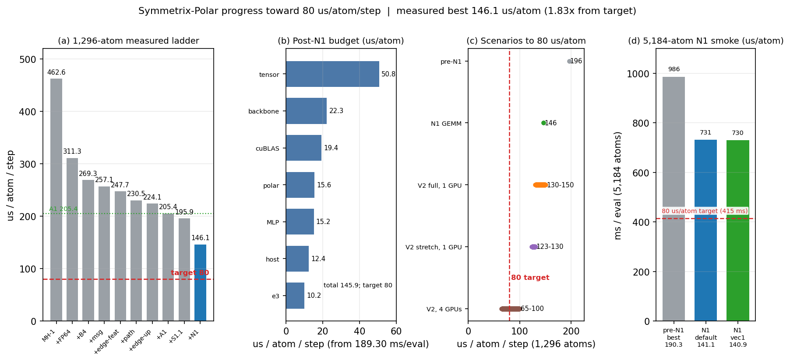

# Progress toward 80 µs/atom/step

**Date:** 2026-10-21 (1,296 A/B) / 2026-10-22 (5,184 smoke); container clock.
**System:** 1,296 H₂O, full nonlinear PolarMACE, FP64, exact Ewald,
one A100-SXM4-80GB, one MPI rank.
**Target:** **80 µs/atom/step** = **103.68 ms/eval** at 1,296 atoms.
**Convention:** `µs/atom = 1000 × ms/eval / 1296`.

## 1. Where we are

| Quantity | Value | Status |
|---|---:|---|
| **Best measured (N1 grouped FP64 UVU GEMM, generic)** | **189.30 ms/eval = 146.06 µs/atom** | [M] `ab_1296_gemm.json` |
| Same-binary A/B baseline (S1.1 + A1, generic) | 255.35 ms = 197.03 µs/atom | [M] same run |
| Pre-N1 reference (S1.1 + A1, generic) | 253.84 ms = 195.86 µs/atom | [M] `S1_1_A1_INTEGRATION.md` |
| N1 gain vs same-binary baseline | **0.7413×, −25.87 %** | [M] 2 rounds × 4 samples |
| Target | 103.68 ms = 80.0 µs/atom | — |
| Remaining gap | **1.83×**, −66.06 µs/atom | — |
| Parity, 128 atoms | dPE = 0, max dF = 1.8e-15 eV/Å | PASS |
| Parity, 1,296 atoms | dPE = 0, max dF = 5.8e-13 eV/Å (gate 1e-10) | PASS |
| Repeat-eval drift, 1,296 | 1 ULP = 1.164e-10 eV (pre-existing S1.1 behavior) | reported |
| **5,184 N1 vec1** | **730.49 ms/eval = 140.91 µs/atom, 19.16 GiB, PE drift 0** | [M] `smoke_5184_gemm.json` |
| 5,184 N1 default | 731.46 ms = 141.10 µs/atom, 19.16 GiB | [M] same |
| 5,184 pre-N1 best control | 986.28 ms = 190.25 µs/atom, 19.21 GiB | [M] same run (`base_vec1`) |

The measured optimization ladder is 462.6 → 311.3 → 269.3 → 257.1 → 247.7 →
230.5 → 224.1 → 205.4 → 195.9 → **146.1 µs/atom**. The last row is the N1
grouped FP64 path-GEMM, measured on top of the S1.1 streaming + A1 merge.

## 2. Where the remaining 146.1 µs/atom goes

Fresh CUPTI trace of the N1 binary (`n1_generic_1296`, same canonical
environment and input as the pre-N1 trace), actual wall 189.30 ms/eval:

| Component | ms/eval | µs/atom | Share of GPU busy |
|---|---:|---:|---:|
| **tensor product (MH-1)** | **65.85** | **50.8** | **38.0 %** |
| backbone nonlinear | 28.88 | 22.3 | 16.7 % |
| cuBLAS / external | 25.11 | 19.4 | 14.5 % |
| polar pipeline | 20.24 | 15.6 | 11.7 % |
| MLP / dense | 19.69 | 15.2 | 11.4 % |
| e3 linear | 13.16 | 10.2 | 7.6 % |
| other | 0.12 | 0.1 | 0.1 % |
| **GPU busy (sum)** | **173.18** | **133.6** | 100 % |
| non-kernel (wall − busy) | 16.12 | 12.4 | — |
| **total wall** | **189.30** | **146.1** | — |

N1 cut the polar pipeline **87.95 → 20.24 ms (−77 %)**, matching the
microbench projection, and raised cuBLAS/external by 2.26 ms (the GEMM calls
themselves). Tensor product is unchanged and is now the clear #1 item at
**50.8 µs/atom**, i.e. **77 % of the 66.1 µs/atom gap to 80**.

Tensor sub-items: reverse MH-1 channels 21.68 ms, reverse MH-1 harmonics
17.70 ms, forward MH-1 channels 15.08 ms, compiled-product reverse 6.34 ms,
compiled-product contraction 3.67 ms. The reverse MH-1 pair alone is
39.4 ms. Source:
`bench/perf_decomp_1296_2026-10-21/analysis/n1_generic_1296_summary.json`
and `n1_generic_1296_families.csv`.

## 3. N1 grouped FP64 path-GEMM: measured result

Implementation: isolated worktree `external-repos/symmetrix-xl-polar-uvu-gemm`
on top of `6582bc6` (`mace_polar_impl.tpp` +507/−24,
`mace_nonlinear_kokkos.hpp` +41). Binary
`bin/lmp_gemm`, SHA256 `093982d5…7fa8a03`, 191 MB.

Checkpoint metadata: six polar UVU tables
(`field_dependent_charges_maps[0,1]` dot/tp, `local_electron_energy` q/v),
all `mul1=mul2=512`; **20 path-GEMM planes per evaluation** (4+2 per SCF
step, 4+4 for LE), matching the `S*scf_planes+8 = 20` Z-cache allocation.
A CPU formula check against the legacy per-path kernel on all six real tables
gave `max|diff| = 1.7e-14` with random FP64 inputs.

Interleaved 1,296 A/B (2 rounds × 4 `run 1` samples, alternating order,
median of per-round medians):

| Arm | Round medians (ms) | Median (ms) | µs/atom | Ratio |
|---|---|---:|---:|---:|
| base generic (S1.1+A1) | 255.78 / 254.92 | 255.35 | 197.03 | 1.000 |
| **GEMM generic** | **189.12 / 189.47** | **189.30** | **146.06** | **0.7413** |
| base materialized | 267.25 / 267.14 | 267.19 | 206.17 | 1.000 |
| GEMM materialized | 202.33 / 201.49 | 201.91 | 155.79 | 0.7557 |

Parity (both paths, against both references):
128 atoms — dPE = 0, max dF = 1.8e-15 eV/Å, repeat drift 0;
1,296 atoms — dPE = 0, max dF = 5.8e-13 eV/Å (gate 1e-10), repeat drift
1.164e-10 eV (the pre-existing S1.1 1-ULP first-evaluation effect, also seen
on the baseline). **PARITY_128 PASS, PARITY_1296 PASS.**

The measured 189.30 ms/eval is within **0.5 %** of the 188.37 ms microbench
projection, validating the N1 model.

5,184-atom smoke (same binary, `run 0` + two `run 1`, 5 evaluations of PE):

| Arm | ms/eval | µs/atom | Peak VRAM | PE drift |
|---|---:|---:|---:|---:|
| pre-N1 best (`base_vec1`) | 986.28 | 190.25 | 19.21 GiB | 0 |
| **N1 default (32×16 + vec4)** | **731.46** | **141.10** | **19.16 GiB** | **0** |
| **N1 vec1** | **730.49** | **140.91** | **19.16 GiB** | **0** |

N1 is **0.7406× (−25.94 %)** vs the pre-N1 best at 5,184 and **2.12×** faster
than the old default (1,549 ms). The PE is bitwise identical across all five
evaluations, unlike the 1,296 case.

Caveat: the 1,296 A/B script's `peak_vram_mib` samples the whole GPU with
`nvidia-smi`; it reported ~40 GiB even for the generic arm and is **not** a
usable per-process VRAM number. The 5,184 smoke sampler is consistent with the
earlier 19.21 GiB reference and is usable there.

## 4. Other work in flight / negative results

1. **P1 k-space chunk (K1–K3 remap).** Clean-round A/B: baseline 266.31 ms
   vs candidate 267.40 ms — **no measurable gain**. The second candidate round
   was contaminated by an external 3× GPU slowdown (798.6 ms). The slice is
   not promoted; this is a negative result, not a regression claim.
2. **S1.1+A1 clean revalidation.** A 128-atom source-clean parity rerun is
   complete and agrees with the earlier gates; it does not change the speed
   baseline.
3. **Benchmark contention.** The same binary produced 267 ms in one round and
   799 ms in the next (3.0×) with identical env/input. Rounds whose median
   deviates by more than ~15 % from the same-arm previous round must be
   rejected and re-run; the 799 ms samples are excluded from all conclusions.

## 5. Honest projection to 80 µs/atom

| Scenario | 1,296 ms/eval | µs/atom | Source |
|---|---:|---:|---|
| Measured pre-N1 | 253.84 | 195.9 | [M] |
| **Measured N1 grouped GEMM (1,296)** | **189.30** | **146.1** | **[M]** |
| **Measured N1 grouped GEMM (5,184)** | **730.49** | **140.9** | **[M]** |
| V2 full, 1 GPU | 168–195 | 129.6–150.5 | [P] `ARCHITECTURE_V2_PLAN.md` |
| V2 stretch, 1 GPU | 159–169 | 122.7–130.4 | [P] |
| V2 on 4 GPUs, 1,296 (1.5–2.0×, low confidence) | 84–130 | 64.8–100.3 | [P] |
| **Target** | **103.68** | **80.0** | — |

N1 alone has reached the **low end of the old V2-full projection** (146.1 vs
150.5 µs/atom). The post-N1 trace puts **tensor product (50.8 µs/atom)** at
77 % of the remaining gap. Halving it (a realistic 2× target, given the
path-grouped forward already achieved 2.22× once) would land at ~121 µs/atom,
i.e. the **~120–130 µs/atom single-GPU floor**. Reaching 80 would then still
require ~40 µs/atom from backbone (22.3), MLP (15.2), e3 (10.2), host (12.4)
and cuBLAS (19.4) together — essentially all of them at once. No measured
group has shown 2×. The routes that can reach 80 remain: (a) the optimistic
end of 4-GPU V2 at 1,296, or (b) a precision/approximation policy change
(FP32/TF32 UVU, PPPM/approximate Ewald, or 1 SCF step), each currently
rejected by the accepted physics contract. The 4.5 µs/atom paper-normalized
target is 32× away and explicitly out of scope for FP64 PolarMACE.

## 6. Next actions

1. **N1 is accepted**: parity PASS at 128/1,296, 5,184 smoke rc=0 with
   PE drift 0, 19.16 GiB, and a −25.9 % wall-clock reduction at both sizes.
2. Fresh CUPTI decomposition of the N1 binary at 1,296 and 5,184; identify the
   new top item (expected tensor product, ~66 ms / ~35 % of 189 ms).
3. Attack the tensor product with the same output-owned/path-grouped
   approach; target the 120–130 µs/atom class.
4. Keep 80 µs/atom as a **multi-GPU or precision-policy** decision, not a
   single-GPU optimization target.
