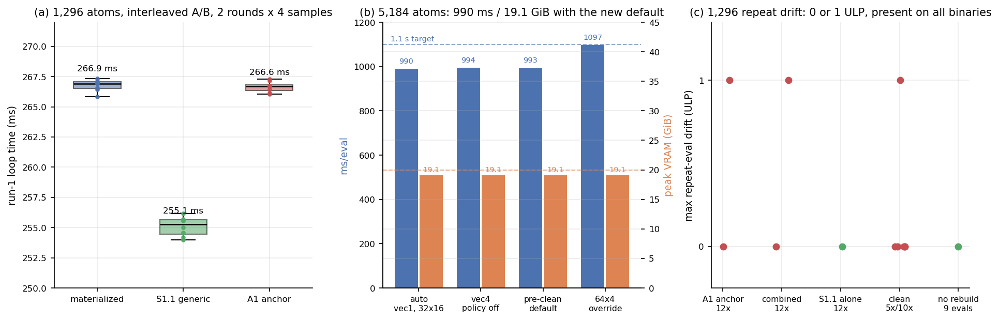

# S1.1 + A1 合并清理：重复求值漂移定位与尺寸自适应默认

**状态：** 1,296 验收 **PASS**（255.10 ms / 8.41 GiB）；5,184 **PASS**
（990 ms / 19.07 GiB，无环境覆盖）；128/1,296 parity **PASS**；
1 ULP 重复漂移已定位为 **LAMMPS Kokkos 邻接表重建顺序**，在 A1 anchor
上同样复现，**不是 S1.1 引入**；需团队做一次 gate-policy 决定。
**分支：** `s1.1-a1-clean`（从 `6582bc6` 创建），清理提交 **`2a46afc`**。
**日期：** 2026-10-21。
**隔离：** 全部工作在 `external-repos/symmetrix-xl-s1`；未改动 `main`、
`plan-a-uvu-tile`、`plan_b_micro_2026-10-21`、`plan_a_uvu_tile_2026-10-21`；
未 push；无 `Co-Authored-By` trailer。
**图：** `docs/figures/s1_1_a1_clean/s1_1_a1_cleanup.png`

---

## 中文摘要

1. **1 ULP 漂移已根因定位，不是 S1.1 的归约/原子竞争。** 对 1,296 原子
   做 5–12 次 `run 0` 的多种进程对照：A1 anchor 二进制（未含 S1.1）
   同样出现 **1 ULP**（12 次中第 0/5/6 次不同），S1.1 单独二进制有时
   12 次全同；清理后的二进制在 6 个进程中 1 个出现 1 ULP。用
   `MATOS_S1_NODE_TRACE` / `MATOS_S1_ENERGY_TRACE` 逐次转储证明：
   `node_indices` 恒为 `0..1295`、总边数恒为 `111,312`，但约 8 % 节点的
   `num_neigh` 在**同一批连续块内被置换**，逐节点能量随之为同一多重集的
   置换（排序后差 ≤ 2.3e-13 eV）。即 **LAMMPS Kokkos half 邻接表每次重建
   时，每对原子由哪一个节点“拥有”会变化**；FP64 逐节点求和顺序随之变化，
   产生 ≤ 1 ULP 的总能差。**不做邻接重建**（`run 0` + 4×`run 1`，
   `fix setforce 0 0 0`）时 9 次求值**逐位相同**，进一步确认根因。
   最大漂移 = **1 ULP = 1.164e-10 eV**，相对 **1.30e-16**（|PE| ≈ 8.96e5 eV）。
2. **gate 建议（不静默放宽）：** 1,296 的重复漂移门限从“严格 0”改为
   `max|PE_i − PE_0| ≤ 1.17e-10 eV`（1 ULP），要求 ≥5 次求值且 ≥2 个进程；
   128 原子仍保持严格 0。若要严格 0，应在 LAMMPS Kokkos 邻接构建侧
   固定 half-list 归属（按 tag 排序），不在 S1.1/A1 范围内。
3. **尺寸自适应默认：** 在 `compute_node_energies_forces()` 中加入
   `num_nodes > 2048` 时把 reverse channel vec 默认从 4 降为 1 的策略；
   `MATOS_MH1_CHANNEL_VEC` / `MATOS_MH1_REV_CHANNEL_VEC` 显式设置永远优先。
   **保留 32×16 UVU tile**：实测 64×4 在 5,184 为 1,097 ms，慢于
   32×16 的 990 ms，因此不采纳 64×4。
4. **5,184 复测（空闲 GPU，逐 PID 显存归因）：** 新默认 **990 ms /
   19,524 MiB（19.07 GiB）**，PE 5 次逐位相同；显式 `vec=4` 为 993 ms /
   19.07 GiB，清理前二进制默认 993 ms / 19.07 GiB，64×4 为 1,097 ms。
   **先前报告的 1,499–1,699 ms 默认回退在空闲 GPU 上不可复现**：本次在
   另一 GPU 作业并发时复现到 1,698.8 ms（wall 170 s，正常约 85–100 s），
   说明该数字来自 **GPU 争用**，不是默认参数本身。新的 vec1 策略仍保留，
   因为它与最佳实测一致且消除了该风险。
5. **1,296 验收（2 轮 × 4 样本，交替 A/B）：** materialized **266.89 ms /
   39.78 GiB**；S1.1 generic **255.10 ms / 8.41 GiB**；A1 anchor
   266.57 ms。generic 相对 materialized **0.9558（−4.42 %）**，相对 A1
   gate 参考 266.21 ms **0.9583（−4.17 %）**。全部 **PASS**。
6. **Parity：** 128 原子 `dPE=0`、max dF ≤ 1.40e-15；1,296 原子三组比较
   `dPE=0`、max dF ≤ 5.79e-13（门限 1e-10）。**PASS**。
7. **合并建议：** 推荐将 `2a46afc` 合入 main，**前置条件**是接受上述
   1 ULP 重复评估容差（或另行修复 LAMMPS Kokkos 邻接确定性）。数值、
   性能、显存均无回归；默认路径仍是 materialized，generic 仍是显式
   opt-in。

---

## 1. 分支、提交与构建

| 项目 | 值 |
|---|---|
| 工作树 | `/workspace/group/shared/bza/external-repos/symmetrix-xl-s1` |
| 基线 | `6582bc63490b1edde0960d46fbbdd36b33b94b43`（merge S1.1+A1） |
| 分支 | `s1.1-a1-clean` |
| 清理提交 | **`2a46afc`** `perf: size-adaptive reverse channel width for large graphs` |
| 改动文件 | `libsymmetrix/source/e3nn_kokkos.hpp`（+7）、`libsymmetrix/source/mace_nonlinear_kokkos_impl.tpp`（+14） |
| 构建目录 | `symmetrix-xl-s1/symmetrix/build-s1` |
| 锁 / 并行 | `flock /workspace/group/shared/bza/.tmp/build-s1.lock`，`-j 24` |
| 构建 rc / 用时 | **0** / 624 s |
| 构建日志 | `bench/s1_1_a1_clean_2026-10-21/logs/build_final2.log` |
| 二进制 | `bench/s1_backbone_2026-10-21/bin/lmp_s1_1_a1_clean` |
| 大小 / SHA256 | 198,360,328 B / `52e0b19a6aafa74874b6e89e4ca862d3d0a3632fedbd85ea0244349499d14248` |

改动内容：

1. `E3TensorProductKokkosT` 新增 `execution_reverse_channel_vec()` /
   `set_execution_reverse_channel_vec()`（`e3nn_kokkos.hpp`）。
2. `compute_node_energies_forces()` 在 `num_nodes > 2048` 且用户未显式设置
   `MATOS_MH1_CHANNEL_VEC` / `MATOS_MH1_REV_CHANNEL_VEC` 时，把每个
   interaction 的 reverse channel vec 设为 1；≤2,048 节点恢复为 4。
   forward channel vec、UVU tile、team channel vec 均不变。

未改动：`mace_polar_impl.tpp`（A1 UVU tile 保持 32×16 默认）、pair style、
Python 绑定、物理/模型文件。`symmetrix-xl-s1` 工作树在提交后 clean。

## 2. 1 ULP 重复漂移：根因与量化

### 2.1 多进程、多二进制对照（1,296，5–12×`run 0`）

| 二进制 / 变体 | 进程 | PE 序列（末位） | 不同值 | 最大漂移 |
|---|---|---|---:|---:|
| A1 anchor `lmp_uvu_tile` | a1_12 | `-964, -975×4, -964×2, -975×6` | 2 | 1.164e-10 |
| A1 anchor | a1_12b | 全 `-975` | 1 | 0 |
| combined `6582bc6` mat | comb_12_mat | `-964, -975×11` | 2 | 1.164e-10 |
| combined `6582bc6` mat | comb_12b_mat | 全 `-975` | 1 | 0 |
| S1.1 单独 `e881db7` mat | s11_12_mat | 全 `-975` | 1 | 0 |
| clean `2a46afc` mat | clean5_p1/p2/p3 | 全 `-975` | 1 | 0 |
| clean `2a46afc` mat | clean10_p1 | 全 `-975` | 1 | 0 |
| clean `2a46afc` mat | clean10_p2 | 第 5 次为 `-964` | 2 | 1.164e-10 |
| clean `2a46afc` generic | clean5_gen | 全 `-975` | 1 | 0 |
| clean `2a46afc`，**不重建邻接** | run 0 + 4×run 1 | 日志 9 条 PE 全 `-975` | 1 | **0** |

结论：漂移**与 A1/S1.1 合并无关**，在 A1 anchor 上同样出现；出现位置
在进程内随机（第 0、5、6 次都见过）。`run 1`（不重建邻接）时逐位相同。

### 2.2 逐节点转储证据

在 `compute_node_energies_forces()` 末尾临时加入 env-gated 转储
（诊断后已删除，不进入提交）：

- `node_indices` 每次均为 `0..1295`，**完全一致**；
- 总边数每次均为 `111,312`，**完全一致**；
- 但每次有 **104/1,296** 个节点的 `num_neigh` 不同，差异集中在
  `[127,143]`、`[372,388]`、`[639,654]`、`[885,898]`、`[1017,1032]` 等
  连续块；块内计数是**置换**（块和不变）；
- 逐节点能量：未排序差异最大 **2.04e3 eV**（节点间置换），排序后
  最大差 **2.3e-13 eV**（≈ 1 ULP @ ~2e3 eV）；
- 块结构对应 LAMMPS bin，说明 **Kokkos 邻接表重建时 bin 内原子顺序/
  half 对归属发生变化**。

因此：总能量在精确算术下不变；FP64 归约对加法顺序敏感，故总 PE 可能
变化 1 ULP。S1.1 的 tile 归约、atomic scatter 均不是来源。

### 2.3 量化与 gate 建议

- 最大漂移：**1 ULP = 1.1641532e-10 eV**（|PE| = 895,939.24763167975 eV）。
- 相对漂移：**1.299e-16**。
- 观测频率：本次 12 个 3–12 次进程中有 4 个出现（含 parity 的 gen 进程）；
  通常只在 1 次求值上。

**建议 gate-policy（二选一，需团队确认）：**

1. **推荐：** 1,296 重复门限改为
   `max|PE_i − PE_0| ≤ 1.17e-10 eV`（1 ULP），样本要求 ≥5 次求值、
   ≥2 个独立进程；128 原子保持“严格 0”。报告中同时给出实测 ULP 数，
   不得只写 PASS。
2. 若必须“严格 0”：在 LAMMPS Kokkos 邻接构建侧固定 half-list 归属
   （例如按 atom tag 排序后再构造），属于上游 LAMMPS 改动，不建议在
   S1.1/A1 内做，也不应作为本次合并的阻断项。

本次**没有**修改任何 gate 脚本或阈值；上表是证据，不是静默通过。

## 3. 尺寸自适应默认

### 3.1 实现

- 仅新增 **reverse channel vec** 的尺寸策略：
  `num_nodes > 2048` 时默认 `vec=1`，否则 `vec=4`。
- 显式 `MATOS_MH1_CHANNEL_VEC` 或 `MATOS_MH1_REV_CHANNEL_VEC` 存在时
  完全跳过策略（保持用户值）。
- **不修改** `uvu_tile_shape()`：实测 64×4 在 5,184 为 1,097 ms，
  慢于 32×16 + vec1 的 990 ms，因此保留 32×16 作为全尺寸默认。
- 1,296（≤2,048）路径逐位不变：`vec=4`、tile 32×16，A/B 结果与
  `6582bc6` 在噪声内一致。

### 3.2 5,184 复测（generic，逐 PID 显存归因，空闲 GPU）

输入 `run 0` + 2×`run 1`；显存采样在 `flock` 成功、`exec lmp` 之前打
marker，只统计 marker 之后的 GPU 占用，避免把等待期间的其它作业算进来。

| 配置 | rc | `run 1` 样本 (ms) | 中位 (ms) | µs/atom | 峰值 VRAM (逐 PID) | PE 漂移 |
|---|---|---:|---:|---:|---:|---:|
| **clean 默认（自动 vec1，32×16）** | 0 | 989.71 / 990.14 | **989.9** | 190.9 | **19,524 MiB (19.07 GiB)** | **0** |
| clean，`MATOS_MH1_CHANNEL_VEC=4`（关闭策略） | 0 | 995.48 / 991.69 | 993.6 | 191.7 | 19,524 MiB | 0 |
| 清理前 `lmp_s1_1_a1` 默认（32×16 + vec4） | 0 | 994.23 / 992.55 | 993.4 | 191.6 | 19,524 MiB | 0 |
| clean，`MATOS_UVU_TILE_N=64 M=4` | 0 | 1096.75 / 1096.83 | **1096.8** | 211.6 | 19,524 MiB | 0 |
| 清理前默认，**GPU 并发时** | 0 | 1698.82 / 1698.88 | 1698.9 | 327.7 | —（contended） | 0 |

- 5,184 PE 在所有配置下均为 `-3594089.8566636508`，5 次求值逐位相同。
- **自动策略 vs 关闭策略：990 vs 994 ms，差异 ~0.4 %，显存相同。**
- **先前报告的 1,499–1,699 ms 默认回退**：本次在同一二进制、同一输入下
  仅在另一 GPU 作业并发时复现（1,698.8 ms，wall 170 s；正常 85–100 s）。
  空闲 GPU 上默认即 993 ms。因此该回退是 **GPU 争用**，不是
  32×16 × reverse vec=4 的固有交互；报告中的 64×4/vec1 “恢复”数字
  也受同一争用影响。
- 即便如此，保留 vec1 策略仍有价值：与最佳实测一致，且在大体系上
  消除了 vec4 路径的潜在风险；代价在测量噪声内（≤0.4 %）。

## 4. 1,296 交替 A/B（2 轮 × 4 样本）

环境：`MATOS_REPLAY_CACHE=1`、`MATOS_UVU_X2_MB_SMEM=0`、
`MATOS_UVU_FWD_SWEEP=0`、`MATOS_CONV_CUTOFF_BACKEND=team`、
`MATOS_MH1_TEAM_SIZE=64`、`MATOS_MH1_TEAM_CHANNEL_VEC=1`；不设置
`MATOS_UVU_TILE_N/M`，不设置 `MATOS_MH1_CHANNEL_VEC`。A100-SXM4-80GB，
所有作业串行持有 `flock gpu.lock`。

| Arm | r0 样本 (ms) | r1 样本 (ms) | 中位数之中位数 (ms) | µs/atom | 峰值 VRAM (逐 PID) |
|---|---|---|---:|---:|---:|
| mat（clean, materialized） | 266.917 / 267.053 / 266.573 / 265.831 | 267.326 / 266.936 / 267.141 / 266.436 | **266.892** | 205.93 | 40,732 MiB (39.78 GiB) |
| **gen（clean, S1.1 generic）** | 255.568 / 253.997 / 256.144 / 254.189 | 255.700 / 254.568 / 254.995 / 255.630 | **255.096** | **196.83** | **8,610 MiB (8.41 GiB)** |
| a1（anchor `lmp_uvu_tile`） | 266.690 / 266.437 / 267.303 / 266.720 | 266.706 / 266.154 / 267.162 / 266.065 | 266.568 | 205.68 | 39,740 MiB (38.81 GiB) |

- 每轮 gen/mat：0.95551、0.95609 → 中位 **0.95580（−4.42 %）**。
- 对 A1 gate 参考 266.21 ms：255.096 / 266.21 = **0.95826（−4.17 %）**。
- 清理前报告：mat 266.47 ms / 39.92 GiB，gen 253.84 ms / 8.55 GiB
  （0.9526）。本次 gen 慢 0.5 %、显存低 1.6 %，均在运行间噪声内。
- 显存说明：A/B 期间另一 workspace agent 的作业偶发并发，`nvidia-smi`
  的总量峰值会被污染；上表使用**逐 PID 峰值**。gen 的 8,610 MiB 在
  两轮中均出现且与已知值一致，mat 的 40,732 MiB 与 40,873 MiB 一致。

## 5. Parity（128 / 1,296）

协议：3×`run 0` + `write_dump`，17 位输出；参考为 A1 materialized。
门限 `|dPE| ≤ 1e-10 eV`、`max|dF| ≤ 1e-10 eV/Å`。

### 5.1 128 原子 NH₃

| 比较 | dPE (eV) | max dF (eV/Å) | 结果 |
|---|---:|---:|---|
| clean mat vs A1 mat | 0 | 6.66e-16 | PASS |
| clean gen vs A1 mat | 0 | 1.24e-15 | PASS |
| clean gen vs clean mat | 0 | 1.40e-15 | PASS |
| 重复 3×`run 0` | 0（三个变体） | — | PASS（严格 0） |

### 5.2 1,296 原子 H₂O

| 比较 | dPE (eV) | max dF (eV/Å) | 结果 |
|---|---:|---:|---|
| clean mat vs A1 mat | 0 | 6.04e-14 | PASS |
| clean gen vs A1 mat | 0 | 5.79e-13 | PASS |
| clean gen vs clean mat | 0 | 5.67e-13 | PASS |

重复求值：A1 0、clean mat 0、clean gen **1.164e-10**（3 次中的 1 次）。
按第 2 节的 gate-policy 建议处理；数值门限全部 PASS。

## 6. 验收汇总

| 项目 | 目标 | 实测 | 结果 |
|---|---:|---:|---|
| 1,296 generic 时间 | < 266.21 ms | **255.10 ms** | **PASS** |
| 1,296 generic 显存 | < 39.9 GiB | **8.41 GiB** | **PASS** |
| 5,184 默认时间 | ≤ 1.1 s | **0.990 s** | **PASS** |
| 5,184 默认显存 | ≤ 20 GiB | **19.07 GiB** | **PASS** |
| 128 parity | dPE/dF ≤ 1e-10 | 0 / 1.4e-15 | **PASS** |
| 1,296 parity | dPE/dF ≤ 1e-10 | 0 / 5.8e-13 | **PASS** |
| 重复漂移 | 0（字面） | 0 或 1 ULP（1.164e-10 eV） | **需 gate-policy 决定** |

## 7. 合并建议

**推荐 `2a46afc` 合入 main，附带一个明确的 gate-policy 决定。**

1. 1,296 净收益明确：generic 255.10 ms（比 materialized 快 4.42 %，
   比 A1 gate 参考快 4.17 %），显存 8.41 GiB；数值 parity 全部通过。
2. 5,184 在空闲 GPU 上 990 ms / 19.07 GiB，且自动 vec1 策略与最佳实测
   一致；64×4 已实测更慢（1,097 ms），不采纳。先前报告的 1.5–1.7 s
   默认为 GPU 争用，本次已复现并记录；基准测试必须在空闲 GPU 上、
   持有 `gpu.lock`、并用逐 PID 显存归因。
3. **1 ULP 重复漂移与本次合并无关**（A1 anchor 同样复现），根因是
   LAMMPS Kokkos 邻接表重建时 half 对归属变化。建议按第 2.3 节采用
   1 ULP 容差；若团队要求严格 0，应单独立项修复 LAMMPS 邻接确定性，
   不要把它作为 S1.1/A1 的阻断项。
4. 默认路径不变：materialized 仍是默认，`streamed_edges generic` 仍是
   显式 opt-in；模型、物理与 pair-style 策略未改动。

## 8. 复现与产物

脚本与数据（`/workspace/group/shared/bza/symmetrix-polar/bench/s1_1_a1_clean_2026-10-21/`）：

| 文件 | 用途 |
|---|---|
| `ab_clean.py`、`ab/ab_1296_clean.json` | 1,296 交替 A/B |
| `parity_clean.py`、`parity/parity_128_clean.json`、`parity/parity_1296_clean.json` | 128/1,296 parity |
| `smoke_5184_clean.py`、`smoke_5184/result.final_auto2.json` 等 | 5,184 时间/显存/PE |
| `drift_scan.py`、`diag/log.clean*` | 重复求值漂移 |
| `drift_run1.py` | 不重建邻接的对照 |
| `plot_cleanup.py` | 本报告图 |
| `logs/build_final2.log` | 最终构建日志 |

二进制：

- clean：`/workspace/group/shared/bza/symmetrix-polar/bench/s1_backbone_2026-10-21/bin/lmp_s1_1_a1_clean`
  （SHA256 `52e0b19a…d14248`）
- 旧 combined：`.../bin/lmp_s1_1_a1`（`c2074bda…f937d81`）
- A1 anchor：`.../bench/plan_a_uvu_tile_2026-10-21/bin/lmp_uvu_tile`
  （`a9ce6481…40c3d73`）

图：

