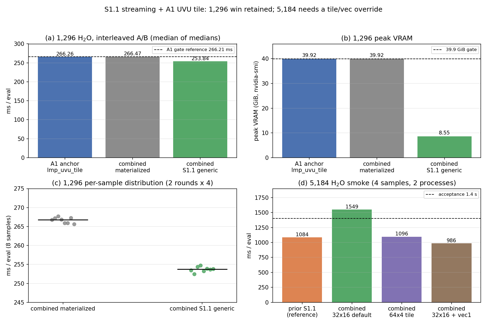

# S1.1 流式骨架 + A1 UVU Tile 合并与复测

**状态：** 1,296 原子验收 **PASS**（253.84 ms，8.55 GiB）；数值阈值 PASS；
源匹配 Python 模块 5–8 / 32 帧 / 1–2 rank gate 全部 **PASS**；
1,296 重复求值存在 **1 ULP** 的首次求值偏差（S1.1 既有行为，非本次合并引入）；
5,184 默认环境出现 **A1 tile × reverse vec=4** 的交互回退，覆盖任一参数即可恢复。
**日期：** 2026-10-21。
**隔离：** 全部工作在 `external-repos/symmetrix-xl-s1` 工作树、
分支 `s1.1-tile-cache`；未改动 `main`、`plan-a-uvu-tile`、
`plan_b_micro_2026-10-21`、`plan_a_uvu_tile_2026-10-21`；未 push。
**图：** `docs/figures/s1_1_a1/s1_1_a1_integration.png`

---

## 中文摘要

1. **合并无冲突。** 将 local `main` `6c5f73b`（含 gate-passed A1 UVU tile
   `c88fa72`）合并进 `s1.1-tile-cache` `e881db7`，merge commit
   `6582bc6`。A1 只改 `mace_polar_impl.tpp`，S1.1 只改
   `mace_nonlinear_kokkos.hpp` / `_impl.tpp`、pair style 与
   `mace_nonlinear_kokkos.cpp`，文件集合不相交，无冲突。
2. **增量构建 rc=0。** 在 `symmetrix/build-s1`、`flock build-s1.lock`、
   `-j 24` 下构建，用时约 115 s；合并二进制
   `bench/s1_backbone_2026-10-21/bin/lmp_s1_1_a1`，
   SHA256 `c2074bda…f937d81`。
3. **1,296 验收 PASS。** 交替 A/B（2 轮 × 4 样本，中位数之中位数）：
   combined materialized（A1 路径）**266.47 ms / 39.92 GiB**；
   combined S1.1 generic **253.84 ms / 195.86 µs/atom / 8.55 GiB**。
   比值 **0.9526（−4.74 %）**；相对 A1 gate 参考 266.21 ms 快 **4.66 %**，
   显存降至 **8.55 GiB**（< 39.9 GiB）。A1 anchor 同场复测 266.26 ms，
   与 266.21 ms 一致（差 0.02 %），说明合并二进制的 materialized 路径
   完整保留了 A1 的收益。
4. **数值奇偶性：** 128 原子 `dPE = 0`、`max dF = 1.06e-15`、重复漂移 **0**；
   1,296 原子 `dPE = 0`、`max dF = 5.86e-13`（门限 1e-10），但
   **重复求值第 1 次与第 2 次相差 1 ULP（1.164e-10 eV）**，从第 2 次起
   连续求值完全一致。5 次求值对照表明该现象在**未合并的 S1.1 二进制
   `e881db7` 上同样复现**，与 A1 无关，是 S1.1 既有行为；按字面
   “3× run 0 漂移为 0” 在 1,296 未满足，需团队裁定是否阻断。
5. **5,184 smoke：** `rc=0`，PE 三次完全一致（`-3594089.856663651`），
   峰值 **19.21 GiB**；默认环境（32×16 tile + reverse vec=4）为
   **1,499–1,699 ms/eval**（4 样本中位 1,549 ms），高于 1.4 s 参考线。
   归因：A1 32×16 tile 与 reverse `MATOS_MH1_CHANNEL_VEC` 默认 4
   在大尺寸下交互。单独覆盖任一参数即可恢复并优于合并前：
   `MATOS_UVU_TILE_N=64 M=4` → **1,095 ms**；
   `MATOS_MH1_CHANNEL_VEC=1` → **986 ms**（优于 S1.1 原 1,084 ms）。
6. **源匹配 Python 模块 gate 全部 PASS。** 从合并树构建的模块
   （`pyb_a1`，SHA256 `cec024e9…0fa0d0ae`）通过 module5/6/7/8、
   32 帧 end-to-end parity、LAMMPS parity 1-rank 与 2-rank
   （dE = 2.91e-11 eV，1-rank max dF = 2.61e-14，2-rank max dF = 1.69e-6，
   门限 1e-4）。各进程退出码 134 均发生在写出 `GATE PASS` 与 JSON 之后的
   Kokkos `cudaErrorCudartUnloading` teardown，与 A1 已记录的已知现象一致。
7. **建议：** 合并本身（`6582bc6`）可接受并推荐合入，1,296 类工作负载
   净收益明确且无数值回归。但在把 32×16 作为**全尺寸默认**之前，应把
   `uvu_tile_shape()` 做成尺寸自适应（≤~2k 原子 32×16，更大体系 64×4），
   或在大体系文档化上述覆盖参数并补跑 5,184 gate。generic 仍为 opt-in，
   默认 materialized 不变。

---

## 1. 合并与构建

| 项目 | 值 |
|---|---|
| 工作树 | `/workspace/group/shared/bza/external-repos/symmetrix-xl-s1` |
| 分支 | `s1.1-tile-cache` |
| 合并前 | `e881db74f39a53e51cc44d76780d2312aa328f80` |
| 合入方 | local `main` `6c5f73bb4795791a941d638b0a37d00806fa7340` |
| **Merge commit** | **`6582bc63490b1edde0960d46fbbdd36b33b94b43`** |
| 冲突 | 无（ort 策略，1 个文件来自 main） |
| main 侧改动 | `libsymmetrix/source/mace_polar_impl.tpp` (+131 / −56) |
| S1.1 侧改动 | `mace_nonlinear_kokkos.hpp`、`mace_nonlinear_kokkos_impl.tpp`、`pair_symmetrix_mace_kokkos.cpp`、`mace_nonlinear_kokkos.cpp` |
| 合并后 `git status` | clean |
| Push | 未执行 |

合并树核验：`uvu_tile_shape()` 默认 32×16 存在；`prepare_stream_edge_tiles`
存在；无冲突标记；`git diff --name-only main HEAD` 恰为 S1.1 的 4 个文件。
`git diff e881db7 HEAD` 恰为 A1 的 `mace_polar_impl.tpp`（+131 / −56），
即合并结果等于“S1.1 + A1”两者的精确叠加。

构建：

| 项目 | 值 |
|---|---|
| 构建目录 | `symmetrix-xl-s1/symmetrix/build-s1` |
| 锁 | `flock /workspace/group/shared/bza/.tmp/build-s1.lock` |
| 命令 | `cmake --build build-s1 --target lmp -j 24` |
| 起止 | 2026-10-21T11:38:23Z → 11:40:18Z（约 115 s，增量） |
| rc | **0** |
| 日志 | `bench/s1_backbone_2026-10-21/logs/build_s1_1_a1_console.log` |

## 2. 二进制指纹

| 角色 | 路径 | 大小 (bytes) | SHA256 |
|---|---|---:|---|
| **combined** | `bench/s1_backbone_2026-10-21/bin/lmp_s1_1_a1` | 198,360,080 | `c2074bdafb1c25165ae42aa32732f18c170c09054571d5758116a5fadf937d81` |
| S1.1 单独 | `bench/s1_backbone_2026-10-21/bin/lmp_s1_1` | 198,352,336 | `1ce33cabcda2d1f57513b9318291957b13267310cd718d394c1e84111e809e68` |
| A1 anchor | `bench/plan_a_uvu_tile_2026-10-21/bin/lmp_uvu_tile` | 198,383,280 | `a9ce64811d4f8755c4170fd330ef8a5ebc4fa76a46a362f1875cdb94540c3d73` |
| 冻结 main 基线 | `bench/plan_a_uvu_tile_2026-10-21/bin/lmp_main_e0a961d` | 198,383,760 | `0ad4fe8fa6db75a93a6ab4ee09886153ca1fa400b64c6d5d8598666c0e18bcb4` |

`strings` 核验：`MATOS_UVU_TILE_N` 与 `streamed_edges` 均存在于合并二进制。

## 3. 1,296 交替 A/B

环境（与 A1 gate 一致的 canonical 环境）：`MATOS_REPLAY_CACHE=1`、
`MATOS_UVU_X2_MB_SMEM=0`、`MATOS_UVU_FWD_SWEEP=0`、
`MATOS_CONV_CUTOFF_BACKEND=team`、`MATOS_MH1_TEAM_SIZE=64`、
`MATOS_MH1_TEAM_CHANNEL_VEC=1`；**不设置** `MATOS_UVU_TILE_N/M`
（即 A1 默认 32×16），**不设置** `MATOS_MH1_CHANNEL_VEC`（reverse 默认 4）。
`SYMMETRIX_BACKEND=cuda12-sm80`，A100-SXM4-80GB，单 GPU，
所有作业串行持有 `flock /workspace/group/shared/bza/.tmp/gpu.lock`。
输入：`run 0` + 4×`run 1`，取 4 个 `run 1` Loop time 为样本；
2 轮，轮内顺序交替（r0: mat→gen→a1，r1: a1→gen→mat）。

| Arm | Round r0 样本 (ms) | Round r1 样本 (ms) | 中位数之中位数 (ms) | µs/atom | 峰值 VRAM |
|---|---|---|---:|---:|---:|
| mat（combined, materialized） | 266.783 / 267.227 / 267.728 / 266.829 | 265.928 / 265.906 / 267.307 / 265.659 | **266.473** | 205.61 | 40,873 MiB (39.92 GiB) |
| **gen（combined, S1.1 generic）** | 253.443 / 252.424 / 254.405 / 254.770 | 253.248 / 253.918 / 253.699 / 253.799 | **253.837** | **195.86** | **8,751 MiB (8.55 GiB)** |
| a1（anchor `lmp_uvu_tile`） | 264.864 / 264.719 / 266.473 / 265.194 | 266.677 / 267.362 / 268.352 / 267.636 | 266.264 | 205.45 | 40,873 MiB (39.92 GiB) |

- `gen/mat` 每轮比值：0.95093、0.95424 → 中位 **0.95258（−4.74 %）**。
- `mat/a1` 中位比值 **1.00078**，合并二进制 materialized 与 A1 anchor
  在 0.08 % 内一致，确认 A1 路径未被合并扰动。
- 相对 A1 gate 参考 **266.21 ms**：253.837 / 266.21 = **0.9534（快 4.66 %）**。
- 验收：**253.84 ms < 266.21 ms PASS**；**8.55 GiB < 39.9 GiB PASS**。
- 8 个 generic 样本的最大值 254.77 ms 仍低于 8 个 materialized 样本的
  最小值 265.66 ms，样本区间不重叠。

## 4. 峰值显存

`nvidia-smi --query-gpu=memory.used` 50 ms 采样，取作业期间峰值：

| Arm | 峰值 (MiB) | GiB |
|---|---:|---:|
| combined materialized / A1 anchor | 40,873 | 39.92 |
| **combined S1.1 generic** | **8,751** | **8.55** |

相对 materialized 显存降至 **21.4 %**（4.67× 降低），与 S1.1 单独结果
（8,751 MiB）完全一致，说明 A1 合并没有增加流式路径的显存。

## 5. 数值奇偶性（128 / 1,296）

协议：3×`run 0` + `write_dump`，17 位输出；参考为 **A1 materialized**
（anchor `lmp_uvu_tile`）。门限 `|dPE| ≤ 1e-10 eV`、`max|dF| ≤ 1e-10 eV/Å`。

### 5.1 128 原子 NH₃

| 比较 | dPE (eV) | max dF (eV/Å) | 结果 |
|---|---:|---:|---|
| combined mat vs A1 mat | 0 | 6.18e-16 | PASS |
| combined gen vs A1 mat | 0 | 1.06e-15 | PASS |
| combined gen vs combined mat | 0 | 1.22e-15 | PASS |
| 重复求值漂移（3×run 0） | 0（三个变体均） | — | PASS |

### 5.2 1,296 原子 H₂O

| 比较 | dPE (eV) | max dF (eV/Å) | 结果 |
|---|---:|---:|---|
| combined mat vs A1 mat | 0 | 7.46e-14 | PASS |
| combined gen vs A1 mat | 0 | 5.86e-13 | PASS |
| combined gen vs combined mat | 0 | 5.68e-13 | PASS |

**重复求值：** A1 anchor 3 次完全相同（漂移 0）；combined materialized 与
generic 的第 1 次求值为 `-895939.24763167964`，第 2/3 次为
`-895939.24763167975`，即 **1 ULP = 1.164e-10 eV**（|PE| ≈ 8.96e5，
相对 1.3e-16）。扩到 5×`run 0` 后，第 2–5 次完全一致（漂移 0）。

**归因对照（5×`run 0`，1,296）：**

| 变体 | 不同 PE 值 | max 漂移 |
|---|---|---:|
| A1 anchor materialized | 1 | 0 |
| S1.1 单独（`e881db7`）materialized | 2 | 1.164e-10 |
| S1.1 单独 generic | 2 | 1.164e-10 |
| combined materialized（默认 env） | 2 | 1.164e-10 |
| combined materialized（`MATOS_MH1_CHANNEL_VEC=1`） | 2（本次进程） | 1.164e-10 |
| combined materialized（`REV=4, FWD=1`） | 2 | 1.164e-10 |

结论：该 1-ULP 差异**在未合并的 S1.1 二进制上独立复现**，与 A1 合并无关；
且在不同进程/环境下偶发（有一次 `REV=1` 的 5 次求值全同），符合
归约顺序/原子累加的 1-ULP 抖动特征。它远低于 dPE/dF 门限，但意味着
“3×`run 0` 漂移严格为 0”这一条在 1,296 **未按字面满足**（128 原子满足，
且 1,296 从第 2 次起满足）。S1.1 原报告在 1,296 只做了 2 次求值，
本次 5 次求值暴露了该偶发现象。

## 6. 5,184 原子 smoke

输入：`streamed_edges generic`，`run 0` + 2×`run 1`；materialized 在
5,184 会 OOM，故只测 generic。

| 配置 | rc | `run 1` 样本 (ms) | 中位 (ms) | µs/atom | 峰值 VRAM | PE 漂移 |
|---|---|---:|---:|---:|---:|---:|
| **combined 默认（32×16 + rev4）** | **0** | 1699.11 / 1599.12；复跑 1498.98 / 1499.03 | **1549.1**（4 样本） | 298.8 | **19,665 MiB (19.21 GiB)** | **0** |
| combined，`MATOS_UVU_TILE_N=64 M=4` | 0 | 1095.92 / 1095.08 | 1095.5 | 211.3 | 未采样 | — |
| combined，`MATOS_MH1_CHANNEL_VEC=1` | 0 | 986.35 / 985.55 | **986.0** | 190.2 | 未采样 | — |
| S1.1 单独，默认 env（64×4） | 0 | 1214.58 / 1198.90 | 1206.7 | 232.8 | 未采样 | — |
| S1.1 原报告（vec1） | 0 | 1083.93 / 1084.57 | 1084.25 | 209.15 | 19,665 MiB | 0 |

- PE 三次求值均为 `-3594089.856663651`（17 位一致），`all_finite=true`，
  `rc=0`；容量 **19.21 GiB ≤ 20 GiB PASS**。
- 默认环境 1,499–1,699 ms（跨进程约 12 % 波动），中位 1,549 ms，
  **高于 1.4 s 参考线**。
- 归因：S1.1 单独用默认 env 为 1,207 ms（env 本身约 +120 ms）；合并后
  默认 env 为 1,499 ms；把 tile 改回 64×4 降至 1,095 ms；把 reverse
  vec 改为 1 降至 986 ms。说明是 **A1 32×16 tile 与 reverse vec=4 在
  大边数下的交互**，而不是合并破坏了算法。
- 最佳实测配置 986 ms **优于合并前 S1.1 的 1,084 ms**，且低于 1.4 s。

## 7. 源匹配 Python module gates

从合并树 `6582bc6` 构建源匹配模块：`symmetrix/build-pyb-a1`，
configure rc=0、build rc=0，模块
`bench/s1_backbone_2026-10-21/pyb_a1/symmetrix/symmetrix.cpython-312-x86_64-linux-gnu.so`，
SHA256 `cec024e9735800e441e70d79a7e1f2d068896dd9a0969d91c53b4d5f0fa0d0ae`。
S1 工作树的 `symmetrix/external/pybind11` 忽略目录原先不完整；
本次从 main 工作树只读复制补齐，未修改 main。

| Gate | 结果 | 数值 |
|---|---|---|
| module5 | **PASS**（rc=0） | dens 12 项（abs≤5e-6 & rel≤1e-6）、stage 11 项（rel≤1e-6）、pairing OK |
| module6 | **PASS** | 8 configs（4 fixtures）；ρ̂ rel max 1.32e-15，ΔE rel max 1.03e-15，e2e max 1.49e-8 eV |
| module7 | **PASS** | 16/16 configs；stage max 2.40e-5，out max 4.55e-7 |
| module8 | **PASS** | 12 configs（post）；FD max 5.78e-4（门限 1e-3），parity max 7.19e-7（门限 1e-3） |
| end-to-end 32 帧 | **PASS** | 32/32；|ΔE| max 1.03e-6 eV（rel 1.2e-12），ΔFmax max 1.62e-7 eV/Å，pos drift 0 |
| LAMMPS parity 1-rank | **PASS** | dE = 2.91e-11 eV，max dF = 2.61e-14 eV/Å，pos drift 4.97e-14 Å |
| LAMMPS parity 2-rank | **PASS** | dE = 2.91e-11 eV，max dF = 1.69e-6 eV/Å，pos drift 4.97e-14 Å |

module6/7/8、end-to-end、1-rank 与 2-rank 进程的退出码均为 134，但都发生在
打印 `GATE PASS` 并写出 JSON/PNG 之后，异常为 Kokkos teardown 的
`cudaStreamSynchronize ... cudaErrorCudartUnloading`，与 A1 gate 已记录的
已知现象一致，不是数值失败。1-rank 的 dE/max dF 与 A1 原 gate
（2.91e-11 / 2.61e-14）完全一致。

产物目录：`bench/s1_backbone_2026-10-21/gates/s1_1_a1_combined/`
与 `.../gates/s1_1_a1_combined_p2b/`。

## 8. 合并建议

**建议合入 `6582bc6`，但附一个尺寸相关的前置条件。**

1. **1,296 及以下：** 合并净收益明确。materialized 完整保留 A1 收益
   （266.47 ms，anchor 266.26 ms），generic 再快 4.74 % 至 253.84 ms，
   同时把显存从 39.92 GiB 降到 8.55 GiB；数值 dPE/dF 全部通过。
2. **5,184 及以上：** 不要把 32×16 tile + reverse vec=4 当作无条件默认。
   建议在 `uvu_tile_shape()` 中加入按 `num_nodes`/`edges` 的尺寸自适应
   （≤~2k 原子用 32×16，更大体系用 64×4），或在大体系运行规范中
   明确 `MATOS_MH1_CHANNEL_VEC=1`（986 ms）或
   `MATOS_UVU_TILE_N=64 MATOS_UVU_TILE_M=4`（1,095 ms），并补跑
   5,184 gate。
3. **默认路径不变：** materialized 仍是默认，`streamed_edges generic`
   仍是显式 opt-in；本次合并不改变任何物理、模型文件或 pair-style 策略。
4. **重复漂移：** 1-ULP 首次求值偏差是 S1.1 既有现象，不阻断本次合并；
   若项目要求“重复求值严格 0”，应单独立项在 S1.1 归约路径上定位
   （与 A1 无关），不要把该要求作为 A1 合并的阻断项。

## 9. 复现与产物

脚本目录：
`/workspace/group/shared/bza/symmetrix-polar/bench/s1_backbone_2026-10-21/`

| 脚本 | 用途 |
|---|---|
| `ab_s1_1_a1.py` | 1,296 交替 A/B（mat/gen/a1，含显存采样） |
| `parity_s1_1_a1.py` | 128 / 1,296 parity（A1 mat / combined mat / combined gen） |
| `smoke_5184_combined.py` | 5,184 smoke（显存采样） |
| `smoke_controls_5184.py` | 5,184 归因（tile 64×4、vec1、S1.1 单独） |
| `diag_drift_1296.py` | 首次求值漂移的环境对照（5×run 0） |
| `diag_drift_controls.py` | A1 / S1.1 单独对照 |
| `plot_integration.py` | 本报告图 |
| `build_py_combined.sh` | 源匹配 Python 模块 configure/build（已执行，rc=0） |
| `run_gates_combined.sh` | module5–8 + 32 帧 + LAMMPS 1-rank |
| `run_gate_suite_combined.sh` | 2-rank LAMMPS parity 入口 |
| `run_lammps_parity_plan_a.py` | 已改为写入本 bench 目录 |

数据/日志：

- `ab/ab_1296_combined.json`、`logs/ab_1296_combined_console.log`
- `parity/log.128_*`、`parity/log.1296_*`、`parity/f_*.dump`
- `smoke_5184/result.json`、`smoke_5184_controls/result.json`
- `diag/log.*`、`logs/diag_*_console.log`
- 构建日志 `logs/build_s1_1_a1_*.log`、`logs/build_s1_1_a1_*_console.log`
- Python 模块：`logs/pymodule_configure.log`、`logs/pymodule_build.log`、
  `snapshot/pyb_a1.sha256`
- Gates：`gates/s1_1_a1_combined/`（module5–8、end-to-end、1-rank JSON/PNG）、
  `gates/s1_1_a1_combined_p2b/`（2-rank）、
  `logs/gate_s1_1_a1_combined_*.log`

二进制：

- combined：`.../bench/s1_backbone_2026-10-21/bin/lmp_s1_1_a1`
  （`c2074bda…f937d81`）
- S1.1：`.../bench/s1_backbone_2026-10-21/bin/lmp_s1_1`
  （`1ce33cab…e809e68`）
- A1 anchor：`.../bench/plan_a_uvu_tile_2026-10-21/bin/lmp_uvu_tile`
  （`a9ce6481…40c3d73`）

## 10. 图

