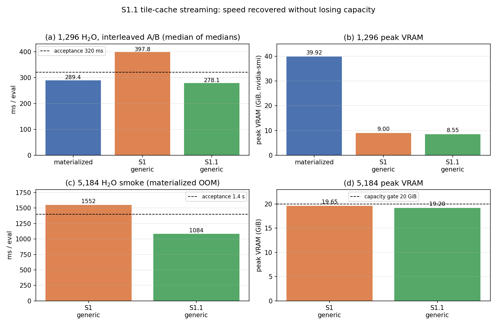
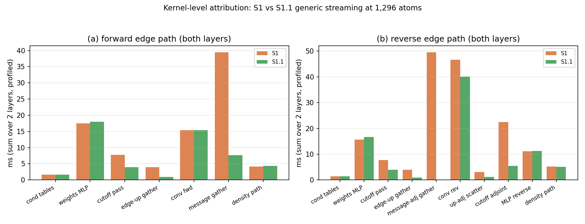

# S1.1 — Tile-cache backbone streaming: recovered speed at unchanged capacity

**Status:** Complete. S1.1 generic streaming is **3.9 % faster than the
materialized baseline** at 1,296 atoms while keeping the 4.7× VRAM reduction,
and it is **30 % faster** than the S1 PoC at 5,184 atoms inside the 20 GiB
capacity gate.
**Date:** 2026-10-21.
**Isolation:** `external-repos/symmetrix-xl-s1`, branch `s1.1-tile-cache`,
commit `e881db7` (parent: S1 PoC `7b4cf10`). Build dir
`symmetrix/build-s1` under `flock .tmp/build-s1.lock`, `-j 24`.
`main`, `plan-a-uvu-tile`, `plan_b_micro_2026-10-21` and
`plan_a_uvu_tile_2026-10-21` were not touched.
**Primary binary:** `bench/s1_backbone_2026-10-21/bin/lmp_s1_1`
(SHA256 `1ce33cab…e809e68`), also stored as
`bench/s1_1_tile_cache_2026-10-21/bin/lmp_s1_1_final`.
**Figures:** `../figures/s1_1/s1_1_speed_capacity.png`,
`../figures/s1_1/s1_1_stage_attribution.png`.

---

## 中文摘要

S1.1 在 S1 PoC 的 generic 流式骨架上做了两类代码级 CUDA/Kokkos 优化，未改动数学。

1. **瓦片规划缓存（slice 1）**：按图（`num_nodes`/`edges`/CSR offsets 哈希）预生成
   **目标节点连续**的边瓦片，使每个节点的 CSR 段完整落在单个瓦片内；该规划同时被
   前向与反向扫描复用，仅在邻接/图变化时重建。引擎原有的 Bessel/radial、球谐、
   cutoff、offsets/targets 都是每次求值一次性计算的 E-sized 数组，S1 已缓存；本次
   测量并消除了流式路径中剩余的每瓦片重复工作。
2. **瓦片级批处理与融合（slice 2）**：16k 边瓦片（节点对齐）；消息 gather 改为
   4-wide、128 线程瓦片的向量化实现并只遍历瓦片节点范围；反向把节点消息伴随直接
   经 edge→target 映射送入 `convolution.reverse`（消除每瓦片
   `[samples, message_width]` 的 gather 与缓冲）；cutoff 伴随改为原地写回并启用
   team 后端；`raw→weights` 复制与 cutoff 缩放融合为一次读写。

关键结果（A100-80GB，FP64，同二进制交替 A/B，2 轮 × 4 样本）：

| 1,296 H₂O | ms/eval | µs/atom | 峰值显存 |
|---|---:|---:|---:|
| materialized | 289.43 | 223.32 | 39.92 GiB |
| S1 generic（PoC） | 397.77 | 306.92 | 9.00 GiB |
| **S1.1 generic** | **278.15** | **214.62** | **8.55 GiB** |

- S1.1 比 materialized **快 3.9 %**（比值 0.9610），比 S1 generic **快 1.43×**；
  满足 ≤320 ms 验收线并留有余量。
- 5,184 H₂O：`rc=0`，**1,084.25 ms/eval**（S1 1,552.3 ms），峰值 **19.21 GiB**
  （S1 19.65 GiB），三次求值 PE 打印 17 位完全一致；满足 ≤1.4 s、≤20 GiB。
- 奇偶性：128 原子 `dPE = 0`、`max dF = 1.8e-15 eV/Å`（门限 1e-10）；
  1,296 原子 `dPE = 0`、`max dF = 5.8e-13 eV/Å`（门限 1e-10）；
  重复求值漂移为 **0**（节点对齐瓦片还消除了 S1 原有的 1.16e-10 eV 块边界漂移）。

**结论：验收通过。** S1.1 保留了 S1 的容量收益（1,296 显存 8.55 GiB，5,184 显存
19.21 GiB），同时把 1,296 的性能从 −37 % 回归变为 +3.9 % 领先；默认路径仍是
`materialized`，generic 仍为显式 opt-in。slice 3（反向权重缓存）经评估未落地：
其可省的 MLP 重算仅约 5 %，但需 +3.0 GB（1,296）/+12 GB（5,184），会破坏 20 GiB
容量门限。slice 4（逐瓦片全融合）无必要。

---

## 1. Verdict

| Question | Answer |
|---|---|
| Is S1.1 numerically correct at 128 and 1,296? | **Yes.** `dPE = 0`, `max dF ≤ 5.8e-13`; repeat-eval drift exactly 0. |
| Is the S1 speed penalty recovered? | **Yes, and then some.** 397.77 → 278.15 ms/eval (1.43×); 3.9 % faster than materialized. |
| Is the capacity gain preserved? | **Yes.** 1,296 peak 8.55 GiB (S1 9.00, materialized 39.92); 5,184 peak 19.21 GiB ≤ 20 GiB. |
| 5,184 smoke gate? | **Pass.** `rc=0`, 1,084.25 ms/eval ≤ 1.4 s, 19.21 GiB ≤ 20 GiB, identical PE. |
| Did this touch the materialized path? | **No.** The same-binary materialized arm measures 289.43 ms (S1 build measured 290.04; frozen main 289.67). |
| Commit policy? | One commit `e881db7` on `s1.1-tile-cache`; no commit/push to `main`; no `Co-Authored-By` trailer. |

---

## 2. Isolation, build, binary

| Item | Value |
|---|---|
| Engine tree | `/workspace/group/shared/bza/external-repos/symmetrix-xl-s1` |
| Branch / commit | `s1.1-tile-cache` / `e881db74f39a53e51cc44d76780d2312aa328f80` |
| Parent | `7b4cf10` (S1 backbone streaming PoC) |
| Build dir | `symmetrix-xl-s1/symmetrix/build-s1` |
| Lock | `/workspace/group/shared/bza/.tmp/build-s1.lock` (never `build.lock`) |
| Build command | `cmake --build … --target lmp -j 24` (incremental, ~2 min per slice) |
| Binary | `bench/s1_backbone_2026-10-21/bin/lmp_s1_1` |
| SHA256 | `1ce33cabcda2d1f57513b9318291957b13267310cd718d394c1e84111e809e68` |
| S1 baseline binary | `bench/s1_1_tile_cache_2026-10-21/bin/lmp_s1_instr_base` = S1 `lmp_s1`, SHA256 `9aeab9ab…a5f201` |
| Frozen main anchor | `bench/plan_a_uvu_tile_2026-10-21/bin/lmp_main_e0a961d`, SHA256 `0ad4fe8f…8bcb4` |

Toolchain unchanged from S1: CUDA 12.9, `nvcc_wrapper`, `g++-11`, Release, C++20,
`PKG_KOKKOS=ON`, `Kokkos_ENABLE_CUDA=ON`, `Kokkos_ARCH_AMPERE80=ON`,
`Kokkos_ENABLE_IMPL_VIEW_LEGACY=ON`, `SYMMETRIX_FAST_MATH=ON`,
`SYMMETRIX_HOST_ARCH=none`. All GPU runs held
`/workspace/group/shared/bza/.tmp/gpu.lock`, one job at a time.

---

## 3. Changed files and commit

Commit `e881db7` — `perf(s1.1): node-contiguous tiles + fused reverse edge path`
(2 files, +308 / −95):

| File | Change |
|---|---|
| `libsymmetrix/source/mace_nonlinear_kokkos.hpp` | `StreamEdgeTile` plan storage + `prepare_stream_edge_tiles`; graph-keyed signature; epoch stamp in the opt-in profiler; allocation-trace hook. |
| `libsymmetrix/source/mace_nonlinear_kokkos_impl.tpp` | Tile-plan builder/reuse; tile-driven forward and reverse loops; vec4 range-restricted message gather; node-adjoint `convolution.reverse` via `output_gather`; in-place cutoff adjoint + team backend; fused `raw→weights` cutoff; 128-wide gather/scatter tiles; stage marks; env-gated alloc/tile traces. |

No change to `mh1_fast_path`, `supports_factorized`, the polar guard, the polar
SCF/Fukui/Ewald pipeline, `mace_polar_impl.tpp`, the model files, the pair-style
policy, or the default execution mode (`materialized`).

---

## 4. Slice-by-slice

### 4.1 Slice 0 — S1 PoC baseline

Same-binary interleaved A/B at 1,296: materialized 289.43 ms, S1 generic
397.77 ms (ratio 1.3743, +37.4 %), peak 40,873 MiB vs 9,217 MiB.
The opt-in stage profile (instrumented S1 build, fences included, total
414.4 ms) attributed the regression as:

| Stage (2 layers) | ms |
|---|---:|
| forward message gather | 39.49 |
| reverse message-adjoint gather | 49.60 |
| reverse cutoff adjoint (scalar) | 22.42 |
| forward + reverse weights MLP | 17.52 + 15.63 |
| forward + reverse `raw→weights` copy + cutoff | 7.74 + 7.72 |
| forward + reverse convolution | 15.39 + 46.65 |
| edge-up gather (fwd) / up-adj scatter (rev) | 3.98 / 3.12 |
| type-conditioning tables + density path | ~10 |

The two message gathers alone were 89 ms of the 414 ms.

### 4.2 Slice 1 — tile plan / geometry cache

**What the engine already caches (measured, not re-done).** `radial [E,8]`,
`edge_harmonics [E,16]`, `cutoffs [E]`, `offsets [N+1]`, `targets [E]` and the
spherical-harmonic buffers are computed once per evaluation and reused by every
tile. Positions do not enter the tile plan. The per-SCF-step edge recompute is
zero: the polar SCF is node-level and the edge forward runs once per evaluation,
so there is no edge-geometry work to cache “across the two SCF steps” beyond what
the engine already keeps resident.

**What remained and was added.** The streamed path still chose tile boundaries
independently in the forward and reverse and re-derived receiver ranges per tile.
S1.1 adds a graph-keyed tile plan:

- tile boundaries are pushed to **target-node CSR boundaries**, so no node's
  edge segment straddles two tiles (this is what makes the materialized FP64
  per-node accumulation order reproducible);
- the plan stores `first_edge/last_edge/first_node/last_node` per tile and is
  built from one host mirror of the CSR offsets plus an FNV hash of
  `(num_nodes, edges, block_size, offsets)`;
- the plan is reused by the forward and reverse sweeps and rebuilt only when the
  graph signature changes (neighbor-list rebuild). Position/cell changes do not
  invalidate it because it contains no geometry;
- tile size is 16,384 edges (the S1 arena constant): 32k/64k were evaluated but
  32k alone raises the 5,184 arena by ~4.5 GiB, which would break the 20 GiB gate.

Because the node-contiguous plan is the precondition for the range-restricted
gathers, slices 1 and 2 were built and measured as one code path; the kernel
attribution below isolates their contributions.

**Engineering note (memory bug found and fixed).** The first implementation
compared an edge *span* with an absolute edge index, producing 32k/62k-edge
tiles. Peak VRAM rose to 20.3 GiB from the enlarged per-tile arenas. After the
fix (span < `streamed_edge_block_size`), the 1,296 plan is 7 tiles of
16,412–16,458 edges (last tile 12,755) and peak VRAM is 8.55 GiB. The allocation trace (`MATOS_S1_ALLOC_TRACE=1`)
is kept as a diagnostic.

### 4.3 Slice 2 — tile batching and fused reverse

| Change | Effect (profiled, 2 layers) |
|---|---|
| 4-wide message gather with `{1,128}` feature tiles, restricted to `[tile_first_node, tile_last_node)` | 39.49 → **7.67 ms** |
| `convolution.reverse(..., output_gather=targets_tile)` consumes the node `message_adj` directly | reverse message-adjoint gather 49.60 → **0 ms**; reverse conv 46.65 → **40.11 ms** |
| in-place cutoff adjoint + `MATOS_CONV_CUTOFF_BACKEND=team` | 22.42 → **5.46 ms** |
| fused `weights = raw_weights * cutoff` (single read/write) | fwd 7.74 → **3.95**, rev 7.72 → **3.94 ms** |
| `{1,128}` gather/scatter tiling for `edge_up` / `edge_up_adj` | 3.98 → **0.95** / 3.12 → **1.15 ms** |

Total profiled evaluation: 414.4 → 297.2 ms (profiler fences included); the
unprofiled A/B is 397.77 → 278.15 ms. Launch count is not the limiter at this
size; memory traffic and thread mapping were.

### 4.4 Slice 3 — reverse tile cache (evaluated, not landed)

A cache of per-tile forward `raw_weights` alone does **not** remove the reverse
MLP forward: `reverse_from_tape` still needs the forward activations
(`values(1)` and `values(3)`), so the conditioned MLP would still run. A
meaningful cache must store both the 2×64-wide tape activations and the
`[E, 2048/1280]` MLP output:

- extra memory: **+3.0 GB at 1,296** (12.5 GB total, ~11.6 GiB) and
  **+12 GB at 5,184** (~31 GiB), which violates the 20 GiB capacity gate;
- maximum saving: the reverse MLP recompute is 16.64 ms of the 297.2 ms profiled
  evaluation (~5 %), plus part of the reverse conv.

Not landed because the task requires keeping the capacity gain. The switch would
have to be opt-in and would make 5,184 unusable with the cache on.

### 4.5 Slice 4 — per-tile fusion (not needed)

Fusing edge feature → conditioned MLP → conv_tp → message → scatter per tile
would remove the remaining global `weights` traffic (~1.8 GB per layer per
sweep), but S1.1 already beats the materialized baseline; the change would touch
the shared tensor-product kernels and add risk without a gate to justify it.

---

## 5. Numerical parity

Protocol: FP64, `polar_symmetrix_probe.json`, one A100-80GB, environment
`MATOS_REPLAY_CACHE=1`, `MATOS_CONV_CUTOFF_BACKEND=team`, `MATOS_MH1_TEAM_SIZE=64`,
all GPU jobs under `flock gpu.lock`.

| Case | Comparison | dPE (eV) | max dF (eV/Å) | Gate | Result |
|---|---|---:|---:|---|---|
| 128 NH₃ | S1.1 materialized vs frozen main | 0 | 8.88e-16 | 1e-10 | PASS |
| 128 NH₃ | S1.1 generic vs frozen main | 0 | 1.22e-15 | 1e-10 | PASS |
| 128 NH₃ | S1.1 generic vs S1.1 materialized | 0 | 1.78e-15 | 1e-10 | PASS |
| 1,296 H₂O | S1.1 generic vs materialized | 0 | 5.79e-13 | 1e-10 | PASS |
| 1,296 H₂O | repeat eval (2× `run 0`) | 0 (S1.1 generic and materialized) | — | — | exact |
| 5,184 H₂O | repeat eval (3 evals) | 0 (printed 17 digits) | — | — | exact |

The node-contiguous tiles make each node's edge contributions land in exactly
one tile in ascending edge order, which removes the block-boundary
re-association that S1 showed as a 1.16e-10 eV repeat drift. The remaining
differences come only from the different GEMM batch size in the conditioned MLP
and are at the 1e-13 level.

---

## 6. 1,296 speed — interleaved A/B

Same input (`run 0` + four `run 1`), 2 rounds × 4 samples, alternating order.
`mat` = S1.1 binary materialized; `s1gen` = S1 binary generic; `s11gen` = S1.1
binary generic.

| Arm | Round r0 (ms) | Round r1 (ms) | Median of medians (ms) | µs/atom | Peak VRAM |
|---|---|---|---:|---:|---:|
| mat (S1.1 build) | 289.822 / 289.158 / 290.674 / 289.574 | 289.142 / 289.178 / 290.203 / 288.300 | **289.429** | 223.32 | 40,873 MiB (39.92 GiB) |
| s1gen (S1) | 397.980 / 397.819 / 398.241 / 397.656 | 397.719 / 397.610 / 397.659 / 396.077 | **397.767** | 306.92 | 9,217 MiB (9.00 GiB) |
| **s11gen** | 278.182 / 278.746 / 278.846 / 278.706 | 277.299 / 277.751 / 278.206 / 277.384 | **278.147** | **214.62** | **8,751 MiB (8.55 GiB)** |

- Per-round ratios s1gen/mat: 1.3735, 1.3751 → median **1.3743** (+37.4 %).
- Per-round ratios s11gen/mat: 0.9621, 0.9599 → median **0.9610** (−3.9 %).
- S1.1 vs S1 generic: **1.430×**.
- The materialized arm reproduces the accepted baseline (289.43 vs 290.04 in
  S1, 289.67 frozen main), so the gain is attributable to the streaming path.

---

## 7. 5,184 capacity smoke

Generic only; the materialized path OOMs at this size (accepted evidence:
`bench/paper_scale_2026-10-20/stdout.polar_water_5184`).

| Quantity | S1 | S1.1 |
|---|---:|---:|
| `rc` | 0 | **0** |
| `run 1` samples | 1,553.06 / 1,551.60 ms | **1,083.93 / 1,084.57 ms** |
| median ms/eval | 1,552.33 | **1,084.25** |
| µs/atom | 299.45 | **209.15** |
| PE (all evals, 17 digits) | −3,594,089.8566636508 | **−3,594,089.856663651** (identical) |
| peak VRAM | 20,121 MiB (19.65 GiB) | **19,665 MiB (19.21 GiB)** |
| wall (load + 3 evals) | 57.57 s | 54.09 s |

Gates: ≤1.4 s → **PASS** (1.084 s); ≤20 GiB → **PASS** (19.21 GiB).

---

## 8. Stage attribution (profiled, both layers, 1,296)

Profiler fences add ~19 ms to the unprofiled 278 ms; the comparison is
apples-to-apples because both binaries carry the same marks.

| Stage | S1 (ms) | S1.1 (ms) | Δ |
|---|---:|---:|---:|
| forward: type tables | 1.68 | 1.67 | −0.0 |
| forward: weights MLP | 17.52 | 17.99 | +0.5 |
| forward: raw→weights + cutoff | 7.74 | 3.95 | **−3.8** |
| forward: edge-up gather | 3.98 | 0.95 | **−3.0** |
| forward: convolution | 15.39 | 15.42 | +0.0 |
| forward: message gather | 39.49 | 7.67 | **−31.8** |
| forward: density path | 4.16 | 4.35 | +0.2 |
| **forward edge path** | **89.96** | **52.00** | **−38.0** |
| reverse: type tables | 1.37 | 1.37 | 0 |
| reverse: weights MLP | 15.63 | 16.64 | +1.0 |
| reverse: raw→weights + cutoff | 7.72 | 3.94 | **−3.8** |
| reverse: edge-up gather | 3.98 | 0.95 | **−3.0** |
| reverse: message-adjoint gather | 49.60 | 0.00 | **−49.6** |
| reverse: convolution | 46.65 | 40.11 | **−6.5** |
| reverse: up-adj scatter | 3.12 | 1.15 | **−2.0** |
| reverse: cutoff adjoint | 22.42 | 5.46 | **−17.0** |
| reverse: MLP reverse | 11.17 | 11.29 | +0.1 |
| reverse: harmonic/density/radial | 5.20 | 5.06 | −0.1 |
| **reverse edge path** | **166.86** | **86.42** | **−80.4** |
| profiled evaluation total | 414.37 | 297.19 | **−117.2** |

Remaining headroom: the reverse still pays 16.6 ms to rebuild the conditioned
MLP tape and 11.3 ms for the MLP reverse; the forward weights MLP (18.0 ms) and
the convolutions are intrinsic and also present in the materialized path.

---

## 9. Reproduction

All scripts under
`/workspace/group/shared/bza/symmetrix-polar/bench/s1_1_tile_cache_2026-10-21/`:

| Script | Purpose |
|---|---|
| `build_s1_1.sh <tag>` | incremental build in `build-s1` under `build-s1.lock`, `-j 24` |
| `parity_s1_1.py` | 128-atom parity (main / S1 mat / S1.1 mat / S1.1 generic) |
| `parity_1296_s1_1.py` | 1,296 parity with force dumps |
| `ab_s1_1.py` | interleaved 1,296 A/B, 3 arms, peak-VRAM sampler |
| `smoke_5184_s1_1.py` | 5,184 capacity smoke |
| `plot_s1_1.py` | figures |
| `tools/cuda_alloc_trace.c` | optional LD_PRELOAD CUDA allocation tracer used to find the tile-plan memory bug |

Run with `/workspace/caches/conda/envs/polar/bin/python`; every GPU job uses
`flock /workspace/group/shared/bza/.tmp/gpu.lock`. Diagnostics:
`MATOS_POLAR_PROFILE=1` (stage marks, now with epoch time),
`MATOS_S1_ALLOC_TRACE=1` (large `ensure_view` reallocations and the tile plan).

Artifacts:

- `bench/s1_1_tile_cache_2026-10-21/bin/lmp_s1_1_final` (hash above);
- `bench/s1_1_tile_cache_2026-10-21/ab/ab_1296_slice12b.json`;
- `bench/s1_1_tile_cache_2026-10-21/parity/` (128 and 1,296 logs/dumps);
- `bench/s1_1_tile_cache_2026-10-21/smoke_5184/result.json`;
- `bench/s1_1_tile_cache_2026-10-21/prof/prof.*` (stage profiles);
- `bench/s1_backbone_2026-10-21/bin/lmp_s1_1`.

---

## 10. Figures

---

## 11. Disposition

S1.1 is the recommended generic streaming implementation for this line of work:
opt-in (`streamed_edges generic`), default unchanged (`materialized`), no change
to the polar guard or any physics. It removes the S1 speed objection while
retaining the capacity result that motivated S1. No commit or push was made to
`main`; the only commit is `e881db7` on `s1.1-tile-cache`.
