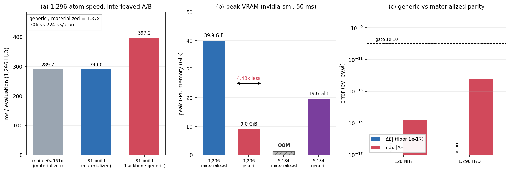

# S1 — Backbone edge streaming with materialized PolarMACE state: PoC results

**Status:** PoC complete. Numerically correct; capacity win; **1,296 speed is a regression**.
**Date:** 2026-10-21.
**Isolation:** `external-repos/symmetrix-xl-s1` (git worktree from `main` at
`e0a961d`), build dir `symmetrix-xl-s1/symmetrix/build-s1`, isolated LAMMPS tree
`external-repos/lammps-stable_30Sep2026-s1`. The main/UVU trees, their binaries and
the two protected `bench/plan_*_2026-10-21` trees were not modified.
**Design:** `docs/design/S1_BACKBONE_STREAMING_POC.md` (written in parallel; the
implementation follows its C3–C7 intent, with slightly different accessor names).
**Figure:** `../figures/s1/s1_backbone_streaming.png`

---

## 中文摘要

S1 PoC 已完成并且数值正确：只把 PolarMACE 的非线性骨架**边路径**切到
`streamed_edges='generic'` 分块流式，节点特征、polar SCF/Fukui/Ewald、readout 与
反向节点链全部保持材料化，polar guard 原样保留。

- 128 NH₃：generic 对比 materialized/baseline，`dPE = 0`，`max dF = 1.55e-15 eV/Å`
  （门限 1e-10），重复求值完全一致。
- 1,296 H₂O：`dPE = 0`，`max dF = 5.65e-13 eV/Å`（门限 1e-10）。
- 峰值显存：1,296 从 **39.9 GiB 降到 9.0 GiB（4.43×）**；5,184 原子在
  **19.65 GiB** 下 `rc=0` 跑通，而材料化路径在 5,184 会 OOM。
- 速度：1,296 同二进制交替 A/B，materialized `290.0 ms/eval`
  （223.8 µs/atom）→ generic `397.2 ms/eval`（306.5 µs/atom），
  **慢 36.95%**（比值 1.3695）。
- 结论：S1 **不是 1,296 提速项**，已超过设计文档的 K3 kill 门限
  （ratio > 1.30）；应保持默认 `materialized`。但它在 5,184 容量与 4.4× 显存
  下降上是真实收益，可作为 opt-in 容量模式与 S3 的正确性桥梁保留。

---

## 1. Verdict

| Question | Answer |
|---|---|
| Can the nonlinear PolarMACE backbone stream edges while polar state stays materialized? | **Yes.** |
| Is it numerically correct at 128 and 1,296? | **Yes**, with large margin (`dPE = 0`, `max dF ≤ 5.7e-13`). |
| Is LAMMPS wired? | **Yes.** The pair style accepts `streamed_edges generic` for a conditioned backbone plan; `auto` still resolves to `materialized`. |
| Is it faster at 1,296? | **No.** 1.3695× slower (K3 kill threshold is 1.30×). |
| Is peak VRAM lower? | **Yes.** 4.43× lower at 1,296; 5,184 now runs at 19.65 GiB. |
| Is S1 worth pursuing? | **As a capacity mode / S3 bridge: yes. As a 1,296 speed optimization: no.** Keep default off. |

The measured numbers reproduce the design's memory model (predicted 8.83 GiB at
1,296 vs measured 9.00 GiB; predicted 18.63 GiB at 5,184 vs measured 19.65 GiB,
inside the 10 % margin band). The speed result is worse than the design's
0.95–1.05× expectation: the per-block recompute and the loss of GEMM batching cost
about 37 % at this size.

---

## 2. Isolation and build

| Item | Value |
|---|---|
| S1 engine tree | `/workspace/group/shared/bza/external-repos/symmetrix-xl-s1` (clean worktree from `main` at creation = `e0a961df1692a3b7ee05ba4aa85f40d064b72fce`; the later UVU commit on `main` is intentionally excluded) |
| `mace_polar_impl.tpp` | pristine `main` (no UVU-tile change leaked; `git diff` clean) |
| LAMMPS tree | `/workspace/group/shared/bza/external-repos/lammps-stable_30Sep2026-s1` (independent copy; 6 Symmetrix files copied, CMake paths repointed to `symmetrix-xl-s1`) |
| Build dir | `/workspace/group/shared/bza/external-repos/symmetrix-xl-s1/symmetrix/build-s1` |
| Lock | `/workspace/group/shared/bza/.tmp/build-s1.lock` (never waited on `build.lock`) |
| Build command | `cmake --build ... --target lmp -j 24` |
| Wall time | 09:22:47 → 10:07:20 (44 min 33 s), with the concurrent UVU build on the machine |
| Binary | `/workspace/group/shared/bza/symmetrix-polar/bench/s1_backbone_2026-10-21/bin/lmp_s1` |
| SHA256 | `9aeab9abc88c438e29df95b3242d92a218759d6b53f1acfb69541e8bcca5f201` |
| Source diff SHA256 | `29faefd129529863ef84a39064ff35fed484b0006df5e9dfaf39ba46a8b5e4bc` |

Toolchain: CUDA 12.9, `nvcc_wrapper`, host `g++-11`, MPI from
`/workspace/caches/conda/envs/lammps-deepmd`, `Release`, C++20, `PKG_KOKKOS=ON`,
`Kokkos_ENABLE_CUDA=ON`, `Kokkos_ARCH_AMPERE80=ON`,
`Kokkos_ENABLE_IMPL_VIEW_LEGACY=ON`, `SYMMETRIX_FAST_MATH=ON`,
`SYMMETRIX_HOST_ARCH=none`.

No git commit or push was made. The S1 worktree has only the four modified source
files below (plus untracked external dependency copies needed to configure).

---

## 3. Exact source changes

### 3.1 `libsymmetrix/source/mace_nonlinear_kokkos.hpp`

- **`supports_streamed_edges()` is unchanged** (`return mh1_fast_path;`). This keeps
  the constructor default, `supports_factorized()`, the true-MH-1 direct/JIT gate
  and the FP32 rule untouched.
- Added a separate capability:
  ```cpp
  bool supports_backbone_streaming() const { return backbone_streaming_supported; }
  bool has_backbone_pair_conditioning() const { return backbone_pair_conditioning; }
  const std::string& backbone_streaming_rejection_reason() const;
  ```
- Added private flags `backbone_streaming_supported`, `backbone_pair_conditioning`,
  `backbone_streaming_rejection`.

### 3.2 `libsymmetrix/source/mace_nonlinear_kokkos_impl.tpp`

- **Constructor (after the `mh1_fast_path`/rejection block):** for
  `polar_enabled && !mh1_fast_path`, call the existing
  `Interaction::prepare_pair_conditioning(...)` for **every** interaction (both
  layers), guarded by `try/catch`:
  ```cpp
  backbone_pair_conditioning = mh1_pair_conditioning;
  backbone_streaming_supported = mh1_fast_path;
  if (polar_enabled && !mh1_fast_path) {
      bool conditioning = true;
      try {
          for (int layer = 0; layer < (int)interactions.size(); ++layer)
              conditioning = interactions[layer].prepare_pair_conditioning(
                  data.at("interactions").at(layer), num_bessel,
                  model_num_elements, indices) && conditioning;
      } catch (const std::exception& exception) {
          conditioning = false;
          backbone_streaming_rejection = exception.what();
      }
      if (!conditioning && backbone_streaming_rejection.empty())
          backbone_streaming_rejection =
              "Conditioned backbone MLP plan is unavailable.";
      backbone_pair_conditioning = conditioning;
      backbone_streaming_supported = conditioning;
  }
  ```
  `mh1_pair_conditioning` / `mh1_fast_path` are **not** modified by this result.
- **`set_streamed_edges`:** `generic` is admitted when
  `supports_streamed_edges() || backbone_streaming_supported`; `direct` requires
  `mh1_fast_path`; the `mh1_fast_path && materialized` rejection is unchanged.
- **Constructor default:** unchanged in effect — still
  `if (supports_streamed_edges()) streamed_edges = direct;`, so a backbone model
  defaults to `materialized`. Generic is explicit.

Verified at runtime for the PolarMACE probe: both layers return valid conditioning
tables (first-layer output width 64 for both the convolution and density MLPs;
conditioned input `8 + 512 + 512 = 1,032`; final convolution weight width
2,048 / 1,280), and the pair-style log prints
`success (streamed_edges='generic', backbone_streaming=yes)`.

### 3.3 `pair_symmetrix/pair_symmetrix_mace_kokkos.cpp`

- True MH-1 rejection now keys on `uses_mh1_fast_path()` (equivalent to the old
  `supports_streamed_edges()` check because that accessor still returns
  `mh1_fast_path`).
- `streamed_edges='auto'` still resolves to `materialized`.
- `generic` is allowed only when `supports_backbone_streaming()`; `direct` is
  rejected explicitly. The log line now reports the backbone capability.

### 3.4 `symmetrix/source/cpp/mace_nonlinear_kokkos.cpp`

- Exposed `supports_backbone_streaming`, `has_backbone_pair_conditioning`,
  `backbone_streaming_rejection_reason` for harness assertions. No execution change.

### 3.5 Deliberately unchanged

`mh1_fast_path`, the strict MH-1 family analyzer, `supports_factorized()`,
`streams_layer`, `release_layer_edge_workspace`, block size (16,384 edges on CUDA),
the generic forward/reverse edge kernels, `mace_polar_impl.tpp`, and the polar
guard `"polar_blocks requires the standard materialized evaluation graph."`
(generic passes it; removing it would be wrong).

---

## 4. Numerical parity

Protocol: FP64, `polar_symmetrix_probe.json`, one A100-80GB, the ledger
environment (`MATOS_REPLAY_CACHE=1`, `MATOS_CONV_CUTOFF_BACKEND=team`,
`MATOS_MH1_TEAM_SIZE=64`), all GPU jobs under `flock gpu.lock`.

| Case | Comparison | dPE (eV) | max dF (eV/Å) | Gate | Result |
|---|---|---:|---:|---|---|
| 128 NH₃ | S1 build materialized vs frozen `lmp_main_e0a961d` | 0 | 6.66e-16 | G0 | PASS |
| 128 NH₃ | S1 generic vs frozen baseline | 0 | 1.55e-15 | 1e-10 | PASS |
| 1,296 H₂O | S1 generic vs S1 materialized | 0 | 5.65e-13 | 1e-10 | PASS |
| 1,296 H₂O | repeat eval (2× `run 0`) | 1.16e-10 (both arms) | — | — | pre-existing non-determinism |
| 5,184 H₂O | repeat eval (3 evals) | 0 (printed 17 digits) | — | — | stable |

- The 128-atom repeat-eval PE is **exactly identical** (`0.0` drift) for all three
  variants; forces differ only at `6.7e-16` between builds (the pre-existing
  atomic-scatter nondeterminism class).
- The 1,296 repeat drift of `1.16e-10` eV on `-895,939.25` eV is
  `1.3e-16` relative and is **identical for materialized and generic**, i.e. it is
  the existing run-to-run FP64 reduction-order noise, not introduced by S1. The
  S1 parity itself is `dPE = 0` exactly.
- 5,184 has no materialized reference because the materialized path OOMs there
  (see §6); its PE is bitwise identical across the three evaluations.

---

## 5. 1,296 speed — interleaved A/B

Same binary (`lmp_s1`) for both arms; only `streamed_edges` differs. Two rounds,
alternating arm order; each sample is a `run 1` loop from a `run 0` + 4×`run 1`
input. Frozen main anchor measured once after the A/B.

| Arm | Round samples (ms) | Round median | Median of medians | µs/atom |
|---|---|---:|---:|---:|
| S1 materialized, r0 | 288.813 / 288.661 / 289.979 / 289.132 | 288.972 | | |
| S1 materialized, r1 | 291.241 / 290.899 / 291.363 / 290.985 | 291.113 | **290.043** | **223.80** |
| S1 generic, r0 | 397.740 / 397.210 / 397.218 / 397.041 | 397.214 | | |
| S1 generic, r1 | 397.083 / 397.183 / 398.202 / 397.259 | 397.221 | **397.218** | **306.49** |
| main `e0a961d` anchor | 289.761 / 290.599 / 289.419 / 289.573 | 289.667 | 289.667 | 223.51 |

- Per-round ratios (generic / materialized): **1.3746** (r0), **1.3645** (r1);
  median **1.3695** → **+36.95 %** slower.
- The S1 build's materialized arm matches the frozen baseline within 0.13 %
  (290.04 vs 289.67 ms), so the regression is attributable to the streaming path,
  not to the build.
- This exceeds the design's hard K3 kill threshold of 1.30×. **Do not enable
  generic by default for 1,296 speed.**

---

## 6. Peak VRAM and 5,184 capacity

Peak sampled from `nvidia-smi --query-gpu=memory.used` at 50 ms while the
lock-protected job ran (single tenant; GPU otherwise idle).

| Case | Path | Peak VRAM | Notes |
|---|---|---:|---|
| 1,296 H₂O | materialized (S1 build) | 40,873 MiB = **39.92 GiB** | matches main anchor (40,873 MiB) |
| 1,296 H₂O | backbone generic | 9,217 MiB = **9.00 GiB** | **4.43× lower** |
| 5,184 H₂O | backbone generic | 20,121 MiB = **19.65 GiB** | `rc=0`, finite PE |
| 5,184 H₂O | materialized | **OOM** | prior accepted evidence: `Cuda memory space failed to allocate 567 MiB` (`bench/paper_scale_2026-10-20/stdout.polar_water_5184`) |

5,184-atom smoke (generic only):

| Quantity | Value |
|---|---|
| `rc` | 0 |
| wall (model load + 3 evals) | 57.57 s |
| `run 0` | 375.64 ms (setup/replay-cache-influenced; not a steady-state number) |
| `run 1` ×2 | 1,553.06 / 1,551.60 ms → median **1,552.33 ms/eval**, **299.45 µs/atom** |
| PE | `-3,594,089.8566636508` eV, identical in all 3 evaluations |
| peak VRAM | 20,121 MiB (19.65 GiB) |

The 5,184 result is a **capacity** result, not a speed comparison: the
materialized path cannot run this size on an 80 GiB A100, so there is no
same-size reference. The design projected 18.63 GiB; the measured 19.65 GiB is
5.5 % above the projection and well inside the 10 % margin.

---

## 7. Why S1 is worth (or not worth) pursuing

**Keep it, default-off, as a capacity mode. Do not adopt it as a 1,296 speed
feature.**

Arguments for keeping:

1. **Correctness is established**: exact PE parity and `max dF ≤ 5.7e-13` at both
   gated sizes, with the polar guard and the entire polar pipeline untouched.
2. **Capacity is real and measured**: 4.43× lower VRAM at 1,296, and 5,184 atoms
   now run at 19.65 GiB where the materialized path OOMs. This is the first
   full-FP64 PolarMACE 5,184-atom run in this line of work.
3. **It is a clean bridge to S3**: the backbone edge path is now separable from
   the materialized node/polar state, which is the prerequisite for deciding
   whether full polar streaming is worth the much larger S3 effort.

Arguments against adopting it now:

1. **1,296 speed regression of 37 %** (1.3695×), beyond the design's 1.30× kill.
   The extra cost is the per-block conditioned-MLP recompute plus smaller GEMMs
   and extra launches; it does not amortize at 1,296.
2. It is not needed for the current 1,296 performance goal (Plan A A1/A2), and
   enabling it by default would regress the accepted baseline.

Recommended disposition: merge the capability as an **opt-in**
(`streamed_edges generic`) capacity mode after review, keep `auto` and the default
at `materialized`, and do not spend further effort on S1 speed tuning. If a
production 5,184+ mode is needed, S1 is already the enabling change; if only
1,296 speed matters, stop here.

---

## 8. Reproduction

Scripts (all under
`/workspace/group/shared/bza/symmetrix-polar/bench/s1_backbone_2026-10-21/`):

| Script | Purpose |
|---|---|
| `build_s1.sh` | isolated configure/build (`build-s1`, `build-s1.lock`, `-j 24`) |
| `parity_s1.py` | 128-atom G0/G1 parity (main mat, S1 mat, S1 generic) |
| `parity_1296_s1.py` | 1,296-atom G2 parity with force dumps |
| `ab_s1.py` | interleaved 1,296 A/B + peak-VRAM sampler + main anchor |
| `smoke_5184_s1.py` | 5,184-atom capacity smoke |
| `plot_s1.py` | generates the figure |

Run with `/workspace/caches/conda/envs/polar/bin/python`; all GPU runs use
`flock /workspace/group/shared/bza/.tmp/gpu.lock`.

---

## 9. Artifacts

- Binary: `bench/s1_backbone_2026-10-21/bin/lmp_s1`
  (`9aeab9abc88c438e29df95b3242d92a218759d6b53f1acfb69541e8bcca5f201`).
- Parity dumps/logs: `bench/s1_backbone_2026-10-21/parity/`.
- A/B JSON + stdout: `bench/s1_backbone_2026-10-21/ab/ab_1296.json`.
- 5,184 smoke: `bench/s1_backbone_2026-10-21/smoke_5184/{result.json,log,stdout}`.
- Build log: `bench/s1_backbone_2026-10-21/logs/build_console.log`.
- Figure: `docs/figures/s1/s1_backbone_streaming.png`.

No commit/push; no `Co-Authored-By` trailer was added anywhere.

---

## 10. Figure


