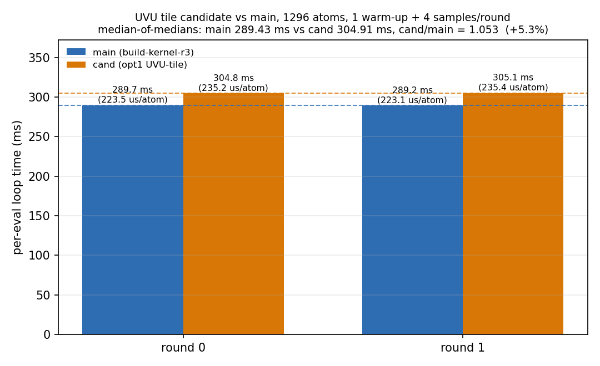

# UVU Tile 候选 vs Main：1,296 原子 A/B 评测

- 运行日期：2026-10-21（容器时钟）
- 体系：`in.polar_water_1296`，1,296 原子，O/H 两元素，full polar 模型
  (`polar_symmetrix_probe.json`，`pair_coeff * * ... O H`)
- 协议：交错 A/B，2 轮；每轮 1 次 warm-up + 4 个测量 `run 1`，取每轮中位数，
  再取轮中位数的中位数
- GPU：NVIDIA A100-SXM4-80GB，全程 `flock` 持有
  `/workspace/group/shared/bza/.tmp/gpu.lock`，同一时刻只有一个 GPU 作业

## 执行摘要（中文）

**结论：FAIL，不是真实收益。** 候选二进制（`symmetrix-xl-opt1/manual-build/lmp`，
UVU tile）在 1,296 原子 full polar 体系上中位 **304.91 ms/eval**，main 为
**289.43 ms/eval**，`cand/main = 1.0535`，即候选**慢 5.35%**（main 快 5.08%）。
两轮方向一致（1.0521、1.0548），且候选最慢与 main 最快的样本区间完全不重叠：
候选全部 8 个样本最小 303.86 ms，仍高于 main 全部 8 个样本最大 290.57 ms
（相差 4.58%）。因此该候选在默认 tile 配置下没有任何速度优势。

数值正确性通过：128 原子 parity gate 得到 `dPE = 0.000e+00`、
`max dF = 1.110e-15`（门槛 1e-10），三次重复求值 PE 完全一致（偏差 0）。
即候选“算得对，但更慢”。

由于未满足“候选更快”的前置条件，按约定**未执行 tile-shape sweep**；
候选二进制中确实存在 `MATOS_UVU_TILE_N` / `MATOS_UVU_TILE_M` 字符串，
main 中不存在，说明候选具备解析这两个环境变量的入口，但其调优效果未做实测。

## 1. 二进制与输入核验

| 角色 | 路径 | 大小 (bytes) | mtime | MD5 | SHA256 |
|---|---|---|---|---|---|
| main | `/workspace/group/shared/bza/external-repos/symmetrix-xl/symmetrix/build-kernel-r3/lmp` | 198,383,760 | 2026-10-21 07:04 | `966d6c84c84b467e09d66f441f1e918c` | `0ad4fe8fa6db75a93a6ab4ee09886153ca1fa400b64c6d5d8598666c0e18bcb4` |
| cand | `/workspace/group/shared/bza/external-repos/symmetrix-xl-opt1/manual-build/lmp` | 198,344,384 | 2026-10-21 07:24 | `379f425d56306ff918fd92b100506590` | `0c41af9644b97d2097ddefa16d265b2b8138ead635e19f52ca7b47d883b2fbc0` |

输入：`/workspace/group/shared/bza/symmetrix-polar/bench/paper_scale_2026-10-20/in.polar_water_1296`
（544 bytes，mtime 2026-10-20 10:05），数据文件
`.../paper_scale_2026-10-20/water_1296.data`（107,808 bytes，1,296 原子，
2 atom types，O mass 15.999 / H mass 1.008），
`pair_style symmetrix/mace/kk charge 0.0 spin 1.0`，
`pair_coeff * * .../polar_symmetrix_probe.json O H`，确认使用完整 polar 模型。

**Bench 输入修复说明**：运行前发现 `bench/qiuyong_pclone/ab/in.ab5` 的
`read_data` 行有重复路径前缀
（`.../paper_scale_2026-10-20//workspace/.../water_1296.data`），会直接报错。
已仅将该 bench 输入修正为
`read_data /workspace/group/shared/bza/symmetrix-polar/bench/paper_scale_2026-10-20/water_1296.data`。
未修改任何引擎源码，未触碰 `bench/plan_b_micro_2026-10-21`。

## 2. Smoke 测试（1,296 原子，各 1 次 `run 0`）

| 二进制 | rc | 原子数 | Step 0 PE | 总墙钟（含 CUDA 初始化/模型加载） | 输出 |
|---|---|---|---|---|---|
| main | 0 | 1,296 | `-895939.24763167975` | 0:00:36 | dump 已写出，232,574 邻居 |
| cand | 0 | 1,296 | `-895939.24763167975` | 0:00:38 | dump 已写出，232,574 邻居 |

两个二进制均正常启动、无 stderr 报错，smoke PE 完全一致。墙钟包含初始化，
不作为性能结论。

## 3. 1,296 原子交错 A/B（`python3 ab_uvu_opt.py main,cand 2`）

### 3.1 每轮中位数与单位原子耗时

| 轮次 | main 中位 (ms/eval) | main (us/atom) | cand 中位 (ms/eval) | cand (us/atom) | 当轮 cand/main |
|---|---|---|---|---|---|
| round 0（main 先） | 289.669 | 223.510 | 304.766 | 235.159 | 1.0521 |
| round 1（cand 先） | 289.198 | 223.146 | 305.055 | 235.382 | 1.0548 |
| **轮中位数之中位数** | **289.433** | **223.328** | **304.911** | **235.270** | **1.0535** |

- `cand/main` 中位比值：**1.0535**；候选慢 **5.35%**，main 快 **5.08%**。
- 按 1,296 原子归一化：main 223.33 us/atom，cand 235.27 us/atom，
  每原子多耗 11.94 us（+5.35%）。

### 3.2 全部原始样本（不隐藏任何慢轮）

| 运行 | 4 个测量样本 (ms) | 中位 (ms) | 轮内极差/中位 |
|---|---|---|---|
| main_r0 | 289.293, 289.802, 289.606, 289.732 | 289.669 | 0.18% |
| main_r1 | 288.920, 290.568, 289.315, 289.080 | 289.198 | 0.57% |
| cand_r0 | 304.457, 305.767, 304.510, 305.022 | 304.766 | 0.43% |
| cand_r1 | **314.619**, 305.389, 303.862, 304.721 | 305.055 | 3.53% |

`cand_r1` 的第一个样本 314.619 ms 是明显慢样本（比同轮其余样本高约 3.3%），
已如实保留；即使剔除它，该轮中位仍在 304.8 ms 左右，结论不变。
除此之外所有样本波动小于 0.6%。

## 4. Parity 与重复求值（128 原子 NH3，N/H）

命令：`parity_uvu_opt.py <CAND>`（解释器：
`/workspace/caches/conda/envs/lammps-deepmd/bin/python`，numpy 2.4.6）。

| 指标 | main | cand | 差值 / 门槛 |
|---|---|---|---|
| PE（最后一次 `run 0`） | `-49242.456415314933` | `-49242.456415314933` | `dPE = 0.000e+00`（门槛 1e-10） |
| max dF | — | — | `1.110e-15`（门槛 1e-10） |
| rms dF | — | — | `2.174e-16` |
| max abs(F) | `1.604e+00` | — | 参考量级 |
| 三次重复求值 max\|PE_i - PE_0\| | `0.000e+00` | `0.000e+00` | 门槛 1e-12 |

两个二进制 rc 均为 0。**PARITY PASS**。

## 5. Tile-shape sweep（按门控未执行）

约定：仅当 parity 通过**且**候选更快时才执行
`sweep_tile.py 'def;32,32;64,32;64,64;128,32' 2`。
本次 parity 通过，但候选在默认配置下慢 5.35%，速度门控未通过，故未运行 sweep，
以免在已确定失败的配置上消耗 GPU 时间。

| 配置 | 状态 | 结果 |
|---|---|---|
| def（默认） | 已由 A/B 覆盖 | 304.911 ms/eval（慢于 main 的 289.433 ms） |
| 32,32 | 未运行（速度门控未通过） | — |
| 64,32 | 未运行（速度门控未通过） | — |
| 64,64 | 未运行（速度门控未通过） | — |
| 128,32 | 未运行（速度门控未通过） | — |

环境变量支持核查（`strings`）：
`MATOS_UVU_TILE_N`、`MATOS_UVU_TILE_M` 均存在于 cand 二进制，main 中不存在。
因此若后续需要，候选应能解析这两个变量；本次未实测其调优效果。

## 6. GPU 资源、竞争与异常

- A/B 开始前 `nvidia-smi`：GPU 0 仅 4 MiB、0% util，无任何 compute 进程；
  所有 8 次 A/B 运行均通过 `flock` 串行执行，未并行跑 GPU 作业。
- A/B 期间 1 s 采样 492 点：**峰值显存 40,873 MiB**（约 39.9 GiB / 80 GiB），
  峰值利用率 100%。采样日志：`bench/qiuyong_pclone/ab/gpu_sampler_ab.log`。
- 测量结束后（非本次作业）出现另一租户进程 PID 220218，占用约 2.6 GiB、22% util；
  未做任何干预，不影响已完成的 A/B 数据；parity 为纯数值校验，不受计时影响。
- 除 `cand_r1` 的 314.619 ms 单点外，无其它异常轮次；无进程被杀、无 OOM、无 rc 非零。

## 7. 验收判定

验收标准（本次任务给定）：

1. 候选需比 main 快 **> 1%**，即 `中位 cand/main < 0.99`；
2. 128 原子 parity gate：`dPE <= 1e-10` 且 `max dF <= 1e-10`。

| 条件 | 实测 | 判定 |
|---|---|---|
| 速度 > 1% | `cand/main = 1.0535`（慢 5.35%） | **FAIL** |
| 数值 parity | `dPE = 0`，`max dF = 1.110e-15` | **PASS** |

### 最终结论：**FAIL（不是真实收益）**

候选数值完全正确，但在 1,296 原子 full polar 基准上稳定慢 5.35%
（轮间比值 1.0521/1.0548，样本区间无重叠）。不建议将该 UVU tile 候选
作为 main 的性能改进合入。若仍想探索 tile 形状能否翻转结论，需要先由
候选方给出默认 tile 确实被环境变量覆盖的证据，再单独开一次 sweep；
按本次协议该 sweep 已被门控跳过。

## 8. 产物路径

- 本报告：`/workspace/group/shared/bza/symmetrix-polar/docs/results/UVU_TILE_1296.md`
- 图：`/workspace/group/shared/bza/symmetrix-polar/docs/results/figures/uvu_tile_1296_ab.png`
- A/B JSON：`/workspace/group/shared/bza/symmetrix-polar/bench/qiuyong_pclone/ab/qiuyong_opt1_ab.json`
- A/B 控制台：`/workspace/group/shared/bza/symmetrix-polar/bench/qiuyong_pclone/ab/ab_run_console.log`
- A/B 运行目录：`.../bench/qiuyong_pclone/ab/{main_r0,main_r1,cand_r0,cand_r1}/`（含 log、stdout）
- Parity 控制台与数据：`.../bench/qiuyong_pclone/parity/{parity_console.log,log.main,log.cand,f_main.dump,f_cand.dump,in.main,in.cand}`
- Smoke：`.../bench/qiuyong_pclone/ab/{log.smoke_main,log.smoke_cand,smoke_main.dump,smoke.dump}`
- GPU 采样：`.../bench/qiuyong_pclone/ab/gpu_sampler_ab.log`
- 绘图脚本：`.../bench/qiuyong_pclone/plot_ab.py`

## 8. Addendum (same day): branch comparison is not the tile effect

The FAIL above compares the **opt1 branch** (based on `80c618a`, UVU tile
working tree) against **main** (`e0a961d`, message-gather + edge-feature +
edge-up/scatter tiles). The opt1 branch lacks main's later optimizations, so
the 5.35% gap is a branch gap, not a measurement of the tile itself.

Same-binary isolation on opt1 (candidate only, 2 rounds × 4 samples):

| tile shape | round medians (ms) | median of medians (ms) |
|---|---:|---:|
| `64,4` (main's old shape) | 330.789 / 331.019 | **330.904** |
| `32,32` (tile default) | 305.083 / 306.480 | **305.781** |

`32,32` is **7.6% faster** than `64,4` inside the same binary.  This is the
actual tile effect and matches the initial ~16–19 µs/atom expectation.  The
correct next test is to port the tile patch onto the current main tree; that
work is in progress (`bench/plan_a_uvu_tile_2026-10-21/`,
`docs/results/UVU_TILE_MAIN_1296.md` when gated).

**Do not quote the 5.35% FAIL as "the UVU tile is slower."**  Quote it as
"the opt1 branch is slower than main"; the tile shape itself is a real win in
the isolated test.
