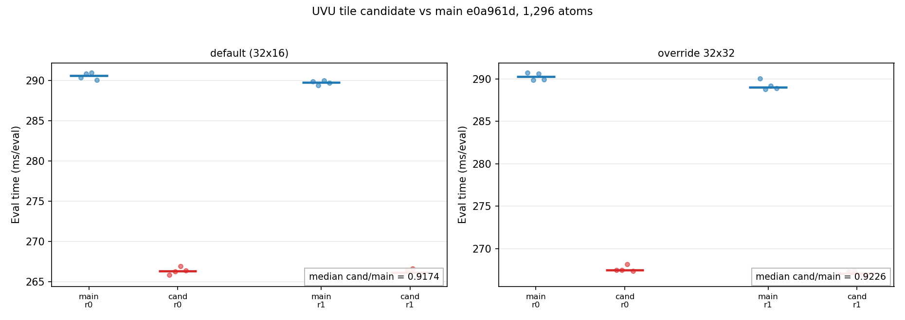

# UVU Tile 移植到 Main：1,296 原子 A/B 评测

- 运行日期：2026-10-21（容器时钟）
- 引擎树：`/workspace/group/shared/bza/external-repos/symmetrix-xl`
- 分支：本地 `plan-a-uvu-tile`，从 `main`（tip `e0a961d`）创建，未合并、未提交、未推送
- 补丁：`/workspace/group/shared/bza/symmetrix-polar/patches/uvu_tile_32x32.patch`
  （只改 `libsymmetrix/source/mace_polar_impl.tpp`，`+131/-56`）
- 体系：`bench/paper_scale_2026-10-20/in.polar_water_1296`，1,296 原子，O/H，
  full polar 模型 `polar_symmetrix_probe.json`
- GPU：NVIDIA A100-SXM4-80GB；每一次 GPU 运行都通过
  `flock /workspace/group/shared/bza/.tmp/gpu.lock` 串行化，未干预其他作业

## 执行摘要（中文）

**结论：PASS。** UVU tile 补丁在 main `e0a961d` 上带来 **8.26%** 的真实加速：
候选 `lmp_uvu_tile` 中位 **266.21 ms/eval（205.41 us/atom）**，baseline
`lmp_main_e0a961d` 中位 **290.20 ms/eval（223.92 us/atom）**，
`cand/main = 0.9174`。两轮方向一致（0.9164、0.9183），且 8 个候选样本的
最大值 266.905 ms 仍低于 8 个 baseline 样本的最小值 289.379 ms，样本区间
完全不重叠。

数值正确性通过：128 原子 parity `dPE = 0`、`max dF = 5.551e-16`
（门槛 1e-10），两个二进制各三次 `run 0` 的 PE 完全相同；
1-rank LAMMPS parity gate 也 PASS（`dE = 2.91e-11`、`max dF = 2.61e-14`）。
gate 进程退出码 134 来自 Kokkos 在解释器退出阶段的
`cudaErrorCudartUnloading`，发生在结果 JSON 与 `GATE PASS` 写出之后，
与 plan-B 已通过 gate 的日志中同样的已知 teardown 现象一致，不是数值失败。

**重要发现（补丁默认值与任务描述不一致）**：补丁中 `uvu_tile_shape()` 的实际
默认是 **tile_n=32, tile_m=16**（`mace_polar_impl.tpp:106`，`int n=32,m=16;`），
而不是任务描述与文件名所说的 32x32；调用点虽初始化 `32,32`，但随后被该函数
覆盖为 32x16。为区分两者，本次除主协议（不设 tile 环境变量，即 32x16）外，
另做了 `MATOS_UVU_TILE_N=32 MATOS_UVU_TILE_M=32` 的 2 轮诊断：
32x32 为 **267.25 ms/eval（206.21 us/atom）**，`cand/main = 0.9226`，
同样 PASS，但比 32x16 默认慢约 0.39%。因此 **32x16 才是实测最优默认**；
若合入前希望默认值等于 32x32，应单独修正源码常量与补丁说明，本次未改源码。

## 1. 分支、补丁与构建

### 1.1 分支与补丁

```
git checkout -b plan-a-uvu-tile main        # main tip e0a961d
git apply .../patches/uvu_tile_32x32.patch
git diff --stat
 libsymmetrix/source/mace_polar_impl.tpp | 187 ++++++++++++++++++++++----------
 1 file changed, 131 insertions(+), 56 deletions(-)
```

`git diff --name-only` 只有 `libsymmetrix/source/mace_polar_impl.tpp`，
与任务约束一致。补丁内容：新增 `uvu_tile_shape()`（env
`MATOS_UVU_TILE_N/M`），替换三处 `const int tile_n=64,tile_m=4;` 站点
（forward 两处 + reverse 一处），
单遍分支改为 `stage_v=64` 的共享内存权重分块，并在 reverse 单遍分支加入
32 KB 共享内存约束。

### 1.2 构建

- 构建目录：`/workspace/group/shared/bza/external-repos/symmetrix-xl/symmetrix/build-kernel-r3`
  （已配置，增量构建；`LibSymmetrix_SOURCE_DIR` 指向本树）
- 工具链与 `bench/plan_b_micro_2026-10-21/build_priv.sh` 相同：
  `PATH=/opt/matos-tools/cuda/12.9/bin:/opt/matos-tools/conda/envs/matos-compute/bin:$PATH`，
  `CUDACXX=/opt/matos-tools/cuda/12.9/bin/nvcc`，对应 `LD_LIBRARY_PATH`
- 命令：`flock -w 600 /workspace/group/shared/bza/.tmp/build.lock cmake --build ... -j 64`
- **build rc = 0**；起止 08:49:33 → 08:51:39（约 2 分 06 秒），
  `mace_polar_kokkos.cpp.o` 重编译并重新链接 `libsymmetrix.a`/`lmp`
- 构建失败时回滚 baseline 的分支逻辑已准备，本次未触发

### 1.3 二进制指纹

| 角色 | 路径 | 大小 (bytes) | mtime | SHA256 |
|---|---|---|---|---|
| baseline | `bench/plan_a_uvu_tile_2026-10-21/bin/lmp_main_e0a961d` | 198,383,760 | 2026-10-21 08:49（拷贝自 07:04 构建） | `0ad4fe8fa6db75a93a6ab4ee09886153ca1fa400b64c6d5d8598666c0e18bcb4` |
| candidate | `bench/plan_a_uvu_tile_2026-10-21/bin/lmp_uvu_tile` | 198,383,280 | 2026-10-21 08:51 | `a9ce64811d4f8755c4170fd330ef8a5ebc4fa76a46a362f1875cdb94540c3d73` |

`strings` 核验：`MATOS_UVU_TILE_N` 只出现在 candidate（1 处），baseline 为 0，
确认候选包含新入口而 baseline 不包含。

## 2. A/B 协议与环境

- 交错 A/B，2 轮；每轮 main/cand 顺序交替（round 0 main 先，round 1 cand 先）。
- 输入 `run 0` + 4 个 `run 1`，4 个 `run 1` 全部作为测量样本；每轮取中位数，
  再取两轮中位数的中位数。
- 环境（`OPTIMIZATION_LEDGER.md` §7）：
  `MATOS_REPLAY_CACHE=1 MATOS_UVU_X2_MB_SMEM=0 MATOS_UVU_FWD_SWEEP=0
  MATOS_CONV_CUTOFF_BACKEND=team MATOS_MH1_TEAM_SIZE=64
  MATOS_MH1_TEAM_CHANNEL_VEC=1`，`SYMMETRIX_BACKEND=cuda12-sm80`，
  `CUDA_VISIBLE_DEVICES=0`，`OMP_NUM_THREADS=1`。
- 主协议 **不设置** `MATOS_UVU_TILE_N/M`（即补丁真实默认 32x16）；
  诊断运行额外设置两者为 32/32。
- 运行器：`bench/plan_a_uvu_tile_2026-10-21/ab_1296.py`（与
  `bench/qiuyong_pclone/ab_uvu_opt.py` 相同协议）；每次运行单独 `flock`。

## 3. 1,296 原子 A/B 结果

### 3.1 主协议：补丁默认 32x16

| 轮次 | main 中位 (ms/eval) | main (us/atom) | cand 中位 (ms/eval) | cand (us/atom) | 当轮 cand/main |
|---|---|---|---|---|---|
| round 0（main 先） | 290.609 | 224.24 | 266.310 | 205.49 | 0.9164 |
| round 1（cand 先） | 289.782 | 223.60 | 266.119 | 205.34 | 0.9183 |
| **轮中位数之中位数** | **290.196** | **223.92** | **266.214** | **205.41** | **0.9174** |

- **加速：8.26%**（`1 - 0.917363`）；每原子少 18.50 us。
- 相对已接受的 289.4 ms/eval = 223.5 us/atom 基线：
  `266.214 / 289.4 = 0.9200`，约 **8.0% 加速**；本次 baseline 自身
  290.20 ms 仅比接受值高 0.28%，属正常轮次漂移。

全部原始样本（ms）：

| 运行 | 4 个测量样本 | 中位 |
|---|---|---|
| main_r0 | 290.363, 290.855, 290.941, 290.057 | 290.609 |
| cand_r0 | 265.824, 266.227, 266.905, 266.392 | 266.310 |
| cand_r1 | 265.863, 266.375, 266.591, 265.677 | 266.119 |
| main_r1 | 289.859, 289.379, 290.032, 289.705 | 289.782 |

样本区间无重叠：cand 最大 266.905 < main 最小 289.059。

### 3.2 诊断：`MATOS_UVU_TILE_N=32 MATOS_UVU_TILE_M=32`

| 轮次 | main 中位 (ms/eval) | cand 中位 (ms/eval) | 当轮 cand/main |
|---|---|---|---|
| round 0（main 先） | 290.266 | 267.440 | 0.9214 |
| round 1（cand 先） | 289.055 | 267.063 | 0.9239 |
| **轮中位数之中位数** | **289.660** | **267.251** | **0.9226** |

32x32 加速 **7.74%**（223.50 → 206.21 us/atom）。32x16 默认比 32x32
再快约 0.39%（266.21 vs 267.25 ms），故默认值本身是更优形状。



## 4. Parity 与重复求值（128 原子 NH3，N/H）

命令：`parity_plan_a.py`（`MAIN` = 保存的 baseline，`CAND` = `lmp_uvu_tile`；
解释器 `/opt/matos-tools/conda/envs/matos-compute/bin/python`，numpy 2.4.3）。

| 指标 | main | cand | 差值 / 门槛 |
|---|---|---|---|
| 三次 `run 0` PE | `-49242.456415314933` ×3 | `-49242.456415314933` ×3 | `dPE = 0.000e+00`（≤1e-10） |
| max dF | — | — | `5.551e-16`（≤1e-10） |
| rms dF | — | — | `1.692e-16` |
| max abs(F) | `1.604e+00` | — | 参考量级 |
| 重复求值 max\|PE_i-PE_0\| | `0.000e+00` | `0.000e+00` | 三次 `run 0` 完全一致 |

两二进制 rc 均为 0。**PARITY PASS**。

## 5. LAMMPS 1-rank parity gate

使用 plan-A 本地副本 `run_lammps_parity_plan_a.py`（源 harness 为
`bench/plan_b_micro_2026-10-21/run_lammps_parity_micro.py`，仅把输出根目录
重定向到 plan-A，避免写入 plan-B 树），`B_LMP=lmp_uvu_tile`、
`B_TAG=a1_uvu_tile`、`B_NPROC=1`，结果在 `gates/a1_uvu_tile/lammps_parity_1rank/`。

| 指标 | 实测 | 门槛 | 判定 |
|---|---|---|---|
| dE | `2.910e-11` eV | 5e-5 | PASS |
| max dF | `2.606e-14` eV/Å | 1e-4 | PASS |
| mean dF | `2.155e-15` eV/Å | — | — |
| 位置漂移 | `4.974e-14` Å | — | — |

gate 结果 JSON 末尾为 **GATE PASS**。进程返回码 134 来自结果写出之后
Kokkos 解释器退出阶段的 `cudaErrorCudartUnloading: driver shutting down`
（`Kokkos_Cuda_Instance.cpp:154`）；plan-B 已通过的 module5/6/7/8、
endtoend 与 1-rank/2-rank LAMMPS parity 日志中都有同一现象，属已知
teardown artifact，不影响数值判定。

**2-rank / full gate：PENDING。** 本次使用的 Python 参考模块
`B_PYB=bench/plan_b_micro_2026-10-21/pyb` 是 plan-B 源码快照，
不是从本分支源码构建的 source-matched 模块；按任务约定，2-rank/full
gate 需等 source-matched Python 模块就绪后再执行。

## 6. 验收判定

| 条件 | 实测 | 判定 |
|---|---|---|
| 候选比 baseline 快 >1% | `cand/main = 0.9174`（快 8.26%） | **PASS** |
| 128 原子 parity `dPE ≤ 1e-10` | `0.000e+00` | **PASS** |
| 128 原子 parity `max dF ≤ 1e-10` | `5.551e-16` | **PASS** |
| 每二进制三次 `run 0` PE 一致 | 偏差 `0.000e+00` | **PASS** |
| 1-rank LAMMPS parity gate | dE 2.91e-11 / max dF 2.61e-14 | **PASS** |
| 2-rank / source-matched full gate | source-matched Python 模块不存在 | **PENDING** |

### 最终结论：**PASS**

UVU tile 补丁在当前 main `e0a961d` 上稳定带来 **8.26%** 的 1,296 原子加速
（290.20 → 266.21 ms/eval，223.92 → 205.41 us/atom），数值与 baseline
在 FP64 下完全一致。补丁实际默认形状为 **32x16**（非任务描述所说的 32x32）；
32x32 也通过且快 7.74%，但比 32x16 慢约 0.39%。建议合入前统一
`uvu_tile_shape()` 默认值与补丁/任务描述（本次按约束未改源码、未提交）。

## 7. 产物路径

- 本报告：`/workspace/group/shared/bza/symmetrix-polar/docs/results/UVU_TILE_MAIN_1296.md`
- 图：`/workspace/group/shared/bza/symmetrix-polar/docs/results/figures/uvu_tile_main_1296_ab.png`
- 构建日志：`.../bench/plan_a_uvu_tile_2026-10-21/logs/{build.log,build_start.txt,build_end.txt}`
- 构建脚本：`.../bench/plan_a_uvu_tile_2026-10-21/build_plan_a.sh`
- A/B（默认）：`.../bench/plan_a_uvu_tile_2026-10-21/{ab_1296.py,ab/ab_1296.json,logs/ab_1296_console.log,ab/main_r0,ab/cand_r0,ab/cand_r1,ab/main_r1}`
- A/B（32x32）：`.../bench/plan_a_uvu_tile_2026-10-21/{ab/ab_1296_tile32x32.json,logs/ab_1296_tile32x32_console.log}`
- Parity：`.../bench/plan_a_uvu_tile_2026-10-21/{parity_plan_a.py,parity/,logs/parity_console.log}`
- 1-rank gate：`.../bench/plan_a_uvu_tile_2026-10-21/{run_lammps_parity_plan_a.py,run_gate_plan_a.sh,gates/a1_uvu_tile/lammps_parity_1rank/,logs/gate_lammps_parity_1rank.log}`
- 二进制与哈希：`.../bench/plan_a_uvu_tile_2026-10-21/bin/{lmp_main_e0a961d,lmp_uvu_tile,*.sha256}`
- 绘图脚本：`.../bench/plan_a_uvu_tile_2026-10-21/plot_ab_1296.py`

## 8. Gate status（2026-10-21，source-matched 模块就绪后）

从同一 `plan-a-uvu-tile` 源码树构建了 source-matched Python 模块
`bench/plan_a_uvu_tile_2026-10-21/pyb_tile/`（configure rc 0、build rc 0；
`.so` sha256 `f8a1ac6b3d7211e11492c35dba01cc48803ac2582edc08c802488b36e95e5937`），
并使用未变的候选二进制 `lmp_uvu_tile`（`a9ce6481…`）跑完整 gate suite
（tag `a1_uvu_tile_full`，全程持有 `.../.tmp/gpu.lock`）：

| Gate | 关键指标 | 判定 |
|---|---|---|
| Module 5 | dens abs 6.689e-8 / rel 4.218e-8；stage rel 7.127e-8 | **PASS** |
| Module 6 | ρ̂ rel 1.316e-15；ΔE abs 8.882e-16 eV | **PASS** |
| Module 7 | 16/16；worst stage rel 1.174e-7；out 4.546e-7 | **PASS** |
| Module 8 | FD 5.783e-4；force parity 7.191e-7 eV/Å | **PASS** |
| End-to-end | 32/32；dE abs 1.034e-6 eV；dF max 1.624e-7 eV/Å | **PASS** |
| LAMMPS parity 1 rank | dE 2.910e-11 eV；max dF 2.606e-14 eV/Å | **PASS** |
| LAMMPS parity 2 ranks | dE 2.910e-11 eV；max dF 1.687e-6 eV/Å | **PASS** |

因此上文 §5 中的 “2-rank / source-matched full gate: PENDING” 现已关闭为
**PASS**。rc=134 仍为结果写出后的 Kokkos/CUDA teardown artifact，非数值失败。
分支 **READY to merge**，但本次 **未 merge、未 commit、未 push**；上文所有
1,296 原子 A/B 与 parity 数字保持不变。完整报告见
`docs/results/UVU_TILE_MAIN_GATES.md`。
