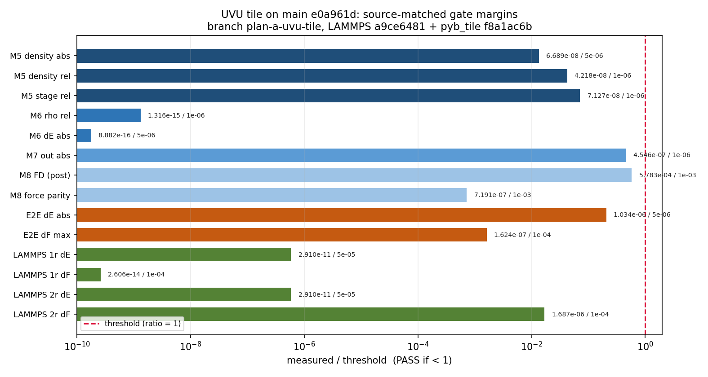

# UVU Tile on Main — Source-Matched Full Gate Report

- 日期：2026-10-21（容器时钟）
- 引擎树：`/workspace/group/shared/bza/external-repos/symmetrix-xl`
- 分支：本地 `plan-a-uvu-tile`（从 `main` tip `e0a961d` 创建；未合并、未提交、未推送）
- 补丁：`/workspace/group/shared/bza/symmetrix-polar/patches/uvu_tile_32x32.patch`
  （只改 `libsymmetrix/source/mace_polar_impl.tpp`，`+131/-56`）
- 被判二进制：`bench/plan_a_uvu_tile_2026-10-21/bin/lmp_uvu_tile`（sha256 `a9ce6481…`）
- Source-matched Python 模块：`bench/plan_a_uvu_tile_2026-10-21/pyb_tile/`
- Gate 标签：`a1_uvu_tile_full`；结果目录
  `bench/plan_a_uvu_tile_2026-10-21/gates/a1_uvu_tile_full/`
- GPU：NVIDIA A100-SXM4-80GB；整个 gate suite 在
  `flock /workspace/group/shared/bza/.tmp/gpu.lock` 下串行执行，未干预其他作业

## 0. 执行摘要（中文）

**结论：PASS。** 从 `plan-a-uvu-tile` 源码树构建了 source-matched Python
模块（configure rc = 0，build rc = 0，`.so` sha256
`f8a1ac6b3d7211e11492c35dba01cc48803ac2582edc08c802488b36e95e5937`），
并配合候选 LAMMPS `lmp_uvu_tile` 跑完完整 gate 契约：模块 5、6、7、8、
32/32 end-to-end、1-rank 与 2-rank LAMMPS parity，共 **7 项全部 PASS**。
所有 gate 日志均写出 `GATE PASS`，全部 JSON verdict 为 `PASS`，日志中没有
任何 `FAIL` 字符串。

数值与 plan-B 已接受的 source-matched gate 在舍入误差内一致：module 5
stage rel `7.127e-8`；module 7 `16/16`、out abs `4.546e-7`；module 8
FD `5.783e-4`、force parity `7.191e-7`；end-to-end `32/32`、dE abs
`1.034e-6 eV`、dF max `1.624e-7 eV/Å`；LAMMPS 1-rank dE
`2.910e-11 eV`、max dF `2.606e-14 eV/Å`；2-rank dE `2.910e-11 eV`、
max dF `1.687e-6 eV/Å`。

进程退出码中 module 5 为 0，其余 6 项为 134；134 均发生在结果 JSON 与
`GATE PASS` **写出之后**，来自 Kokkos/CUDA 在解释器退出阶段的已知
`cudaErrorCudartUnloading: driver shutting down`
（`Kokkos_Cuda_Instance.cpp:154`），与 plan-B 已通过 gate 的日志完全同型，
不是数值失败。gate 判定以 `GATE PASS` 行与 JSON verdict 为准。

**合入状态：READY（门禁全过），但本次未 merge、未 commit、未 push。**
分支仍为本地 `plan-a-uvu-tile`。已有的 1,296 原子 A/B（baseline
290.196 ms/eval → candidate 266.214 ms/eval，`-8.26%`）与 128 原子 parity
（dPE = 0、max dF `5.551e-16`）保持不变。

## 1. Source-matched 模块构建

模板：`bench/plan_b_micro_2026-10-21/build_py_priv.sh`。本任务的构建脚本：
`bench/plan_a_uvu_tile_2026-10-21/build_py_tile.sh`。

| 项目 | 结果 |
|---|---|
| Configure | rc = 0；`PYB_CONFIGURE_DONE`；日志 `logs/pymodule_configure.log` |
| Build | rc = 0；`-j 32`，`flock …/.tmp/build.lock`；`PYM_TILE_BUILD_DONE` |
| 构建时间 | 2026-10-21T09:12:58Z → 2026-10-21T09:22:28Z（约 9 分 30 秒） |
| 构建目录 | `/workspace/group/shared/bza/external-repos/symmetrix-xl/symmetrix/build-pyb-tile` |
| 工具链 | Python `/workspace/caches/conda/envs/polar/bin/python`；CUDA 12.9；Kokkos Ampere80；`SYMMETRIX_BACKEND_SELECTOR=cuda`；`SYMMETRIX_DEVICE_BACKEND=CUDA`；`SYMMETRIX_FAST_MATH=ON` |
| 产物 | `pyb_tile/symmetrix/symmetrix.cpython-312-x86_64-linux-gnu.so`（68,948,688 B）+ 23 个 `source/symmetrix/*.py` |
| `.so` SHA256 | **`f8a1ac6b3d7211e11492c35dba01cc48803ac2582edc08c802488b36e95e5937`** |
| 日志 | `logs/pymodule_build.log`、`logs/pymodule_build_start.txt`、`logs/pymodule_build_end.txt`、`logs/pymodule_build_console.log` |

23 个 Python 源文件与 plan-B 快照逐字节一致；模块字节来自本分支源码
（gate 日志中的 Kokkos teardown 路径指向
`external-repos/symmetrix-xl/libsymmetrix/...`，可作为 provenance 旁证）。

## 2. Gate 结果

调用方式（模板 `run_gates_micro.sh` / `run_gate_suite_micro.sh`，输出重定向到
plan-A 树）：`run_gate_suite_tile.sh a1_uvu_tile_full <lmp_uvu_tile> <pyb_tile>`。
未设置额外 `MATOS_*` 环境变量，即 gate 使用二进制/模块的默认配置
（UVU tile 实际默认形状为 32x16，见 `UVU_TILE_MAIN_1296.md`）。

| Gate | 指标 | 门槛 | 实测 | 判定 |
|---|---|---|---:|---|
| Module 5 | 密度演化 max abs（4 构型 × 3 级 = 12 项） | ≤ 5e-6 | 6.689e-8 | **PASS** |
| Module 5 | 密度演化 max rel | ≤ 1e-6 | 4.218e-8 | **PASS** |
| Module 5 | stage chain max rel（11 项，pairing OK） | ≤ 1e-6 | 7.127e-8 | **PASS** |
| Module 6 | ρ̂ max rel（8 构型） | ≤ 1e-6 | 1.316e-15 | **PASS** |
| Module 6 | ΔE max rel | ≤ 1e-6 | 1.026e-15 | **PASS** |
| Module 6 | ΔE max abs | ≤ 5e-6 eV | 8.882e-16 eV | **PASS** |
| Module 7 | stage max abs / worst rel（16 构型） | abs ≤ 5e-6 **或** rel ≤ 1e-6 | abs 2.396e-5；worst rel 1.174e-7 | **PASS**（按 OR 判据） |
| Module 7 | 出口 max abs（local_q_e / le_total） | ≤ 1e-6 | 4.546e-7 | **PASS** |
| Module 8 | FD 自洽 max（post，12 构型） | ≤ 1e-3 eV/Å | 5.783e-4 eV/Å | **PASS** |
| Module 8 | Python 总力 parity max | ≤ 1e-3 eV/Å | 7.191e-7 eV/Å | **PASS** |
| End-to-end | 32/32 帧通过；E rel / abs | rel ≤ 1e-6 且 abs ≤ 5e-6 eV | 32/32；rel 0；abs 1.034e-6 eV | **PASS** |
| End-to-end | dF max / mean；位置漂移 | ≤ 1e-4 eV/Å | 1.624e-7 / 9.456e-8 eV/Å；0 Å | **PASS** |
| LAMMPS parity 1 rank | dE | ≤ 5e-5 eV | 2.910e-11 eV | **PASS** |
| LAMMPS parity 1 rank | max dF（128 原子 NH3×32） | ≤ 1e-4 eV/Å | 2.606e-14 eV/Å | **PASS** |
| LAMMPS parity 2 ranks | dE | ≤ 5e-5 eV | 2.910e-11 eV | **PASS** |
| LAMMPS parity 2 ranks | max dF | ≤ 1e-4 eV/Å | 1.687e-6 eV/Å | **PASS** |

补充：1-rank mean dF `2.131e-15`、位置漂移 `4.974e-14 Å`；2-rank mean dF
`1.222e-7`、位置漂移 `4.974e-14 Å`。Module 7 的 stage 最大绝对误差
`2.396e-5` 高于绝对门槛 `5e-6`，但该 gate 的契约是 **abs ≤ 5e-6 或
rel ≤ 1e-6**，worst rel 为 `1.174e-7`，因此判 PASS；plan-B 已接受的 gate
记录为同一数值（`2.396e-5` / out `4.546e-7`）。

进程返回码：module 5 = 0；module 6/7/8、end-to-end、1-rank、2-rank 均为
134。六个 134 都是 `GATE PASS` 与结果 JSON 写完之后 Kokkos/CUDA teardown
abort，属于 plan-B 已记录的同型 artifact；数值判定不受影响。

图：各 gate 的实测/门槛归一化裕度（对数轴，红线为阈值 1）。所有指标均在
阈值以下；module 7 stage 使用 OR 判据，图中展示的是出口 abs 指标。

## 3. 分支、源码与二进制指纹

| 对象 | 值 |
|---|---|
| 分支 | `plan-a-uvu-tile`（本地） |
| HEAD | `e0a961df1692a3b7ee05ba4aa85f40d064b72fce`（`polar: coalesce edge up/scatter, fuse cutoff copy`） |
| 工作树修改 | 仅 `libsymmetrix/source/mace_polar_impl.tpp`，`+131/-56` |
| **Source diff hash** | **`2747ac1674c20276d3393bff9e70413e439456004dd41442efde87c0c06a88aa`**（`git diff \| sha256sum`） |
| 补丁文件 SHA256 | `2747ac1674c20276d3393bff9e70413e439456004dd41442efde87c0c06a88aa` |
| Patched source SHA256 | `93a092c8c4d43f28e2fdb27cde4451166835cef2203b118c90fe6afeac3fd2cf` |
| Candidate LAMMPS | `bin/lmp_uvu_tile`，**`a9ce64811d4f8755c4170fd330ef8a5ebc4fa76a46a362f1875cdb94540c3d73`** |
| Baseline LAMMPS | `bin/lmp_main_e0a961d`，`0ad4fe8fa6db75a93a6ab4ee09886153ca1fa400b64c6d5d8598666c0e18bcb4` |
| Python 模块 `.so` | **`f8a1ac6b3d7211e11492c35dba01cc48803ac2582edc08c802488b36e95e5937`** |
| 源码 provenance | `snapshot/source_provenance.txt`；模块 hash `snapshot/pyb_tile.sha256` |

## 4. 合入判定

- **READY to merge（就本 gate 契约而言）**：source-matched 模块 + 候选二进制
  通过 module 5/6/7/8、32/32 end-to-end、1-rank 与 2-rank LAMMPS parity。
- 本次 **未 merge、未 commit、未 push**；未创建任何 commit。
- 既有建议仍成立：补丁实际默认 tile 形状为 32x16（`uvu_tile_shape()` 默认），
  与文件名“32x32”不一致；若合入前希望默认等于 32x32，应单独修正源码常量与
  文档。本轮按任务约束未改源码。

## 5. 产物路径

- 报告：`/workspace/group/shared/bza/symmetrix-polar/docs/results/UVU_TILE_MAIN_GATES.md`
- 图：`/workspace/group/shared/bza/symmetrix-polar/docs/results/figures/uvu_tile_main_gates.png`
- 模块：`.../bench/plan_a_uvu_tile_2026-10-21/pyb_tile/symmetrix/`
- 构建脚本/日志：`.../bench/plan_a_uvu_tile_2026-10-21/{build_py_tile.sh,logs/pymodule_configure.log,logs/pymodule_build.log}`
- Gate 脚本：`.../bench/plan_a_uvu_tile_2026-10-21/{run_gates_tile.sh,run_gate_suite_tile.sh,run_lammps_parity_plan_a.py}`
- Gate 日志：`.../bench/plan_a_uvu_tile_2026-10-21/logs/gate_a1_uvu_tile_full_*.log`、`logs/gate_suite_a1_uvu_tile_full_console.log`
- Gate 结果：`.../bench/plan_a_uvu_tile_2026-10-21/gates/a1_uvu_tile_full/`（JSON + PNG + `summary.json`）
- 汇总脚本：`.../bench/plan_a_uvu_tile_2026-10-21/{summarize_gates.py,plot_gate_summary.py}`
