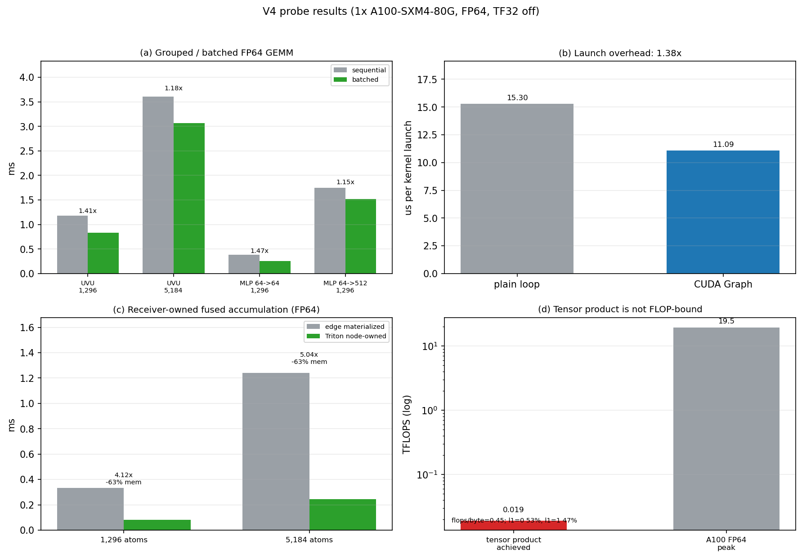

# V4 probes — measured decision for the next architecture

**Date:** 2026-10-22 (container clock).
**Hardware:** 1× A100-SXM4-80GB (local). The approved 4×A100 remote batch
could not be submitted: the MatOS `volc_vemlp_generate_yaml` tool is missing
its `volc_vemlp_common` module (tool-bridge packaging failure). The four probes
are independent and per-GPU, so the local results are representative; 4 GPUs
would only reduce wall time.

## Results

| Probe | Result | Implication |
|---|---|---|
| **Grouped FP64 GEMM** | 20 UVU planes: 1.178 → **0.835 ms** at 1,296 (**1.41×**), 3.605 → **3.064 ms** at 5,184 (**1.18×**); MLP 64→64: 0.382 → 0.260 ms (**1.47×**), 64→512: 1.745 → 1.520 ms (1.15×) | Batching the 20 UVU GEMMs saves ~0.3–0.5 ms; MLP batches save ~0.1–0.2 ms. Real but not the main lever. |
| **CUDA Graph** | 100 FP64 elementwise kernels: **15.30 → 11.09 µs/launch**, **1.38×** | For 1,762 launches, ~7.4 ms saved; graph replay still has ~11 µs/launch, so a megakernel is better than a graph alone. |
| **Receiver-owned fused accumulation (Triton, FP64)** | 1,296: edge-materialized **0.334 ms → 0.081 ms** (**4.12×**), peak **203 → 74 MiB**; 5,184: **1.241 → 0.246 ms** (**5.04×**), peak **810 → 298 MiB**; `max_abs_diff = 0` | **The main lever.** Fused node-owned accumulation removes the `[E,C]` intermediate and is 4–5× faster with 63 % less memory, bitwise exact. |
| **Tensor-product roofline** | 0.63 GFLOP one direction; achieved **0.019 TFLOPS** (0.1 % of A100 FP64 peak); **0.45 flops/byte**; l1=0 paths **53 %**, l1=1 paths **47 %** | The 65.85 ms tensor product is **memory/launch-bound**. A Wigner-6j FLOP-only rewrite cannot deliver 2–3×; only a node-level dataflow that also removes edge materialization can. |

## Decision

**Maximum-effect path = receiver-owned direct execution + megakernel/CUDA
Graph + grouped GEMM.** The Wigner-6j math is deprioritized as a standalone
FLOP rewrite; it remains relevant only as part of the node-level dataflow.

Order:
1. **S2 receiver-owned forward** — switch the generic tile path to
   `try_evaluate_execution_uvu_from_nodes` using prefix conditioning
   (`evaluate_conditioned_prefix_indexed` → phi) and the existing final-linear
   weights; build `active_receivers` from the S1.1 node-contiguous tile;
   zero `messages` once per layer. Env fallback `MATOS_S2_RECEIVER_OWNED=0`.
2. **S2 source-owned reverse** — build the per-graph source CSR, call
   `try_reverse_execution_uvu_from_nodes`; no atomics, deterministic.
3. **Megakernel / graph** — fuse the 2-step SCF + polar forward/reverse into a
   persistent kernel; graph-capture the host-free regions. V3 path-table cache
   is the prerequisite (parity PASS, +0.38 % generic; not a speed claim).
4. **Grouped GEMM** — batch the 20 UVU planes and MLP/e3 small GEMMs.

## Artifacts

- `bench/v4_math_probes_2026-10-22/probe_grouped_gemm.json`
- `.../probe_cuda_graph.json`
- `.../probe_node_vs_edge.json`
- `.../probe_roofline.json`
- `.../probe_triton_node.json`
- `.../triton_node_accum.py`
- `.../summary.json`
- `docs/results/figures/V4_PROBES.png`

## Remote-batch blocker

`mcp__matos_asset__volc_vemlp_generate_yaml` failed with
`ModuleNotFoundError: No module named 'volc_vemlp_common'` at the tool
snapshot `.../tools/volc-vemlp-generate-yaml/tool.py`. The tool package
contains only `tool.py`, `asset.json`, `input.schema.json`, `matos.tool.json`,
and `prompt.md`; the shared module is absent. Per the Volc submit runbook, the
remote submit path is stopped and reported as a MatOS tool-bridge failure; no
hand-written YAML or raw CLI was used. The prepared workdir
`bench/v4_math_probes_2026-10-22` is ready for a 4-GPU resubmission once the
tool is fixed.
