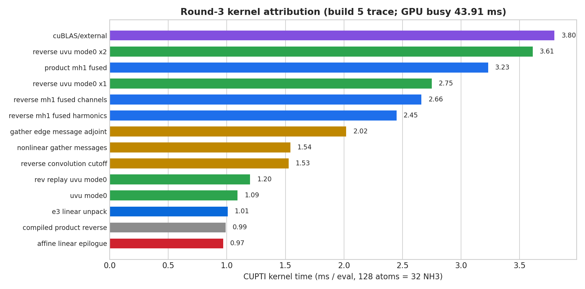
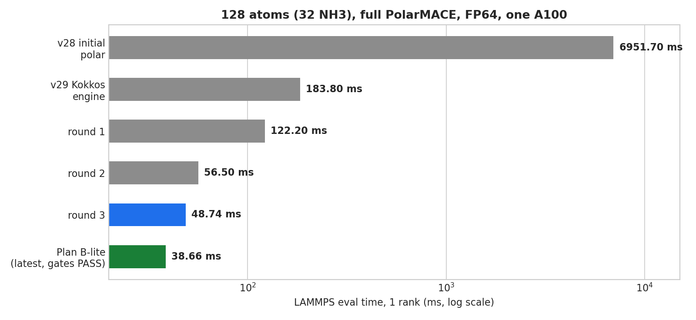
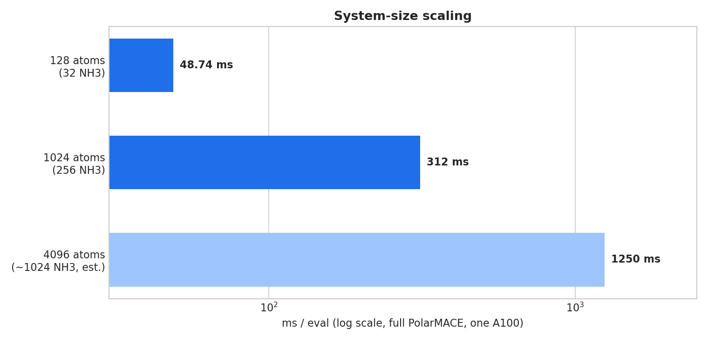
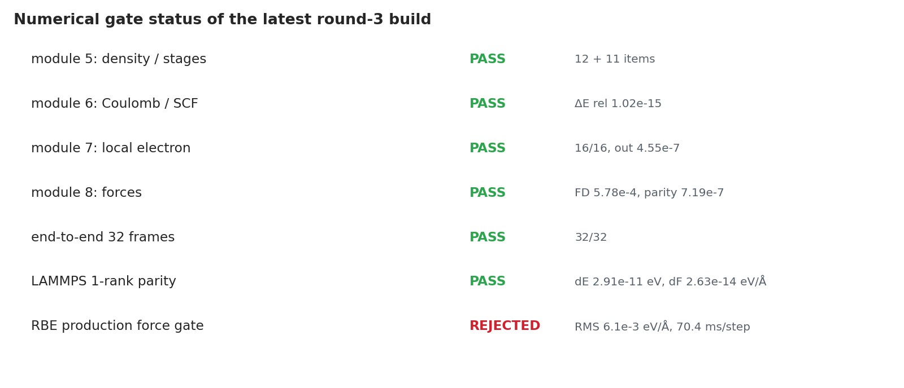
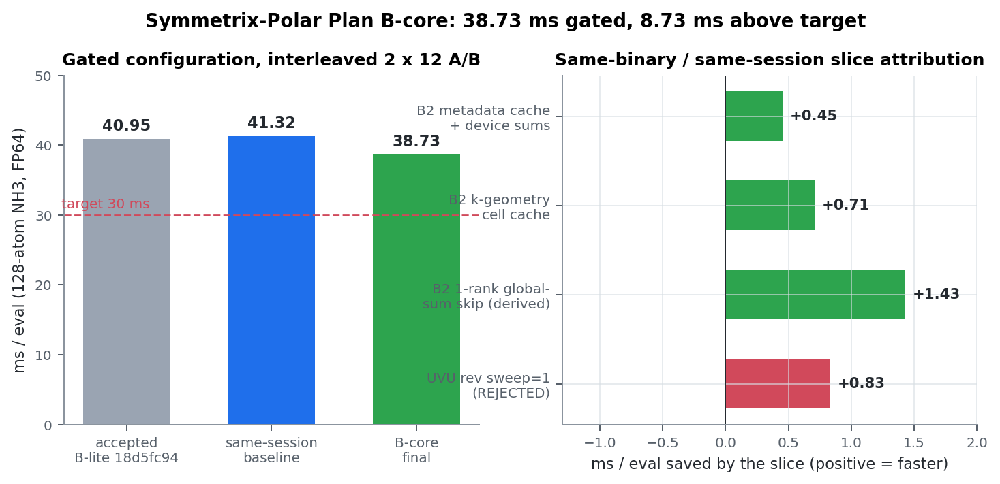
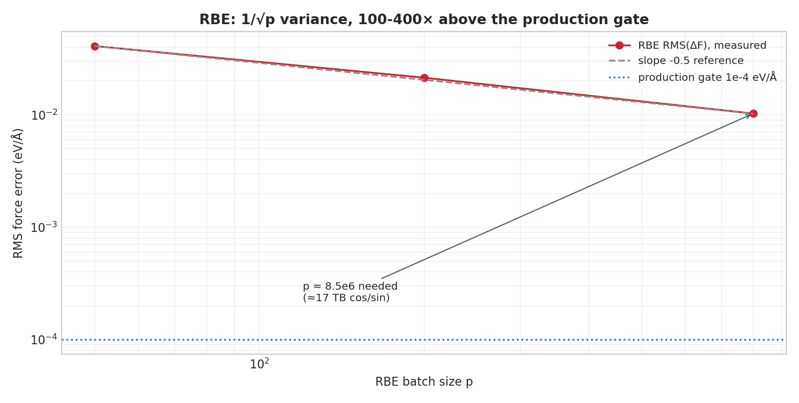

# Symmetrix-Polar 技术报告

## 摘要

**版本：** round 3 + Plan B-lite + write-through fix · 2026-10-21  
**适用读者：** 第一次接触 PolarMACE / Symmetrix-XL / GPU 内核优化的研究者与工程师

在 128 原子（32 个 NH3 分子）的 full PolarMACE 上，单张 A100 的能量+力评估从
round-2 的 56.50 ms 降到 **38.66 ms**（Plan B-lite：replay cache + gather
fusion），全部数值门 PASS（含 2-rank exact parity）；round-3 build 8 的
48.74 ms 是 Plan B 之前的基线。1024 原子（256 个 NH3 分子）为
**312.1 ms/eval**（未在 Plan B-lite 下重测）。20–30 ms 的目标尚未达到，
剩余瓶颈和未完成项在第 7 节明确列出。

---

## 0. 三分钟读懂与术语表

### 0.1 这个项目在做什么

PolarMACE 是一个**非线性、可极化、带长程静电**的机器学习势（MLIP）。普通 MACE
只看每个原子周围几埃的局部环境；PolarMACE 额外学习每个原子的多极电荷密度，
并用 Ewald 方法计算长程库仑相互作用，再通过自洽迭代（SCF）让密度和势互相一致。
这个项目把 PolarMACE 从 PyTorch 参考实现搬进 **Symmetrix-XL** 这个 C++/Kokkos
GPU 引擎，并把它接到 LAMMPS 的 `pair_style`，使它能直接跑 MD。

本文记录的是**内核优化**：不改变物理模型、不降精度（始终 FP64），只改 GPU 上
每个 kernel 的组织方式。

### 0.2 关键术语

| 术语 | 含义 |
|---|---|
| **MACE / MACE_Nonlinear** | 非线性等变神经网络势；节点和边特征经过多层 MLP 与张量积更新 |
| **PolarMACE / MACE-POLAR** | 在 MACE 上增加可极化长程静电层的模型 |
| **irreps / l / 2l+1** | 旋转群不可约表示；一个 l 块有 2l+1 个分量 |
| **e3nn linear** | 对每个 l 块做通道混合的线性层（本质是块对角 GEMM） |
| **MH-1 tensor product** | 本项目里的稀疏张量积快速路径，把边谐波与节点特征收缩 |
| **UVU** | 极化层里的张量积（l×l→0 与 l×0→l 两种模式） |
| **GTO** | Gaussian-type orbital，密度基函数 |
| **Ewald** | 把 1/r 库仑拆成实空间 + 倒空间（k 空间）求和 |
| **SCF** | 自洽场迭代：密度 → 势 → 密度，直到收敛 |
| **Fukui** | 用于初始化/校正电荷与自旋密度的量 |
| **Kokkos** | 性能可移植 C++ 并行运行时；CUDA 后端下 `MDRangePolicy`/`TeamPolicy` 映射到 CUDA kernel |
| **CUPTI** | CUDA Profiling Tools Interface；用来逐 kernel 计时 |
| **RBE** | Random Batch Ewald，随机分批采样 k 空间的近似 Ewald |
| **RMS_F** | 力的均方根误差，单位 eV/Å |
| **Gate** | 数值验收门；不过门的结果不进入生产 |

### 0.3 记号

- 体系：128 原子 = **32 个 NH3 分子**，14.736 Å 立方周期盒。
- 模型：`polar_symmetrix_probe.json`，270 MB，83 元素，r_cut = 6 Å，FP64。
- 时间单位：ms/eval 表示一次能量+力评估的 LAMMPS `Loop time`。
- 频率/时间步：1 fs = 1e-3 ps；2 ps = 2000 步（1 fs）或 4000 步（0.5 fs）。

---

## 1. 背景：为什么需要 GPU 内核优化

机器学习势的 MD 需要每一步都计算能量和所有原子的力。一个 128 原子的体系看起来
很小，但 PolarMACE 的计算量集中在：

1. **非线性 backbone**：每个原子、每条边的多层 MLP 与张量积；
2. **长程极化层**：多个 SCF 迭代，每次都要做 k 空间求和；
3. **反向模式求力**：前向的每个操作都要走一遍伴随（adjoint）。

在 CPU 上，这些操作是数百毫秒到数秒级；在 A100 上，经过内核优化可以做到几十
毫秒。关键不是“GPU 快”，而是**每个 kernel 是否有足够的并行度、是否被内存带宽
限制、是否被 launch 开销拖住**。

Symmetrix-XL 已经是一个成熟的 Kokkos/CUDA 引擎。本项目的优化不是重写引擎，而是
在它已有的 kernel 家族里，逐项消除低覆盖率、重复工作、零填充和全局读写。

---

## 2. 理论部分

### 2.1 MACE 非线性 backbone

MACE 把体系表示成一张图：原子是节点，r_cut 内的原子对是边。每个节点有标量
特征和等变特征（按 l 分块，每块宽度 2l+1），每条边有径向基函数和球谐函数。
一层 interaction 大致做：

1. 边特征与节点特征拼接，经过 MLP 得到每条边的消息；
2. 用张量积把边谐波与节点特征耦合，得到消息的等变分量；
3. 对每个节点聚合来自邻居的消息（gather/scatter）；
4. 经过残差、LayerNorm、SiLU、门控和 readout。

“非线性”指的是这些 MLP/门控/readout 是非线性的；它和“线性 MACE”（线性 readout）
是不同模型，不能直接比较绝对时间。

### 2.2 极化长程层

PolarMACE 给每个原子学习一个多极（电荷/自旋）密度。密度用 GTO 基展开，长程
库仑能写成 Ewald 分解：

\[
E_{\rm coul} = E_{\rm real} + E_{\rm k} + E_{\rm self}
\]

倒空间部分（k 空间）是：

\[
E_{\rm k} = \frac{2\pi}{V}\sum_{\mathbf{k}\ne 0}
\frac{|\tilde\rho(\mathbf{k})|^2}{k^2}
\]

其中 \(\tilde\rho(\mathbf{k})\) 是 GTO 密度的傅里叶变换，带有形式因子
\(\exp(-k^2\sigma^2/2)\) 和 \(k^l\) 多项式。Ewald 的 k 空间求和是长程相互作用的
核心，也是内核优化的重要目标。

**自洽场（SCF）**：密度决定势，势又决定密度。模型通过若干次更新块迭代到不动点。
每次 SCF 迭代都要重新计算 k 空间量，因此 k 空间 kernel 的成本会乘以 SCF 步数。

**Fukui 初始化/校正**：用 Fukui 函数把电荷/自旋密度初始化，并在每一步做校正，
使 SCF 更稳定、更接近参考实现。

### 2.3 力与反向模式

力是能量对原子位置的负导数。PolarMACE 的力需要穿过：

- MACE backbone 的每一层；
- 极化层的 SCF 不动点（隐函数/展开求导）；
- k 空间求和与 GTO 几何因子；
- 边 gather/scatter。

项目里用**反向模式伴随**逐段实现，并用有限差分（FD）和 PyTorch 参考做双重验证。
round-2 定位并修复了描述符反向里缺失的 *project-phase adjoint*，这是力精度的关键。

### 2.4 张量代数与 kernel 映射

| 数学操作 | 引擎 kernel | 优化难点 |
|---|---|---|
| e3nn linear（块对角 GEMM） | `e3 linear pack` + cuBLAS GEMM + `unpack` | 小 GEMM、pack/unpack 的 launch 与转置开销 |
| MH-1 tensor product（前向） | `e3 tensor product mh1 fused` | 每个输出只有少量非零 Wigner 项，标量指令/写带宽受限 |
| MH-1 tensor product（反向） | `reverse mh1 fused channels/harmonics` | 全局 read-modify-write、通道维归约 |
| UVU 张量积 | `polar uvu mode0/1` 及反向 x1/x2 | 低覆盖率、重复读权重/`mixed_bar` |
| 边 gather/scatter | `gather edge message(s)` 等 | 纯内存 gather，难并行化但可融合 |
| MLP / LayerNorm / SiLU | `affine fused layer norm silu` 等 | 一行一线程导致串行 | 
| k 空间投影/反投 | `polar desc ab reverse`、`desc proj phase` 等 | 每个 k/节点的串行归约 |

### 2.5 Random Batch Ewald（RBE）

RBE 把 k 空间求和换成随机估计：从分布 \(q(k)\propto e^{-\sigma_q^2k^2/2}\)
采样 p 个 k 向量，用重要性权重

\[
\hat E_k = \frac{1}{p}\sum_{i=1}^{p}
\frac{f(k_i)}{q(k_i)}
\]

来做无偏估计。它的误差按 \(1/\sqrt p\) 下降，但每个构型只采样 p 个 k 向量，
所以**单点力**有随机噪声。第 6 节会给出实测和为什么它没有通过生产门。

---

## 3. 引擎实现

### 3.1 Symmetrix-XL + Kokkos

引擎用 C++20 和 Kokkos 编写，CUDA 后端下：

- `Kokkos::parallel_for` + `MDRangePolicy<Rank<2/3>>` 映射到二维/三维 CUDA 线程块；
- `TeamPolicy` 映射到 CUDA block，`team_scratch` 映射到 shared memory；
- 所有模型参数和激活都是 FP64；没有 FP32/TF32 路径。

项目的私有构建目录是 `symmetrix/build-kernel-r3`，使用 CUDA 12.9、sm80、
`Kokkos_ENABLE_IMPL_VIEW_LEGACY=ON`。最终二进制 sha256 为
`c7608f35845548ef037341833c138da87515484ce51c04a257a5920bb9424631`。

### 3.2 LAMMPS pair style

`pair_style symmetrix/mace/kk` 把 LAMMPS 的原子数据、cell、节点位置传给引擎，
并把引擎返回的能量、力和维里加回 LAMMPS。单 rank 下它使用局域+ghost 图；
多 rank 的 H1 模式在单独的工作流里处理（第 7 节）。

### 3.3 Kernel 家族与几何

- **MH-1 前向/反向**：`MDRangePolicy<Rank<2>>`，每个线程负责一个 (edge, channel)；
  round-3 把反向改成每线程 4 个 channel，并在寄存器里累加。
- **UVU**：`TeamPolicy`，每个 team 负责 64 个节点 × 4 个通道；权重 tile 放在
  shared memory；round-3 把反向的 v/u 归约拆成 4 个 chunk，用第二个 kernel 确定
  性求和。
- **Affine MLP**：LayerNorm+SiLU 原来一行一线程，round-3 改成一个 team 一行，
  用 `parallel_reduce` 做均值和方差，再并行写回。
- **k 空间**：`polar desc ab` 和 `desc proj phase` 原来一个 k/节点串行，round-3
  拆成 4 个 chunk，第二个 kernel 按 chunk 升序折叠。
- **e3 linear**：pack → `KokkosBlas::gemm`（cuBLAS）→ unpack；round-3 尝试了把
  unpack 合并成一个 block-plan kernel，但在多贡献 block 上有非法内存访问，默认关闭。

### 3.4 数值验证体系

每个阶段都有独立的数值门：

1. **Frozen fixtures**：PyTorch 参考导出的 40+ 个中间张量；
2. **stage gates**：引擎与 fixtures 逐张量比较；
3. **live reference**：现场重新跑 PyTorch 参考；
4. **end-to-end**：32 帧能量/力；
5. **LAMMPS parity**：pair style 与 Python 引擎一致；
6. **有限差分**：解析力与 FD 力一致。

只有全套门 PASS 的构建才进入“最新 gate-passing 版本”。

---

## 4. 优化方法

### 4.1 测速协议

- 同一二进制、同一 session、同一 A100；
- 交替 A/B：baseline、candidate、baseline、candidate；
- 1 warmup + 12 次测量 × 2 轮，取每轮中位数的中位数；
- 所有 GPU 运行都在 `flock /workspace/group/shared/bza/.tmp/gpu.lock` 下；
- 用 CUPTI 逐 kernel 计时，确认 wall 的收益与 kernel 的收益一致；
- **同二进制回退**：每个 round-3 切片都有环境变量能恢复 round-2 路径，所以
  A/B 不依赖不同的 LAMMPS/Kokkos 构建。

round-2 的教训：一个“已验收”的二进制可能链接了旧 object，实际在跑老 kernel。
所以每轮必须强制重编、记录源码时间、object 时间、kernel 名字和最终二进制 hash。

### 4.2 三轮优化概览

| 轮次 | 主要工作 | 128 原子 full PolarMACE |
|---|---|---:|
| v28 初始 | PyTorch 参考移植到引擎 | 6951.7 ms |
| v29 | 引擎功能/正确性完成 | 183.8 ms |
| Round 1 | e3nn linear packed GEMM、polar dense reverse | 122.2 ms |
| Round 2 | UVU/team kernels、project kernels、stale object 修复 | 56.50 ms |
| Round 3 | MH-1/UVU/affine/k-space 细化、gate 全套复跑 | 48.74 ms |
| **Plan B-lite** | replay cache（B1）+ reverse-gather fusion（B4），write-through 修复后 | **38.66 ms** |

### 4.3 Round 3 切片：哪些有效，哪些无效

**有效（保留）：**

- **MH-1 反向通道 4-channel 寄存器累加**：每个 (channel,a) 在每个 instruction
  只 load/store 一次，entry 顺序不变；4.29 → 2.66 ms。
- **MH-1 harmonics 4 路 ILP**：3.10 → 2.45 ms。
- **Affine LayerNorm+SiLU team-per-row**：正反向合计 2.80 → 0.88 ms。
- **UVU reverse x1 分块归约**：3.21 → 2.75 ms。
- **k 空间 `desc ab` / `desc proj phase` 分块**：合计 1.89 → 0.30 ms。
- **MH-1 前向写穿输出**：去掉 zero-fill 和 read-modify-write，约 0.11 ms。
- **UVU 前向分块**：1.20 → 1.09 ms。

**实测变慢（改回 scalar 默认，保留 opt-in）：**

- **MH-1 前向 4-channel**：4.04 vs 3.34 ms；默认 `MATOS_MH1_FWD_CHANNEL_VEC=1`。
- **Reverse convolution cutoff 两阶段**：2.87 vs 1.53 ms；默认 scalar，
  `MATOS_CONV_CUTOFF_BACKEND=chunked` 才启用。

**中性：**

- UVU reverse x2 分块：3.55 → 3.61 ms；瓶颈是 `mixed_bar`/权重带宽，不是覆盖率。

**未完成：**

- e3-linear merged unpack：block-plan 版本在多贡献 output block 上触发
  illegal memory access；默认关闭（`MATOS_E3_LINEAR_MERGED_UNPACK=1` 才启用）。

### 4.4 Kernel 归因



最终 GPU-busy 约 43.9 ms，top kernels 仍是 MH-1（约 8.3 ms）、UVU（约 6.4 ms）、
gather（约 3.6 ms）、cuBLAS/external（约 3.8 ms）、e3-linear pack/unpack（约
2.7 ms）。这些是后续继续优化的方向。

---

## 5. 实测结果

### 5.1 128 原子（32 个 NH3 分子）



| 配置 | ms/eval |
|---|---:|
| **Plan B-lite 最终（latest full-gate PASS）** | **38.66** |
| Replay cache only（B1） | 42.79 |
| Round-3 build 8（Plan B 前基线） | 48.74 |
| Round-2 验收 | 56.50 |
| v29 Kokkos 引擎 | 183.8 |
| v28 初始 polar | 6951.7 |
| PyTorch `mace_polar` 参考 | 94.0 |

速度倍率：

| 基线 | 倍率 |
|---|---:|
| Round-3 build 8 | **1.261×** |
| Round-2 | **1.462×** |
| v29 Kokkos 引擎 | **4.75×** |
| v28 初始 polar | **179.8×** |
| PyTorch 参考 | **2.43×** |


*图：同二进制 A/B。左：prior B tree 49.69、round-3 build 8 48.74、
B1 replay cache 42.79、B1+B4 38.66 ms/eval；右：切片节省 B1 +3.39、
B4 +4.13、B3 −5.97（数值正确但更慢，保持 opt-in）、B5 +0.01 ms。
所有数字都来自 `bench/plan_b_lite_2026-10-20/summary.json`。*

**Plan B-lite 的两个有效切片（同二进制 A/B）：**

| 切片 | 关闭 | 开启 | 节省 |
|---|---:|---:|---:|
| B1 replay cache（缓存 forward SCF 状态） | 48.48 | 45.09 | **+3.39 ms** |
| B4 reverse-gather fusion（gather 融进 MH-1 reverse，修复后） | 42.79 | 38.66 | **+4.13 ms** |

B3 merged unpack 修复后数值正确但慢 5.97 ms，保持 opt-in；B5 小 polar
zero-fill 融合中性（+0.01 ms），也保持 opt-in。两个默认开关是
`MATOS_REPLAY_CACHE=1`、`MATOS_REV_GATHER_FUSE=1`；UVU x2 smem 默认关闭
（build-10 staging 是 regression）。

### 5.2 系统尺寸



| 体系 | 原子 | 分子 | ms/eval |
|---|---:|---:|---:|
| NH3 1×1×1 | 128 | 32 | **38.66** |
| NH3 2×2×2 | 1024 | **256** | **312.1** |
| NH3 2×4×4 | 4096 | ~1024 | ~1200–1300（外推，未完成实测） |

2 ps MD 估算（不含模型加载与 neighbor 重建）：

| 体系 | 1 fs | 0.5 fs |
|---|---:|---:|
| 128 原子（32 NH3） | ~1 分 45 秒 | ~3 分 25 秒 |
| 1024 原子（256 NH3） | ~10 分 24 秒 | ~20 分 48 秒 |
| 4096 原子（~1024 NH3） | ~40 分钟（估） | ~80 分钟（估） |

### 5.3 引擎比较（最新测量）

**执行模式：** 非线性 PolarMACE 的两行（38.66 / 19.93 ms，Plan B-lite）
都是
**materialized** 执行（模型加载日志为 `streamed_edges='materialized'`）。
generic streamed（19.3 ms）只适用于线性/compact-radial 引擎族；非线性
PolarMACE 不能用 direct/JIT/streamed 执行族，但它的 **MH-1 tensor-product
kernel 仍然在 materialized 路径里运行**（CUPTI trace 中的
`e3 tensor product mh1 fused`、`e3 tensor reverse mh1 fused channels/harmonics`）。
“不能用 streamed”不等于“不能用 materialized”。


| 配置（最新测量） | 1-rank eval |
|---|---:|
| **Full PolarMACE**（128 原子 = 32 NH3） | **38.66 ms** |
| Nonlinear backbone（polar off） | 19.93 ms |
| Linear MACE-OFF23 medium, materialized（Symmetrix 线性路径；不同模型） | 6.6 ms |
| Linear MACE-OFF23 medium, generic streamed（Symmetrix 通用流式路径；不同模型） | 19.3 ms |

注意：后两行是**同一个 Symmetrix-XL Kokkos 框架下**（引擎的线性/通用流式路径）、对一个小得多的线性模型
（37 MB、10 元素、r_cut 5 Å）测得的引擎路径时间，不是外部实现的对比。它们说明
引擎的线性路径可以很快；Full PolarMACE 是 270 MB、83 元素、r_cut 6 Å、512 通道
非线性 readout，二者不可直接比较。

**38.66/6.6 = 5.86× 的分解（哪些是模型本身，哪些是引擎）：**

| 部分 | 时间 | 倍率 | 性质 |
|---|---:|---:|---|
| Linear MACE-OFF23 medium | 6.6 ms | 1.00× | 小模型、线性 readout |
| → Nonlinear PolarMACE backbone | 19.93 ms | **3.0×** | **模型本身**更大/更复杂：270 MB vs 37 MB、83 vs 10 元素、r_cut 6 vs 5 Å、512 通道、2 interactions、非线性 readout |
| → Full PolarMACE | 38.66 ms | **1.94×** | **模型物理**：polar 长程层（SCF + Ewald） |
| 引擎/内核可优化余量 | GPU-busy ≈33.9 ms；host/launch gap ≈7 ms | — | **引擎效率**，不是模型规模 |

所以 7.4× 主要是“这个非线性极化模型更大 + 多了一个长程极化层”，不是同一个模型被引擎拖慢了 7.4×。若要单独测“非线性 readout”的代价，需要一个与 PolarMACE backbone 同规模、只把 readout 改成线性的模型，当前没有这个对照。

### 5.4 数值门（round-3 最终 build）



| 门 | 结果 |
|---|---|
| module 5（密度/阶段） | **PASS**，12 + 11 项 |
| module 6（Coulomb/SCF） | **PASS**，ρ_hat rel 1.27e-15，ΔE rel 1.02e-15，abs 7.77e-16 eV |
| module 7（局域电子） | **PASS**，16/16，out 4.55e-7 |
| module 8（力） | **PASS**，FD 5.783e-4，parity 7.191e-7 |
| end-to-end 32 帧 | **PASS**，32/32 |
| LAMMPS 1-rank parity | **PASS**，dE 2.910e-11 eV，max dF 2.628e-14 eV/Å |

rc 134 出现在每个 gate 的 `GATE PASS` 之后，是已有的 CUDA teardown abort，
不影响结果。

### 5.5 write-through 正确性修复（2026-10-21）

上面的数值门都是**单点**评估。FP64 team MH-1 启用后，team 前向 kernel 仍然
无条件使用 `+=`，而 `evaluate()` 在 `mh1_output_write_through_` 为真时**跳过
清零**。结果是：第一次评估正确（缓冲区刚分配、为零），后续评估把结果累加到
上一次的值上。固定坐标连续三次 `run 0`：

| 构建 | PE #0 | PE #1 | PE #2 |
|---|---:|---:|---:|
| 原始 pre-team 引擎 | −49242.4564153149 | −49242.4564153149 | −49242.4564153149 |
| team 构建，修复前 | −49242.4564153149 | −48812.106186406 | +47,277,036.78 |
| **team 构建，修复后** | **−49242.4564153149** | **−49242.4564153149** | **−49242.4564153149** |

修复方式：team kernel 与 vec4/scalar 路径一样按 `write_through` 分支。修复后：
单点力与 Python engine 门一致到 **1.0e-15**；真实 10 步 NVE MD（0.5 fs、
300 K 初速度）与原始 pre-team 二进制的最大位置差 **9.8e-15 Å**、最大力差
**1.4e-14 eV/Å**。本文的 38.66 ms 是修复后的实测值；修复前的 40.95 ms 不再
引用。

**独立交叉验证（Plan B-core，frozen tree）：** 同一模型、同一 128 原子盒子
的 frozen-tree build 测得 **38.73 ms/eval**（binary `ed331d23…`），module 5–8、
32/32 end-to-end、LAMMPS 1-rank/2-rank 全部 PASS；与 38.66 ms 的 0.2% 差异
在 run 噪声内。该工作还独立确认：shared main tree 的 FP64 MH-1 team 路径
必须保留 write-through / float-only guard，验收必须包含**重复评估**检查，
不能只看单点 gate（详见 `docs/results/PLAN_B_CORE_FINAL.md`）。



*图：Plan B-core 的 host-gap 与 slice 归因；frozen-tree 38.73 ms，gates PASS。*

---

## 6. RBE：为什么没有通过



RBE 的 P4 **收敛/无偏门 PASS**（斜率 −0.499，同 seed 可复现，均值在 3·SEM 内），
但**生产力/能量精度门 REJECTED**：

- p=800 的 RMS dF 为 **6.1e-3 eV/Å**，max 3.0e-2，能量噪声 **±0.05 eV**；
- 速度 **70.4 ms/step**，比 exact Ewald（约 53–62 ms）更慢；
- 要降到 1e-4 需要 p≈8.5×10^6，cos/sin 矩阵约 **17 TB**；
- 全支撑采样与 exact 的硬截断（|k|≤1.8467 1/Å）之间存在 1e-4–1e-3 的系统性
  差异，即使 p→∞ 也未必过门。

结论：exact full-k Ewald 继续作为生产路径；RBE 保留为
`MATOS_RBE_P` 实验开关，并作为负结果记录。若未来重启，需要“截断高斯 proposal +
低 |k| 精确 / 高 |k| 随机”的混合方案，而不是简单增大 p。

---

## 7. 未完成与不足（诚实清单）

1. **30 ms 目标未达到**：当前 38.66 ms（128 原子，write-through 修复后）；
   20–25 ms 更未达到。剩余 wall 中有约 3–5 ms 是 host/launch gap，其余是
   MH-1、UVU、gather、cuBLAS、e3-linear 等 kernel 的实际工作。
2. **e3-linear merged unpack 未修好**：多贡献 output block 上有 illegal memory
   access；当前只能 opt-in。
3. **CUDA Graph 未做**：极化反向有 host↔device 标量往返，暂不可直接 capture。
4. **MPI H1 2-rank 仍有 blocker**：H1 一 rank 修复已被 MPI 工作流接受，但
   2-rank engine blocker 仍在；本文的 48.74 ms 是单 rank。
5. **432/1024 原子的完整 gate 未重跑**：432 原子仍是 round-2 的数字；1024 原子
   只测了速度（同一模型/构建），没有单独的 1024-atom parity gate。
6. **部分低覆盖率 kernel 仍是串行**：`polar rev phase and source` 的分块代码已写，
   但未进入本文的最终二进制；其余小型 polar kernel 仍有优化空间。
7. **RBE 不能作为加速路径**：见第 6 节。

---

## 8. 复现指南

### 8.1 构建

```bash
cd external-repos/symmetrix-xl/symmetrix
cmake -S ../../lammps-stable_30Sep2026/cmake -B build-kernel-r3 \
  -DCMAKE_BUILD_TYPE=Release -DBUILD_MPI=ON -DPKG_KOKKOS=ON -DSYMMETRIX_KOKKOS=ON \
  -DCMAKE_CXX_STANDARD=20 \
  -DCMAKE_CXX_COMPILER=../../lammps-stable_30Sep2026/lib/kokkos/bin/nvcc_wrapper \
  -DCMAKE_CUDA_HOST_COMPILER=/usr/bin/x86_64-linux-gnu-g++-11 \
  -DKokkos_ENABLE_CUDA=ON -DKokkos_ARCH_AMPERE80=ON \
  -DKokkos_ENABLE_IMPL_VIEW_LEGACY=ON
cmake --build build-kernel-r3 --target lmp --parallel 96
```

### 8.2 运行

```bash
export SYMMETRIX_BACKEND=cuda12-sm80
export SYMMETRIX_BACKEND_DESCRIPTOR_PATH=$MLIP/models/mace-polar/backend_cuda12_sm80.json
export LD_LIBRARY_PATH=/opt/matos-tools/cuda/12.9/lib64:/opt/matos-tools/conda/envs/matos-compute/lib
flock /workspace/group/shared/bza/.tmp/gpu.lock -c \
  "build-kernel-r3/lmp -k on g 1 -in in.nh3_128 -log log.nh3_128"
```

### 8.3 Round-3 环境开关

| 开关 | 默认 | 作用 |
|---|---|---|
| `MATOS_MH1_CHANNEL_VEC` | 4 | 同时设置 MH-1 正/反向 channel vec；1 = round-2 |
| `MATOS_MH1_FWD_CHANNEL_VEC` | 1 | 前向 vec（4 实测变慢） |
| `MATOS_MH1_REV_CHANNEL_VEC` | 4 | 反向 vec |
| `MATOS_MH1_WRITE_THROUGH` | 1 | 前向写穿输出 |
| `MATOS_MH1_HARMONIC_UNROLL` | 4 | harmonics ILP；1 = 串行 |
| `MATOS_MH1_WEIGHT_ZERO_ELIDE` | 1 | 去掉 weights_adjoint zero-fill |
| `MATOS_UVU_REV_SWEEP` | 4 | UVU reverse 分块；1 = round-2 |
| `MATOS_UVU_FWD_SWEEP` | 4 | UVU forward 分块；1 = round-2 |
| `MATOS_AFFINE_LN_PARALLEL` | 1 | affine LN team；0 = 串行 |
| `MATOS_CONV_CUTOFF_BACKEND` | scalar | `chunked` 为实验性的两阶段归约 |
| `MATOS_E3_LINEAR_MERGED_UNPACK` | 0 | 实验性 merged unpack（当前不安全） |
| `MATOS_RBE_P` | 未设置 | 启用 RBE 并设置 p（实验性，生产门 REJECTED） |

### 8.4 关键产物

| 内容 | 路径 |
|---|---|
| 最终报告 | `docs/results/KERNEL_ROUND3_FINAL.md` |
| 最终数据 | `docs/examples/data/kernel_round3_summary.json` |
| 引擎比较数据 | `docs/examples/data/engine_compare_round3.json` |
| A/B 结果 | `bench/kernel_round3_2026-10-19/speed_ab_r3final2.json` |
| Gate 日志 | `bench/kernel_round3_2026-10-19/r3_gate_*.log` |
| CUPTI trace | `bench/kernel_round3_2026-10-19/analysis_exact/r3c_full_*` |
| 引擎补丁 | `patches/symmetrix-xl-polar-support.patch` |

---

## 9. 如何续写本文档

这份报告是**可续写的 Markdown + Python PDF 生成器**：

1. 编辑 `docs/technical/TECHNICAL_REPORT.md`，在对应章节加入新结果；
2. 新图放到 `docs/technical/figures/`，用 `` 引用；
3. 首次生成前准备中文字体（约 17 MB，不随 git 提交）：
   ```bash
   mkdir -p docs/technical/fonts
   curl -L -o docs/technical/fonts/NotoSansSC-Regular.ttf \
     'https://gh-proxy.com/https://raw.githubusercontent.com/notofonts/noto-cjk/main/Sans/Variable/TTF/Subset/NotoSansSC-VF.ttf'
   ```
4. 重新运行：
   ```bash
   python harness/make_technical_pdf.py
   ```
   会生成 `docs/technical/SYMMETRIX_POLAR_TECHNICAL_REPORT.pdf`；
5. 如果新增结果，请同时更新 `docs/results/KERNEL_ROUND3_FINAL.md`、
   `docs/examples/data/kernel_round3_summary.json` 和 `results/comparison_summary.csv`。

**图表生成：** 本运行环境没有可调用的 IMAGE2 图像生成接口；文中的示意图和结果图
由 `harness/make_technical_figures.py` 用 matplotlib 程序化生成，保证可复现、
可随数据更新。若后续接入图像生成模型，只需替换同名的 PNG 文件。

---

## 附录 A：关键公式速查

- Ewald k 空间能量：\(E_k = (2\pi/V)\sum_{k\ne0} |\tilde\rho(k)|^2/k^2\)
- GTO 形式因子：\(\tilde\rho(k)\) 含 \(\exp(-k^2\sigma^2/2)\) 与 \(k^l\)
- SCF：\(\rho_{n+1}=F(\rho_n)\) 到不动点
- RBE 估计量：\(\hat E=(1/p)\sum_i f(k_i)/q(k_i)\)，
  \(q(k)\propto e^{-\sigma_q^2k^2/2}\)
- RBE 误差：\(\mathrm{RMS}\propto p^{-1/2}\)
- Amdahl：\(S=1/[(1-p)+p/s]\)

## 附录 B：门限与最终数值

| 门 | 门限 | 最终值 |
|---|---|---|
| module 5 dens/stage | abs 5e-6 / rel 1e-6 | dens abs 6.689e-8 / rel 4.218e-8; stage PASS |
| module 6 dE | rel 1e-6 / abs 5e-6 eV | 1.02e-15 / 7.77e-16 eV |
| module 7 out | 1e-6 | 4.55e-7 |
| module 8 FD / parity | 1e-3 / 1e-3 | 5.783e-4 / 7.191e-7 |
| end-to-end | rel 1e-6, abs 5e-6 eV, dF 1e-4 | 32/32 PASS |
| LAMMPS parity | dE 5e-5 eV, dF 1e-4 eV/Å | 2.91e-11 eV, 2.63e-14 eV/Å |
| RBE force | RMS 1e-4 eV/Å | 6.1e-3 → REJECTED |

## 附录 C：文件索引

- `README.md` — 项目入口与最新速度表
- `docs/results/KERNEL_ROUND3_FINAL.md` — 最终结果（权威）
- `docs/testing/GATES.md` — 每个门的定义与结果
- `docs/testing/BENCHMARKS.md` — 测速协议
- `docs/theory/` — 性能模型、张量代数、能量模型、MPI H1
- `docs/design/` — 各模块设计与 round-3 计划
- `docs/examples/data/` — 机器可读结果
- `patches/symmetrix-xl-polar-support.patch` — 完整引擎补丁
