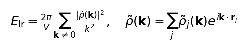
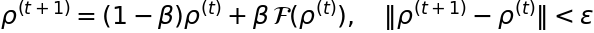

# Module 1 — Energy Model (PolarMACE)

**中文摘要：** PolarMACE 的总能量 = 短程 MACE 消息传递 + 学习型 GTO 电荷
密度的倒空间 Ewald 长程项；长程层是 SCF 不动点，力和反向都要对整条链求伴随。
RBE 是可行的随机估计量，但力误差比 1e-4 eV/Å 的硬门大 100–400 倍，因此不用于
生产。

This module defines the energy that every kernel is computing. It is the
contract behind the numerical gates: if a kernel change alters any term below,
it is not a valid optimization.

## 1.1 Total energy decomposition

\[
E = E_{\rm SR} + E_{\rm LR}, \qquad
\mathbf F_i = -\frac{\partial E}{\partial \mathbf R_i}.
\]

- \(E_{\rm SR}\): short-range MACE message passing inside the 6 Å cutoff.
- \(E_{\rm LR}\): long-range electrostatic energy from learned spin-charge
  densities, evaluated in reciprocal space with a GTO-Ewald kernel.

The split is not a physical approximation added by the engine: it is the
PolarMACE model definition. The engine implements the same terms as the
PyTorch reference; the end-to-end gate compares the two directly.

## 1.2 Short-range MACE (per interaction)

For atom \(i\) with hidden state \(h_i^{(\ell)}\),

\[
h_i^{(\ell+1)} = \sum_{j\in\mathcal N(i)}
R^{(\ell)}(r_{ij})\,Y(\hat{\mathbf r}_{ij})\,W^{(\ell)} h_j^{(\ell)},
\]

followed by the linear/skip path and the tensor product. \(Y\) are spherical
harmonics, \(R\) is the radial spline, and \(W\) are the learned weights. The
readout maps the final hidden state to the per-atom energy contribution.

In the engine the per-output accumulation order is part of the numerical
contract: the scalar path and the packed GEMM path must agree to the gate
tolerance. Round 2 uses FP64 and bitwise-neutral kernel rewrites wherever
possible.

## 1.3 Learned GTO density and reciprocal-space energy

Each atom contributes a Gaussian-type orbital density
\(\rho_i(\mathbf r-\mathbf R_i)\). The reciprocal-space density is

\[
\tilde\rho(\mathbf k)=\sum_i \tilde\rho_i(\mathbf k)\,e^{i\mathbf k\cdot\mathbf R_i}.
\]

The long-range energy is the Ewald reciprocal sum with the GTO form factor
already inside \(\tilde\rho_i\) (no separate erfc split is needed):

\[
\boxed{
E_{\rm LR}=\frac{2\pi}{V}\sum_{\mathbf k\neq 0}
\frac{|\tilde\rho(\mathbf k)|^2}{k^2},
\qquad
\tilde\rho(\mathbf k)=\sum_i \tilde\rho_i(\mathbf k)\,
e^{i\mathbf k\cdot\mathbf R_i}
}
\]

- The Gaussian damping \(e^{-k^2\sigma^2/2}\) is **inside** the GTO form
  factor \(\tilde\rho_i(\mathbf k)\). Do not apply it a second time outside;
  the formula above is the standard Ewald reciprocal sum with the GTO form
  factor already included (no erfc split).
- The \(k=0\) term is excluded; the self/real-space contribution is handled by
  the GTO basis and the model's charge/spin constraints.
- The engine precomputes the half-space k-grid, the GTO geometry, and the
  cos/sin tables; the per-eval work is the structure-factor accumulation and
  the \(|\tilde\rho|^2/k^2\) reduction.
- Forces are obtained by reverse-mode differentiation of exactly this
  expression; the adjoint chain is documented in
  `../design/POLAR_REVERSE_DESIGN.md`.

### Why the k-space slice is not the whole story

At 128 atoms the full-k Coulomb stage is a small fraction of the eval. The
dominant cost is the nonlinear backbone and the polar non-k kernels (UVU,
replay, embedding, MLP reverse). This is why the kernel rounds target kernel
shape first and do not start from the Ewald stage.

## 1.4 Self-consistent charge/spin densities

The long-range layer is a fixed point: the learned densities depend on the
local environment, and the electrostatic potential feeds back into the update.
The engine iterates

\[
\boxed{
\rho^{(t+1)}=(1-\beta)\rho^{(t)}+\beta\,\mathcal F\!\left(\rho^{(t)}\right),
\qquad
\|\rho^{(t+1)}-\rho^{(t)}\|<\epsilon
}
\]

where \(\mathcal F\) is the Fukui-balanced update block and \(\beta\) is the
mixing factor. The gate compares each SCF step (module 5/7), not just the final
energy. A kernel rewrite that changes the update order must be re-gated.

Forces require the adjoint of the whole fixed-point chain: the readout seeds
the final adjoint, each layer's adjoint is accumulated (not overwritten), and
the polar chain writes the node/cell adjoints. The reverse design doc records
the exact overwrite-vs-accumulate contract.

## 1.5 Random Batch Ewald (RBE): estimator and why it is rejected

RBE replaces the full k-sum by a stochastic batch. With a sampling distribution
\(q(\mathbf k)=e^{-k^2\sigma_q^2/2}/Z_q\), the unbiased estimator is

\[
\hat E_{\rm LR}=
\frac{2\pi}{V}\frac{1}{P}\sum_{b=1}^{P}\frac{1}{q_b}
\sum_{\mathbf k\in S_b}
\frac{|\tilde\rho(\mathbf k)|^2}{k^2}
e^{-k^2\sigma_q^2/2}.
\]

The implementation is bitwise reproducible at a fixed seed and shows the
expected \(1/\sqrt{P}\) error slope (−0.499). But the force RMS is
\(4.1\times10^{-2}\) to \(1.0\times10^{-2}\) eV/Å for \(p=50\ldots800\),
which is 100–400× the \(10^{-4}\) eV/Å force gate. RBE is therefore **not** a
production option; the gate is the hard minimum, not a preference.

## 1.6 What “no invalid computation” means here

- Every accepted kernel keeps all terms above and FP64.
- Removing a term, dropping a correction, or changing precision is not an
  optimization; it is a different model and fails the end-to-end gates.
- The only accepted approximations are those that are exactly neutral on the
  gate (e.g., reordering a reduction with a proven bitwise result).
