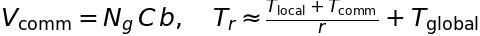

# Module 4 — MPI, Ghost Atoms, and the H1 Feature Exchange

This module explains the multi-rank design, the exactness condition, and the
measured one-GPU behaviour. It also records the 1042-ghost diagnosis that
dominates the current H1 overhead.

## 4.1 Domain decomposition vocabulary

| Term | Meaning |
|---|---|
| rank | one MPI process; it owns a subset of atoms |
| local atom | owned by this rank; its energy/force is counted here |
| ghost atom | a periodic or remote copy needed as a **source** for local edges |
| \(N_l\) | number of local atoms |
| \(N_g\) | number of ghost atoms |
| ghost ratio | \(g=N_g/N_l\) |
| H1 | the first-interaction hidden node state that is exchanged between ranks |
| exact 2-hop | each rank builds the full local+ghost graph, including ghosts' own neighbours; numerically exact, expensive |
| 1-hop | only first-hop ghosts are supplied; **approximate**, rejected by the force gate |

The production single-rank path uses no ghosts and no message passing. The
multi-rank path must supply, for every local receiver, the features of every
source within \(r_c\), including sources owned by other ranks.

## 4.2 The H1 exchange

A naive exact multi-rank evaluation builds a 2-hop ghost graph: every rank
needs the neighbours of its ghosts to compute the ghosts' messages. That is
correct but the ghost graph is much larger than the local graph.

The H1 scheme avoids the second hop by exchanging the first-interaction hidden
state:

1. each rank computes layer 0 for its local atoms;
2. **forward exchange:** send \(H_1\in\mathbb R^{N\times C}\) for the ghost
   rows (from the owner to every rank that has that atom as a ghost);
3. layer 1 uses local receivers + ghost **sources** with the exchanged \(H_1\);
4. **reverse exchange:** after the layer-1 adjoint, sum
   \(\bar H_1\in\mathbb R^{N\times C}\) from ghost copies back to the owner;
5. readout and polar seeds are masked on ghosts, so a ghost's energy
   derivative is not double-counted.


The exchange is exact for the same reason the 2-hop graph is exact: the ghost
row is exactly the owner-computed \(H_1\), and the owner receives the summed
adjoint. The numerical gate (dE 2.91e-11 eV, max dF 1.41e-15 eV/Å) confirms it.

## 4.3 Communication volume

Per exchange,

\[
\boxed{
V_{\rm comm}=N_g\,C\,b,\qquad b=8\ \text{bytes (FP64)}
}
\]



For the 128-atom NH3 box, the 1-rank H1 diagnostic reported
\(N_g=1042\), \(C=512\):

\[
V_{\rm comm}=1042\times512\times8\approx4.27\ \text{MB per exchange}.
\]

With two forward and two reverse exchanges per eval, the total is ~17 MB. At a
conservative 10 GB/s host/PCIe path this is ~1.7 ms — **not** the 700+ ms
overhead observed. The overhead is dominated by **computing the model on the
ghost-inflated node set**, not by the bytes moved.

## 4.4 The 1042-ghost diagnosis (1 rank)

The H1 1-rank timing input deliberately keeps the H1 mode on one rank to test
the plumbing. The diagnostic log reports:

```
Nlocal:  128
Nghost:  1042
```

So the model runs on \(N=1170\) nodes instead of 128, a factor

\[
\frac{N}{N_l}=\frac{1170}{128}=9.14.
\]

The edge-based stages still only use local receivers, but node-based stages
(embedding, linear-up, products, readout, polar) scale with \(N\). The observed
1-rank H1 slowdown is **4.87×** (894.6 ms vs 183.6 ms), consistent with a
node-heavy, not edge-heavy, inflation.

**Cause:** the H1 mode sets the LAMMPS communication cutoff to
\(r_c+\text{skin}=6+2=8\) Å. The 14.7 Å box has a half-length of 7.37 Å, so
LAMMPS creates periodic ghost images even on one rank. The correct 1-rank path
should either use the production local graph or set the comm cutoff to
\(r_c=6\) Å (< 7.37 Å) and bypass the H1 callbacks.

**First fix attempt (2026-10-19):** skipping the cutoff extension alone gave
the wrong energy (dE 756.6 eV, max dF 2.79e4 eV/Å); the 2-rank path aborted
(rc=11); the exact 2-hop control hit a GPU OOM while another agent was using
the card. The fix is **not accepted**; it is being reworked. See
[`../results/MPI_H1.md`](../results/MPI_H1.md).

## 4.5 One GPU with multiple ranks vs one GPU per rank

Let \(W_l\) be the local work and \(W_g\) the ghost work per rank. On **one**
GPU with \(r\) ranks, the GPU time-slices the same SMs:

\[
T_{1\rm GPU}(r)\approx r\,(W_l+W_g)+W_{\rm comm}.
\]

On **\(r\)** GPUs, each rank gets its own SMs:

\[
T_{r\rm GPU}(r)\approx \max_{\rm rank}(W_l+W_g)+W_{\rm comm}
+W_{\rm global},
\]

where \(W_{\rm global}\) is the global reduction (polar k-space, SCF
allreduce). The speedup over one GPU is therefore approximately

\[
S_{r\rm GPU}\approx
\frac{r\,W_l}{W_l+W_g+W_{\rm comm}+W_{\rm global}}.
\]

This is why:

- **one GPU, two ranks is slower**, even with a perfect MPI implementation —
  the same SMs are shared and the ghost work is duplicated;
- **two GPUs, one rank each** can be faster, but the gain is reduced by
  \(W_g\) and communication;
- the ghost ratio \(g=N_g/N_l\) is large for a 14.7 Å box and shrinks as the box
  grows. The 128-atom case is the worst case for domain decomposition; 432 and
  1024 atoms are the meaningful scaling targets.

## 4.6 Comparison with the upstream linear engine

| Metric | Upstream linear MACE-OFF23 | PolarMACE (pre-round-2) |
|---|---:|---:|
| materialized 1-rank | 6.6 ms | 183.6 ms |
| H1 1-rank | 13.586 ms | **894.6 ms** |
| H1 1-rank / materialized | 2.06× | **4.87×** |
| H1 2-rank (one GPU) | 45.878 ms | 1600.5 ms |
| H1 2-rank / H1 1-rank | 3.38× | **1.79×** |
| H1 2-rank / materialized | 6.95× | 8.72× |

The last-but-one row is the key: **our 2-rank ghost/communication scaling is
actually better than the mature linear engine's** (1.79× vs 3.38×). The 8.7×
headline is dominated by the H1 1-rank baseline (4.87× vs 2.06×), i.e. the
1042-ghost problem, not by the 2-rank exchange.

## 4.7 What to measure next

1. On the fixed 1-rank path, H1 1-rank should approach the production 1-rank.
2. On 2 GPUs (one rank per GPU), measure wall vs 1 GPU on 432 and 1024 atoms;
   the expected speedup is below \(r\) because of \(W_g\) and \(W_{\rm comm}\).
3. On 4 GPUs, repeat; watch \(W_{\rm global}\) (polar allreduce) and load
   imbalance.
4. Keep the force gate as the hard acceptance criterion; 1-hop remains
   rejected.

## 4.8 Operational constraint

The A100 has 108 SMs and 80 GB. The 80 GB is **capacity**, not compute: it lets
several ranks, models, and ghost workspaces fit, but it does not add SMs or
memory bandwidth. Multi-rank on one GPU is a correctness/portability test; a
single-simulation speedup requires multiple GPUs, one rank per GPU.
