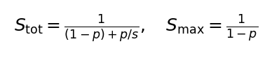
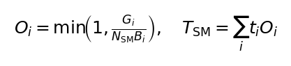

# Module 3 — Performance Model and Occupancy

**中文摘要：** “GPU busy”只说明有 kernel 在跑，“SM 覆盖”才说明用了多少
计算单元；两者必须分开报。Amdahl 解释为什么单个 kernel 快 12×、整模型只快
1.5×。所有 occupancy 数字都是静态估计（本容器没有 ncu 硬件计数器权限），
不能当成实测 achieved occupancy。

This module defines exactly what “speedup”, “GPU busy”, and “SM coverage” mean
in this project. It is the shared vocabulary for every result table.

## 3.1 Speedup and saved time

For a baseline time \(T_0\) and an optimized time \(T\),

\[
S=\frac{T_0}{T},\qquad \Delta T=T_0-T.
\]

A speedup is only reported for the **same model, same system, same precision,
same gate status**, and an interleaved A/B under the same GPU lock.

## 3.2 Amdahl's law — why 12× on a kernel can be 1.5× end-to-end

If a fraction \(p\) of the baseline time is optimized by a factor \(s\),

\[
\boxed{
S_{\rm tot}=\frac{1}{(1-p)+p/s},
\qquad
S_{\rm max}=\frac{1}{1-p}
}
\]

Example from round 1 (128-atom NH3):

- \(T_0=183.5\) ms, e3 linear \(=67.48\) ms → \(p=0.368\);
- kernel speedup \(s=12.07\);
- theoretical ceiling \(S_{\rm max}=1/(1-0.368)=1.58\);
- measured \(S=1.50\), i.e. **95% of the ceiling**.

This is why “the kernel is 12× faster” and “the model is 1.5× faster” are both
true at the same time. The remaining 114 ms was outside the e3 kernel and is
the target of the next rounds.

## 3.3 GPU busy vs SM coverage

Two different questions:

1. **Is the GPU executing kernels?**
   \[
   f_{\rm busy}=\frac{T_{\rm busy}}{T_{\rm wall}},\qquad
   T_{\rm busy}=\sum_i t_i.
   \]
   Round 2: \(49.97/56.50=88.4\%\).
2. **Are the kernels using all SMs?**
   For kernel \(i\) with \(G_i\) grid blocks and \(B_i\) resident blocks per SM
   (from registers/shared memory/threads), the static coverage is
   \[
   \boxed{
   O_i=\min\!\left(1,\frac{G_i}{N_{\rm SM}B_i}\right),
   \qquad
   T_{\rm SM}=\sum_i t_iO_i
   }
   \]
   

   Round 2: \(T_{\rm SM}\approx22.93\) ms, so
   \[
   f_{\rm SM}=22.93/56.50=40.6\%.
   \]

A GPU can be **busy 88%** and **only 41% SM-covered**: the kernels are running,
but many of them occupy one or a few SMs. This is the “串行 / 不够跑” phenomenon.

### Static, not measured

`O_i` is computed from the launch geometry and static register/shared-memory
usage. The container has no `ncu` payload and the host driver has
`RmProfilingAdminOnly: 1`, so hardware-counter measurements (achieved
occupancy, DRAM %, SM %) are unavailable. `O_i` is therefore an **upper-bound
estimate of coverage**, not a measured achieved occupancy. All statements in
this repository are phrased accordingly.

## 3.4 Top low-coverage kernels after round 2

| Kernel | ms/eval | grid | static coverage |
|---|---:|---|---:|
| `cuBLAS/external` (312 launches) | 3.80 | 64×1×1 | 14.8% |
| `polar reverse uvu mode0 x2` | 3.55 | 256×1×1 | 39.5% |
| `polar reverse uvu mode0 x1` | 3.21 | 256×1×1 | 39.5% |
| `affine fused reverse layer norm silu` | 1.54 | 37×1×1 | 3.4% |
| `reverse convolution cutoff` | 1.53 | 37×1×1 | 2.9% |
| `affine fused layer norm silu` | 1.26 | 37×1×1 | 3.4% |

The tensor-product and gather kernels are already at 100% coverage. The
remaining waste is in these narrow launches plus the 312 tiny cuBLAS calls.

## 3.5 Launch overhead

For \(N_{\rm launch}\) kernels with average launch cost \(\tau\),

\[
T_{\rm launch}\approx N_{\rm launch}\tau,\qquad \tau\approx5\text{–}10\ \mu s.
\]

Round 2 still has 1194 launches (882 Kokkos). 312 are cuBLAS, 294 are e3
linear pack/unpack. The pack/unpack pair alone costs 1.76 ms. Fusing them into
the GEMM epilogue and batching the small GEMMs are straightforward next steps.
CUDA Graph capture is a later option: it does not widen an individual kernel,
but it removes launch gaps and CPU-side serialization.

## 3.6 Roofline (conceptual)

For a kernel with arithmetic intensity \(I=\text{FLOPs}/\text{bytes}\),

\[
P=\min\left(P_{\rm peak},\,I\cdot B_{\rm mem}\right).
\]

- e3 linear was latency-bound (low \(I\), strided loads), not FLOP-bound.
- The tensor products are compute-bound (100% coverage, regular FP64).
- UVU small dots are latency-bound; widening the grid is the fix.
- Hardware counters are unavailable, so the roofline is used qualitatively,
  not as a measured plot.

## 3.7 What “make it full” means operationally

1. **Remove work first** (replay, ghost redundancy, duplicate passes). This is
   the only way to reduce \(T_{\rm busy}\), not just redistribute it.
2. **Widen the grid** so \(G_i\ge N_{\rm SM}B_i\): 2-D/3-D MDRange,
   TeamPolicy, edge-level parallelism.
3. **Fuse dependent kernels** to reduce serial boundaries and launches.
4. **Batch small GEMMs** into grouped/batched calls.
5. **Use FP64 tensor cores** where the contraction is regular (next round).
6. **Do not** use FP32/TF32, drop terms, or add redundant ghost work just to
   raise occupancy.

**Occupancy is a means, not the goal.** A 40%-covered kernel that does half the
work can beat a 100%-covered kernel doing redundant work. The scoreboard is
wall time at a fixed gate, not occupancy alone.

## 3.8 Round-2 outcome in this language

| Quantity | Before | Round 2 |
|---|---:|---:|
| \(T_{\rm wall}\) | 122.46 ms | **56.50 ms** |
| \(T_{\rm busy}\) | 116.66 ms | **49.97 ms** |
| \(f_{\rm busy}\) | 95.3% | 88.4% |
| \(T_{\rm SM}\) | 31.40 ms | **22.93 ms** |
| \(f_{\rm SM}\) | 25.6% | **40.6%** |
| launches | ~1194 | ~1194 |

The absolute SM-weighted busy time fell, and the relative coverage rose from
~23% to ~41% because \(T_{\rm wall}\) shrank faster than \(T_{\rm SM}\). The
remaining 22.9 ms of SM-weighted work is the next frontier: tensor products
(10.8 ms, already 100% covered), UVU reverse (6.8 ms, 39.5%), cuBLAS (3.8 ms,
14.8%), and narrow affine/convolution kernels (4.3 ms, 3%).
