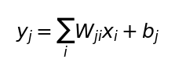
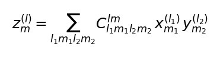

# Module 2 — Tensor Algebra: e3nn Linear, Tensor Product, UVU

**中文摘要：** e3nn linear 是逐样本矩阵乘，tensor product 是带 CG 系数的
不可约表示耦合，UVU 是引擎预先分解的等变收缩实现。老 UVU 是“一节点一线程”，
只有 128 个线程、一个 block；round 2 改成 `(node, u)` 二维并行 + shared-memory
权重 tile，并保持每个输出的累加顺序，因此数值上 bitwise 不变。

This module explains the kernels that dominate the GPU time. The formulas are
the mathematical contract; the implementation notes explain why the old kernel
shapes were slow and what changed in the kernel rounds.

## 2.1 e3nn linear (per sample)

For a sample with input vector \(x\in\mathbb R^{d_{\rm in}}\) and output
\(y\in\mathbb R^{d_{\rm out}}\),

\[
\boxed{y_j=\sum_{i=0}^{d_{\rm in}-1} W_{ji}x_i+b_j}
\]

The operation is a batched matrix multiply over samples. The original CUDA
scalar kernel assigned one thread per output and looped over `source`, which
made adjacent lanes read the weight matrix with a large stride and re-read it
per sample. The measured throughput was a few percent of FP64 peak.

**Round 1 fix:** route the same layers through the existing packed
`KokkosBlas::gemm` path (cuBLAS FP64 DMMA). The math is unchanged; the
summation order changes inside cuBLAS. Forward + reverse kernel time dropped
from 67.48 ms to 5.59 ms (12.07×), and the packed path was admitted only after
the full gate suite passed. The scalar, bitwise path remains available with
`MATOS_E3_LINEAR_CUDA_BACKEND=scalar`.

## 2.2 Tensor product

For irreps \(x^{(l_1)}\), \(y^{(l_2)}\), the coupled product is

\[
\boxed{
z^{(l)}_m=\sum_{l_1m_1l_2m_2}
C^{lm}_{l_1m_1l_2m_2}\,
x^{(l_1)}_{m_1}\,y^{(l_2)}_{m_2}
}
\]

where \(C\) are Clebsch–Gordan coefficients. The product is the expensive
regular FP64 contraction in the model. The engine's “MH-1 fused” kernels run at
100% SM coverage (for the 128-atom case) but are **instruction/store-bound**,
not compute-bound: measured 0.12–0.25 TFLOP/s, 5–12x below the DMMA ridge
because each output has only 1–21 nonzero Wigner entries. They are the target
of the round-3 channel-blocking plan, not of the UVU fixes.

## 2.3 UVU factorization

The engine writes the edge tensor product in the precomputed \(U\)-basis:

\[
\boxed{
z^{(l)}=U^{(l)}\left(\sum_{l_1,l_2}V^{(l)}_{l_1l_2}
\left(x^{(l_1)}\otimes y^{(l_2)}\right)\right)
}
\]

The point of UVU is to replace repeated CG evaluation by a precomputed
change-of-basis \(U\) and learned/weighted \(V\), so the per-edge work is a
small dense contraction. The exact coefficient layout is model-specific; the
numerical contract is the same tensor product above.

### Why the original UVU kernels were slow

The original forward, reverse, and replay UVU kernels used **one GPU thread per
node** with an internal loop over the full channel block. For 128 atoms that is
128 threads — one block — while the A100 has 108 SMs. The kernel was
latency-bound on a single SM.

**Round 2 fix:** rewrite the four sites (forward SCF, forward local-electron,
reverse, replay) as `(node, u)` 2-D kernels with a shared-memory weight tile
(4×`mul` weights, padded stride, ~16 KB per team) and hoist the `mixed_bar`
computation out of the inner loop. The per-output accumulation order is kept
ascending, so the result is bitwise-neutral on the gate model.

## 2.4 Fused gate normalization

The nonlinear block applies a gate and a normalization:

\[
h_i = g_i \odot \frac{x_i-\mu_i}{\sqrt{\sigma_i^2+\epsilon}},
\qquad
\mu_i=\frac{1}{K}\sum_k x_{ik},
\quad
\sigma_i^2=\frac{1}{K}\sum_k(x_{ik}-\mu_i)^2.
\]

The original reverse computed the two passes serially in a single 128-thread
block. Round 2:

- the `linear_adj` write is a 2-D MDRange over `(node, pre_gate_width)`;
- the density adjoint is folded by one thread per node in the original
  ascending order (bitwise-identical FP64 reduction);
- the fused path (`mh1 fused reverse gate normalization`) is used by default;
  `MATOS_RN_BACKEND=scalar` / `MATOS_FUSED_GATE_REVERSE=0` restores the
  fallback.

Measured: `reverse nonlinear normalization` 13.03 → 0.00 ms (fused path 0.17 ms).

## 2.5 Kernel-shape rules used in the rounds

1. **One thread per output is not enough.** For a 128-atom model, the node
   dimension is only 128; the channel/angular dimensions must be part of the
   grid.
2. **Prefer MDRange over (node, feature) or TeamPolicy over nodes** when the
   inner loop is a small dot product.
3. **One writer per output slot.** Avoid atomics when each `(node, i)` has a
   unique writer; atomics were pure overhead in the old dense reverse.
4. **Keep the accumulation order** when the gate is bitwise; if a packed GEMM
   reorders, gate it and record the tolerance.
5. **Fuse x1/x2 passes over the same operands.** They were two launches over the
   same data; the round-2 UVU reverse fuses/handles them in one team kernel.
