# 导读：先知道这份文档要回答什么

本教程面向需要阅读、讲解和继续开发 Symmetrix-Polar 的读者。默认读者知道原子、能量和分子动力学的基本含义，但不要求预先掌握等变神经网络、Ewald 求和或 GPU 编程。正文沿着一条线展开：**原子坐标怎样变成能量和力，PolarMACE 为什么加入全局电荷信息，GPU 为什么会慢，我们的改动到底省掉了哪些工作。**

MACE、PolarMACE、Symmetrix-XL 和 Symmetrix-Polar 不是四个可以互换的名字。MACE 是模型架构；MACE-POLAR-1 是加入极化和长程静电的模型；Symmetrix-XL 是执行已经训练好的 MACE 模型的推理引擎；本仓库 Symmetrix-Polar 是对相应 C++/Kokkos 引擎的扩展和优化工作。模型规定“计算什么”，引擎决定“按什么顺序、在哪块内存、由哪些线程计算”。[P1，§2–5；P2，§II]

## 阅读路线

| 专题 | 要回答的问题 | 读完应能说明 |
|---|---|---|
| 一：从原子到能量 | 神经网络势输入、输出是什么？ | 能量、力、邻居图、训练与推理 |
| 二：MACE 的几何语言 | 等变、通道、角动量、多体分别指什么？ | 不把阶数、层数、维数与代数混为一谈 |
| 三：PolarMACE 的全局响应 | 电荷密度、极化、Fukui、Ewald 如何连接？ | 为什么两个更新层不等于 SCF 收敛 |
| 四：Symmetrix-XL 的执行方法 | streaming、specialization、tiling 为什么省内存？ | 公式不变时仍可改执行顺序 |
| 五：GPU 基础 | 有 GPU 为什么仍可能慢？ | 线程、warp、合并访存、算子启动与复用 |
| 六：本项目的优化 | 每项改动究竟改了什么？ | 用数据解释收益，并识别不成立的比较 |
| 七：正确性 | “与参考一致”证明到什么程度？ | 单点、重复评估、轨迹与物理精度各自的边界 |
| 八：结果与下一步 | 现在多快、还缺什么？ | 准确汇报现状，安排下一轮实验 |

性能统一采用 **µs/atom/step**，即一次完整能量与力评估的耗时除以原子数。数值越小，单位原子的计算开销越低。这个归一化量仍受原子数、邻居密度、模型、精度和执行边界影响；不同体系的数值不能直接当成软件优劣排名。

## 本版的证据边界

本版重新读取了仓库中的 JSON、技术记录和两篇原论文，重算归一化数值、重画图表并修订解释，**没有重新运行 GPU benchmark**。因此文中的“实测”表示仓库已有历史测量，不表示本次编写时在新硬件上复测。模型与原实现的一致性也不能替代模型对 DFT 或实验的准确性验证。

最重要的两个结果分开记忆：

1. **128 原子 NH₃ 分支**：Plan B-30ms 为 **238.7 µs/atom/step**，对应所记录 PyTorch 参考的 **734.4 µs/atom/step**，历史参考比值约 3.08。这一分支有明确的最终二进制与重复评估记录。[D1]
2. **1,296 原子 H₂O 分支**：最终候选的全部轮次中位数为 **224.4 µs/atom/step**；事后选出的两轮稳定轮中位数为 **224.1 µs/atom/step**。两种统计均保留。相对历史起点约少 51.6% 耗时，但不是同场端点 A/B，也不是独占 GPU 上的最终生产资格测试。[D2–D4]

**汇报时可这样说：**“我们在保留所测试 PolarMACE 计算结果的前提下，改写了 GPU 执行。128 原子分支相对已有 PyTorch 参考约快 3 倍；1,296 原子的历史工程链把耗时降低约一半。后者仍需独占 GPU 和最终版本的完整复验。”

# 专题一：从原子坐标到能量和力

## 1.1 一个神经网络势到底接收什么

考虑一个装有水分子的周期性盒子。每个原子有元素种类和三维坐标；盒子的三条边及周期性条件决定哪些周期镜像需要参与计算。普通局部势主要接收元素与几何；PolarMACE 还需要体系电荷、自旋状态等电子状态信息。原子坐标相同，并不意味着不同电子数的体系能量相同。

| 输入 | 处理 | 输出 |
|---|---|---|
| 元素、坐标、晶胞、边界条件 | 建立邻居图，计算几何特征与网络特征 | 总势能 |
| 总电荷、自旋等模型支持的信息 | 选择电子状态并约束密度 | 状态相关的能量与响应 |
| 总势能对坐标、晶胞的导数 | 按完整计算链求导 | 力以及相应的应力 |

记模型参数为 $\theta$，原子坐标集合为 $\mathbf R$，元素集合为 $\mathbf Z$，总电荷为 $Q$，电子自旋状态记号为 $S$。模型可抽象写成

$$
E_\theta=E_\theta(\mathbf R,\mathbf Z,Q,S).
$$

这里的 $\theta$ 是训练后固定的权重；$\mathbf R$ 在 MD 中逐步变化。$Q,S$ 是否变化、怎样传入，取决于具体模拟协议和接口定义。不能把“模型接受电荷输入”理解成“引擎自动完成恒电势模拟”。

## 1.2 为什么力通常从能量求导

力决定原子下一刻向哪里运动。对原子 $i$，能量型势的力为

$$
\mathbf F_i=-\nabla_{\mathbf R_i}E_\theta.
$$

负号表示原子受到朝向势能降低方向的力。若一维示例为 $E(x)=kx^2/2$，则 $F(x)=-kx$。这只是解释导数的弹簧算例，不是 PolarMACE 的实际势能表达式。

对一个复杂模型，坐标先影响邻居距离，再影响网络特征、极化密度和能量。求力必须对这些依赖一起使用链式法则。只对最后的库仑公式求导、却把由坐标决定的密度当作常量，通常会漏掉力的贡献。MD 还需要速度、质量、时间积分和温控等步骤；模型的一次评估不是全部模拟流程。

## 1.3 邻居图、截断与感受范围

把原子画成节点，把截断距离内的相互作用记录为有向边，就得到邻居图。边 $j\to i$ 表示原子 $j$ 向原子 $i$ 提供信息；它是计算关系，不等于化学键。两原子即使没有形成共价键，也可能在邻居图里相连。

若 $r_{ij}<r_c$，通常将 $j$ 加入 $i$ 的邻居表。实现还可能保留一层 skin：先建稍大的表，在原子移动较小时复用，避免每步重建。**模型截断 $r_c$ 与邻居表半径 $r_c+\mathrm{skin}$ 不同**；skin 内的额外边不应改变定义好的势能。

一层消息传递只读一跳邻居；多层可沿图传播更远。$T r_c$ 可以作为有限层传播范围的粗略上界，但不代表所有这个半径内的几何都以同样方式参与。层数有限时，信息范围仍有限；显式全局静电则提供另一条信息通道。[P1，§2；P2，§II]

## 1.4 训练与推理，不是同一项工作

训练用 DFT 等参考数据调整 $\theta$；推理在固定 $\theta$ 后，对新的结构算能量和力。本项目主要优化推理执行，不是训练一个新的基础模型，也不是把 PolarMACE 蒸馏成小模型。

有三种不同的准确性问题：训练模型能否预测参考物理；模型能否泛化到目标体系；本引擎是否忠实执行该模型。本仓库的许多数值门主要回答第三项。即使引擎与 PyTorch 差到机器舍入量级，也不能据此宣称目标反应势垒已经达到 DFT 精度。

**本专题检查点。** 能解释一个水盒子怎样产生能量和力；知道邻居边不是化学键；知道“保持权重不变的加速”与“重新训练更小模型”是不同路线。

# 专题二：MACE 用什么语言表示三维几何

## 2.1 不变性与等变性：转动体系后，什么应该变化

把整个结构刚性转动，内部距离与夹角不变，总势能应该不变；力是空间向量，应跟着转动。对旋转矩阵 $\mathbf R_{\mathrm{rot}}$，

$$
E(\mathbf R_{\mathrm{rot}}\mathbf R)=E(\mathbf R),\qquad
\mathbf F_i(\mathbf R_{\mathrm{rot}}\mathbf R)
=\mathbf R_{\mathrm{rot}}\mathbf F_i(\mathbf R).
$$

第一条叫旋转不变，第二条叫旋转等变。**等变不是“不允许变化”，而是“按规定的方式变化”。** 例如绕 $z$ 轴转 $90^\circ$，向量 $(1,0,0)$ 应变成 $(0,1,0)$，向量长度仍为 1。MACE 在内部也使用遵守这些变换规律的特征。[P1，§2；P3]

相同元素原子的编号互换不应改变总能量；整体平移也不应改变孤立体系的内部能量。这些对称性帮助网络把学习能力用于实际化学差别，而不是重复学习坐标系的任意选择。

## 2.2 $l$、$m$、channel 和 parity 分别是什么

可以把等变特征理解成“按旋转规律分好类的多组数”。旋转角动量阶数 $l$ 对应每组的 $2l+1$ 个几何分量；$m$ 标识这组内部的分量；channel 表示同一种变换类型有多少组可学习特征。

$$
\mathbf h_i^{(l,p)}\in\mathbb R^{C_{l,p}\times(2l+1)}.
$$

这里 $i$ 是原子，$C_{l,p}$ 是通道数，$p$ 是空间反演的奇偶性。对完整 $O(3)$ 表示，需要同时指定 $l$ 和 $p$。$l=1$ 本身只说明旋转类型；通常的极向量是 1o，轴向量可以是 1e，不能把所有 $l=1$ 一律叫 1o。

| 例子 | 单组分量数 | 直观理解 |
|---|---:|---|
| 0e | 1 | 旋转与反演下不变的标量 |
| 1o | 3 | 像位移或力那样变换的极向量 |
| 2e | 5 | 对称无迹二阶张量的独立分量 |
| 3o | 7 | 更高阶的方向信息 |

**算例。** “512x0e + 512x1o”共有 $512\times1+512\times3=2048$ 个标量存储位置。如果另一处张量为“512x0e + 512x1o + 512x2e + 512x3o”，其大小是 $512(1+3+5+7)=8192$。这两个张量出现在不同运算阶段，不能据此把整个模型的每一层都写成 8192 维。

这里没有增加新的空间维度。原子仍在三维空间中；8192 是某个特征数组的宽度。它也不是“第几代神经网络”的代数。

## 2.3 张量积：把两种方向信息组合成新的特征

两个等变对象相乘后，需要把结果重新分解到允许的旋转类型。Clebsch–Gordan 系数给出这种组合的固定几何规则。一个便于阅读的示意式是

$$
y_{c,lm}=
\sum_{\pi,m_1,m_2}
w_{\pi c}\,
C^{lm}_{l_1m_1,l_2m_2}\,
x_{c,l_1m_1}\,z_{l_2m_2}.
$$

$C$ 是固定耦合系数；$w$ 是具体模型中的学习权重或由网络生成的权重；$\pi$ 区分允许的耦合路径。允许的旋转阶数满足 $|l_1-l_2|\le l\le l_1+l_2$，反演奇偶性需满足相应的乘积规则。

点积与叉积是熟悉的低阶例子：两个向量的点积给出标量，叉积给出轴向量。实际 MACE 的通道混合、路径权重和乘积基更丰富，不能把全部张量积缩成一次普通矩阵乘法。[P1，§2–4；P3]

**为什么这会成为热点？** 对很多原子、边和通道反复执行稀疏耦合时，固定的小系数表会被重复读取，相同局部收缩可能重复计算。优化可以利用这些固定规律，但不能删掉训练模型要求的耦合路径。

## 2.4 多体阶数、消息层数与代际：三条不同的轴

多体阶数描述原子环境中同时耦合了多少个粒子的几何信息。例如单个原子对的距离是二体信息，中心原子与两个邻居形成的角度是三体信息。MACE 利用乘积基高效构造更高体阶消息，不需要显式枚举每一种邻居元组。[P3]

消息层数描述信息经过多少轮图更新；$l_{\max}$ 描述保留到多高阶的方向表示；2G/3G/4G 则是另一种按局域性、长程作用和全局电子响应划分势模型的方法。

| 名称 | 真正在问什么 | 不能据此推断 |
|---|---|---|
| $l_{\max}$ | 方向表示保留到几阶？ | 模型属于第几代 |
| channel 数 | 同类型特征有多少组？ | 电子数或空间维数 |
| body order | 同时耦合多少粒子的几何？ | 信息一定传得更远 |
| interaction 层数 | 信息经过多少轮图更新？ | 自动具备无限程响应 |
| 代际分类 | 是否处理全局电子状态与非局域响应？ | 精度或速度必然更高 |

标准局部 MACE 可对应广义 2G 范畴；PolarMACE 具有全局电子响应，按能力可讨论为广义 4G。这个对应不是两篇论文给出的统一官方型号，也不意味着 PolarMACE 使用 RuNNer 的 QEq 实现。

## 2.5 “线性 MACE”为什么容易误导

旧报告用“线性路径”和“非线性 PolarMACE 路径”对照执行分支，这种工程简称不能直接变成物理定义。标准 MACE 同样有非线性和高体阶乘积；普通 MACE 的径向网络也可以给不同边生成不同权重。**不能说普通 MACE 的所有权重都固定、每条边都完全独立。**

本教程采用明确名称：“MACE-OFF23 的标准 streamed/direct 路径”与“本仓库当前支持的 MACE_Nonlinear/PolarMACE materialized 路径”。实际是否能融合、预计算或重排，要看具体算子的依赖，不只看最后 readout 是线性层还是 MLP。

# 专题三：PolarMACE 为什么需要全局电荷信息

## 3.1 极化、电荷转移与电荷态，不是一件事

**极化**是电荷分布在电场作用下重排。例如中性片段内一侧电子稍多、另一侧稍少，整体仍然中性。**片段间电荷转移**是按某种分区定义，两个片段的净电荷发生交换。**改变总电荷态**则是整个体系电子数改变，需要明确电子库或所研究的电荷态。

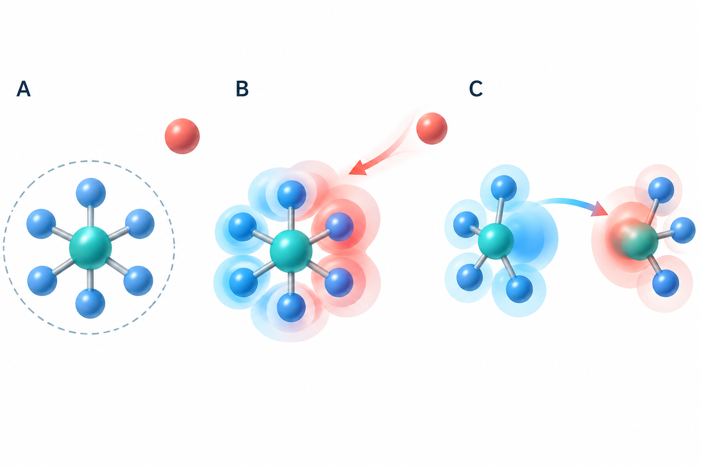

有限范围的几何网络可能无法区分“局部几何相同、远处环境不同”的两个结构。PolarMACE 先用局部 MACE 提取几何，再通过全局静电信息更新密度，使远处的影响能回到局部能量预测中。[P2，§II.B]

## 3.2 用原论文图看完整计算流程

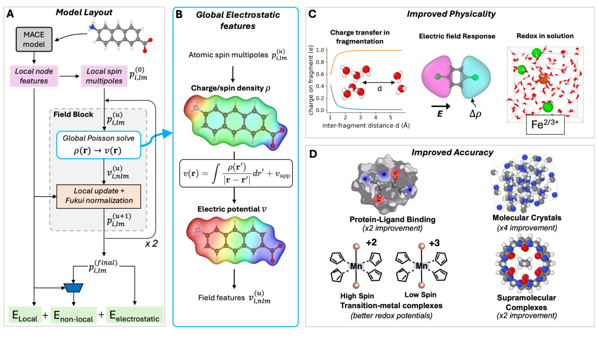

先看原图 A：原子结构进入局部 MACE，产生局部特征和初始 spin-charge multipoles；进入 Field Block 后，根据全局密度算静电势，再局部更新多极矩并进行 Fukui 归一化。这个块执行两次，最后计算能量。

再看 B：密度产生静电势，静电势投影回原子中心特征。重点是**从全体系出发、回到各原子**的信息通道，不是要求把每个原子的所有远邻都塞进原来的局部邻居表。

最后看 C、D：原论文用片段解离、外电场、氧化还原和非共价相互作用等任务说明模型作用。不能把这张图当成 Symmetrix-Polar 的新增 benchmark，也不能把原论文的所有应用精度自动转移到当前引擎版本。

## 3.3 总能量的三部分，以及“密度”到底是什么

遵循原论文式（1），

$$
E_{\mathrm{total}}=
E_{\mathrm{local}}+
E_{\mathrm{nonlocal}}+
E_{\mathrm{electrostatic}}.
$$

局部项学习近程化学环境的主要能量；静电项描述平滑电荷密度的长程库仑能；非局域学习项利用局部几何和全局电荷／场特征，补充单纯库仑项之外的能量贡献。[P2，§II.A、II.B.5–6]

这个分解不是可以任意相加的三个独立模型；它们是在同一学习框架中定义、协同拟合的。原文说明非局域学习项可承载包括色散在内的残余效应，**不能据此宣称它自动满足任意远距离的准确 $C_6/r^6$ 渐近式，或等于单独添加 D3/D4**。

原论文采用的是粗粒化残余电荷密度，形式上对应核正电荷与电子负电荷抵消后的平滑剩余。它不是 DFT 中带核尖峰和芯电子细节的完整电子密度，也不是对 Bader 电荷的唯一重建。

对自旋通道 $\sigma\in\{\uparrow,\downarrow\}$，

$$
\rho^\sigma(\mathbf r)=
\sum_{i,l,m}p^\sigma_{i,lm}\,
\phi_{lm}(\mathbf r-\mathbf R_i).
$$

$p$ 为原子中心多极系数，$\phi$ 为带球谐角向结构的 Gaussian 基函数。单极刻画净电荷，偶极刻画方向性分布；更高 $l$ 表示更细的方向结构。原论文中的自旋通道残余电荷是建模变量，不要把两通道都当成非负电子概率密度。[P2，式（2）–（10）]

## 3.4 全局静电势如何进入原子网络

无外场时，教学形式的库仑势为

$$
v^\sigma(\mathbf r)=
\int\frac{\rho^\sigma(\mathbf r')}{|\mathbf r-\mathbf r'|}
\,d\mathbf r'.
$$

远处密度也出现在积分里，因此它具有全局依赖。把 $v^\sigma$ 投影到原子中心基函数，得到网络能够使用的特征，

$$
v^\sigma_{i,nlm}=
\frac{1}{\mathcal N_{nl}}
\int\phi_{nlm}(\mathbf r-\mathbf R_i)
v^\sigma(\mathbf r)\,d\mathbf r.
$$

$n$ 标识径向基，$l,m$ 标识角向分量，$\mathcal N_{nl}$ 是规定的归一化。投影可以理解为：用一组固定“探针”测量原子附近电势的不同方向和尺度。本教程这两式省略外加电势；原论文对每个自旋残余电荷通道使用 $v_{\mathrm{app}}/2$。[P2，式（16）–（17）]

## 3.5 Fukui 平衡：按学习到的权重补足总电荷

网络初步给出的单极 $\widetilde q_i$ 未必恰好满足总电荷约束。Fukui 机制为每个原子学习一个响应权重，并把总量差额分配回去。忽略自旋分解的教学形式为

$$
w_i=\frac{f_i}{\sum_j f_j},\qquad
q_i=\widetilde q_i+
w_i\left(Q-\sum_j\widetilde q_j\right).
$$

只要分母定义良好，就有 $\sum_iw_i=1$，因此 $\sum_iq_i=Q$。这里 $f_i$ 的具体生成和数值稳定处理属于模型定义，不能由引擎随意替换。

**三原子算例。** 设初值为 $(0.10,-0.20,0.00)$，总目标 $Q=0$，归一化权重为 $(0.50,0.30,0.20)$。初值之和为 $-0.10$，还需补 $+0.10$，因此修正为 $(+0.05,+0.03,+0.02)$，最终得到 $(0.15,-0.17,0.02)$，和为 0。这个算例只展示归一化代数，没有指定真实分子的电荷。

实际模型有两个自旋通道，按原论文约定分别满足

$$
Q^\uparrow=\frac{Q+S}{2},\qquad
Q^\downarrow=\frac{Q-S}{2}.
$$

原论文此处 $S$ 是两残余电荷通道的归一化差，采用 $N_{\mathrm{el}}^\downarrow-N_{\mathrm{el}}^\uparrow$ 的约定。程序中的字段 spin 可能是多重度 $M$ 而不是这个 $S$；本仓库补丁记录了使用 $M-1$ 的转换。**比较接口前必须核对语义，不能把论文 $S$、物理自旋量子数和输入多重度直接互换。** 闭壳层通常用 $M=1$，相应通道差为 0。[P2，式（10）、（13）–（15）、（26）–（27）；仓库 polar 支持补丁]

Fukui 归一化提供总量约束，但只加这个约束并不保证模型已经正确描述任意长程电荷转移。PolarMACE 的全局响应还依靠前述电势特征更新；物理效果最终需要具体测试。

## 3.6 两次更新不等于“迭代到收敛”

用简写表示一个更新层：

$$
\widetilde{\mathbf p}^{(u+1)}
=\mathbf p^{(u)}
+\Delta_\theta^{(u)}
(\mathbf h,\mathbf p^{(u)},\mathbf v^{(u)}),
\qquad
\mathbf p^{(u+1)}
=\mathcal F_Q^{(u)}
(\widetilde{\mathbf p}^{(u+1)}).
$$

$\mathbf h$ 是局部几何特征，$\mathbf p$ 是多极系数，$\mathbf v$ 是由全局密度得到的场特征；$\mathcal F_Q$ 表示带电荷／自旋目标的 Fukui 修正。上标 $u$ 表明不同更新层可以有各自的学习参数。

MACE-POLAR-1 的原文是 **non-self-consistent field formalism**，当前模型执行两次学习型全局更新。它受 SCF 思想启发，但没有要求重复同一映射直到 $\|\mathbf p^{(u+1)}-\mathbf p^{(u)}\|$ 小于收敛阈值。[P2，§II.B.4、II.B.7]

因此仓库旧文中的“SCF”在本教程统一解释为历史代码名称。把两次更新改成一次，会改变训练模型定义，不是单纯调低一个求解器精度；把两次改成很多次也不能自动获得更精确答案。

## 3.7 Ewald：在周期空间计算长程库仑作用

周期性盒子代表无限重复的结构。直接把所有周期镜像两两相加既慢又需要谨慎定义求和与边界条件。周期静电可以在倒空间组织：先求各波矢的密度系数，再用库仑核组合能量。

为避免不同 Fourier 约定混淆，本教程明确定义

$$
\rho_{\mathbf k}=\int_\Omega
\rho(\mathbf r)e^{-i\mathbf k\cdot\mathbf r}\,d\mathbf r,
\qquad
\rho(\mathbf r)=\frac{1}{\Omega}
\sum_{\mathbf k}\rho_{\mathbf k}e^{i\mathbf k\cdot\mathbf r}.
$$

在原子单位、三维周期、净电荷为零、无外场的前提下，

$$
E_{\mathrm H}=
\frac{1}{2\Omega}\sum_{\mathbf k\ne0}
\frac{4\pi}{|\mathbf k|^2}|\rho_{\mathbf k}|^2.
$$

$\Omega$ 是晶胞体积，$\mathbf k$ 为倒格矢。这与原论文采用另一 Fourier 归一化的式（40）–（42）等价；**前面的系数必须与密度变换定义成对使用**。

Gaussian 密度基的 Fourier 变换本身已经带有衰减。若把它包含在 $\rho_{\mathbf k}$ 中，不能再无依据地乘一次传统 Ewald screening 因子；否则可能重复衰减、改变模型。有限倒空间截断仍有数值误差，仓库“exact/full-k”表示求完所选截断内的格点，区别于随机抽样，不等于数学上无限求和绝对无误差。[P2，§II.B.6、SI V.F]

非中性周期体系需要说明背景、边界和有限尺寸修正；删掉 $\mathbf k=0$ 并不能自动解决所有带电缺陷能问题。本项目的特定测试通过不代表所有边界条件均已验证。

**本专题检查点。** 能沿“局部特征→初始多极→全局电势→局部更新→Fukui 修正→重复两层→三部分能量”讲清流程；知道学习到的残余密度、SCF 收敛、QEq 和 Bader 电荷不能混称。

# 专题四：Symmetrix-XL 怎样在不改模型时减少开销

## 4.1 先区分物理模型、计算图和执行计划

给定训练权重和结构，模型规定一组数学运算；计算图表达运算之间的依赖；执行计划决定中间量保存多久、怎样分块、什么时候重算、由哪些线程负责。

例如 $q_i=\sum_{j\in\mathcal N(i)}u_{ji}$。可以先算完全部边的 $u_{ji}$，保存大数组，再对每个原子求和；也可以每算出一条边的贡献就累加给 $q_i$。数学目标相同，中间存储不同。浮点加法不严格满足结合律，所以改变累加顺序后仍需数值核验，不能简单宣称逐位相同。

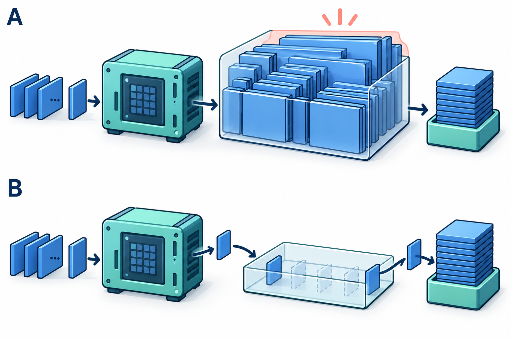

这个例子说明的是调度自由度，不是允许删除全局物理。PolarMACE 仍然需要全局密度和场；全局状态存在，并不在逻辑上禁止把某些局部边运算流式化。

## 4.2 原论文的三条路线

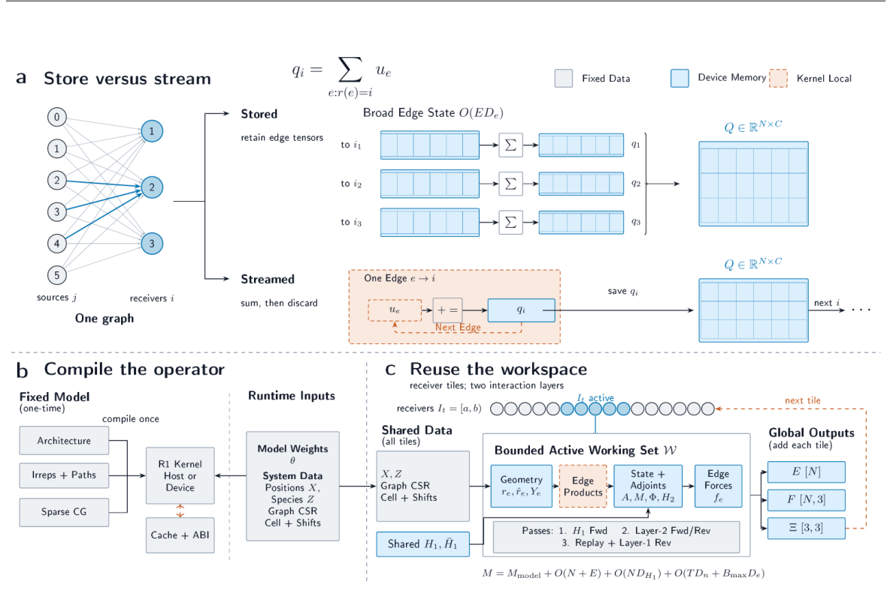

**第一条，streamed-edge execution。** 展开的边权重和张量积贡献在接近使用位置时生成，累加到接收原子后释放，避免全图同时保存大量宽边数组。仍需保留图、几何和必要节点状态。

**第二条，model-specialized execution。** 固定模型的允许耦合路径、通道数和数组布局在模拟前已知，可以生成专用代码，减少每次推理对通用稀疏计划的解释。原子数和邻居图仍可改变；“专用代码”不等于只能算某一个固定盒子。

**第三条，tiled execution。** 将接收原子及关联边分成有限大小的 tile，复用一块工作区。必要的跨层节点状态仍可保留在全图；边上的较大临时数组限制在当前 tile 内。它以部分重算和调度开销换取更大容量。[P1，§3–5]

## 4.3 为什么边数组比节点数组大

记原子数为 $N$，平均有向邻居数为 $z$，边数为 $N_e\approx Nz$。如果每条边保存宽度 $W_e$ 的数组，每个数占 $b$ 字节，

$$
M_{\mathrm{edge}}\approx N_eW_eb.
$$

**教学算例。** 取 $N_e=100000$、$W_e=8192$、FP64 的 $b=8$，单个边数组约占 $6.10$ GiB。若还有输入、输出、反向中间量和其他层，峰值内存会继续增加。这不是本模型实测峰值，而是帮助理解宽边数组的量级。

同样宽度的节点数组只随 $N$ 增长。平均每个原子几十到上百条有向边时，把可消去的宽边量留到全图，会比保留相应节点量昂贵得多。高密度、较大截断半径与更多通道通常都会增加开销，但不同项的比例需实测。

streaming 主要减少展开数组的存活期。不能把内存复杂度写成“全程 $O(1)$”：邻居图和节点特征依旧随体系增大。[P1，§3]

## 4.4 用代数重排理解“权重不变也能加速”

原论文给出紧凑径向嵌入 $\varphi_{eq}$ 到展开边权重的投影，

$$
W_{e,\pi a}=\sum_q\varphi_{eq}B_{q,\pi a},
\qquad
\mathbf m_i=
\sum_{e:r(e)=i}\sum_{\pi,a}
W_{e,\pi a}\,
T_{\pi a}(\mathbf h_{s(e)},Y_e).
$$

符号含义：$s(e)$ 是边的源原子，$r(e)$ 是接收原子，$q$ 是紧凑径向分量，$\pi,a$ 表示路径及其分量，$B$ 是训练权重，$T$ 是相应角向／源特征收缩。

把第一式代入第二式后，展开权重可以即时产生，不必为所有边同时存储。反向传播也能使用同一重排的转置，并按需重算局部因子。这是代数与内存调度协作，不是降低网络表达能力。[P1，§3]

某些模型会让边更新依赖两端节点特征，或在场更新中引入更复杂依赖；此时能否复用相同重排要重新分析。但“有 MLP”“有动态边权”都不是不能 streaming 的充分理由。

## 4.5 当前 Symmetrix-Polar 真正实现到了哪里

本仓库记录：MACE-OFF23 可以使用 direct/JIT streamed 路径；当前 PolarMACE 的相应 pair style 仅接通 materialized 执行，直接拒绝不支持的 direct/JIT 请求。因此，它尚未把原论文所有容量优势带到 full PolarMACE。[D5]

**必须分清三个说法：**

1. “当前实现没有接通”是软件事实，可以通过代码和运行记录检查。
2. “这个公式需要保留全局节点／密度状态”是数据依赖事实。
3. “任何实现都不可能对该模型 streaming”是很强的理论结论，现有材料不支持。

后续可研究局部边算子的分块、必要状态与可重算状态的拆分，以及极化更新边界上的全局同步。是否值得做，取决于容量、额外重算和通信的实测权衡。

## 4.6 原论文的速度与容量图，应该怎么读

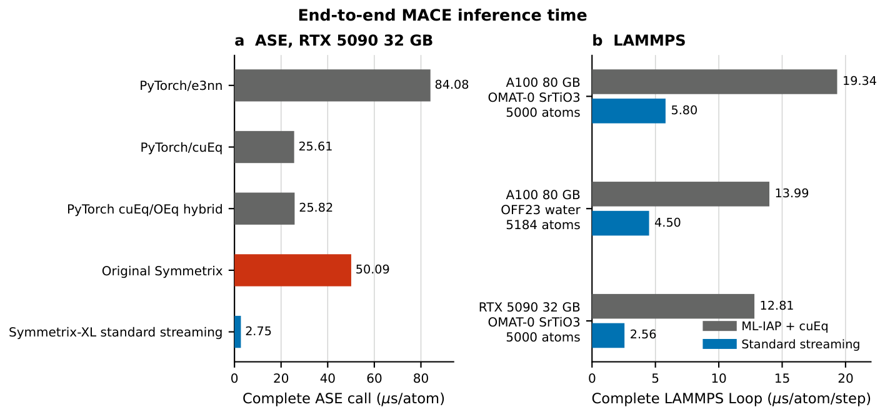

原论文的 A100、OFF23 水体系点为 **13.99 → 4.50 µs/atom/step**，是在同一 5,184 原子体系、FP32、相应静态计时协议下比较 ML-IAP + cuEquivariance 与 standard streaming。它不是 PolarMACE 的测量；也不是本项目相对自己早期 C++ 引擎的加速倍数。[P1，§6、图 2]

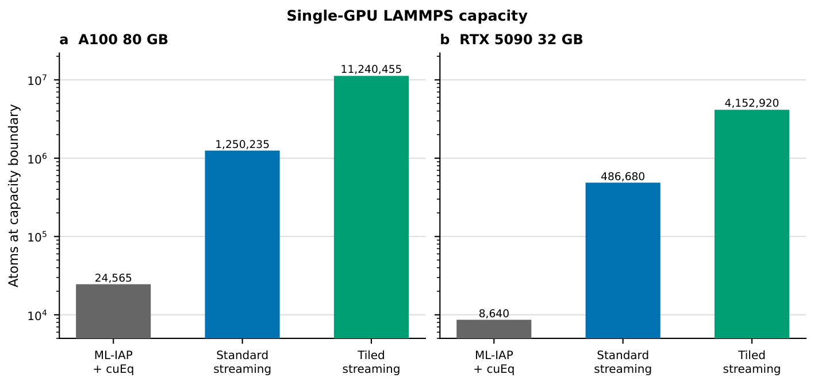

百万原子容量展示属于指定的 MACE-OMAT-0、FP32 和执行计划。不能据此说本仓库 full PolarMACE 已能算千万原子。容量、吞吐量和长时间稳定性是三项不同指标。

# 专题五：读懂 GPU 优化必须知道的概念

## 5.1 CPU、GPU、kernel、thread、warp、block

CPU 适合灵活控制、串行逻辑和复杂流程；GPU 适合大量结构相似的工作。GPU 加速的前提是任务能形成足够并行度、数据移动合理，而且每次发起任务的开销没有压过实际计算。

| 概念 | 直白解释 | 在本项目里的例子 |
|---|---|---|
| kernel | 一次提交给 GPU 的并行程序 | 汇总邻居消息、计算张量积 |
| thread | 一个逻辑执行线程 | 计算某个原子的一项特征 |
| warp | NVIDIA 中按组执行的 32 个线程 | 相邻线程最好访问相邻数据 |
| block | 一组可协作并共享局部内存的线程 | 共同计算一个节点或收缩任务 |
| SM | 执行许多线程块的硬件计算单元 | 任务太少时部分 SM 无工作 |
| register | 线程内很快但容量有限的存储 | 保存局部累加器 |
| shared memory | block 内线程共享的局部存储 | 缓存耦合表和预收缩结果 |
| device/global memory | 容量大的 GPU 显存 | 存邻居图和全局数组 |

Kokkos 用跨平台抽象描述这些执行组织。TeamPolicy 可以让一组线程合作完成任务；MDRange 可以把多维索引分配给线程。它们不是换个名称就一定更快，实际效果取决于工作量、内存访问和资源占用。

## 5.2 合并访存：让相邻线程读写相邻位置

假设一个二维边特征数组按行存储，每行是一条边的全部特征。一条边一个线程时，warp 在同一条存储指令中可能写 32 条相隔很远的行。改成按“边、特征”二维分工，相邻线程可写同一行的相邻分量，通常更容易合并访问。

旧报告把这一点说成“32 倍写放大”，不够严谨。以对齐的 FP64 store 为教学算例：32 个线程各写 8 字节，有效载荷为 256 字节；若每个线程都落在不同的 32 字节 sector，就涉及 32 个 sector；连续访问的理想情况涉及 8 个 sector。

$$
A_{\mathrm{sector}}=
\frac{32\times32}{32\times8}=4.
$$

这是**单条理想化访存指令的 sector 比值**，不是已经测到的总 DRAM 流量放大。缓存命中、后续相邻写入、指令合并和实际地址对齐都会影响总流量；不能据这个算例推断整个模型必然快 4 倍。32 字节 sector 也不能简单称为物理 DRAM 总线的最小事务。

## 5.3 计算受限、带宽受限和延迟受限

算术强度 $I$ 表示每移动一个字节做多少次浮点运算。经典 roofline 的示意上界为

$$
P\le\min(P_{\max},I\,B_{\mathrm{mem}}).
$$

$P$ 是性能，$P_{\max}$ 是相关指令类型的峰值性能，$B_{\mathrm{mem}}$ 是相关内存层级的带宽。这个模型有助于判断上界，但真正程序还可能受小任务、启动开销、同步、寄存器压力和稀疏索引影响。

“张量积运算多”不等于已经证明它计算受限；“gather 在搬数据”也不等于已经证明它跑满显存带宽。本项目有 CUPTI 时长和启动形状信息，但相关记录说明没有完整硬件计数器测量。因此本文将这些作为诊断假设，不把推测写成已证实瓶颈。

## 5.4 occupancy、并发覆盖与 GPU busy 不能混用

occupancy 常指一个 SM 上活跃 warp 占理论最大值的比例；SM 覆盖涉及有多少 SM 能分到工作；GPU busy 时间表示 GPU 有 kernel 在执行。三者相关但不是同一个量。

例如一个很小的 kernel 可以只占少数 SM，却持续执行很久，使“GPU busy”看起来很高。反过来，提高每线程寄存器使用来增加局部复用，也可能降低 occupancy，却减少了访存而更快。

本仓库某些 occupancy/coverage 指标由 block 数、寄存器和共享内存需求估算，属于**静态估计**。它们不能冒充由硬件计数器测到的 achieved occupancy，也不能仅凭一个估计值断言“GPU 只用了 40%”。

## 5.5 融合、预计算、复用和重算

融合是把本来分开的步骤放进同一个执行单元，例如生成中间量后直接汇总，少写一次显存、少启动一个 kernel。预计算是把输入不变的工作提前做一次；复用是让多个通道或调用共享已有结果；重算则用额外计算换更小的中间存储。

四者都有代价。融合可能增加寄存器和同步压力；预计算需要缓存，且输入变化时必须失效；复用必须符合数据依赖；重算可能增加总算术量。优化应比较完整模型耗时，而不是只挑某个 kernel 的最佳数字。

## 5.6 Amdahl：一个算子快了，整个模型能快多少

若某部分占原始全步耗时比例 $f$，该部分加速 $s$ 倍，其余不变，则

$$
\frac{T_{\mathrm{new}}}{T_{\mathrm{old}}}
=(1-f)+\frac{f}{s},
\qquad
S_{\mathrm{whole}}=
\frac{1}{(1-f)+f/s}.
$$

全步耗时减少比例为 $f(1-1/s)$。例如 $f=0.25$、$s=2.22$，全步耗时减少约 13.7%，整体加速约 1.16 倍。旧报告将这组假设与“减少 6.9%”直接配对，分母不一致；6.9% 只能在另一占比或实际端到端测量下成立。

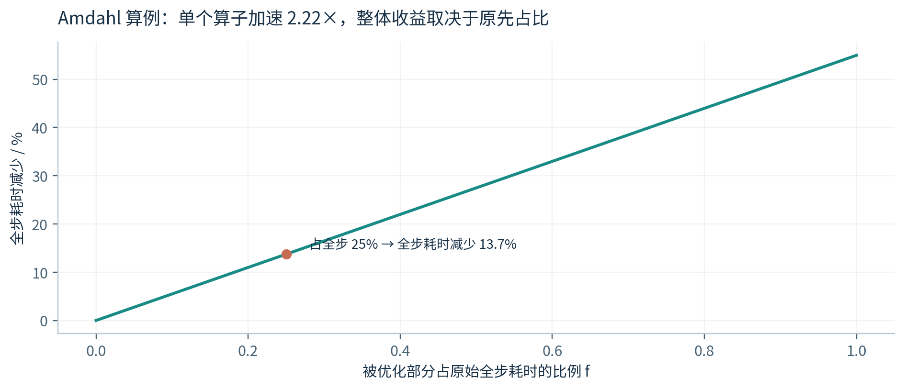

**本专题检查点。** 能解释为什么合并访存通常有帮助、为什么 GPU busy 不能当成硬件利用率、为什么单算子加速不能直接当成完整模型加速。

# 专题六：我们的改动究竟优化了什么

## 6.1 先固定模型与测速边界

本专题主体为 **1,296 原子 H₂O、full PolarMACE、FP64、单张 A100 80GB**。历史记录主要用预热后多次短 run 的每步评估计时。它能观察稳态调用成本，但与原论文“5 次预热、20 次测量、3 个新进程”的完整 LAMMPS Loop 协议不同。[D2、D5]

这里的 step 是一次模型能量与力评估。若静态结构重复调用，邻居表通常可复用；真实 MD 中还会有邻居重建、积分、通信和输出等开销。**本文每个模型评估的性能不能直接承诺真实长轨迹的相同吞吐量。**

原始日志以整次调用时间记录，本教程按

$$
u=\frac{10^6\,T_{\mathrm{eval}}}{N}
\quad[\mu\mathrm{s}/\mathrm{atom}/\mathrm{step}]
$$

统一转换，式中 $T_{\mathrm{eval}}$ 以秒计，$N$ 为实际参与体系的原子数。计时器需要正确同步 GPU，否则测到的可能主要是 CPU 提交任务时间。

## 6.2 优化一：让 FP64 张量积也采用协作执行

MH-1 是仓库对一类张量积执行路径的工程名称，不是“第一代神经网络”。旧路径让 FP64 使用较通用的组织；team 路径让一组线程共享局部工作和耦合计划，以减少重复读取和串行循环。

历史记录显示这一步有明显收益，但最初打开 FP64 team 路径时暴露了重复调用状态错误。**错误修复前，即使某次单点通过，也不能把该版本列为已通过生产验收的加速结果。** 本教程历史图不再把这些未修复 team 数字当作可靠的累计阶梯。[D4]

随后 B4 将反向中的 edge-to-node gather 融入相应张量积反向，避免先写边伴随量再单独汇总。伴随量可以理解为“后续输出对当前中间变量有多敏感”，是链式求导传回来的量。

## 6.3 优化二：重排消息汇总和边特征的线程

message gather 对各邻居的消息求和。原先线程布局让相邻线程访问相距较远的位置；新的 tile 让特征分量方向更连续。边特征构造也从“一条边一个线程”改成“边×特征”分工，使 warp 内的写入更连续。

| 改动 | 改前 | 改后 | 耗时减少 |
|---|---:|---:|---:|
| message gather tile | 267.7 | 257.1 | 4.0% |
| edge-feature tile | 257.5 | 247.7 | 3.8% |

表内单位均为 **µs/atom/step**；每一行是该实验自己的 clean A/B 中位数，不要求上一行改后与下一行改前完全相等。系统运行噪声、分支快照和实验批次不同，不能把它们强行拼成同一条逐点精确曲线。[D3：相应两个 JSON]

## 6.4 优化三：张量积里的共同项先算一次

考虑经过适当分组的一条收缩路径，

$$
y_{ca}=\sum_b x_{cb}
\left(\sum_d C_{bda}\,z_d\right).
$$

若 $z$ 与固定的 $C$ 在这一组里不随 channel $c$ 变化，可先算

$$
g_{ba}=\sum_d C_{bda}z_d,\qquad
y_{ca}=\sum_bx_{cb}g_{ba}.
$$

第一步对相同数据只做一次，第二步让不同 channel 复用 $g$。这里“可复用”有前提：必须在共享相同输入和耦合路径的范围内分组；不能跨不同原子、不同边或不同动态权重随意复用。

本项目还把输出索引展开成连续位置，让相邻线程连续写入，并把部分局部输入保存在寄存器。**收益来自重复工作减少和访问顺序改善，训练权重、耦合路径和计算目标不变。** 浮点误差仍需核验。

clean sandbox 两轮数据为 **247.8 → 230.1 µs/atom/step**，完整模型耗时减少 7.1%；所记录 forward 张量积阶段约快 2.22 倍。完整模型与单个阶段的分母不同，不能混用。[D3：sandbox JSON、stage profile]

## 6.5 优化四：边更新与拷贝融合

edge-up / scatter 等步骤中，部分原始到缩放数组的拷贝可以与 cutoff 乘法合并，再通过特征优先的 tile 改善访问。它没有删掉 cutoff，而是把相同乘法放到能减少额外读写的位置。

这组 A/B 的稳定基线轮为 **229.9 µs/atom/step**；候选两轮稳定轮的“轮次中位数的中位数”为 **224.1 µs/atom/step**，减少约 2.5%。这是事后选取稳定轮的探索性统计，全部样本与所有轮次的中位数见下一节。旧稿中的 2.8% 来自不同历史端点，不当作这一次配对实验的精确收益。

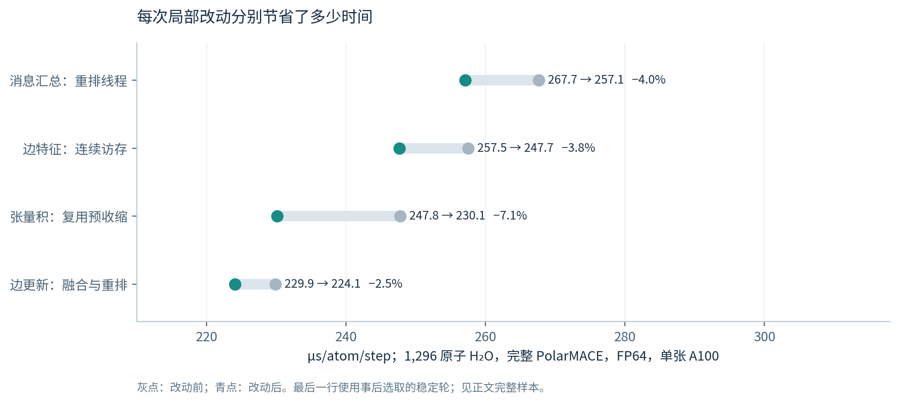

## 6.6 慢轮保留：为什么 224.1 与 224.4 都出现

边更新候选记录了三轮中位数，转换后约为 **423.7、224.4、223.7 µs/atom/step**。三轮中位数的中位数为 **224.4**；仅对后两轮稳定轮取中位数得到 **224.1**。旧稿用后者作为稳定值，却把另一套整次调用值和它并列，导致换算不一致。

本教程统一处理为：**全部轮次的统计作为保守记录，稳定轮数值作为探索性估计，两者都报告**。不把第一轮从原始数据删掉；也不把“看起来慢”自动当成已由硬件监控证实的外部争用。

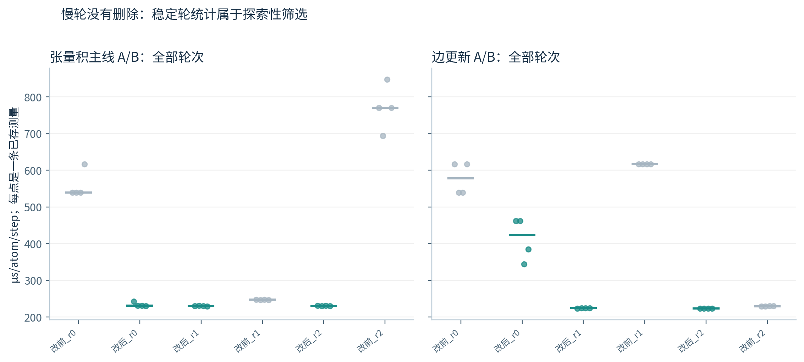

主线记录对部分基线轮标注了共享 GPU 争用，clean sandbox 提供了独立的稳定交叉检查。但最终边更新实验仍缺独占硬件的预先固定协议复测。因此目前不为它构造虚假的置信区间，也不宣称只有四个样本就能代表生产环境的波动分布。

## 6.7 历史上总体做到了什么

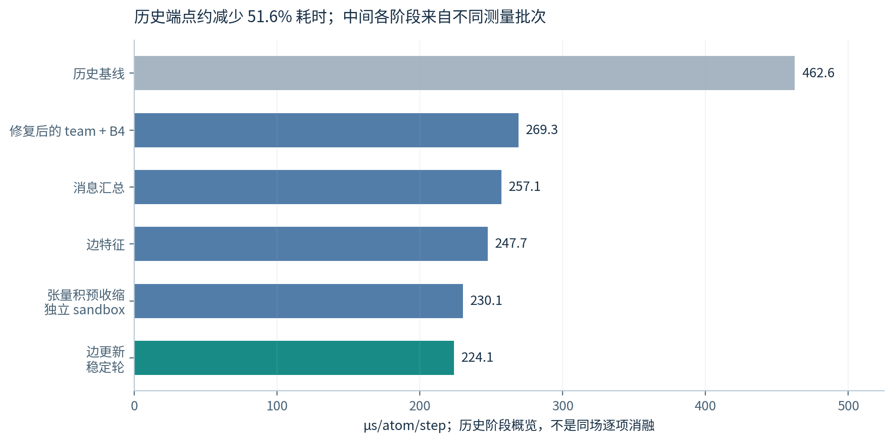

把两个历史端点相除约为 2.06 倍。它说明这条工程链取得了明显进展，但不等于最后所有开关在同一最终二进制上的同时消融，也不等于已在全部体系上取得相同倍率。

特别要注意：本仓库的 128 原子 Plan B-30ms、1,024 原子旧 round-3 和 1,296 原子水优化链不是同一个版本下的一条规模曲线。不能从其中两个点拟合扩展率，也不能把小体系的最新收益直接乘到尚未重测的大体系上。

## 6.8 没成功的尝试，也能告诉我们什么

| 尝试 | 仓库现象 | 应怎样理解 |
|---|---|---|
| 两次极化更新改一次 | 能量差约 1.27 eV，最大力分量差约 0.101 eV/Å | 改变模型；不能当作无损加速 |
| channel vec4、部分展开 | 某些测试变慢 | 更多寄存器或工作量可能抵消并行收益 |
| 不同 team size | 结果随配置变化 | 最优参数依赖任务规模与路径 |
| Random Batch Ewald | 收敛趋势可见，但生产力误差门未通过 | 无偏或渐近收敛不等于有限样本可用于 MD |
| 单 GPU 上增加 MPI rank | 正确性可通过，但未证明加速 | 进程竞争同一设备不等于多 GPU 扩展 |

这些负结果只针对对应模型、版本和测试设置。“没有找到更快开关”不等于达到数学性能下限；“这个 RBE 配置未通过”也不等于所有随机长程方法都不可能有效。[D1–D5]

# 专题七：怎样证明算得对，而不是只跑得快

## 7.1 先问：是和谁比较，比较什么

| 验证层级 | 参考对象 | 主要回答 |
|---|---|---|
| 算子／阶段 | 固定 Python fixture 与实时原模型 | 这一段代数和布局是否一致 |
| 完整能量和力 | 同一 PolarMACE 的 PyTorch 输出 | 引擎是否忠实执行模型 |
| LAMMPS 接口 | 独立 engine 评估 | 类型、坐标、周期、力传回是否接对 |
| 固定结构重复调用 | 同一实现的前后调用 | 缓存、缓冲区和状态是否泄漏 |
| MD 短轨迹 | 原始引擎同初值轨迹 | 连续调用与积分时是否出现偏离 |
| 模型物理准确性 | DFT、其他电子结构方法或实验 | 这个势是否适合研究目标 |

不同层级互相补充。某个 kernel 与旧 kernel 一样，不保证旧实现没有共同错误；短轨迹一致也不自动证明长时间热力学正确。

## 7.2 能量误差、力误差和有限差分

总能量差、每原子能量差、最大力分量差和力 RMSE 的含义不同。本文引用 gate JSON 时保持原定义，例如

$$
\Delta E_{\mathrm{abs}}=|E_{\mathrm{engine}}-E_{\mathrm{ref}}|,
\qquad
\Delta F_{\max}=
\max_{i,\alpha}|F_{i\alpha}^{\mathrm{engine}}-F_{i\alpha}^{\mathrm{ref}}|.
$$

这里 $\alpha$ 为三个 Cartesian 分量；最大分量差不是力向量模长的最大差，也不是力 RMSE。能量总量接近零时，相对误差还可能失去解释力，因此不能只报相对值。

有限差分是独立检查求导链的一种方法，

$$
F_{i\alpha}^{\mathrm{FD}}
\approx-\frac{E(\mathbf R+\delta\mathbf e_{i\alpha})
-E(\mathbf R-\delta\mathbf e_{i\alpha})}{2\delta}.
$$

$\delta$ 太大有截断误差，太小则可能受浮点相消和求值噪声影响。应扫描合理步长，避免跨越邻居表或其他非光滑分支。有限差分通过说明力与被实现能量一致，不说明该能量对 DFT 一定准确。

## 7.3 为什么单点通过，第二次调用却可能错

本项目发现过明确的状态 bug：当 write-through 语义要求覆盖输出时，FP64 team forward 却无条件使用加法累积。第一次调用使用刚清零的缓冲区，看起来正确；后面调用把新值加到旧结果上。

$$
\text{正确覆盖：}\quad y^{(k)}=F(x^{(k)}),
\qquad
\text{错误累加：}\quad y^{(k)}=y^{(k-1)}+F(x^{(k)}).
$$

固定坐标时，原始 pre-team 引擎连续三次总势能相同；未修复 team 版本从约 $-49242.46$ eV 漂到 $-48812.11$ eV，再变为约 $4.73\times10^7$ eV。修复后固定结构重复输出恢复一致。这里展示错误症状，不把错误版本的速度算作有效生产结果。[D4]

**最低限度的回归序列**应包括：固定结构连续评估；改变坐标后再评估；恢复原坐标再评估；改变原子数或邻居数的相关路径；随后运行连续 MD。三次固定结构测试很重要，但并不覆盖所有缓存失效情况。

## 7.4 已有 gate 证明了什么，没证明什么

| 已提交记录 | 数值 | 限定 |
|---|---:|---|
| 128 原子 LAMMPS 1-rank 对 engine | 总能量差约 $2.91\times10^{-11}$ eV；最大力分量差约 $2.58\times10^{-14}$ eV/Å | 指定 B4team 版本及构型 |
| 相同体系 2-rank exact | 最大力分量差约 $1.69\times10^{-6}$ eV/Å | 正确性，不是多 GPU 加速 |
| 修复后固定结构重复调用 | 最大力差约 $10^{-15}$ eV/Å | 对应重复调用序列 |
| 10 步 NVE 实现对比 | 记录中的势能逐步相同；文字记录另报极小位置与力差 | 仅约 5 fs 的短轨迹 |
| Plan B-30ms | 完整阶段、端到端、接口及重复调用门有记录 | 不自动覆盖 1,296 原子最终分支 |

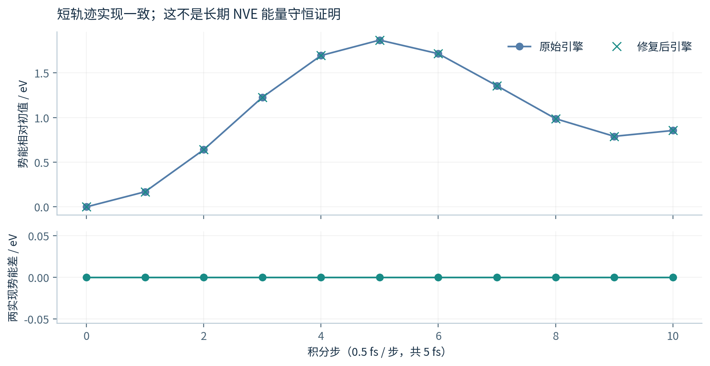

NVE 总能量需要同时包含动能和势能；势能单独变化在正常动力学中很常见。这份 JSON 只保存势能，没有长期温度、动能、总能量漂移和结构分布，因此不能升级为长期稳定性结论。文字记录中极小的位置和力差也应与 JSON 实际包含的数据区分。

## 7.5 测试矩阵应该怎样补齐

下一轮应把最终发布二进制与模型身份固定，再按体系、尺寸、边界、精度和 rank 数建立矩阵。同一版本至少覆盖不同扰动构型、固定与变化结构连续调用，以及能量、力和需要用到的应力。记录失败本身也应保留。

若目的是研究电荷转移和极化，还需具体的物理测试：外电场响应、片段解离电荷、总电荷态切换、周期尺寸与截断收敛等。若目的是生产 MD，则增加长轨迹、邻居表重建、温度及总能量漂移、目标结构统计量。门限应由任务需求和数值精度决定，不能为了通过而随意放宽。

**本专题检查点。** 汇报时能把“实现保真”“求导一致”“重复调用正确”“短轨迹一致”“对 DFT 准确”分别说明，而不是用一个 PASS 包揽全部结论。

# 专题八：结果怎样比较，下一步怎样安排

## 8.1 两条测试分支分别汇报

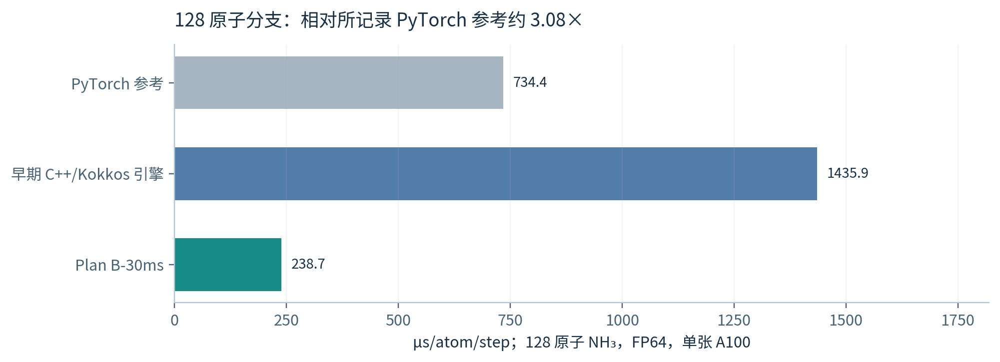

这张图回答“当前小体系分支相对已有参考怎样”，不能回答“所有体系都快 3 倍”。**238.7 µs/atom/step** 对应 Plan B-30ms；**734.4 µs/atom/step** 对应所记录 PyTorch 参考，两者历史比值约 3.08。相对早期专用 C++ 引擎约 6.02，也不能把这个比值说成相对原论文 ML-IAP 的加速。

1,296 原子分支来自另一条水体系优化链，目前全部轮次中位数 **224.4 µs/atom/step**、稳定轮估计 **224.1 µs/atom/step**。**不要用 128 与 1,296 两个不同体系、不同快照的归一化数值，推断“规模增大后加速多少”**。完整规模曲线必须固定模型、精度、构型生成规则与最终版本后重测。

## 8.2 4.50 µs/atom/step 是参照，不是 PolarMACE 的既定目标

原论文 **4.50 µs/atom/step** 来自 MACE-OFF23、水、5,184 原子、FP32、standard streaming。当前 PolarMACE 是另一模型、FP64、materialized，而且原子数也不同。这几个条件同时变化，因此不能把差距全归给“极化物理”，也不能全归给引擎低效。

仓库曾用 MACE-OFF23、水、5,184 原子、FP32 direct/JIT 作对照。三进程结果分别保留最小值与中位数：

| 试次 | 最小值 | 中位数 |
|---|---:|---:|
| 1 | 4.53 | 6.37 |
| 2 | 4.47 | 4.49 |
| 3 | 4.50 | 5.43 |

单位均为 **µs/atom/step**。最小值显示已记录的最快样本可接近论文所报告量级；三进程中位数的中位数为 5.43，且本地短 run 协议与论文完整 Loop 协议不同。因此正确说法是“已记录最快样本接近原论文量级”，**不是“已严格复现原论文中位性能”**。[D5]

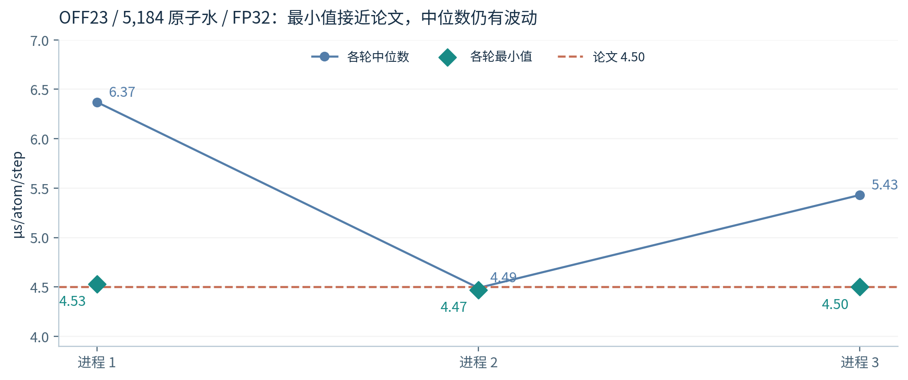

FP32 与 FP64 是数值精度；它们不是模型“线性／非线性”的固有属性。当前接受路径选用 FP64，不等于任何 PolarMACE 计算都在数学上必须使用 FP64。若尝试混合精度，需要重新验证误差、响应、力和轨迹，不能只以速度决定。

## 8.3 RuNNer 2.0 与本项目，解决的问题有何不同

RuNNer 2.0 主要提供小型 HDNNP 的训练与执行，重点优化 CPU 上的全局 QEq、长程静电、缓存和并行。Symmetrix-Polar 主要保留已有 PolarMACE 模型，通过 GPU 引擎执行和优化来降低推理开销。[P4；D1–D5]

两者都讨论全局电荷信息，但不是同一模型、同一数据和同一硬件。RuNNer 的 2G 千万原子演示不能当作其 4G 性能，也不能与本项目的 FP64 full PolarMACE 直接互除。即使某个专用水模型在 CPU 上耗时更低，也不能据此认定它与基础模型具有同样适用范围或预测误差。

若目标是为一个固定体系训练高效势，RuNNer 路线值得考虑；若目标是直接执行既有 PolarMACE checkpoint，本项目处理的是对应的部署问题。**比较应从研究目标出发，再匹配模型误差、原子数、边界、精度、硬件和计时范围。** 当前材料不足以给出普适速度排名。

## 8.4 当前时间花在哪里

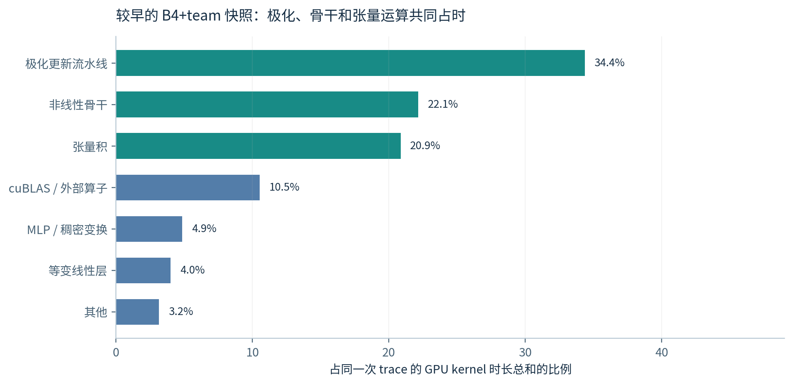

图中极化流水线、非线性骨干和张量积都占有明显比例。不能从“有 Ewald”推断长程库仑一定是主瓶颈；也不能把旧版本的分类比例拿来精确预测新版本优化收益。每一次较大优化后，应重新 profile，因为原来的次要部分可能成为新的主瓶颈。

对于没有硬件计数器支持的算术强度、带宽或 occupancy 解释，本教程保留为假设。下一轮要先用时间分解确定候选，再通过 A/B 和硬件信息验证，避免按看起来最复杂的公式盲目优化。

## 8.5 按优先级安排下一轮

| 优先级 | 实际动作 | 通过条件 |
|---|---|---|
| 1 | 固定最终模型、二进制、编译选项与开关 | 有完整身份记录，可重新构建 |
| 2 | 独占 GPU，预先固定 warm-up、测量步数与重复进程 | 报中位数与分布，不事后挑最快轮 |
| 3 | 同一最终版本重跑 128、1,024、1,296 及容量边界 | 区分体系与模型，不混合版本 |
| 4 | 对最终版本补齐阶段、端到端、重复调用、MD 和应力验证 | 数值门与测试范围明确 |
| 5 | 在最新 profile 上优化局部热点 | 全模型收益与数值保真同时通过 |
| 6 | 研究 PolarMACE 边算子的 tiling／streaming | 峰值内存下降，新增重算可接受 |

“还可优化多少”目前没有经过最终版硬件测量证明的理论下限。旧报告提出的“现实终点 200–215”以及“4.5 只能改模型才能达到”等说法，均不应当作确定结论。先完成统一测量和依赖分析，再讨论上界。

**本专题检查点。** 读者应能用一张表说清当前结果、比较条件与证据缺口，而不把“论文容量”“本地最快样本”“当前稳定轮”和“最终生产性能”混为一谈。

# 附录 A：公式串起来看一遍

本附录只保留理解完整链路所需的骨架；具体通道、基归一化、单位换算、截断和边界条件以模型与接口定义为准。

**第一步，局部几何编码。** 位置和元素经有限层 MACE 得到节点特征及局部能量：

$$
(\mathbf R,\mathbf Z)\longrightarrow
\{\mathbf h_i\},\quad E_{\mathrm{local}}.
$$

**第二步，初始化密度并满足总量。** 从节点特征读出原子多极，使用两个自旋通道的 Fukui 平衡。它保证规定的单极之和，不改变更高多极的定义：

$$
p^\sigma_{i,00}=
\widetilde p^\sigma_{i,00}
+\frac{f_i^\sigma}{\sum_j f_j^\sigma}
\left(Q^\sigma-\sum_j\widetilde p^\sigma_{j,00}\right).
$$

**第三步，执行固定数目的全局更新层。** 密度产生全局场，场特征与局部几何一起更新多极，再做归一化。对当前模型保留两层；不把它改成未经训练的收敛迭代。

**第四步，计算三部分能量并对完整链求导。**

$$
E=E_{\mathrm{local}}+E_{\mathrm{nonlocal}}+E_{\mathrm{electrostatic}},
\qquad
\mathbf F_i=-\frac{dE}{d\mathbf R_i}.
$$

这里写全导数强调所有依赖都需考虑。若把 $\mathbf p$ 当作中间变量，教学展开为

$$
\frac{dE}{d\mathbf R_i}
=
\left.\frac{\partial E}{\partial\mathbf R_i}\right|_{\mathbf p}
+\sum_a\frac{\partial E}{\partial p_a}
\frac{dp_a}{d\mathbf R_i}.
$$

$a$ 汇总所有原子、通道与多极分量。$\mathbf p$ 在这里代表把网络内部几何、场更新等依赖复合后的中间量；实际求导还需覆盖局部能量及其他路径，不能只实现这个示意式中的一部分。

**第五步，MD 积分。** 用力推进坐标，更新必要的邻居表，然后进入下一次模型评估。GPU 缓存若依赖位置、晶胞或图，就必须按这些输入的变化正确刷新。

# 附录 B：符号与术语速查

## B.1 数学符号

| 符号 | 含义 | 易混点 |
|---|---|---|
| $N$、$N_e$ | 原子数、有向边数 | $N_e$ 不是电子数 |
| $\mathbf R_i$ | 第 $i$ 个原子的位置 | 与旋转矩阵区分 |
| $r_c$、skin | 模型截断、邻居表额外厚度 | 不都属于模型有效作用半径 |
| $l,m$ | 旋转表示阶数及分量 | 不是代际与网络层数 |
| $p$ | 某些表示式中的反演奇偶性 | 与多极系数 $p_{i,lm}$ 按上下文区分 |
| $C_{l,p}$ | 某类特征的通道数 | 不是几何空间维数 |
| $Q$ | 总净电荷 | 不等于原子电荷绝对值之和 |
| $S$、$M$ | 论文通道归一化差、接口可能使用的多重度 | 先查约定再换算 |
| $\rho^\sigma$ | 自旋分辨的平滑残余电荷密度 | 不是完整 DFT 电子密度 |
| $p^\sigma_{i,lm}$ | 原子中心多极系数 | 单极、偶极与高阶系数意义不同 |
| $f_i,w_i$ | Fukui 特征、归一化响应权重 | 具体生成与稳定处理由模型定义 |
| $\Omega,\mathbf k$ | 晶胞体积、倒格矢 | Fourier 前因子依赖定义 |
| $\theta$ | 训练后固定的模型参数 | 与每条边动态生成的中间权重不同 |
| $u$ | 归一化性能数值 | 全文单位为 µs/atom/step |

## B.2 常见英文名称

| 名称 | 中文解释 |
|---|---|
| checkpoint | 已训练模型的参数及相关定义 |
| inference | 固定参数后求能量、力等输出 |
| equivariance | 输入变换时，输出按规定规律变换 |
| irrep | 不可约表示；按旋转与反演规律组织特征 |
| readout | 从内部特征生成能量或其他输出 |
| tensor product | 按几何规则组合等变对象 |
| multipole | 单极、偶极等电荷分布描述 |
| polarization | 电场引起的电荷分布重排 |
| charge transfer | 指定分区下的片段净电荷交换 |
| QEq | 通过电荷能量泛函及约束求电荷的模型族 |
| SCF | self-consistent field；本仓库历史名称不等于原模型做收敛求解 |
| Ewald / reciprocal space | 周期静电求和／倒空间组织 |
| materialized | 把中间量显式保存成数组 |
| streaming | 中间量就近生成、使用后释放 |
| tiling | 分块执行并复用工作区 |
| JIT / specialization | 按模型结构生成并编译专用算子 |
| gather / scatter | 从多处汇总／把结果分配回对应位置 |
| adjoint / reverse mode | 伴随量／由输出向输入传播导数 |
| parity gate | 与参考结果的数值一致性检查 |
| OOM | out of memory；分配所需内存失败 |
| A/B | 保持其他条件尽量一致，比较单项改动 |

# 附录 C：开会时可以直接使用的问答

**问：你们训练了一个新势吗？**  
答：这里主要做引擎扩展和执行优化。目标是在指定误差内保留已有 PolarMACE 的预测，而不是重新训练、蒸馏或删掉物理项。

**问：PolarMACE 与普通 MACE 差在哪里？**  
答：除了局部几何，它还学习平滑的自旋电荷多极，通过全局电势更新这些特征，满足总电荷／自旋约束，再计算局部、非局域与静电能量。

**问：两次 SCF 迭代就收敛了吗？**  
答：原模型不是迭代到收敛的 SCF。它使用两次学习型极化更新；两层是模型定义的一部分，不能把层数当求解精度开关。

**问：为什么 GPU 还慢？**  
答：当前路径有宽边数组、张量收缩、许多局部网络及反向步骤。GPU 需要合适的线程和访存组织；只把计算搬上 GPU 不会自动消除重复工作和中间存储。

**问：你们最主要改了什么？**  
答：让线程更连续地访问特征，把共同的张量积收缩先算一次复用，融合部分反向汇总与拷贝，并修复连续调用的状态错误。每项收益看自己的配对数据。

**问：现在多快？**  
答：在指定 A100、FP64 配置下，128 原子分支为 238.7 µs/atom/step；1,296 原子水分支全部轮次中位数为 224.4，稳定轮估计为 224.1 µs/atom/step。它们不是同一规模曲线。

**问：已经和论文一样快了吗？**  
答：普通 OFF23 路径的已记录最快样本接近论文量级，但中位性能和计时协议仍有差别；full PolarMACE 是另一模型，不能直接与论文 4.50 的点对比。

**问：正确性有没有问题？**  
答：已有阶段、能量／力、接口、重复调用及短轨迹检查；发现过的 write-through bug 已有修复记录。完整最终版本仍应按尺寸和边界做统一复验，不能把已有小体系 gate 泛化到所有场景。

**问：下一步最值得做什么？**  
答：先在独占 GPU 上固定最终版本和统一测速协议，再根据最新 profile 优化热点；同时研究边工作区分块，解决容量。没有证据支持先承诺某个“理论终点”。

# 附录 D：本版改正了旧报告哪些问题

| 旧说法或表达问题 | 本版处理 |
|---|---|
| PolarMACE 是“Fukui 平衡的 SCF 不动点” | 改为固定两层非自洽学习型极化更新；代码旧称另说明 |
| 能量项命名不统一 | 对照原论文采用 local、nonlocal、electrostatic 三部分 |
| 密度 Fourier 已含 Gaussian，又另乘 screening | 明确 Fourier 约定，说明避免重复衰减 |
| 普通 MACE 都是线性的、没有动态权重 | 区分工程路径、内部算子、readout 与模型非线性 |
| 全局密度意味着任何 streaming 都不可能 | 改为当前实现限制，说明可研究的局部分块 |
| $l$、通道维数、网络代数混称 | 分别解释，并提供 2048/8192 的算例 |
| 32 倍写放大 | 改为 FP64 单指令 sector 算例及适用前提 |
| 静态 occupancy 当成实测利用率 | 明确推算性质及硬件计数器缺口 |
| 单算子快 2.22 倍与全步收益的分母混用 | 补 Amdahl 算例，实际收益使用 clean A/B |
| 未修复 team 版本也作为有效优化阶梯 | 从有效历史图剔除，并保留故障解释 |
| 多处整次时间与归一化数值不一致 | 从 JSON 重算，区别 224.1 与 224.4 的统计 |
| 4.50 被当成 full PolarMACE 的理论下限 | 改为不同模型和路径的外部参照 |
| 最快样本代表典型性能、短轨迹代表长期稳定 | 保留全部样本，区分最小值／中位数及验证层级 |
| 未核实“唯一引擎”、确定的最终性能预测 | 删除这类超出证据的结论 |

# 附录 E：文献、图源与复算入口

## E.1 原始文献

**[P1]** Fu, L. 等。*Train for Accuracy, Execute at Scale: Architecture-Preserving Inference for Equivariant Atomistic Foundation Models*。arXiv:2610.01036v1，2026。[原文与版本](https://arxiv.org/abs/2610.01036v1)。本文执行图来自原图 1，速度图来自原图 2，容量图来自原图 3。它们按原样提取并给出中文阅读说明，没有把原论文结果改成仓库新结果。

**[P2]** Batatia, I. 等。*MACE-POLAR-1: A Polarisable Electrostatic Foundation Model for Molecular Chemistry*。arXiv:2602.19411v1，2026。[原文与版本](https://arxiv.org/abs/2602.19411v1)。重点依据 §II、原图 1 及 SI V.F；HTML 与 PDF 的小节标号略有不同，本文同时给出标题或式号。图中应用精度属于原文证据。

**[P3]** Batatia, I. 等。*MACE: Higher Order Equivariant Message Passing Neural Networks for Fast and Accurate Force Fields*。NeurIPS 2022；[arXiv:2206.07697](https://arxiv.org/abs/2206.07697)。用于 MACE 的高体阶消息、等变表示与局部原子能的基础概念。

**[P4]** Knoll, A. L. M. 等。*RuNNer 2.0: A software suite for high-dimensional neural network potentials*。J. Chem. Phys. **165**, 152502 (2026)。[DOI:10.1063/5.0352886](https://doi.org/10.1063/5.0352886)。只用于讨论另一类软件路线与比较条件；本教程不建立其与 PolarMACE 的同条件速度排名。

**图片使用说明。** 原论文图用于本教程的学术讲解与来源对照，作者及来源见每幅图注；原图权利归相应作者或权利人，不因本仓库代码采用 MIT 许可而改变。AI 概念插图不含真实计算数据，提示词与用途记录在 image_provenance.json；Python 数据图均有对应数据入口。

## E.2 仓库证据索引

下列路径相对仓库根目录。历史文件可能含已过时措辞；本教程只按明确的文件、版本、统计定义引用，不把旧的汇总结论直接视为新的验证。

| 编号 | 内容 | 文件 |
|---|---|---|
| D1 | 128 原子最终计时、最终二进制、阶段及重复调用门 | [PLAN_B_30MS_FINAL.md](../results/PLAN_B_30MS_FINAL.md) |
| D2 | 1,296 原子历史优化链与来源索引 | [OPTIMIZATION_LEDGER.md](../results/OPTIMIZATION_LEDGER.md) |
| D3 | 所有 A/B、sandbox、计时分轮、gate 摘要 | [data/README.md](../results/data/README.md) |
| D4 | FP64 team 改动与 write-through 故障、修复及短轨迹文字记录 | [MH1_TEAM_FP64.md](../results/MH1_TEAM_FP64.md) |
| D5 | OFF23 对照、精度、路径、规模、原论文协议差别 | [PAPER_COMPARABILITY.md](../results/PAPER_COMPARABILITY.md) |
| D6 | 本版由原始摘要重新派生的数值和选择规则 | [derived_metrics.json](derived_metrics.json) |
| D7 | 所有 Python 数据图的生成方法 | [build_tutorial_figures.py](../../harness/build_tutorial_figures.py) |
| D8 | PolarMACE 引擎支持及部分布局实现 | [polar support patch](../../patches/symmetrix-xl-polar-support.patch) |

本教程依据的代码仓库输入快照为 **5cdf8a0fd37209a777cb4b47fac5f5e813a0db0f**。这个哈希标识编写起点，不是 GPU 运行二进制身份；各测试自己的身份见相应记录。derived_metrics.json 保留本版构建时的输入 commit、筛选规则与重算值。

## E.3 复算应做什么

重新生成数据图：在仓库根目录运行 Python 脚本 harness/build_tutorial_figures.py。它只读取已提交 JSON 和有来源的历史表格，不补造 benchmark 数据。重新生成 PDF 与离线网页：运行 harness/build_tutorial.py。

原始 GPU 日志、完整 trace、checkpoint 和某些探针输入不全部包含在公开提交中，因此仅靠这个阅读包不能重新执行所有历史 GPU 实验。可复算的是已提交摘要的统计、单位换算和图表；真正重跑需要补齐模型、环境、二进制和输入身份。两类“复现”必须区分。

**读完后应带走的判断方法：**先确认模型在计算什么，再检查引擎实际执行了什么；先固定比较条件，再解释速度；先明确验证参考和范围，再讨论正确性。这样既能讲清当前工作，也能知道下一步还需要什么证据。
